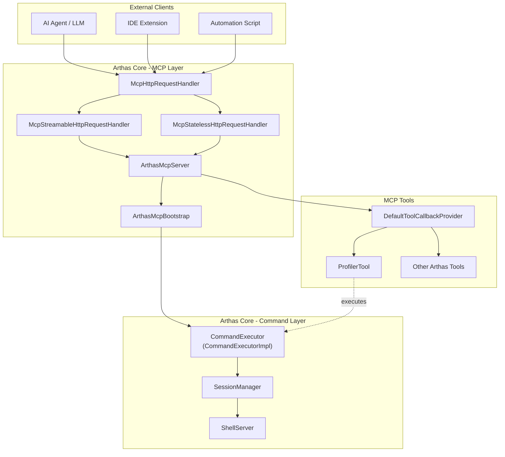
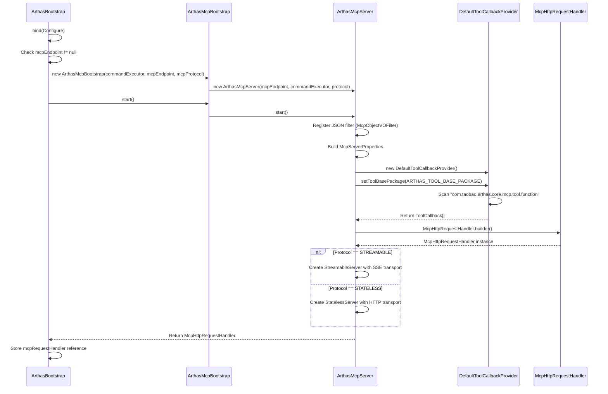
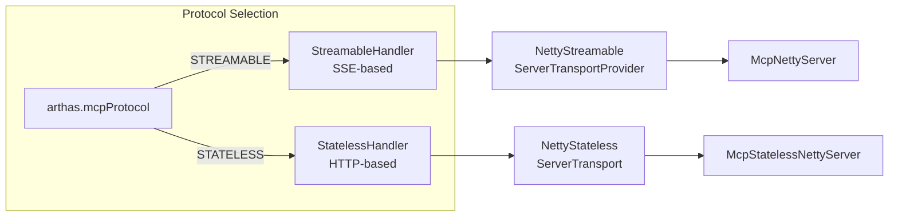
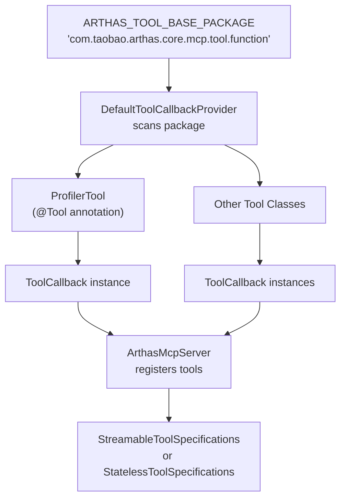
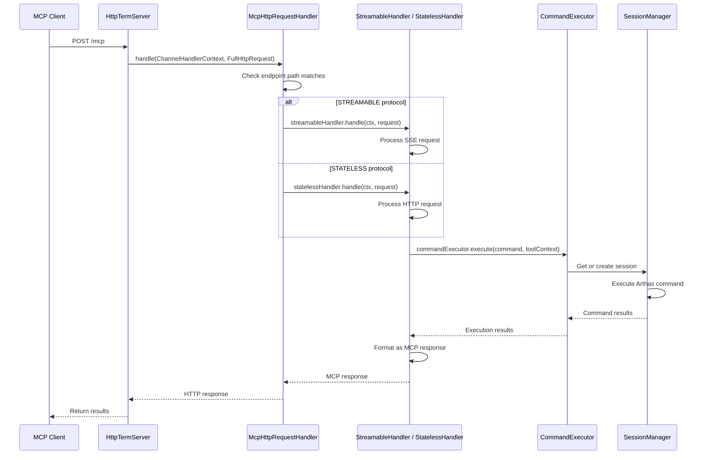
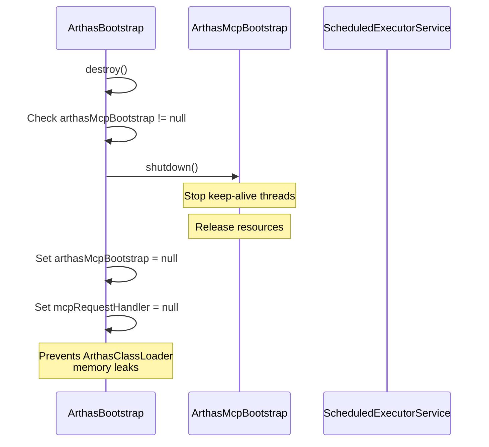
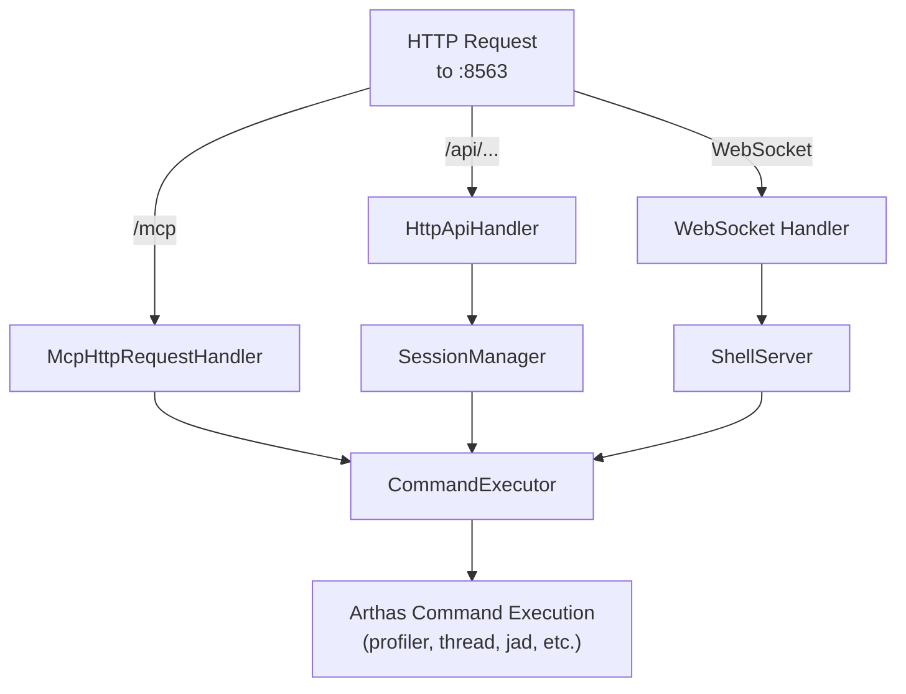

<!-- source: DeepWiki mcp.deepwiki.com · repo alibaba/arthas · page 7.3 Model Context Protocol (MCP) Integration · fetched 2026-10-29 -->

# Model Context Protocol (MCP) Integration

<details>
<summary>Relevant source files</summary>

The following files were used as context for generating this wiki page:

- [Dockerfile](Dockerfile)
- [Dockerfile-No-Jdk](Dockerfile-No-Jdk)
- [agent/src/main/java/com/taobao/arthas/agent334/AgentBootstrap.java](agent/src/main/java/com/taobao/arthas/agent334/AgentBootstrap.java)
- [bin/as.sh](bin/as.sh)
- [boot/src/main/java/com/taobao/arthas/boot/Bootstrap.java](boot/src/main/java/com/taobao/arthas/boot/Bootstrap.java)
- [core/src/main/java/arthas.properties](core/src/main/java/arthas.properties)
- [core/src/main/java/com/taobao/arthas/core/Arthas.java](core/src/main/java/com/taobao/arthas/core/Arthas.java)
- [core/src/main/java/com/taobao/arthas/core/command/model/ProfilerModel.java](core/src/main/java/com/taobao/arthas/core/command/model/ProfilerModel.java)
- [core/src/main/java/com/taobao/arthas/core/command/monitor200/ProfilerCommand.java](core/src/main/java/com/taobao/arthas/core/command/monitor200/ProfilerCommand.java)
- [core/src/main/java/com/taobao/arthas/core/command/monitor200/ProfilerMarkdown.java](core/src/main/java/com/taobao/arthas/core/command/monitor200/ProfilerMarkdown.java)
- [core/src/main/java/com/taobao/arthas/core/command/view/ProfilerView.java](core/src/main/java/com/taobao/arthas/core/command/view/ProfilerView.java)
- [core/src/main/java/com/taobao/arthas/core/config/Configure.java](core/src/main/java/com/taobao/arthas/core/config/Configure.java)
- [core/src/main/java/com/taobao/arthas/core/mcp/ArthasMcpServer.java](core/src/main/java/com/taobao/arthas/core/mcp/ArthasMcpServer.java)
- [core/src/main/java/com/taobao/arthas/core/mcp/tool/function/monitor200/ProfilerTool.java](core/src/main/java/com/taobao/arthas/core/mcp/tool/function/monitor200/ProfilerTool.java)
- [core/src/main/java/com/taobao/arthas/core/server/ArthasBootstrap.java](core/src/main/java/com/taobao/arthas/core/server/ArthasBootstrap.java)
- [core/src/main/java/com/taobao/arthas/core/shell/impl/ShellServerImpl.java](core/src/main/java/com/taobao/arthas/core/shell/impl/ShellServerImpl.java)
- [core/src/main/java/com/taobao/arthas/core/shell/session/impl/SessionManagerImpl.java](core/src/main/java/com/taobao/arthas/core/shell/session/impl/SessionManagerImpl.java)
- [core/src/main/java/com/taobao/arthas/core/shell/term/impl/http/api/ApiRequest.java](core/src/main/java/com/taobao/arthas/core/shell/term/impl/http/api/ApiRequest.java)
- [core/src/main/java/com/taobao/arthas/core/shell/term/impl/http/api/HttpApiHandler.java](core/src/main/java/com/taobao/arthas/core/shell/term/impl/http/api/HttpApiHandler.java)
- [core/src/main/java/com/taobao/arthas/core/util/UserStatUtil.java](core/src/main/java/com/taobao/arthas/core/util/UserStatUtil.java)
- [core/src/test/java/com/taobao/arthas/core/command/monitor200/ProfilerMarkdownTest.java](core/src/test/java/com/taobao/arthas/core/command/monitor200/ProfilerMarkdownTest.java)
- [site/docs/doc/profiler.md](site/docs/doc/profiler.md)
- [site/docs/en/doc/profiler.md](site/docs/en/doc/profiler.md)
- [tunnel-server/src/main/java/com/alibaba/arthas/tunnel/server/app/web/StatController.java](tunnel-server/src/main/java/com/alibaba/arthas/tunnel/server/app/web/StatController.java)

</details>


## Purpose and Scope

The Model Context Protocol (MCP) integration provides a standardized interface for AI agents, IDEs, and automated tools to interact with Arthas diagnostic capabilities. This page describes how Arthas exposes its diagnostic commands as MCP tools through an embedded HTTP server, enabling programmatic access to profiling, monitoring, and debugging features.

For information about the HTTP API for web console interaction, see [Web Console and HTTP API](#7.2). For Spring Boot integration, see [Spring Boot Starter](#7.1).

## Overview

Arthas embeds an MCP server that exposes diagnostic commands as callable tools following the Model Context Protocol specification. This enables:

- **AI/LLM Integration**: AI agents can invoke Arthas commands and interpret results
- **IDE Extensions**: Development tools can integrate Arthas diagnostics directly
- **Automation**: Scripts and monitoring systems can programmatically access Arthas features

The MCP server runs within the same JVM as the Arthas agent and shares the same `CommandExecutor` infrastructure used by other Arthas interfaces (Telnet, HTTP, WebSocket).

**Key Characteristics**:
- Embedded HTTP endpoint (default: `/mcp`)
- Two protocol modes: STREAMABLE (SSE-based) and STATELESS (request-response)
- Auto-discovery of Arthas commands as MCP tools
- Unified request handling with other Arthas protocols

Sources: [core/src/main/java/com/taobao/arthas/core/mcp/ArthasMcpServer.java:1-286](), [core/src/main/java/com/taobao/arthas/core/server/ArthasBootstrap.java:472-483]()

## Configuration

### Configuration Properties

MCP server behavior is configured through two primary properties:

| Property | Default Value | Description |
|----------|---------------|-------------|
| `arthas.mcpEndpoint` | `/mcp` | HTTP path where MCP server accepts requests |
| `arthas.mcpProtocol` | `STREAMABLE` | Protocol mode: `STREAMABLE` or `STATELESS` |

### Configuration Methods

**1. Via arthas.properties**

```properties
arthas.mcpEndpoint=/mcp
arthas.mcpProtocol=STREAMABLE
```

**2. Via Command-Line Arguments**

```bash
./as.sh --mcp-endpoint /custom-mcp --mcp-protocol STATELESS <pid>
```

**3. Via Environment Variables (through ArthasEnvironment)**

The configuration system follows the standard Arthas property resolution hierarchy: command-line arguments > system properties > environment variables > `arthas.properties`.

Sources: [core/src/main/java/arthas.properties:26-28](), [core/src/main/java/com/taobao/arthas/core/config/Configure.java:78-86](), [core/src/main/java/com/taobao/arthas/core/config/Configure.java:223-237]()

## Architecture

### Component Overview



**MCP Server Initialization Flow**

Sources: [core/src/main/java/com/taobao/arthas/core/mcp/ArthasMcpServer.java:34-56](), [core/src/main/java/com/taobao/arthas/core/server/ArthasBootstrap.java:472-480]()

### Initialization Sequence

The MCP server is initialized during `ArthasBootstrap.bind()` if `mcpEndpoint` is configured:



Sources: [core/src/main/java/com/taobao/arthas/core/server/ArthasBootstrap.java:472-480](), [core/src/main/java/com/taobao/arthas/core/mcp/ArthasMcpServer.java:80-145]()

### Protocol Modes

The MCP server supports two protocol modes, configured via `arthas.mcpProtocol`:

**STREAMABLE Protocol**
- Uses Server-Sent Events (SSE) for streaming responses
- Maintains persistent HTTP connections
- Suitable for long-running operations and real-time updates
- Default mode
- Implementation: `McpStreamableHttpRequestHandler` backed by `NettyStreamableServerTransportProvider`

**STATELESS Protocol**
- Traditional request-response HTTP
- Each request is independent
- Simpler for basic integrations
- Implementation: `McpStatelessHttpRequestHandler` backed by `NettyStatelessServerTransport`



Sources: [core/src/main/java/com/taobao/arthas/core/mcp/ArthasMcpServer.java:58-71](), [core/src/main/java/com/taobao/arthas/core/mcp/ArthasMcpServer.java:111-141]()

## Tool Registration and Discovery

### Auto-Discovery Mechanism

Arthas MCP tools are automatically discovered from the base package `com.taobao.arthas.core.mcp.tool.function`:



**Tool Discovery Process**:

1. `DefaultToolCallbackProvider` scans the configured base package
2. Identifies classes annotated with `@Tool`
3. Creates `ToolCallback` instances for each tool
4. Tools are registered with the MCP server during initialization
5. Tool metadata (name, description, parameters) is extracted from annotations

Sources: [core/src/main/java/com/taobao/arthas/core/mcp/ArthasMcpServer.java:40](), [core/src/main/java/com/taobao/arthas/core/mcp/ArthasMcpServer.java:96-103]()

### Tool Implementation Example

The `ProfilerTool` class demonstrates how Arthas commands are wrapped as MCP tools:

**ProfilerTool Structure**:

```
@Tool(name = "profiler", description = "...")
public class ProfilerTool extends AbstractArthasTool {
    
    public String profiler(
        @ToolParam(...) String action,
        @ToolParam(...) String actionArg,
        @ToolParam(...) String event,
        ...
    ) {
        // Build Arthas command string
        // Execute via CommandExecutor
        // Return results
    }
}
```

**Key Components**:
- `@Tool` annotation defines tool metadata (name, description)
- `@ToolParam` annotations define parameter metadata (description, required, etc.)
- Extends `AbstractArthasTool` for common functionality
- Method parameters map to MCP tool parameters
- Returns command execution results as String

Sources: [core/src/main/java/com/taobao/arthas/core/mcp/tool/function/monitor200/ProfilerTool.java:34-42](), [core/src/main/java/com/taobao/arthas/core/mcp/tool/function/monitor200/ProfilerTool.java:43-99]()

## Request Processing Flow

### HTTP Request Routing

MCP requests arrive through the Arthas HTTP server infrastructure and are routed to the MCP handler:



Sources: [core/src/main/java/com/taobao/arthas/core/mcp/ArthasMcpServer.java:105-109](), [core/src/main/java/com/taobao/arthas/core/mcp/ArthasMcpBootstrap.java:1-100]()

### Command Execution Integration

The MCP server uses `CommandExecutorImpl` to execute Arthas commands, which integrates with the existing session management infrastructure:

**Execution Path**:

1. MCP tool method invocation → builds Arthas command string
2. `CommandExecutor.execute(command, toolContext)` → creates execution context
3. `SessionManager` → manages session lifecycle and result distribution
4. Command execution → same as Telnet/HTTP/WebSocket commands
5. Result collection → captured and returned to MCP client

**Integration Points**:
- Uses same `SessionManager` as HTTP API ([SessionManagerImpl:1-160]())
- Shares `InternalCommandManager` for command resolution
- Results formatted according to MCP protocol specifications
- Supports both synchronous and asynchronous command execution

Sources: [core/src/main/java/com/taobao/arthas/core/server/ArthasBootstrap.java:477](), [core/src/main/java/com/taobao/arthas/core/shell/session/impl/SessionManagerImpl.java:23-65]()

## Lifecycle Management

### Startup

The MCP server starts during `ArthasBootstrap.bind()`:

1. Check if `mcpEndpoint` is configured (non-null and non-empty)
2. Create `CommandExecutorImpl` instance from `SessionManager`
3. Instantiate `ArthasMcpBootstrap` with executor, endpoint, and protocol
4. Call `start()` to initialize MCP server
5. Store `McpHttpRequestHandler` reference for HTTP routing

Sources: [core/src/main/java/com/taobao/arthas/core/server/ArthasBootstrap.java:472-480]()

### Shutdown

The MCP server is gracefully shut down in `ArthasBootstrap.destroy()`:



**Shutdown Responsibilities**:
- Stop MCP server and release network resources
- Terminate scheduled executor threads (e.g., keep-alive tasks)
- Clear handler references to enable garbage collection
- Prevent `ArthasClassLoader` memory leaks after `stop` command

Sources: [core/src/main/java/com/taobao/arthas/core/server/ArthasBootstrap.java:530-539]()

## Tool Example: ProfilerTool

The `ProfilerTool` demonstrates how Arthas's `profiler` command is exposed via MCP:

**Tool Metadata**:

| Attribute | Value |
|-----------|-------|
| Name | `profiler` |
| Description | Async Profiler diagnostic tool (maps to `profiler` command) |
| Base Package | `com.taobao.arthas.core.mcp.tool.function.monitor200` |

**Supported Parameters** (from `@ToolParam` annotations):

- `action` (required): Action to execute (start/stop/dump/status/etc.)
- `actionArg` (optional): Action argument (e.g., for `execute` action)
- `event` (optional): Sampling event (cpu/alloc/lock/wall, default: cpu)
- `interval` (optional): Sampling interval in nanoseconds
- `file` (optional): Output file path
- `format` (optional): Output format (flamegraph/jfr/md/etc.)
- Additional parameters for profiling options (threads, duration, includes/excludes, etc.)

**Implementation Pattern**:

The tool method builds an Arthas command string from parameters and executes it via the shared `CommandExecutor`. Results are formatted and returned according to MCP protocol specifications.

Sources: [core/src/main/java/com/taobao/arthas/core/mcp/tool/function/monitor200/ProfilerTool.java:34-99]()

## Integration with Other Arthas Components

### Shared Infrastructure

The MCP server leverages existing Arthas infrastructure:

**Command Execution**:
- Uses `CommandExecutorImpl` which wraps `SessionManager`
- Commands executed through same pipeline as Telnet/HTTP/WebSocket
- Results processed by same `ResultViewResolver` system

**Session Management**:
- Integrates with `SessionManagerImpl` for session lifecycle
- Sessions created/managed using standard session timeout rules
- Same eviction and cleanup mechanisms as other protocols

**Authentication**:
- Can leverage `SecurityAuthenticator` for access control
- Respects `username`/`password` configuration
- Subject propagation through session context

**HTTP Server**:
- MCP handler registered alongside existing HTTP term servers
- Uses shared `NioEventLoopGroup` worker threads
- Part of same HTTP server listening on `httpPort`

Sources: [core/src/main/java/com/taobao/arthas/core/server/ArthasBootstrap.java:468-470](), [core/src/main/java/com/taobao/arthas/core/server/ArthasBootstrap.java:477]()

### Unified Request Handler



Sources: [core/src/main/java/com/taobao/arthas/core/shell/term/impl/http/api/HttpApiHandler.java:52-68](), [core/src/main/java/com/taobao/arthas/core/server/ArthasBootstrap.java:468-470]()

## Configuration Reference

### Complete Configuration Table

| Property | Type | Default | Description |
|----------|------|---------|-------------|
| `arthas.mcpEndpoint` | String | `/mcp` | HTTP endpoint path for MCP requests |
| `arthas.mcpProtocol` | Enum | `STREAMABLE` | Protocol mode: `STREAMABLE` or `STATELESS` |

### Related Configuration

MCP server inherits behavior from general Arthas configuration:

- `arthas.httpPort`: Port where MCP endpoint is exposed (default: 8563)
- `arthas.ip`: Bind address (default: 127.0.0.1)
- `arthas.sessionTimeout`: Session timeout in seconds (affects MCP sessions)
- `arthas.username` / `arthas.password`: Authentication credentials
- `arthas.disabledCommands`: Comma-separated list of disabled commands (applies to MCP tools)

Sources: [core/src/main/java/arthas.properties:1-29](), [core/src/main/java/com/taobao/arthas/core/config/Configure.java:22-289]()

---

