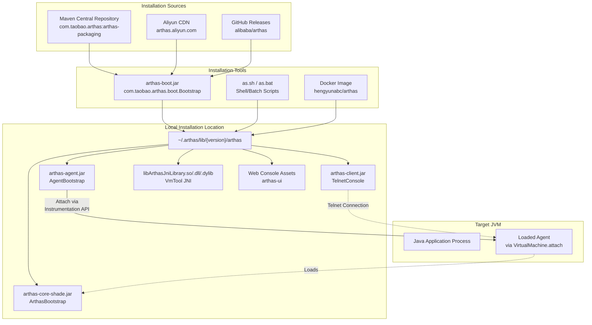
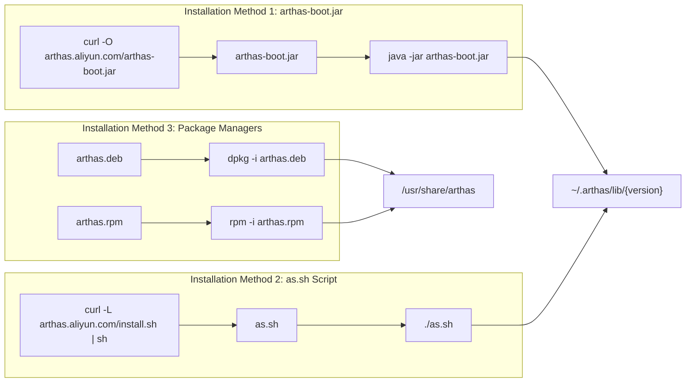
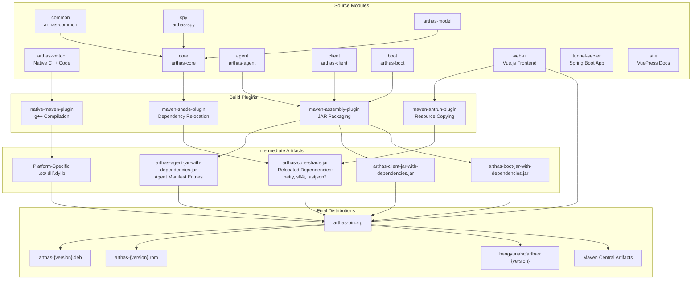
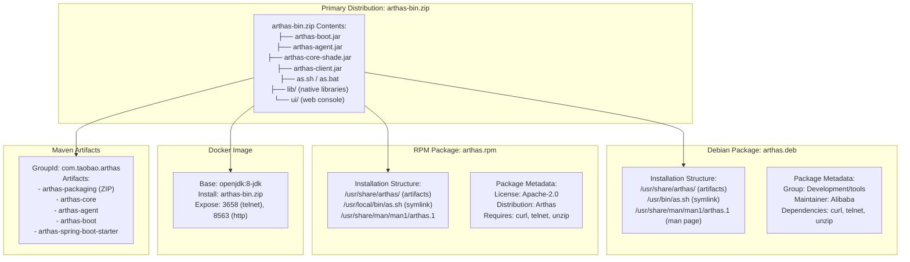
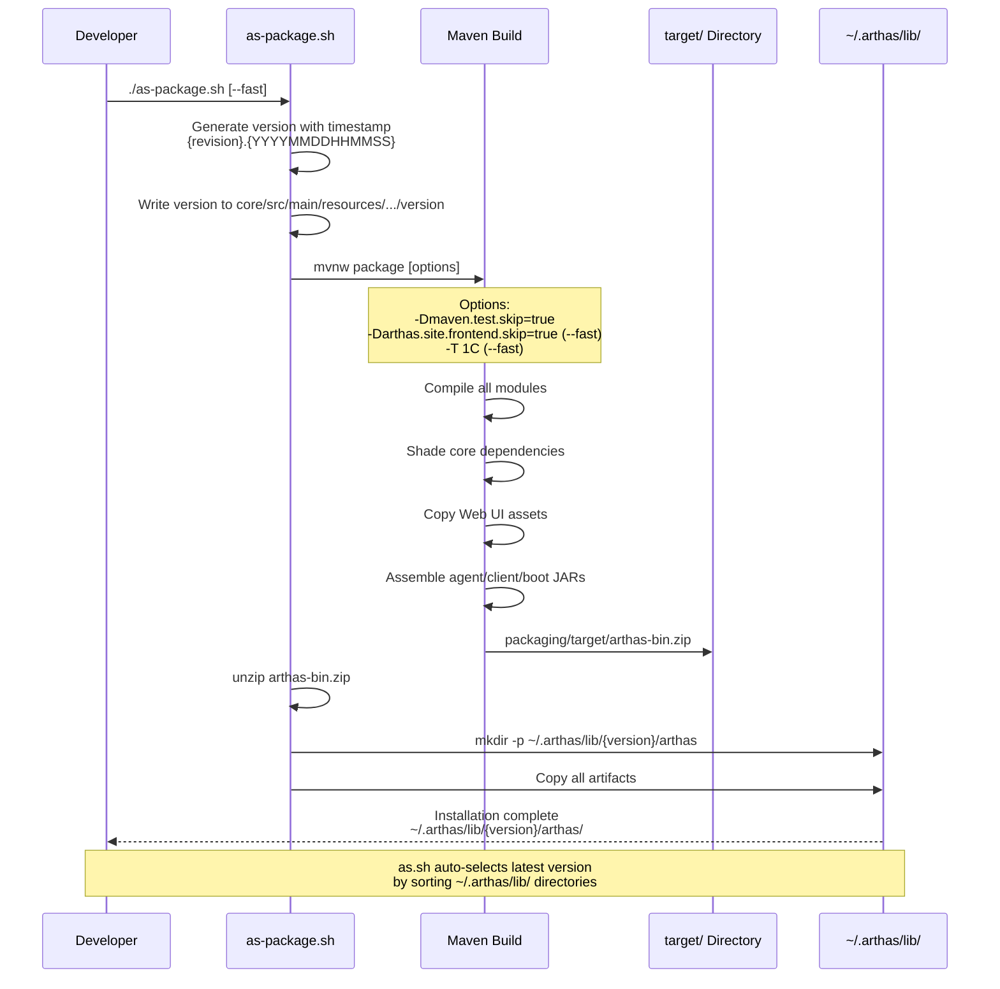
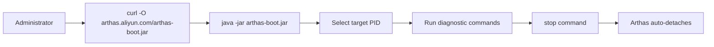
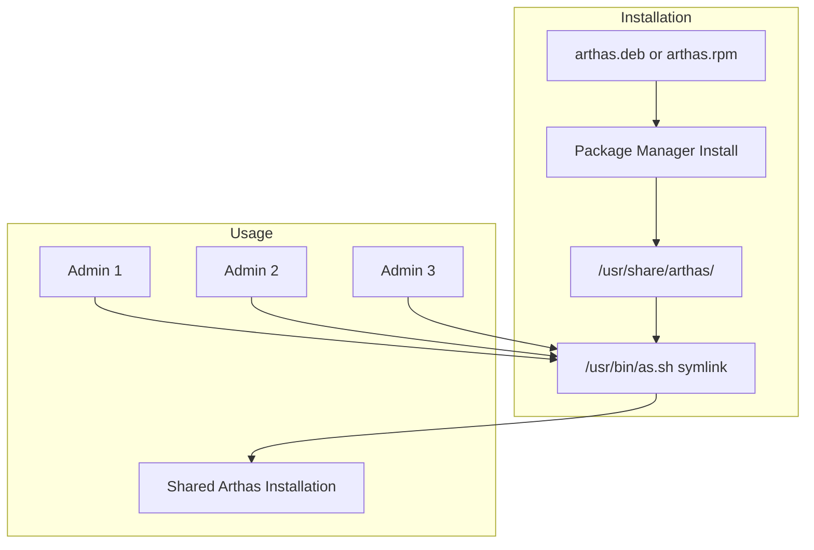
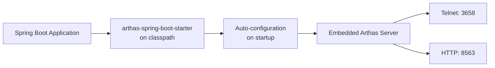
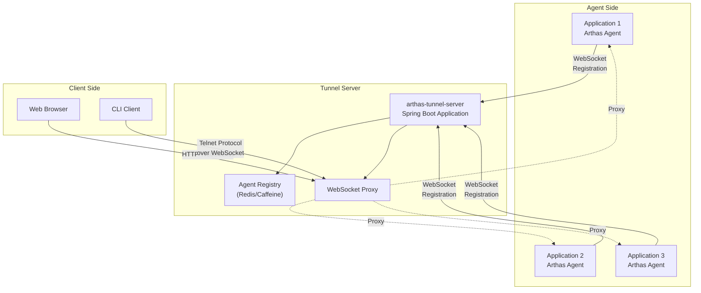
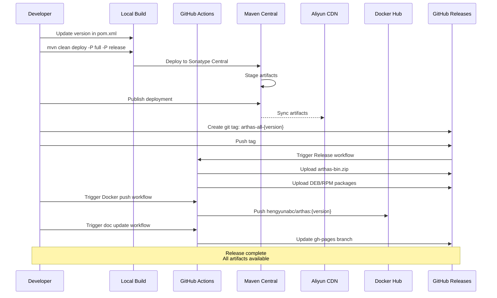

<!-- source: DeepWiki mcp.deepwiki.com · repo alibaba/arthas · page 8 Installation and Deployment · fetched 2026-10-29 -->

# Installation and Deployment

<details>
<summary>Relevant source files</summary>

The following files were used as context for generating this wiki page:

- [CONTRIBUTING.md](CONTRIBUTING.md)
- [README.md](README.md)
- [README_CN.md](README_CN.md)
- [USERS.md](USERS.md)
- [agent/pom.xml](agent/pom.xml)
- [arthas-vmtool/README.md](arthas-vmtool/README.md)
- [as-package.sh](as-package.sh)
- [bin/as-service.bat](bin/as-service.bat)
- [bin/as.bat](bin/as.bat)
- [boot/pom.xml](boot/pom.xml)
- [client/pom.xml](client/pom.xml)
- [common/pom.xml](common/pom.xml)
- [core/pom.xml](core/pom.xml)
- [memorycompiler/pom.xml](memorycompiler/pom.xml)
- [packaging/pom.xml](packaging/pom.xml)
- [pom.xml](pom.xml)
- [site/pom.xml](site/pom.xml)
- [spy/pom.xml](spy/pom.xml)
- [static/cider.png](static/cider.png)
- [static/citycloud.jpg](static/citycloud.jpg)
- [static/didiglobal.jpg](static/didiglobal.jpg)
- [static/dms.png](static/dms.png)
- [static/guideir.jpg](static/guideir.jpg)
- [static/hollycrm.png](static/hollycrm.png)
- [static/mingyuanyun.jpg](static/mingyuanyun.jpg)
- [static/ouyeel.png](static/ouyeel.png)
- [static/videt.png](static/videt.png)
- [static/zhaopin.png](static/zhaopin.png)
- [testcase/pom.xml](testcase/pom.xml)
- [tunnel-client/pom.xml](tunnel-client/pom.xml)
- [tunnel-server/pom.xml](tunnel-server/pom.xml)

</details>


## Purpose and Scope

This page provides a comprehensive guide to installing, deploying, and distributing Arthas in various environments. It covers the available installation methods, distribution formats, build processes, and deployment scenarios. For detailed information about specific installation methods, see [Installation Methods](#8.1). For packaging format details, see [Packaging and Distribution Formats](#8.2). For configuration options, see [Configuration Options](#8.3).

## Deployment Architecture Overview

Arthas operates as a Java agent that attaches to running JVM processes. The deployment architecture consists of several key components distributed across different artifacts:



**Deployment Components:**

| Component | Artifact | Main Class/Entry Point | Purpose |
|-----------|----------|------------------------|---------|
| Bootstrap | `arthas-boot.jar` | `com.taobao.arthas.boot.Bootstrap` | Process selection and agent attachment |
| Agent | `arthas-agent.jar` | `com.taobao.arthas.agent334.AgentBootstrap` | Java agent loader with manifest entries |
| Core | `arthas-core-shade.jar` | `com.taobao.arthas.core.Arthas` | Command processing engine |
| Client | `arthas-client.jar` | `com.taobao.arthas.client.TelnetConsole` | Telnet-based CLI client |
| Native Tools | `libArthasJniLibrary.*` | JNI/JVMTI bridge | Low-level VM introspection |

Sources: [README.md:53-96](), [boot/pom.xml:10-71](), [agent/pom.xml:10-68](), [core/pom.xml:10-106](), [client/pom.xml:10-67]()

## Installation Methods Overview

Arthas provides three primary installation approaches, each suited for different use cases:



**Comparison of Installation Methods:**

| Method | Use Case | Location | Auto-Update | Requires Root |
|--------|----------|----------|-------------|---------------|
| `arthas-boot.jar` | One-time use, quick diagnostics | `~/.arthas` | Yes | No |
| `as.sh` script | Repeated use, development | `~/.arthas` | Via `--repo-mirror` | No |
| DEB/RPM packages | System-wide installation | `/usr/share/arthas` | Via package manager | Yes |
| Docker image | Containerized environments | Container filesystem | Via image tags | No |
| Maven dependency | Spring Boot integration | Application classpath | Via Maven | No |

For detailed installation procedures, see [Installation Methods](#8.1).

Sources: [README.md:51-96](), [README_CN.md:37-68](), [packaging/pom.xml:75-262]()

## Build and Packaging Pipeline

The Arthas build system uses Maven multi-module architecture to produce various distribution formats:



**Key Build Configuration:**

| Build Aspect | Configuration | Purpose |
|--------------|---------------|---------|
| Dependency Shading | [core/pom.xml:45-63]() | Relocate netty, slf4j, fastjson2 to `com.alibaba.arthas.deps` |
| Agent Manifest | [agent/pom.xml:49-60]() | Set `Premain-Class`, `Agent-Class`, `Can-Retransform-Classes` |
| Native Compilation | [arthas-vmtool/README.md:1-2]() | Build platform-specific JNI libraries (x64, aarch64, Windows, macOS) |
| Web UI Integration | [core/pom.xml:92-95]() | Copy Vue.js assets into `arthas-core.jar` |
| Version Generation | [as-package.sh:75-79]() | Append timestamp to version for local builds |

**Build Commands:**

```bash
# Full production build
./mvnw clean package -DskipTests -P full

# Fast local development build
./as-package.sh --fast

# Platform-specific builds (via GitHub Actions)
# - Linux x64: ubuntu-latest
# - Linux aarch64: run-on-arch-action
# - Windows: windows-2022
# - macOS: macos-latest (universal binary)
```

Sources: [pom.xml:53-82](), [core/pom.xml:18-106](), [agent/pom.xml:33-67](), [packaging/pom.xml:30-73](), [as-package.sh:1-123]()

## Distribution Formats

Arthas is packaged in multiple formats to support different deployment scenarios:



**Distribution Format Details:**

| Format | Build Profile | Output Location | Target Platform | Installation Command |
|--------|---------------|-----------------|-----------------|---------------------|
| ZIP | Default | `packaging/target/arthas-bin.zip` | All platforms | Manual extraction |
| DEB | `-P deb` | `packaging/target/arthas-{version}.deb` | Debian/Ubuntu | `dpkg -i` or `apt install` |
| RPM | `-P rpm` | `packaging/target/arthas-{version}.rpm` | RHEL/CentOS | `rpm -i` or `yum install` |
| Docker | Manual | `hengyunabc/arthas:{version}` | Container environments | `docker pull` |
| Maven | `-P release` | Maven Central | Java applications | Maven/Gradle dependency |

For detailed packaging specifications, see [Packaging and Distribution Formats](#8.2).

Sources: [packaging/pom.xml:75-262](), [README.md:85-92]()

## Local Development Installation

Developers building Arthas from source use a specialized installation workflow:



**Build Script Options:**

| Option | Effect | Use Case |
|--------|--------|----------|
| `--fast` | Skip clean, skip site build, parallel Maven | Rapid iteration during development |
| `--no-clean` | Preserve target/ caches | Incremental builds |
| `--skip-site` | Skip VuePress documentation build | When only Java code changes |
| `-T <threads>` | Maven parallel build threads | Speed up multi-module builds |
| `--use-version` | Start specific Arthas version | Testing multiple versions |

**Version Selection Logic:**

When `as.sh` is executed, it searches `~/.arthas/lib/` and selects the version with the latest timestamp. For example:

```
~/.arthas/lib/
├── 4.1.5.20250115123045/  <- Selected (most recent)
├── 4.1.5.20250114090000/
└── 4.1.4/
```

Sources: [as-package.sh:1-123](), [CONTRIBUTING.md:24-54]()

## Deployment Scenarios

Arthas supports various deployment models depending on organizational requirements:

### Ad-Hoc Diagnostics

**Scenario:** One-time troubleshooting of production issues without permanent installation.



**Configuration:** No persistent installation, automatic download to `~/.arthas` on first run.

Sources: [README.md:53-66]()

### System-Wide Installation

**Scenario:** Multiple administrators need access to Arthas on shared servers.



**Installation Commands:**

```bash
# Debian/Ubuntu
sudo dpkg -i arthas-{version}.deb

# RHEL/CentOS
sudo rpm -i arthas-{version}.rpm
```

Sources: [packaging/pom.xml:75-234]()

### Containerized Environments

**Scenario:** Debugging applications running in Docker/Kubernetes.

**Docker Deployment:**

```bash
# Run Arthas container attached to target container's PID namespace
docker run -it --pid container:{target-container-id} \
  hengyunabc/arthas:latest /bin/sh -c "java -jar /opt/arthas/arthas-boot.jar"
```

**Kubernetes Deployment:**

```yaml
# Ephemeral debug container (requires Kubernetes 1.18+)
kubectl debug -it {pod-name} --image=hengyunabc/arthas:latest --target={container-name}
```

Sources: [README.md:91]()

### Embedded Spring Boot Integration

**Scenario:** Pre-integrated diagnostics in Spring Boot applications (see [Spring Boot Starter](#7.1)).



**Maven Dependency:**

```xml
<dependency>
    <groupId>com.taobao.arthas</groupId>
    <artifactId>arthas-spring-boot-starter</artifactId>
    <version>${arthas.version}</version>
</dependency>
```

Sources: [README.md:92](), [pom.xml:69]()

### Tunnel Server for Remote Access

**Scenario:** Centralized access to multiple Arthas agents across network boundaries (see [Tunnel System](#5)).



**Deployment:** Deploy `tunnel-server/target/arthas-tunnel-server-{version}-fatjar.jar` as standalone Spring Boot application.

Sources: [tunnel-server/pom.xml:1-227]()

## Configuration Overview

Arthas behavior can be customized through various configuration mechanisms. This section provides a brief overview; for comprehensive configuration details, see [Configuration Options](#8.3).

**Configuration Sources (in precedence order):**

1. **Command-line arguments** (highest priority)
2. **Environment variables**
3. **arthas.properties file**
4. **Default values** (lowest priority)

**Key Configuration Parameters:**

| Parameter | Command-Line Flag | Environment Variable | Default Value | Description |
|-----------|-------------------|----------------------|---------------|-------------|
| Telnet Port | `--telnet-port` | `ARTHAS_TELNET_PORT` | `3658` | Port for telnet client connections |
| HTTP Port | `--http-port` | `ARTHAS_HTTP_PORT` | `8563` | Port for web console and HTTP API |
| Target IP | `--target-ip` | `ARTHAS_TARGET_IP` | `127.0.0.1` | IP address to bind servers |
| Session Timeout | `--session-timeout` | `ARTHAS_SESSION_TIMEOUT` | `1800` (seconds) | Idle session timeout |
| Tunnel Server | `--tunnel-server` | `ARTHAS_TUNNEL_SERVER` | (none) | Tunnel server URL for registration |
| App Name | `--app-name` | `ARTHAS_APP_NAME` | (none) | Application identifier for tunnel |

**Example Configuration Files:**

```properties
# arthas.properties
arthas.telnetPort=3658
arthas.httpPort=8563
arthas.sessionTimeout=3600
arthas.tunnelServer=ws://tunnel.example.com/ws
arthas.appName=my-application
```

Sources: [bin/as.bat:13-74](), [bin/as-service.bat:11-158]()

## Platform-Specific Considerations

### Windows Deployment

Windows systems use batch scripts (`as.bat`, `as-service.bat`) instead of shell scripts:

**Command-Line Arguments:**

```batch
REM Basic usage
as.bat <pid>

REM With custom ports
as.bat <pid> --telnet-port 4000 --http-port 4001

REM For JDK 9+
as.bat <pid> --ignore-tools
```

**Windows Service Installation:**

The `as-service.bat` script supports running Arthas as a Windows service:

```batch
REM Install and start service
as-service.bat -pid <pid>

REM Install with interactive UI (for debugging)
as-service.bat -pid <pid> --interact

REM Remove service
as-service.bat --remove
```

**Java Home Configuration:** Windows scripts support `AS_JAVA_HOME` environment variable to override `JAVA_HOME`.

Sources: [bin/as.bat:1-120](), [bin/as-service.bat:1-282]()

### Native Library Architecture

Arthas includes platform-specific native libraries for JNI/JVMTI operations:

| Platform | Architecture | Library Name | Build System |
|----------|--------------|--------------|--------------|
| Linux | x86_64 | `libArthasJniLibrary.so` | ubuntu-latest (GitHub Actions) |
| Linux | aarch64 | `libArthasJniLibrary.so` | run-on-arch-action |
| Windows | x64 | `ArthasJniLibrary.dll` | windows-2022 |
| macOS | Universal | `libArthasJniLibrary.dylib` | macos-latest |

**Build Process:** Native libraries are compiled via GitHub Actions workflows and committed to the repository under `lib/` directory for reproducible builds across all platforms.

Sources: [arthas-vmtool/README.md:1-2](), [CONTRIBUTING.md:139]()

## Release and Distribution Process

The Arthas release workflow follows this sequence:



**Pre-Release Checklist:**

1. Update version in `as.sh` and `Bootstrap.java`
2. Build native libraries if `arthas-vmtool` changed (via GitHub Actions)
3. Execute GPG sign test: `gpg --sign /tmp/test.txt`
4. Run full build: `mvn clean deploy -P full -P release`
5. Verify Maven Central publication
6. Check Aliyun mirror sync
7. Create and push git tag
8. Trigger GitHub Actions for documentation and Docker

**Post-Release Verification:**

- Verify Maven Central: `https://repo1.maven.org/maven2/com/taobao/arthas/arthas-packaging/{version}/`
- Verify Aliyun Mirror: `https://maven.aliyun.com/repository/public/com/taobao/arthas/arthas-packaging/{version}/`
- Test download: `curl -O https://arthas.aliyun.com/arthas-boot.jar`
- Verify Docker: `docker pull hengyunabc/arthas:{version}`

Sources: [CONTRIBUTING.md:136-162]()

## Troubleshooting Installation Issues

**Common Installation Problems:**

| Issue | Symptom | Solution |
|-------|---------|----------|
| Missing `tools.jar` | "Can not find lib\tools.jar under %JAVA_HOME%" | Use JDK (not JRE) or add `--ignore-tools` for JDK 9+ |
| Port already in use | "Address already in use" | Specify custom ports: `--telnet-port 4000 --http-port 4001` |
| Download failures | Connection timeout to maven.aliyun.com | Use `--repo-mirror aliyun --use-http` or manual download |
| Permission denied | Cannot write to ~/.arthas | Check filesystem permissions or use `sudo` for system install |
| Windows telnet unavailable | "telnet wasn't found" | Install telnet via Windows Features or use web console at `http://127.0.0.1:8563` |

**Version Management:**

List installed versions:
```bash
./as.sh --versions
```

Use specific version:
```bash
./as.sh --use-version 4.1.5.20250115123045
```

Sources: [README.md:51-96](), [bin/as.bat:76-98](), [CONTRIBUTING.md:42-54]()

---

This page provides the foundation for understanding Arthas installation and deployment. For hands-on procedures, refer to the sub-pages: [Installation Methods](#8.1), [Packaging and Distribution Formats](#8.2), and [Configuration Options](#8.3). For integration into applications, see [Integration Options](#7).

---

