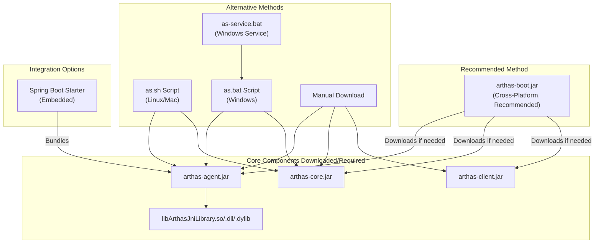
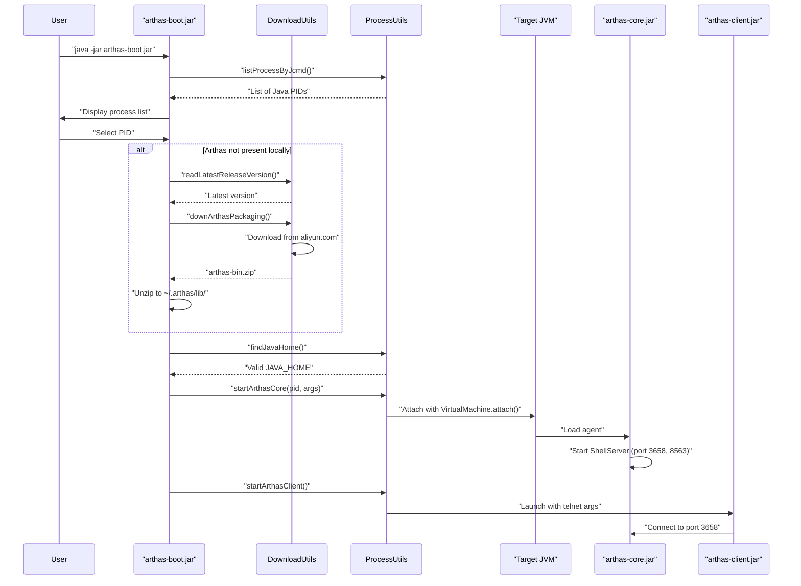
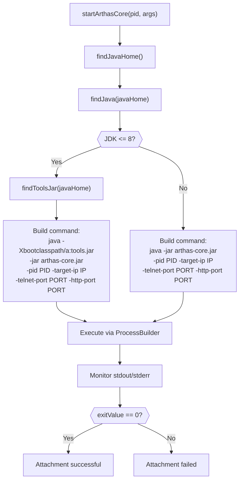
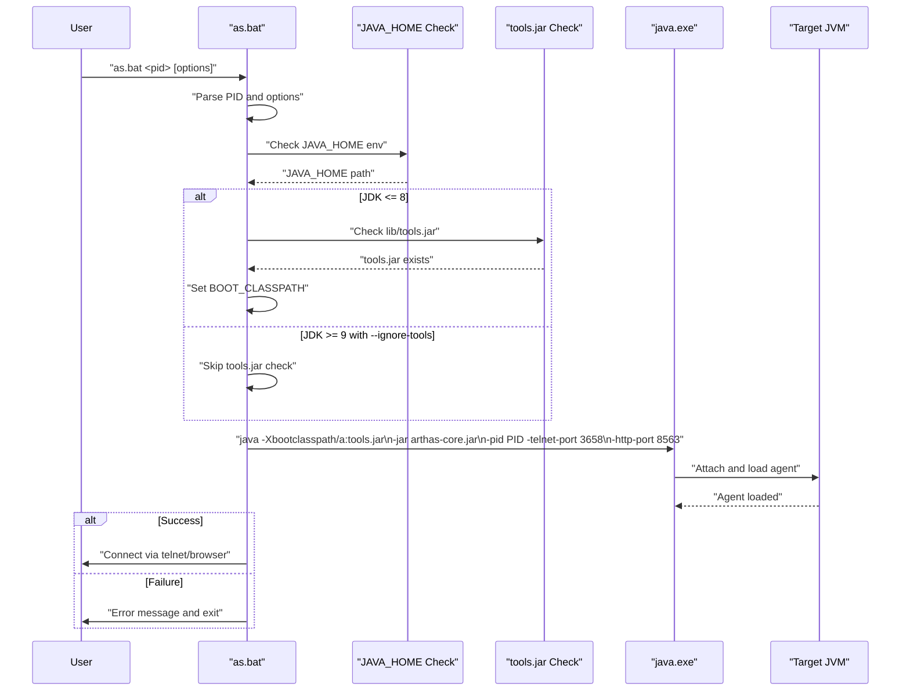
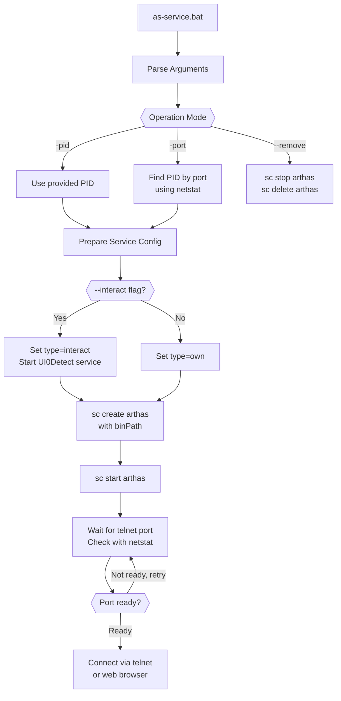
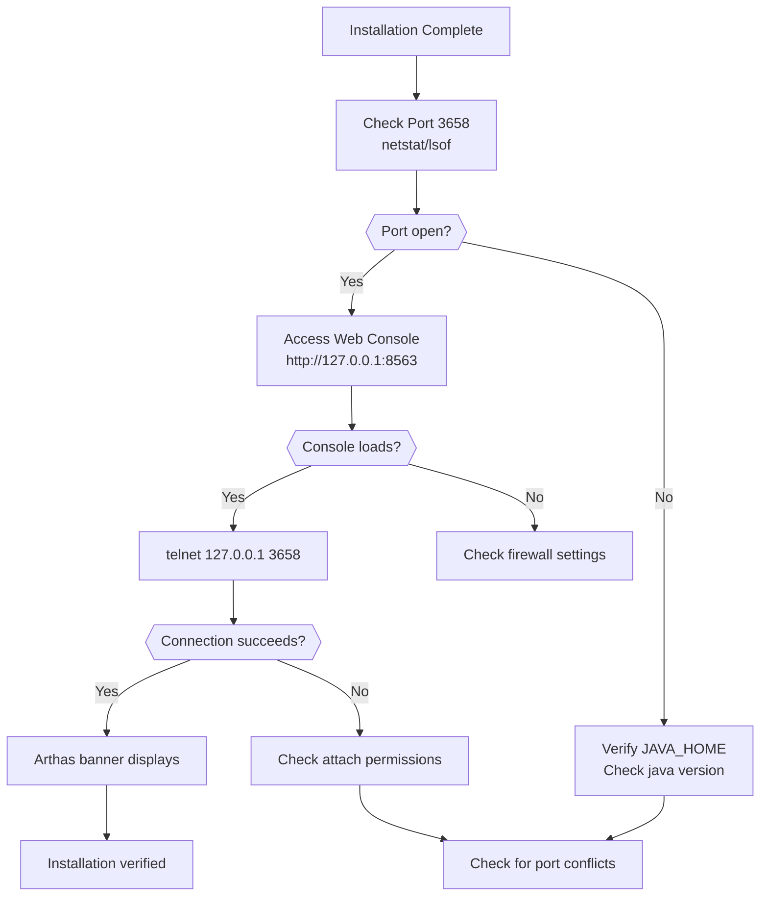

<!-- source: DeepWiki mcp.deepwiki.com · repo alibaba/arthas · page 8.1 Installation Methods · fetched 2026-10-29 -->

# Installation Options

<details>
<summary>Relevant source files</summary>

The following files were used as context for generating this wiki page:

- [CONTRIBUTING.md](CONTRIBUTING.md)
- [README.md](README.md)
- [README_CN.md](README_CN.md)
- [USERS.md](USERS.md)
- [arthas-vmtool/README.md](arthas-vmtool/README.md)
- [as-package.sh](as-package.sh)
- [bin/as-service.bat](bin/as-service.bat)
- [bin/as.bat](bin/as.bat)
- [boot/src/main/java/com/taobao/arthas/boot/DownloadUtils.java](boot/src/main/java/com/taobao/arthas/boot/DownloadUtils.java)
- [boot/src/main/java/com/taobao/arthas/boot/ProcessUtils.java](boot/src/main/java/com/taobao/arthas/boot/ProcessUtils.java)
- [boot/src/test/java/com/taobao/arthas/boot/DownloadUtilsTest.java](boot/src/test/java/com/taobao/arthas/boot/DownloadUtilsTest.java)
- [client/src/main/java/com/taobao/arthas/client/IOUtil.java](client/src/main/java/com/taobao/arthas/client/IOUtil.java)
- [client/src/main/java/com/taobao/arthas/client/TelnetConsole.java](client/src/main/java/com/taobao/arthas/client/TelnetConsole.java)
- [common/src/main/java/com/taobao/arthas/common/AnsiLog.java](common/src/main/java/com/taobao/arthas/common/AnsiLog.java)
- [common/src/main/java/com/taobao/arthas/common/ExecutingCommand.java](common/src/main/java/com/taobao/arthas/common/ExecutingCommand.java)
- [common/src/main/java/com/taobao/arthas/common/IOUtils.java](common/src/main/java/com/taobao/arthas/common/IOUtils.java)
- [common/src/main/java/com/taobao/arthas/common/PidUtils.java](common/src/main/java/com/taobao/arthas/common/PidUtils.java)
- [common/src/main/java/com/taobao/arthas/common/SocketUtils.java](common/src/main/java/com/taobao/arthas/common/SocketUtils.java)
- [common/src/main/java/com/taobao/arthas/common/UsageRender.java](common/src/main/java/com/taobao/arthas/common/UsageRender.java)
- [core/src/main/java/com/taobao/arthas/core/shell/command/internal/WordCountHandler.java](core/src/main/java/com/taobao/arthas/core/shell/command/internal/WordCountHandler.java)
- [core/src/main/java/com/taobao/arthas/core/shell/impl/ShellImpl.java](core/src/main/java/com/taobao/arthas/core/shell/impl/ShellImpl.java)
- [core/src/main/java/com/taobao/arthas/core/util/ArthasBanner.java](core/src/main/java/com/taobao/arthas/core/util/ArthasBanner.java)
- [static/cider.png](static/cider.png)
- [static/citycloud.jpg](static/citycloud.jpg)
- [static/didiglobal.jpg](static/didiglobal.jpg)
- [static/dms.png](static/dms.png)
- [static/guideir.jpg](static/guideir.jpg)
- [static/hollycrm.png](static/hollycrm.png)
- [static/mingyuanyun.jpg](static/mingyuanyun.jpg)
- [static/ouyeel.png](static/ouyeel.png)
- [static/videt.png](static/videt.png)
- [static/zhaopin.png](static/zhaopin.png)

</details>


This page details the various methods for installing and deploying Arthas to a target Java application. Arthas provides multiple installation approaches to accommodate different operating systems and deployment scenarios. For configuration of Arthas after installation, see [Configuration Options](#8.2).

## Overview of Installation Methods

Arthas provides multiple installation approaches to accommodate different operating systems and deployment scenarios. The **recommended method** is using `arthas-boot.jar`, which is a self-contained bootstrap application that handles downloading and attaching Arthas components automatically.



Sources: [README.md:53-78](), [boot/src/main/java/com/taobao/arthas/boot/DownloadUtils.java:81-96]()

## Prerequisites

Before installing Arthas, ensure your environment meets the following requirements:

| Requirement | Details |
|-------------|---------|
| JDK Version | JDK 6+ (Arthas 4.x no longer supports JDK 6 and JDK 7) |
| Operating System | Windows, Linux, macOS |
| Permissions | Sufficient privileges to attach to target Java process |
| Java Process | A running Java process to attach to |
| `tools.jar` | Required for JDK ≤ 1.8 (must be in JDK `lib/` directory) |
| `java` executable | Must be accessible from `JAVA_HOME` or system PATH |

**Important Notes:**
- For JDK 9+, `tools.jar` is no longer required as the attachment API is part of the JDK modules
- The `JAVA_HOME` environment variable should point to a JDK installation, not a JRE
- On Windows, telnet client may need to be installed separately to use the telnet interface

Sources: [README.md:43-44](), [boot/src/main/java/com/taobao/arthas/boot/ProcessUtils.java:217-276](), [bin/as.bat:77-89]()

## Primary Method: arthas-boot.jar (Recommended)

The `arthas-boot.jar` is the recommended installation method as it provides a consistent, cross-platform experience and automatically handles downloading Arthas components.

### Basic Usage

Download and run `arthas-boot.jar`:
```bash
curl -O https://arthas.aliyun.com/arthas-boot.jar
java -jar arthas-boot.jar
```

The bootstrap process:



### Process Selection

The `arthas-boot.jar` uses `ProcessUtils.select()` to discover and present Java processes:

**Process Discovery Methods** (in order of preference):
1. **jcmd** - Uses `ProcessUtils.listProcessByJcmd()` to execute `jcmd -l` command
2. **jps** (deprecated) - Falls back to `ProcessUtils.listProcessByJps()` if jcmd fails

The discovered processes are displayed with PID and main class information for selection.

Sources: [README.md:53-66](), [boot/src/main/java/com/taobao/arthas/boot/ProcessUtils.java:55-123](), [boot/src/main/java/com/taobao/arthas/boot/ProcessUtils.java:125-164](), [boot/src/main/java/com/taobao/arthas/boot/ProcessUtils.java:278-358]()

### Download and Version Management

When `arthas-boot.jar` needs to download Arthas components, it uses `DownloadUtils`:

**Download Sources:**
- **Primary:** `https://arthas.aliyun.com/download/${VERSION}?mirror=${REPO}`
- **Version API:** `https://arthas.aliyun.com/api/latest_version`
- **Version List:** `https://arthas.aliyun.com/api/versions`

**Installation Location:**
- Components are installed to `~/.arthas/lib/${VERSION}/arthas/`
- The directory contains: `arthas-agent.jar`, `arthas-core.jar`, `arthas-client.jar`, and supporting files

**Command-Line Options for arthas-boot.jar:**
```bash
java -jar arthas-boot.jar -h  # Print help
java -jar arthas-boot.jar --repo-mirror aliyun --use-http  # Use aliyun mirror with HTTP
```

Sources: [README_CN.md:42-54](), [boot/src/main/java/com/taobao/arthas/boot/DownloadUtils.java:24-46](), [boot/src/main/java/com/taobao/arthas/boot/DownloadUtils.java:81-96]()

### Attachment Process

The attachment process handled by `ProcessUtils.startArthasCore()`:



Sources: [boot/src/main/java/com/taobao/arthas/boot/ProcessUtils.java:278-358](), [boot/src/main/java/com/taobao/arthas/boot/ProcessUtils.java:406-460]()

## Alternative Methods

### Using as.sh (Linux/Mac)

The `as.sh` script provides a convenient one-line installation for Linux, Unix, and macOS:

```bash
curl -L https://arthas.aliyun.com/install.sh | sh
```

This downloads the `as.sh` bootstrap script to the current directory. The script can then be executed:

```bash
./as.sh
# or with PID
./as.sh <pid>
# or for help
./as.sh -h
```

The `as.sh` script internally follows similar logic to `arthas-boot.jar`, discovering processes and attaching to the target JVM.

Sources: [README.md:68-78]()

### Using as.bat (Windows)

The `as.bat` script provides installation and attachment for Windows systems.



**Basic usage:**
```cmd
as.bat <pid> [options]
```

**Common options:**
- `--ignore-tools`: For JDK 9/10/11, ignores the `tools.jar` dependency
- `--no-interact`: Exits after attaching Arthas (useful for non-interactive scripts)
- `-telnet-port <port>`: Custom telnet port (default: 3658)
- `-http-port <port>`: Custom HTTP port (default: 8563)

**Key Components Referenced:**
- `JAVA_HOME\bin\java.exe` - Java executable [bin/as.bat:91-92]()
- `JAVA_HOME\lib\tools.jar` - Required for JDK <= 8 [bin/as.bat:82-88]()
- `arthas-core.jar` - Main Arthas core [bin/as.bat:29]()
- `arthas-agent.jar` - Agent JAR [bin/as.bat:28]()

Sources: [bin/as.bat:10-89](), [bin/as.bat:100-115]()

### Using as-service.bat (Windows Service)

For scenarios requiring Arthas to run persistently as a Windows service, the `as-service.bat` script provides service management capabilities.



**Basic Usage:**
```cmd
as-service.bat <pid> [options]
as-service.bat -pid <pid> [options]
as-service.bat -port <port> [options]
```

**Service-Specific Options:**
- `--remove`: Removes the Arthas Windows service
- `--interact`: Enables Windows service interactive UI (requires `UI0Detect` service)
- `--service`: Internal flag marking script execution in service mode
- `-telnet-port <port>`: Custom telnet port
- `-http-port <port>`: Custom HTTP port

**Service Implementation Details:**

The service creation uses Windows `sc` command:
```cmd
sc create arthas start=demand type=own binPath="..."
```

For interactive mode:
```cmd
sc create arthas start=demand type=interact type=own binPath="..."
```

**Advantages of Windows Service Mode:**
- Arthas agent persists after user logout
- Manageable through Windows Service Manager (`services.msc`)
- Supports both interactive and background modes
- Automatic port conflict detection

**Finding PID by Port:**

When using `-port` option, the script uses `netstat` to find the listening process:
```cmd
netstat -ano | findstr ":<port>" | findstr "LISTENING"
```

Sources: [bin/as-service.bat:8-28](), [bin/as-service.bat:95-180](), [bin/as-service.bat:140-169]()

## Manual Installation / Direct Download

For environments where automated downloads are restricted, Arthas components can be manually downloaded and deployed.

**Download Locations:**
- **Maven Central:** `https://search.maven.org/search?q=g:com.taobao.arthas`
- **Aliyun Mirror:** `https://arthas.aliyun.com/download/<version>`

**Required Components:**
1. `arthas-agent.jar` - The Java agent loaded into target JVM
2. `arthas-core.jar` - Core diagnostic engine
3. `arthas-client.jar` - Telnet client
4. Native libraries (optional): `libArthasJniLibrary.so/.dll/.dylib`

**Manual Attachment:**

Once components are downloaded, attach manually using:
```bash
# Find java executable and tools.jar
java -Xbootclasspath/a:$JAVA_HOME/lib/tools.jar \
  -jar arthas-core.jar \
  -pid <target-pid> \
  -target-ip 127.0.0.1 \
  -telnet-port 3658 \
  -http-port 8563 \
  -core arthas-core.jar \
  -agent arthas-agent.jar
```

For JDK 9+, `tools.jar` is not needed:
```bash
java -jar arthas-core.jar \
  -pid <target-pid> \
  -target-ip 127.0.0.1 \
  -telnet-port 3658 \
  -http-port 8563 \
  -core arthas-core.jar \
  -agent arthas-agent.jar
```

Sources: [README.md:85-86](), [bin/as.bat:100-102]()

## Spring Boot Integration

For Spring Boot applications where you want Arthas embedded and always available, use the `arthas-spring-boot-starter`. This approach bundles Arthas with your application.

**Maven Dependency:**
```xml
<dependency>
    <groupId>com.taobao.arthas</groupId>
    <artifactId>arthas-spring-boot-starter</artifactId>
    <version>${arthas.version}</version>
</dependency>
```

With this integration, Arthas automatically attaches to the Spring Boot application on startup. For detailed configuration and usage, see [Spring Boot Starter](#7.1).

Sources: [README.md:92](), [README_CN.md:81]()


## Installation Verification

After installation, verify Arthas is operational by checking the following:

**1. Verify Telnet Port (Default: 3658)**

Windows:
```cmd
netstat -nao | findstr LIST | findstr :3658
```

Linux/macOS:
```bash
netstat -an | grep LISTEN | grep 3658
# or
lsof -i :3658
```

**2. Access Web Console**

Open browser to: `http://127.0.0.1:8563` (default HTTP port)

**3. Connect via Telnet Client**

```bash
telnet 127.0.0.1 3658
```

Or use `arthas-client.jar`:
```bash
java -jar arthas-client.jar 127.0.0.1 3658
```

**4. Check Arthas Banner**

Upon successful connection, you should see the Arthas banner displaying:
- Wiki URL: `https://arthas.aliyun.com/doc`
- Tutorials URL: `https://arthas.aliyun.com/doc/arthas-tutorials.html`
- Version information
- PID of attached process
- Telnet/HTTP port information



Sources: [bin/as.bat:107-115](), [bin/as-service.bat:189-201](), [core/src/main/java/com/taobao/arthas/core/util/ArthasBanner.java:85-138]()

## Troubleshooting Installation Issues

Common installation issues and their solutions:

| Issue | Possible Cause | Solution | Code Reference |
|-------|---------------|----------|----------------|
| `tools.jar not found` | Using JRE instead of JDK | Set `JAVA_HOME` to valid JDK directory | [boot/src/main/java/com/taobao/arthas/boot/ProcessUtils.java:228-276]() |
| `tools.jar not found` (JDK 9+) | JDK 9+ doesn't include `tools.jar` | Use `--ignore-tools` option | [bin/as.bat:79-89]() |
| `Can not find java/java.exe` | `JAVA_HOME` not set or invalid | Set `JAVA_HOME` environment variable | [boot/src/main/java/com/taobao/arthas/boot/ProcessUtils.java:406-438]() |
| `Permission denied` | Insufficient process attach privileges | Run with appropriate permissions (admin/root) | |
| `Connection refused` | Port already in use | Use `--telnet-port` or `--http-port` for custom ports | [bin/as.bat:69-70]() |
| `Telnet not available` | Telnet client not installed (Windows) | Install telnet via Windows Features or use web console | [bin/as.bat:109-115]() |
| `Process not found` | Target JVM not visible to jcmd/jps | Check if process is Java, verify user permissions | [boot/src/main/java/com/taobao/arthas/boot/ProcessUtils.java:55-64]() |
| Download failure | Network restrictions, SSL issues | Use `--use-http` and `--repo-mirror aliyun` options | [boot/src/main/java/com/taobao/arthas/boot/DownloadUtils.java:133-141]() |
| Attach failure | Target JVM blocking agents | Check JVM security settings, verify not in restricted mode | |

**Detailed Troubleshooting Steps:**

**For JAVA_HOME Issues:**
1. Verify `JAVA_HOME` points to JDK root (not `bin/` directory)
2. Check `$JAVA_HOME/bin/java` or `%JAVA_HOME%\bin\java.exe` exists
3. For JDK <= 8, verify `$JAVA_HOME/lib/tools.jar` exists

**For Process Discovery Issues:**
1. Run `jcmd -l` manually to see if target process appears
2. Ensure running as same user as target Java process
3. Check if target JVM has agent attachment enabled

**For Port Conflicts:**
1. Use `netstat` to identify conflicting processes:
   ```bash
   # Windows
   netstat -nao | findstr :3658
   # Linux/macOS
   lsof -i :3658
   ```
2. Specify alternative ports when launching Arthas

Sources: [bin/as.bat:77-98](), [boot/src/main/java/com/taobao/arthas/boot/ProcessUtils.java:228-276](), [boot/src/main/java/com/taobao/arthas/boot/DownloadUtils.java:32-45]()

## Command Reference

Here's a quick reference for the main installation commands:

| Platform | Command | Description |
|----------|---------|-------------|
| Windows | `as.bat <pid> [options]` | Basic installation and attachment |
| Windows | `as-service.bat <pid> [options]` | Run as Windows service |
| Linux/macOS | `./as.sh <pid> [options]` | Basic installation and attachment |
| Cross-platform | `java -jar arthas-boot.jar` | Java-based installation |
| Spring Boot | Add dependency and configuration | Integrated installation |

Sources: [bin/as.bat:18-24](), [bin/as-service.bat:249-270]()

---

