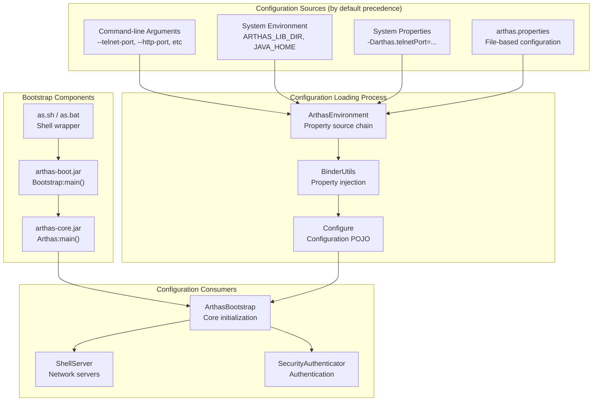
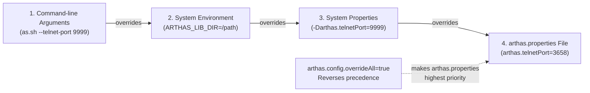
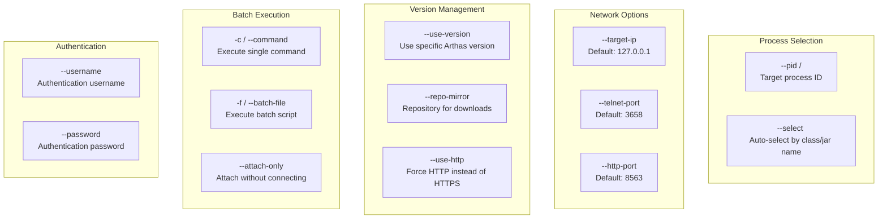
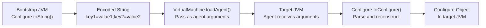

<!-- source: DeepWiki mcp.deepwiki.com · repo alibaba/arthas · page 8.3 Configuration Options · fetched 2026-10-29 -->

# Configuration Options

<details>
<summary>Relevant source files</summary>

The following files were used as context for generating this wiki page:

- [Dockerfile](Dockerfile)
- [Dockerfile-No-Jdk](Dockerfile-No-Jdk)
- [agent/src/main/java/com/taobao/arthas/agent334/AgentBootstrap.java](agent/src/main/java/com/taobao/arthas/agent334/AgentBootstrap.java)
- [bin/as.sh](bin/as.sh)
- [boot/src/main/java/com/taobao/arthas/boot/Bootstrap.java](boot/src/main/java/com/taobao/arthas/boot/Bootstrap.java)
- [boot/src/main/java/com/taobao/arthas/boot/DownloadUtils.java](boot/src/main/java/com/taobao/arthas/boot/DownloadUtils.java)
- [boot/src/main/java/com/taobao/arthas/boot/ProcessUtils.java](boot/src/main/java/com/taobao/arthas/boot/ProcessUtils.java)
- [boot/src/test/java/com/taobao/arthas/boot/DownloadUtilsTest.java](boot/src/test/java/com/taobao/arthas/boot/DownloadUtilsTest.java)
- [client/src/main/java/com/taobao/arthas/client/IOUtil.java](client/src/main/java/com/taobao/arthas/client/IOUtil.java)
- [client/src/main/java/com/taobao/arthas/client/TelnetConsole.java](client/src/main/java/com/taobao/arthas/client/TelnetConsole.java)
- [common/src/main/java/com/taobao/arthas/common/AnsiLog.java](common/src/main/java/com/taobao/arthas/common/AnsiLog.java)
- [common/src/main/java/com/taobao/arthas/common/ExecutingCommand.java](common/src/main/java/com/taobao/arthas/common/ExecutingCommand.java)
- [common/src/main/java/com/taobao/arthas/common/IOUtils.java](common/src/main/java/com/taobao/arthas/common/IOUtils.java)
- [common/src/main/java/com/taobao/arthas/common/PidUtils.java](common/src/main/java/com/taobao/arthas/common/PidUtils.java)
- [common/src/main/java/com/taobao/arthas/common/SocketUtils.java](common/src/main/java/com/taobao/arthas/common/SocketUtils.java)
- [common/src/main/java/com/taobao/arthas/common/UsageRender.java](common/src/main/java/com/taobao/arthas/common/UsageRender.java)
- [core/src/main/java/arthas.properties](core/src/main/java/arthas.properties)
- [core/src/main/java/com/taobao/arthas/core/Arthas.java](core/src/main/java/com/taobao/arthas/core/Arthas.java)
- [core/src/main/java/com/taobao/arthas/core/config/Configure.java](core/src/main/java/com/taobao/arthas/core/config/Configure.java)
- [core/src/main/java/com/taobao/arthas/core/mcp/ArthasMcpServer.java](core/src/main/java/com/taobao/arthas/core/mcp/ArthasMcpServer.java)
- [core/src/main/java/com/taobao/arthas/core/server/ArthasBootstrap.java](core/src/main/java/com/taobao/arthas/core/server/ArthasBootstrap.java)
- [core/src/main/java/com/taobao/arthas/core/shell/command/internal/WordCountHandler.java](core/src/main/java/com/taobao/arthas/core/shell/command/internal/WordCountHandler.java)
- [core/src/main/java/com/taobao/arthas/core/shell/impl/ShellImpl.java](core/src/main/java/com/taobao/arthas/core/shell/impl/ShellImpl.java)
- [core/src/main/java/com/taobao/arthas/core/shell/impl/ShellServerImpl.java](core/src/main/java/com/taobao/arthas/core/shell/impl/ShellServerImpl.java)
- [core/src/main/java/com/taobao/arthas/core/shell/session/impl/SessionManagerImpl.java](core/src/main/java/com/taobao/arthas/core/shell/session/impl/SessionManagerImpl.java)
- [core/src/main/java/com/taobao/arthas/core/shell/term/impl/http/api/ApiRequest.java](core/src/main/java/com/taobao/arthas/core/shell/term/impl/http/api/ApiRequest.java)
- [core/src/main/java/com/taobao/arthas/core/shell/term/impl/http/api/HttpApiHandler.java](core/src/main/java/com/taobao/arthas/core/shell/term/impl/http/api/HttpApiHandler.java)
- [core/src/main/java/com/taobao/arthas/core/util/ArthasBanner.java](core/src/main/java/com/taobao/arthas/core/util/ArthasBanner.java)
- [core/src/main/java/com/taobao/arthas/core/util/UserStatUtil.java](core/src/main/java/com/taobao/arthas/core/util/UserStatUtil.java)
- [tunnel-server/src/main/java/com/alibaba/arthas/tunnel/server/app/web/StatController.java](tunnel-server/src/main/java/com/alibaba/arthas/tunnel/server/app/web/StatController.java)

</details>


This page documents the configuration system for Arthas, including all available configuration options, configuration sources, and their precedence rules. For information about installation methods, see [Installation Methods](#8.1). For deployment-specific topics, see [Packaging and Distribution Formats](#8.2).

## Overview

Arthas provides a flexible configuration system that accepts settings from multiple sources: command-line arguments, environment variables, system properties, and configuration files. The configuration is processed during the bootstrap phase and used to initialize the Arthas server with appropriate network settings, security options, and behavioral parameters.

Sources: [core/src/main/java/com/taobao/arthas/core/server/ArthasBootstrap.java:253-347](), [core/src/main/java/com/taobao/arthas/core/config/Configure.java:1-290]()

## Configuration Architecture



**Configuration Loading Flow**: Arthas uses a layered property source system where command-line arguments override system environment, which overrides system properties, which override the properties file.

Sources: [core/src/main/java/com/taobao/arthas/core/server/ArthasBootstrap.java:253-284](), [core/src/main/java/com/taobao/arthas/core/env/ArthasEnvironment.java]()

## Configuration Precedence

The default configuration precedence from highest to lowest priority is:



**Precedence Reversal**: Setting `arthas.config.overrideAll=true` in the properties file makes it the highest priority source, overriding all other configuration sources.

Sources: [core/src/main/java/com/taobao/arthas/core/server/ArthasBootstrap.java:260-263](), [core/src/main/java/com/taobao/arthas/core/server/ArthasBootstrap.java:329-344]()

## Configuration Options Reference

### Network Configuration Options

| Option | Type | Default | Description |
|--------|------|---------|-------------|
| `arthas.ip` / `--target-ip` | String | `127.0.0.1` | IP address for Arthas server to bind |
| `arthas.telnetPort` / `--telnet-port` | Integer | `3658` | Telnet server port (use `-1` to disable) |
| `arthas.httpPort` / `--http-port` | Integer | `8563` | HTTP server port (use `-1` to disable) |

**Default Listening Addresses**: By default, Arthas binds to `127.0.0.1` for security. When binding to `0.0.0.0` without a password, Arthas automatically generates a random password to prevent unauthorized remote access.

Sources: [core/src/main/java/arthas.properties:2-4](), [core/src/main/java/com/taobao/arthas/core/config/Configure.java:25-27](), [core/src/main/java/com/taobao/arthas/core/server/ArthasBootstrap.java:404-415]()

### Security and Authentication Options

| Option | Type | Default | Description |
|--------|------|---------|-------------|
| `arthas.username` / `--username` | String | null | Username for authentication |
| `arthas.password` / `--password` | String | null | Password for authentication |
| `arthas.localConnectionNonAuth` | Boolean | `true` | Allow local connections without authentication |
| `arthas.disabledCommands` / `--disabled-commands` | String | null | Comma-separated list of disabled commands |

**Local Connection Security**: When `arthas.localConnectionNonAuth=true` (default), connections from `127.0.0.1` bypass authentication even if a password is set. This provides convenience for local debugging while maintaining security for remote connections.

**Password Generation**: When listening on `0.0.0.0` without a configured password, Arthas generates a 64-character random password and logs it to prevent unauthorized access.

Sources: [core/src/main/java/arthas.properties:11-16](), [core/src/main/java/com/taobao/arthas/core/config/Configure.java:35-37,73-75](), [core/src/main/java/com/taobao/arthas/core/server/ArthasBootstrap.java:404-415]()

### Session Management Options

| Option | Type | Default | Description |
|--------|------|---------|-------------|
| `arthas.sessionTimeout` / `--session-timeout` | Long | `1800` | Session timeout in seconds (30 minutes) |

**Session Timeout Behavior**: Sessions are automatically closed after the timeout period of inactivity. The timeout is measured from the last access time, not from session creation.

Sources: [core/src/main/java/arthas.properties:6-7](), [core/src/main/java/com/taobao/arthas/core/config/Configure.java:62-65]()

### Tunnel and Remote Access Options

| Option | Type | Default | Description |
|--------|------|---------|-------------|
| `arthas.tunnelServer` / `--tunnel-server` | String | null | Tunnel server URL (e.g., `ws://192.168.10.11:7777/ws`) |
| `arthas.agentId` / `--agent-id` | String | null | Unique agent ID for tunnel registration |
| `arthas.appName` / `--app-name` | String | null | Application name for identification |
| `arthas.statUrl` / `--stat-url` | String | null | URL for reporting usage statistics |

**Tunnel Server Integration**: When `arthas.tunnelServer` is configured, Arthas connects to a tunnel server for remote access. The `agentId` uniquely identifies the instance, and if not specified, Arthas auto-generates one with the `appName` as prefix.

Sources: [core/src/main/java/arthas.properties:18-20](), [core/src/main/java/com/taobao/arthas/core/config/Configure.java:32-59](), [core/src/main/java/com/taobao/arthas/core/server/ArthasBootstrap.java:381-392]()

### Advanced Configuration Options

| Option | Type | Default | Description |
|--------|------|---------|-------------|
| `arthas.outputPath` / `--output-path` | String | `arthas-output` | Directory for output files (cache, profiling results) |
| `arthas.enhanceLoaders` | String | null | Comma-separated ClassLoader names to enhance |
| `arthas.mcpEndpoint` | String | `/mcp` | Model Context Protocol endpoint path |
| `arthas.mcpProtocol` | String | `STREAMABLE` | MCP protocol: `STREAMABLE` or `STATELESS` |

**ClassLoader Enhancement**: The `arthas.enhanceLoaders` option allows specifying which ClassLoader classes should be enhanced to load SpyAPI. This solves issues where custom ClassLoaders cannot find Arthas spy classes. By default, only standard ClassLoaders are enhanced.

**MCP Configuration**: The Model Context Protocol (MCP) provides AI/IDE tool integration. The endpoint and protocol type can be customized for different integration requirements.

Sources: [core/src/main/java/arthas.properties:9,22-28](), [core/src/main/java/com/taobao/arthas/core/config/Configure.java:40-85](), [core/src/main/java/com/taobao/arthas/core/server/ArthasBootstrap.java:223-251]()

## Command-Line Arguments

### Bootstrap Arguments (as.sh / arthas-boot.jar)



**Batch Mode Execution**: Using `-c` or `-f` options enables batch mode, where commands are executed automatically and the client exits after completion. The `--attach-only` option attaches Arthas to the target process without starting an interactive client.

Sources: [bin/as.sh:80-161](), [boot/src/main/java/com/taobao/arthas/boot/Bootstrap.java:64-311]()

### Attach Arguments (arthas-core.jar)

The following arguments are passed internally during the attach process:

| Argument | Description |
|----------|-------------|
| `-pid <pid>` | Target process ID (required) |
| `-core <path>` | Path to arthas-core.jar (required) |
| `-agent <path>` | Path to arthas-agent.jar (required) |
| `-target-ip <ip>` | Target IP address |
| `-telnet-port <port>` | Telnet server port |
| `-http-port <port>` | HTTP server port |
| `-session-timeout <seconds>` | Session timeout |
| `-tunnel-server <url>` | Tunnel server URL |
| `-agent-id <id>` | Agent identifier |
| `-stat-url <url>` | Statistics reporting URL |
| `-app-name <name>` | Application name |
| `-username <user>` | Authentication username |
| `-password <password>` | Authentication password |
| `-disabled-commands <cmds>` | Disabled commands list |

Sources: [core/src/main/java/com/taobao/arthas/core/Arthas.java:30-86](), [boot/src/main/java/com/taobao/arthas/boot/Bootstrap.java:527-586]()

## Environment Variables

### ARTHAS_LIB_DIR

Controls the directory where Arthas stores downloaded versions and libraries.

- **Default**: `~/.arthas/lib`
- **Usage**: `export ARTHAS_LIB_DIR=/custom/path`

This directory contains versioned subdirectories (e.g., `4.1.5/arthas/`) with the complete Arthas distribution.

Sources: [boot/src/main/java/com/taobao/arthas/boot/Bootstrap.java:136-143](), [bin/as.sh:86-90]()

### JAVA_HOME

Specifies the Java installation to use for running Arthas.

- **Detection Order**:
  1. `JAVA_HOME` environment variable
  2. `/opt/taobao/java` (Alibaba default)
  3. `/usr/libexec/java_home` (macOS)
  4. Java command in PATH
  5. Java processes detected via `jps`/`jcmd`

- **Version Matching**: Arthas attempts to match the Java version with the target JVM to avoid compatibility issues. Warnings are logged if versions differ.

Sources: [bin/as.sh:248-276](), [boot/src/main/java/com/taobao/arthas/boot/ProcessUtils.java:228-276]()

### JAVA_TOOL_OPTIONS

This environment variable is explicitly cleared by Arthas during the attach process to prevent interference with JVM agent loading.

Sources: [bin/as.sh:242](), [boot/src/main/java/com/taobao/arthas/boot/ProcessUtils.java:317]()

## Configuration File Format

### arthas.properties Location

The properties file is loaded from:

1. Path specified by `arthas.config.location` system property
2. `arthas.home` directory (where arthas-core.jar is located)
3. Default filename: `arthas.properties` (customizable via `arthas.config.name`)

Sources: [core/src/main/java/com/taobao/arthas/core/server/ArthasBootstrap.java:312-346]()

### Sample Configuration File

```properties
# Override all other configuration sources
#arthas.config.overrideAll=true

# Network configuration
arthas.telnetPort=3658
arthas.httpPort=8563
arthas.ip=127.0.0.1

# Session timeout in seconds
arthas.sessionTimeout=1800

# ClassLoader enhancement
#arthas.enhanceLoaders=java.lang.ClassLoader

# Authentication
# arthas.username=arthas
# arthas.password=arthas

# Local connection without authentication
arthas.localConnectionNonAuth=true

# Application identification
#arthas.appName=demoapp
#arthas.tunnelServer=ws://127.0.0.1:7777/ws
#arthas.agentId=mmmmmmyiddddd

# Disable specific commands
#arthas.disabledCommands=stop,dump

# Output directory
#arthas.outputPath=arthas-output

# MCP (Model Context Protocol) configuration
arthas.mcpEndpoint=/mcp
arthas.mcpProtocol=STREAMABLE
```

**Property Naming Convention**: All properties in the file use the `arthas.` prefix. When passed as command-line arguments, the prefix is typically omitted (e.g., `--telnet-port` instead of `--arthas.telnet-port`).

Sources: [core/src/main/java/arthas.properties:1-29]()

## Configuration Binding Process

```mermaid
graph TB
    subgraph "Property Sources"
        Args["Command Args<br/>MapPropertySource"]
        Env["Environment<br/>EnvPropertySource"]
        SysProp["System Props<br/>SystemPropertySource"]
        File["arthas.properties<br/>PropertiesPropertySource"]
    end
    
    subgraph "Configuration Pipeline"
        ArthasEnvironment["ArthasEnvironment<br/>Property source chain management"]
        PlaceholderResolver["Placeholder Resolution<br/>$&#123;property.name&#125; expansion"]
        BinderUtils["BinderUtils<br/>Type-safe property binding"]
    end
    
    subgraph "Target Configuration"
        Configure["Configure POJO<br/>Type-safe configuration object"]
        Fields["Fields:<br/>- String ip<br/>- Integer telnetPort<br/>- Long sessionTimeout<br/>- etc."]
    end
    
    Args --> ArthasEnvironment
    Env --> ArthasEnvironment
    SysProp --> ArthasEnvironment
    File --> ArthasEnvironment
    
    ArthasEnvironment --> PlaceholderResolver
    PlaceholderResolver --> BinderUtils
    BinderUtils --> Configure
    Configure --> Fields
```



**Type-Safe Binding**: The `BinderUtils` class performs automatic type conversion and validation when binding properties to the `Configure` class fields. Property names are matched using the `@Config(prefix = "arthas")` annotation and field names.

**Placeholder Resolution**: Properties can reference other properties using `${property.name}` syntax, which is resolved during the binding process.

Sources: [core/src/main/java/com/taobao/arthas/core/server/ArthasBootstrap.java:253-284](), [core/src/main/java/com/taobao/arthas/core/config/BinderUtils.java](), [core/src/main/java/com/taobao/arthas/core/config/Configure.java:22-23]()

## Configuration Usage Examples

### Example 1: Basic Local Debugging

```bash
# Use default configuration (127.0.0.1:3658 telnet, 127.0.0.1:8563 http)
./as.sh <pid>
```

### Example 2: Custom Ports

```bash
# Change ports to avoid conflicts
./as.sh --telnet-port 9999 --http-port 9998 <pid>

# Disable HTTP server
./as.sh --http-port -1 <pid>
```

### Example 3: Remote Access with Authentication

```bash
# Listen on all interfaces with authentication
./as.sh --target-ip 0.0.0.0 --username admin --password secret123 <pid>
```

### Example 4: Tunnel Server Integration

```bash
# Connect to tunnel server for remote access
./as.sh --tunnel-server 'ws://tunnel.example.com:7777/ws' \
        --app-name myapp \
        --agent-id node-001 <pid>
```

### Example 5: Batch Command Execution

```bash
# Execute single command and exit
./as.sh -c "thread -n 3; dashboard -n 1" <pid>

# Execute commands from file
./as.sh -f commands.txt <pid>
```

### Example 6: Properties File Configuration

```properties
# /opt/arthas/arthas.properties
arthas.config.overrideAll=true
arthas.telnetPort=9999
arthas.httpPort=9998
arthas.username=admin
arthas.password=secret123
arthas.sessionTimeout=3600
arthas.disabledCommands=stop,dump
```

```bash
# Use custom properties file location
java -Darthas.config.location=/opt/arthas/arthas.properties \
     -jar arthas-boot.jar <pid>
```

Sources: [bin/as.sh:470-487](), [boot/src/main/java/com/taobao/arthas/boot/Bootstrap.java:48-63]()

## Configuration Validation and Defaults

### Port Allocation

- **Random Port Assignment**: Setting a port to `0` causes Arthas to allocate a random available port. The assigned port is logged during startup.
- **Port Conflict Detection**: Before binding, Arthas checks if ports are already in use and logs warnings if conflicts are detected.

Sources: [core/src/main/java/com/taobao/arthas/core/server/ArthasBootstrap.java:363-373](), [boot/src/main/java/com/taobao/arthas/boot/Bootstrap.java:379-392]()

### Application Name Auto-Detection

When `arthas.appName` is not specified, Arthas attempts to auto-detect it from system properties in this order:

1. `project.name`
2. `app.name`
3. `spring.application.name`

Sources: [core/src/main/java/com/taobao/arthas/core/server/ArthasBootstrap.java:374-378]()

### Default Constants

```java
// Default values from Bootstrap
DEFAULT_TELNET_PORT = 3658
DEFAULT_HTTP_PORT = 8563
DEFAULT_TARGET_IP = "127.0.0.1"
DEFAULT_SESSION_TIMEOUT = 1800 seconds (30 minutes)
```

Sources: [boot/src/main/java/com/taobao/arthas/boot/Bootstrap.java:65-67](), [core/src/main/java/com/taobao/arthas/core/config/Configure.java]()

## Configuration Serialization

The `Configure` class implements `toString()` to serialize all configuration values for transmission during the agent attach process. This serialization uses the `FeatureCodec.DEFAULT_COMMANDLINE_CODEC` to encode configuration as a string that can be parsed on the target JVM side.



**Configuration Transport**: The entire configuration is serialized and passed as a single string argument to `VirtualMachine.loadAgent()`, allowing the Arthas agent in the target JVM to reconstruct the exact configuration.

Sources: [core/src/main/java/com/taobao/arthas/core/config/Configure.java:244-288](), [core/src/main/java/com/taobao/arthas/core/Arthas.java:122-123](), [boot/src/main/java/com/taobao/arthas/boot/Bootstrap.java:527-591]()

---

