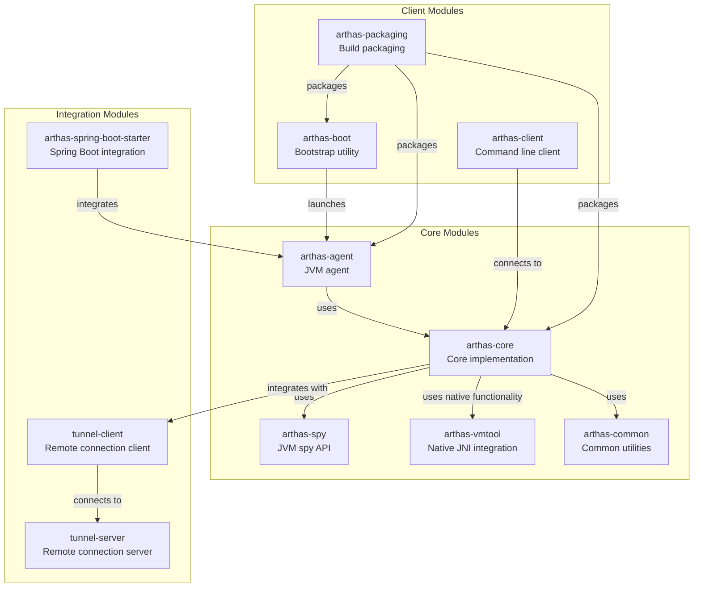
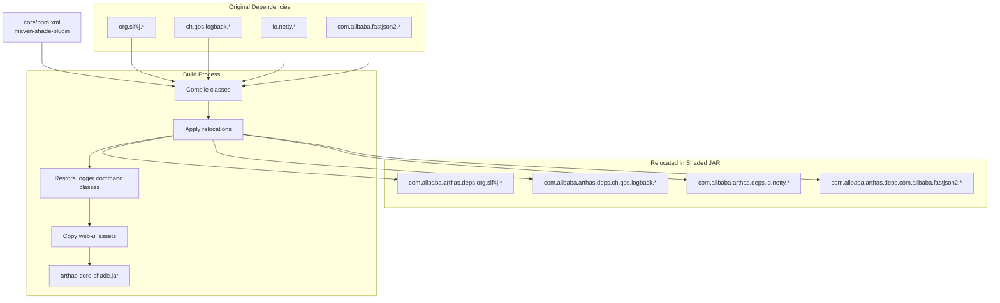
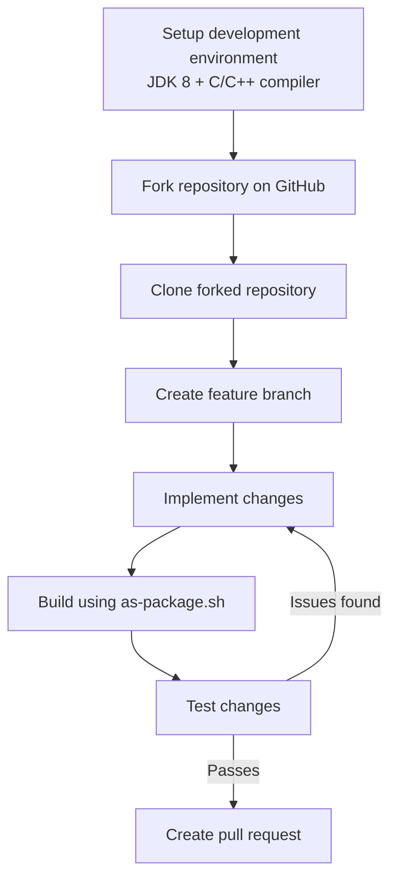
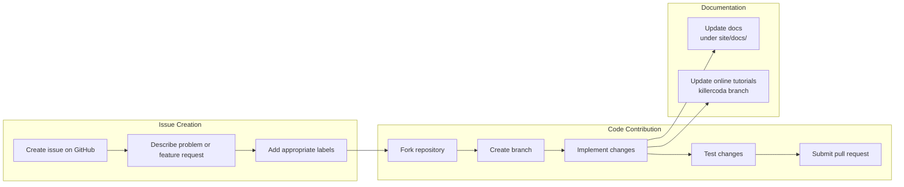
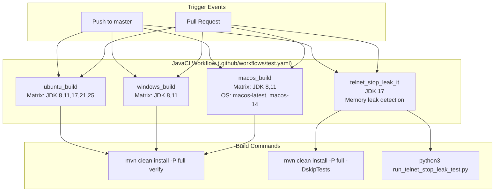
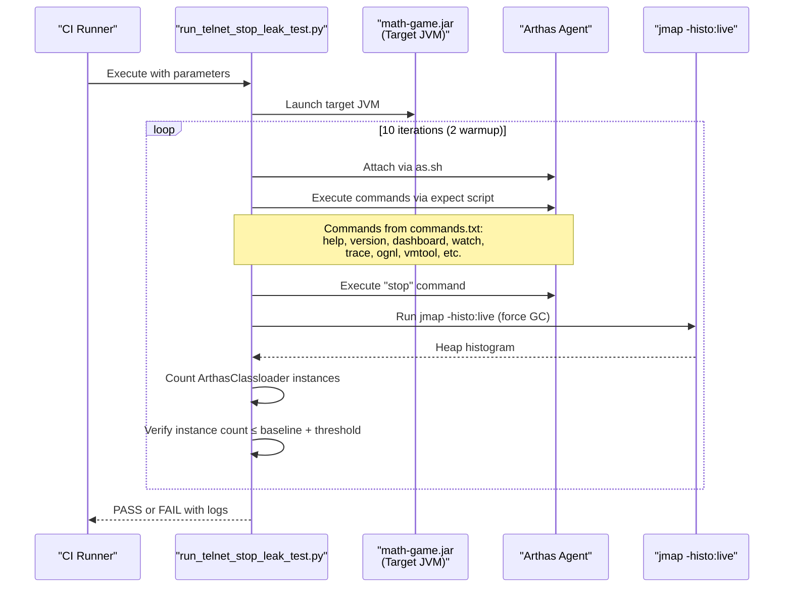
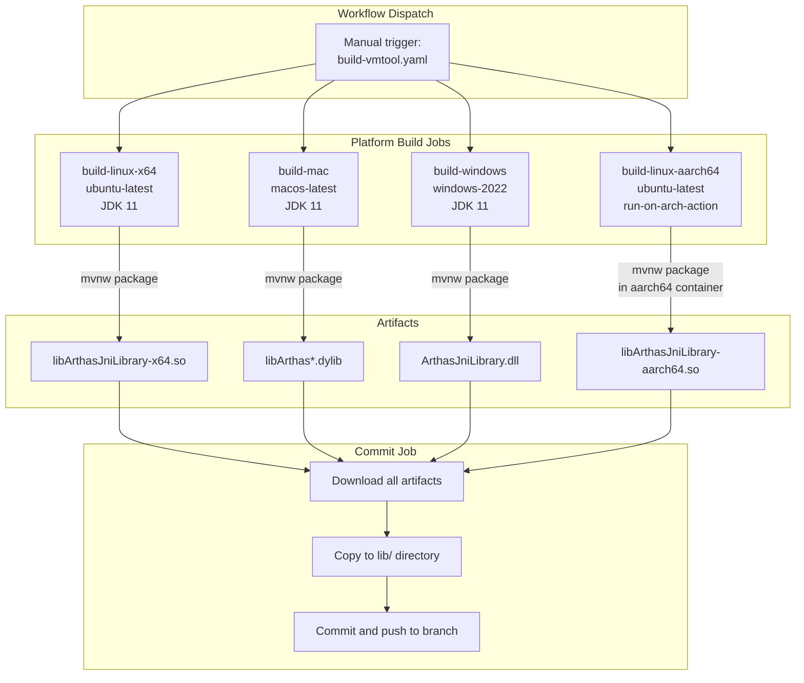
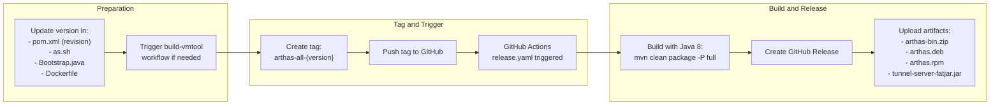
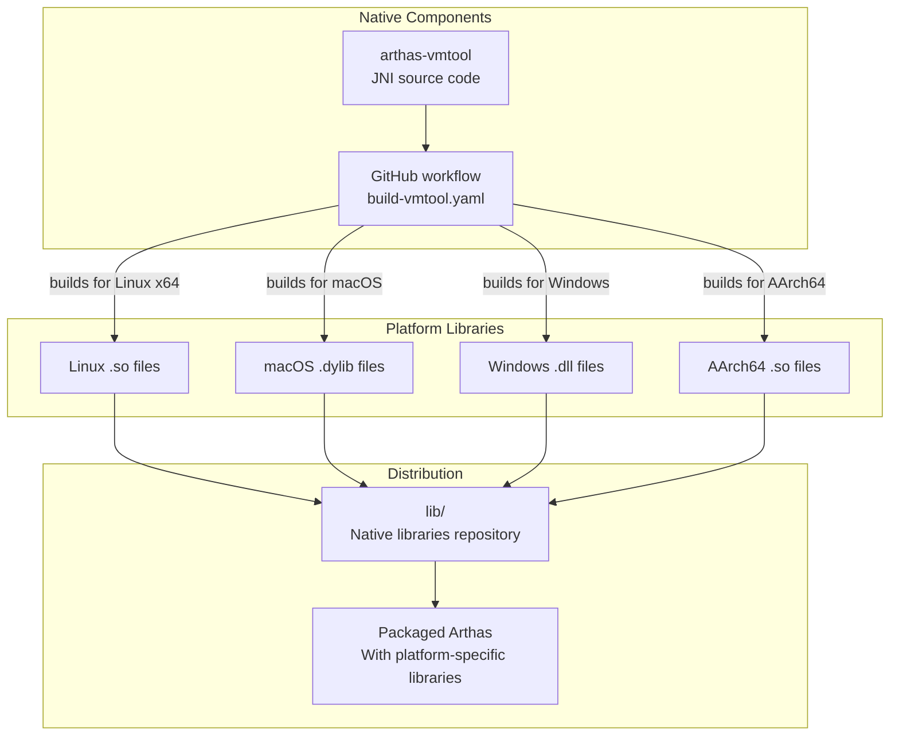
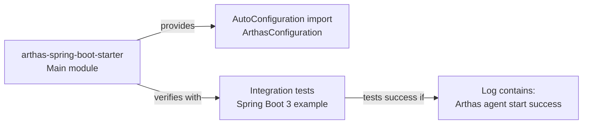

<!-- source: DeepWiki mcp.deepwiki.com · repo alibaba/arthas · page 9 Development and Contributing · fetched 2026-10-29 -->

# Development and Contributing

<details>
<summary>Relevant source files</summary>

The following files were used as context for generating this wiki page:

- [.github/workflows/auto-prettier.yaml](.github/workflows/auto-prettier.yaml)
- [.github/workflows/build-vmtool.yaml](.github/workflows/build-vmtool.yaml)
- [.github/workflows/release.yaml](.github/workflows/release.yaml)
- [.github/workflows/test.yaml](.github/workflows/test.yaml)
- [.gitignore](.gitignore)
- [agent/pom.xml](agent/pom.xml)
- [boot/pom.xml](boot/pom.xml)
- [client/pom.xml](client/pom.xml)
- [common/pom.xml](common/pom.xml)
- [core/pom.xml](core/pom.xml)
- [integration-test/telnet-stop-leak/README.md](integration-test/telnet-stop-leak/README.md)
- [integration-test/telnet-stop-leak/arthas_telnet.exp](integration-test/telnet-stop-leak/arthas_telnet.exp)
- [integration-test/telnet-stop-leak/commands.txt](integration-test/telnet-stop-leak/commands.txt)
- [integration-test/telnet-stop-leak/run_telnet_stop_leak_test.py](integration-test/telnet-stop-leak/run_telnet_stop_leak_test.py)
- [memorycompiler/pom.xml](memorycompiler/pom.xml)
- [packaging/pom.xml](packaging/pom.xml)
- [pom.xml](pom.xml)
- [site/pom.xml](site/pom.xml)
- [spy/pom.xml](spy/pom.xml)
- [testcase/pom.xml](testcase/pom.xml)
- [tunnel-client/pom.xml](tunnel-client/pom.xml)
- [tunnel-server/pom.xml](tunnel-server/pom.xml)

</details>


This page provides a comprehensive guide for developers who want to contribute to the Arthas project. It covers the development environment setup, building and testing the project, understanding the project structure, and the contribution workflow. For specific information about implementing new diagnostic commands, see [Adding New Commands](#9.2).

## Development Environment Requirements

Arthas has specific requirements for development that differ from its runtime requirements.

### JDK Version Requirements

- **Runtime**: Arthas supports JDK 6+
- **Development**: JDK 8 is recommended for compilation
  - Using higher versions may cause issues (see CI workflow configurations)
  - For JFR-related functionality, use OpenJDK 8u262+ or Zulu JDK 8

### Platform Support

Arthas supports development on multiple platforms:
- Linux
- macOS
- Windows

### Native Development Requirements

To support JNI components:
- C/C++ compilation environment is required
- Mac requires Xcode installation
- Windows requires GCC installation

Sources: [CONTRIBUTING.md:20-32](), [.github/workflows/test.yaml:8-18]()

## Project Structure for Contributors

The following diagram illustrates the key modules in Arthas that contributors should be familiar with:



Sources: [README.md:13-44]()

## Building and Testing

This section explains how to build and test Arthas locally.

### Maven Profiles and Build Configurations

Arthas uses several Maven profiles to control the build process:

| Profile | Activation | Purpose |
|---------|------------|---------|
| `jdk12` | JDK 12+ with JAVA8_HOME set | Adds tools.jar from JDK 8 for compilation on newer JDKs |
| `jdk17` | JDK 17+ | Includes arthas-mcp-integration-test module |
| `full` | Manual activation `-P full` | Enables git-commit-id-plugin and javadoc generation |
| `release` | `performRelease=true` | Enables GPG signing and central publishing |

The project is configured with:
- Java 8 source and target compatibility
- Maven flatten plugin for version management using `${revision}` property
- Current version: 4.1.5

Sources: [pom.xml:224-350]()

### Local Installation

It's recommended to use `as-package.sh` to package and install Arthas locally:

```bash
./as-package.sh
```

This script:
1. Compiles the project
2. Installs the latest version to `~/.arthas`
3. Creates a version suffixed with the current timestamp (e.g., `3.0.5.20180917161808`)

When debugging, Arthas will automatically load the latest version from this location.

### Manual Build Commands

Standard build (skipping tests):
```bash
./mvnw clean package -DskipTests
```

Full build with documentation and git info:
```bash
./mvnw clean package -P full -DskipTests
```

Build specific modules:
```bash
# Build only core and its dependencies
./mvnw -pl core -am clean package -DskipTests

# Build vmtool with native compilation
./mvnw -pl common,arthas-vmtool clean package -DskipTests
```

Verify build across all test profiles:
```bash
./mvnw clean install -P full verify
```

The packaging module generates multiple distribution formats under `packaging/target/`:
- `arthas-bin.zip` - Complete binary distribution
- `arthas-{version}.deb` - Debian package (with `-P deb`)
- `arthas-{version}.rpm` - RPM package (with `-P rpm`)

Sources: [pom.xml:1-493](), [packaging/pom.xml:1-263](), [.github/workflows/test.yaml:24-24]()

### Build Artifacts and Dependency Shading

The arthas-core module uses maven-shade-plugin to relocate dependencies and avoid conflicts with target application classes:



The relocation prevents classpath conflicts with application dependencies. The logger command classes are restored after shading to maintain compatibility with target JVM logging frameworks.

Sources: [core/pom.xml:18-106]()

### Running a Specific Version

When you have multiple versions built, you can specify which one to use:

```bash
./as.sh --use-version 3.0.5.20180919185025
```

To list all available versions:

```bash
./as.sh --versions
```

Sources: [CONTRIBUTING.md:40-51]()

## Development Workflow

The following diagram illustrates the workflow for Arthas development:



Sources: [CONTRIBUTING.md:20-65]()

### Running a Specific Version

When you have multiple versions built, you can specify which one to use:

```bash
./as.sh --use-version 3.0.5.20180919185025
```

To list all available versions:

```bash
./as.sh --versions
```

Sources: [CONTRIBUTING.md:40-51]()

## Debugging and Development Tips

### Debugging Arthas in IDEs

Arthas can be debugged in IDEs like IntelliJ IDEA. For detailed instructions, refer to the GitHub issue mentioned in the contributing guide.

### VmTool Native Development

For vmtool native library development:

**Important:** After modifying `arthas-vmtool` related codes, the packaging results need to be manually copied to the `lib/` path of this repo. They will not be copied automatically during the build.

The native build process:
1. Maven `native-maven-plugin` compiles C++ source to platform-specific libraries
2. Libraries are placed in `arthas-vmtool/target/`
3. For distribution, manually copy to `lib/` or trigger the `build-vmtool.yaml` workflow
4. The workflow builds for all platforms and commits to `lib/`

Platform-specific build requirements:
- **Linux**: g++ compiler (apt install g++)
- **macOS**: Xcode command line tools (xcode-select --install)
- **Windows**: MinGW-w64 or Visual Studio Build Tools
- **AArch64**: Cross-compilation or ARM64 environment

Sources: [CONTRIBUTING.md:54-56](), [CONTRIBUTING.md:26-32](), [arthas-vmtool/README.md:1-2](), [.github/workflows/build-vmtool.yaml:55-82]()

### Local Testing Workflow

Test changes locally before submitting pull requests:

1. **Build and install locally:**
   ```bash
   ./as-package.sh
   ```

2. **Test with a sample application:**
   ```bash
   # Start math-game (included in packaging)
   java -jar ~/.arthas/lib/{version}/arthas/math-game.jar
   
   # In another terminal, attach Arthas
   ./as.sh <pid>
   ```

3. **Test specific commands:**
   Execute the commands you modified or added to verify functionality

4. **Run unit tests:**
   ```bash
   ./mvnw test -pl core
   ```

5. **Run integration tests:**
   ```bash
   # Memory leak test
   python3 integration-test/telnet-stop-leak/run_telnet_stop_leak_test.py \
     --iterations 10 --warmup 2 --threshold 5
   ```

Sources: [CONTRIBUTING.md:34-65](), [integration-test/telnet-stop-leak/README.md:12-29]()

## Contribution Workflow



### Issue Reporting

Contributors are encouraged to use the [issue tracker](https://github.com/alibaba/arthas/issues) for:
- Feature requests
- Usage tips
- Troubleshooting experiences

### Documentation Contributions

Documentation is located in the `site/docs/` directory. Improvements to the documentation are welcome through pull requests.

### Online Tutorials

Refer to the README.md in the killercoda branch for guidance on contributing to online tutorials.

Sources: [CONTRIBUTING.md:3-17]()

## Continuous Integration and Testing Infrastructure

Arthas uses GitHub Actions for continuous integration across multiple platforms and JDK versions, with comprehensive testing including unit tests, integration tests, and memory leak detection.

### CI Workflow Architecture



### Test Matrix

The CI system tests Arthas across different Java versions and operating systems:

| Platform | JDK Versions | OS Variants | Build Command |
|----------|--------------|-------------|---------------|
| Ubuntu   | 8, 11, 17, 21, 25 | ubuntu-latest | `mvn -V -ntp clean install -P full verify` |
| Windows  | 8, 11 | windows-2022 | `mvn -V -ntp clean install -P full` |
| macOS    | 8, 11 | macos-latest, macos-14 | `mvn -V -ntp clean install -P full` |

All builds use:
- Zulu JDK distribution
- Maven dependency caching via `actions/setup-java@v3`
- `-ntp` flag (no transfer progress) for cleaner logs

Sources: [.github/workflows/test.yaml:1-84]()

### Memory Leak Integration Test

The `telnet_stop_leak_it` job performs comprehensive leak testing:

**Test Flow:**


**Test Configuration:**
- Iterations: 10
- Warmup rounds: 2 (excluded from leak detection)
- Threshold: 5 instances
- Timeout per command: 30 seconds
- Commands tested: help, version, session, dashboard, thread, sc, sm, jad, watch, trace, ognl, vmtool, reset

The test verifies that `com.taobao.arthas.agent.ArthasClassloader` instances do not accumulate after repeated attach/detach cycles, ensuring proper cleanup on `stop` command.

Sources: [.github/workflows/test.yaml:61-83](), [integration-test/telnet-stop-leak/run_telnet_stop_leak_test.py:1-337](), [integration-test/telnet-stop-leak/README.md:1-41](), [integration-test/telnet-stop-leak/commands.txt:1-23]()

### Native Library Build Workflow

A separate workflow builds native JNI libraries for all supported platforms:



The AArch64 build uses `uraimo/run-on-arch-action@v2` to run an Ubuntu 20.04 ARM64 container with OpenJDK 11 and g++ installed.

Built libraries are committed back to the repository under `lib/` directory for distribution.

Sources: [.github/workflows/build-vmtool.yaml:1-110]()

## Release Process

The release process involves several steps to ensure the correct packaging and distribution of Arthas.

### Automated Release Workflow

The release workflow is triggered automatically when a tag matching `arthas-all-*` is pushed:



Sources: [.github/workflows/release.yaml:1-32]()

### Manual Release Steps

For publishing to Maven Central:

1. Check and update vmtool libraries if needed by triggering the build action
2. Update version in `as.sh`, `Bootstrap.java`, and Dockerfile
3. Set up Maven `settings.xml` with credentials for Sonatype
4. Verify GPG is running for artifact signing
5. Run the release build:
   ```bash
   mvn clean deploy -DskipTests -P full -P release
   ```
6. The `release` profile automatically:
   - Signs artifacts with GPG via `maven-gpg-plugin`
   - Publishes to Sonatype Central using `central-publishing-maven-plugin`
7. Close and release staging repository on https://oss.sonatype.org/
8. Verify synchronization to Maven Central and Aliyun repositories
9. Create and push Git tag (which triggers GitHub release workflow)
10. Update documentation and other related resources

**Note:** The `tunnel-server` module is configured to skip central publishing due to Spring Boot repackaging incompatibilities.

Sources: [CONTRIBUTING.md:131-158](), [pom.xml:315-349](), [tunnel-server/pom.xml:216-222]()

### Distribution Packages

The packaging module produces multiple distribution formats:

| Format | Profile | Target | Use Case |
|--------|---------|--------|----------|
| ZIP | Default | `packaging/target/arthas-bin.zip` | Universal distribution |
| DEB | `-P deb` | `packaging/target/arthas-{version}.deb` | Debian/Ubuntu systems |
| RPM | `-P rpm` | `packaging/target/arthas-{version}.rpm` | RedHat/CentOS systems |
| JAR | Default | Individual module JARs | Maven dependency usage |

The DEB package installs to `/usr/share/arthas` with a symlink from `/usr/bin/as.sh`.
The RPM package installs to `/usr/share/arthas` with a symlink from `/usr/local/bin/as.sh`.

Sources: [packaging/pom.xml:75-234]()

## Cross-Platform Native Development

Arthas includes native code (JNI) for enhanced diagnostics capabilities, requiring special considerations for cross-platform development:



The native libraries are built using GitHub Actions and automatically committed to the `lib/` directory in the repository.

Sources: [.github/workflows/build-vmtool.yaml:7-108](), [CONTRIBUTING.md:26-32](), [arthas-vmtool/README.md:1-2]()

## Contributing to Spring Boot Integration

Arthas provides Spring Boot integration through the `arthas-spring-boot-starter` module.

### Spring Boot 3 Support

The project includes integration testing for Spring Boot 3:



Integration tests ensure compatibility with Spring Boot 3 by verifying successful agent startup.

Sources: [arthas-spring-boot-starter/src/it/arthas-spring-boot3-starter-example/pom.xml:1-56](), [arthas-spring-boot-starter/src/main/resources/META-INF/spring/org.springframework.boot.autoconfigure.AutoConfiguration.imports:1-2](), [arthas-spring-boot-starter/src/it/arthas-spring-boot3-starter-example/verify.groovy:1-4]()

## Community and Support

Arthas has a vibrant community with contributors from many organizations. The project welcomes contributions from companies and individual developers.

There are over 120 registered users of Arthas, including major companies like Alibaba, Alipay, and many others.

For questions and discussions, users can join the QQ or DingTalk groups mentioned in the Chinese documentation.

Sources: [README.md:419-434](), [USERS.md:1-168]()

---

