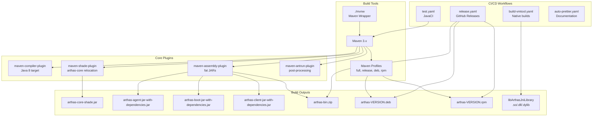
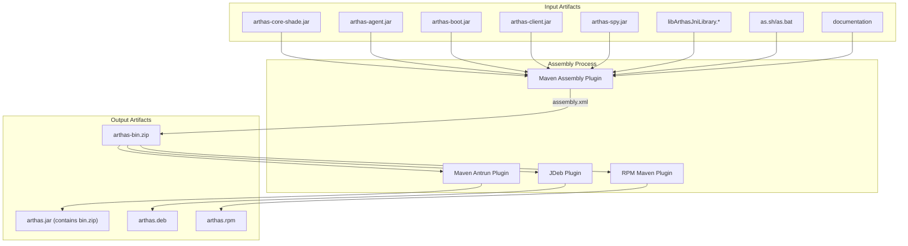
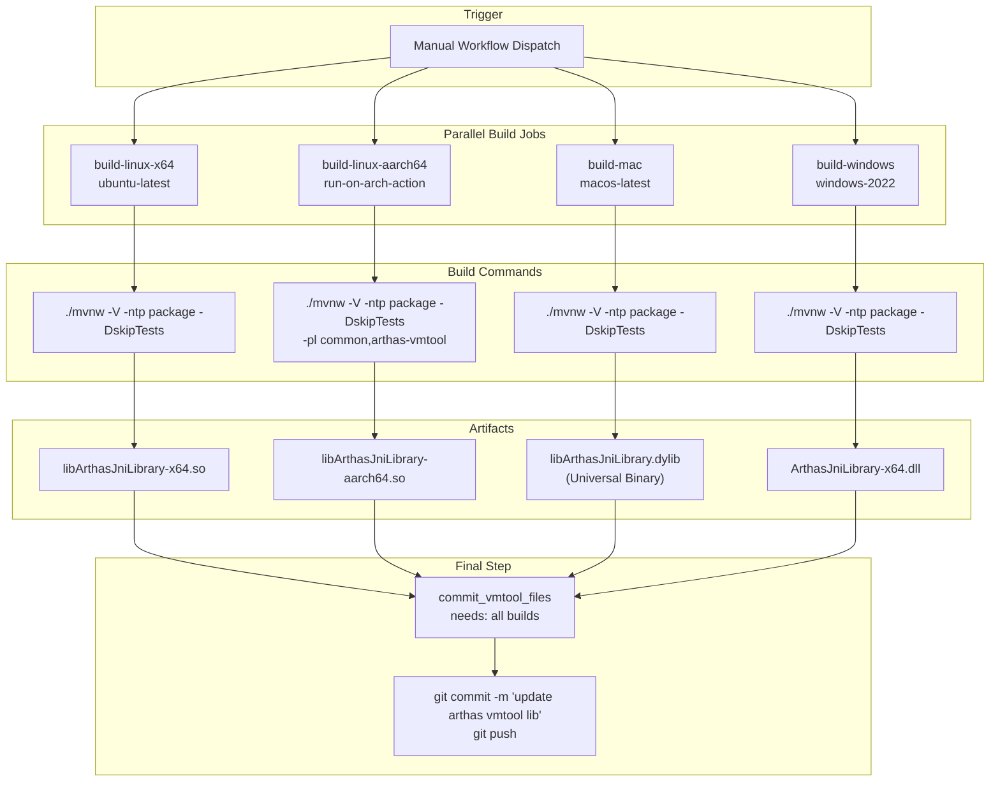
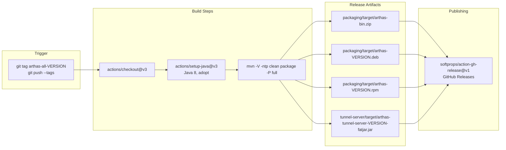
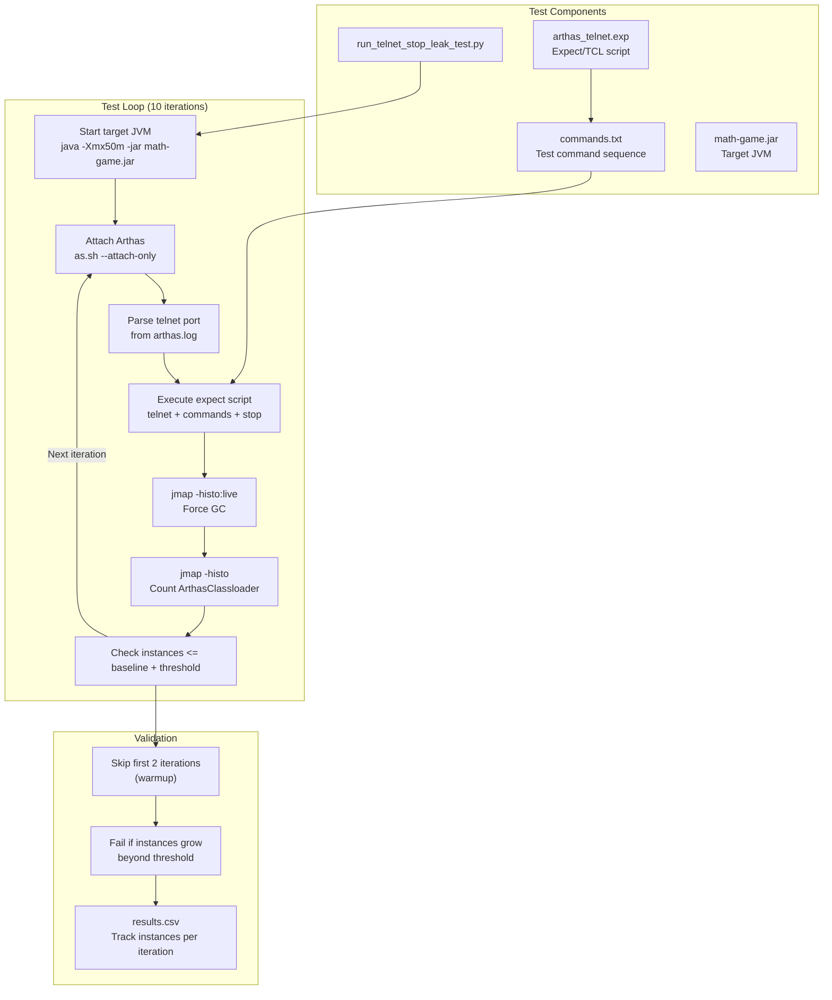
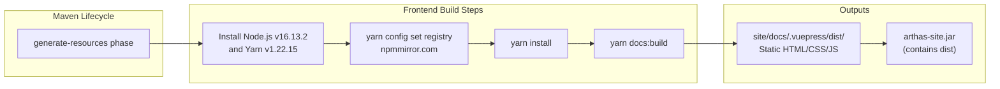

<!-- source: DeepWiki mcp.deepwiki.com · repo alibaba/arthas · page 9.1 Build System and CI/CD · fetched 2026-10-29 -->

# Build System and CI/CD

<details>
<summary>Relevant source files</summary>

The following files were used as context for generating this wiki page:

- [.github/workflows/auto-prettier.yaml](.github/workflows/auto-prettier.yaml)
- [.github/workflows/build-vmtool.yaml](.github/workflows/build-vmtool.yaml)
- [.github/workflows/release.yaml](.github/workflows/release.yaml)
- [.github/workflows/test.yaml](.github/workflows/test.yaml)
- [.gitignore](.gitignore)
- [agent/pom.xml](agent/pom.xml)
- [boot/pom.xml](boot/pom.xml)
- [client/pom.xml](client/pom.xml)
- [common/pom.xml](common/pom.xml)
- [core/pom.xml](core/pom.xml)
- [integration-test/telnet-stop-leak/README.md](integration-test/telnet-stop-leak/README.md)
- [integration-test/telnet-stop-leak/arthas_telnet.exp](integration-test/telnet-stop-leak/arthas_telnet.exp)
- [integration-test/telnet-stop-leak/commands.txt](integration-test/telnet-stop-leak/commands.txt)
- [integration-test/telnet-stop-leak/run_telnet_stop_leak_test.py](integration-test/telnet-stop-leak/run_telnet_stop_leak_test.py)
- [memorycompiler/pom.xml](memorycompiler/pom.xml)
- [packaging/pom.xml](packaging/pom.xml)
- [pom.xml](pom.xml)
- [site/pom.xml](site/pom.xml)
- [spy/pom.xml](spy/pom.xml)
- [testcase/pom.xml](testcase/pom.xml)
- [tunnel-client/pom.xml](tunnel-client/pom.xml)
- [tunnel-server/pom.xml](tunnel-server/pom.xml)

</details>


This document describes the build system and continuous integration/deployment pipeline used for Arthas, explaining how the project is built, tested, packaged, and distributed across multiple platforms. For information about module structure and architecture, see [Module Structure](#2.1).

## Overview

Arthas uses Maven as its primary build tool with a multi-module architecture, orchestrated through GitHub Actions for continuous integration and deployment. The build system supports cross-platform development with automated native library compilation for Linux (x64/aarch64), macOS, and Windows platforms. Arthas can be packaged as a standalone ZIP distribution, Debian (.deb), RPM, Docker images, and published to Maven Central.



Sources: [pom.xml:1-493](), [packaging/pom.xml:1-264](), [.github/workflows/test.yaml:1-84](), [.github/workflows/build-vmtool.yaml:1-110](), [.github/workflows/release.yaml:1-33]()

## Project Structure

The Arthas project is organized as a multi-module Maven project with a parent POM and multiple child modules.

```mermaid
flowchart TB
    Root["arthas-all (Root POM)"]
    
    subgraph "Core Modules"
        Core["arthas-core"]
        Agent["arthas-agent"]
        Spy["arthas-spy"]
        Boot["arthas-boot"]
        Client["arthas-client"]
        Common["arthas-common"]
        VMTool["arthas-vmtool"]
    end
    
    subgraph "Supporting Modules"
        MemCompiler["memorycompiler"]
        TunnelClient["tunnel-client"]
        TunnelCommon["tunnel-common"] 
        TunnelServer["tunnel-server"]
    end
    
    subgraph "Integration Modules"
        SpringStarter["arthas-spring-boot-starter"]
        AgentAttach["arthas-agent-attach"]
    end
    
    subgraph "Build & Distribution"
        WebUI["web-ui"]
        Site["site"]
        Packaging["packaging"]
        TestCase["testcase"]
    end
    
    Root --> Core
    Root --> Agent
    Root --> Spy
    Root --> Boot
    Root --> Client
    Root --> Common
    Root --> VMTool
    Root --> MemCompiler
    Root --> TunnelClient
    Root --> TunnelCommon
    Root --> TunnelServer
    Root --> SpringStarter
    Root --> AgentAttach
    Root --> WebUI
    Root --> Site
    Root --> Packaging
    Root --> TestCase
```



Sources: [pom.xml:59-83]()

## Maven Configuration

### Dependencies Management

The root POM defines a comprehensive dependency management section to ensure consistent dependency versions across all modules.

Key dependencies include:
- bytekit-core: For bytecode manipulation
- termd-core: Terminal handling
- fastjson2: JSON serialization
- ognl: Object Graph Navigation Language support
- slf4j/logback: Logging
- Netty: For networking and HTTP support
- JUnit/Assertj/Mockito: For testing

Sources: [pom.xml:99-235]()

### Plugin Management

The build is orchestrated by several key Maven plugins:

```mermaid
flowchart TB
    subgraph "Core Build Plugins"
        Compiler["maven-compiler-plugin"]
        Jar["maven-jar-plugin"]
        Source["maven-source-plugin"]
        Flatten["flatten-maven-plugin"]
    end
    
    subgraph "Assembly & Packaging"
        Assembly["maven-assembly-plugin"]
        Shade["maven-shade-plugin"]
        Antrun["maven-antrun-plugin"]
    end
    
    subgraph "Special-Purpose Plugins"
        GitCommit["git-commit-id-plugin"]
        Javadoc["maven-javadoc-plugin"]
        Frontend["frontend-maven-plugin"]
        JDeb["jdeb-plugin"]
        RPM["rpm-maven-plugin"]
    end
    
    Compiler -->|"Compiles source code"| Java8["Java 8+ Bytecode"]
    Jar -->|"Creates JAR archives"| BasicJars["Basic Module JARs"]
    Source -->|"Attaches source code"| SourceJars["Source JARs"]
    Flatten -->|"Flattens POMs"| FlatPOMs["Deployable POMs"]
    
    Assembly -->|"Creates distributions"| Distribution["arthas-bin.zip"]
    Shade -->|"Creates uberjar with relocated deps"| Uberjar["arthas-core-shade.jar"]
    Antrun -->|"Post-processes artifacts"| FinalJar["Final JARs"]
    
    GitCommit -->|"Embeds Git metadata"| VersionInfo["Version Info"]
    Javadoc -->|"Generates documentation"| JavadocJar["Javadoc JARs"]
    Frontend -->|"Builds web UI"| WebUIAssets["Web Console UI"]
    JDeb -->|"Builds Debian package"| DebPackage[".deb Package"]
    RPM -->|"Builds RPM package"| RpmPackage[".rpm Package"]
```



Sources: [pom.xml:346-478](), [core/pom.xml:18-104](), [packaging/pom.xml:30-71]()

## Module Build Strategies

Different modules in Arthas have specific build strategies:

### Core Module

The `arthas-core` module uses the Maven Shade plugin to create a self-contained JAR with all dependencies:

1. First, it creates a shaded JAR with relocated dependencies to avoid conflicts
2. Then, it uses the Maven Antrun plugin to restore logger command classes and add Web UI assets
3. The final output is `arthas-core-shade.jar`

Sources: [core/pom.xml:18-104]()

### Agent Module

The `arthas-agent` module builds a JAR with manifest entries for Java agent functionality:
- `Premain-Class` and `Agent-Class` point to `com.taobao.arthas.agent334.AgentBootstrap`
- Sets `Can-Redefine-Classes` and `Can-Retransform-Classes` to `true`

Sources: [agent/pom.xml:33-65]()

### Boot, Client, and Other Modules

The executable modules like `arthas-boot` and `arthas-client` use the Assembly plugin to build fat JARs with:
- All dependencies included
- Manifest entries for main class
- Implementation version information

Sources: [boot/pom.xml:36-67](), [client/pom.xml:15-47]()

## Packaging and Distribution

The `packaging` module is responsible for assembling the final distribution packages.

### Distribution Assembly

The main packaging process creates:
1. A ZIP file containing all necessary components (JARs, scripts, documentation)
2. Platform-specific packages (.deb, .rpm) with appropriate file locations and dependencies



Sources: [packaging/pom.xml:30-262]()

## Maven Profiles

The build system uses Maven profiles to customize the build process for different scenarios:

| Profile | Purpose | Activation |
|---------|---------|------------|
| jdk12   | Special handling for JDK 12+ | Automatically when JDK ≥ 12 |
| full    | Includes Git metadata and Javadoc | Manual activation (`-P full`) |
| release | Adds GPG signing for Maven Central | When `performRelease` property is set |
| deb     | Builds Debian package | JDK ≥ 1.8 |
| rpm     | Builds RPM package | On Linux with `-Drpm` flag |

Sources: [pom.xml:238-344](), [packaging/pom.xml:75-261]()

## GitHub Actions CI/CD Pipeline

Arthas uses GitHub Actions for all continuous integration and deployment tasks. The CI/CD pipeline consists of four main workflows defined in `.github/workflows/`:

### JavaCI Workflow (test.yaml)

The primary test workflow runs on every push to master and on all pull requests. It performs matrix builds across multiple Java versions and operating systems.

**Test Matrix:**

| Job | Operating System | Java Versions | Maven Command |
|-----|------------------|---------------|---------------|
| `ubuntu_build` | `ubuntu-latest` | 8, 11, 17, 21, 25 | `mvn -V -ntp clean install -P full verify` |
| `windows_build` | `windows-2022` | 8, 11 | `mvn -V -ntp clean install -P full` |
| `macos_build` | `macos-latest`, `macos-14` | 8, 11 | `mvn -V -ntp clean install -P full` |
| `telnet_stop_leak_it` | `ubuntu-latest` | 17 | Integration test for memory leaks |

The `telnet_stop_leak_it` job is a specialized integration test that verifies Arthas properly cleans up resources after detachment. It uses Python and Expect scripts to repeatedly attach Arthas to a target JVM, execute commands via telnet, stop, and verify that `ArthasClassloader` instances are garbage collected.

Sources: [.github/workflows/test.yaml:1-84](), [integration-test/telnet-stop-leak/run_telnet_stop_leak_test.py:1-338](), [integration-test/telnet-stop-leak/arthas_telnet.exp:1-97]()

### VMTool Native Build Workflow (build-vmtool.yaml)

This workflow is manually triggered (`workflow_dispatch`) to rebuild native JNI libraries for `arthas-vmtool`. It runs parallel jobs for each platform:



**Platform-Specific Details:**

- **Linux x64**: Uses `native-maven-plugin` with g++ compiler on Ubuntu
- **Linux aarch64**: Uses `uraimo/run-on-arch-action@v2` with `ubuntu20.04` distro, installs `openjdk-11-jdk` and `g++`
- **macOS**: Builds universal binary supporting both x86_64 and arm64 architectures
- **Windows**: Uses Visual Studio toolchain on `windows-2022` runner

After all builds complete, the `commit_vmtool_files` job downloads all artifacts, copies them to `lib/` directory, and commits them back to the repository. This ensures native libraries are version-controlled for reproducible builds.

Sources: [.github/workflows/build-vmtool.yaml:1-110](), [arthas-vmtool/pom.xml:1-100]()

### Release Workflow (release.yaml)

Triggered automatically when a tag matching `arthas-all-*` is pushed:



The workflow uses the `full` Maven profile which activates:
- `git-commit-id-plugin`: Embeds Git commit info into `arthas-git.properties`
- `maven-javadoc-plugin`: Generates Javadoc JARs
- Debian/RPM packaging plugins

Sources: [.github/workflows/release.yaml:1-33](), [pom.xml:256-313]()

### Documentation Auto-Formatting (auto-prettier.yaml)

Automatically runs Prettier on documentation when files in `site/**` are modified:

```
prettier --config ./site/.prettierrc.json --ignore-path ./site/.prettierignore --write ./site
```

Sources: [.github/workflows/auto-prettier.yaml:1-22]()

## Cross-Platform Native Library Builds

Arthas's diagnostic capabilities rely on native code in the `arthas-vmtool` module, which provides JNI/JVMTI access for heap analysis and advanced VM operations. The native build process is handled by the `native-maven-plugin` configured in `arthas-vmtool/pom.xml`.

### Native Build Configuration

The `arthas-vmtool` module uses platform detection and compiler-specific flags:

**Build Process:**
1. Maven invokes `native-maven-plugin` during compile phase
2. Plugin detects OS and architecture using `${os.detected.name}` and `${os.detected.arch}` properties
3. Compiles `arthas-vmtool/src/main/native/` C++ sources with JNI headers
4. Links into platform-specific shared library:
   - Linux: `libArthasJniLibrary-x64.so` or `libArthasJniLibrary-aarch64.so`
   - macOS: `libArthasJniLibrary.dylib` (universal binary)
   - Windows: `ArthasJniLibrary-x64.dll`

**Compiler Flags by Platform:**

| Platform | Compiler | Key Flags |
|----------|----------|-----------|
| Linux x64/aarch64 | g++ | `-fPIC -shared -std=c++11` |
| macOS | clang++ | `-arch x86_64 -arch arm64` (universal) |
| Windows | MSVC | `/MD /EHsc` |

Sources: [arthas-vmtool/pom.xml:1-100](), [.github/workflows/build-vmtool.yaml:55-83]()

### Reproducible Builds Strategy

Native libraries are committed to the repository in the `lib/` directory rather than being built on-demand. This approach:
- Ensures consistent library versions across builds
- Avoids requiring native toolchains for normal development
- Allows the `build-vmtool.yaml` workflow to update libraries when needed
- The `Enhancer` class and bytecode instrumentation system load these libraries at runtime via `System.loadLibrary()`

When libraries need to be updated (e.g., for bug fixes or new features), developers manually trigger the `build-vmtool` workflow, which rebuilds all platforms and commits the results.

Sources: [.github/workflows/build-vmtool.yaml:84-110](), [lib/]()

## Memory Leak Integration Testing

The `telnet-stop-leak` integration test is a sophisticated Python-based test harness that validates Arthas properly releases resources after detachment. This test runs in the CI pipeline to catch regressions.

**Test Architecture:**



**Key Test Parameters:**
- `--iterations 10`: Total test cycles
- `--warmup 2`: Initial cycles excluded from validation
- `--threshold 5`: Maximum allowed growth in `ArthasClassloader` instances
- `--attach-timeout 90`: Seconds to wait for attachment
- `--expect-timeout 30`: Seconds per command execution

The test executes realistic diagnostic commands (`watch`, `trace`, `vmtool`, `ognl`) via telnet, then validates that all Arthas infrastructure is properly cleaned up after `stop`.

Sources: [integration-test/telnet-stop-leak/run_telnet_stop_leak_test.py:1-338](), [integration-test/telnet-stop-leak/arthas_telnet.exp:1-97](), [integration-test/telnet-stop-leak/commands.txt:1-24](), [.github/workflows/test.yaml:61-84]()

## Building Arthas Locally

### Prerequisites

- JDK 8 or higher (JDK 8 required for production builds)
- Maven 3.x or use `./mvnw` (Maven Wrapper)
- For native library builds: Platform-specific C++ compiler (g++, clang, MSVC)
- For documentation builds: Node.js and Yarn (handled by `frontend-maven-plugin`)

### Common Build Commands

**Basic development build:**
```bash
./mvnw clean install
```

**Full production build with all features:**
```bash
./mvnw clean install -P full
```

This activates the `full` profile which:
- Generates Git metadata via `git-commit-id-plugin` → `arthas-git.properties`
- Creates Javadoc JARs via `maven-javadoc-plugin`
- Builds documentation site via `site` module

**Build with Debian package:**
```bash
./mvnw clean package -P full,deb
```
Produces: `packaging/target/arthas-VERSION.deb`

**Build with RPM package (Linux only):**
```bash
./mvnw clean package -P full,rpm -Drpm
```
Produces: `packaging/target/rpm/arthas/RPMS/noarch/arthas-VERSION.noarch.rpm`

**Build specific modules:**
```bash
./mvnw clean install -pl core,agent -am
```

**Skip tests:**
```bash
./mvnw clean install -DskipTests
```

**Build with specific Java version (CI scenario):**
```bash
JAVA8_HOME=/path/to/jdk8 ./mvnw clean install -P full
```

The `jdk12` profile activates automatically when building with JDK 12+ and uses `JAVA8_HOME` for `tools.jar` dependency.

Sources: [pom.xml:225-253](), [.github/workflows/test.yaml:24-76]()

### Dependency Relocation in Core Module

The `arthas-core` module uses `maven-shade-plugin` to create an uber-JAR with relocated dependencies to avoid classpath conflicts with target applications:

**Relocated Packages:**
- `org.slf4j` → `com.alibaba.arthas.deps.org.slf4j`
- `ch.qos.logback` → `com.alibaba.arthas.deps.ch.qos.logback`
- `io.netty` → `com.alibaba.arthas.deps.io.netty`
- `com.alibaba.fastjson2` → `com.alibaba.arthas.deps.com.alibaba.fastjson2`

The build then uses `maven-antrun-plugin` to restore original logger command classes (which must access application's logging framework) and inject Web UI assets from `web-ui` module.

Sources: [core/pom.xml:18-106](), [core/pom.xml:45-63]()

## Documentation Build Pipeline

The `site` module builds the VuePress-based documentation website at `https://arthas.aliyun.com`. The build process is automated through `frontend-maven-plugin`:



**Configuration:**
- Node download mirror: `https://npmmirror.com/mirrors/node/`
- Yarn registry: `https://registry.npmmirror.com/`
- Install directory: `site/target/` (isolated from system)
- Skip flag: `-Darthas.site.frontend.skip=true` to disable frontend build

The generated site is included in the `packaging` module for offline documentation in `arthas-bin.zip`.

Sources: [site/pom.xml:14-89](), [packaging/pom.xml:14-28]()

## Versioning

Arthas uses the Maven flatten plugin to manage versions. The project version is defined in the root POM's `revision` property and propagated to all modules.

Sources: [pom.xml:87-87](), [pom.xml:455-478]()

---

