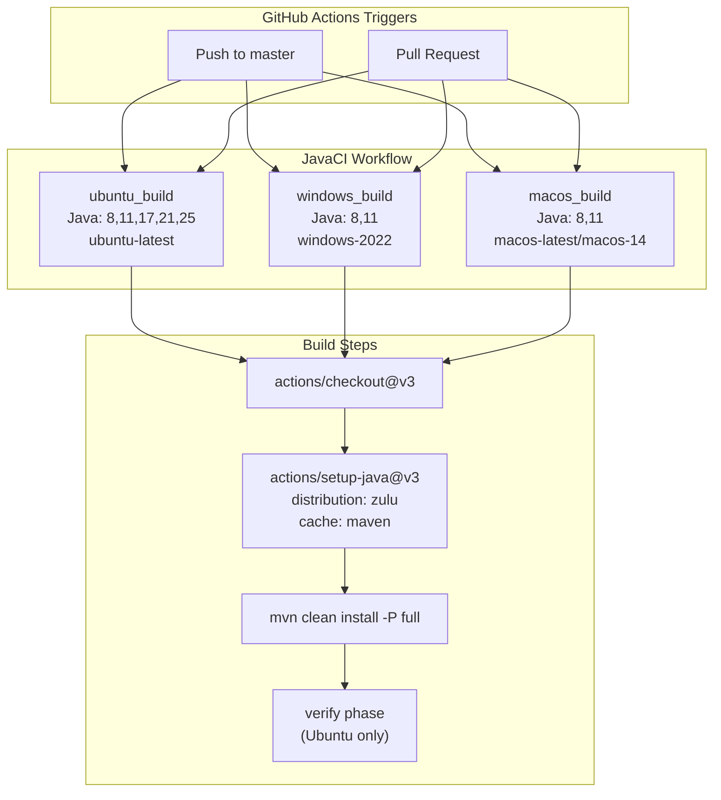
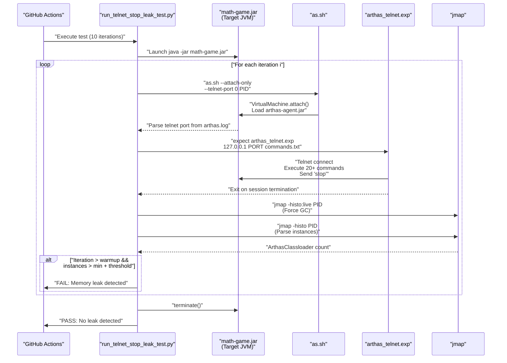
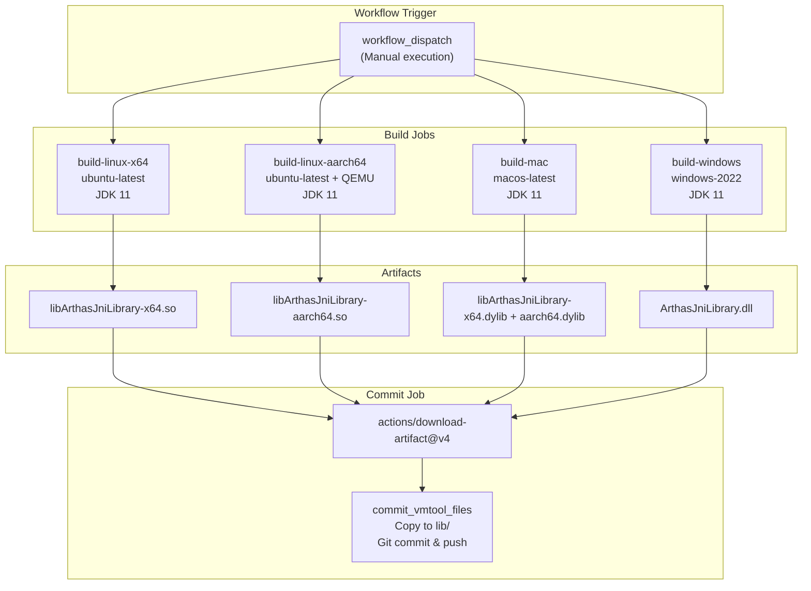

<!-- source: DeepWiki mcp.deepwiki.com · repo alibaba/arthas · page 9.2 Testing Infrastructure · fetched 2026-10-29 -->

# Testing Infrastructure

<details>
<summary>Relevant source files</summary>

The following files were used as context for generating this wiki page:

- [.github/workflows/auto-prettier.yaml](.github/workflows/auto-prettier.yaml)
- [.github/workflows/build-vmtool.yaml](.github/workflows/build-vmtool.yaml)
- [.github/workflows/release.yaml](.github/workflows/release.yaml)
- [.github/workflows/test.yaml](.github/workflows/test.yaml)
- [.gitignore](.gitignore)
- [integration-test/telnet-stop-leak/README.md](integration-test/telnet-stop-leak/README.md)
- [integration-test/telnet-stop-leak/arthas_telnet.exp](integration-test/telnet-stop-leak/arthas_telnet.exp)
- [integration-test/telnet-stop-leak/commands.txt](integration-test/telnet-stop-leak/commands.txt)
- [integration-test/telnet-stop-leak/run_telnet_stop_leak_test.py](integration-test/telnet-stop-leak/run_telnet_stop_leak_test.py)

</details>


## Purpose and Scope

This document describes Arthas's testing infrastructure, including the CI/CD pipeline, integration testing framework, and specialized memory leak detection tests. The testing system ensures code quality across multiple JDK versions, operating systems, and platform architectures.

For information about the build system that produces artifacts to be tested, see [Build System and CI/CD](#9.1).

---

## CI/CD Test Matrix

Arthas employs a comprehensive GitHub Actions-based testing strategy that validates functionality across diverse environments. The primary workflow is `JavaCI`, which executes on every push to `master` and on all pull requests.

### Multi-Platform Test Jobs

The CI system executes three parallel job categories:

| Job | Operating System | JDK Versions | Profile |
|-----|-----------------|--------------|---------|
| `ubuntu_build` | `ubuntu-latest` | 8, 11, 17, 21, 25 | `full` with `verify` |
| `windows_build` | `windows-2022` | 8, 11 | `full` |
| `macos_build` | `macos-latest`, `macos-14` | 8, 11 | `full` |

**Sources:** [.github/workflows/test.yaml:10-59]()



**Sources:** [.github/workflows/test.yaml:1-59]()

### Build Command Execution

Each platform executes Maven with the `-P full` profile, which activates comprehensive dependency shading and native library compilation. The Ubuntu job uniquely includes the `verify` lifecycle phase for additional validation:

```bash
mvn -V -ntp clean install -P full verify
```

**Sources:** [.github/workflows/test.yaml:24]()

---

## Integration Testing Framework

### Telnet Stop Leak Test

The `telnet_stop_leak_it` job implements a specialized integration test that detects memory leaks in Arthas's classloader management. This test repeatedly attaches Arthas to a target JVM, executes diagnostic commands via telnet, and verifies proper resource cleanup after the `stop` command.

**Test Configuration:**

| Parameter | Default | Purpose |
|-----------|---------|---------|
| `--iterations` | 10 | Number of attach/detach cycles |
| `--warmup` | 2 | Initial cycles excluded from leak detection |
| `--threshold` | 5 | Maximum allowable instance count growth |
| `--attach-timeout` | 90s | Timeout for `as.sh` attachment |
| `--expect-timeout` | 30s | Timeout per telnet command |
| `--jmap-timeout` | 120s | Timeout for heap analysis |

**Sources:** [integration-test/telnet-stop-leak/run_telnet_stop_leak_test.py:141-150]()



**Sources:** [.github/workflows/test.yaml:61-83](), [integration-test/telnet-stop-leak/run_telnet_stop_leak_test.py:139-337]()

### Test Execution Components

The integration test orchestrates several components:

1. **Target Application**: `math-game.jar` serves as the diagnostic target, launched with constrained heap (`-Xmx50m`)
2. **Attachment Script**: `as.sh` from `arthas-bin` directory attaches to the target JVM with dynamic port allocation
3. **Expect Automation**: `arthas_telnet.exp` automates telnet interaction, handling command timeouts and Ctrl+C interrupts
4. **Command Coverage**: `commands.txt` defines 20+ commands covering class inspection, bytecode enhancement, OGNL evaluation, and vmtool operations

**Sources:** [integration-test/telnet-stop-leak/run_telnet_stop_leak_test.py:206-215](), [integration-test/telnet-stop-leak/arthas_telnet.exp:1-96]()

### Leak Detection Algorithm

The Python test harness implements statistical leak detection:

```python
# Parse ArthasClassloader instances from jmap -histo output
instances, matched_line = parse_arthas_classloader_instances(jmap_histo_out)

# Track minimum instance count after warmup
if i > args.warmup:
    min_so_far = instances if min_so_far is None else min(min_so_far, instances)
    if instances > min_so_far + args.threshold:
        raise RuntimeError("Leak detected")
```

The algorithm expects `com.taobao.arthas.agent.ArthasClassloader` instances to stabilize or decrease after warmup iterations. Growth exceeding the threshold indicates improper cleanup after `stop`.

**Sources:** [integration-test/telnet-stop-leak/run_telnet_stop_leak_test.py:81-96](), [integration-test/telnet-stop-leak/run_telnet_stop_leak_test.py:312-323]()

### Expect Script Implementation

The `arthas_telnet.exp` script provides robust telnet automation with timeout handling:

```tcl
# Connect and wait for Arthas prompt "$ "
spawn telnet $host $port
expect {
    -re {\$ } {}
    timeout { exit 2 }
}

# Execute each command from file
while {[gets $fp line] >= 0} {
    send -- "$line\r"
    expect {
        -re {\$ } {}
        timeout {
            # Interrupt with Ctrl+C on timeout
            send -- "\003"
        }
    }
}

# Final stop command
send -- "stop\r"
expect {
    -re {Session has been terminated} {}
    eof {}
}
```

**Sources:** [integration-test/telnet-stop-leak/arthas_telnet.exp:28-95]()

---

## Native Library Build Testing

The `build-vmtool` workflow validates cross-platform compilation of `libArthasJniLibrary` native components. This workflow executes manually via `workflow_dispatch` and produces platform-specific binaries.

### Platform Build Matrix



**Sources:** [.github/workflows/build-vmtool.yaml:1-110]()

### Architecture-Specific Compilation

Each platform executes native compilation through the `native-maven-plugin`:

| Platform | Runner | Compiler | Output |
|----------|--------|----------|--------|
| Linux x64 | `ubuntu-latest` | `g++` | `libArthasJniLibrary-x64.so` |
| Linux aarch64 | `ubuntu-latest` + `run-on-arch-action` | `g++` (emulated) | `libArthasJniLibrary-aarch64.so` |
| macOS Universal | `macos-latest` | `clang` | Universal binary (.dylib) |
| Windows | `windows-2022` | `MSVC` | `ArthasJniLibrary.dll` |

**Sources:** [.github/workflows/build-vmtool.yaml:7-83]()

The aarch64 build uses `uraimo/run-on-arch-action@v2` to execute QEMU-based ARM64 emulation:

```yaml
- uses: uraimo/run-on-arch-action@v2
  with:
    arch: aarch64
    distro: ubuntu20.04
    run: |
      apt update && apt install openjdk-11-jdk g++ -y
      export JAVA_HOME=/usr/lib/jvm/java-11-openjdk-arm64
      ./mvnw -V -ntp package -DskipTests -pl common,arthas-vmtool
```

**Sources:** [.github/workflows/build-vmtool.yaml:55-78]()

### Artifact Commitment

The `commit_vmtool_files` job aggregates all platform binaries and commits them to the `lib/` directory:

```bash
mkdir -p lib
cp tmplib/*/* lib/
git add lib/
git commit -m "update arthas vmtool lib"
```

This ensures reproducible builds by checking in pre-compiled native libraries alongside Java source code.

**Sources:** [.github/workflows/build-vmtool.yaml:84-109]()

---

## Test Artifact Management

### Artifact Upload on Failure

The `telnet_stop_leak_it` job preserves diagnostic artifacts when tests fail:

```yaml
- name: Upload artifacts on failure
  if: failure()
  uses: actions/upload-artifact@v4
  with:
    name: telnet-stop-leak-logs
    path: integration-test/telnet-stop-leak/work
```

Uploaded artifacts include:
- `results.csv`: Per-iteration classloader instance counts
- `logs/attach/*.log`: `as.sh` attachment outputs
- `logs/telnet/*.log`: Expect script transcripts
- `logs/jmap/*.err`: Heap analysis error outputs
- `logs/math-game.log`: Target JVM stdout/stderr

**Sources:** [.github/workflows/test.yaml:78-83](), [integration-test/telnet-stop-leak/run_telnet_stop_leak_test.py:171-174]()

### Working Directory Structure

The Python test harness creates timestamped run directories:

```
work/
└── run-20240115-143022/
    ├── results.csv
    ├── home/                    # Isolated HOME for Arthas
    │   └── logs/arthas/arthas.log
    └── logs/
        ├── math-game.log
        ├── attach/
        │   ├── attach-001.log
        │   └── attach-002.log
        ├── telnet/
        │   ├── telnet-001.log
        │   └── expect-run-001.log
        └── jmap/
            └── jmap-live-001.err
```

**Sources:** [integration-test/telnet-stop-leak/run_telnet_stop_leak_test.py:164-174]()

---

## Test Command Coverage

The `commands.txt` file defines the diagnostic command sequence executed during leak testing:

```mermaid
graph LR
    subgraph "Basic Commands"
        Help["help"]
        Version["version"]
        Session["session"]
    end
    
    subgraph "Monitoring Commands"
        Dashboard["dashboard -n 1"]
        Thread["thread -n 3"]
    end
    
    subgraph "Class Inspection"
        SC["sc -d demo.MathGame"]
        SM["sm demo.MathGame"]
        JAD["jad demo.MathGame"]
    end
    
    subgraph "Bytecode Enhancement"
        Watch["watch demo.MathGame primeFactors<br/>-n 1 -x 1"]
        Trace1["trace demo.MathGame run -n 1"]
        Trace2["trace demo.MathGame primeFactors<br/>'#cost>0' -n 1"]
    end
    
    subgraph "Expression & Native"
        OGNL1["ognl @System@getProperty"]
        OGNL2["ognl @Runtime@availableProcessors"]
        VmTool1["vmtool --action getInstances"]
        VmTool2["vmtool --action forceGc"]
    end
    
    subgraph "Cleanup"
        Reset["reset"]
        Stop["stop<br/>(by expect script)"]
    end
    
    Help --> Version
    Version --> Session
    Session --> Dashboard
    Dashboard --> Thread
    Thread --> SC
    SC --> SM
    SM --> JAD
    JAD --> Watch
    Watch --> Trace1
    Trace1 --> Trace2
    Trace2 --> OGNL1
    OGNL1 --> OGNL2
    OGNL2 --> VmTool1
    VmTool1 --> VmTool2
    VmTool2 --> Reset
    Reset --> Stop
```



**Sources:** [integration-test/telnet-stop-leak/commands.txt:1-23]()

This command sequence exercises critical code paths:
- **Class inspection**: `sc`, `sm`, `jad` (Section [3.2](#3.2))
- **Bytecode enhancement**: `watch`, `trace` (Section [3.3](#3.3))
- **OGNL evaluation**: `ognl` (Section [3.4](#3.4))
- **Native operations**: `vmtool` (Section [6.2](#6.2))
- **Enhancement cleanup**: `reset`

---

## Environment Dependencies

### Required Tools

The integration test framework requires the following system dependencies:

| Tool | Purpose | Validation |
|------|---------|------------|
| `expect` | Telnet automation scripting | `which_or_throw("expect")` |
| `telnet` | Network protocol client | `which_or_throw("telnet")` |
| `java` | Target JVM execution | `resolve_java_bin("java")` |
| `jmap` | Heap histogram analysis | `resolve_java_bin("jmap")` |
| `bash` | Shell script execution | `which_or_throw("bash")` |

**Sources:** [integration-test/telnet-stop-leak/run_telnet_stop_leak_test.py:31-48](), [integration-test/telnet-stop-leak/run_telnet_stop_leak_test.py:179-183]()

The CI workflow installs these dependencies explicitly:

```yaml
- name: Install expect/telnet
  run: sudo apt-get update && sudo apt-get install -y expect telnet
```

**Sources:** [.github/workflows/test.yaml:72-73]()

### Repository Structure Resolution

The test harness dynamically locates repository resources using filesystem traversal:

```python
def find_repo_root(start: Path) -> Path:
    for path in [start] + list(start.parents):
        if (path / "pom.xml").is_file() and (path / "bin" / "as.sh").exists():
            return path
    raise RuntimeError(f"Cannot locate repo root")
```

This allows execution from any directory within the repository hierarchy.

**Sources:** [integration-test/telnet-stop-leak/run_telnet_stop_leak_test.py:24-28]()

---

## Test Result Analysis

### CSV Output Format

The `results.csv` file records per-iteration metrics:

| Column | Description |
|--------|-------------|
| `iteration` | Cycle number (1 to N) |
| `telnet_port` | Dynamically allocated port from `arthas.log` |
| `http_port` | HTTP server port (typically `-1` for disabled) |
| `arthas_classloader_instances` | Count from `jmap -histo` output |
| `matched_histo_line` | Raw histogram line for verification |

**Sources:** [integration-test/telnet-stop-leak/run_telnet_stop_leak_test.py:222-231]()

### Port Discovery Mechanism

Arthas dynamically allocates telnet ports (configured as `0` for random assignment). The test harness parses `arthas.log` to discover the actual port:

```python
ARTHAS_LOG_RANDOM_TELNET_PORT_RE = re.compile(r"generate random telnet port: (\d+)")
ARTHAS_LOG_BIND_TELNET_PORT_RE = re.compile(r"try to bind telnet server, host: .* port: (\d+)")

def wait_for_telnet_port_from_arthas_log(arthas_log: Path, start_offset: int, 
                                          timeout_seconds: int) -> int:
    # Poll arthas.log for port announcement
    while time.time() < deadline:
        # Read new content and search for port patterns
        matches = ARTHAS_LOG_RANDOM_TELNET_PORT_RE.findall(text)
        if matches:
            return int(matches[-1])
```

**Sources:** [integration-test/telnet-stop-leak/run_telnet_stop_leak_test.py:20-21](), [integration-test/telnet-stop-leak/run_telnet_stop_leak_test.py:111-136]()

### JMap Histogram Parsing

The test extracts `ArthasClassloader` instance counts using regex:

```python
JMAP_HISTO_LINE_RE = re.compile(r"^\s*\d+:\s+(?P<instances>\d+)\s+(?P<bytes>\d+)\s+(?P<class>\S+)\s*$")

def parse_arthas_classloader_instances(jmap_histo_output: str) -> Tuple[int, Optional[str]]:
    for line in jmap_histo_output.splitlines():
        if ARTHAS_CLASSLOADER_CLASSNAME not in line:
            continue
        m = JMAP_HISTO_LINE_RE.match(line)
        if m and m.group("class") == ARTHAS_CLASSLOADER_CLASSNAME:
            instances = int(m.group("instances"))
            return instances, line.strip()
    return 0, None
```

**Sources:** [integration-test/telnet-stop-leak/run_telnet_stop_leak_test.py:18-19](), [integration-test/telnet-stop-leak/run_telnet_stop_leak_test.py:81-96]()

---

## Release Testing

The `release` workflow executes on Git tags matching the pattern `arthas-all-*` and performs a final build validation before publishing artifacts:

```yaml
on:
  push:
    tags:
      - "arthas-all-*"

jobs:
  build:
    runs-on: ubuntu-latest
    steps:
      - name: Build with Maven
        run: mvn -V -ntp clean package -P full
      - name: Release
        uses: softprops/action-gh-release@v1
        with:
          files: |
            packaging/target/*.zip
            packaging/target/*.deb
            packaging/target/*.rpm
            tunnel-server/target/*fatjar.jar
```

This workflow validates that tagged releases build successfully before publishing distribution artifacts.

**Sources:** [.github/workflows/release.yaml:1-32]()

---

## Summary

Arthas's testing infrastructure provides multi-layered quality assurance:

1. **CI/CD Matrix**: Tests across 5 JDK versions and 3 operating systems ensure broad compatibility
2. **Memory Leak Detection**: Specialized integration testing validates proper resource cleanup after diagnostic sessions
3. **Native Builds**: Cross-platform compilation testing for 4 architectures ensures native components function correctly
4. **Automated Command Coverage**: Expect-based automation exercises 20+ diagnostic commands in realistic scenarios

The combination of unit tests (via Maven `verify`), integration tests (telnet leak detection), and native compilation validation provides comprehensive coverage of Arthas's functionality across diverse deployment environments.

**Sources:** [.github/workflows/test.yaml:1-84](), [.github/workflows/build-vmtool.yaml:1-110](), [integration-test/telnet-stop-leak/run_telnet_stop_leak_test.py:1-337]()

---

