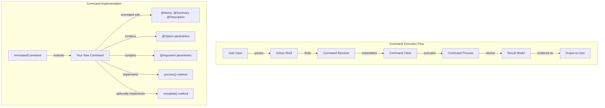

<!-- source: DeepWiki mcp.deepwiki.com · repo alibaba/arthas · page 9.3 Adding New Commands · fetched 2026-10-29 -->

# Adding New Commands

<details>
<summary>Relevant source files</summary>

The following files were used as context for generating this wiki page:

- [core/src/main/java/com/taobao/arthas/core/advisor/Enhancer.java](core/src/main/java/com/taobao/arthas/core/advisor/Enhancer.java)
- [core/src/main/java/com/taobao/arthas/core/command/BuiltinCommandPack.java](core/src/main/java/com/taobao/arthas/core/command/BuiltinCommandPack.java)
- [core/src/main/java/com/taobao/arthas/core/command/basic1000/StopCommand.java](core/src/main/java/com/taobao/arthas/core/command/basic1000/StopCommand.java)
- [core/src/main/java/com/taobao/arthas/core/command/model/VmToolModel.java](core/src/main/java/com/taobao/arthas/core/command/model/VmToolModel.java)
- [core/src/main/java/com/taobao/arthas/core/command/monitor200/EnhancerCommand.java](core/src/main/java/com/taobao/arthas/core/command/monitor200/EnhancerCommand.java)
- [core/src/main/java/com/taobao/arthas/core/command/monitor200/MonitorCommand.java](core/src/main/java/com/taobao/arthas/core/command/monitor200/MonitorCommand.java)
- [core/src/main/java/com/taobao/arthas/core/command/monitor200/StackCommand.java](core/src/main/java/com/taobao/arthas/core/command/monitor200/StackCommand.java)
- [core/src/main/java/com/taobao/arthas/core/command/monitor200/TimeTunnelCommand.java](core/src/main/java/com/taobao/arthas/core/command/monitor200/TimeTunnelCommand.java)
- [core/src/main/java/com/taobao/arthas/core/command/monitor200/TraceCommand.java](core/src/main/java/com/taobao/arthas/core/command/monitor200/TraceCommand.java)
- [core/src/main/java/com/taobao/arthas/core/command/monitor200/WatchCommand.java](core/src/main/java/com/taobao/arthas/core/command/monitor200/WatchCommand.java)
- [core/src/main/java/com/taobao/arthas/core/command/view/ResultViewResolver.java](core/src/main/java/com/taobao/arthas/core/command/view/ResultViewResolver.java)
- [core/src/main/java/com/taobao/arthas/core/command/view/VmToolView.java](core/src/main/java/com/taobao/arthas/core/command/view/VmToolView.java)
- [core/src/main/java/com/taobao/arthas/core/util/SearchUtils.java](core/src/main/java/com/taobao/arthas/core/util/SearchUtils.java)
- [core/src/main/java/com/taobao/arthas/core/util/affect/EnhancerAffect.java](core/src/main/java/com/taobao/arthas/core/util/affect/EnhancerAffect.java)
- [core/src/test/java/com/taobao/arthas/core/advisor/EnhancerTest.java](core/src/test/java/com/taobao/arthas/core/advisor/EnhancerTest.java)

</details>


This page guides developers through the process of implementing new diagnostic commands in Arthas. Arthas's command system follows a structured architecture that makes it straightforward to add new commands while maintaining consistency in how users interact with the tool.

For information about the overall command processing pipeline, see [Command Processing Pipeline](#2.3).

## Command System Architecture

The Arthas command system uses an annotation-based approach to define commands, their parameters, and documentation. When implementing a new command, you'll create a Java class that extends `AnnotatedCommand` and add specific annotations to define command behavior.



Sources: [core/src/main/java/com/taobao/arthas/core/command/monitor200/ProfilerCommand.java:45-70]()

## Command Components

Every command in Arthas consists of these key components:

```mermaid
classDiagram
    class AnnotatedCommand {
        +process(CommandProcess process)
        +complete(Completion completion)
    }
    
    class NewCommand {
        -fieldA: Type
        -fieldB: Type
        +setFieldA(Type value)
        +setFieldB(Type value)
        +process(CommandProcess process)
        +complete(Completion completion)
    }
    
    AnnotatedCommand <|-- NewCommand
    
    note for NewCommand "Class-level annotations:\n@Name\n@Summary\n@Description"
    note for NewCommand::setFieldA "Annotated with:\n@Argument or @Option\n@Description"
```

Sources: [core/src/main/java/com/taobao/arthas/core/command/monitor200/ProfilerCommand.java:70-106](), [core/src/main/java/com/taobao/arthas/core/command/monitor200/ProfilerCommand.java:297-337]()

## Step-by-Step Guide to Adding a New Command

### 1. Create a Command Class

Start by creating a new Java class that extends `AnnotatedCommand`:

```java
public class MyNewCommand extends AnnotatedCommand {
    // Command implementation
}
```

### 2. Add Class-Level Annotations

Add annotations at the class level to define your command's metadata:

| Annotation | Description | Example |
|------------|-------------|---------|
| `@Name` | The name users will use to invoke your command | `@Name("profiler")` |
| `@Summary` | Brief description of what the command does | `@Summary("My diagnostic tool")` |
| `@Description` | Detailed description with usage examples | `@Description("Examples: \n my-command start\n my-command stop")` |

Sources: [core/src/main/java/com/taobao/arthas/core/command/monitor200/ProfilerCommand.java:45-69]()

### 3. Define Command Arguments

Arguments are positional parameters that users provide when executing the command. Define fields and setter methods for each argument:

```java
private String actionArg;

@Argument(argName = "actionArg", index = 0, required = true)
@Description("The main action to execute")
public void setActionArg(String actionArg) {
    this.actionArg = actionArg;
}
```

The `@Argument` annotation supports these attributes:
- `argName`: Descriptive name for the argument
- `index`: Position of the argument (0-based)
- `required`: Whether the argument is mandatory

Sources: [core/src/main/java/com/taobao/arthas/core/command/monitor200/ProfilerCommand.java:297-306]()

### 4. Define Command Options

Options are named parameters that users can provide in any order using flags. Define fields and setter methods for each option:

```java
private String outputFile;

@Option(shortName = "f", longName = "file")
@Description("Output file path")
public void setOutputFile(String file) {
    this.outputFile = file;
}
```

The `@Option` annotation supports these attributes:
- `shortName`: Short form of the option (e.g., `-f`)
- `longName`: Long form of the option (e.g., `--file`)
- `flag`: Whether the option is a boolean flag without a value
- `required`: Whether the option is mandatory

Sources: [core/src/main/java/com/taobao/arthas/core/command/monitor200/ProfilerCommand.java:322-326](), [core/src/main/java/com/taobao/arthas/core/command/monitor200/ProfilerCommand.java:376-379]()

### 5. Implement the Process Method

The `process` method is where your command's logic goes. It receives a `CommandProcess` object that you use to interact with the user:

```java
@Override
public void process(final CommandProcess process) {
    try {
        // Your command implementation here
        
        // Return a result model
        YourResultModel model = new YourResultModel();
        model.setData(result);
        process.appendResult(model);
        
        // End the command
        process.end();
    } catch (Throwable e) {
        logger.error("Command error", e);
        process.end(1, "Command error: " + e.getMessage());
    }
}
```

Sources: [core/src/main/java/com/taobao/arthas/core/command/monitor200/ProfilerCommand.java:731-865]()

### 6. Create a Result Model

For complex commands, create a dedicated result model class to structure your output:

```java
public class YourResultModel extends ResultModel {
    private String data;
    
    public String getData() {
        return data;
    }
    
    public void setData(String data) {
        this.data = data;
    }
}
```

For the profiler command, the model is defined in: [core/src/main/java/com/taobao/arthas/core/command/model/ProfilerModel.java]()

### 7. Implement Command Completion (Optional)

For better user experience, implement the `complete` method to provide auto-completion suggestions:

```java
@Override
public void complete(Completion completion) {
    List<CliToken> tokens = completion.lineTokens();
    String token = tokens.get(tokens.size() - 1).value();
    
    if (token.startsWith("-")) {
        // Complete options
        super.complete(completion);
        return;
    }
    
    // Complete custom values
    CompletionUtils.complete(completion, Arrays.asList("value1", "value2"));
}
```

Sources: [core/src/main/java/com/taobao/arthas/core/command/monitor200/ProfilerCommand.java:979-1004]()

## Best Practices

### Command Organization

Commands in Arthas are organized into different packages based on their functionality:

1. **Basic Commands**: Simple commands for managing Arthas
2. **Class/Method Commands**: Commands related to class inspection and manipulation
3. **Monitor Commands**: Commands for runtime monitoring and diagnostics

Place your new command in the appropriate package based on its functionality.

### Error Handling

Always handle exceptions in your command implementation and provide clear error messages:

```java
try {
    // Command implementation
} catch (Throwable e) {
    logger.error("Error message", e);
    process.end(1, "User-friendly error message: " + e.getMessage());
}
```

Sources: [core/src/main/java/com/taobao/arthas/core/command/monitor200/ProfilerCommand.java:861-864]()

### Command Documentation

Provide thorough documentation for your command:

1. Clear `@Description` with usage examples
2. Detailed parameter descriptions
3. Links to relevant documentation

Look at the profiler command's description as an example of comprehensive documentation:

Sources: [core/src/main/java/com/taobao/arthas/core/command/monitor200/ProfilerCommand.java:46-68]()

### Enum-based Subcommands

For commands with multiple actions (like start/stop), consider using enums to define supported actions:

```java
public enum YourCommandAction {
    start, stop, status
}
```

Sources: [core/src/main/java/com/taobao/arthas/core/command/monitor200/ProfilerCommand.java:586-595]()

## Command Testing

When developing new commands, you should:

1. Write unit tests for command logic
2. Test command execution and parameter handling
3. Verify command output formatting
4. Test auto-completion functionality

## Integration Example

Here's a simplified example of how to integrate a new command into Arthas:

1. Create your command class in the appropriate package
2. Add the command to Arthas's command registry
3. Add documentation for your command in the site/docs directory

For complex commands like profiler, also consider:
1. Whether you need native integration (like async-profiler's native libraries)
2. If your command requires additional dependencies
3. How to package and distribute these dependencies

Looking at the profiler command, you can see how it loads native libraries and handles different platforms:

Sources: [core/src/main/java/com/taobao/arthas/core/command/monitor200/ProfilerCommand.java:266-294]()

## Conclusion

Adding a new command to Arthas involves:
1. Creating a class that extends `AnnotatedCommand`
2. Adding appropriate annotations to define command metadata and parameters
3. Implementing the `process` method for command execution
4. Optionally implementing the `complete` method for auto-completion
5. Creating a result model for structured output
6. Testing and documenting your command

Following these guidelines will help ensure your command integrates seamlessly with the Arthas ecosystem and provides a consistent user experience.