# Page: Overview

# Overview

<details>
<summary>Relevant source files</summary>

The following files were used as context for generating this wiki page:

- [CONTRIBUTING.md](CONTRIBUTING.md)
- [README.md](README.md)
- [README_CN.md](README_CN.md)
- [USERS.md](USERS.md)
- [agent/pom.xml](agent/pom.xml)
- [arthas-vmtool/README.md](arthas-vmtool/README.md)
- [as-package.sh](as-package.sh)
- [bin/as-service.bat](bin/as-service.bat)
- [bin/as.bat](bin/as.bat)
- [boot/pom.xml](boot/pom.xml)
- [client/pom.xml](client/pom.xml)
- [common/pom.xml](common/pom.xml)
- [core/pom.xml](core/pom.xml)
- [memorycompiler/pom.xml](memorycompiler/pom.xml)
- [packaging/pom.xml](packaging/pom.xml)
- [pom.xml](pom.xml)
- [site/pom.xml](site/pom.xml)
- [spy/pom.xml](spy/pom.xml)
- [static/cider.png](static/cider.png)
- [static/citycloud.jpg](static/citycloud.jpg)
- [static/didiglobal.jpg](static/didiglobal.jpg)
- [static/dms.png](static/dms.png)
- [static/guideir.jpg](static/guideir.jpg)
- [static/hollycrm.png](static/hollycrm.png)
- [static/mingyuanyun.jpg](static/mingyuanyun.jpg)
- [static/ouyeel.png](static/ouyeel.png)
- [static/videt.png](static/videt.png)
- [static/zhaopin.png](static/zhaopin.png)
- [testcase/pom.xml](testcase/pom.xml)
- [tunnel-client/pom.xml](tunnel-client/pom.xml)
- [tunnel-server/pom.xml](tunnel-server/pom.xml)

</details>


Arthas is a Java diagnostic tool that enables developers to troubleshoot production applications without modifying source code or restarting the JVM. The system operates by attaching to a running Java process and injecting a diagnostic agent that provides real-time introspection, bytecode instrumentation, and profiling capabilities.

This page provides an overview of Arthas's architecture, capabilities, and components. For detailed information about specific subsystems, see:
- [Core Architecture](#2) - Agent-based model and component relationships
- [Diagnostic Commands](#3) - Command-line tools for inspection and monitoring
- [Bytecode Instrumentation System](#4) - Method tracing and interception mechanisms
- [Installation and Deployment](#8) - Setup and configuration options

## Purpose and Problem Statement

Arthas addresses diagnostic challenges in production environments where traditional debugging approaches are impractical:

- **No code changes required**: Inspect and diagnose without modifying application source
- **No JVM restart needed**: Attach to running processes without service interruption
- **Non-invasive observation**: Acts as an observer without suspending application threads
- **Production-safe operations**: Designed for live system diagnosis

**Sources**: [README.md:13-27](), [README_CN.md:17-30]()

## Key Capabilities

Arthas provides diagnostic capabilities across several domains:

| Capability Domain | Features |
|------------------|----------|
| **Class Inspection** | Check class loading, decompile classes (`jad`), search classes (`sc`), search methods (`sm`) |
| **Method Observation** | Watch method parameters/returns (`watch`), trace method calls (`trace`), capture stack traces (`stack`) |
| **Performance Profiling** | CPU/memory profiling via async-profiler, flame graph generation |
| **Bytecode Manipulation** | Hot-reload classes (`retransform`), compile in-memory (`mc`), dump class bytecode (`dump`) |
| **JVM Monitoring** | Thread analysis, heap inspection, classloader statistics, system metrics |
| **Dynamic Expression** | Execute OGNL expressions against live objects |

**Sources**: [README.md:29-44](), [README_CN.md:19-30]()

## High-Level System Architecture

The following diagram illustrates Arthas's major architectural layers and component relationships:

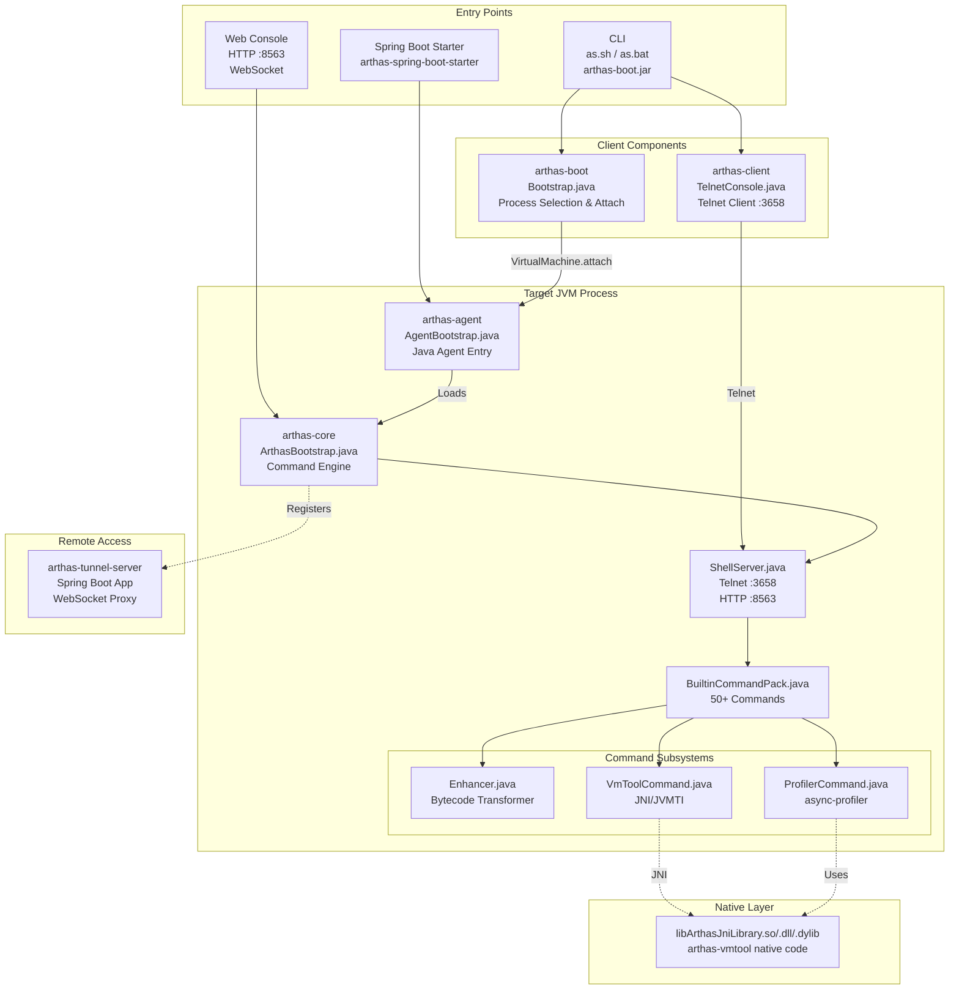

**Arthas System Architecture**: Shows the three-layer model with entry points, client components, and in-JVM diagnostic engine. The system uses Java's Instrumentation API to inject the agent, which then provides diagnostic services via telnet/HTTP protocols.

**Sources**: [pom.xml:53-82](), [README.md:1-97](), [agent/pom.xml:1-68](), [core/pom.xml:1-279](), [boot/pom.xml:1-71](), [client/pom.xml:1-66]()

## Module Structure

Arthas uses a multi-module Maven project structure organized by functional concern:

```mermaid
graph TB
    Root["arthas-all<br/>pom.xml"]
    
    Root --> CoreModules["Core Modules"]
    Root --> ClientModules["Client Modules"]
    Root --> IntegrationModules["Integration Modules"]
    Root --> DistributionModules["Distribution Modules"]
    Root --> SupportModules["Support Modules"]
    
    CoreModules --> agent["arthas-agent<br/>Agent entry point"]
    CoreModules --> core["arthas-core<br/>Command engine"]
    CoreModules --> spy["arthas-spy<br/>Hook callbacks"]
    CoreModules --> vmtool["arthas-vmtool<br/>Native JNI/JVMTI"]
    
    ClientModules --> boot["arthas-boot<br/>Bootstrap launcher"]
    ClientModules --> client["arthas-client<br/>Telnet console"]
    
    IntegrationModules --> starter["arthas-spring-boot-starter<br/>Auto-configuration"]
    IntegrationModules --> tunnelserver["arthas-tunnel-server<br/>Remote proxy"]
    IntegrationModules --> tunnelclient["arthas-tunnel-client<br/>Agent tunnel client"]
    IntegrationModules --> mcp["arthas-mcp-server<br/>MCP protocol"]
    
    DistributionModules --> packaging["arthas-packaging<br/>ZIP/DEB/RPM"]
    DistributionModules --> site["arthas-site<br/>VuePress docs"]
    
    SupportModules --> common["arthas-common<br/>Shared utilities"]
    SupportModules --> model["arthas-model<br/>Data models"]
    SupportModules --> memcompiler["arthas-memorycompiler<br/>In-memory compiler"]
```

**Arthas Maven Module Structure**: The parent POM coordinates 20+ modules organized by architectural layer. Core modules run inside the target JVM, client modules provide user interfaces, integration modules enable embedding, and distribution modules handle packaging.

**Sources**: [pom.xml:53-82](), [CONTRIBUTING.md:1-163]()

## Execution Model

Arthas operates through a multi-phase lifecycle:

### 1. Attachment Phase

The `arthas-boot.jar` launcher performs process discovery and agent injection:

```mermaid
sequenceDiagram
    participant User
    participant Bootstrap["Bootstrap.java<br/>(arthas-boot)"]
    participant VirtualMachine["VirtualMachine API<br/>(tools.jar)"]
    participant TargetJVM["Target JVM Process"]
    
    User->>Bootstrap: java -jar arthas-boot.jar
    Bootstrap->>Bootstrap: List Java processes<br/>(jps / VirtualMachine.list())
    Bootstrap->>User: Display process selection
    User->>Bootstrap: Select PID
    Bootstrap->>Bootstrap: Download/verify<br/>arthas-agent.jar
    Bootstrap->>VirtualMachine: attach(pid)
    VirtualMachine->>TargetJVM: Signal attachment
    TargetJVM-->>VirtualMachine: Attachment successful
    Bootstrap->>VirtualMachine: loadAgent(arthas-agent.jar)
    VirtualMachine->>TargetJVM: Load agent JAR
    TargetJVM->>TargetJVM: Call AgentBootstrap.agentmain()
```

**Attachment Sequence**: Shows how the bootstrap process locates the target JVM and injects the agent using the Java Attach API (`com.sun.tools.attach.VirtualMachine`).

**Sources**: [boot/pom.xml:1-71](), [bin/as.bat:1-119]()

### 2. Agent Initialization

Once loaded, `AgentBootstrap` in the `arthas-agent` module initializes the core engine:

1. Create isolated `ArthasClassLoader` to prevent dependency conflicts
2. Load `ArthasBootstrap` from `arthas-core.jar`
3. Initialize `Spy` API into bootstrap classloader for bytecode hooks
4. Enhance application classloaders to support instrumentation

**Sources**: [agent/pom.xml:1-68](), [core/pom.xml:1-279]()

### 3. Service Binding

The `ArthasBootstrap.bind()` method starts diagnostic services:

- **ShellServer**: Binds telnet port (default 3658) and HTTP port (default 8563)
- **BuiltinCommandPack**: Registers 50+ diagnostic commands
- **SessionManager**: Manages concurrent client sessions
- **TunnelClient** (optional): Registers with tunnel server for remote access

**Sources**: [core/pom.xml:1-279](), [bin/as.bat:13-14]()

### 4. Interactive Session

Clients connect via telnet or HTTP/WebSocket to execute commands:

```mermaid
sequenceDiagram
    participant Client["TelnetConsole / Browser"]
    participant ShellServer["ShellServer<br/>(arthas-core)"]
    participant CommandResolver["CommandResolver"]
    participant Command["Command Implementation<br/>(e.g., WatchCommand)"]
    participant Enhancer["Enhancer<br/>(Bytecode Transformer)"]
    participant TargetClass["Application Class"]
    
    Client->>ShellServer: Connect telnet/websocket
    ShellServer->>ShellServer: Create Session
    
    loop Interactive Commands
        Client->>ShellServer: watch com.example.Service method
        ShellServer->>CommandResolver: Parse & resolve command
        CommandResolver->>Command: Create WatchCommand instance
        Command->>Enhancer: Request method transformation
        Enhancer->>Enhancer: Generate bytecode<br/>(inject SpyAPI callbacks)
        Enhancer->>TargetClass: Retransform class
        TargetClass-->>Enhancer: Transformation complete
        Command-->>Client: Waiting for method invocation...
        
        Note over TargetClass: Application invokes method
        TargetClass->>Command: SpyAPI callback
        Command->>Command: Capture params/result
        Command-->>Client: Display captured data
    end
```

**Command Execution Flow**: Demonstrates how user commands trigger bytecode instrumentation and receive callbacks from instrumented methods through the SpyAPI hook mechanism.

**Sources**: [core/pom.xml:1-279](), [client/pom.xml:1-66]()

## Interaction Models

Arthas supports multiple modes of interaction:

### Local Command Line (as.sh / as.bat)

Shell scripts that combine bootstrapping and client connection:

- **as.sh**: Unix/Linux/macOS shell script
- **as.bat**: Windows batch script
- **arthas-boot.jar**: Cross-platform Java launcher

**Sources**: [bin/as.bat:1-119](), [as-package.sh:1-123]()

### Web Console

Browser-based interface served on HTTP port 8563:

- Static assets from `web-ui` module bundled into `arthas-core.jar`
- WebSocket connection for bidirectional command execution
- Rich terminal emulation with syntax highlighting

**Sources**: [core/pom.xml:92-95]()

### Spring Boot Starter

Auto-configuration for embedding Arthas in Spring Boot applications:

- Module: `arthas-spring-boot-starter`
- Automatic agent initialization on application startup
- Configuration via `application.properties` or `application.yml`

**Sources**: [pom.xml:69]()

### Tunnel Server

Remote access proxy for distributed environments:

- Spring Boot application: `arthas-tunnel-server`
- Agents register via WebSocket
- Central dashboard for managing multiple Arthas instances

**Sources**: [tunnel-server/pom.xml:1-227]()

### MCP Protocol

Integration with AI tools and IDEs:

- Module: `arthas-mcp-server`
- Implements Model Context Protocol
- Enables programmatic diagnostic automation

**Sources**: [pom.xml:62](), [README.md:1-463]()

## Distribution and Packaging

Arthas is distributed in multiple formats via the `arthas-packaging` module:

| Format | Description | Use Case |
|--------|-------------|----------|
| **ZIP** | `arthas-bin.zip` | Manual installation, script-based deployment |
| **JAR** | `arthas-boot.jar` | Single-file launcher, most common usage |
| **DEB** | `arthas-<version>.deb` | Debian/Ubuntu package management |
| **RPM** | `arthas-<version>.rpm` | RedHat/CentOS package management |
| **Docker** | `hengyunabc/arthas` | Container-based deployment |
| **Maven Central** | `com.taobao.arthas:*` | Programmatic dependency inclusion |

The packaging process aggregates:
- Core JARs (`arthas-core-shade.jar`, `arthas-agent.jar`, `arthas-client.jar`, `arthas-boot.jar`)
- Native libraries (`libArthasJniLibrary.so/.dll/.dylib`) for each platform
- Shell scripts (`as.sh`, `as.bat`)
- Web UI assets (bundled in core JAR)
- Documentation site (from `arthas-site` module)

**Sources**: [packaging/pom.xml:1-263](), [CONTRIBUTING.md:136-163]()

## Build and Development

The project uses Maven with platform-specific profiles for native compilation:

- **Java compilation**: Target JDK 8 for maximum compatibility
- **Native compilation**: Cross-platform builds via GitHub Actions for Linux (x64/aarch64), Windows, macOS
- **Dependency shading**: `maven-shade-plugin` relocates conflicting dependencies (netty, slf4j, fastjson2) into `com.alibaba.arthas.deps` package
- **Testing**: CI matrix covers JDK 8, 11, 17, 21, 25 on Ubuntu, Windows, macOS

The `as-package.sh` script provides local development workflow:
1. Build all modules with timestamp-based version
2. Install to `~/.arthas/lib/<version>/arthas/`
3. `as.sh` automatically uses latest local version

**Sources**: [pom.xml:84-95](), [pom.xml:224-253](), [core/pom.xml:18-104](), [as-package.sh:1-123](), [CONTRIBUTING.md:19-133]()

## Runtime Requirements

- **JDK Support**: JDK 6+ (Arthas 4.x dropped JDK 6/7 support)
- **Operating Systems**: Linux, macOS, Windows
- **Permissions**: Sufficient privileges to attach to target JVM process
- **Network Ports**: Telnet port (default 3658), HTTP port (default 8563)
- **Native Libraries**: Platform-specific JNI libraries for advanced features (VmTool, profiler)

For JDK 9+, tools.jar is not required as the attach mechanism is built into the JDK.

**Sources**: [README.md:43-44](), [bin/as.bat:77-89](), [CONTRIBUTING.md:21-23]()

---

# Page: Core Architecture

# Core Architecture

<details>
<summary>Relevant source files</summary>

The following files were used as context for generating this wiki page:

- [Dockerfile](Dockerfile)
- [Dockerfile-No-Jdk](Dockerfile-No-Jdk)
- [agent/pom.xml](agent/pom.xml)
- [agent/src/main/java/com/taobao/arthas/agent334/AgentBootstrap.java](agent/src/main/java/com/taobao/arthas/agent334/AgentBootstrap.java)
- [bin/as.sh](bin/as.sh)
- [boot/pom.xml](boot/pom.xml)
- [boot/src/main/java/com/taobao/arthas/boot/Bootstrap.java](boot/src/main/java/com/taobao/arthas/boot/Bootstrap.java)
- [client/pom.xml](client/pom.xml)
- [common/pom.xml](common/pom.xml)
- [core/pom.xml](core/pom.xml)
- [core/src/main/java/arthas.properties](core/src/main/java/arthas.properties)
- [core/src/main/java/com/taobao/arthas/core/Arthas.java](core/src/main/java/com/taobao/arthas/core/Arthas.java)
- [core/src/main/java/com/taobao/arthas/core/config/Configure.java](core/src/main/java/com/taobao/arthas/core/config/Configure.java)
- [core/src/main/java/com/taobao/arthas/core/mcp/ArthasMcpServer.java](core/src/main/java/com/taobao/arthas/core/mcp/ArthasMcpServer.java)
- [core/src/main/java/com/taobao/arthas/core/server/ArthasBootstrap.java](core/src/main/java/com/taobao/arthas/core/server/ArthasBootstrap.java)
- [core/src/main/java/com/taobao/arthas/core/shell/impl/ShellServerImpl.java](core/src/main/java/com/taobao/arthas/core/shell/impl/ShellServerImpl.java)
- [core/src/main/java/com/taobao/arthas/core/shell/session/impl/SessionManagerImpl.java](core/src/main/java/com/taobao/arthas/core/shell/session/impl/SessionManagerImpl.java)
- [core/src/main/java/com/taobao/arthas/core/shell/term/impl/http/api/ApiRequest.java](core/src/main/java/com/taobao/arthas/core/shell/term/impl/http/api/ApiRequest.java)
- [core/src/main/java/com/taobao/arthas/core/shell/term/impl/http/api/HttpApiHandler.java](core/src/main/java/com/taobao/arthas/core/shell/term/impl/http/api/HttpApiHandler.java)
- [core/src/main/java/com/taobao/arthas/core/util/UserStatUtil.java](core/src/main/java/com/taobao/arthas/core/util/UserStatUtil.java)
- [memorycompiler/pom.xml](memorycompiler/pom.xml)
- [packaging/pom.xml](packaging/pom.xml)
- [pom.xml](pom.xml)
- [site/pom.xml](site/pom.xml)
- [spy/pom.xml](spy/pom.xml)
- [testcase/pom.xml](testcase/pom.xml)
- [tunnel-client/pom.xml](tunnel-client/pom.xml)
- [tunnel-server/pom.xml](tunnel-server/pom.xml)
- [tunnel-server/src/main/java/com/alibaba/arthas/tunnel/server/app/web/StatController.java](tunnel-server/src/main/java/com/alibaba/arthas/tunnel/server/app/web/StatController.java)

</details>


## Purpose and Scope

This document describes the overall architectural design of Arthas, including its agent-based deployment model, core component relationships, module organization, and initialization flow. It focuses on the structural elements that enable Arthas to attach to running JVMs and provide diagnostic capabilities without application restart.

For specific subsystems, see:
- Module structure details: [Module Structure](#2.1)
- Bootstrapping and attachment process: [Bootstrapping and Attachment](#2.2)
- Communication protocols: [Client-Server Communication](#2.3)
- Command execution pipeline: [Command Processing Pipeline](#2.4)
- Bytecode instrumentation internals: [Bytecode Instrumentation System](#4)

---

## Agent-Based Deployment Model

Arthas operates as a Java Agent that attaches to a running JVM using the Java Instrumentation API. The architecture follows a clear separation between the external launcher (running in a separate JVM), the agent loader (injected into target JVM), and the core engine (running inside target JVM).

### Deployment Architecture

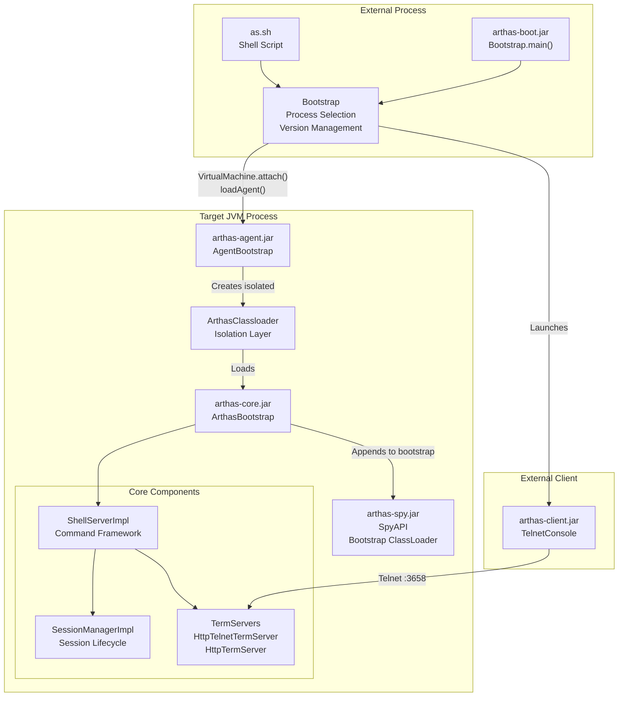

**Key Design Principles:**

1. **Process Isolation**: Bootstrap runs in a separate JVM to avoid interfering with target application
2. **ClassLoader Isolation**: `ArthasClassloader` prevents dependency conflicts with target application classes
3. **Bootstrap Injection**: `SpyAPI` is injected into bootstrap classloader to be accessible from all classloaders
4. **Non-Invasive Attachment**: Uses standard Java Attach API (`VirtualMachine.attach()`)

Sources: [bin/as.sh:1-1043](), [boot/src/main/java/com/taobao/arthas/boot/Bootstrap.java:1-707](), [agent/src/main/java/com/taobao/arthas/agent334/AgentBootstrap.java:1-200](), [core/src/main/java/com/taobao/arthas/core/server/ArthasBootstrap.java:1-650]()

---

## Core Component Hierarchy

The runtime architecture consists of several layers, each with specific responsibilities. The following diagram shows the class-level relationships between core components:

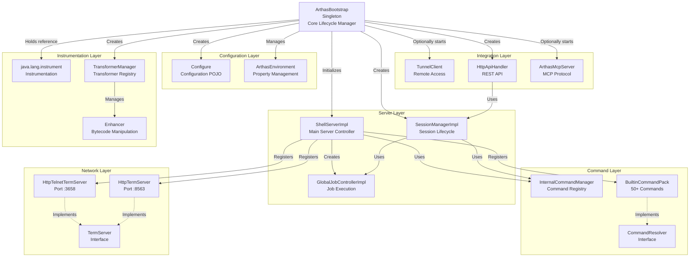

**Component Responsibilities:**

| Component | Responsibility | Key Methods |
|-----------|---------------|-------------|
| `ArthasBootstrap` | Singleton lifecycle manager, initialization orchestration | `getInstance()`, `bind()`, `destroy()` |
| `Configure` | Configuration POJO with all runtime settings | Property getters/setters |
| `ArthasEnvironment` | Multi-source property resolution (args > env > properties file) | `getProperty()`, `addFirst()`, `addLast()` |
| `ShellServerImpl` | Main server controller, registers term servers and commands | `listen()`, `registerTermServer()`, `registerCommandResolver()` |
| `SessionManagerImpl` | Session creation, eviction, timeout management | `createSession()`, `getSession()`, `removeSession()` |
| `InternalCommandManager` | Command registry and resolution | `getCommand()`, `registerCommand()` |
| `HttpTelnetTermServer` | Telnet protocol handler on port 3658 | `termHandler()`, `listen()` |
| `HttpTermServer` | HTTP/WebSocket handler on port 8563 | `termHandler()`, `listen()` |
| `TransformerManager` | Manages all active `ClassFileTransformer` instances | `addTransformer()`, `removeTransformer()`, `destroy()` |

Sources: [core/src/main/java/com/taobao/arthas/core/server/ArthasBootstrap.java:94-650](), [core/src/main/java/com/taobao/arthas/core/config/Configure.java:1-290](), [core/src/main/java/com/taobao/arthas/core/shell/impl/ShellServerImpl.java:1-200](), [core/src/main/java/com/taobao/arthas/core/shell/session/impl/SessionManagerImpl.java:1-180]()

---

## Module Organization

Arthas is organized as a Maven multi-module project with clear dependency boundaries. The modules are designed to minimize coupling and allow independent development.

### Module Dependency Graph

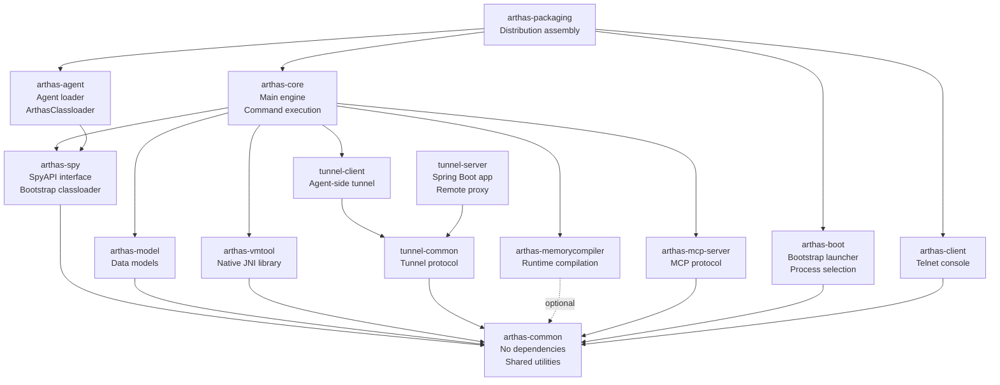

**Module Descriptions:**

| Module | Artifact | Purpose | Key Classes |
|--------|----------|---------|-------------|
| **common** | arthas-common | Shared utilities, no dependencies | `AnsiLog`, `PidUtils`, `SocketUtils` |
| **spy** | arthas-spy.jar | Hook API injected into bootstrap classloader | `SpyAPI`, `Spy` interface |
| **model** | arthas-model | Data transfer objects for command results | `ResultModel`, `WatchModel`, `TraceModel` |
| **vmtool** | arthas-vmtool + libArthasJniLibrary.so | JNI/JVMTI bridge for heap analysis | `VmTool` native methods |
| **core** | arthas-core-shade.jar | Main engine with shaded dependencies | `ArthasBootstrap`, `ShellServerImpl`, `Enhancer` |
| **agent** | arthas-agent.jar | Agent loader with isolated classloader | `AgentBootstrap`, `ArthasClassloader` |
| **boot** | arthas-boot.jar | Bootstrap launcher, process selection | `Bootstrap`, `ProcessUtils` |
| **client** | arthas-client.jar | Telnet console client | `TelnetConsole` |
| **tunnel-client** | tunnel-client | WebSocket client for tunnel server | `TunnelClient` |
| **tunnel-server** | tunnel-server-fatjar.jar | Spring Boot remote proxy | `TunnelServer`, `AgentClusterStore` |
| **packaging** | arthas-bin.zip | Distribution assembly | ZIP/DEB/RPM packages |

**Build Configuration:**

The core module uses Maven Shade plugin to relocate dependencies and avoid conflicts:

```
Relocations (from core/pom.xml):
- org.slf4j        → com.alibaba.arthas.deps.org.slf4j
- ch.qos.logback   → com.alibaba.arthas.deps.ch.qos.logback
- io.netty         → com.alibaba.arthas.deps.io.netty
- com.alibaba.fastjson2 → com.alibaba.arthas.deps.com.alibaba.fastjson2
```

Sources: [pom.xml:1-494](), [core/pom.xml:1-280](), [agent/pom.xml:1-69](), [boot/pom.xml:1-72](), [client/pom.xml:1-67](), [tunnel-server/pom.xml:1-227](), [packaging/pom.xml:1-264]()

---

## Initialization Sequence

The initialization process follows a precise sequence to ensure proper isolation and setup. The following diagram shows the detailed initialization flow:

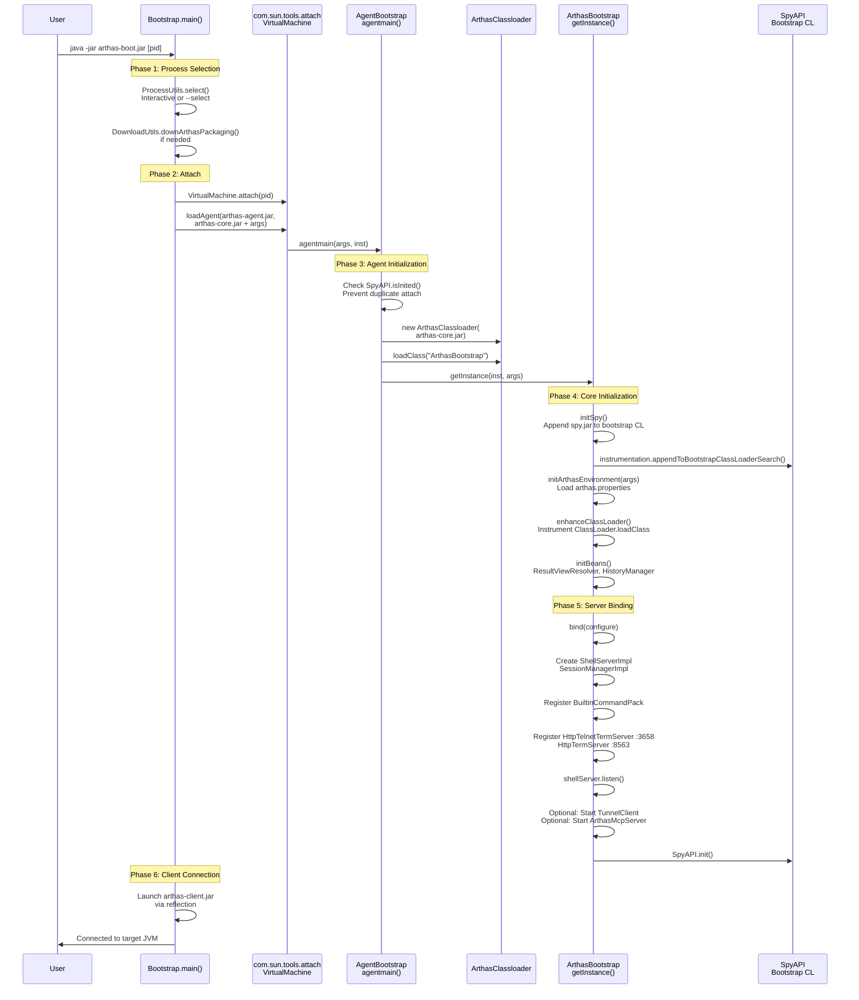

**Initialization Phases:**

1. **Process Selection** ([Bootstrap.java:394-408]()): 
   - List Java processes via `jps` or `ps` 
   - Interactive selection or `--select` filter
   - Version management and download if needed

2. **Attach** ([Bootstrap.java:516-594]()): 
   - Use `VirtualMachine.attach(pid)` from tools.jar
   - `loadAgent()` triggers `AgentBootstrap.agentmain()`
   - Agent jar path and configuration passed as string argument

3. **Agent Initialization** ([AgentBootstrap.java:90-173]()):
   - Check `SpyAPI.isInited()` to prevent duplicate attach
   - Create `ArthasClassloader` for dependency isolation
   - Load and invoke `ArthasBootstrap.getInstance()`

4. **Core Initialization** ([ArthasBootstrap.java:138-185]()):
   - `initSpy()`: Inject spy.jar into bootstrap classloader
   - `initArthasEnvironment()`: Load configuration from multiple sources
   - `enhanceClassLoader()`: Instrument `ClassLoader.loadClass` to ensure SpyAPI visibility
   - `initBeans()`: Create service objects

5. **Server Binding** ([ArthasBootstrap.java:355-504]()):
   - Create `ShellServerImpl` with `ShellServerOptions`
   - Register `BuiltinCommandPack` (50+ commands)
   - Register term servers (Telnet :3658, HTTP :8563)
   - Optional: Start `TunnelClient` for remote access
   - Optional: Start `ArthasMcpServer` for MCP protocol
   - Generate random password if listening on 0.0.0.0

6. **Client Connection** ([Bootstrap.java:600-635]()):
   - Launch `arthas-client.jar` via `URLClassLoader` and reflection
   - Connect to telnet port for interactive session

Sources: [boot/src/main/java/com/taobao/arthas/boot/Bootstrap.java:313-635](), [agent/src/main/java/com/taobao/arthas/agent334/AgentBootstrap.java:90-199](), [core/src/main/java/com/taobao/arthas/core/server/ArthasBootstrap.java:138-504]()

---

## Runtime Component Interaction

Once initialized, Arthas operates through several interconnected subsystems. The following diagram illustrates the runtime relationships:

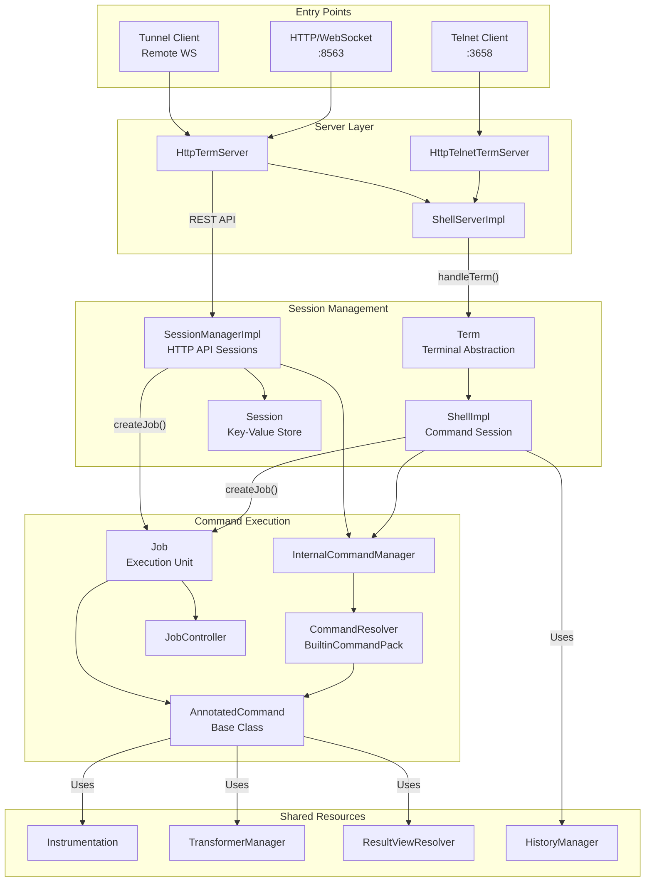

**Interaction Patterns:**

1. **Telnet/Terminal Flow**:
   - `HttpTelnetTermServer` accepts telnet connection on port 3658
   - Creates `Term` abstraction for terminal I/O
   - `ShellServerImpl.handleTerm()` creates `ShellImpl` session
   - `ShellImpl` reads commands, creates `Job`, executes through `JobController`

2. **HTTP API Flow**:
   - `HttpTermServer` accepts HTTP/WebSocket on port 8563
   - `HttpApiHandler` processes REST requests
   - `SessionManagerImpl` manages stateless API sessions
   - Commands executed through same `Job`/`JobController` mechanism

3. **Command Resolution**:
   - `InternalCommandManager` holds registered `CommandResolver` instances
   - `BuiltinCommandPack` provides 50+ built-in commands
   - Each command extends `AnnotatedCommand` with CLI annotations
   - Commands access shared resources: `Instrumentation`, `TransformerManager`, etc.

4. **Session Types**:
   - **ShellImpl**: Interactive terminal session with readline, history, job control
   - **Session** (HTTP API): Stateless session with result distributor for async command execution
   - Both share same `InternalCommandManager` and command implementations

Sources: [core/src/main/java/com/taobao/arthas/core/shell/impl/ShellServerImpl.java:44-200](), [core/src/main/java/com/taobao/arthas/core/shell/session/impl/SessionManagerImpl.java:1-180](), [core/src/main/java/com/taobao/arthas/core/shell/term/impl/http/api/HttpApiHandler.java:1-400]()

---

## Configuration System

Arthas uses a hierarchical configuration system with multiple property sources. The `ArthasEnvironment` class manages configuration resolution with priority ordering.

### Configuration Priority

```
Priority (highest to lowest):
1. Command-line arguments (passed via Bootstrap)
2. System environment variables
3. System properties (-D flags)
4. arthas.properties file
5. Default values

Special: arthas.config.overrideAll=true reverses priority
```

### Configuration Loading

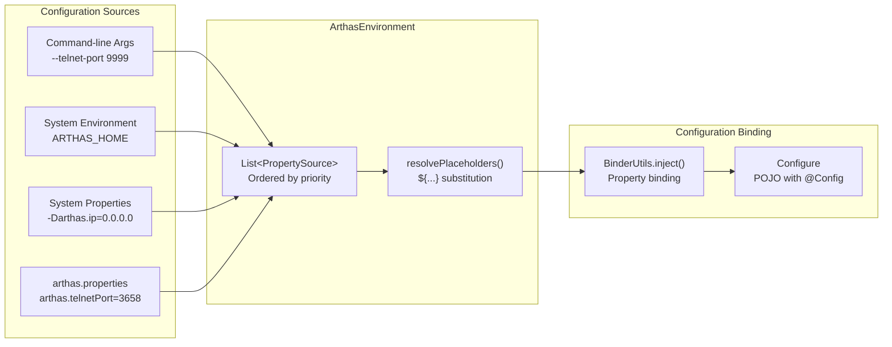

**Key Configuration Properties:**

| Property | Default | Description | Source |
|----------|---------|-------------|--------|
| `arthas.telnetPort` | 3658 | Telnet server port | [arthas.properties:2]() |
| `arthas.httpPort` | 8563 | HTTP server port | [arthas.properties:3]() |
| `arthas.ip` | 127.0.0.1 | Listen IP address | [arthas.properties:4]() |
| `arthas.sessionTimeout` | 1800 | Session timeout (seconds) | [arthas.properties:7]() |
| `arthas.enhanceLoaders` | - | ClassLoaders to enhance | [arthas.properties:9]() |
| `arthas.username` | - | Authentication username | [arthas.properties:12]() |
| `arthas.password` | - | Authentication password | [arthas.properties:13]() |
| `arthas.localConnectionNonAuth` | true | Skip auth for 127.0.0.1 | [arthas.properties:16]() |
| `arthas.tunnelServer` | - | Tunnel server WebSocket URL | [arthas.properties:19]() |
| `arthas.agentId` | - | Agent ID for tunnel | [arthas.properties:20]() |
| `arthas.disabledCommands` | - | Comma-separated disabled commands | [arthas.properties:22]() |
| `arthas.mcpEndpoint` | /mcp | MCP protocol endpoint | [arthas.properties:27]() |
| `arthas.mcpProtocol` | STREAMABLE | MCP protocol mode | [arthas.properties:28]() |

**Configuration Binding Process:**

1. `ArthasBootstrap` constructor calls `initArthasEnvironment(args)` ([ArthasBootstrap.java:146]())
2. Create `MapPropertySource` from command-line args ([ArthasBootstrap.java:265-278]())
3. Load `arthas.properties` if exists ([ArthasBootstrap.java:313-346]())
4. Add property sources to `ArthasEnvironment` in priority order ([ArthasBootstrap.java:278-346]())
5. Use `BinderUtils.inject()` to bind properties to `Configure` POJO ([ArthasBootstrap.java:283]())
6. `Configure` instance used throughout initialization

Sources: [core/src/main/java/com/taobao/arthas/core/server/ArthasBootstrap.java:253-346](), [core/src/main/java/com/taobao/arthas/core/config/Configure.java:1-290](), [core/src/main/java/arthas.properties:1-29]()

---

## Instrumentation Architecture

Arthas's diagnostic capabilities are built on the Java Instrumentation API. The architecture ensures proper isolation and management of class transformations.

### Instrumentation Component Stack

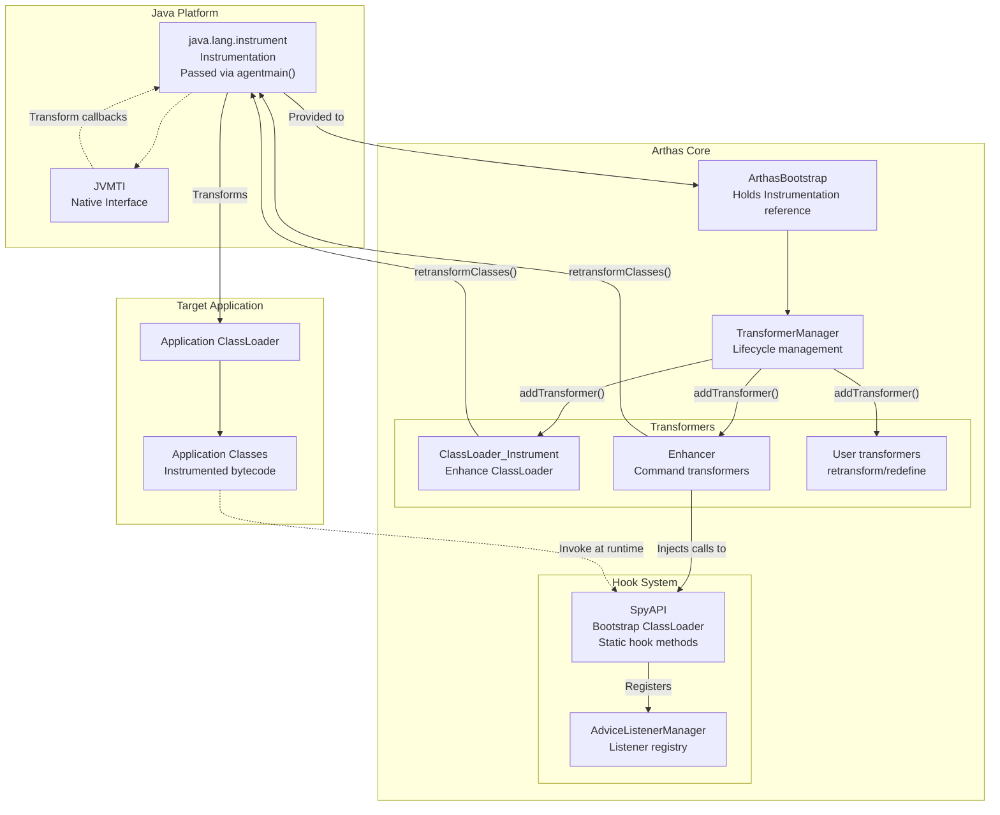

**Instrumentation Flow:**

1. **Instrumentation Acquisition**: `Instrumentation` instance passed via `AgentBootstrap.agentmain()` ([AgentBootstrap.java:67-68]())

2. **SpyAPI Injection**: 
   - `arthas-spy.jar` appended to bootstrap classloader ([ArthasBootstrap.java:198-221]())
   - Makes `SpyAPI` accessible from all classloaders
   - Static methods provide hook points: `atEnter()`, `atExit()`, `atExceptionExit()`

3. **ClassLoader Enhancement**:
   - `enhanceClassLoader()` instruments `ClassLoader.loadClass()` ([ArthasBootstrap.java:223-251]())
   - Ensures SpyAPI is loaded before application classes
   - Solves visibility issues for custom classloaders

4. **Transformer Management**:
   - `TransformerManager` tracks all registered transformers ([ArthasBootstrap.java:183]())
   - Commands register transformers via `Enhancer` class
   - `destroy()` removes all transformers and resets classes ([ArthasBootstrap.java:565-569]())

5. **Bytecode Modification**:
   - Commands like `watch`, `trace`, `tt` use `Enhancer` to transform methods
   - ASM library manipulates bytecode to inject `SpyAPI` calls
   - Bytekit provides higher-level instrumentation API

6. **Runtime Callbacks**:
   - Transformed methods invoke `SpyAPI` static methods
   - `AdviceListenerManager` routes events to registered listeners
   - Listeners process method entry/exit/exception events

Sources: [core/src/main/java/com/taobao/arthas/core/server/ArthasBootstrap.java:109-251](), [agent/src/main/java/com/taobao/arthas/agent334/AgentBootstrap.java:67-199]()

---

## Network Architecture

Arthas supports multiple network protocols for different use cases. Each protocol handler is implemented as a `TermServer`.

### Network Protocol Support

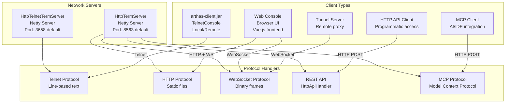

**Protocol Characteristics:**

| Protocol | Port | Handler | Use Case | Features |
|----------|------|---------|----------|----------|
| **Telnet** | 3658 | `HttpTelnetTermServer` | Interactive CLI via `arthas-client.jar` | Line buffering, history, job control |
| **HTTP** | 8563 | `HttpTermServer` | Static file serving | Web console UI files |
| **WebSocket** | 8563 | `HttpTermServer` | Real-time bidirectional | Web console commands, tunnel proxy |
| **REST API** | 8563 | `HttpApiHandler` | Programmatic access | Session-based or one-time execution |
| **MCP** | 8563 | `ArthasMcpServer` | AI/IDE integration | Model Context Protocol for tools |

**Server Configuration:**

```java
// From ArthasBootstrap.bind()
if (configure.getTelnetPort() != null && configure.getTelnetPort() > 0) {
    shellServer.registerTermServer(new HttpTelnetTermServer(
        configure.getIp(), 
        configure.getTelnetPort(),
        options.getConnectionTimeout(), 
        workerGroup, 
        httpSessionManager
    ));
}

if (configure.getHttpPort() != null && configure.getHttpPort() > 0) {
    shellServer.registerTermServer(new HttpTermServer(
        configure.getIp(), 
        configure.getHttpPort(),
        options.getConnectionTimeout(), 
        workerGroup, 
        httpSessionManager
    ));
}
```

**Authentication and Security:**

- `SecurityAuthenticatorImpl` handles username/password authentication ([ArthasBootstrap.java:417]())
- `localConnectionNonAuth=true` skips auth for 127.0.0.1 connections ([arthas.properties:16]())
- Listening on 0.0.0.0 forces password generation if not configured ([ArthasBootstrap.java:404-415]())
- `HttpSessionManager` manages authenticated sessions ([ArthasBootstrap.java:403]())

Sources: [core/src/main/java/com/taobao/arthas/core/server/ArthasBootstrap.java:355-504](), [core/src/main/java/com/taobao/arthas/core/shell/term/impl/http/api/HttpApiHandler.java:1-100](), [core/src/main/java/com/taobao/arthas/core/mcp/ArthasMcpServer.java:1-200]()

---

## Lifecycle Management

Arthas provides proper lifecycle management for clean startup and shutdown.

### Lifecycle State Diagram

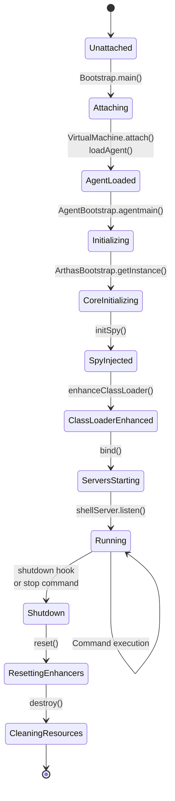

**Lifecycle Methods:**

1. **Startup**: 
   - `ArthasBootstrap.getInstance(Instrumentation, String)` - Singleton creation ([ArthasBootstrap.java:589-611]())
   - Constructor performs initialization ([ArthasBootstrap.java:138-185]())
   - `bind(Configure)` starts servers ([ArthasBootstrap.java:355-504]())

2. **Runtime**:
   - `isBind()` checks if servers are running ([ArthasBootstrap.java:518-520]())
   - Commands execute through `Job` and `JobController`
   - Sessions managed by `SessionManager` with timeout eviction

3. **Shutdown**:
   - Shutdown hook registered with JVM ([ArthasBootstrap.java:175-181]())
   - `reset()` removes all bytecode enhancements ([ArthasBootstrap.java:522-524]())
   - `destroy()` releases all resources ([ArthasBootstrap.java:529-585]())

**Shutdown Sequence:**

```java
// From ArthasBootstrap.destroy()
public void destroy() {
    // 1. Stop MCP server
    if (arthasMcpBootstrap != null) {
        arthasMcpBootstrap.shutdown();
    }
    
    // 2. Close shell server
    if (shellServer != null) {
        shellServer.close();
    }
    
    // 3. Close session manager
    if (sessionManager != null) {
        sessionManager.close();
    }
    
    // 4. Stop tunnel client
    if (tunnelClient != null) {
        tunnelClient.stop();
    }
    
    // 5. Shutdown executor
    if (executorService != null) {
        executorService.shutdownNow();
    }
    
    // 6. Destroy transformers
    if (transformerManager != null) {
        transformerManager.destroy();
    }
    
    // 7. Reset classloader instrumentation
    if (classLoaderInstrumentTransformer != null) {
        instrumentation.removeTransformer(classLoaderInstrumentTransformer);
    }
    
    // 8. Reset arthas classloader
    AgentBootstrap.resetArthasClassLoader();
}
```

**Duplicate Attach Prevention:**

```java
// From AgentBootstrap.main()
try {
    Class.forName("java.arthas.SpyAPI");
    if (SpyAPI.isInited()) {
        ps.println("Arthas server already started, skip attach.");
        return;
    }
} catch (Throwable e) {
    // SpyAPI not loaded, proceed with attach
}
```

Sources: [core/src/main/java/com/taobao/arthas/core/server/ArthasBootstrap.java:529-585](), [agent/src/main/java/com/taobao/arthas/agent334/AgentBootstrap.java:90-173]()

---

## Summary

The Arthas core architecture demonstrates several key design principles:

1. **Isolation**: `ArthasClassloader` prevents dependency conflicts with target applications
2. **Non-invasiveness**: Java Attach API allows runtime attachment without restart
3. **Modularity**: Clear module boundaries with minimal coupling
4. **Extensibility**: Command resolver pattern allows custom command registration
5. **Multi-protocol**: Supports Telnet, HTTP, WebSocket, REST API, and MCP for various use cases
6. **Proper Lifecycle**: Clean initialization and shutdown with resource management

The architecture supports the core use case of attaching to production JVMs for diagnostics without application modification or restart, while maintaining stability through proper classloader isolation and resource management.

---

# Page: Module Structure

# Module Structure

<details>
<summary>Relevant source files</summary>

The following files were used as context for generating this wiki page:

- [agent/pom.xml](agent/pom.xml)
- [boot/pom.xml](boot/pom.xml)
- [client/pom.xml](client/pom.xml)
- [common/pom.xml](common/pom.xml)
- [core/pom.xml](core/pom.xml)
- [memorycompiler/pom.xml](memorycompiler/pom.xml)
- [packaging/pom.xml](packaging/pom.xml)
- [pom.xml](pom.xml)
- [site/pom.xml](site/pom.xml)
- [spy/pom.xml](spy/pom.xml)
- [testcase/pom.xml](testcase/pom.xml)
- [tunnel-client/pom.xml](tunnel-client/pom.xml)
- [tunnel-server/pom.xml](tunnel-server/pom.xml)

</details>


This page provides a detailed overview of Arthas' Maven module structure, the purpose of each module, and the dependencies between them. Understanding the module organization is essential for developers who want to contribute to Arthas or customize it for their specific needs.

For information about the bootstrapping process, see [Bootstrapping Process](#2.2). For details on the command system, see [Command Processing Pipeline](#2.3).

## Overview of Module Organization

Arthas is structured as a multi-module Maven project. The parent POM `arthas-all` defines the overall project configuration and manages common dependencies across all modules.

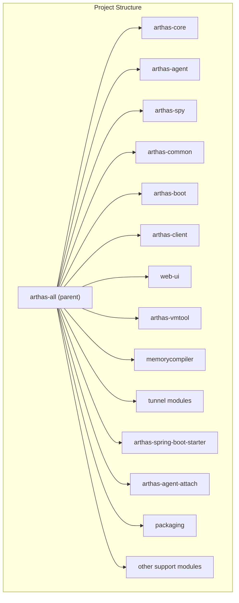

Sources: [pom.xml:59-83]()

## Core Modules and Their Functions

Each module in Arthas has a specific role in the system. The following table describes the main modules and their functions:

| Module | Purpose |
|--------|---------|
| arthas-core | The central engine containing command implementations, class enhancement logic, and various diagnostic tools |
| arthas-agent | The Java agent that bootstraps Arthas by attaching to a target JVM |
| arthas-spy | A lightweight library injected into target classes for method event interception |
| arthas-common | Shared utilities and constants used across multiple modules |
| arthas-boot | Command-line tool for starting Arthas and attaching to target JVMs |
| arthas-client | Telnet client for connecting to an Arthas server |
| arthas-vmtool | Native JNI bridge for low-level JVM operations |
| memorycompiler | In-memory Java code compilation utility |
| tunnel-client/server | Components for enabling remote access to Arthas instances |
| arthas-spring-boot-starter | Integration with Spring Boot applications |
| arthas-agent-attach | Utility for programmatically attaching the Arthas agent |
| packaging | Handles final artifact assembly and distribution packaging |

Sources: [pom.xml:59-83](), [core/pom.xml:9-12](), [agent/pom.xml:10-12](), [spy/pom.xml:10-12](), [client/pom.xml:11-13](), [boot/pom.xml:10-12](), [common/pom.xml:10-12](), [memorycompiler/pom.xml:10-12](), [packaging/pom.xml:10-12]()

## Module Dependencies and Relationships

Understanding how modules depend on each other helps visualize the overall architecture of Arthas:

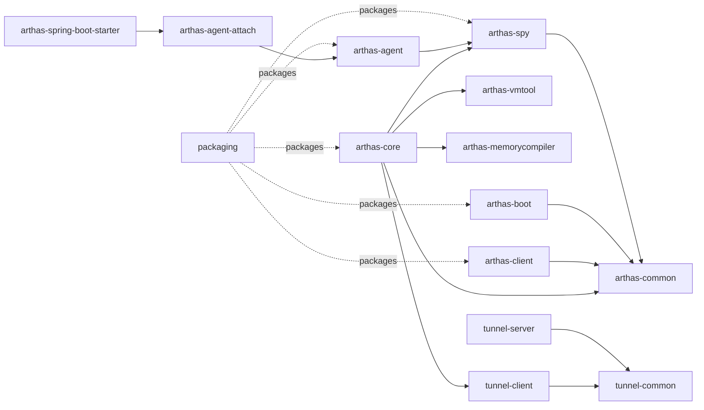

Sources: [core/pom.xml:108-266](), [agent/pom.xml:14-31](), [client/pom.xml:50-64](), [boot/pom.xml:14-33](), [spy/pom.xml:14-22](), [packaging/pom.xml:14-29]()

## Module Structure by Functional Categories

The modules in Arthas can be organized into functional categories that reflect their roles in the system:

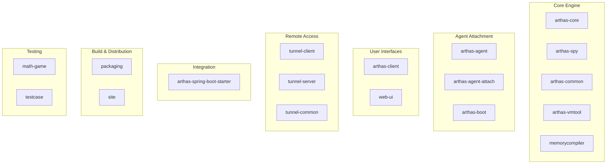

Sources: [pom.xml:59-83]()

## Detailed Module Analysis

### Core Engine Modules

#### arthas-core

The central component of Arthas, containing all the command implementations and diagnostic tools. It depends on several other modules and third-party libraries.

Key features:
- Command system implementation
- Class enhancement and transformation logic
- Diagnostic capabilities and tools
- Shell server for handling client connections

The core module uses Maven Shade Plugin to create a self-contained JAR with relocated dependencies to avoid conflicts with the target application.

Sources: [core/pom.xml:9-12](), [core/pom.xml:18-104]()

#### arthas-spy

A lightweight library that gets injected into target application classes. It intercepts method calls and sends events to the core module for processing. It has minimal dependencies to reduce its footprint in the target application.

Sources: [spy/pom.xml:10-12](), [spy/pom.xml:14-22]()

#### arthas-common

Contains common utilities and constants shared across modules. This module intentionally has no dependencies to avoid circular dependencies.

Sources: [common/pom.xml:10-12](), [common/pom.xml:14-17]()

#### arthas-vmtool

Provides native JVM integration through JNI for operations that aren't possible with pure Java.

Sources: [core/pom.xml:122-125]()

### Agent and Bootstrap Modules

#### arthas-agent

The Java agent responsible for loading and bootstrapping Arthas in the target JVM. It contains the `AgentBootstrap` class defined as both `Premain-Class` and `Agent-Class` in its manifest.

Sources: [agent/pom.xml:10-12](), [agent/pom.xml:34-65]()

#### arthas-boot

A command-line tool for launching Arthas and attaching it to running Java processes. It scans for Java processes and handles the attachment process.

Sources: [boot/pom.xml:10-12](), [boot/pom.xml:36-68]()

#### arthas-client

A telnet client for connecting to the Arthas server. It provides a command-line interface for interacting with Arthas.

Sources: [client/pom.xml:11-13](), [client/pom.xml:15-47]()

### Packaging and Distribution

#### packaging

Handles the assembly and creation of the final distribution artifacts. It combines all other modules into a single distributable package.

The packaging module:
- Packages all components into `arthas-bin.zip`
- Optionally creates documentation in `arthas-doc.zip`
- Supports different distribution formats (ZIP, DEB, RPM)

Sources: [packaging/pom.xml:10-12](), [packaging/pom.xml:30-73]()

## Build and Packaging Flow

The following diagram illustrates how individual modules are built and packaged into the final distribution:

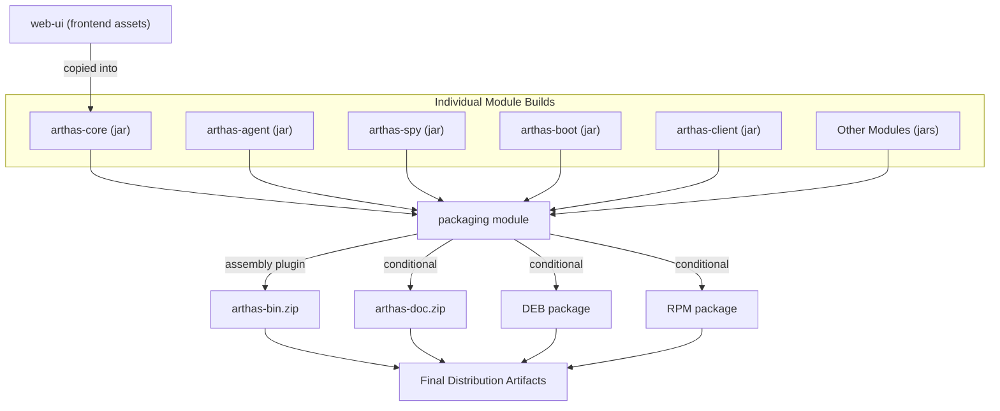

Sources: [packaging/pom.xml:30-73](), [packaging/pom.xml:76-234](), [core/pom.xml:18-104]()

## Module Dependencies Management

Arthas uses a central dependency management system in the parent POM to ensure consistent library versions across all modules. Key third-party dependencies include:

- Bytekit for bytecode enhancement
- Termd for terminal functionality
- Netty for networking
- Fastjson for JSON processing
- OGNL for expression evaluation
- SLF4J and Logback for logging (repackaged to avoid conflicts)

Sources: [pom.xml:99-236]()

## Conclusion

Arthas employs a modular architecture that separates concerns into distinct Maven modules. The design allows for:

1. Clear separation between core functionality, agent attachment, and user interfaces
2. Flexibility in how Arthas is started and connected to
3. Minimal dependencies in the spy module that gets injected into target applications
4. Comprehensive packaging for easy distribution

This modular approach makes Arthas maintainable, extensible, and adaptable to different usage scenarios while keeping its core diagnostic capabilities powerful and effective.

---

# Page: Bootstrapping and Attachment

# Bootstrapping and Attachment

<details>
<summary>Relevant source files</summary>

The following files were used as context for generating this wiki page:

- [Dockerfile](Dockerfile)
- [Dockerfile-No-Jdk](Dockerfile-No-Jdk)
- [agent/src/main/java/com/taobao/arthas/agent334/AgentBootstrap.java](agent/src/main/java/com/taobao/arthas/agent334/AgentBootstrap.java)
- [bin/as.sh](bin/as.sh)
- [boot/src/main/java/com/taobao/arthas/boot/Bootstrap.java](boot/src/main/java/com/taobao/arthas/boot/Bootstrap.java)
- [boot/src/main/java/com/taobao/arthas/boot/DownloadUtils.java](boot/src/main/java/com/taobao/arthas/boot/DownloadUtils.java)
- [boot/src/main/java/com/taobao/arthas/boot/ProcessUtils.java](boot/src/main/java/com/taobao/arthas/boot/ProcessUtils.java)
- [boot/src/test/java/com/taobao/arthas/boot/DownloadUtilsTest.java](boot/src/test/java/com/taobao/arthas/boot/DownloadUtilsTest.java)
- [client/src/main/java/com/taobao/arthas/client/IOUtil.java](client/src/main/java/com/taobao/arthas/client/IOUtil.java)
- [client/src/main/java/com/taobao/arthas/client/TelnetConsole.java](client/src/main/java/com/taobao/arthas/client/TelnetConsole.java)
- [common/src/main/java/com/taobao/arthas/common/AnsiLog.java](common/src/main/java/com/taobao/arthas/common/AnsiLog.java)
- [common/src/main/java/com/taobao/arthas/common/ExecutingCommand.java](common/src/main/java/com/taobao/arthas/common/ExecutingCommand.java)
- [common/src/main/java/com/taobao/arthas/common/IOUtils.java](common/src/main/java/com/taobao/arthas/common/IOUtils.java)
- [common/src/main/java/com/taobao/arthas/common/PidUtils.java](common/src/main/java/com/taobao/arthas/common/PidUtils.java)
- [common/src/main/java/com/taobao/arthas/common/SocketUtils.java](common/src/main/java/com/taobao/arthas/common/SocketUtils.java)
- [common/src/main/java/com/taobao/arthas/common/UsageRender.java](common/src/main/java/com/taobao/arthas/common/UsageRender.java)
- [core/src/main/java/arthas.properties](core/src/main/java/arthas.properties)
- [core/src/main/java/com/taobao/arthas/core/Arthas.java](core/src/main/java/com/taobao/arthas/core/Arthas.java)
- [core/src/main/java/com/taobao/arthas/core/config/Configure.java](core/src/main/java/com/taobao/arthas/core/config/Configure.java)
- [core/src/main/java/com/taobao/arthas/core/mcp/ArthasMcpServer.java](core/src/main/java/com/taobao/arthas/core/mcp/ArthasMcpServer.java)
- [core/src/main/java/com/taobao/arthas/core/server/ArthasBootstrap.java](core/src/main/java/com/taobao/arthas/core/server/ArthasBootstrap.java)
- [core/src/main/java/com/taobao/arthas/core/shell/command/internal/WordCountHandler.java](core/src/main/java/com/taobao/arthas/core/shell/command/internal/WordCountHandler.java)
- [core/src/main/java/com/taobao/arthas/core/shell/impl/ShellImpl.java](core/src/main/java/com/taobao/arthas/core/shell/impl/ShellImpl.java)
- [core/src/main/java/com/taobao/arthas/core/shell/impl/ShellServerImpl.java](core/src/main/java/com/taobao/arthas/core/shell/impl/ShellServerImpl.java)
- [core/src/main/java/com/taobao/arthas/core/shell/session/impl/SessionManagerImpl.java](core/src/main/java/com/taobao/arthas/core/shell/session/impl/SessionManagerImpl.java)
- [core/src/main/java/com/taobao/arthas/core/shell/term/impl/http/api/ApiRequest.java](core/src/main/java/com/taobao/arthas/core/shell/term/impl/http/api/ApiRequest.java)
- [core/src/main/java/com/taobao/arthas/core/shell/term/impl/http/api/HttpApiHandler.java](core/src/main/java/com/taobao/arthas/core/shell/term/impl/http/api/HttpApiHandler.java)
- [core/src/main/java/com/taobao/arthas/core/util/ArthasBanner.java](core/src/main/java/com/taobao/arthas/core/util/ArthasBanner.java)
- [core/src/main/java/com/taobao/arthas/core/util/UserStatUtil.java](core/src/main/java/com/taobao/arthas/core/util/UserStatUtil.java)
- [tunnel-server/src/main/java/com/alibaba/arthas/tunnel/server/app/web/StatController.java](tunnel-server/src/main/java/com/alibaba/arthas/tunnel/server/app/web/StatController.java)

</details>


## Purpose and Scope

This page documents the bootstrapping and attachment mechanism that allows Arthas to inject itself into a running JVM process. It covers:

1. **Process Discovery** - How Arthas identifies target Java processes
2. **Arthas Distribution** - Locating or downloading Arthas binaries
3. **JVM Attachment** - The Java Agent injection mechanism
4. **Agent Initialization** - Setting up the Arthas runtime in the target JVM

For information about the command processing and execution after attachment, see [Command Processing Pipeline](#2.4). For details on how the client connects to the attached server, see [Client-Server Communication](#2.3).

---

## Architecture Overview

The bootstrapping process involves multiple JVM processes and several key phases:

```mermaid
sequenceDiagram
    participant User
    participant "as.sh / arthas-boot.jar<br/>(Bootstrap Process)" as Bootstrap
    participant "arthas-core.jar<br/>(Attach Process)" as Attach
    participant "Target JVM" as Target
    participant "AgentBootstrap<br/>(in Target JVM)" as Agent
    participant "ArthasBootstrap<br/>(in Target JVM)" as Core

    User->>Bootstrap: Launch with optional PID
    Bootstrap->>Bootstrap: Parse arguments
    
    alt No PID provided
        Bootstrap->>Bootstrap: listProcessByJcmd()
        Bootstrap->>User: Display process list
        User->>Bootstrap: Select process
    end
    
    Bootstrap->>Bootstrap: Locate/download Arthas home
    
    Bootstrap->>Attach: Start new Java process<br/>java -jar arthas-core.jar -pid <PID>
    Attach->>Attach: Parse Configure
    Attach->>Target: VirtualMachine.attach(pid)
    Attach->>Target: loadAgent(arthas-agent.jar, args)
    
    Target->>Agent: JVM calls agentmain()
    Agent->>Agent: Create ArthasClassloader
    Agent->>Core: Load & call getInstance()
    Core->>Core: initSpy()<br/>enhanceClassLoader()<br/>bind()
    Core-->>Bootstrap: Attachment complete
    
    opt Not attach-only mode
        Bootstrap->>Bootstrap: Launch arthas-client.jar
    end
```

**Sources:** [bin/as.sh:828-1103](), [boot/src/main/java/com/taobao/arthas/boot/Bootstrap.java:313-635](), [core/src/main/java/com/taobao/arthas/core/Arthas.java:88-149](), [agent/src/main/java/com/taobao/arthas/agent334/AgentBootstrap.java:1-300]()

---

## Phase 1: Process Discovery and Selection

### Entry Points

Arthas can be launched through three primary entry points:

| Entry Point | Implementation | Use Case |
|-------------|---------------|----------|
| `as.sh` | Shell script | Unix-like systems, production environments |
| `arthas-boot.jar` | Bootstrap.main() | Cross-platform, development |
| Spring Boot Starter | Auto-configuration | Embedded mode (see [Spring Boot Starter](#7.1)) |

### Process Discovery Mechanism

The `ProcessUtils` class provides process discovery using JDK tools:

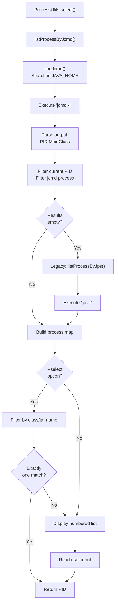

**Sources:** [boot/src/main/java/com/taobao/arthas/boot/ProcessUtils.java:55-123](), [boot/src/main/java/com/taobao/arthas/boot/ProcessUtils.java:125-164]()

### Process Selection Logic

The selection process prioritizes convenience and safety:

1. **Explicit PID**: If user provides `<pid>` argument, use it directly
2. **Select Filter**: If `--select <pattern>` matches exactly one process, auto-select it
3. **Port Reuse**: If telnet port already bound, prioritize that process in the list
4. **Interactive Mode**: Display numbered list with suggestion (marked with `*`)

**Sources:** [boot/src/main/java/com/taobao/arthas/boot/Bootstrap.java:394-407](), [bin/as.sh:758-826]()

---

## Phase 2: Arthas Distribution Resolution

### Resolution Strategy

The `Bootstrap` class implements a multi-tiered strategy to locate Arthas binaries:

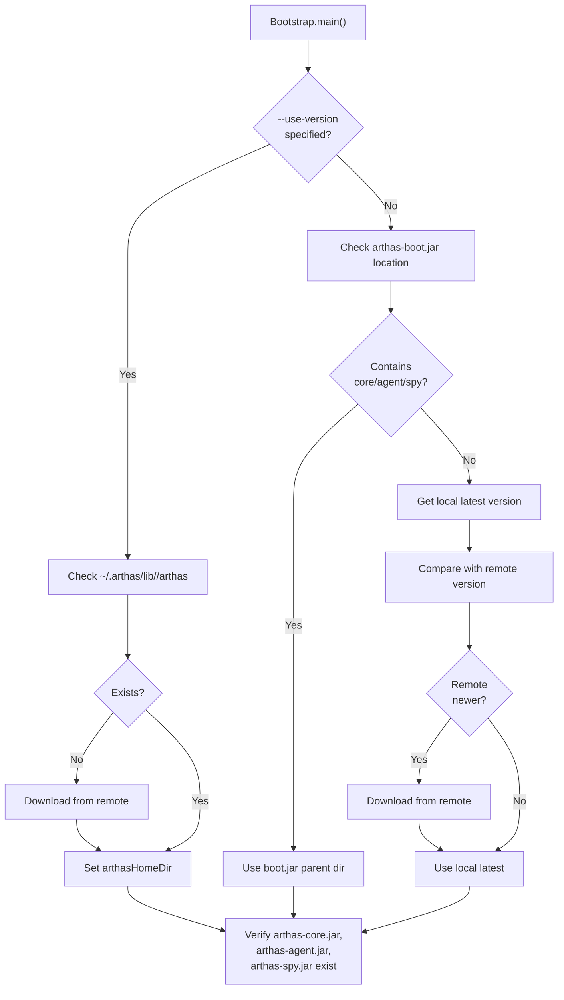

**Sources:** [boot/src/main/java/com/taobao/arthas/boot/Bootstrap.java:420-514]()

### Download Mechanism

When downloading is required, `DownloadUtils` handles remote retrieval:

| Component | Purpose |
|-----------|---------|
| Repository Mirror | Default: `center` (Maven Central), `aliyun` for +0800 timezone |
| Version Check | `GET https://arthas.aliyun.com/api/latest_version` |
| Download URL | `https://arthas.aliyun.com/download/${VERSION}?mirror=${REPO}` |
| Extraction | Unzip to `~/.arthas/lib/${VERSION}/arthas/` |

**Sources:** [boot/src/main/java/com/taobao/arthas/boot/DownloadUtils.java:24-96](), [boot/src/main/java/com/taobao/arthas/boot/Bootstrap.java:358-364]()

---

## Phase 3: JVM Attachment Process

### Starting the Attach Process

Once Arthas home is located, Bootstrap spawns a separate Java process to perform the attachment:

```mermaid
graph LR
    Bootstrap["Bootstrap Process"]
    AttachProcess["Attach Process<br/>(arthas-core.jar)"]
    TargetJVM["Target JVM"]
    
    Bootstrap -->|"startArthasCore()"| AttachProcess
    AttachProcess -->|"VirtualMachine.attach()"| TargetJVM
    
    subgraph "Bootstrap Arguments"
        BootArgs["-jar arthas-core.jar<br/>-pid <PID><br/>-target-ip 127.0.0.1<br/>-telnet-port 3658<br/>-http-port 8563<br/>-core <path><br/>-agent <path>"]
    end
    
    subgraph "Target JVM"
        AgentJar["arthas-agent.jar<br/>loaded via loadAgent()"]
    end
```

**Sources:** [boot/src/main/java/com/taobao/arthas/boot/ProcessUtils.java:278-358](), [boot/src/main/java/com/taobao/arthas/boot/Bootstrap.java:526-593]()

### Java Attach API Usage

The `Arthas` class (in arthas-core.jar) uses the Java Attach API to inject the agent:

**Key Steps:**

1. **Locate Target VM Descriptor**
   ```
   VirtualMachine.list() → find matching PID
   ```

2. **Attach to Target**
   ```
   VirtualMachine.attach(pid) or attach(descriptor)
   ```

3. **Version Compatibility Check**
   - Compare target Java version with current Java version
   - Warn on mismatch but continue (attachment may still succeed)

4. **Load Agent JAR**
   ```
   vm.loadAgent(arthasAgentPath, args)
   ```
   where `args` = `<arthas-core.jar path>;<Configure.toString()>`

5. **Detach**
   ```
   vm.detach()
   ```

**Sources:** [core/src/main/java/com/taobao/arthas/core/Arthas.java:88-149]()

### Configure Parameter Serialization

The `Configure` class holds all initialization parameters and serializes them for passing to the agent:

| Field | Purpose | Default |
|-------|---------|---------|
| `javaPid` | Target process ID | Required |
| `arthasCore` | Path to arthas-core.jar | Required |
| `arthasAgent` | Path to arthas-agent.jar | Required |
| `ip` | Listen IP address | 127.0.0.1 |
| `telnetPort` | Telnet server port | 3658 |
| `httpPort` | HTTP server port | 8563 |
| `sessionTimeout` | Session timeout seconds | 1800 |
| `username` | Authentication username | null |
| `password` | Authentication password | null |
| `tunnelServer` | Tunnel server URL | null |
| `agentId` | Agent identifier | null |
| `disabledCommands` | Comma-separated disabled commands | null |

**Sources:** [core/src/main/java/com/taobao/arthas/core/config/Configure.java:1-290]()

---

## Phase 4: Agent Initialization in Target JVM

### AgentBootstrap Entry Point

When the JVM loads `arthas-agent.jar`, it invokes the `agentmain()` method:

```mermaid
graph TB
    JVM["JVM calls agentmain()"]
    JVM --> Parse["Parse agentArgs:<br/>coreJar;configString"]
    
    Parse --> CheckInstance{ArthasBootstrap<br/>already bound?}
    CheckInstance -->|Yes| Skip["Skip initialization"]
    CheckInstance -->|No| CreateLoader["Create ArthasClassloader"]
    
    CreateLoader --> IsolateCP["Isolated classpath:<br/>arthas-core.jar"]
    IsolateCP --> LoadCore["Load ArthasBootstrap class"]
    LoadCore --> CallGetInstance["Call getInstance(inst, args)"]
    
    CallGetInstance --> Return["Return to JVM"]
    Skip --> Return
```

**Sources:** [agent/src/main/java/com/taobao/arthas/agent334/AgentBootstrap.java:62-200]()

### Classloader Isolation

The `ArthasClassloader` prevents conflicts with application classes:

**Isolation Strategy:**
- Parent: Bootstrap ClassLoader (null)
- Loads from: `arthas-core.jar`, `arthas-spy.jar`
- Protected packages: `java.*`, `javax.*`, `sun.*`
- Delegation: Parent-last for Arthas classes

**Sources:** [agent/src/main/java/com/taobao/arthas/agent334/AgentBootstrap.java:140-170]()

---

## Phase 5: Core Bootstrap Initialization

### ArthasBootstrap Singleton

The `ArthasBootstrap` class is the main entry point in the target JVM:

```mermaid
graph TB
    GetInstance["getInstance(Instrumentation, args)"]
    GetInstance --> CheckExists{Singleton<br/>exists?}
    
    CheckExists -->|Yes| Return["Return existing"]
    CheckExists -->|No| Construct["new ArthasBootstrap(inst, args)"]
    
    Construct --> InitSpy["initSpy()<br/>Load SpyAPI to bootstrap CL"]
    InitSpy --> InitEnv["initArthasEnvironment()<br/>Parse configuration"]
    InitEnv --> InitLogger["LogUtil.initLogger()"]
    InitLogger --> EnhanceLoader["enhanceClassLoader()<br/>Instrument ClassLoader.loadClass"]
    EnhanceLoader --> InitBeans["initBeans()<br/>Create ResultViewResolver, HistoryManager"]
    InitBeans --> Bind["bind(configure)<br/>Start servers"]
    
    Bind --> StartServers["Start Telnet/HTTP servers"]
    StartServers --> RegisterCmds["Register BuiltinCommandPack"]
    RegisterCmds --> Return
```

**Sources:** [core/src/main/java/com/taobao/arthas/core/server/ArthasBootstrap.java:138-185](), [core/src/main/java/com/taobao/arthas/core/server/ArthasBootstrap.java:595-621]()

### Critical Initialization Steps

#### 1. SpyAPI Injection

SpyAPI must be in the bootstrap classloader to be accessible from instrumented classes:

```mermaid
graph LR
    Check["Check if SpyAPI loaded"]
    Check -->|Not loaded| LocateSpy["Find arthas-spy.jar<br/>in arthas home"]
    LocateSpy --> Append["instrumentation.appendToBootstrapClassLoaderSearch()"]
    Append --> Verify["Verify SpyAPI.class loadable"]
    Check -->|Already loaded| Done["Continue"]
    Verify --> Done
```

**Sources:** [core/src/main/java/com/taobao/arthas/core/server/ArthasBootstrap.java:198-221]()

#### 2. ClassLoader Enhancement

To handle custom classloaders that cannot load SpyAPI, Arthas instruments `ClassLoader.loadClass()`:

**Mechanism:**
- Uses Bytekit's `InstrumentTransformer`
- Injects bytecode to add bootstrap classpath search
- Configurable via `arthas.enhanceLoaders` property
- Default: `java.lang.ClassLoader`

**Sources:** [core/src/main/java/com/taobao/arthas/core/server/ArthasBootstrap.java:223-251]()

#### 3. Configuration Resolution

Configuration is resolved from multiple sources with this priority order:

1. Command-line arguments (highest priority)
2. System environment variables
3. System properties
4. `arthas.properties` file
5. Defaults (lowest priority)

Unless `arthas.config.overrideAll=true` in `arthas.properties`, which reverses the priority.

**Sources:** [core/src/main/java/com/taobao/arthas/core/server/ArthasBootstrap.java:253-347]()

#### 4. Server Binding

The `bind()` method starts the shell servers:

| Component | Port | Protocol |
|-----------|------|----------|
| TelnetServer | 3658 (default) | Telnet/HTTP hybrid |
| HttpTermServer | 8563 (default) | HTTP/WebSocket |
| TunnelClient | N/A | WebSocket (optional) |

**Random Port Generation:** If port is set to `0`, Arthas generates a random available port via `SocketUtils.findAvailableTcpPort()`.

**Security:** If listening on `0.0.0.0` without a password, Arthas automatically generates a 64-character random password to prevent unauthorized remote access.

**Sources:** [core/src/main/java/com/taobao/arthas/core/server/ArthasBootstrap.java:355-504]()

---

## Bootstrap Command Flow

### Complete Execution Trace

The following table traces key method calls across processes:

| Process | Class | Method | Key Actions |
|---------|-------|--------|-------------|
| **Bootstrap** | Bootstrap | main() | Parse CLI, select process |
| | ProcessUtils | select() | List and select target PID |
| | Bootstrap | findArthasHome() | Locate/download binaries |
| | ProcessUtils | startArthasCore() | Spawn attach process |
| **Attach** | Arthas | main() | Parse arguments |
| | Arthas | parse() | Create Configure object |
| | Arthas | attachAgent() | Use VirtualMachine.attach() |
| | VirtualMachine | loadAgent() | Inject arthas-agent.jar |
| **Target JVM** | AgentBootstrap | agentmain() | Entry point from JVM |
| | AgentBootstrap | (constructor) | Parse args, create classloader |
| | ArthasClassloader | (load) | Load ArthasBootstrap class |
| | ArthasBootstrap | getInstance() | Singleton creation |
| | ArthasBootstrap | (constructor) | Initialize core components |
| | ArthasBootstrap | initSpy() | Inject SpyAPI |
| | ArthasBootstrap | enhanceClassLoader() | Instrument classloaders |
| | ArthasBootstrap | bind() | Start shell servers |
| | ShellServerImpl | listen() | Bind ports |

**Sources:** [boot/src/main/java/com/taobao/arthas/boot/Bootstrap.java:313-635](), [core/src/main/java/com/taobao/arthas/core/Arthas.java:26-149](), [agent/src/main/java/com/taobao/arthas/agent334/AgentBootstrap.java:62-200](), [core/src/main/java/com/taobao/arthas/core/server/ArthasBootstrap.java:138-504]()

---

## Error Handling and Edge Cases

### Java Version Mismatch

When the attach process Java version differs from the target JVM:

**Warning (non-fatal):**
- Different major versions (e.g., Java 8 attaching to Java 11)
- Printed to stderr but attachment continues
- May result in `AgentLoadException` with code "0"

**Sources:** [core/src/main/java/com/taobao/arthas/core/Arthas.java:106-143]()

### Port Conflicts

Before attachment, Bootstrap checks for port conflicts:

1. Use `SocketUtils.findTcpListenProcess()` to detect process using telnet/http ports
2. If port in use by different process than target, exit with error
3. If port already used by target, skip attachment (already attached)

**Conflict Resolution:**
- Use `--telnet-port` and `--http-port` to specify different ports
- Set `--http-port -1` to disable HTTP server
- Set `--telnet-port -1` to disable telnet (not recommended)

**Sources:** [boot/src/main/java/com/taobao/arthas/boot/Bootstrap.java:378-418](), [boot/src/main/java/com/taobao/arthas/boot/Bootstrap.java:637-647]()

### tools.jar Requirement (Java 8 and earlier)

For JDK 8 and earlier, `tools.jar` must be accessible:

**Search Order:**
1. `$JAVA_HOME/lib/tools.jar`
2. `$JAVA_HOME/../lib/tools.jar` (JRE under JDK)
3. Environment variable `JAVA_HOME`

**Bypass:** Java 9+ does not require `tools.jar` (APIs included in JDK).

**Sources:** [boot/src/main/java/com/taobao/arthas/boot/ProcessUtils.java:228-276](), [boot/src/main/java/com/taobao/arthas/boot/ProcessUtils.java:440-460]()

---

## Configuration Properties

### arthas.properties File

Default configuration can be specified in `arthas.properties` located in Arthas home:

```properties
arthas.telnetPort=3658
arthas.httpPort=8563
arthas.ip=127.0.0.1
arthas.sessionTimeout=1800
arthas.username=arthas
arthas.password=arthas
arthas.localConnectionNonAuth=true
arthas.disabledCommands=stop,dump
```

**Override Behavior:**
- By default, command-line args override properties file
- Set `arthas.config.overrideAll=true` to make properties file highest priority

**Sources:** [core/src/main/java/arthas.properties:1-29](), [core/src/main/java/com/taobao/arthas/core/server/ArthasBootstrap.java:312-346]()

---

## Integration with Deployment

### Docker Deployment

The Dockerfile demonstrates automated Arthas installation:

```dockerfile
ARG ARTHAS_VERSION="4.1.5"
ENV MAVEN_HOST=https://repo1.maven.org/maven2

RUN wget -qO /tmp/arthas.zip \
    "${MAVEN_HOST}/com/taobao/arthas/arthas-packaging/${ARTHAS_VERSION}/arthas-packaging-${ARTHAS_VERSION}-bin.zip" && \
    mkdir -p /opt/arthas && \
    unzip /tmp/arthas.zip -d /opt/arthas
```

This pre-installs Arthas, avoiding runtime downloads.

**Sources:** [Dockerfile:1-23](), [Dockerfile-No-Jdk:1-20]()

### Spring Boot Starter

For embedded integration without external attachment, see [Spring Boot Starter](#7.1).

---

## Attach-Only Mode

The `--attach-only` flag allows injecting Arthas without connecting a client:

**Use Cases:**
- Automation scripts that only need to start the server
- Tunnel server scenarios where clients connect remotely
- Web-based monitoring where HTTP API is sufficient

**Behavior:**
```bash
./as.sh --attach-only <pid>
# Exits after successful attachment
# Server keeps running in target JVM
```

**Sources:** [boot/src/main/java/com/taobao/arthas/boot/Bootstrap.java:596-598](), [bin/as.sh:1100-1102]()

---

# Page: Client-Server Communication

# Client-Server Communication

<details>
<summary>Relevant source files</summary>

The following files were used as context for generating this wiki page:

- [Dockerfile](Dockerfile)
- [Dockerfile-No-Jdk](Dockerfile-No-Jdk)
- [agent/src/main/java/com/taobao/arthas/agent334/AgentBootstrap.java](agent/src/main/java/com/taobao/arthas/agent334/AgentBootstrap.java)
- [bin/as.sh](bin/as.sh)
- [boot/src/main/java/com/taobao/arthas/boot/Bootstrap.java](boot/src/main/java/com/taobao/arthas/boot/Bootstrap.java)
- [boot/src/main/java/com/taobao/arthas/boot/DownloadUtils.java](boot/src/main/java/com/taobao/arthas/boot/DownloadUtils.java)
- [boot/src/main/java/com/taobao/arthas/boot/ProcessUtils.java](boot/src/main/java/com/taobao/arthas/boot/ProcessUtils.java)
- [boot/src/test/java/com/taobao/arthas/boot/DownloadUtilsTest.java](boot/src/test/java/com/taobao/arthas/boot/DownloadUtilsTest.java)
- [client/src/main/java/com/taobao/arthas/client/IOUtil.java](client/src/main/java/com/taobao/arthas/client/IOUtil.java)
- [client/src/main/java/com/taobao/arthas/client/TelnetConsole.java](client/src/main/java/com/taobao/arthas/client/TelnetConsole.java)
- [common/src/main/java/com/taobao/arthas/common/AnsiLog.java](common/src/main/java/com/taobao/arthas/common/AnsiLog.java)
- [common/src/main/java/com/taobao/arthas/common/ExecutingCommand.java](common/src/main/java/com/taobao/arthas/common/ExecutingCommand.java)
- [common/src/main/java/com/taobao/arthas/common/IOUtils.java](common/src/main/java/com/taobao/arthas/common/IOUtils.java)
- [common/src/main/java/com/taobao/arthas/common/PidUtils.java](common/src/main/java/com/taobao/arthas/common/PidUtils.java)
- [common/src/main/java/com/taobao/arthas/common/SocketUtils.java](common/src/main/java/com/taobao/arthas/common/SocketUtils.java)
- [common/src/main/java/com/taobao/arthas/common/UsageRender.java](common/src/main/java/com/taobao/arthas/common/UsageRender.java)
- [core/src/main/java/arthas.properties](core/src/main/java/arthas.properties)
- [core/src/main/java/com/taobao/arthas/core/Arthas.java](core/src/main/java/com/taobao/arthas/core/Arthas.java)
- [core/src/main/java/com/taobao/arthas/core/config/Configure.java](core/src/main/java/com/taobao/arthas/core/config/Configure.java)
- [core/src/main/java/com/taobao/arthas/core/mcp/ArthasMcpServer.java](core/src/main/java/com/taobao/arthas/core/mcp/ArthasMcpServer.java)
- [core/src/main/java/com/taobao/arthas/core/server/ArthasBootstrap.java](core/src/main/java/com/taobao/arthas/core/server/ArthasBootstrap.java)
- [core/src/main/java/com/taobao/arthas/core/shell/command/internal/WordCountHandler.java](core/src/main/java/com/taobao/arthas/core/shell/command/internal/WordCountHandler.java)
- [core/src/main/java/com/taobao/arthas/core/shell/impl/ShellImpl.java](core/src/main/java/com/taobao/arthas/core/shell/impl/ShellImpl.java)
- [core/src/main/java/com/taobao/arthas/core/shell/impl/ShellServerImpl.java](core/src/main/java/com/taobao/arthas/core/shell/impl/ShellServerImpl.java)
- [core/src/main/java/com/taobao/arthas/core/shell/session/impl/SessionManagerImpl.java](core/src/main/java/com/taobao/arthas/core/shell/session/impl/SessionManagerImpl.java)
- [core/src/main/java/com/taobao/arthas/core/shell/term/impl/http/api/ApiRequest.java](core/src/main/java/com/taobao/arthas/core/shell/term/impl/http/api/ApiRequest.java)
- [core/src/main/java/com/taobao/arthas/core/shell/term/impl/http/api/HttpApiHandler.java](core/src/main/java/com/taobao/arthas/core/shell/term/impl/http/api/HttpApiHandler.java)
- [core/src/main/java/com/taobao/arthas/core/util/ArthasBanner.java](core/src/main/java/com/taobao/arthas/core/util/ArthasBanner.java)
- [core/src/main/java/com/taobao/arthas/core/util/UserStatUtil.java](core/src/main/java/com/taobao/arthas/core/util/UserStatUtil.java)
- [tunnel-server/src/main/java/com/alibaba/arthas/tunnel/server/app/web/StatController.java](tunnel-server/src/main/java/com/alibaba/arthas/tunnel/server/app/web/StatController.java)

</details>


## Purpose and Scope

This document describes how Arthas clients communicate with the Arthas server that runs embedded in the target JVM. It covers the network protocols (Telnet and HTTP/WebSocket), client types, server-side components, connection establishment, session management, and authentication mechanisms.

For information about the tunnel system that enables remote access through a central proxy, see [Tunnel System](#5).

For information about how Arthas bootstraps and attaches to the target JVM, see [Bootstrapping and Attachment](#2.2).

---

## Communication Architecture

Arthas supports multiple communication protocols and client types to interact with the diagnostic server running inside the target JVM.

### Supported Protocols

| Protocol | Default Port | Purpose | Client Type |
|----------|-------------|---------|-------------|
| Telnet | 3658 | Interactive command line interface | `arthas-client.jar`, `telnet` command |
| HTTP | 8563 | Web console and RESTful API | Web browser, HTTP clients |
| WebSocket | 8563 | Real-time bidirectional communication | Web console, tunnel client |

**Configuration Properties:**

Sources: [core/src/main/java/arthas.properties:1-5]()

```properties
arthas.telnetPort=3658
arthas.httpPort=8563
arthas.ip=127.0.0.1
```

### Communication Architecture Diagram

```mermaid
graph TB
    subgraph "Client Layer - External Process"
        AsScript["as.sh / as.bat<br/>Shell Script"]
        BootJar["arthas-boot.jar<br/>Bootstrap Class"]
        ClientJar["arthas-client.jar<br/>TelnetConsole"]
        WebBrowser["Web Browser"]
        HttpClient["HTTP API Client"]
    end
    
    subgraph "Target JVM - Embedded Server"
        ShellServer["ShellServer<br/>Main Server Component"]
        
        subgraph "Term Servers"
            HttpTelnetTermServer["HttpTelnetTermServer<br/>Port 3658"]
            HttpTermServer["HttpTermServer<br/>Port 8563"]
        end
        
        subgraph "Request Handlers"
            HttpApiHandler["HttpApiHandler<br/>RESTful API"]
            McpHandler["McpHttpRequestHandler<br/>MCP Protocol"]
        end
        
        SessionManager["SessionManager<br/>Session Lifecycle"]
        CommandManager["InternalCommandManager<br/>Command Registry"]
        JobController["JobController<br/>Job Execution"]
    end
    
    AsScript -->|"1. Attach Agent"| BootJar
    BootJar -->|"2. VirtualMachine.attach()<br/>loadAgent()"| ShellServer
    BootJar -->|"3. Launch Client"| ClientJar
    
    ClientJar -->|"Telnet Protocol"| HttpTelnetTermServer
    WebBrowser -->|"HTTP/WebSocket"| HttpTermServer
    HttpClient -->|"POST /api/exec"| HttpTermServer
    
    HttpTelnetTermServer --> ShellServer
    HttpTermServer --> ShellServer
    HttpTermServer --> HttpApiHandler
    HttpTermServer --> McpHandler
    
    ShellServer --> SessionManager
    ShellServer --> CommandManager
    ShellServer --> JobController
```

Sources: [core/src/main/java/com/taobao/arthas/core/server/ArthasBootstrap.java:355-504](), [core/src/main/java/com/taobao/arthas/core/shell/impl/ShellServerImpl.java:41-76](), [bin/as.sh:78-1107](), [boot/src/main/java/com/taobao/arthas/boot/Bootstrap.java:1-774]()

---

## Client Types

### 1. Telnet Client (`arthas-client.jar`)

The primary interactive client that connects via Telnet protocol.

**Key Class:** `com.taobao.arthas.client.TelnetConsole`

**Connection Process:**

```mermaid
sequenceDiagram
    participant User
    participant Bootstrap
    participant TelnetConsole
    participant TelnetClient
    participant ArthasServer
    
    User->>Bootstrap: java -jar arthas-boot.jar <pid>
    Bootstrap->>Bootstrap: Attach agent to target JVM
    Bootstrap->>ArthasServer: Start ShellServer<br/>Bind ports 3658, 8563
    Bootstrap->>TelnetConsole: Launch arthas-client.jar<br/>127.0.0.1 3658
    TelnetConsole->>TelnetClient: new TelnetClient()<br/>connect(ip, port)
    TelnetClient->>ArthasServer: TCP Connection
    ArthasServer-->>TelnetClient: Welcome message
    
    loop Interactive Session
        User->>TelnetConsole: Enter command
        TelnetConsole->>ArthasServer: Send command
        ArthasServer->>ArthasServer: Execute command
        ArthasServer-->>TelnetConsole: Stream results
        TelnetConsole-->>User: Display output
    end
    
    User->>TelnetConsole: Ctrl+D or "quit"
    TelnetConsole->>ArthasServer: Close connection
```

**Features:**
- **Interactive Mode**: Full readline support with command history
- **Batch Mode**: Execute commands via `-c` or `-f` flags
- **Terminal Size Negotiation**: Uses `WindowSizeOptionHandler` to report terminal dimensions
- **Ctrl+C Handling**: Interrupts running commands without closing connection

Sources: [client/src/main/java/com/taobao/arthas/client/TelnetConsole.java:46-453](), [boot/src/main/java/com/taobao/arthas/boot/Bootstrap.java:600-635]()

**Usage Examples:**

```bash
# Interactive mode
java -jar arthas-client.jar 127.0.0.1 3658

# Batch mode - single command
java -jar arthas-client.jar 127.0.0.1 3658 -c "dashboard -n 1"

# Batch mode - script file
java -jar arthas-client.jar 127.0.0.1 3658 -f batch.as
```

Sources: [client/src/main/java/com/taobao/arthas/client/TelnetConsole.java:203-343]()

### 2. Shell Script Client (`as.sh` / `as.bat`)

Convenience scripts that combine bootstrapping and client connection.

**Process Flow:**
1. Detects or downloads Arthas binaries
2. Attaches agent to target JVM via `arthas-core.jar`
3. Launches `arthas-client.jar` for interactive session

**Key Features:**
- **Auto-attach Mode**: Attaches and connects in one command
- **Attach-only Mode**: `--attach-only` flag skips client connection
- **Native Telnet Fallback**: Uses system `telnet` command if available

Sources: [bin/as.sh:1-1107]()

### 3. HTTP/WebSocket Client

Web-based console and programmatic HTTP API access.

**Access Methods:**

| Method | Endpoint | Purpose |
|--------|----------|---------|
| Web Console | `http://127.0.0.1:8563` | Browser-based interactive UI |
| HTTP API | `POST /api/exec` | RESTful command execution |
| WebSocket | `ws://127.0.0.1:8563/ws` | Real-time bidirectional communication |

**HTTP API Request Format:**

```json
{
  "action": "exec",
  "command": "dashboard -n 1",
  "sessionId": "uuid-string",
  "requestId": "request-uuid"
}
```

**Supported Actions:**
- `INIT_SESSION` - Create new session
- `EXEC` - Synchronous command execution
- `ASYNC_EXEC` - Asynchronous command execution
- `INTERRUPT_JOB` - Cancel running job
- `PULL_RESULTS` - Retrieve command results
- `SESSION_INFO` - Get session metadata
- `JOIN_SESSION` - Attach to existing session
- `CLOSE_SESSION` - Terminate session

Sources: [core/src/main/java/com/taobao/arthas/core/shell/term/impl/http/api/HttpApiHandler.java:46-419](), [core/src/main/java/com/taobao/arthas/core/shell/term/impl/http/api/ApiRequest.java:1-87]()

---

## Server-Side Architecture

### ShellServer

The main server component that orchestrates all communication.

**Key Class:** `com.taobao.arthas.core.shell.impl.ShellServerImpl`

**Responsibilities:**
- Registers and manages `TermServer` instances for different protocols
- Maintains command resolvers and internal command manager
- Coordinates session lifecycle through global job controller
- Implements session timeout and reaper mechanism

Sources: [core/src/main/java/com/taobao/arthas/core/shell/impl/ShellServerImpl.java:44-243]()

### TermServer Implementations

```mermaid
graph LR
    ShellServer["ShellServer"]
    
    subgraph "TermServer Implementations"
        HttpTelnetTermServer["HttpTelnetTermServer<br/>Netty-based Telnet Server<br/>Port: 3658"]
        HttpTermServer["HttpTermServer<br/>Netty-based HTTP/WebSocket<br/>Port: 8563"]
    end
    
    ShellServer -->|registerTermServer| HttpTelnetTermServer
    ShellServer -->|registerTermServer| HttpTermServer
    
    HttpTelnetTermServer -->|creates| TelnetTtyConnection["TelnetTtyConnection<br/>Terminal Connection"]
    HttpTermServer -->|creates| ExtHttpTtyConnection["ExtHttpTtyConnection<br/>HTTP Terminal Connection"]
    
    TelnetTtyConnection -->|wraps| Term["Term<br/>Terminal Abstraction"]
    ExtHttpTtyConnection -->|wraps| Term
    
    Term -->|used by| Shell["Shell<br/>Command Execution Context"]
```

**HttpTelnetTermServer:**
- Implements Telnet protocol using Netty
- Creates `TelnetTtyConnection` for each client
- Handles terminal control sequences
- Default binding: `127.0.0.1:3658`

**HttpTermServer:**
- Implements HTTP and WebSocket protocols
- Creates `ExtHttpTtyConnection` for HTTP clients
- Integrates with `HttpApiHandler` for RESTful API
- Default binding: `127.0.0.1:8563`

Sources: [core/src/main/java/com/taobao/arthas/core/server/ArthasBootstrap.java:436-454]()

### HTTP API Handler

Processes RESTful HTTP requests and manages API sessions.

**Request Processing Flow:**

```mermaid
sequenceDiagram
    participant Client
    participant HttpTermServer
    participant HttpApiHandler
    participant SessionManager
    participant Job
    participant ResultDistributor
    
    Client->>HttpTermServer: POST /api/exec<br/>{"action": "exec", "command": "jvm"}
    HttpTermServer->>HttpApiHandler: handle(request)
    HttpApiHandler->>HttpApiHandler: parseRequest()
    
    alt Session exists
        HttpApiHandler->>SessionManager: getSession(sessionId)
        SessionManager-->>HttpApiHandler: Session
    else No session
        HttpApiHandler->>SessionManager: createSession()
        SessionManager-->>HttpApiHandler: New Session
    end
    
    HttpApiHandler->>Job: createJob(command)
    HttpApiHandler->>ResultDistributor: createDistributor(consumer)
    HttpApiHandler->>Job: run()
    
    Job->>Job: Execute command
    Job->>ResultDistributor: appendResult(model)
    
    ResultDistributor->>ResultDistributor: Queue results
    ResultDistributor-->>HttpApiHandler: Results available
    HttpApiHandler-->>Client: HTTP Response<br/>{"state": "succeeded", "body": [...]}
```

**Key Methods:**

- `handle(ChannelHandlerContext, FullHttpRequest)` - Main entry point for HTTP requests
- `processRequest(ChannelHandlerContext, ApiRequest)` - Routes requests to action handlers
- `processExecRequest(ApiRequest, Session)` - Synchronous command execution
- `processAsyncExecRequest(ApiRequest, Session)` - Asynchronous command execution
- `processPullResultsRequest(ApiRequest, Session)` - Retrieve queued results

Sources: [core/src/main/java/com/taobao/arthas/core/shell/term/impl/http/api/HttpApiHandler.java:52-419]()

---

## Session Management

### Session Lifecycle

Arthas maintains stateful sessions for both telnet and HTTP clients.

**SessionManager Implementation:**

```mermaid
stateDiagram-v2
    [*] --> Created: createSession()
    Created --> Active: First command execution
    Active --> Active: Command execution<br/>updateAccessTime()
    Active --> Idle: No activity for period
    Idle --> Active: New command
    Idle --> Expired: Timeout reached<br/>(default 1800s)
    Active --> Closed: User closes<br/>removeSession()
    Expired --> Removed: Reaper removes session
    Closed --> Removed: Cleanup resources
    Removed --> [*]
```

**Session Properties:**

| Property | Description | Storage Key |
|----------|-------------|-------------|
| Session ID | Unique identifier (UUID) | `Session.ID` |
| Command Manager | Command registry | `Session.COMMAND_MANAGER` |
| Instrumentation | JVM instrumentation API | `Session.INSTRUMENTATION` |
| PID | Target process ID | `Session.PID` |
| TTY | Terminal connection | `Session.TTY` |
| User ID | Authenticated user identifier | Custom key |
| Subject | Security authentication subject | `ArthasConstants.SUBJECT_KEY` |

Sources: [core/src/main/java/com/taobao/arthas/core/shell/session/impl/SessionManagerImpl.java:19-167]()

### Session Timeout and Reaper

**Configuration:**

```properties
# Default: 1800 seconds (30 minutes)
arthas.sessionTimeout=1800
```

**Reaper Mechanism:**
- Scheduled task runs at fixed intervals (default: 1000ms)
- Checks each session's last access time
- Removes expired sessions and closes associated resources
- Also removes idle result consumers (timeout: 5 minutes)

Sources: [core/src/main/java/com/taobao/arthas/core/shell/session/impl/SessionManagerImpl.java:119-167](), [core/src/main/java/arthas.properties:6-7]()

**Reaper Logic:**

```mermaid
flowchart TD
    Start["Reaper Timer Fires<br/>(every 1000ms)"]
    Start --> CheckSessions["Iterate All Sessions"]
    CheckSessions --> CalcAge["Calculate Age:<br/>now - lastAccessTime"]
    CalcAge --> IsExpired{"Age > Timeout?"}
    IsExpired -->|Yes| InterruptJob["Interrupt Foreground Job"]
    InterruptJob --> CloseDistributor["Close ResultDistributor"]
    CloseDistributor --> RemoveSession["Remove from SessionManager"]
    IsExpired -->|No| CheckConsumers["Check ResultConsumers"]
    CheckConsumers --> ConsumerExpired{"Consumer Idle?"}
    ConsumerExpired -->|Yes| RemoveConsumer["Remove Consumer"]
    RemoveConsumer --> NextSession["Next Session"]
    ConsumerExpired -->|No| NextSession
    RemoveSession --> NextSession
    NextSession --> CheckSessions
```

Sources: [core/src/main/java/com/taobao/arthas/core/shell/session/impl/SessionManagerImpl.java:119-167]()

---

## Connection Establishment

### Bootstrap and Attach Flow

```mermaid
sequenceDiagram
    participant User
    participant AsScript as as.sh
    participant Bootstrap as Bootstrap.java
    participant Core as arthas-core.jar
    participant TargetJVM as Target JVM
    participant ShellServer
    participant Client as arthas-client.jar
    
    User->>AsScript: ./as.sh <pid>
    AsScript->>AsScript: Find/download Arthas binaries
    AsScript->>Bootstrap: java -jar arthas-boot.jar --pid <pid>
    Bootstrap->>Bootstrap: Verify arthas home directory
    Bootstrap->>Bootstrap: Check telnet/HTTP port availability
    
    Bootstrap->>Core: java -jar arthas-core.jar<br/>-pid <pid><br/>-telnet-port 3658<br/>-http-port 8563
    Core->>TargetJVM: VirtualMachine.attach(pid)<br/>loadAgent(arthas-agent.jar)
    
    TargetJVM->>TargetJVM: agentmain() invoked
    TargetJVM->>TargetJVM: Create ArthasClassLoader
    TargetJVM->>ShellServer: ArthasBootstrap.getInstance()<br/>bind(configure)
    
    ShellServer->>ShellServer: Register HttpTelnetTermServer<br/>Bind 0.0.0.0:3658
    ShellServer->>ShellServer: Register HttpTermServer<br/>Bind 0.0.0.0:8563
    ShellServer-->>Core: Server started
    Core-->>Bootstrap: Attach success
    
    Bootstrap->>Client: Launch arthas-client.jar<br/>127.0.0.1 3658
    Client->>ShellServer: Connect via Telnet
    ShellServer-->>Client: Welcome banner
    Client-->>User: Ready for commands
```

Sources: [bin/as.sh:828-1103](), [boot/src/main/java/com/taobao/arthas/boot/Bootstrap.java:313-635](), [core/src/main/java/com/taobao/arthas/core/Arthas.java:21-169](), [core/src/main/java/com/taobao/arthas/core/server/ArthasBootstrap.java:355-504]()

### Port Binding and Configuration

**Default Port Assignments:**

| Component | Default | Can Disable |
|-----------|---------|-------------|
| Telnet Port | 3658 | Yes (set to -1) |
| HTTP Port | 8563 | Yes (set to -1) |
| Random Port | 0 | Auto-assign available port |

**Port Conflict Detection:**

The bootstrap process checks if ports are already in use and validates they're being used by the correct process:

```java
// Check if telnet port is already in use
telnetPortPid = SocketUtils.findTcpListenProcess(telnetPort);
if (telnetPortPid > 0 && targetPid != telnetPortPid) {
    // Error: port used by different process
    exit(1);
}
```

Sources: [boot/src/main/java/com/taobao/arthas/boot/Bootstrap.java:378-418](), [common/src/main/java/com/taobao/arthas/common/SocketUtils.java:40-170]()

**Configuration Override Priority:**

1. Command-line arguments (`--telnet-port`, `--http-port`)
2. System environment variables
3. System properties
4. `arthas.properties` file
5. Built-in defaults

Sources: [core/src/main/java/com/taobao/arthas/core/server/ArthasBootstrap.java:253-284]()

---

## Authentication and Security

### Local Connection Authentication

By default, local connections (from `127.0.0.1`) are not authenticated to simplify local debugging:

```properties
# arthas.properties
arthas.localConnectionNonAuth=true
```

**Local Connection Detection:**

The server identifies local connections and automatically creates a `Principal` for authentication bypass:

```mermaid
flowchart TD
    NewConnection["New Telnet Connection"]
    NewConnection --> CheckIP{"Is Local IP?<br/>127.0.0.1 or ::1"}
    CheckIP -->|Yes| CreatePrincipal["AuthUtils.localPrincipal()<br/>Creates Anonymous Principal"]
    CheckIP -->|No| RequireAuth["Require Authentication"]
    CreatePrincipal --> AutoLogin["SecurityAuthenticator.login()"]
    AutoLogin --> CreateSubject["Create Authenticated Subject"]
    CreateSubject --> StoreSession["Store in Session:<br/>ArthasConstants.SUBJECT_KEY"]
    RequireAuth --> ValidatePassword["Validate Username/Password"]
```

Sources: [core/src/main/java/com/taobao/arthas/core/shell/impl/ShellImpl.java:67-90](), [core/src/main/java/com/taobao/arthas/core/config/Configure.java:72-76]()

### Password-Based Authentication

When listening on non-local addresses (`0.0.0.0`), Arthas enforces authentication:

**Automatic Password Generation:**

```java
if (IPUtils.isAllZeroIP(configure.getIp()) && StringUtils.isBlank(configure.getPassword())) {
    // Force generate password when listening on 0.0.0.0
    configure.setPassword(StringUtils.randomString(64));
    logger.error("Generated arthas password: " + configure.getPassword());
}
```

**Manual Configuration:**

```properties
# arthas.properties
arthas.username=arthas
arthas.password=your-secure-password
```

Sources: [core/src/main/java/com/taobao/arthas/core/server/ArthasBootstrap.java:404-417](), [core/src/main/java/arthas.properties:11-13]()

### HTTP Session Authentication

HTTP clients pass authentication credentials via session cookies or request headers:

```java
// Authentication stored in HttpSession
HttpSession httpSession = HttpSessionManager.getHttpSessionFromContext(ctx);
Object subject = httpSession.getAttribute(ArthasConstants.SUBJECT_KEY);
if (subject != null) {
    session.put(ArthasConstants.SUBJECT_KEY, subject);
}
```

Sources: [core/src/main/java/com/taobao/arthas/core/shell/term/impl/http/api/HttpApiHandler.java:157-170]()

---

## Batch Mode and Command Execution

### Telnet Batch Mode

Execute commands non-interactively:

**Single Command:**
```bash
arthas-client.jar 127.0.0.1 3658 -c "dashboard -n 1"
```

**Batch File:**
```bash
arthas-client.jar 127.0.0.1 3658 -f commands.as
```

**Execution Flow:**

```mermaid
sequenceDiagram
    participant Client as TelnetConsole<br/>(Batch Mode)
    participant Server as Arthas Server
    participant PrintThread as Result Printer Thread
    
    Client->>Server: Connect
    Server-->>Client: Connection established
    
    Client->>PrintThread: Start result printer thread
    
    loop For each command
        Client->>Client: Wait for prompt "[arthas@"
        Note over Client: Queue blocks until prompt received
        Client->>Server: command + " | plaintext\n"
        Server->>Server: Execute command
        
        loop Stream results
            Server-->>PrintThread: Result chunks
            PrintThread->>PrintThread: Print to stdout
            PrintThread->>PrintThread: Detect prompt "[arthas@"
            PrintThread->>Client: Signal prompt received
        end
    end
    
    Client->>Server: "quit\n"
    Client->>Client: Exit
```

**Timeout Handling:**

Batch mode supports execution timeout to prevent hanging:

```java
// Configuration
--execution-timeout 30000  // 30 seconds

// Implementation
if (executionTimeout > 0) {
    if (now - startTime > executionTimeout) {
        return STATUS_EXEC_TIMEOUT; // Exit code 100
    }
}
```

Sources: [client/src/main/java/com/taobao/arthas/client/TelnetConsole.java:345-411]()

### HTTP API Batch Execution

**Synchronous Execution:**

Blocks until command completes, returns all results:

```json
{
  "action": "exec",
  "command": "dashboard -n 1",
  "execTimeout": 30000
}
```

**Asynchronous Execution:**

Starts command in background, returns immediately:

```json
{
  "action": "async_exec",
  "command": "trace com.example.Service method",
  "sessionId": "session-uuid"
}
```

**Result Retrieval:**

Pull results from asynchronous execution:

```json
{
  "action": "pull_results",
  "sessionId": "session-uuid",
  "consumerId": "consumer-uuid"
}
```

Sources: [core/src/main/java/com/taobao/arthas/core/shell/term/impl/http/api/HttpApiHandler.java:194-335]()

---

## Communication Protocol Details

### Telnet Protocol Specifics

**Terminal Size Negotiation:**

Arthas uses the Telnet Window Size Option (RFC 1073) to adapt output to terminal dimensions:

```java
// WindowSizeOptionHandler initialization
TelnetOptionHandler sizeOpt = new WindowSizeOptionHandler(
    width,   // Terminal width
    height,  // Terminal height
    true,    // Initial DO
    true,    // Initial WILL
    false,   // Accept DO
    false    // Accept WILL
);
telnet.addOptionHandler(sizeOpt);
```

**Control Character Handling:**

| Key | Code | Behavior |
|-----|------|----------|
| Ctrl+C | 0x03 | Send interrupt signal to current job |
| Ctrl+D | 0x04 | End of transmission (disconnect) |
| Ctrl+Z | 0x1A | Suspend current job (not implemented) |

Sources: [client/src/main/java/com/taobao/arthas/client/TelnetConsole.java:276-303]()

### WebSocket Protocol

The HTTP server upgrades HTTP connections to WebSocket for real-time communication:

**Upgrade Sequence:**
1. Client sends HTTP GET with `Upgrade: websocket` header
2. Server responds with `101 Switching Protocols`
3. Connection becomes full-duplex WebSocket
4. Messages exchanged as JSON-RPC style frames

**Message Format:**

```json
{
  "action": "read",
  "data": "dashboard\n"
}
```

Sources: [core/src/main/java/com/taobao/arthas/core/shell/term/impl/http/api/HttpApiHandler.java:1-419]()

---

## Error Handling and Status Codes

### Exit Status Codes

Clients return standardized exit codes:

| Code | Constant | Meaning |
|------|----------|---------|
| 0 | `STATUS_OK` | Success |
| 1 | `STATUS_ERROR` | Generic error |
| 100 | `STATUS_EXEC_TIMEOUT` | Command execution timeout |
| 101 | `STATUS_EXEC_ERROR` | Command execution error |

Sources: [client/src/main/java/com/taobao/arthas/client/TelnetConsole.java:58-73](), [boot/src/main/java/com/taobao/arthas/boot/ProcessUtils.java:36-52]()

### HTTP API Response States

```json
{
  "state": "succeeded",  // or "failed", "refused"
  "message": "Success message",
  "body": { /* result data */ },
  "requestId": "uuid"
}
```

**States:**
- `SUCCEEDED` - Command executed successfully
- `FAILED` - Command execution failed
- `REFUSED` - Request was rejected (invalid action, authentication failure, etc.)

Sources: [core/src/main/java/com/taobao/arthas/core/shell/term/impl/http/api/HttpApiHandler.java:72-192]()

---

## Summary

Arthas provides multiple communication channels to suit different use cases:

1. **Telnet Protocol** (port 3658) - Primary interactive interface using `arthas-client.jar`
2. **HTTP/WebSocket** (port 8563) - Web console and programmatic API access
3. **Tunnel Server** - Remote access through centralized proxy (see [Tunnel System](#5))

The server architecture uses Netty-based `TermServer` implementations registered with a central `ShellServer`. Sessions are managed by `SessionManager` with configurable timeout and automatic cleanup. Authentication supports both local non-auth mode for `localhost` connections and password-based authentication for remote access.

All communication protocols ultimately create a `Shell` instance that executes commands through the `CommandManager` and `JobController`, with results streamed back to clients through protocol-specific channels.

---

# Page: Command Processing Pipeline

# Command Processing Pipeline

<details>
<summary>Relevant source files</summary>

The following files were used as context for generating this wiki page:

- [core/src/main/java/com/taobao/arthas/core/command/BuiltinCommandPack.java](core/src/main/java/com/taobao/arthas/core/command/BuiltinCommandPack.java)
- [core/src/main/java/com/taobao/arthas/core/command/basic1000/StopCommand.java](core/src/main/java/com/taobao/arthas/core/command/basic1000/StopCommand.java)
- [core/src/main/java/com/taobao/arthas/core/command/model/VmToolModel.java](core/src/main/java/com/taobao/arthas/core/command/model/VmToolModel.java)
- [core/src/main/java/com/taobao/arthas/core/command/view/ResultViewResolver.java](core/src/main/java/com/taobao/arthas/core/command/view/ResultViewResolver.java)
- [core/src/main/java/com/taobao/arthas/core/command/view/VmToolView.java](core/src/main/java/com/taobao/arthas/core/command/view/VmToolView.java)
- [core/src/main/java/com/taobao/arthas/core/mcp/util/McpObjectVOFilter.java](core/src/main/java/com/taobao/arthas/core/mcp/util/McpObjectVOFilter.java)
- [core/src/main/java/com/taobao/arthas/core/util/NetUtils.java](core/src/main/java/com/taobao/arthas/core/util/NetUtils.java)
- [core/src/main/java/com/taobao/arthas/core/util/StringUtils.java](core/src/main/java/com/taobao/arthas/core/util/StringUtils.java)
- [core/src/main/java/com/taobao/arthas/core/util/metrics/RateCounter.java](core/src/main/java/com/taobao/arthas/core/util/metrics/RateCounter.java)
- [core/src/main/java/com/taobao/arthas/core/view/ObjectView.java](core/src/main/java/com/taobao/arthas/core/view/ObjectView.java)
- [core/src/test/java/com/taobao/arthas/core/advisor/SpyImplTest.java](core/src/test/java/com/taobao/arthas/core/advisor/SpyImplTest.java)
- [core/src/test/java/com/taobao/arthas/core/view/ObjectViewTest.java](core/src/test/java/com/taobao/arthas/core/view/ObjectViewTest.java)

</details>


## Purpose and Scope

This document explains the architecture and components involved in processing commands in Arthas, from the moment a user inputs a command until results are rendered and displayed. Understanding this pipeline is crucial for developers who want to extend Arthas with new commands or modify existing command behavior. For information about specific diagnostic commands, see [Diagnostic Commands](#3).

## High-Level Pipeline Overview

The command processing pipeline in Arthas follows a well-defined flow that transforms user input into structured results through several processing stages.

```mermaid
flowchart LR
    subgraph "Input Phase"
        UserInput["User Input"]
        CommandParsing["Command Parsing"]
    end
    
    subgraph "Processing Phase"
        CommandResolution["Command Resolution"]
        CommandExecution["Command Execution"]
        ResultModelCreation["Result Model Creation"]
    end
    
    subgraph "Output Phase"
        ResultDistribution["Result Distribution"]
        ResultRendering["Result Rendering"]
        OutputDisplay["Output Display"]
    end
    
    UserInput --> CommandParsing
    CommandParsing --> CommandResolution
    CommandResolution --> CommandExecution
    CommandExecution --> ResultModelCreation
    ResultModelCreation --> ResultDistribution
    ResultDistribution --> ResultRendering
    ResultRendering --> OutputDisplay
```

Sources: High-level architecture diagram provided in the introduction

## Command Input and Parsing

When a user enters a command through any interface (CLI, web console, or API), the input is tokenized and parsed into structured command arguments using the middleware CLI framework.

```mermaid
flowchart TD
    subgraph "Command Input and Parsing"
        UserInput["User Input String"]
        ShellImpl["ShellImpl"]
        Parser["CLI Parser"]
        AnnotatedCommand["AnnotatedCommand"]
    end
    
    UserInput --> ShellImpl
    ShellImpl --> Parser
    Parser --> |"@Name, @Summary\n@Option annotations"| AnnotatedCommand
    AnnotatedCommand --> ValidatedCommand["Validated Command\nwith Arguments"]
```

Commands are defined as classes extending `AnnotatedCommand` and use annotations from the `com.taobao.middleware.cli.annotations` package to declare their names, options, and arguments. The CLI parser automatically extracts and validates arguments based on these annotations.

Sources: [core/src/main/java/com/taobao/arthas/core/shell/command/AnnotatedCommand.java], [core/src/main/java/com/taobao/arthas/core/command/basic1000/StopCommand.java:1-43]()

## Command Resolution and Execution

After parsing, Arthas resolves the command to the appropriate handler based on the command name using the `CommandResolver` interface. The primary implementation is `BuiltinCommandPack`, which registers 50+ built-in commands during initialization.

```mermaid
flowchart LR
    subgraph "Command Resolution and Execution"
        ParsedCommand["Parsed Command"]
        CommandResolver["CommandResolver\n(BuiltinCommandPack)"]
        AnnotatedCommand["AnnotatedCommand\nSubclass"]
        CommandProcess["CommandProcess"]
    end
    
    ParsedCommand --> CommandResolver
    CommandResolver --> |"commands() list"| AnnotatedCommand
    AnnotatedCommand --> |"process()"| CommandProcess
    CommandProcess --> |"appendResult()"| ResultModel["ResultModel"]
```

**Command Registration**: The `BuiltinCommandPack` class registers all built-in commands in its constructor:

| Command Category | Example Commands | Line References |
|------------------|------------------|-----------------|
| Basic (basic1000) | `help`, `version`, `cls`, `stop` | [core/src/main/java/com/taobao/arthas/core/command/BuiltinCommandPack.java:61-108]() |
| Class Inspection (klass100) | `jad`, `dump`, `sc`, `sm` | [core/src/main/java/com/taobao/arthas/core/command/BuiltinCommandPack.java:64-68]() |
| Enhancement (monitor200) | `watch`, `trace`, `tt`, `monitor`, `stack` | [core/src/main/java/com/taobao/arthas/core/command/BuiltinCommandPack.java:69-75]() |
| JVM Introspection | `thread`, `jvm`, `dashboard`, `memory` | [core/src/main/java/com/taobao/arthas/core/command/BuiltinCommandPack.java:71-77]() |

**Command Execution**: Each command implements the `process(CommandProcess process)` method, which receives a `CommandProcess` object for appending results and managing execution lifecycle.

Sources: [core/src/main/java/com/taobao/arthas/core/command/BuiltinCommandPack.java:1-127](), [core/src/main/java/com/taobao/arthas/core/command/basic1000/StopCommand.java:22-41]()

## Result Model Creation

Command execution produces standardized `ResultModel` objects that encapsulate the command output in a structured way. These models provide a consistent interface for the distribution and rendering phases.

```mermaid
flowchart TD
    subgraph "Result Model Creation"
        CommandResult["Command Result"]
        ResultModel["Result Model"]
        Countable["Countable Interface"]
    end
    
    CommandResult --> ResultModel
    Countable -.-> ResultModel
```

Some result models implement the `Countable` interface, which helps estimate the size of results for efficient distribution:

```java
public interface Countable {
    /**
     * Get item size of this result model, the value of size is greater than or equal to 1
     * @return item size of this result model
     */
    int size();
}
```

Sources: [core/src/main/java/com/taobao/arthas/core/command/model/Countable.java:1-15]()

## Result Distribution

After a result model is created, it enters the distribution phase, where it is queued and distributed to various consumers (CLI, web interface, API clients, etc.).

```mermaid
flowchart TD
    subgraph "Result Distribution System"
        ResultModel["Result Model"]
        ResultConsumerHelper["ResultConsumerHelper"]
        PackingDistributor["PackingResultDistributorImpl"]
        ResultConsumer["ResultConsumerImpl"]
        
        ResultModel --> ResultConsumerHelper
        ResultConsumerHelper --> |"estimates item count"| PackingDistributor
        PackingDistributor --> |"queues results"| ResultConsumer
    end
```

The distribution system consists of these key components:

1. **ResultConsumerHelper**: Estimates the size of result models to facilitate efficient distribution
2. **PackingResultDistributorImpl**: Queues result models and handles overflow conditions
3. **ResultConsumerImpl**: Consumes and processes command results for specific output channels

The distribution system manages result flow using a queue system with configurable limits:

```java
// From PackingResultDistributorImpl
private BlockingQueue<ResultModel> resultQueue = new ArrayBlockingQueue<ResultModel>(500);

// From ResultConsumerImpl
public boolean appendResult(ResultModel result) {
    //可能某些Consumer已经断开，不会再读取，这里不能堵塞！
    boolean discard = false;
    while (!resultQueue.offer(result)) {
        ResultModel discardResult = resultQueue.poll();
        discard = true;
    }
    return !discard;
}
```

The distribution system also supports batch processing and long polling to optimize network communication:

```java
// From ResultConsumerImpl - polling with batching support
public List<ResultModel> pollResults() {
    // ... (locking and timing logic)
    List<ResultModel> sendingResults = new ArrayList<ResultModel>(resultBatchSizeLimit);
    
    // Poll results with timing constraints
    while (!closed && sendingResults.size() < resultBatchSizeLimit
            && sendingDelay < 100 && waitingTime < pollTimeLimit) {
        ResultModel aResult = resultQueue.poll(100, TimeUnit.MILLISECONDS);
        if (aResult != null) {
            sendingResults.add(aResult);
            // ... (flush logic)
        }
    }
    return sendingResults;
}
```

Sources: 
- [core/src/main/java/com/taobao/arthas/core/distribution/ResultConsumerHelper.java:22-93]()
- [core/src/main/java/com/taobao/arthas/core/distribution/impl/PackingResultDistributorImpl.java:1-43]()
- [core/src/main/java/com/taobao/arthas/core/distribution/impl/ResultConsumerImpl.java:22-167]()

## Result Rendering

The rendering phase transforms structured `ResultModel` objects into formats appropriate for display through a view resolution and rendering system.

```mermaid
flowchart TD
    subgraph "Result Rendering System"
        ResultModel["ResultModel\n(WatchModel, TraceModel, etc.)"]
        ResultViewResolver["ResultViewResolver"]
        ResultView["ResultView\n(WatchView, TraceView, etc.)"]
        ObjectView["ObjectView"]
        RenderOutput["Rendered Output"]
        
        ResultModel --> ResultViewResolver
        ResultViewResolver --> |"getResultView()"| ResultView
        ResultView --> |"draw()"| RenderOutput
        ResultView --> |"for complex objects"| ObjectView
        ObjectView --> RenderOutput
    end
```

**View Resolution**: The `ResultViewResolver` class maintains a registry mapping `ResultModel` classes to their corresponding `ResultView` implementations. During initialization, it registers 40+ view mappings:

```java
// From ResultViewResolver - view registration
private void initResultViews() {
    // Basic commands
    registerView(VersionView.class);
    registerView(HelpView.class);
    
    // Class inspection
    registerView(JadView.class);
    registerView(SearchClassView.class);
    
    // Enhancement commands
    registerView(WatchView.class);
    registerView(TraceView.class);
    registerView(MonitorView.class);
    // ... 30+ more views
}
```

The resolver uses reflection to automatically extract the model class from each view's `draw()` method signature at [core/src/main/java/com/taobao/arthas/core/command/view/ResultViewResolver.java:122-139]().

**Object Rendering**: The `ObjectView` class provides sophisticated rendering of Java objects with these capabilities:

- **Format Selection**: JSON format (via fastjson2) or custom text format based on `GlobalOptions.isUsingJson`
- **Depth Control**: Configurable expansion depth (default max 4 levels) to prevent excessive output
- **Type-Specific Rendering**: Special handling for primitives, strings, collections, arrays, maps, throwables, dates, and enums
- **Size Limits**: Throws `ObjectTooLargeException` when output exceeds configured limit

```java
// From ObjectView - rendering with depth control
public ObjectView(Object object, int deep, int maxObjectLength) {
    this.object = object;
    this.deep = deep > MAX_DEEP ? MAX_DEEP : deep;
    this.maxObjectLength = maxObjectLength;
}
```

Sources: 
- [core/src/main/java/com/taobao/arthas/core/command/view/ResultViewResolver.java:1-141]()
- [core/src/main/java/com/taobao/arthas/core/view/ObjectView.java:1-704]()
- [core/src/test/java/com/taobao/arthas/core/view/ObjectViewTest.java:19-284]()

## Output Display

The final phase involves displaying the rendered output to the user through the appropriate channel (CLI, web interface, API response, etc.).

```mermaid
flowchart LR
    subgraph "Output Display"
        RenderOutput["Rendered Output"]
        OutputChannel["Output Channel"]
        User["User"]
        
        RenderOutput --> OutputChannel
        OutputChannel --> User
    end
```

Different output channels handle the final display logic, including:
- Telnet terminal for CLI users
- HTTP responses for web console users 
- Tunnel system for remote clients

## Complete Pipeline Architecture

The full command processing pipeline integrates all components into a cohesive flow:

```mermaid
flowchart TD
    subgraph "Command Processing Pipeline - Code Entity Mapping"
        UserInput["User Input String"] --> ShellImpl["ShellImpl"]
        ShellImpl --> CLIParser["CLI Parser\n(@Name, @Option)"]
        CLIParser --> BuiltinCommandPack["BuiltinCommandPack\n.commands()"]
        
        BuiltinCommandPack --> AnnotatedCommand["AnnotatedCommand\n.process()"]
        AnnotatedCommand --> CommandProcess["CommandProcess\n.appendResult()"]
        
        CommandProcess --> ResultModel["ResultModel\n(WatchModel, TraceModel)"]
        ResultModel --> ResultConsumerHelper["ResultConsumerHelper\n.estimateSize()"]
        
        ResultConsumerHelper --> PackingResultDistributor["PackingResultDistributor\n.send()"]
        PackingResultDistributor --> ResultConsumer["ResultConsumer\n.pollResults()"]
        
        ResultConsumer --> ResultViewResolver["ResultViewResolver\n.getResultView()"]
        ResultViewResolver --> ResultView["ResultView\n.draw()"]
        ResultView --> ObjectView["ObjectView\n.renderObject()"]
        
        ObjectView --> OutputChannel["Output Channel\n(Telnet/HTTP/WebSocket)"]
    end
    
    OutputChannel --> User["User"]
```

**Key Integration Points**:

1. **ShellImpl** manages the command execution context and job lifecycle
2. **BuiltinCommandPack** acts as the central registry for all 50+ commands
3. **CommandProcess** provides the bridge between command execution and result distribution
4. **ResultConsumerHelper** estimates result sizes for efficient batching
5. **ResultViewResolver** performs model-to-view mapping via reflection
6. **ObjectView** handles complex object rendering with depth control

This architecture enables Arthas to process commands efficiently across different interfaces while managing resources and handling potentially large result sets.

Sources: 
- [core/src/main/java/com/taobao/arthas/core/command/BuiltinCommandPack.java:1-127]()
- [core/src/main/java/com/taobao/arthas/core/command/view/ResultViewResolver.java:1-141]()
- [core/src/main/java/com/taobao/arthas/core/view/ObjectView.java:1-704]()

## Pipeline Flow Example

To illustrate how the pipeline works in practice, let's trace how a sample command flows through the system:

| Phase | Component | Action |
|-------|-----------|--------|
| Input | User | Enters `thread` command to view thread information |
| Parsing | Command Parser | Tokenizes and parses command arguments |
| Resolution | Command Resolver | Resolves to the ThreadCommand handler |
| Execution | ThreadCommand | Executes thread analysis logic |
| Result Creation | ThreadCommand | Creates ThreadModel with thread data |
| Distribution | PackingResultDistributor | Queues the ThreadModel for distribution |
| Distribution | ResultConsumer | Consumes the ThreadModel from the queue |
| Rendering | ObjectView | Renders thread information in readable format |
| Output | CLI/Web Console | Displays the rendered thread information |

This example demonstrates how a single command travels through each phase of the pipeline, from user input to displayed output.

The command processing pipeline enables Arthas's extensible and flexible diagnostic capabilities. Its modular design allows for efficient command handling and result presentation across different interfaces, making it a powerful tool for Java application diagnostics.

---

# Page: Diagnostic Commands

# Diagnostic Commands

<details>
<summary>Relevant source files</summary>

The following files were used as context for generating this wiki page:

- [CONTRIBUTING.md](CONTRIBUTING.md)
- [README.md](README.md)
- [README_CN.md](README_CN.md)
- [USERS.md](USERS.md)
- [arthas-vmtool/README.md](arthas-vmtool/README.md)
- [as-package.sh](as-package.sh)
- [bin/as-service.bat](bin/as-service.bat)
- [bin/as.bat](bin/as.bat)
- [core/src/main/java/com/taobao/arthas/core/command/BuiltinCommandPack.java](core/src/main/java/com/taobao/arthas/core/command/BuiltinCommandPack.java)
- [core/src/main/java/com/taobao/arthas/core/command/basic1000/StopCommand.java](core/src/main/java/com/taobao/arthas/core/command/basic1000/StopCommand.java)
- [core/src/main/java/com/taobao/arthas/core/command/model/VmToolModel.java](core/src/main/java/com/taobao/arthas/core/command/model/VmToolModel.java)
- [core/src/main/java/com/taobao/arthas/core/command/view/ResultViewResolver.java](core/src/main/java/com/taobao/arthas/core/command/view/ResultViewResolver.java)
- [core/src/main/java/com/taobao/arthas/core/command/view/VmToolView.java](core/src/main/java/com/taobao/arthas/core/command/view/VmToolView.java)
- [static/cider.png](static/cider.png)
- [static/citycloud.jpg](static/citycloud.jpg)
- [static/didiglobal.jpg](static/didiglobal.jpg)
- [static/dms.png](static/dms.png)
- [static/guideir.jpg](static/guideir.jpg)
- [static/hollycrm.png](static/hollycrm.png)
- [static/mingyuanyun.jpg](static/mingyuanyun.jpg)
- [static/ouyeel.png](static/ouyeel.png)
- [static/videt.png](static/videt.png)
- [static/zhaopin.png](static/zhaopin.png)

</details>


## Purpose and Scope

Arthas provides over 50 built-in diagnostic commands that allow developers to inspect, monitor, and modify running Java applications without code changes or restarts. Commands are organized into categories based on their diagnostic capabilities: basic utilities, class inspection, bytecode enhancement, expression evaluation, and JVM/thread monitoring.

This page provides an overview of all available diagnostic commands and their registration mechanism. For detailed information on specific command categories, see:
- Profiling commands: [3.1](#3.1)
- Class inspection commands: [3.2](#3.2)
- Bytecode enhancement commands: [3.3](#3.3)
- Expression evaluation: [3.4](#3.4)
- Thread and JVM commands: [3.5](#3.5)

For information on how commands are processed and executed, see [Command Processing Pipeline](#2.4).

## Command Categories and Registration

All built-in commands are registered through the `BuiltinCommandPack` class, which implements the `CommandResolver` interface. Commands are instantiated using the `Command.create()` factory method, which wraps `AnnotatedCommand` subclasses with CLI argument parsing capabilities.

**Command Registration Flow:**

```mermaid
graph TB
    ArthasBootstrap["ArthasBootstrap<br/>initCommands()"]
    BuiltinCommandPack["BuiltinCommandPack<br/>initCommands()"]
    
    subgraph "Command Classes"
        Basic["basic1000 package<br/>HelpCommand, VersionCommand<br/>StopCommand, etc."]
        Klass["klass100 package<br/>JadCommand, DumpClassCommand<br/>SearchClassCommand, etc."]
        Monitor["monitor200 package<br/>WatchCommand, TraceCommand<br/>ThreadCommand, etc."]
        Logger["logger package<br/>LoggerCommand"]
        Hidden["hidden package<br/>JulyCommand, ThanksCommand"]
    end
    
    CommandResolver["CommandResolver<br/>commands()"]
    ShellServer["ShellServer<br/>registerCommand()"]
    
    ArthasBootstrap --> BuiltinCommandPack
    BuiltinCommandPack --> Basic
    BuiltinCommandPack --> Klass
    BuiltinCommandPack --> Monitor
    BuiltinCommandPack --> Logger
    BuiltinCommandPack --> Hidden
    
    Basic --> CommandResolver
    Klass --> CommandResolver
    Monitor --> CommandResolver
    Logger --> CommandResolver
    Hidden --> CommandResolver
    
    CommandResolver --> ShellServer
```

Sources: [core/src/main/java/com/taobao/arthas/core/command/BuiltinCommandPack.java:1-127]()

### Command Package Structure

Commands are organized into Java packages that correspond to their functional categories:

| Package | Purpose | Example Commands |
|---------|---------|-----------------|
| `com.taobao.arthas.core.command.basic1000` | Basic utilities and system commands | help, version, stop, cls, options |
| `com.taobao.arthas.core.command.klass100` | Class inspection and manipulation | jad, dump, sc, sm, classloader, ognl |
| `com.taobao.arthas.core.command.monitor200` | Monitoring and bytecode enhancement | watch, trace, monitor, thread, dashboard |
| `com.taobao.arthas.core.command.logger` | Logger configuration | logger |
| `com.taobao.arthas.core.command.hidden` | Easter egg commands | july, thanks |

## Complete Command Reference

### Basic and Utility Commands

These commands provide essential utilities for interacting with Arthas and managing sessions.

| Command | Class | Description |
|---------|-------|-------------|
| `help` | `HelpCommand` | Display help information for commands |
| `version` | `VersionCommand` | Display Arthas version |
| `stop` | `StopCommand` | Shutdown Arthas server and exit |
| `cls` | `ClsCommand` | Clear the terminal screen |
| `session` | `SessionCommand` | Display current session information |
| `reset` | `ResetCommand` | Reset all enhanced classes |
| `history` | `HistoryCommand` | Display command history |
| `auth` | `AuthCommand` | Authenticate user |
| `keymap` | `KeymapCommand` | Display keyboard shortcuts |
| `options` | `OptionsCommand` | View or modify Arthas options |
| `sysprop` | `SystemPropertyCommand` | View or modify system properties |
| `sysenv` | `SystemEnvCommand` | View system environment variables |
| `vmoption` | `VMOptionCommand` | View or modify VM diagnostic options |
| `cat` | `CatCommand` | Concatenate and print files |
| `echo` | `EchoCommand` | Echo text to output |
| `pwd` | `PwdCommand` | Print working directory |
| `grep` | `GrepCommand` | Search for patterns (used as pipe command) |
| `tee` | `TeeCommand` | Redirect output to file and console |
| `base64` | `Base64Command` | Base64 encode/decode |

Sources: [core/src/main/java/com/taobao/arthas/core/command/BuiltinCommandPack.java:61-108](), [core/src/main/java/com/taobao/arthas/core/command/basic1000/StopCommand.java:1-43]()

### Class Inspection Commands

These commands allow inspection of classes, methods, and bytecode without modifying the application. See [3.2](#3.2) for detailed documentation.

| Command | Class | Description |
|---------|-------|-------------|
| `sc` | `SearchClassCommand` | Search loaded classes by pattern |
| `sm` | `SearchMethodCommand` | Search methods in loaded classes |
| `jad` | `JadCommand` | Decompile class to Java source code |
| `dump` | `DumpClassCommand` | Dump bytecode of loaded classes to files |
| `classloader` | `ClassLoaderCommand` | View classloader hierarchy and statistics |
| `getstatic` | `GetStaticCommand` | View static field values |
| `mc` | `MemoryCompilerCommand` | Memory compiler - compile .java to .class in memory |
| `redefine` | `RedefineCommand` | Redefine classes in JVM |
| `retransform` | `RetransformCommand` | Retransform classes using loaded .class files |
| `ognl` | `OgnlCommand` | Execute OGNL expressions |

Sources: [core/src/main/java/com/taobao/arthas/core/command/BuiltinCommandPack.java:64-84](), [README.md:140-238]()

### Monitoring and Enhancement Commands

These commands use bytecode instrumentation to monitor method execution and capture runtime data. See [3.3](#3.3) for bytecode enhancement details and [3.5](#3.5) for thread/JVM commands.

| Command | Class | Description | Enhancement |
|---------|-------|-------------|------------|
| `watch` | `WatchCommand` | Observe method input/output/exception | Yes |
| `trace` | `TraceCommand` | Trace method call tree with timing | Yes |
| `monitor` | `MonitorCommand` | Monitor method call statistics | Yes |
| `tt` | `TimeTunnelCommand` | Time tunnel - record and replay method calls | Yes |
| `stack` | `StackCommand` | Display method call stack | Yes |
| `thread` | `ThreadCommand` | Display thread information and stack traces | No |
| `dashboard` | `DashboardCommand` | Real-time system dashboard (threads, memory, GC) | No |
| `jvm` | `JvmCommand` | Display JVM information | No |
| `memory` | `MemoryCommand` | Display memory usage | No |
| `perfcounter` | `PerfCounterCommand` | Display JVM performance counters | No |
| `heapdump` | `HeapDumpCommand` | Generate heap dump file | No |
| `mbean` | `MBeanCommand` | View or invoke MBean attributes and operations | No |

Sources: [core/src/main/java/com/taobao/arthas/core/command/BuiltinCommandPack.java:69-85](), [README.md:99-344]()

### Advanced Diagnostic Commands

| Command | Class | Description |
|---------|-------|-------------|
| `profiler` | `ProfilerCommand` | Async-profiler integration for CPU/memory profiling |
| `vmtool` | `VmToolCommand` | JNI-based tools for heap instance retrieval and analysis |
| `logger` | `LoggerCommand` | View or modify logger levels at runtime |
| `jfr` | `JFRCommand` | Java Flight Recorder commands (JDK 11+) |

Sources: [core/src/main/java/com/taobao/arthas/core/command/BuiltinCommandPack.java:96-114](), [README.md:240-260](), [README.md:395-412]()

## Command Resolution and Execution

**Command Resolution Architecture:**

```mermaid
graph LR
    Input["User Input<br/>'watch Demo test'"]
    
    ShellImpl["ShellImpl<br/>handleCommandLine()"]
    
    Parser["CLI Parser<br/>Parse args & options"]
    
    Resolver["CommandResolver<br/>BuiltinCommandPack"]
    
    subgraph "Command Registry"
        RegBasic["Basic Commands"]
        RegKlass["Class Commands"]
        RegMonitor["Monitor Commands"]
        RegLogger["Logger Commands"]
    end
    
    Command["Command Instance<br/>AnnotatedCommand"]
    
    Process["CommandProcess<br/>Execute & output"]
    
    Input --> ShellImpl
    ShellImpl --> Parser
    Parser --> Resolver
    
    Resolver --> RegBasic
    Resolver --> RegKlass
    Resolver --> RegMonitor
    Resolver --> RegLogger
    
    RegBasic --> Command
    RegKlass --> Command
    RegMonitor --> Command
    RegLogger --> Command
    
    Command --> Process
```

When a command is executed:

1. **Input Parsing**: The shell receives the command line and splits it into command name and arguments
2. **Command Resolution**: `BuiltinCommandPack` searches its registered commands by matching the `@Name` annotation value
3. **Argument Binding**: CLI parser binds command-line arguments to command fields using reflection and annotations
4. **Execution**: The command's `process(CommandProcess)` method is invoked
5. **Result Generation**: Command generates a `ResultModel` (e.g., `WatchModel`, `JadModel`)
6. **View Rendering**: `ResultViewResolver` maps the model to appropriate `ResultView` for terminal output

Sources: [core/src/main/java/com/taobao/arthas/core/command/BuiltinCommandPack.java:54-57](), [core/src/main/java/com/taobao/arthas/core/command/view/ResultViewResolver.java:17-140]()

## Result Model and View Mapping

Arthas uses a Model-View pattern for command output. Each command produces a `ResultModel` that is then rendered by a corresponding `ResultView`.

**Model-View Registration in ResultViewResolver:**

```mermaid
graph TB
    subgraph "Command Execution"
        Cmd["Command<br/>process()"]
        Model["ResultModel<br/>WatchModel, JadModel, etc."]
    end
    
    subgraph "Result View Resolver"
        Resolver["ResultViewResolver<br/>getResultView()"]
        
        subgraph "View Registry"
            BasicViews["Basic Views<br/>VersionView, HelpView<br/>EchoView, etc."]
            KlassViews["Class Views<br/>JadView, DumpClassView<br/>SearchClassView, etc."]
            MonitorViews["Monitor Views<br/>WatchView, TraceView<br/>ThreadView, etc."]
        end
    end
    
    Render["ResultView<br/>draw(CommandProcess, Model)"]
    Output["Terminal Output<br/>Formatted text/tables"]
    
    Cmd --> Model
    Model --> Resolver
    
    Resolver --> BasicViews
    Resolver --> KlassViews
    Resolver --> MonitorViews
    
    BasicViews --> Render
    KlassViews --> Render
    MonitorViews --> Render
    
    Render --> Output
```

**Example View Registrations:**

| Model Class | View Class | Command(s) |
|-------------|-----------|-----------|
| `WatchModel` | `WatchView` | watch |
| `TraceModel` | `TraceView` | trace |
| `JadModel` | `JadView` | jad |
| `ThreadModel` | `ThreadView` | thread |
| `DashboardModel` | `DashboardView` | dashboard |
| `VmToolModel` | `VmToolView` | vmtool |
| `ProfilerModel` | `ProfilerView` | profiler |
| `TimeTunnelModel` | `TimeTunnelView` | tt |

Sources: [core/src/main/java/com/taobao/arthas/core/command/view/ResultViewResolver.java:30-87]()

## Disabled Commands

The `BuiltinCommandPack` constructor accepts a list of disabled command names, allowing specific commands to be excluded from the command registry. This is useful for security or compliance requirements.

```java
// Example from BuiltinCommandPack.java lines 116-123
for (Class<? extends AnnotatedCommand> clazz : commandClassList) {
    Name name = clazz.getAnnotation(Name.class);
    if (name != null && name.value() != null) {
        if (disabledCommands.contains(name.value())) {
            continue;  // Skip disabled commands
        }
    }
    commands.add(Command.create(clazz));
}
```

Sources: [core/src/main/java/com/taobao/arthas/core/command/BuiltinCommandPack.java:50-52](), [core/src/main/java/com/taobao/arthas/core/command/BuiltinCommandPack.java:116-125]()

## Command Input Sources

Diagnostic commands can be invoked through multiple interfaces, all converging on the same command processing pipeline:

```mermaid
graph TB
    subgraph "Input Sources"
        Telnet["Telnet Client<br/>Port 3658<br/>Interactive CLI"]
        HTTP["HTTP API<br/>Port 8563<br/>POST /api/command"]
        WebConsole["Web Console<br/>Browser-based UI<br/>WebSocket"]
        Batch["Batch Mode<br/>Script files<br/>-c flag"]
        MCP["MCP Protocol<br/>AI/IDE integration<br/>Tool calls"]
    end
    
    subgraph "Session Layer"
        SessionMgr["SessionManager<br/>Lifecycle management"]
        Session["Session<br/>Key-value store<br/>Result distribution"]
    end
    
    Shell["ShellImpl<br/>Command routing"]
    
    Resolver["CommandResolver<br/>BuiltinCommandPack"]
    
    Execution["Command Execution"]
    
    Telnet --> SessionMgr
    HTTP --> SessionMgr
    WebConsole --> SessionMgr
    Batch --> SessionMgr
    MCP --> SessionMgr
    
    SessionMgr --> Session
    Session --> Shell
    Shell --> Resolver
    Resolver --> Execution
```

Sources: [README.md:39-40](), [README.md:88-92]()

## Command Examples

The README files provide extensive examples of command usage. Here are representative examples for each category:

**Class Inspection (jad):**
```bash
$ jad javax.servlet.Servlet
# Decompiles the class and shows ClassLoader hierarchy
```

**Bytecode Enhancement (watch):**
```bash
$ watch test.arthas.TestWatch doGet {params[0], throwExp} -e
# Watches method parameters and exceptions when exception occurs
```

**Monitoring (thread):**
```bash
$ thread -n 3
# Shows top 3 threads by CPU usage with stack traces
```

**Profiling (profiler):**
```bash
$ profiler start
$ profiler stop
# Generates CPU flame graph to arthas-output directory
```

**Heap Analysis (vmtool):**
```bash
$ vmtool --action getInstances --className java.lang.String --limit 10
# Retrieves String instances from heap using JNI
```

Sources: [README.md:140-412](), [README_CN.md:129-399]()

---

# Page: Profiling Commands

# Profiling Commands

<details>
<summary>Relevant source files</summary>

The following files were used as context for generating this wiki page:

- [core/src/main/java/com/taobao/arthas/core/command/model/ProfilerModel.java](core/src/main/java/com/taobao/arthas/core/command/model/ProfilerModel.java)
- [core/src/main/java/com/taobao/arthas/core/command/monitor200/ProfilerCommand.java](core/src/main/java/com/taobao/arthas/core/command/monitor200/ProfilerCommand.java)
- [core/src/main/java/com/taobao/arthas/core/command/monitor200/ProfilerMarkdown.java](core/src/main/java/com/taobao/arthas/core/command/monitor200/ProfilerMarkdown.java)
- [core/src/main/java/com/taobao/arthas/core/command/view/ProfilerView.java](core/src/main/java/com/taobao/arthas/core/command/view/ProfilerView.java)
- [core/src/main/java/com/taobao/arthas/core/mcp/tool/function/monitor200/ProfilerTool.java](core/src/main/java/com/taobao/arthas/core/mcp/tool/function/monitor200/ProfilerTool.java)
- [core/src/test/java/com/taobao/arthas/core/command/monitor200/ProfilerMarkdownTest.java](core/src/test/java/com/taobao/arthas/core/command/monitor200/ProfilerMarkdownTest.java)
- [site/docs/doc/profiler.md](site/docs/doc/profiler.md)
- [site/docs/en/doc/profiler.md](site/docs/en/doc/profiler.md)

</details>


The Profiling Commands in Arthas provide powerful CPU, memory, and lock profiling capabilities through integration with [async-profiler](https://github.com/jvm-profiling-tools/async-profiler). These commands allow users to generate flame graphs and other visualizations to analyze performance bottlenecks in Java applications without requiring application restarts or code modifications.

## Command Overview

The profiler command follows the basic structure `profiler action [actionArg]` and supports various sampling events including CPU, allocation, lock contention, and more. The primary implementation is in the `ProfilerCommand` class which manages the interaction with the native async-profiler library.

### Profiler Command Architecture

```mermaid
graph TD
    subgraph "User Interface"
        Client["Arthas Client"] --> Shell["Arthas Shell"]
    end
    
    subgraph "Command Processing"
        Shell --> |"executes"| ProfilerCommand["ProfilerCommand"]
        ProfilerCommand --> |"creates"| CommandModel["ProfilerModel"]
    end
    
    subgraph "Native Integration"
        ProfilerCommand --> |"uses JNI"| AsyncProfiler["AsyncProfiler Interface"]
        AsyncProfiler --> |"loads"| NativeLib["Native Library (libasyncProfiler.so)"]
        NativeLib --> |"attaches to"| TargetJVM["Target JVM Process"]
    end
    
    subgraph "Results"
        ProfilerCommand --> |"produces"| OutputFormats["Output Formats"]
        OutputFormats --> FlameGraph["Flame Graph (HTML)"]
        OutputFormats --> JFR["JFR Format"]
        OutputFormats --> FlatProfile["Flat/Collapsed Output"]
    end
```

Sources: [core/src/main/java/com/taobao/arthas/core/command/monitor200/ProfilerCommand.java:40-81](), [core/src/main/java/com/taobao/arthas/core/command/monitor200/ProfilerCommand.java:583-596]()

## Supported Actions

The profiler command supports multiple actions to control the profiling lifecycle:

```mermaid
graph LR
    subgraph "Profiler Actions"
        Start["start: Begin profiling"] --> Resume["resume: Continue profiling"]
        Resume --> |"sampling"| Status["status: Check state"]
        Status --> |"sampling"| Dump["dump: Save results"]
        Dump --> |"sampling"| Stop["stop: End profiling"]
        
        subgraph "Informational Actions"
            Check["check: Verify events"]
            List["list: Show events"]
            Actions["actions: List commands"]
            Version["version: Show version"]
            MemInfo["meminfo: Memory usage"]
        end
        
        subgraph "Data Extraction"
            GetSamples["getSamples: Sample count"]
            DumpFlat["dumpFlat: Flat profile"]
            DumpCollapsed["dumpCollapsed: Collapsed format"]
            DumpTraces["dumpTraces: Stack traces"]
        end
        
        Execute["execute: Run complex commands"]
    end
```

Sources: [core/src/main/java/com/taobao/arthas/core/command/monitor200/ProfilerCommand.java:586-596](), [core/src/main/java/com/taobao/arthas/core/command/monitor200/ProfilerCommand.java:731-865]()

## Command Implementation

The `ProfilerCommand` class is the central component that processes user inputs, configures the profiler, and manages the sampling process.

### Initialization Process

When a user invokes the profiler command, the following initialization process occurs:

```mermaid
sequenceDiagram
    participant User as "User"
    participant Shell as "Arthas Shell"
    participant Command as "ProfilerCommand"
    participant Instance as "AsyncProfiler Instance"
    participant Native as "Native Library"
    
    User->>Shell: "profiler start"
    Shell->>Command: process(CommandProcess)
    Command->>Command: ProfilerAction.valueOf(action)
    Command->>Command: profilerInstance()
    
    alt First profiler usage
        Command->>Instance: AsyncProfiler.getInstance(libPath)
        Instance->>Native: Load native library
        Note right of Native: Copy to temp file to avoid<br/>classloader conflicts
        Native-->>Instance: Return native methods handle
    else Profiler already loaded
        Command->>Instance: Get existing instance
    end
    
    Command->>Command: executeArgs(ProfilerAction)
    Command->>Instance: execute(args)
    
    alt start action
        Instance->>Native: Start profiling with config
        Native-->>Instance: Return result
        Command->>Command: Create ProfilerModel
        
        opt duration specified
            Command->>Command: Schedule stop after duration
        end
    end
    
    Command-->>Shell: Return result
    Shell-->>User: Display result
```

Sources: [core/src/main/java/com/taobao/arthas/core/command/monitor200/ProfilerCommand.java:542-582](), [core/src/main/java/com/taobao/arthas/core/command/monitor200/ProfilerCommand.java:731-866]()

### Configuration Options

The profiler command supports numerous configuration options. The most important ones include:

| Option | Description | Default |
|--------|-------------|---------|
| `--event` | Event to trace (cpu, alloc, lock, etc.) | cpu |
| `--interval` | Sampling interval in nanoseconds | 10,000,000 (10ms) |
| `--duration` | Run profiling for specified seconds | - |
| `--file` | Output file path | Auto-generated |
| `--format` | Output format (flamegraph, jfr, collapsed, etc.) | flamegraph |
| `--threads` | Profile different threads separately | false |
| `--include` | Include stack traces with pattern | - |
| `--exclude` | Exclude stack traces with pattern | - |
| `--alloc` | Allocation profiling interval | - |
| `--lock` | Lock profiling threshold | - |
| `--jstackdepth` | Maximum Java stack depth | 2048 |

Sources: [core/src/main/java/com/taobao/arthas/core/command/monitor200/ProfilerCommand.java:80-538]()

## Profiling Workflow

### Starting a Profiling Session

The start action begins collecting profiling data based on the specified event:

```java
profiler start                    // Start CPU profiling (default)
profiler start --event alloc      // Start memory allocation profiling
profiler start --event lock       // Start lock contention profiling
profiler start --duration 30      // Profile for 30 seconds then stop
```

The implementation logic in [core/src/main/java/com/taobao/arthas/core/command/monitor200/ProfilerCommand.java:751-806]() handles:
1. Determining if a file was specified or should be auto-generated
2. Building execution arguments
3. Executing the profiling command
4. Optionally scheduling a delayed stop if duration was specified

### Checking Profiling Status

The status action shows if profiling is active and for how long:

```java
profiler status                   // Shows active profiling status
```

### Stopping and Generating Results

The stop action ends profiling and generates output based on the specified format:

```java
profiler stop                     // Stop and generate flame graph (default)
profiler stop --format jfr        // Stop and generate JFR file
profiler stop --include 'java/*'  // Stop and filter for java package frames only
```

The implementation in [core/src/main/java/com/taobao/arthas/core/command/monitor200/ProfilerCommand.java:809-810]() and [core/src/main/java/com/taobao/arthas/core/command/monitor200/ProfilerCommand.java:867-905]() handles:
1. Processing the stop action
2. Determining the output file format
3. Generating the final profiling output

## Profiling Events

The profiler command supports different events depending on the operating system platform.

### Basic Events (All Platforms)

| Event | Description |
|-------|-------------|
| cpu | CPU samples (default) |
| alloc | Heap allocations |
| lock | Lock contention |
| wall | Wall clock time |
| itimer | Interval timer |
| ctimer | CPU timer |

### Additional Linux-Specific Events

Linux-specific events include processor events like:
- page-faults
- context-switches
- cycles
- instructions
- cache-misses
- branch-instructions
- L1-dcache-load-misses
- and more

Sources: [site/docs/doc/profiler.md:92-139]()

## Output Formats

The profiler command can generate various output formats:

```mermaid
graph TD
    subgraph "Output Formats"
        FlameGraph["flamegraph: HTML flame graph visualization"]
        JFR["jfr: Java Flight Recorder format"]
        Collapsed["collapsed: Collapsed stack format"]
        Flat["flat: Flat histogram of hot methods"]
        Traces["traces: Raw stack traces"]
        Tree["tree: Call tree format"]
    end
    
    subgraph "Tools Integration"
        FlameGraph --> |"viewed in"| Browser["Web browser"]
        JFR --> |"analyzed with"| MissionControl["JDK Mission Control"]
        JFR --> |"analyzed with"| JProfiler["JProfiler"]
        Collapsed --> |"input for"| FlameGraphTool["FlameGraph tools"]
    end
```

Sources: [site/docs/doc/profiler.md:66-86](), [site/docs/doc/profiler.md:251-254]()

## Advanced Features

### Continuous Profiling

The profiler supports running in a loop for continuous profiling with the `--loop` option:

```java
profiler start --loop 1h -f /var/log/profile-%t.jfr
```

This command generates periodic JFR files, useful for long-term application performance monitoring.

### Time-to-Safepoint Profiling

The profiler can analyze JVM safepoint pauses using `--ttsp` option:

```java
profiler start --ttsp --format jfr
```

This measures the time it takes for threads to reach a safepoint when one is requested.

Sources: [site/docs/doc/profiler.md:378-386](), [site/docs/doc/profiler.md:319-345]()

### JFR Synchronization

The profiler can start Java Flight Recording alongside profiling with `--jfrsync`:

```java
profiler start -e cpu --jfrsync profile -f combined.jfr
```

This allows correlation between profiling data and JFR events.

Sources: [site/docs/doc/profiler.md:346-376]()

## Implementation Details

### Native Library Loading

The profiler command loads the appropriate platform-specific native library during initialization:

```java
static {
    String profilerSoPath = null;
    if (OSUtils.isMac()) {
        // FAT_BINARY support both x86_64/arm64
        profilerSoPath = "async-profiler/libasyncProfiler-mac.dylib";
    }
    if (OSUtils.isLinux()) {
        if (OSUtils.isX86_64()) {
            profilerSoPath = "async-profiler/libasyncProfiler-linux-x64.so";
        } else if (OSUtils.isArm64()) {
            profilerSoPath = "async-profiler/libasyncProfiler-linux-arm64.so";
        }
    }
    // ... library initialization logic ...
}
```

Sources: [core/src/main/java/com/taobao/arthas/core/command/monitor200/ProfilerCommand.java:266-295]()

### Command Argument Processing

The `executeArgs` method builds the command string for the native profiler based on user-specified options:

```java
private String executeArgs(ProfilerAction action) {
    StringBuilder sb = new StringBuilder();
    final char COMMA = ',';

    // action (start, resume, stop, etc.)
    sb.append(action).append(COMMA);

    // Add event type
    if (this.event != null) {
        sb.append("event=").append(this.event).append(COMMA);
    }
    
    // Add other options (interval, file, format, etc.)
    // ...
}
```

Sources: [core/src/main/java/com/taobao/arthas/core/command/monitor200/ProfilerCommand.java:597-718]()

## Related Documentation

For information about other monitoring commands, see:
- [Thread Analysis Commands](#3.2) for monitoring thread states and system metrics
- [Class and Method Monitoring](#3.3) for analyzing method execution

## Conclusion

The profiler command provides comprehensive JVM profiling capabilities to Arthas users. Built on the robust async-profiler library, it enables detailed performance analysis for CPU usage, memory allocations, lock contention, and more, with minimal overhead to the target application.

---

# Page: Class Inspection Commands

# Class Inspection Commands

<details>
<summary>Relevant source files</summary>

The following files were used as context for generating this wiki page:

- [CONTRIBUTING.md](CONTRIBUTING.md)
- [README.md](README.md)
- [README_CN.md](README_CN.md)
- [USERS.md](USERS.md)
- [arthas-vmtool/README.md](arthas-vmtool/README.md)
- [as-package.sh](as-package.sh)
- [bin/as-service.bat](bin/as-service.bat)
- [bin/as.bat](bin/as.bat)
- [common/src/main/java/com/taobao/arthas/common/Pair.java](common/src/main/java/com/taobao/arthas/common/Pair.java)
- [core/src/main/java/com/taobao/arthas/core/command/klass100/DumpClassCommand.java](core/src/main/java/com/taobao/arthas/core/command/klass100/DumpClassCommand.java)
- [core/src/main/java/com/taobao/arthas/core/command/klass100/JadCommand.java](core/src/main/java/com/taobao/arthas/core/command/klass100/JadCommand.java)
- [core/src/main/java/com/taobao/arthas/core/command/model/DumpClassModel.java](core/src/main/java/com/taobao/arthas/core/command/model/DumpClassModel.java)
- [core/src/main/java/com/taobao/arthas/core/command/model/JadModel.java](core/src/main/java/com/taobao/arthas/core/command/model/JadModel.java)
- [core/src/main/java/com/taobao/arthas/core/command/model/MemoryCompilerModel.java](core/src/main/java/com/taobao/arthas/core/command/model/MemoryCompilerModel.java)
- [core/src/main/java/com/taobao/arthas/core/command/model/RedefineModel.java](core/src/main/java/com/taobao/arthas/core/command/model/RedefineModel.java)
- [core/src/main/java/com/taobao/arthas/core/command/monitor200/DashboardInterruptHandler.java](core/src/main/java/com/taobao/arthas/core/command/monitor200/DashboardInterruptHandler.java)
- [core/src/main/java/com/taobao/arthas/core/command/view/DumpClassView.java](core/src/main/java/com/taobao/arthas/core/command/view/DumpClassView.java)
- [core/src/main/java/com/taobao/arthas/core/util/Decompiler.java](core/src/main/java/com/taobao/arthas/core/util/Decompiler.java)
- [core/src/main/java/com/taobao/arthas/core/util/InstrumentationUtils.java](core/src/main/java/com/taobao/arthas/core/util/InstrumentationUtils.java)
- [core/src/test/java/com/taobao/arthas/core/util/DecompilerTest.java](core/src/test/java/com/taobao/arthas/core/util/DecompilerTest.java)
- [static/cider.png](static/cider.png)
- [static/citycloud.jpg](static/citycloud.jpg)
- [static/didiglobal.jpg](static/didiglobal.jpg)
- [static/dms.png](static/dms.png)
- [static/guideir.jpg](static/guideir.jpg)
- [static/hollycrm.png](static/hollycrm.png)
- [static/mingyuanyun.jpg](static/mingyuanyun.jpg)
- [static/ouyeel.png](static/ouyeel.png)
- [static/videt.png](static/videt.png)
- [static/zhaopin.png](static/zhaopin.png)

</details>


This page documents the commands in Arthas for inspecting Java classes at runtime. These commands enable powerful capabilities for examining the actual code of classes loaded in the JVM, searching for classes and methods, saving class bytecode to disk, and decompiling classes to readable source code.

## Overview

Arthas provides four main commands for class inspection:

| Command | Purpose | Key Features |
|---------|---------|-------------|
| `jad` | Decompile class bytecode | Shows Java source code for classes loaded in the JVM |
| `dump` | Extract class bytecode to file | Saves class files to disk for further analysis |
| `sc` | Search class | Finds loaded classes and displays detailed class information |
| `sm` | Search method | Finds methods in classes and displays method signatures |

These commands are particularly useful for troubleshooting and debugging applications in production environments where you may not have access to the original source code or need to verify which classes are actually loaded.

## Command Architecture

The class inspection commands use Arthas's core capabilities to interact with loaded classes in the JVM.

```mermaid
flowchart TB
    subgraph "Class Inspection Commands"
        JAD["JadCommand"]
        DUMP["DumpClassCommand"]
        SC["SearchClassCommand"]
        SM["SearchMethodCommand"]
    end

    subgraph "Instrumentation System"
        INST["Java Instrumentation API"]
        TRANS["ClassDumpTransformer"]
        RETRANS["InstrumentationUtils.retransformClasses()"]
    end

    subgraph "Core Utilities"
        SEARCH["SearchUtils"]
        DECOMPILER["Decompiler (CFR)"]
        CLASSUTILS["ClassUtils"]
    end

    JAD --> SEARCH
    DUMP --> SEARCH
    SC --> SEARCH
    SM --> SEARCH
    JAD --> TRANS
    DUMP --> TRANS
    TRANS --> RETRANS
    RETRANS --> INST
    JAD --> DECOMPILER
    SC --> CLASSUTILS
    SM --> CLASSUTILS
```

**Architecture Overview**: Class inspection commands follow a common pattern: they use `SearchUtils` to find classes matching user-specified patterns, then perform specific operations. The `jad` and `dump` commands additionally use `ClassDumpTransformer` to extract bytecode through the Java Instrumentation API's retransformation mechanism. All commands support flexible class matching patterns and ClassLoader specification.

Sources: [core/src/main/java/com/taobao/arthas/core/command/klass100/JadCommand.java](), [core/src/main/java/com/taobao/arthas/core/command/klass100/DumpClassCommand.java](), [core/src/main/java/com/taobao/arthas/core/util/SearchUtils.java](), [core/src/main/java/com/taobao/arthas/core/util/InstrumentationUtils.java]()

## Jad Command

The `jad` command decompiles specified classes loaded in the JVM and presents the equivalent Java source code. This helps users understand the actual code being executed, which may differ from the original source due to bytecode enhancement or different versions.

### Command Details

The `jad` command is defined in [core/src/main/java/com/taobao/arthas/core/command/klass100/JadCommand.java]() with the following features:

1. **Name**: `jad`
2. **Summary**: Decompile class
3. **Usage Examples**:
   - `jad java.lang.String` - Decompile entire class
   - `jad java.lang.String toString` - Decompile specific method
   - `jad java.lang.String -d /tmp/jad/dump` - Specify output directory
   - `jad --source-only java.lang.String` - Show source code only
   - `jad -c 39eb305e org/apache/log4j/Logger` - Use specific ClassLoader

### Options

| Option | Description |
|--------|-------------|
| `class-pattern` | Class name pattern using either '.' or '/' as separator |
| `method-name` | (Optional) Method name to decompile a specific method |
| `-c, --code <hashcode>` | Specify the hash code of the class's ClassLoader |
| `--classLoaderClass` | Specify class name of the ClassLoader |
| `-E, --regex` | Enable regular expression matching (default is wildcard) |
| `--hideUnicode` | Hide unicode characters in output |
| `--source-only` | Output source code only (no class/loader info) |
| `--lineNumber` | Show line numbers (default is true) |
| `-d, --directory` | Set destination directory for dumped class files |

### How It Works

```mermaid
sequenceDiagram
    participant User
    participant JadCommand
    participant SearchUtils
    participant ClassDumpTransformer
    participant Instrumentation
    participant Decompiler

    User->>JadCommand: Execute jad command
    JadCommand->>SearchUtils: Search for matching classes
    
    alt Multiple classes found
        JadCommand->>User: Return list of matching classes
    else One class found
        JadCommand->>ClassDumpTransformer: Create transformer
        JadCommand->>Instrumentation: Apply transformer
        Instrumentation-->>ClassDumpTransformer: Class bytes
        ClassDumpTransformer-->>JadCommand: Class file location
        JadCommand->>Decompiler: Decompile class file
        Decompiler-->>JadCommand: Decompiled source code
        JadCommand->>User: Return formatted source code
    else No classes found
        JadCommand->>User: Return error message
    end
```

Sources: [core/src/main/java/com/taobao/arthas/core/command/klass100/JadCommand.java:125-175](), [core/src/main/java/com/taobao/arthas/core/util/Decompiler.java]()

The workflow for decompiling a class involves:

1. Searching for the requested class(es) using `SearchUtils`
2. Dumping the class bytecode to a temporary file using `ClassDumpTransformer`
3. Decompiling the bytecode using the CFR decompiler
4. Formatting and returning the source code to the user

The `jad` command uses the [CFR decompiler](https://www.benf.org/other/cfr/) (embedded in Arthas) to convert bytecode back to readable Java source code.

Sources: [core/src/main/java/com/taobao/arthas/core/util/Decompiler.java:26-102]()

## Dump Command

The `dump` command extracts the bytecode of specified classes from the JVM and saves them to disk. This is useful for offline analysis or when you need to inspect the actual bytecode.

### Command Details

The `dump` command is defined in [core/src/main/java/com/taobao/arthas/core/command/klass100/DumpClassCommand.java]() with the following features:

1. **Name**: `dump`
2. **Summary**: Dump class byte array from JVM
3. **Usage Examples**:
   - `dump java.lang.String` - Dump class to default directory
   - `dump -d /tmp/output java.lang.String` - Specify output directory
   - `dump *StringUtils` - Use wildcard pattern
   - `dump -E org\.apache\.commons\.lang\.StringUtils` - Use regex pattern

### Options

| Option | Description |
|--------|-------------|
| `class-pattern` | Class name pattern using either '.' or '/' as separator |
| `-c, --code <hashcode>` | Specify the hash code of the class's ClassLoader |
| `--classLoaderClass` | Specify class name of the ClassLoader |
| `-E, --regex` | Enable regular expression matching (default is wildcard) |
| `-d, --directory` | Set destination directory for dumped class files |
| `-l, --limit` | Maximum number of classes to dump (default is 50) |

### How It Works

```mermaid
sequenceDiagram
    participant User
    participant DumpClassCommand
    participant SearchUtils
    participant ClassDumpTransformer
    participant Instrumentation
    participant FileSystem

    User->>DumpClassCommand: Execute dump command
    DumpClassCommand->>SearchUtils: Search for matching classes
    
    alt Too many classes found
        DumpClassCommand->>User: Return list of matching classes
    else Classes found within limit
        DumpClassCommand->>ClassDumpTransformer: Create transformer
        DumpClassCommand->>Instrumentation: Apply transformer
        Instrumentation-->>ClassDumpTransformer: Class bytes
        ClassDumpTransformer->>FileSystem: Write class files
        ClassDumpTransformer-->>DumpClassCommand: File locations
        DumpClassCommand->>User: Return list of dumped files
    else No classes found
        DumpClassCommand->>User: Return error message
    end
```

Sources: [core/src/main/java/com/taobao/arthas/core/command/klass100/DumpClassCommand.java:98-137](), [core/src/main/java/com/taobao/arthas/core/command/klass100/ClassDumpTransformer.java]()

The `dump` command uses the same `ClassDumpTransformer` as the `jad` command but focuses on saving the class bytes to disk rather than decompiling. The file path of dumped classes typically follows this pattern:

```
<dump-dir>/<classloader-class>-<hashcode>/<package-path>/<class-name>.class
```

For classes loaded by the bootstrap classloader, the classloader prefix is omitted.

Sources: [core/src/main/java/com/taobao/arthas/core/command/klass100/ClassDumpTransformer.java:66-94]()

## SC Command (Search Class)

The `sc` command searches for classes loaded in the JVM and displays detailed information about them. This is essential for understanding which classes are loaded, from which JAR files, and by which ClassLoaders.

### Command Details

The `sc` command provides the following features:

1. **Name**: `sc` (Search Class)
2. **Summary**: Search any loaded class with detailed information
3. **Usage Examples**:
   - `sc demo.*` - Search all classes in demo package
   - `sc -d demo.MathGame` - View detailed information about a class
   - `sc -d -f demo.MathGame` - View class info with field details

### Options

| Option | Description |
|--------|-------------|
| `class-pattern` | Class name pattern, use either '.' or '/' as separator |
| `-d, --details` | Display detailed information about the class |
| `-f, --field` | Display fields of the class |
| `-E, --regex` | Enable regular expression matching (default is wildcard) |
| `-c, --classLoader <hashcode>` | Specify the hash code of the class's ClassLoader |
| `--classLoaderClass` | Specify class name of the ClassLoader |
| `-n, --limits <value>` | Maximum number of matching classes with details (default 100) |

### Output Information

When using the `-d` option, `sc` displays comprehensive class metadata:

- **class-info**: Fully qualified class name
- **code-source**: Location of the JAR/directory containing the class
- **name**: Class name
- **isInterface**: Whether the class is an interface
- **isAnnotation**: Whether the class is an annotation
- **isEnum**: Whether the class is an enum
- **isAnonymousClass**: Whether the class is anonymous
- **isArray**: Whether the class is an array
- **isLocalClass**: Whether the class is a local class
- **isMemberClass**: Whether the class is a member class
- **isPrimitive**: Whether the class is a primitive type
- **isSynthetic**: Whether the class is synthetic
- **simple-name**: Simple class name without package
- **modifier**: Class modifiers (public, abstract, final, etc.)
- **annotation**: Annotations on the class
- **interfaces**: Interfaces implemented by the class
- **super-class**: Superclass hierarchy
- **class-loader**: ClassLoader hierarchy
- **classLoaderHash**: Hash code of the ClassLoader

### Example Output

From [README.md:208-237]():

```
$ sc -d org.springframework.web.context.support.XmlWebApplicationContext
 class-info        org.springframework.web.context.support.XmlWebApplicationContext
 code-source       /Users/xxx/work/test/WEB-INF/lib/spring-web-3.2.11.RELEASE.jar
 name              org.springframework.web.context.support.XmlWebApplicationContext
 isInterface       false
 isAnnotation      false
 isEnum            false
 isAnonymousClass  false
 isArray           false
 isLocalClass      false
 isMemberClass     false
 isPrimitive       false
 isSynthetic       false
 simple-name       XmlWebApplicationContext
 modifier          public
 annotation
 interfaces
 super-class       +-org.springframework.web.context.support.AbstractRefreshableWebApplicationContext
                     +-org.springframework.context.support.AbstractRefreshableConfigApplicationContext
                       +-org.springframework.context.support.AbstractRefreshableApplicationContext
                         +-org.springframework.context.support.AbstractApplicationContext
                           +-org.springframework.core.io.DefaultResourceLoader
                             +-java.lang.Object
 class-loader      +-org.apache.catalina.loader.ParallelWebappClassLoader
                     +-java.net.URLClassLoader@6108b2d7
                       +-sun.misc.Launcher$AppClassLoader@18b4aac2
                         +-sun.misc.Launcher$ExtClassLoader@1ddf84b8
 classLoaderHash   25131501
```

### How It Works

```mermaid
sequenceDiagram
    participant User
    participant SCCommand as "SearchClassCommand"
    participant SearchUtils
    participant Instrumentation
    participant ClassUtils

    User->>SCCommand: Execute sc command
    SCCommand->>SearchUtils: searchClass(pattern)
    SearchUtils->>Instrumentation: getAllLoadedClasses()
    Instrumentation-->>SearchUtils: Class[] array
    SearchUtils->>SearchUtils: Filter by pattern & ClassLoader
    SearchUtils-->>SCCommand: Set<Class<?>> matches
    
    alt Details requested (-d flag)
        SCCommand->>ClassUtils: createClassVO() for each class
        ClassUtils->>ClassUtils: Extract metadata
        ClassUtils-->>SCCommand: ClassVO with details
        SCCommand->>User: Display detailed info
    else Simple listing
        SCCommand->>User: Display class names
    end
```

**Search Process**: The `sc` command uses `SearchUtils.searchClass()` to find all loaded classes matching the pattern. It retrieves all loaded classes from the Instrumentation API, applies pattern matching (wildcard or regex), filters by ClassLoader if specified, and formats the results. With the `-d` flag, it extracts comprehensive metadata for each matching class.

Sources: [README.md:201-237](), [core/src/main/java/com/taobao/arthas/core/util/SearchUtils.java](), [core/src/main/java/com/taobao/arthas/core/util/ClassUtils.java]()

## SM Command (Search Method)

The `sm` command searches for methods in loaded classes and displays method signatures, modifiers, annotations, and other metadata. This is useful for understanding the API surface of a class or finding specific methods.

### Command Details

The `sm` command provides the following features:

1. **Name**: `sm` (Search Method)
2. **Summary**: Search method from loaded classes
3. **Usage Examples**:
   - `sm java.lang.String` - View all methods in String class
   - `sm -d java.lang.String toString` - View detailed info for toString method
   - `sm java.lang.String *Value` - Search methods ending with "Value"

### Options

| Option | Description |
|--------|-------------|
| `class-pattern` | Class name pattern |
| `method-pattern` | Method name pattern |
| `-d, --details` | Display detailed information |
| `-E, --regex` | Enable regular expression matching |
| `-c, --classLoader <hashcode>` | Specify ClassLoader hash code |
| `--classLoaderClass` | Specify ClassLoader class name |
| `-n, --limits <value>` | Maximum number of matching classes (default 100) |

### Output Information

The `sm` command displays method information including:

- Method signature (return type, name, parameters)
- Declaring class
- Method modifiers (public, static, final, etc.)
- Whether the method is constructor
- Annotations on the method
- Exceptions thrown
- ClassLoader information

### How It Works

```mermaid
sequenceDiagram
    participant User
    participant SMCommand as "SearchMethodCommand"
    participant SearchUtils
    participant Instrumentation
    participant ClassUtils

    User->>SMCommand: Execute sm command
    SMCommand->>SearchUtils: searchClass(classPattern)
    SearchUtils->>Instrumentation: getAllLoadedClasses()
    Instrumentation-->>SearchUtils: Class[] array
    SearchUtils-->>SMCommand: Set<Class<?>> matches
    
    loop For each matched class
        SMCommand->>ClassUtils: Get methods
        ClassUtils->>ClassUtils: Filter by methodPattern
        ClassUtils->>ClassUtils: Extract metadata
        ClassUtils-->>SMCommand: Method details
    end
    
    SMCommand->>User: Display method signatures
```

**Method Search Process**: The `sm` command first finds classes matching the class pattern, then retrieves all methods (including inherited methods if specified) from each class. It filters methods by the method pattern, extracts metadata like modifiers and annotations, and formats the output. The command can search across multiple ClassLoaders and handle method overloading.

Sources: [core/src/main/java/com/taobao/arthas/core/util/SearchUtils.java](), [core/src/main/java/com/taobao/arthas/core/util/ClassUtils.java]()

## Class Transformation Mechanism

Behind all these commands is Arthas's class transformation mechanism, which leverages Java's Instrumentation API.

```mermaid
flowchart TB
    subgraph "Class Transformation Process"
        CMD["Command (jad/dump)"]
        SEARCH["SearchUtils.searchClass()"]
        TRANS["ClassDumpTransformer"]
        RETRANS["InstrumentationUtils.retransformClasses()"]
        INST["JVM Instrumentation"]
        FILESYSTEM["File System"]
    end

    CMD -->|"1. Find classes"| SEARCH
    SEARCH -->|"2. Classes found"| CMD
    CMD -->|"3. Create transformer"| TRANS
    CMD -->|"4. Register & apply"| RETRANS
    RETRANS -->|"5. Register transformer"| INST
    RETRANS -->|"6. Trigger retransform"| INST
    INST -->|"7. Call transform()"| TRANS
    TRANS -->|"8. Write bytecode"| FILESYSTEM
    TRANS -->|"9. Return file locations"| CMD
```

Sources: [core/src/main/java/com/taobao/arthas/core/command/klass100/ClassDumpTransformer.java](), [core/src/main/java/com/taobao/arthas/core/util/InstrumentationUtils.java:19-41]()

The key components in this mechanism:

1. `SearchUtils` - Finds loaded classes matching the specified pattern
2. `ClassDumpTransformer` - A `ClassFileTransformer` that dumps class bytes to files
3. `InstrumentationUtils` - Utility for applying transformers and triggering retransformation
4. Java Instrumentation API - The JVM facility that enables bytecode inspection and modification

This transformation mechanism is non-invasive—it doesn't modify the actual behavior of classes but extracts their bytecode for analysis purposes.

## Common Features and Patterns

These class manipulation commands share several common features:

### Class Matching

All commands support flexible class matching:

- Simple class name matching with wildcards (`*`)
- Regex pattern matching with the `-E` option
- Package path notation using either `.` or `/` separators

### ClassLoader Specification

All class inspection commands allow specifying which ClassLoader to use:

- `-c <hashcode>` - Specify the ClassLoader by its hash code
- `--classLoaderClass <name>` - Specify the ClassLoader by its class name

This is particularly useful when multiple ClassLoaders have loaded the same class, which is common in application servers, plugin systems, and OSGi environments.

```mermaid
flowchart LR
    subgraph ClassLoaderResolution["ClassLoader Resolution Process"]
        direction TB
        CMD["Class Inspection Command"]
        HASH["ClassLoaderUtils.getClassLoaderByHashCode()"]
        NAME["ClassLoaderUtils.getClassLoaderByClassName()"]
        DEFAULT["Default: SystemClassLoader"]
    end

    CMD -->|"-c hashcode"| HASH
    CMD -->|"--classLoaderClass name"| NAME
    CMD -->|"no option"| DEFAULT
    
    HASH --> CL["Target ClassLoader"]
    NAME --> CL
    DEFAULT --> CL
    
    CL --> SEARCH["SearchUtils.searchClass()"]
    SEARCH --> CLASS["Matched Classes"]
```

**ClassLoader Filtering**: When a ClassLoader is specified, `SearchUtils` filters the search results to only include classes loaded by that specific ClassLoader or its child ClassLoaders. If no ClassLoader is specified, the search includes classes from all ClassLoaders. The `--classLoaderClass` option is particularly useful when you know the ClassLoader type but not its hash code.

Sources: [core/src/main/java/com/taobao/arthas/core/command/klass100/JadCommand.java:132-148](), [core/src/main/java/com/taobao/arthas/core/command/klass100/DumpClassCommand.java:105-121](), [core/src/main/java/com/taobao/arthas/core/util/ClassLoaderUtils.java]()

### Output Directory Specification

Both `jad` and `dump` commands allow specifying a custom output directory:

- `-d, --directory <path>` - Specify where to save the extracted class files

## Use Cases and Examples

### Finding Classes

Use `sc` to locate classes when you're unsure of the exact package or class name:

```sh
# Find all classes related to String utilities
sc *StringUtils

# Find classes in a specific package with details
sc -d com.example.service.*

# Search using regex for precise matching
sc -E org\.apache\.commons\.lang3\..*Utils
```

### Inspecting Class Metadata

Use `sc -d` to understand class structure and origin:

```sh
# See where a class is loaded from (useful for JAR conflicts)
sc -d org.springframework.web.context.support.XmlWebApplicationContext

# View class hierarchy and interfaces
sc -d -f com.example.MyClass
```

### Finding Methods

Use `sm` to explore class APIs or find specific methods:

```sh
# List all methods in a class
sm java.lang.String

# Find methods with specific names
sm java.lang.String *Value

# Get detailed method signatures
sm -d java.lang.String toString
```

### Troubleshooting Modified Classes

When frameworks like Spring modify classes at runtime:

```sh
# See what the actual runtime class looks like
jad com.example.UserService

# Check specific methods that might be proxied
jad com.example.UserService getUserById

# Verify which version of a class is loaded
sc -d com.example.UserService
```

### Comparing With Source Code

To verify deployed code matches the expected source:

```sh
# Dump just the source for comparison
jad --source-only com.example.CriticalComponent > runtime.java

# Now compare with your source repository version
diff -u runtime.java ~/project/src/main/java/com/example/CriticalComponent.java
```

### Exploring Third-Party Libraries

When documentation is insufficient:

```sh
# First find the class
sc org.apache.commons.lang3.*StringUtils

# Examine the methods available
sm org.apache.commons.lang3.StringUtils

# Examine how a library class works internally
jad org.apache.commons.lang3.StringUtils
```

### Extracting Classes From Running Applications

To recover source code from running applications:

```sh
# First identify what classes are loaded
sc com.example.*

# Dump all classes in a package
dump com.example.*

# Extract to a specific directory
dump -d /tmp/recovered com.example.*
```

### Resolving ClassLoader Issues

When dealing with multiple ClassLoaders:

```sh
# Find which ClassLoaders loaded a class
sc -d com.example.MyClass

# Use the specific ClassLoader hash
jad -c 3d4eac69 com.example.MyClass

# Or specify by ClassLoader class name
dump --classLoaderClass org.springframework.boot.loader.LaunchedURLClassLoader com.example.*
```

## Summary

The class manipulation commands in Arthas provide powerful tools for runtime diagnostics and troubleshooting Java applications. By allowing you to inspect and extract class bytecode and execute expressions against the runtime environment, these commands enable deep insights into application behavior without modifying the application itself or requiring a restart.

For more information on bytecode enhancement in Arthas, see the [Class Enhancement System](#4).

---

# Page: Bytecode Enhancement Commands

# Bytecode Enhancement Commands

<details>
<summary>Relevant source files</summary>

The following files were used as context for generating this wiki page:

- [CONTRIBUTING.md](CONTRIBUTING.md)
- [README.md](README.md)
- [README_CN.md](README_CN.md)
- [USERS.md](USERS.md)
- [arthas-vmtool/README.md](arthas-vmtool/README.md)
- [as-package.sh](as-package.sh)
- [bin/as-service.bat](bin/as-service.bat)
- [bin/as.bat](bin/as.bat)
- [core/src/main/java/com/taobao/arthas/core/advisor/Enhancer.java](core/src/main/java/com/taobao/arthas/core/advisor/Enhancer.java)
- [core/src/main/java/com/taobao/arthas/core/command/monitor200/EnhancerCommand.java](core/src/main/java/com/taobao/arthas/core/command/monitor200/EnhancerCommand.java)
- [core/src/main/java/com/taobao/arthas/core/command/monitor200/MonitorCommand.java](core/src/main/java/com/taobao/arthas/core/command/monitor200/MonitorCommand.java)
- [core/src/main/java/com/taobao/arthas/core/command/monitor200/StackCommand.java](core/src/main/java/com/taobao/arthas/core/command/monitor200/StackCommand.java)
- [core/src/main/java/com/taobao/arthas/core/command/monitor200/TimeTunnelCommand.java](core/src/main/java/com/taobao/arthas/core/command/monitor200/TimeTunnelCommand.java)
- [core/src/main/java/com/taobao/arthas/core/command/monitor200/TraceCommand.java](core/src/main/java/com/taobao/arthas/core/command/monitor200/TraceCommand.java)
- [core/src/main/java/com/taobao/arthas/core/command/monitor200/WatchCommand.java](core/src/main/java/com/taobao/arthas/core/command/monitor200/WatchCommand.java)
- [core/src/main/java/com/taobao/arthas/core/util/SearchUtils.java](core/src/main/java/com/taobao/arthas/core/util/SearchUtils.java)
- [core/src/main/java/com/taobao/arthas/core/util/affect/EnhancerAffect.java](core/src/main/java/com/taobao/arthas/core/util/affect/EnhancerAffect.java)
- [core/src/test/java/com/taobao/arthas/core/advisor/EnhancerTest.java](core/src/test/java/com/taobao/arthas/core/advisor/EnhancerTest.java)
- [static/cider.png](static/cider.png)
- [static/citycloud.jpg](static/citycloud.jpg)
- [static/didiglobal.jpg](static/didiglobal.jpg)
- [static/dms.png](static/dms.png)
- [static/guideir.jpg](static/guideir.jpg)
- [static/hollycrm.png](static/hollycrm.png)
- [static/mingyuanyun.jpg](static/mingyuanyun.jpg)
- [static/ouyeel.png](static/ouyeel.png)
- [static/videt.png](static/videt.png)
- [static/zhaopin.png](static/zhaopin.png)

</details>


This page documents Arthas's bytecode enhancement commands, which use runtime bytecode instrumentation to monitor and analyze method execution in running Java applications. These commands work by injecting monitoring code into target methods without requiring application restart or source code modification.

The bytecode enhancement mechanism is explained in detail in [Bytecode Instrumentation System](#4). For profiling capabilities, see [Profiling Commands](#3.1). For class inspection without enhancement, see [Class Inspection Commands](#3.2).

## Overview of Enhancement Commands

Arthas provides five specialized commands that use bytecode enhancement to monitor method execution at runtime:

| Command | Purpose | Key Features | Enhancement Type |
|---------|---------|-------------|------------------|
| watch | Display method input/output parameters, return values, and exceptions | Can observe before/after method execution | Method entry/exit hooks |
| trace | Track method execution time, including nested method calls | Creates execution tree with timing information | Method invocation tracing |
| monitor | Collect method execution statistics | Tracks success/failure counts and response time | Method entry/exit counting |
| stack | Show method call stack | Displays full stack trace when methods are invoked | Stack capture on method entry |
| tt (Time Tunnel) | Record and replay method calls | Can store and later analyze or replay invocations | Complete advice recording |

All these commands extend the `EnhancerCommand` base class and use Arthas's bytecode instrumentation system (see [Bytecode Instrumentation System](#4)) to inject monitoring hooks into target methods.

**Enhancement Command Architecture**

```mermaid
graph TB
    subgraph "Enhancement Commands"
        WatchCommand["WatchCommand"]
        TraceCommand["TraceCommand"]
        MonitorCommand["MonitorCommand"]
        StackCommand["StackCommand"]
        TimeTunnelCommand["TimeTunnelCommand"]
    end
    
    subgraph "Base Classes"
        EnhancerCommand["EnhancerCommand<br/>base class"]
        AnnotatedCommand["AnnotatedCommand"]
    end
    
    subgraph "Enhancement Components"
        Enhancer["Enhancer<br/>ClassFileTransformer"]
        AdviceListener["AdviceListener<br/>callback interface"]
        WatchAdviceListener["WatchAdviceListener"]
        TraceAdviceListener["TraceAdviceListener"]
        MonitorAdviceListener["MonitorAdviceListener"]
        StackAdviceListener["StackAdviceListener"]
        TimeTunnelAdviceListener["TimeTunnelAdviceListener"]
    end
    
    subgraph "Matching & Filtering"
        ClassNameMatcher["classNameMatcher"]
        MethodNameMatcher["methodNameMatcher"]
        ExcludeMatcher["classNameExcludeMatcher"]
    end
    
    WatchCommand --> EnhancerCommand
    TraceCommand --> EnhancerCommand
    MonitorCommand --> EnhancerCommand
    StackCommand --> EnhancerCommand
    TimeTunnelCommand --> EnhancerCommand
    
    EnhancerCommand --> AnnotatedCommand
    EnhancerCommand --> ClassNameMatcher
    EnhancerCommand --> MethodNameMatcher
    EnhancerCommand --> ExcludeMatcher
    EnhancerCommand --> Enhancer
    
    WatchCommand --> WatchAdviceListener
    TraceCommand --> TraceAdviceListener
    MonitorCommand --> MonitorAdviceListener
    StackCommand --> StackAdviceListener
    TimeTunnelCommand --> TimeTunnelAdviceListener
    
    WatchAdviceListener --> AdviceListener
    TraceAdviceListener --> AdviceListener
    MonitorAdviceListener --> AdviceListener
    StackAdviceListener --> AdviceListener
    TimeTunnelAdviceListener --> AdviceListener
    
    Enhancer --> AdviceListener
```

Sources: [core/src/main/java/com/taobao/arthas/core/command/monitor200/EnhancerCommand.java:38-155](), [core/src/main/java/com/taobao/arthas/core/command/monitor200/WatchCommand.java:35](), [core/src/main/java/com/taobao/arthas/core/command/monitor200/TraceCommand.java:46](), [core/src/main/java/com/taobao/arthas/core/command/monitor200/MonitorCommand.java:31](), [core/src/main/java/com/taobao/arthas/core/command/monitor200/StackCommand.java:31](), [core/src/main/java/com/taobao/arthas/core/command/monitor200/TimeTunnelCommand.java:52]()

## EnhancerCommand Base Class

All bytecode enhancement commands inherit from `EnhancerCommand`, which provides common functionality for class/method matching, bytecode enhancement, and command lifecycle management.

**Key responsibilities of EnhancerCommand:**

1. **Pattern Matching**: Defines abstract methods for class and method matchers
2. **Enhancement Process**: Manages the enhancement workflow via the `enhance()` method
3. **Listener Creation**: Creates appropriate `AdviceListener` implementations for each command
4. **Session Locking**: Ensures only one enhancement operation runs at a time
5. **Timeout Management**: Supports automatic command termination via the `--timeout` option
6. **Lazy Enhancement**: Supports the `--lazy` option for enhancing classes when they load

**Common options available to all enhancement commands:**

| Option | Description | Default |
|--------|-------------|---------|
| `-E, --regex` | Enable regular expression matching | wildcard matching |
| `-c, --classloader` | Hash code of target classloader | all classloaders |
| `--exclude-class-pattern` | Exclude classes from matching | none |
| `-m, --maxMatch` | Maximum matched classes | 50 |
| `-v, --verbose` | Enable verbose information | false |
| `-n, --limits` | Execution count threshold | 100 |
| `--timeout` | Timeout in seconds for auto-exit | none |
| `-L, --lazy` | Enable lazy mode for unloaded classes | false |

Sources: [core/src/main/java/com/taobao/arthas/core/command/monitor200/EnhancerCommand.java:38-155](), [core/src/main/java/com/taobao/arthas/core/command/monitor200/EnhancerCommand.java:188-286]()

## Common Parameters and Expressions

All monitoring commands share some common parameters and expression capabilities:

### Class and Method Pattern Matching

* `class-pattern`: Specifies target classes using wildcard or regex patterns
* `method-pattern`: Identifies methods to monitor using wildcard or regex patterns
* `-E/--regex`: Enable regular expression matching (default is wildcard matching)
* `--exclude-class-pattern`: Exclude specific classes from matching

### Condition Expressions

All commands support conditional expressions in OGNL syntax to filter when monitoring is triggered:

```
Conditional expression examples:
  TRUE  : 1==1
  TRUE  : true
  FALSE : false
  TRUE  : 'params.length>=0'
  FALSE : 1==2
  '#cost>100'
```

### Built-in Variables for Expressions

When writing expressions for monitoring commands, you can access these variables:

* `target`: The target object instance
* `clazz`: The target class
* `method`: The constructor or method being invoked
* `params`: Array of method parameters
* `params[0..n]`: Individual method parameters
* `returnObj`: The returned object (after method execution)
* `throwExp`: Any thrown exception
* `isReturn`: Whether method ended by returning
* `isThrow`: Whether method ended by throwing
* `#cost`: Execution time in milliseconds

Sources: [core/src/main/java/com/taobao/arthas/core/command/Constants.java:12-22](), [core/src/main/java/com/taobao/arthas/core/command/Constants.java:41-47]()

## Watch Command

The `watch` command observes method input parameters, return values, and exceptions during method execution.

### Syntax

```
watch [class-pattern] [method-pattern] [expression] [condition-expression]
```

### Options

* `-b, --before`: Watch before method invocation
* `-f, --finish`: Watch after method invocation (default)
* `-e, --exception`: Watch after method throws exception
* `-s, --success`: Watch after successful method invocation
* `-x, --expand <level>`: Expand level of object display (default 1)
* `-M, --sizeLimit <limit>`: Upper size limit in bytes for result (default 10 MB)
* `-n, --limits <num>`: Threshold of execution times

### Examples

```
# Watch the parameters and return value of StringUtils.isBlank
watch org.apache.commons.lang.StringUtils isBlank

# Watch with custom expression showing params, target and return value
watch org.apache.commons.lang.StringUtils isBlank '{params, target, returnObj}' -x 2

# Watch first parameter of isBlank where parameter length is 1
watch *StringUtils isBlank params[0] params[0].length==1

# Watch methods that take longer than 100ms
watch *StringUtils isBlank params '#cost>100'
```

Sources: [core/src/main/java/com/taobao/arthas/core/command/monitor200/WatchCommand.java:22-33]()

## Trace Command

The `trace` command tracks method execution time, including nested method calls, creating a method invocation tree with timing information.

### Syntax

```
trace [class-pattern] [method-pattern] [condition-expression]
```

### Options

* `-E, --regex`: Enable regular expression to match
* `-n, --limits <num>`: Threshold of execution times
* `-p, --path <path-patterns>`: Path tracing pattern
* `--skipJDKMethod <true/false>`: Skip JDK method trace (default true)

### Examples

```
# Trace execution of StringUtils.isBlank
trace org.apache.commons.lang.StringUtils isBlank

# Trace using wildcard pattern matching
trace *StringUtils isBlank

# Trace with condition on the first parameter
trace *StringUtils isBlank params[0].length==1

# Trace methods that take longer than 100ms
trace *StringUtils isBlank '#cost>100'

# Trace with regular expression pattern
trace -E org\.apache\.commons\.lang\.StringUtils isBlank

# Trace multiple classes and methods
trace -E com.test.ClassA|org.test.ClassB method1|method2|method3

# Limit to 5 traces
trace demo.MathGame run -n 5

# Include JDK methods in the trace
trace demo.MathGame run --skipJDKMethod false
```

```mermaid
graph TD
    subgraph "Trace Command Execution"
        E1["Method Entry Point"]
        E2["Child Method 1"]
        E3["Child Method 2"]
        E4["Grand-child Method"]
        
        E1 -->|"calls"| E2
        E1 -->|"calls"| E3
        E3 -->|"calls"| E4
    end
    
    subgraph "Trace Output"
        T1["Root Method (10ms)"]
        T2["├── Child Method 1 (2ms)"]
        T3["└── Child Method 2 (7ms)"]
        T4["    └── Grand-child Method (5ms)"]
    end
    
    E1 -.-> T1
    E2 -.-> T2
    E3 -.-> T3
    E4 -.-> T4
```

Sources: [core/src/main/java/com/taobao/arthas/core/command/monitor200/TraceCommand.java:29-43]()

## Monitor Command

The `monitor` command collects method execution statistics, including total invocations, success rate, and average response time.

### Syntax

```
monitor [class-pattern] [method-pattern] [condition-expression]
```

### Options

* `-c, --cycle <seconds>`: Monitoring interval in seconds (default 60)
* `-E, --regex`: Enable regular expression matching
* `-n, --limits <num>`: Threshold of execution times
* `-b, --before`: Evaluate condition expression before method invocation

### Examples

```
# Monitor StringUtils.isBlank method
monitor org.apache.commons.lang.StringUtils isBlank

# Monitor with 5-second intervals
monitor org.apache.commons.lang.StringUtils isBlank -c 5

# Monitor with a condition on the first parameter
monitor org.apache.commons.lang.StringUtils isBlank params[0]!=null

# Monitor evaluating condition before method execution
monitor -b org.apache.commons.lang.StringUtils isBlank params[0]!=null
```

### Output Format

The monitor command displays results in a table with these columns:

| timestamp | class | method | total | success | fail | avg-rt(ms) | fail-rate |
|-----------|-------|--------|-------|---------|------|------------|-----------|
| 2023-01-01 12:00:00 | StringUtils | isBlank | 10 | 10 | 0 | 0.35 | 0.00% |

Sources: [core/src/main/java/com/taobao/arthas/core/command/monitor200/MonitorCommand.java:21-29](), [core/src/main/java/com/taobao/arthas/core/command/view/MonitorView.java:22-43]()

## Stack Command

The `stack` command shows the full stack trace for method invocations, helping to understand the call path leading to a method.

### Syntax

```
stack [class-pattern] [method-pattern] [condition-expression]
```

### Options

* `-E, --regex`: Enable regular expression matching
* `-n, --limits <num>`: Threshold of execution times

### Examples

```
# Display stack traces for StringUtils.isBlank calls
stack org.apache.commons.lang.StringUtils isBlank

# Using wildcard matching
stack *StringUtils isBlank

# Show stack trace only when parameter length is 1
stack *StringUtils isBlank params[0].length==1

# Show stack trace for methods taking longer than 100ms
stack *StringUtils isBlank '#cost>100'
```

Sources: [core/src/main/java/com/taobao/arthas/core/command/monitor200/StackCommand.java:22-30]()

## Time Tunnel (tt) Command

The `tt` command creates a "time tunnel" for recording method calls and allowing later inspection or replay.

### Syntax

```
tt [option] [class-pattern] [method-pattern] [condition-expression]
```

### Primary Options

* `-t, --time-tunnel`: Record method invocations
* `-l, --list`: List all recorded time fragments
* `-i, --index <index>`: Display details of specified time fragment
* `-p, --play`: Replay the method invocation specified by index
* `-w, --watch-express <expr>`: Watch time fragment with the specified expression
* `-s, --search-express <expr>`: Search time fragments with the specified expression
* `-d, --delete`: Delete the specified time fragment
* `--delete-all`: Delete all time fragments

### Additional Options

* `-x, --expand <level>`: Expand level for object display (default 1)
* `-M, --sizeLimit <limit>`: Size limit for results (default 10 MB)
* `-E, --regex`: Enable regular expression matching
* `-n, --limits <num>`: Execution count threshold (default 100)
* `--replay-times <num>`: Number of replay executions (default 1)
* `--replay-interval <ms>`: Interval between replays in milliseconds (default 1000)

### Examples

```
# Record method invocations
tt -t *StringUtils isEmpty

# Record with condition
tt -t *StringUtils isEmpty params[0].length==1

# List recorded invocations
tt -l

# View details of a specific record
tt -i 1000

# View specific data from a record
tt -i 1000 -w params[0]

# Replay a recorded invocation
tt -i 1000 -p

# Replay multiple times with interval
tt -i 1000 -p --replay-times 3 --replay-interval 3000

# Search records by condition and watch parameters
tt -s '{params[0] > 1}' -w '{params}'

# Delete all records
tt --delete-all
```

```mermaid
flowchart TD
    subgraph "Time Tunnel Process"
        Record["1. Record<br/>tt -t *StringUtils isBlank"]
        List["2. List<br/>tt -l"]
        View["3. View details<br/>tt -i 1000"]
        Analyze["4. Analyze<br/>tt -i 1000 -w params[0]"]
        Replay["5. Replay<br/>tt -i 1000 -p"]
        Search["Search<br/>tt -s 'condition'"]
    end
    
    Record --> List
    List --> View
    View --> Analyze
    View --> Replay
    List --> Search
    
    subgraph "Time Fragment Map"
        TF1["TimeFragment #1000"]
        TF2["TimeFragment #1001"]
        TF3["TimeFragment #1002"]
    end
    
    List -.-> TF1
    List -.-> TF2
    List -.-> TF3
    View -.-> TF1
    Analyze -.-> TF1
    Replay -.-> TF1
    Search -.-> TF2
```

Sources: [core/src/main/java/com/taobao/arthas/core/command/monitor200/TimeTunnelCommand.java:39-51](), [core/src/main/java/com/taobao/arthas/core/command/monitor200/TimeTunnelTable.java:25-48]()

## Enhancement Execution Flow

The bytecode enhancement process follows a well-defined sequence:

**Enhancement Process Flow**

```mermaid
sequenceDiagram
    participant User
    participant EnhancerCommand
    participant Session
    participant Enhancer
    participant Instrumentation
    participant AdviceListener
    participant TargetMethod
    
    User->>EnhancerCommand: "Execute command"
    EnhancerCommand->>Session: "tryLock()"
    Note over Session: "Prevent concurrent enhancements"
    
    EnhancerCommand->>EnhancerCommand: "getClassNameMatcher()"
    EnhancerCommand->>EnhancerCommand: "getMethodNameMatcher()"
    EnhancerCommand->>EnhancerCommand: "getAdviceListener()"
    
    EnhancerCommand->>Enhancer: "new Enhancer(listener, isTracing, skipJDKTrace, ...)"
    EnhancerCommand->>Enhancer: "enhance(inst, maxNumOfMatchedClass)"
    
    Enhancer->>Instrumentation: "getAllLoadedClasses()"
    Enhancer->>Enhancer: "filter matching classes"
    Enhancer->>Instrumentation: "retransformClasses(matchingClasses)"
    
    Note over Instrumentation: "Bytecode transformation"
    Instrumentation->>Enhancer: "transform() callback"
    Enhancer->>Enhancer: "Inject SpyAPI hooks"
    
    Note over TargetMethod: "Application continues"
    
    TargetMethod->>AdviceListener: "before() callback"
    Note over TargetMethod: "Method execution"
    TargetMethod->>AdviceListener: "afterReturning() or afterThrowing()"
    
    AdviceListener->>EnhancerCommand: "Process and format results"
    EnhancerCommand->>User: "Display output"
    
    EnhancerCommand->>Session: "unLock()"
```

Sources: [core/src/main/java/com/taobao/arthas/core/command/monitor200/EnhancerCommand.java:188-286](), [core/src/main/java/com/taobao/arthas/core/advisor/Enhancer.java:472-538](), [core/src/main/java/com/taobao/arthas/core/advisor/Enhancer.java:139-328]()

## Use Cases and Best Practices

### When To Use Each Command

* **watch**: For inspecting method parameters, return values, and exceptions
* **trace**: For analyzing performance bottlenecks and seeing method call hierarchies
* **monitor**: For ongoing monitoring of method execution statistics
* **stack**: For understanding the call path to a method
* **tt**: For detailed analysis and replay of specific method invocations

### Performance Considerations

1. **Be specific with class/method patterns**: Overly broad patterns can impact application performance
2. **Use condition expressions**: Filter invocations to reduce overhead
3. **Limit execution count**: Use the `-n` option to control the number of intercepted methods
4. **Use appropriate expand levels**: Higher expand levels (`-x`) consume more resources
5. **Watch time tunnel usage**: Recorded invocations consume memory until deleted

### Combining Commands for Troubleshooting

A typical troubleshooting workflow might combine multiple commands:

1. Use `monitor` to identify problematic methods with high failure rates or long execution times
2. Use `trace` to see the detailed execution path and timings for the problematic method
3. Use `watch` to inspect specific parameters and return values
4. Use `stack` to understand the call path to the method
5. Use `tt` to record and replay problematic invocations for deeper analysis

Sources: [core/src/main/java/com/taobao/arthas/core/command/monitor200/WatchCommand.java:23-33](), [core/src/main/java/com/taobao/arthas/core/command/monitor200/TraceCommand.java:32-43](), [core/src/main/java/com/taobao/arthas/core/command/monitor200/MonitorCommand.java:23-29](), [core/src/main/java/com/taobao/arthas/core/command/monitor200/StackCommand.java:24-30](), [core/src/main/java/com/taobao/arthas/core/command/monitor200/TimeTunnelCommand.java:42-51]()

---

# Page: Expression Evaluation

# Expression Evaluation

<details>
<summary>Relevant source files</summary>

The following files were used as context for generating this wiki page:

- [core/src/main/java/com/taobao/arthas/core/command/klass100/OgnlCommand.java](core/src/main/java/com/taobao/arthas/core/command/klass100/OgnlCommand.java)

</details>


## Purpose and Scope

This document describes the OGNL (Object-Graph Navigation Language) expression evaluation system in Arthas, which allows users to dynamically evaluate Java expressions in the context of a running JVM. The `ognl` command provides programmatic access to static fields, methods, and objects without requiring code changes or application restart.

For information about other diagnostic capabilities, see [Class Inspection Commands](#3.2) for viewing class structure, and [Bytecode Enhancement Commands](#3.3) for method observation capabilities.

## Overview

Arthas integrates OGNL to enable dynamic expression evaluation in the target JVM. This provides powerful capabilities for:

- Accessing and modifying static fields
- Invoking static methods
- Calling methods on singleton instances
- Evaluating complex expressions with multiple statements
- Inspecting system properties and environment variables

The expression evaluation system is implemented through the `ognl` command, which uses the Apache Commons OGNL library (relocated to avoid dependency conflicts) to parse and execute expressions within the context of the target application's classloader hierarchy.

**Sources:** [core/src/main/java/com/taobao/arthas/core/command/klass100/OgnlCommand.java:1-118]()

## Command Structure

The `ognl` command is implemented as an `AnnotatedCommand` and accepts the following parameters:

| Parameter | Short | Long | Required | Description |
|-----------|-------|------|----------|-------------|
| express | - | - | Yes | The OGNL expression to evaluate |
| classLoader | `-c` | `--classLoader` | No | Hash code of the target classloader (defaults to SystemClassLoader) |
| classLoaderClass | - | `--classLoaderClass` | No | Class name to identify the classloader |
| expand | `-x` | `--expand` | No | Object expansion depth for result display (default: 1) |

The command class is defined at [core/src/main/java/com/taobao/arthas/core/command/klass100/OgnlCommand.java:31-41]() with annotations specifying the command metadata.

**Sources:** [core/src/main/java/com/taobao/arthas/core/command/klass100/OgnlCommand.java:41-71]()

## Expression Evaluation Architecture

```mermaid
graph TB
    User["User Input"] --> OgnlCommand["OgnlCommand"]
    
    OgnlCommand --> CLResolution["ClassLoader Resolution"]
    CLResolution --> HashCode["By Hash Code<br/>(-c option)"]
    CLResolution --> ClassName["By Class Name<br/>(--classLoaderClass)"]
    CLResolution --> Default["SystemClassLoader<br/>(default)"]
    
    HashCode --> CLUtils["ClassLoaderUtils.getClassLoader()"]
    ClassName --> CLUtils2["ClassLoaderUtils.getClassLoaderByClassName()"]
    Default --> SystemCL["ClassLoader.getSystemClassLoader()"]
    
    CLUtils --> SelectedCL["Selected ClassLoader"]
    CLUtils2 --> SelectedCL
    SystemCL --> SelectedCL
    
    SelectedCL --> ExpressFactory["ExpressFactory.unpooledExpress()"]
    ExpressFactory --> Express["Express Instance"]
    
    Express --> Bind["express.bind(new Object())"]
    Bind --> Get["express.get(expression)"]
    
    Get --> Result["Evaluation Result"]
    Result --> ObjectVO["ObjectVO(value, expand)"]
    ObjectVO --> OgnlModel["OgnlModel"]
    
    Get -.-> ExpressException["ExpressException"]
    ExpressException --> ErrorHandling["Error Logging & Message"]
    
    OgnlModel --> Process["CommandProcess.appendResult()"]
    ErrorHandling --> ProcessEnd["CommandProcess.end(-1, message)"]
```

**Diagram: OGNL Command Execution Pipeline**

The evaluation process follows these steps:
1. User provides OGNL expression and optional classloader specification
2. Command resolves the target classloader using `ClassLoaderUtils`
3. `ExpressFactory` creates an unpooled `Express` instance with the selected classloader
4. Expression is bound to a root object and evaluated via `express.get()`
5. Result is wrapped in `ObjectVO` with specified expansion depth
6. `OgnlModel` is created and appended to the command process

**Sources:** [core/src/main/java/com/taobao/arthas/core/command/klass100/OgnlCommand.java:74-116]()

## ClassLoader Resolution Logic

```mermaid
graph TB
    Start["process() Entry"] --> CheckHashCode{"hashCode<br/>specified?"}
    
    CheckHashCode -->|Yes| GetByHash["ClassLoaderUtils.getClassLoader(inst, hashCode)"]
    GetByHash --> ValidHash{"Found?"}
    ValidHash -->|No| ErrorHash["End: Cannot find classloader"]
    ValidHash -->|Yes| UseCL["Use Found ClassLoader"]
    
    CheckHashCode -->|No| CheckClass{"classLoaderClass<br/>specified?"}
    
    CheckClass -->|Yes| GetByClass["ClassLoaderUtils.getClassLoaderByClassName(inst, classLoaderClass)"]
    GetByClass --> CountMatches{"Match Count"}
    CountMatches -->|0| ErrorNoMatch["End: Cannot find classloader"]
    CountMatches -->|1| UseCL
    CountMatches -->|"> 1"| CreateVOList["ClassUtils.createClassLoaderVOList()"]
    CreateVOList --> ShowMultiple["Show Matched ClassLoaders"]
    ShowMultiple --> ErrorMultiple["End: Specify with -c"]
    
    CheckClass -->|No| UseSystem["ClassLoader.getSystemClassLoader()"]
    UseSystem --> UseCL
    
    UseCL --> CreateExpress["ExpressFactory.unpooledExpress(classLoader)"]
```

**Diagram: ClassLoader Selection Decision Tree**

The classloader resolution follows a priority order:

1. **Hash Code (`-c` option)**: Directly retrieves a classloader by its identity hash code [core/src/main/java/com/taobao/arthas/core/command/klass100/OgnlCommand.java:77-82]()
2. **Class Name (`--classLoaderClass` option)**: Searches for classloaders that loaded a specific class, requiring unique match [core/src/main/java/com/taobao/arthas/core/command/klass100/OgnlCommand.java:83-98]()
3. **System ClassLoader (default)**: Falls back to the system classloader when no option is specified [core/src/main/java/com/taobao/arthas/core/command/klass100/OgnlCommand.java:100]()

When multiple classloaders match a class name, the command returns a list of candidates as `ClassLoaderVO` objects and requires the user to specify one using the `-c` option with the hash code.

**Sources:** [core/src/main/java/com/taobao/arthas/core/command/klass100/OgnlCommand.java:75-101]()

## Express Interface and Factory

```mermaid
graph LR
    ExpressFactory["ExpressFactory"] -->|"unpooledExpress(classLoader)"| Express["Express Interface"]
    
    Express --> Bind["bind(Object root)"]
    Bind --> BoundExpress["Express (bound)"]
    
    BoundExpress --> Get["get(String express)"]
    Get --> Result["Object result"]
    
    Get -.->|"throws"| ExpressException["ExpressException"]
    
    Express --> Is["is(Object, String)"]
    Express --> Select["select(Object, String)"]
```

**Diagram: Express API Surface**

The `ExpressFactory` class provides factory methods to create `Express` instances. The `unpooledExpress()` method creates a new instance for each invocation, ensuring isolation between evaluations [core/src/main/java/com/taobao/arthas/core/command/klass100/OgnlCommand.java:103]().

The `Express` interface provides methods for:
- **`bind(Object root)`**: Binds the expression evaluator to a root object context
- **`get(String express)`**: Evaluates an expression and returns the result
- **`is(Object, String)`**: Tests if an expression evaluates to true
- **`select(Object, String)`**: Selects objects matching an expression

The OGNL command uses the bind-then-get pattern, binding to a new `Object()` instance before evaluating the user's expression [core/src/main/java/com/taobao/arthas/core/command/klass100/OgnlCommand.java:106]().

**Sources:** [core/src/main/java/com/taobao/arthas/core/command/klass100/OgnlCommand.java:103-110]()

## Result Processing

The evaluation result flows through two main data structures:

### ObjectVO Construction

The result value is wrapped in an `ObjectVO` (Value Object) with the specified expansion depth:

```java
new ObjectVO(value, expand)
```

The `expand` parameter controls how deeply nested object properties are serialized for display. A value of 1 (default) shows only the top-level properties, while higher values recursively expand nested objects.

### OgnlModel Assembly

The `ObjectVO` is encapsulated in an `OgnlModel` which serves as the result model for the command:

| Field | Type | Description |
|-------|------|-------------|
| `value` | `ObjectVO` | The wrapped evaluation result |
| `classLoaderClass` | `String` | Set when ambiguous classloader matches occur |
| `matchedClassLoaders` | `Collection<ClassLoaderVO>` | List of matching classloaders for user selection |

The `OgnlModel` is appended to the command process via `process.appendResult()` [core/src/main/java/com/taobao/arthas/core/command/klass100/OgnlCommand.java:107-110](), where it enters the result rendering pipeline (see [Command Processing Pipeline](#2.4)).

**Sources:** [core/src/main/java/com/taobao/arthas/core/command/klass100/OgnlCommand.java:107-110](), [core/src/main/java/com/taobao/arthas/core/command/klass100/OgnlCommand.java:89-92]()

## Error Handling

The expression evaluation implements two primary error scenarios:

### Expression Evaluation Failure

When `express.get()` throws an `ExpressException`, the command:
1. Logs the full exception with stack trace at WARN level [core/src/main/java/com/taobao/arthas/core/command/klass100/OgnlCommand.java:112]()
2. Returns an error message with exit code -1 [core/src/main/java/com/taobao/arthas/core/command/klass100/OgnlCommand.java:113-114]()
3. Directs users to check `$HOME/logs/arthas/arthas.log` for details

### ClassLoader Resolution Failure

Three classloader-related error conditions are handled:
- Hash code not found: Returns specific error message with the hash code [core/src/main/java/com/taobao/arthas/core/command/klass100/OgnlCommand.java:80-81]()
- Class name not found: Returns error with the class name [core/src/main/java/com/taobao/arthas/core/command/klass100/OgnlCommand.java:96-97]()
- Multiple matches: Returns list of candidates and prompts for specific selection [core/src/main/java/com/taobao/arthas/core/command/klass100/OgnlCommand.java:93-94]()

**Sources:** [core/src/main/java/com/taobao/arthas/core/command/klass100/OgnlCommand.java:111-115](), [core/src/main/java/com/taobao/arthas/core/command/klass100/OgnlCommand.java:80-97]()

## OGNL Expression Syntax

The command documentation provides examples of common OGNL patterns:

### Static Field Access
```
ognl '@Demo@staticField'
```
Accesses the static field `staticField` of class `Demo`.

### Static Method Invocation
```
ognl '@java.lang.System@out.println("hello \u4e2d\u6587")'
```
Invokes `System.out.println()` with Unicode support for internationalization.

### Singleton Pattern Access
```
ognl -x 2 '@Singleton@getInstance()'
```
Calls the `getInstance()` method and expands the result to depth 2.

### Multiple Expressions
```
ognl '#value1=@System@getProperty("java.home"), #value2=@System@getProperty("java.runtime.name"), {#value1, #value2}'
```
Evaluates multiple expressions and returns them as an array. Variables are defined with `#` prefix.

### ClassLoader-Specific Evaluation
```
ognl -c 5d113a51 '@com.taobao.arthas.core.GlobalOptions@isDump'
```
Evaluates the expression using the classloader with hash code `5d113a51`.

These examples are documented in the command's help text at [core/src/main/java/com/taobao/arthas/core/command/klass100/OgnlCommand.java:33-40]().

**Sources:** [core/src/main/java/com/taobao/arthas/core/command/klass100/OgnlCommand.java:33-40]()

## Integration with Command Framework

```mermaid
graph TB
    AnnotatedCommand["AnnotatedCommand<br/>(Abstract Base)"]
    AnnotatedCommand --> OgnlCommand["OgnlCommand"]
    
    OgnlCommand --> Annotations["Command Annotations"]
    Annotations --> Name["@Name('ognl')"]
    Annotations --> Summary["@Summary"]
    Annotations --> Description["@Description"]
    
    OgnlCommand --> FieldAnnotations["Field Annotations"]
    FieldAnnotations --> Argument["@Argument(express)"]
    FieldAnnotations --> OptionC["@Option(-c, --classLoader)"]
    FieldAnnotations --> OptionCLC["@Option(--classLoaderClass)"]
    FieldAnnotations --> OptionX["@Option(-x, --expand)"]
    
    OgnlCommand --> ProcessMethod["process(CommandProcess)"]
    ProcessMethod --> Session["session.getInstrumentation()"]
    ProcessMethod --> AppendResult["appendResult(ognlModel)"]
    ProcessMethod --> End["end() or end(-1, message)"]
    
    BuiltinCommandPack["BuiltinCommandPack"] --> Register["Registers OgnlCommand"]
    Register --> CommandResolver["CommandResolver"]
    CommandResolver --> RouteToOgnl["Routes 'ognl' to OgnlCommand"]
```

**Diagram: OgnlCommand Integration in Command Framework**

The `OgnlCommand` class extends `AnnotatedCommand` and integrates with Arthas's command registration system:

1. **Annotation-based Configuration**: Command metadata (`@Name`, `@Summary`, `@Description`) and parameter definitions (`@Argument`, `@Option`) are declared declaratively [core/src/main/java/com/taobao/arthas/core/command/klass100/OgnlCommand.java:31-71]()

2. **Registration**: The command is registered in `BuiltinCommandPack` which makes it available through the command resolver

3. **Execution**: When invoked, the `process()` method receives a `CommandProcess` object that provides:
   - Access to `Instrumentation` via the session [core/src/main/java/com/taobao/arthas/core/command/klass100/OgnlCommand.java:75]()
   - Result output via `appendResult()` [core/src/main/java/com/taobao/arthas/core/command/klass100/OgnlCommand.java:92](), [core/src/main/java/com/taobao/arthas/core/command/klass100/OgnlCommand.java:109]()
   - Process lifecycle control via `end()` [core/src/main/java/com/taobao/arthas/core/command/klass100/OgnlCommand.java:110]()

**Sources:** [core/src/main/java/com/taobao/arthas/core/command/klass100/OgnlCommand.java:31-116]()

## Security Considerations

The OGNL command executes arbitrary code in the target JVM with full privileges of the application. Key security implications:

1. **Full JVM Access**: OGNL expressions can access any class, method, or field visible to the specified classloader
2. **Side Effects**: Expressions can modify state, invoke methods with side effects, or even crash the JVM
3. **ClassLoader Isolation**: The classloader parameter provides some isolation but does not enforce security boundaries
4. **Local Access Model**: Arthas's authentication model (see [Authentication and Security](#5.3)) controls who can execute OGNL commands

Users should treat the `ognl` command as equivalent to running arbitrary Java code within the target application.

**Sources:** [core/src/main/java/com/taobao/arthas/core/command/klass100/OgnlCommand.java:1-118]()

## Related Components

The expression evaluation system depends on several core components:

| Component | Module | Purpose |
|-----------|--------|---------|
| `Express` | arthas-core | Interface for expression evaluation operations |
| `ExpressFactory` | arthas-core | Factory for creating `Express` instances |
| `ExpressException` | arthas-core | Exception thrown during expression evaluation failures |
| `ClassLoaderUtils` | arthas-core | Utilities for classloader discovery and resolution |
| `ObjectVO` | arthas-core | Value object for serializing evaluation results |
| `OgnlModel` | arthas-core | Result model for OGNL command output |

These components are referenced at [core/src/main/java/com/taobao/arthas/core/command/klass100/OgnlCommand.java:10-15]().

The underlying OGNL library is relocated during the build process (see [Build System and CI/CD](#9.1)) to the `com.alibaba.arthas.deps.ognl` package to prevent conflicts with application dependencies.

**Sources:** [core/src/main/java/com/taobao/arthas/core/command/klass100/OgnlCommand.java:1-18]()

---

# Page: Thread and JVM Commands

# Thread and JVM Commands

<details>
<summary>Relevant source files</summary>

The following files were used as context for generating this wiki page:

- [CONTRIBUTING.md](CONTRIBUTING.md)
- [README.md](README.md)
- [README_CN.md](README_CN.md)
- [USERS.md](USERS.md)
- [arthas-vmtool/README.md](arthas-vmtool/README.md)
- [as-package.sh](as-package.sh)
- [bin/as-service.bat](bin/as-service.bat)
- [bin/as.bat](bin/as.bat)
- [boot/src/main/java/com/taobao/arthas/boot/DownloadUtils.java](boot/src/main/java/com/taobao/arthas/boot/DownloadUtils.java)
- [boot/src/main/java/com/taobao/arthas/boot/ProcessUtils.java](boot/src/main/java/com/taobao/arthas/boot/ProcessUtils.java)
- [boot/src/test/java/com/taobao/arthas/boot/DownloadUtilsTest.java](boot/src/test/java/com/taobao/arthas/boot/DownloadUtilsTest.java)
- [client/src/main/java/com/taobao/arthas/client/IOUtil.java](client/src/main/java/com/taobao/arthas/client/IOUtil.java)
- [client/src/main/java/com/taobao/arthas/client/TelnetConsole.java](client/src/main/java/com/taobao/arthas/client/TelnetConsole.java)
- [common/src/main/java/com/taobao/arthas/common/AnsiLog.java](common/src/main/java/com/taobao/arthas/common/AnsiLog.java)
- [common/src/main/java/com/taobao/arthas/common/ExecutingCommand.java](common/src/main/java/com/taobao/arthas/common/ExecutingCommand.java)
- [common/src/main/java/com/taobao/arthas/common/IOUtils.java](common/src/main/java/com/taobao/arthas/common/IOUtils.java)
- [common/src/main/java/com/taobao/arthas/common/PidUtils.java](common/src/main/java/com/taobao/arthas/common/PidUtils.java)
- [common/src/main/java/com/taobao/arthas/common/SocketUtils.java](common/src/main/java/com/taobao/arthas/common/SocketUtils.java)
- [common/src/main/java/com/taobao/arthas/common/UsageRender.java](common/src/main/java/com/taobao/arthas/common/UsageRender.java)
- [core/src/main/java/com/taobao/arthas/core/shell/command/internal/WordCountHandler.java](core/src/main/java/com/taobao/arthas/core/shell/command/internal/WordCountHandler.java)
- [core/src/main/java/com/taobao/arthas/core/shell/impl/ShellImpl.java](core/src/main/java/com/taobao/arthas/core/shell/impl/ShellImpl.java)
- [core/src/main/java/com/taobao/arthas/core/util/ArthasBanner.java](core/src/main/java/com/taobao/arthas/core/util/ArthasBanner.java)
- [static/cider.png](static/cider.png)
- [static/citycloud.jpg](static/citycloud.jpg)
- [static/didiglobal.jpg](static/didiglobal.jpg)
- [static/dms.png](static/dms.png)
- [static/guideir.jpg](static/guideir.jpg)
- [static/hollycrm.png](static/hollycrm.png)
- [static/mingyuanyun.jpg](static/mingyuanyun.jpg)
- [static/ouyeel.png](static/ouyeel.png)
- [static/videt.png](static/videt.png)
- [static/zhaopin.png](static/zhaopin.png)

</details>


This document covers Arthas commands for introspecting JVM runtime state, including thread analysis, system dashboard, JVM properties, and memory statistics. These commands provide read-only diagnostics without modifying application behavior.

For bytecode instrumentation commands that monitor method execution (watch, trace, tt, monitor, stack), see [Bytecode Enhancement Commands](#3.3). For class inspection and decompilation (jad, dump, sc, sm), see [Class Inspection Commands](#3.2).

## Overview

Thread and JVM commands enable real-time observation of the target JVM's internal state. These commands query the JVM through management APIs and instrumentation interfaces to provide snapshots of running threads, memory usage, garbage collection statistics, and system properties.

### Command Categories

| Command | Purpose | Primary Use Case |
|---------|---------|------------------|
| `thread` | Thread inspection and analysis | Identify high CPU threads, deadlocks, thread states |
| `dashboard` | Real-time system overview | Monitor overall JVM health at a glance |
| `jvm` | JVM information display | View runtime configuration and properties |
| `memory` | Memory statistics | Analyze heap, non-heap, and buffer pool usage |
| `sysprop` | System properties | View and modify system properties |
| `sysenv` | Environment variables | Display system environment |
| `vmoption` | VM diagnostic options | View and modify VM diagnostic flags |
| `getstatic` | Static field value | Retrieve static field values |

Sources: [README.md:29-45](), [README_CN.md:96-127]()

## Command Processing Architecture

```mermaid
graph TB
    subgraph "User Input"
        CLI["CLI: thread -n 3"]
        WebUI["Web Console Command"]
    end
    
    subgraph "Session Layer"
        Session["Session<br/>session.getPid()"]
        TTY["Term (TTY)<br/>term.write()"]
    end
    
    subgraph "Command Resolution"
        ShellImpl["ShellImpl<br/>createJob()"]
        Parser["CliTokens<br/>tokenize()"]
        JobController["JobControllerImpl<br/>createJob()"]
    end
    
    subgraph "Execution Layer"
        ThreadCmd["ThreadCommand<br/>Thread analysis"]
        DashboardCmd["DashboardCommand<br/>System metrics"]
        JvmCmd["JvmCommand<br/>Runtime properties"]
        MemoryCmd["MemoryCommand<br/>Heap/non-heap stats"]
    end
    
    subgraph "JVM APIs"
        ThreadMXBean["ThreadMXBean<br/>getThreadInfo()"]
        RuntimeMXBean["RuntimeMXBean<br/>getSystemProperties()"]
        MemoryMXBean["MemoryMXBean<br/>getHeapMemoryUsage()"]
        GarbageCollectorMXBean["GarbageCollectorMXBean<br/>getCollectionCount()"]
    end
    
    CLI --> Session
    WebUI --> Session
    Session --> ShellImpl
    ShellImpl --> Parser
    Parser --> JobController
    JobController --> ThreadCmd
    JobController --> DashboardCmd
    JobController --> JvmCmd
    JobController --> MemoryCmd
    
    ThreadCmd --> ThreadMXBean
    DashboardCmd --> ThreadMXBean
    DashboardCmd --> MemoryMXBean
    DashboardCmd --> GarbageCollectorMXBean
    JvmCmd --> RuntimeMXBean
    MemoryCmd --> MemoryMXBean
```

Sources: [core/src/main/java/com/taobao/arthas/core/shell/impl/ShellImpl.java:129-137](), [README.md:107-138]()

## Thread Command

The `thread` command displays Java thread information including stack traces, CPU usage, and thread states. It leverages `ThreadMXBean` from the Java Management API to retrieve detailed thread metrics.

### Basic Thread Information

The command identifies threads by their unique ID and provides comprehensive state information:

```bash
# Show all threads
thread

# Show thread by ID
thread 1

# Show top N threads by CPU usage
thread -n 3

# Show threads in BLOCKED state
thread -b

# Find threads with specific name pattern
thread | grep "pool-"
```

### Thread States and CPU Usage

Example output showing CPU-intensive threads:

```
"as-command-execute-daemon" Id=29 cpuUsage=75% RUNNABLE
    at sun.management.ThreadImpl.dumpThreads0(Native Method)
    at sun.management.ThreadImpl.getThreadInfo(ThreadImpl.java:440)
    at com.taobao.arthas.core.command.monitor200.ThreadCommand$1.action(ThreadCommand.java:58)
    ...
    Number of locked synchronizers = 1
    - java.util.concurrent.ThreadPoolExecutor$Worker@6cd0b6f8
```

The CPU usage percentage represents the proportion of CPU time consumed by each thread, calculated by sampling thread CPU time through `ThreadMXBean.getThreadCpuTime()`.

### Thread Blocking and Deadlock Detection

The `-b` option identifies threads blocked on synchronizers or waiting for locks:

```bash
thread -b
```

This is particularly useful for diagnosing contention issues where multiple threads compete for the same resources.

### Implementation Architecture

```mermaid
graph LR
    subgraph "ThreadCommand"
        Execute["execute()<br/>Parse options"]
        SampleCpu["sampleThreadCpuTime()<br/>Calculate CPU %"]
        GetThreadInfo["getThreadInfo()<br/>Stack traces"]
    end
    
    subgraph "Java Management"
        ThreadMXBean["ThreadMXBean<br/>getAllThreadIds()<br/>getThreadInfo()<br/>getThreadCpuTime()"]
        LockInfo["LockInfo<br/>Synchronizer details"]
    end
    
    subgraph "Result Model"
        ThreadModel["ThreadModel<br/>id, name, state<br/>cpuUsage, lockInfo"]
        ThreadView["ThreadView<br/>Render formatted output"]
    end
    
    Execute --> SampleCpu
    SampleCpu --> GetThreadInfo
    SampleCpu --> ThreadMXBean
    GetThreadInfo --> ThreadMXBean
    ThreadMXBean --> LockInfo
    GetThreadInfo --> ThreadModel
    ThreadModel --> ThreadView
```

Sources: [README.md:107-138](), [README_CN.md:96-127](), [common/src/main/java/com/taobao/arthas/common/PidUtils.java:1-52]()

## Dashboard Command

The `dashboard` command provides a comprehensive real-time view of the JVM's health status, refreshing at regular intervals to display thread counts, memory usage, garbage collection statistics, and runtime information.

### Dashboard Components

The dashboard displays five primary data sections:

1. **Thread Statistics**: Total threads, peak threads, started threads, daemon threads
2. **Memory Usage**: Heap and non-heap memory utilization with percentages
3. **Runtime Information**: Uptime, loaded classes, OS information
4. **GC Statistics**: Collection counts and cumulative time for each GC algorithm
5. **Operating System**: CPU usage, load average, available processors

### Display Format

```
ID   NAME                          GROUP           PRIORITY  STATE    %CPU     TIME      INTERRUPTED DAEMON
-1   C2 CompilerThread0            -               -1        -        0.0      0:0.156   false       true
7    Finalizer                     system          8         WAITING  0.0      0:0.000   false       true

Memory                    used     total    max      usage    GC
heap                      24M      241M     3641M    0.67%    gc.ps_scavenge.count    2
ps_eden_space             14M      93M      1352M    1.07%    gc.ps_scavenge.time(ms) 4
ps_survivor_space         10M      15M      15M      69.01%   gc.ps_marksweep.count   0
ps_old_gen                0M       132M     2731M    0.01%    gc.ps_marksweep.time    0
```

### Update Frequency

By default, the dashboard refreshes every 5 seconds. The interval can be configured:

```bash
# Refresh every 1 second
dashboard -i 1000

# Display once without continuous refresh
dashboard -n 1
```

### Data Sources

```mermaid
graph TB
    subgraph "DashboardCommand"
        Execute["execute()<br/>Initialize display"]
        Refresh["scheduleRefresh()<br/>Periodic update"]
        CollectMetrics["collectMetrics()<br/>Gather all stats"]
    end
    
    subgraph "Management Beans"
        ThreadMXBean["ThreadMXBean<br/>getThreadCount()<br/>getPeakThreadCount()"]
        MemoryMXBean["MemoryMXBean<br/>getHeapMemoryUsage()<br/>getNonHeapMemoryUsage()"]
        GCBean["GarbageCollectorMXBean<br/>getCollectionCount()<br/>getCollectionTime()"]
        RuntimeMXBean["RuntimeMXBean<br/>getUptime()<br/>getStartTime()"]
        OSBean["OperatingSystemMXBean<br/>getSystemLoadAverage()"]
        ClassLoadingBean["ClassLoadingMXBean<br/>getLoadedClassCount()"]
    end
    
    subgraph "Rendering"
        DashboardModel["DashboardModel<br/>threads, memory, gc"]
        TableView["TableElement<br/>Formatted output"]
    end
    
    Execute --> Refresh
    Refresh --> CollectMetrics
    CollectMetrics --> ThreadMXBean
    CollectMetrics --> MemoryMXBean
    CollectMetrics --> GCBean
    CollectMetrics --> RuntimeMXBean
    CollectMetrics --> OSBean
    CollectMetrics --> ClassLoadingBean
    CollectMetrics --> DashboardModel
    DashboardModel --> TableView
```

Sources: [README.md:101-105](), [core/src/main/java/com/taobao/arthas/core/util/ArthasBanner.java:122-137]()

## JVM Command

The `jvm` command displays comprehensive JVM runtime information including process details, JVM version, input arguments, class loading statistics, and thread counts.

### Information Categories

| Category | Information Provided |
|----------|---------------------|
| **Process** | PID, main class, Java home path |
| **JVM** | JVM version, vendor, specification version |
| **Input Arguments** | VM arguments, system properties passed at startup |
| **Class Loading** | Loaded class count, unloaded class count, total loaded |
| **Threading** | Current thread count, peak thread count, daemon threads |
| **Memory Pools** | Names and types of all memory pools |
| **GC Collectors** | Names of garbage collectors in use |

### Usage Examples

```bash
# Display all JVM information
jvm

# Display specific sections
jvm | grep "SYSTEM-PROPERTIES"
jvm | grep "MEMORY-MANAGERS"
```

### Process Identification

The JVM command relies on process identification utilities to determine the target process:

```mermaid
graph LR
    subgraph "Process Utilities"
        PidUtils["PidUtils<br/>currentPid()<br/>mainClass()"]
        ProcessUtils["ProcessUtils<br/>select()<br/>findJavaHome()"]
    end
    
    subgraph "Process Discovery"
        Jcmd["jcmd -l<br/>List Java processes"]
        Jps["jps -l -v<br/>(deprecated)"]
    end
    
    subgraph "Process Info"
        ManagementFactory["ManagementFactory<br/>getRuntimeMXBean()<br/>getName()"]
        SystemProps["System.getProperty()<br/>sun.java.command"]
    end
    
    PidUtils --> ManagementFactory
    PidUtils --> SystemProps
    ProcessUtils --> Jcmd
    ProcessUtils --> Jps
    ManagementFactory --> PidUtils
```

The `PidUtils` class extracts the process ID from the JVM name format `pid@hostname`:

[common/src/main/java/com/taobao/arthas/common/PidUtils.java:16-28]()

Sources: [common/src/main/java/com/taobao/arthas/common/PidUtils.java:1-52](), [boot/src/main/java/com/taobao/arthas/boot/ProcessUtils.java:125-164]()

## Memory Command

The `memory` command provides detailed memory statistics for heap, non-heap, buffer pools, and individual memory pool segments.

### Memory Regions

The JVM memory is divided into several regions:

**Heap Memory:**
- Eden Space: Where new objects are allocated
- Survivor Space: For objects that survived minor GC
- Old Generation: Long-lived objects after multiple GC cycles

**Non-Heap Memory:**
- Metaspace (Java 8+): Class metadata
- Code Cache: JIT-compiled native code
- Compressed Class Space: Class metadata compression

**Direct Memory:**
- Direct buffers allocated via `ByteBuffer.allocateDirect()`

### Display Format

Each memory region shows:
- `used`: Currently used memory
- `total`: Currently allocated memory
- `max`: Maximum allocatable memory
- `usage`: Percentage of max memory used

### Memory Monitoring

```bash
# Display all memory information
memory

# Monitor specific memory pool
memory | grep eden
```

The memory statistics are retrieved through `MemoryMXBean` and `MemoryPoolMXBean` interfaces:

```mermaid
graph TB
    subgraph "MemoryCommand"
        Execute["execute()<br/>Gather memory stats"]
        FormatOutput["formatMemoryInfo()<br/>Create table view"]
    end
    
    subgraph "Memory MXBeans"
        MemoryMXBean["MemoryMXBean<br/>getHeapMemoryUsage()<br/>getNonHeapMemoryUsage()"]
        MemoryPoolMXBeans["MemoryPoolMXBean[]<br/>getUsage() per pool"]
        BufferPoolMXBeans["BufferPoolMXBean[]<br/>getMemoryUsed()"]
    end
    
    subgraph "Memory Usage Model"
        HeapUsage["MemoryUsage<br/>init, used, committed, max"]
        NonHeapUsage["MemoryUsage<br/>Metaspace, Code Cache"]
        PoolUsages["Map<String,MemoryUsage><br/>Per-pool statistics"]
    end
    
    Execute --> MemoryMXBean
    Execute --> MemoryPoolMXBeans
    Execute --> BufferPoolMXBeans
    MemoryMXBean --> HeapUsage
    MemoryMXBean --> NonHeapUsage
    MemoryPoolMXBeans --> PoolUsages
    HeapUsage --> FormatOutput
    NonHeapUsage --> FormatOutput
    PoolUsages --> FormatOutput
```

Sources: [README.md:101-105](), [core/src/main/java/com/taobao/arthas/core/util/ArthasBanner.java:122-137]()

## System Configuration Commands

### System Properties (sysprop)

The `sysprop` command views and modifies JVM system properties at runtime:

```bash
# List all system properties
sysprop

# Get specific property
sysprop java.version

# Set property value
sysprop user.country CN
```

### System Environment (sysenv)

The `sysenv` command displays operating system environment variables:

```bash
# List all environment variables
sysenv

# Get specific variable
sysenv PATH
```

### VM Options (vmoption)

The `vmoption` command views and modifies VM diagnostic options:

```bash
# List all VM options
vmoption

# Get specific option
vmoption PrintGCDetails

# Enable GC logging
vmoption PrintGC true
```

### Static Field Access (getstatic)

The `getstatic` command retrieves static field values from loaded classes:

```bash
# Get static field value
getstatic demo.MathGame random
```

This command uses the instrumentation API to access class static fields without requiring source code or reflection setup.

Sources: [README.md:29-45]()

## Session and Process Context

All thread and JVM commands execute within the context of an established Arthas session. The session maintains references to the target process and provides access to management interfaces.

### Session Initialization

When Arthas attaches to a target JVM, it initializes a session with key identifiers:

```mermaid
graph TB
    subgraph "Bootstrap Phase"
        ArthasBoot["arthas-boot.jar<br/>Process selection"]
        Attach["VirtualMachine.attach(pid)<br/>Load agent"]
    end
    
    subgraph "Session Setup"
        ShellImpl["ShellImpl<br/>Constructor"]
        SessionInit["Session initialization"]
        SetContext["Set session properties"]
    end
    
    subgraph "Session Properties"
        PID["Session.PID<br/>Target process ID"]
        MainClass["PidUtils.mainClass()<br/>Main class name"]
        Instrumentation["Session.INSTRUMENTATION<br/>Instrumentation API"]
        TTY["Session.TTY<br/>Terminal connection"]
    end
    
    subgraph "Banner Display"
        ArthasBanner["ArthasBanner.welcome()<br/>Display system info"]
        ShowInfo["pid, main_class<br/>start_time, current_time"]
    end
    
    ArthasBoot --> Attach
    Attach --> ShellImpl
    ShellImpl --> SessionInit
    SessionInit --> SetContext
    SetContext --> PID
    SetContext --> MainClass
    SetContext --> Instrumentation
    SetContext --> TTY
    SessionInit --> ArthasBanner
    ArthasBanner --> ShowInfo
```

The session stores the target process ID and main class for display in the command prompt:

[core/src/main/java/com/taobao/arthas/core/shell/impl/ShellImpl.java:101-106]()

The prompt format includes the process ID:

[core/src/main/java/com/taobao/arthas/core/shell/impl/ShellImpl.java:160-164]()

Sources: [core/src/main/java/com/taobao/arthas/core/shell/impl/ShellImpl.java:53-118](), [core/src/main/java/com/taobao/arthas/core/util/ArthasBanner.java:109-139](), [common/src/main/java/com/taobao/arthas/common/PidUtils.java:10-52]()

## Port Management and Process Detection

Arthas uses configurable ports for telnet and HTTP communication. The system can detect if a process is already attached by checking for listening ports.

### Default Ports

| Protocol | Default Port | Purpose |
|----------|--------------|---------|
| Telnet | 3658 | Command-line interface |
| HTTP/WebSocket | 8563 | Web console and API access |

### Port Detection

The `SocketUtils` class provides utilities to find available ports and detect processes listening on specific ports:

```mermaid
graph TB
    subgraph "Port Detection"
        FindListenProcess["findTcpListenProcess(port)<br/>Identify process by port"]
        CheckAvailable["isTcpPortAvailable(port)<br/>Check if port is free"]
    end
    
    subgraph "Platform-Specific"
        Windows["netstat -ano -p TCP<br/>Parse LISTENING entries"]
        Unix["lsof -t -s TCP:LISTEN<br/>Extract PID"]
    end
    
    subgraph "Use Cases"
        AlreadyRunning["Check if Arthas attached<br/>telnetPortPid > 0"]
        FindPort["Allocate random port<br/>findAvailableTcpPort()"]
    end
    
    FindListenProcess --> Windows
    FindListenProcess --> Unix
    FindListenProcess --> AlreadyRunning
    CheckAvailable --> FindPort
```

The port detection logic helps prevent multiple Arthas instances from attaching to the same process:

[common/src/main/java/com/taobao/arthas/common/SocketUtils.java:40-78]()

Sources: [common/src/main/java/com/taobao/arthas/common/SocketUtils.java:21-195](), [boot/src/main/java/com/taobao/arthas/boot/ProcessUtils.java:55-73]()

## Command Result Processing

All thread and JVM commands follow a standard result processing pipeline that transforms raw data into formatted terminal output.

### Result Model Pattern

Each command produces a result model containing structured data:

```mermaid
graph LR
    subgraph "Command Execution"
        ThreadCmd["ThreadCommand<br/>gather thread data"]
        DashboardCmd["DashboardCommand<br/>collect metrics"]
        MemoryCmd["MemoryCommand<br/>query memory"]
    end
    
    subgraph "Result Models"
        ThreadModel["ThreadModel<br/>id, state, cpu, stack"]
        DashboardModel["DashboardModel<br/>threads, memory, gc"]
        MemoryModel["MemoryModel<br/>heap, pools, buffers"]
    end
    
    subgraph "View Resolution"
        ResultViewResolver["ResultViewResolver<br/>Map model to view"]
        ThreadView["ThreadView"]
        DashboardView["DashboardView"]
        MemoryView["MemoryView"]
    end
    
    subgraph "Terminal Output"
        TableElement["TableElement<br/>Formatted tables"]
        RenderUtil["RenderUtil.render()<br/>ANSI color support"]
        TermWrite["term.write(output)"]
    end
    
    ThreadCmd --> ThreadModel
    DashboardCmd --> DashboardModel
    MemoryCmd --> MemoryModel
    
    ThreadModel --> ResultViewResolver
    DashboardModel --> ResultViewResolver
    MemoryModel --> ResultViewResolver
    
    ResultViewResolver --> ThreadView
    ResultViewResolver --> DashboardView
    ResultViewResolver --> MemoryView
    
    ThreadView --> TableElement
    DashboardView --> TableElement
    MemoryView --> TableElement
    
    TableElement --> RenderUtil
    RenderUtil --> TermWrite
```

The rendering system supports ANSI color codes when running in terminal environments that support colors, detected through console availability checks:

[common/src/main/java/com/taobao/arthas/common/AnsiLog.java:61-77]()

Sources: [common/src/main/java/com/taobao/arthas/common/AnsiLog.java:23-323](), [common/src/main/java/com/taobao/arthas/common/UsageRender.java:9-33](), [core/src/main/java/com/taobao/arthas/core/util/ArthasBanner.java:72-79]()

## Integration with Arthas Architecture

Thread and JVM commands are part of the built-in command pack registered during Arthas initialization:

```mermaid
graph TB
    subgraph "Bootstrap"
        ArthasBootstrap["ArthasBootstrap<br/>getInstance()"]
        InitCommands["Initialize commands"]
    end
    
    subgraph "Command Registration"
        BuiltinCommandPack["BuiltinCommandPack<br/>50+ commands"]
        ThreadCommand["thread"]
        DashboardCommand["dashboard"]
        JvmCommand["jvm"]
        MemoryCommand["memory"]
        SyspropCommand["sysprop"]
    end
    
    subgraph "Command Manager"
        InternalCommandManager["InternalCommandManager<br/>Command registry"]
        CommandResolver["Resolve command name<br/>to implementation"]
    end
    
    subgraph "Execution"
        Shell["ShellImpl<br/>createJob()"]
        Job["Job<br/>Execute command"]
        ProcessHandler["Process command line"]
    end
    
    ArthasBootstrap --> InitCommands
    InitCommands --> BuiltinCommandPack
    BuiltinCommandPack --> ThreadCommand
    BuiltinCommandPack --> DashboardCommand
    BuiltinCommandPack --> JvmCommand
    BuiltinCommandPack --> MemoryCommand
    BuiltinCommandPack --> SyspropCommand
    
    BuiltinCommandPack --> InternalCommandManager
    InternalCommandManager --> CommandResolver
    CommandResolver --> Shell
    Shell --> Job
    Job --> ProcessHandler
```

The `ShellImpl` class manages command execution within job contexts, allowing multiple commands to run concurrently:

[core/src/main/java/com/taobao/arthas/core/shell/impl/ShellImpl.java:129-137]()

Sources: [core/src/main/java/com/taobao/arthas/core/shell/impl/ShellImpl.java:53-278](), [README.md:39-44]()

## Use Cases and Best Practices

### Performance Troubleshooting

**Identifying High CPU Threads:**
```bash
# Find top 3 CPU-consuming threads
thread -n 3

# Get full stack trace of specific thread
thread [thread-id]
```

**Memory Leak Investigation:**
```bash
# Monitor heap usage over time with dashboard
dashboard -i 1000

# Check specific memory pools
memory | grep eden
```

### Production Monitoring

**Continuous Health Checks:**
```bash
# Monitor system in real-time
dashboard

# Track GC frequency and duration
dashboard -i 5000 | grep gc
```

**Thread Deadlock Detection:**
```bash
# Find blocked threads
thread -b

# Analyze waiting threads
thread | grep WAITING
```

### Configuration Verification

**Validate Runtime Settings:**
```bash
# Check JVM arguments
jvm | grep "INPUT-ARGUMENTS"

# Verify system properties
sysprop | grep java.version

# Inspect environment
sysenv | grep JAVA_HOME
```

### Safety Considerations

Thread and JVM commands are read-only operations that do not modify application state:
- No bytecode transformation occurs
- No thread interruption
- No garbage collection triggered
- Minimal performance impact from sampling

The exception is `sysprop` and `vmoption` commands which can modify runtime properties. Use these with caution in production environments.

Sources: [README.md:19-27](), [README_CN.md:19-28]()

---

# Page: Bytecode Instrumentation System

# Bytecode Instrumentation System

<details>
<summary>Relevant source files</summary>

The following files were used as context for generating this wiki page:

- [core/src/main/java/com/taobao/arthas/core/advisor/Enhancer.java](core/src/main/java/com/taobao/arthas/core/advisor/Enhancer.java)
- [core/src/main/java/com/taobao/arthas/core/command/monitor200/EnhancerCommand.java](core/src/main/java/com/taobao/arthas/core/command/monitor200/EnhancerCommand.java)
- [core/src/main/java/com/taobao/arthas/core/command/monitor200/MonitorCommand.java](core/src/main/java/com/taobao/arthas/core/command/monitor200/MonitorCommand.java)
- [core/src/main/java/com/taobao/arthas/core/command/monitor200/StackCommand.java](core/src/main/java/com/taobao/arthas/core/command/monitor200/StackCommand.java)
- [core/src/main/java/com/taobao/arthas/core/command/monitor200/TimeTunnelCommand.java](core/src/main/java/com/taobao/arthas/core/command/monitor200/TimeTunnelCommand.java)
- [core/src/main/java/com/taobao/arthas/core/command/monitor200/TraceCommand.java](core/src/main/java/com/taobao/arthas/core/command/monitor200/TraceCommand.java)
- [core/src/main/java/com/taobao/arthas/core/command/monitor200/WatchCommand.java](core/src/main/java/com/taobao/arthas/core/command/monitor200/WatchCommand.java)
- [core/src/main/java/com/taobao/arthas/core/util/SearchUtils.java](core/src/main/java/com/taobao/arthas/core/util/SearchUtils.java)
- [core/src/main/java/com/taobao/arthas/core/util/affect/EnhancerAffect.java](core/src/main/java/com/taobao/arthas/core/util/affect/EnhancerAffect.java)
- [core/src/test/java/com/taobao/arthas/core/advisor/EnhancerTest.java](core/src/test/java/com/taobao/arthas/core/advisor/EnhancerTest.java)

</details>


The Bytecode Instrumentation System is Arthas's core mechanism for runtime method interception. It transforms Java bytecode to inject monitoring hooks, enabling diagnostic commands (`watch`, `trace`, `tt`, `monitor`, `stack`) to observe method execution without source code modification or application restart. The system leverages Java's Instrumentation API and ASM bytecode manipulation library to retransform loaded classes.

## Architecture Overview

Title: Bytecode Instrumentation System Architecture

```mermaid
graph TB
    subgraph Commands["Command Layer"]
        WatchCommand["WatchCommand"]
        TraceCommand["TraceCommand"]
        TTCommand["TimeTunnelCommand"]
        MonitorCommand["MonitorCommand"]
        StackCommand["StackCommand"]
    end

    subgraph Framework["Instrumentation Framework"]
        EnhancerCommand["EnhancerCommand<br/>(abstract base)"]
        Enhancer["Enhancer<br/>(ClassFileTransformer)"]
        SearchUtils["SearchUtils<br/>(class discovery)"]
    end
    
    subgraph Transformation["Bytecode Transformation"]
        ASM["ASM ClassNode/MethodNode"]
        ByteKit["ByteKit InterceptorProcessor"]
        SpyInterceptors["SpyInterceptor1/2/3<br/>SpyTraceInterceptor1/2/3"]
    end
    
    subgraph Runtime["Runtime Hooks"]
        SpyAPI["SpyAPI<br/>(static hook methods)"]
        AdviceListenerManager["AdviceListenerManager"]
        AdviceListener["AdviceListener<br/>(event callbacks)"]
    end
    
    subgraph JVM["Java Platform"]
        Instrumentation["Instrumentation API"]
        TargetClasses["Target Classes<br/>(instrumented)"]
    end

    WatchCommand --> EnhancerCommand
    TraceCommand --> EnhancerCommand
    TTCommand --> EnhancerCommand
    MonitorCommand --> EnhancerCommand
    StackCommand --> EnhancerCommand
    
    EnhancerCommand --> Enhancer
    EnhancerCommand --> AdviceListener
    
    Enhancer --> SearchUtils
    Enhancer --> Instrumentation
    Enhancer --> ASM
    ASM --> ByteKit
    ByteKit --> SpyInterceptors
    
    SpyInterceptors -.->|"injects calls to"| SpyAPI
    Instrumentation --> TargetClasses
    TargetClasses -.->|"invoke at runtime"| SpyAPI
    SpyAPI --> AdviceListenerManager
    AdviceListenerManager --> AdviceListener
```

Sources: [core/src/main/java/com/taobao/arthas/core/advisor/Enhancer.java:1-593](), [core/src/main/java/com/taobao/arthas/core/command/monitor200/EnhancerCommand.java:38-325](), [core/src/main/java/com/taobao/arthas/core/advisor/SpyInterceptors.java:1-300]()

## Key Components

### Enhancer

`Enhancer` implements `ClassFileTransformer` and is the central bytecode transformation engine. It coordinates class discovery, bytecode manipulation, and listener registration.

Key responsibilities:
- **Class Discovery**: Uses `SearchUtils` to find classes matching `Matcher<String>` patterns ([core/src/main/java/com/taobao/arthas/core/advisor/Enhancer.java:472-476]())
- **Class Filtering**: Excludes unsafe classes, self-loaded classes, lambdas, and unsupported types ([core/src/main/java/com/taobao/arthas/core/advisor/Enhancer.java:379-462]())
- **Bytecode Transformation**: Injects `SpyAPI` method calls using ASM and ByteKit ([core/src/main/java/com/taobao/arthas/core/advisor/Enhancer.java:187-310]())
- **Listener Registration**: Registers `AdviceListener` instances with `AdviceListenerManager` ([core/src/main/java/com/taobao/arthas/core/advisor/Enhancer.java:299-301]())
- **Bytecode Caching**: Maintains `classBytesCache` for reset operations ([core/src/main/java/com/taobao/arthas/core/advisor/Enhancer.java:88-313]())

The `transform()` method is invoked by the JVM during class retransformation and performs the actual bytecode rewriting.

Sources: [core/src/main/java/com/taobao/arthas/core/advisor/Enhancer.java:68-593]()

### EnhancerCommand

`EnhancerCommand` is the abstract base class for all bytecode instrumentation commands. Each diagnostic command (`WatchCommand`, `TraceCommand`, `TimeTunnelCommand`, `MonitorCommand`, `StackCommand`) extends this class.

Provides:
- **Pattern Matching**: Exposes abstract methods `getClassNameMatcher()`, `getClassNameExcludeMatcher()`, `getMethodNameMatcher()` for subclasses to define targets ([core/src/main/java/com/taobao/arthas/core/command/monitor200/EnhancerCommand.java:125-137]())
- **Listener Factory**: `getAdviceListener()` creates command-specific callback handlers ([core/src/main/java/com/taobao/arthas/core/command/monitor200/EnhancerCommand.java:144]())
- **Enhancement Orchestration**: `enhance()` method coordinates the full enhancement lifecycle ([core/src/main/java/com/taobao/arthas/core/command/monitor200/EnhancerCommand.java:188-286]())
- **Options**: Common flags like `-n` (limit), `-E` (regex), `--classloader`, `--exclude-class-pattern`, `-L` (lazy mode) ([core/src/main/java/com/taobao/arthas/core/command/monitor200/EnhancerCommand.java:65-118]())
- **Session Locking**: Ensures only one enhancement operation runs at a time ([core/src/main/java/com/taobao/arthas/core/command/monitor200/EnhancerCommand.java:190-195]())

Sources: [core/src/main/java/com/taobao/arthas/core/command/monitor200/EnhancerCommand.java:38-325](), [core/src/main/java/com/taobao/arthas/core/command/monitor200/WatchCommand.java:35-211](), [core/src/main/java/com/taobao/arthas/core/command/monitor200/TraceCommand.java:46-199]()

### EnhancerAffect

The `EnhancerAffect` class tracks statistics about the enhancement operation, including:
- Number of affected classes
- Number of affected methods
- Time taken for enhancement
- Details of dumped class files (if enabled)
- Any errors that occurred during enhancement

Sources: [core/src/main/java/com/taobao/arthas/core/util/affect/EnhancerAffect.java:21-162]()

### SpyAPI and SpyInterceptors

**SpyAPI** provides static hook methods injected into instrumented bytecode. These methods are called at specific execution points and forward events to registered listeners.

Hook points ([spy/src/main/java/java/arthas/SpyAPI.java:1-100]()):
- `atEnter()` - Method entry
- `atExit()` - Method normal return
- `atExceptionExit()` - Method exception throw
- `atBeforeInvoke()` - Before sub-method call (trace mode)
- `atInvokeException()` - Sub-method exception (trace mode)

**SpyInterceptors** are ByteKit annotation-based classes that define where to inject `SpyAPI` calls:
- `SpyInterceptor1`, `SpyInterceptor2`, `SpyInterceptor3` - Basic method entry/exit/exception hooks ([core/src/main/java/com/taobao/arthas/core/advisor/SpyInterceptors.java:197-199]())
- `SpyTraceInterceptor1/2/3` - Add `atBeforeInvoke` for all method calls ([core/src/main/java/com/taobao/arthas/core/advisor/SpyInterceptors.java:203-205]())
- `SpyTraceExcludeJDKInterceptor1/2/3` - Skip JDK methods in traces ([core/src/main/java/com/taobao/arthas/core/advisor/SpyInterceptors.java:207-209]())

ByteKit's `InterceptorProcessor` parses these annotated classes and generates ASM instructions to inject the hook calls ([core/src/main/java/com/taobao/arthas/core/advisor/Enhancer.java:193-211]()).

Sources: [spy/src/main/java/java/arthas/SpyAPI.java:1-100](), [core/src/main/java/com/taobao/arthas/core/advisor/SpyInterceptors.java:1-300](), [core/src/main/java/com/taobao/arthas/core/advisor/Enhancer.java:193-211]()

## Bytecode Transformation Process

Title: Complete Instrumentation Lifecycle

```mermaid
sequenceDiagram
    participant User
    participant Command as "EnhancerCommand"
    participant Enhancer
    participant SearchUtils
    participant Instrumentation as "Java Instrumentation"
    participant ASM as "ASM + ByteKit"
    participant AdviceListenerManager
    participant TargetClass as "Instrumented Class"
    participant SpyAPI
    participant Listener as "AdviceListener"

    User->>Command: "Execute (e.g., watch Demo test)"
    Command->>Command: "getClassNameMatcher()<br/>getMethodNameMatcher()"
    Command->>Enhancer: "new Enhancer(listener, isTracing, skipJDK, matchers)"
    Command->>Enhancer: "enhance(inst, maxClasses)"
    
    Enhancer->>SearchUtils: "searchClass(inst, classNameMatcher)"
    SearchUtils->>Instrumentation: "getAllLoadedClasses()"
    SearchUtils-->>Enhancer: "Set<Class<?>>"
    
    Enhancer->>Enhancer: "filter(classes)"
    Note over Enhancer: "Remove unsafe, self-loaded,<br/>lambda, unsupported classes"
    
    Enhancer->>Instrumentation: "retransformClasses(classArray)"
    Instrumentation->>Enhancer: "transform(classLoader, className, ...)"
    
    Enhancer->>ASM: "ClassNode classNode = toClassNode(bytes)"
    Enhancer->>ASM: "Parse SpyInterceptor annotations"
    Enhancer->>ASM: "For each matched method:"
    ASM->>ASM: "Insert SpyAPI.atEnter() call"
    ASM->>ASM: "Insert SpyAPI.atExit() call"
    ASM->>ASM: "Insert SpyAPI.atExceptionExit() call"
    ASM->>ASM: "If tracing: Insert atBeforeInvoke() calls"
    
    Enhancer->>AdviceListenerManager: "registerAdviceListener(loader, class, method, listener)"
    Enhancer->>Enhancer: "classBytesCache.put(class, marker)"
    Enhancer-->>Command: "EnhancerAffect (stats)"
    Command-->>User: "Display: Affect(class count: 1, method count: 1)"
    
    Note over TargetClass,Listener: "Runtime: Method invocation"
    User->>TargetClass: "Call instrumented method"
    TargetClass->>SpyAPI: "atEnter(listenerId, classLoader, className, methodName, target, args)"
    SpyAPI->>AdviceListenerManager: "Lookup listener by key"
    AdviceListenerManager->>Listener: "before(advice)"
    
    TargetClass->>TargetClass: "Execute original method body"
    
    TargetClass->>SpyAPI: "atExit(..., returnObj)"
    SpyAPI->>AdviceListenerManager: "Route event"
    AdviceListenerManager->>Listener: "afterReturning(advice)"
    Listener-->>User: "Display watch result"
```

Sources: [core/src/main/java/com/taobao/arthas/core/advisor/Enhancer.java:472-538](), [core/src/main/java/com/taobao/arthas/core/advisor/Enhancer.java:140-328](), [core/src/main/java/com/taobao/arthas/core/util/SearchUtils.java:28-49](), [core/src/main/java/com/taobao/arthas/core/advisor/AdviceListenerManager.java:1-200]()

## Detailed Transformation Steps

### Step 1: Class Discovery

`Enhancer.enhance()` uses `SearchUtils` to find matching classes:

```java
this.matchingClasses = GlobalOptions.isDisableSubClass
    ? SearchUtils.searchClass(inst, classNameMatcher)
    : SearchUtils.searchSubClass(inst, SearchUtils.searchClass(inst, classNameMatcher));
```

`SearchUtils.searchClass()` iterates through `inst.getAllLoadedClasses()` and applies `classNameMatcher.matching(clazz.getName())` ([core/src/main/java/com/taobao/arthas/core/util/SearchUtils.java:28-49]()).

### Step 2: Class Filtering

`Enhancer.filter()` removes ineligible classes ([core/src/main/java/com/taobao/arthas/core/advisor/Enhancer.java:379-411]()):

| Filter | Condition | Reason |
|--------|-----------|--------|
| Self-loaded | `clazz.getClassLoader() == Enhancer.class.getClassLoader()` | Avoid instrumenting Arthas itself |
| Unsafe | `clazz.getClassLoader() == null && !GlobalOptions.isUnsafe` | Bootstrap classes can destabilize JVM |
| Excluded pattern | `classNameExcludeMatcher.matching(clazz.getName())` | User-specified exclusions |
| Lambda | `ClassUtils.isLambdaClass(clazz)` | Lambdas cannot be enhanced |
| Special types | `clazz.equals(Integer.class/Class.class/Method.class)` or `clazz.isArray()` | Cause transformation errors |
| Interface | `clazz.isInterface() && !GlobalOptions.isSupportDefaultMethod` | Unless default methods supported |

### Step 3: Bytecode Transformation

The `transform()` method performs ASM-based bytecode rewriting ([core/src/main/java/com/taobao/arthas/core/advisor/Enhancer.java:140-328]()):

1. **Parse class**: `ClassNode classNode = AsmUtils.toClassNode(classfileBuffer)` ([core/src/main/java/com/taobao/arthas/core/advisor/Enhancer.java:187-190]())

2. **Match methods**: Filter methods using `methodNameMatcher` and exclude abstract methods, `<clinit>` ([core/src/main/java/com/taobao/arthas/core/advisor/Enhancer.java:213-227]())

3. **Parse SpyInterceptors**: `DefaultInterceptorClassParser` extracts ByteKit annotations from `SpyInterceptor1/2/3` classes ([core/src/main/java/com/taobao/arthas/core/advisor/Enhancer.java:193-211]())

4. **Inject hooks**: `MethodProcessor` applies `InterceptorProcessor` to insert `SpyAPI` calls:
   - `InvokeContainLocationFilter` prevents duplicate injection ([core/src/main/java/com/taobao/arthas/core/advisor/Enhancer.java:230-251]())
   - For tracing, also injects `atBeforeInvoke()` before each method call inside ([core/src/main/java/com/taobao/arthas/core/advisor/Enhancer.java:279-296]())

5. **Fix version**: Ensure class version >= 49 (Java 5) for compatibility ([core/src/main/java/com/taobao/arthas/core/advisor/Enhancer.java:305-308]())

6. **Generate bytes**: `AsmUtils.toBytes(classNode, classLoader, classReader)` ([core/src/main/java/com/taobao/arthas/core/advisor/Enhancer.java:310]())

### Step 4: Listener Registration

For each instrumented method, register the `AdviceListener`:

```java
AdviceListenerManager.registerAdviceListener(
    inClassLoader, className, methodNode.name, methodNode.desc, listener);
```

The key format is `classLoaderHash|className#methodName|methodDesc`, used to route runtime events ([core/src/main/java/com/taobao/arthas/core/advisor/AdviceListenerManager.java:50-100]()).

### Step 5: Bytecode Caching

Store a marker in `classBytesCache` to track enhanced classes for later reset:

```java
classBytesCache.put(classBeingRedefined, new Object());
```

Sources: [core/src/main/java/com/taobao/arthas/core/advisor/Enhancer.java:472-538](), [core/src/main/java/com/taobao/arthas/core/advisor/Enhancer.java:140-328](), [core/src/main/java/com/taobao/arthas/core/util/SearchUtils.java:18-144]()

## Class Reset Mechanism

The enhancement system includes functionality to revert enhanced classes to their original state:

```mermaid
flowchart TD
    Start["User executes 'reset' command"] --> MatchClasses["Find enhanced classes<br>matching pattern"]
    MatchClasses --> RetrieveCache["Retrieve original<br>bytecode from cache"]
    RetrieveCache --> RetransformClasses["Retransform classes with<br>original bytecode"]
    RetransformClasses --> RemoveCache["Remove classes<br>from cache"]
    RemoveCache --> End["Enhancement reverted"]
```

Sources: [core/src/main/java/com/taobao/arthas/core/advisor/Enhancer.java:483-517](), [core/src/main/java/com/taobao/arthas/core/command/basic1000/ResetCommand.java:1-61]()

## Configuration Options

The Class Enhancement System behavior can be customized through several global options:

| Option | Default | Description |
|--------|---------|-------------|
| `unsafe` | `false` | Whether to allow enhancement of system classes (bootstrap loader) |
| `dump` | `false` | Whether to dump enhanced classes to files for inspection |
| `batch-re-transform` | `true` | Whether to retransform classes in batch mode |
| `disable-sub-class` | `false` | Whether to disable inclusion of subclasses when matching |
| `support-default-method` | Depends on Java version | Whether to support default methods in interfaces |

These options can be modified using the `options` command:

```
options unsafe true
options dump true
```

Sources: [core/src/main/java/com/taobao/arthas/core/GlobalOptions.java:24-89](), [core/src/main/java/com/taobao/arthas/core/command/basic1000/OptionsCommand.java:1-237]()

## Enhanced Class Dump

When the `dump` option is enabled, the enhancement system saves the enhanced class bytecode to files, allowing for inspection and debugging:

```mermaid
flowchart LR
    subgraph "Dump Process"
        direction TB
        CheckOption["Check if dump<br>is enabled"] --> CreateDir["Create dump<br>directory"]
        CreateDir --> WriteFile["Write class<br>bytecode to file"]
        WriteFile --> RecordFile["Record file in<br>EnhancerAffect"]
    end
```

The dumped files are saved to `./arthas-class-dump/` directory with the fully qualified class name as the file path.

Sources: [core/src/main/java/com/taobao/arthas/core/advisor/Enhancer.java:294-318]()

## Command Integration Examples

Each diagnostic command extends `EnhancerCommand` and provides a custom `AdviceListener` implementation.

### WatchCommand

Title: WatchCommand Instrumentation Flow

```mermaid
graph LR
    WatchCommand["WatchCommand"]
    WatchAdviceListener["WatchAdviceListener"]
    Enhancer["Enhancer"]
    SpyAPI["SpyAPI"]
    
    WatchCommand -->|"getAdviceListener()"| WatchAdviceListener
    WatchCommand -->|"enhance()"| Enhancer
    Enhancer -.->|"injects calls to"| SpyAPI
    SpyAPI -->|"before/afterReturning"| WatchAdviceListener
    WatchAdviceListener -->|"evaluate express"| OGNL["OGNL Engine"]
    WatchAdviceListener -->|"output"| WatchModel["WatchModel"]
```

`WatchCommand` observes method parameters, return values, and exceptions:
- User specifies OGNL expression like `{params, returnObj, throwExp}` ([core/src/main/java/com/taobao/arthas/core/command/monitor200/WatchCommand.java:62-67]())
- `WatchAdviceListener` evaluates the expression using `ExpressFactory.unpooledExpress()` ([core/src/main/java/com/taobao/arthas/core/command/monitor200/WatchAdviceListener.java:1-150]())
- Results are wrapped in `WatchModel` for rendering

### TraceCommand

Title: TraceCommand with Method Call Tracking

```mermaid
graph TB
    TraceCommand["TraceCommand<br/>skipJDKTrace=true"]
    TraceAdviceListener["TraceAdviceListener"]
    Enhancer["Enhancer<br/>isTracing=true"]
    SpyTraceExcludeJDKInterceptor["SpyTraceExcludeJDKInterceptor"]
    
    TraceCommand -->|"getAdviceListener()"| TraceAdviceListener
    TraceCommand -->|"skipJDKTrace flag"| Enhancer
    Enhancer -->|"uses"| SpyTraceExcludeJDKInterceptor
    SpyTraceExcludeJDKInterceptor -.->|"skips java/* calls"| SpyAPI["SpyAPI.atBeforeInvoke()"]
    SpyAPI -->|"callbacks"| TraceAdviceListener
    TraceAdviceListener -->|"build tree"| ThreadLocalWatch["ThreadLocalWatch"]
```

`TraceCommand` builds a method call tree:
- Sets `isTracing=true` to enable `atBeforeInvoke()` injection ([core/src/main/java/com/taobao/arthas/core/command/monitor200/EnhancerCommand.java:213]())
- `skipJDKTrace` determines whether to use `SpyTraceExcludeJDKInterceptor` ([core/src/main/java/com/taobao/arthas/core/command/monitor200/TraceCommand.java:92-97]())
- `TraceAdviceListener` uses `ThreadLocalWatch` to track nested call depth and timing ([core/src/main/java/com/taobao/arthas/core/command/monitor200/TraceAdviceListener.java:1-200]())

### TimeTunnelCommand

`TimeTunnelCommand` (`tt`) records method invocations in a `timeFragmentMap` for replay:
- Stores `Advice` objects with parameters, return value, and exception ([core/src/main/java/com/taobao/arthas/core/command/monitor200/TimeTunnelCommand.java:55-270]())
- Can replay invocation using `method.invoke(target, params)` ([core/src/main/java/com/taobao/arthas/core/command/monitor200/TimeTunnelCommand.java:490-551]())
- Supports OGNL-based searching through recorded fragments ([core/src/main/java/com/taobao/arthas/core/command/monitor200/TimeTunnelCommand.java:386-428]())

Sources: [core/src/main/java/com/taobao/arthas/core/command/monitor200/WatchCommand.java:35-211](), [core/src/main/java/com/taobao/arthas/core/command/monitor200/TraceCommand.java:46-199](), [core/src/main/java/com/taobao/arthas/core/command/monitor200/TimeTunnelCommand.java:39-552](), [core/src/main/java/com/taobao/arthas/core/command/monitor200/EnhancerCommand.java:188-286]()

## Lazy Mode and ClassLoader Considerations

### Lazy Mode (`-L` flag)

By default, `Enhancer` only instruments classes already loaded by the JVM. The lazy mode enables instrumentation of classes at load time ([core/src/main/java/com/taobao/arthas/core/command/monitor200/EnhancerCommand.java:110-118]()):

```java
if (isLazy) {
    ArthasBootstrap.getInstance().getTransformerManager().addLazyTransformer(this);
    logger.info("Lazy mode enabled, transformer added to lazy transformer list");
}
```

When lazy mode is active:
- The `Enhancer` remains registered even if no classes initially match ([core/src/main/java/com/taobao/arthas/core/advisor/Enhancer.java:498-503]())
- When a new class loads, `transform()` checks if it matches patterns ([core/src/main/java/com/taobao/arthas/core/advisor/Enhancer.java:158-183]())
- Useful for instrumenting classes not yet loaded: `watch -L com.example.LazyClass method`

### ClassLoader Filtering

The `--classloader` option targets specific ClassLoaders using hash codes:

```java
private boolean isTargetClassLoader(ClassLoader inClassLoader) {
    if (targetClassLoaderHash == null || targetClassLoaderHash.isEmpty()) {
        return true;
    }
    return Integer.toHexString(inClassLoader.hashCode()).equalsIgnoreCase(targetClassLoaderHash);
}
```

This prevents instrumenting the same class name from different ClassLoaders ([core/src/main/java/com/taobao/arthas/core/advisor/Enhancer.java:540-548]()).

Sources: [core/src/main/java/com/taobao/arthas/core/advisor/Enhancer.java:498-503](), [core/src/main/java/com/taobao/arthas/core/advisor/Enhancer.java:158-183](), [core/src/main/java/com/taobao/arthas/core/advisor/Enhancer.java:540-548](), [core/src/test/java/com/taobao/arthas/core/advisor/EnhancerTest.java:98-135]()

## Limitations and Constraints

| Limitation | Reason | Workaround |
|------------|--------|------------|
| **Lambda classes** | Dynamically generated, no stable name | Use method reference instead ([core/src/main/java/com/taobao/arthas/core/advisor/Enhancer.java:438-440]()) |
| **Bootstrap classes** | Can destabilize JVM | Enable with `options unsafe true` ([core/src/main/java/com/taobao/arthas/core/advisor/Enhancer.java:430-432]()) |
| **Large methods** | Bytecode size limit (64KB) | Use `reset ClassName` and retry ([core/src/main/java/com/taobao/arthas/core/command/monitor200/EnhancerCommand.java:249-258]()) |
| **Integer/Class/Method** | Special JVM classes | Cannot enhance ([core/src/main/java/com/taobao/arthas/core/advisor/Enhancer.java:446-457]()) |
| **Abstract methods** | No bytecode to instrument | Automatically skipped ([core/src/main/java/com/taobao/arthas/core/advisor/Enhancer.java:340-343]()) |
| **Performance overhead** | Extra method calls per invocation | Monitor with `monitor` command, use sparingly in production |
| **Memory overhead** | `classBytesCache` stores class markers | Use `reset` command to clean up ([core/src/main/java/com/taobao/arthas/core/advisor/Enhancer.java:558-581]()) |

**Concurrency**: `EnhancerCommand.enhance()` uses session locking to prevent concurrent transformations ([core/src/main/java/com/taobao/arthas/core/command/monitor200/EnhancerCommand.java:190-195]()).

**CGLIB Compatibility**: Special handling for CGLIB-generated constructors to fix exception tables ([core/src/main/java/com/taobao/arthas/core/advisor/Enhancer.java:220-227]()).

Sources: [core/src/main/java/com/taobao/arthas/core/advisor/Enhancer.java:379-462](), [core/src/main/java/com/taobao/arthas/core/command/monitor200/EnhancerCommand.java:188-286]()

## Integration with Java Instrumentation API

The Class Enhancement System relies heavily on the Java Instrumentation API, particularly:

1. `Instrumentation.retransformClasses()`: Used to trigger bytecode transformation of already loaded classes
2. `ClassFileTransformer.transform()`: Implemented by `Enhancer` to perform the actual bytecode transformation
3. `Instrumentation.getAllLoadedClasses()`: Used to find classes matching specified patterns

Sources: [core/src/main/java/com/taobao/arthas/core/advisor/Enhancer.java:112-274](), [core/src/main/java/com/taobao/arthas/core/advisor/Enhancer.java:441-466]()

## Related Systems

- For details on the bytecode instrumentation mechanism, see [Instrumentation Mechanism](#4.1)
- For information on the advice system that processes intercepted method events, see [Advice System](#4.2)
- For the complete command system that utilizes the enhancement capabilities, see [Command Processing Pipeline](#2.3)

---

# Page: Enhancer and Instrumentation API

# Enhancer and Instrumentation API

<details>
<summary>Relevant source files</summary>

The following files were used as context for generating this wiki page:

- [core/src/main/java/com/taobao/arthas/core/advisor/Enhancer.java](core/src/main/java/com/taobao/arthas/core/advisor/Enhancer.java)
- [core/src/main/java/com/taobao/arthas/core/command/monitor200/EnhancerCommand.java](core/src/main/java/com/taobao/arthas/core/command/monitor200/EnhancerCommand.java)
- [core/src/main/java/com/taobao/arthas/core/command/monitor200/MonitorCommand.java](core/src/main/java/com/taobao/arthas/core/command/monitor200/MonitorCommand.java)
- [core/src/main/java/com/taobao/arthas/core/command/monitor200/StackCommand.java](core/src/main/java/com/taobao/arthas/core/command/monitor200/StackCommand.java)
- [core/src/main/java/com/taobao/arthas/core/command/monitor200/TimeTunnelCommand.java](core/src/main/java/com/taobao/arthas/core/command/monitor200/TimeTunnelCommand.java)
- [core/src/main/java/com/taobao/arthas/core/command/monitor200/TraceCommand.java](core/src/main/java/com/taobao/arthas/core/command/monitor200/TraceCommand.java)
- [core/src/main/java/com/taobao/arthas/core/command/monitor200/WatchCommand.java](core/src/main/java/com/taobao/arthas/core/command/monitor200/WatchCommand.java)
- [core/src/main/java/com/taobao/arthas/core/util/SearchUtils.java](core/src/main/java/com/taobao/arthas/core/util/SearchUtils.java)
- [core/src/main/java/com/taobao/arthas/core/util/affect/EnhancerAffect.java](core/src/main/java/com/taobao/arthas/core/util/affect/EnhancerAffect.java)
- [core/src/test/java/com/taobao/arthas/core/advisor/EnhancerTest.java](core/src/test/java/com/taobao/arthas/core/advisor/EnhancerTest.java)

</details>


## Purpose and Scope

This document details the `Enhancer` class and its integration with the Java Instrumentation API. The `Enhancer` is the core component responsible for bytecode transformation in Arthas, implementing the `ClassFileTransformer` interface to modify class bytecode at runtime. It orchestrates the process of finding target classes, matching methods, and injecting instrumentation code using ASM and Bytekit libraries.

For information about the callback mechanism and SpyAPI hook injection, see [Advice Listeners and SpyAPI](#4.2). For details on specific diagnostic commands that use the Enhancer, see [Bytecode Enhancement Commands](#3.3).

---

## Enhancer Class Architecture

The `Enhancer` class serves as the bridge between Arthas commands and the JVM's bytecode transformation capabilities. It implements `ClassFileTransformer` and coordinates multiple subsystems to achieve runtime bytecode modification.

```mermaid
graph TB
    subgraph "Command Layer"
        EnhancerCommand["EnhancerCommand<br/>(abstract base)"]
        WatchCmd["WatchCommand"]
        TraceCmd["TraceCommand"]
        TTCmd["TimeTunnelCommand"]
        MonitorCmd["MonitorCommand"]
        StackCmd["StackCommand"]
    end
    
    subgraph "Enhancer Core"
        Enhancer["Enhancer<br/>implements ClassFileTransformer"]
        EnhancerAffect["EnhancerAffect<br/>(enhancement statistics)"]
        
        subgraph "Configuration"
            Matchers["classNameMatcher<br/>classNameExcludeMatcher<br/>methodNameMatcher"]
            Flags["isTracing<br/>skipJDKTrace<br/>isLazy<br/>targetClassLoaderHash"]
            Listener["AdviceListener<br/>(callback handler)"]
        end
    end
    
    subgraph "Java Instrumentation API"
        Instrumentation["java.lang.instrument.Instrumentation"]
        ClassFileTransformer["ClassFileTransformer interface"]
        RetransformClasses["retransformClasses()"]
    end
    
    subgraph "Supporting Components"
        SearchUtils["SearchUtils<br/>(find matching classes)"]
        TransformerManager["TransformerManager<br/>(lifecycle management)"]
        ClassBytesCache["classBytesCache<br/>(WeakHashMap)"]
    end
    
    WatchCmd --> EnhancerCommand
    TraceCmd --> EnhancerCommand
    TTCmd --> EnhancerCommand
    MonitorCmd --> EnhancerCommand
    StackCmd --> EnhancerCommand
    
    EnhancerCommand -->|"creates"| Enhancer
    EnhancerCommand -->|"provides"| Matchers
    EnhancerCommand -->|"provides"| Listener
    
    Enhancer -->|"implements"| ClassFileTransformer
    Enhancer -->|"uses"| Matchers
    Enhancer -->|"uses"| Flags
    Enhancer -->|"uses"| Listener
    Enhancer -->|"tracks via"| EnhancerAffect
    
    Enhancer -->|"calls"| SearchUtils
    Enhancer -->|"registered with"| TransformerManager
    Enhancer -->|"caches to"| ClassBytesCache
    
    Enhancer -->|"registers with"| Instrumentation
    Instrumentation -->|"callback"| ClassFileTransformer
    Enhancer -->|"triggers"| RetransformClasses
```

**Key Components:**

| Component | Type | Purpose |
|-----------|------|---------|
| `Enhancer` | ClassFileTransformer | Core transformation engine that modifies bytecode |
| `EnhancerCommand` | Abstract base class | Template for commands requiring bytecode enhancement |
| `Instrumentation` | Java API | JVM interface for class transformation |
| `EnhancerAffect` | Statistics tracker | Records classes/methods affected by enhancement |
| Matchers | Matcher objects | Pattern matching for class and method names |
| `AdviceListener` | Callback interface | Receives method execution events |

**Sources:** [core/src/main/java/com/taobao/arthas/core/advisor/Enhancer.java:68-137](), [core/src/main/java/com/taobao/arthas/core/command/monitor200/EnhancerCommand.java:38-154]()

---

## Java Instrumentation API Integration

The `Enhancer` integrates with the Java Instrumentation API through a well-defined lifecycle that involves registration, transformation, and cleanup.

### Instrumentation API Usage Flow

```mermaid
sequenceDiagram
    participant Cmd as "EnhancerCommand"
    participant Enh as "Enhancer"
    participant TM as "TransformerManager"
    participant Inst as "Instrumentation"
    participant JVM as "JVM ClassLoader"
    
    Cmd->>Enh: new Enhancer(listener, matchers, flags)
    Cmd->>Enh: enhance(inst, maxNumOfMatchedClass)
    
    Enh->>Inst: getAllLoadedClasses()
    Inst-->>Enh: Class<?>[]
    
    Enh->>Enh: filter(matchingClasses)
    Note over Enh: Apply classNameMatcher<br/>classNameExcludeMatcher<br/>methodNameMatcher
    
    Enh->>TM: addTransformer(this, isTracing)
    Note over TM: Register ClassFileTransformer
    
    alt Lazy Mode
        Enh->>TM: addLazyTransformer(this)
        Note over TM: Also register for future loads
    end
    
    Enh->>Inst: retransformClasses(classArray)
    Note over Inst: Trigger transformation
    
    loop For each matched class
        Inst->>Enh: transform(classLoader, className, ...)
        Enh->>Enh: Apply bytecode modifications
        Enh-->>Inst: modified bytecode
        Inst->>JVM: Load enhanced class
    end
    
    Enh-->>Cmd: EnhancerAffect (statistics)
```

**Sources:** [core/src/main/java/com/taobao/arthas/core/advisor/Enhancer.java:472-538](), [core/src/main/java/com/taobao/arthas/core/command/monitor200/EnhancerCommand.java:188-286]()

### Enhancement Entry Point

The `enhance()` method is the main entry point that orchestrates the entire enhancement process:

```java
public synchronized EnhancerAffect enhance(final Instrumentation inst, int maxNumOfMatchedClass)
```

**Process Steps:**

1. **Class Discovery**: Uses `SearchUtils` to find classes matching the `classNameMatcher`
2. **Subclass Search**: Optionally includes subclasses (controlled by `GlobalOptions.isDisableSubClass`)
3. **Filtering**: Removes classes that cannot be enhanced (see Class Filtering section)
4. **Limit Check**: Validates that matched classes don't exceed `maxNumOfMatchedClass`
5. **Registration**: Registers the `Enhancer` as a `ClassFileTransformer` with `TransformerManager`
6. **Lazy Mode Setup**: If enabled, also registers as a lazy transformer for future class loads
7. **Retransformation**: Calls `Instrumentation.retransformClasses()` to trigger bytecode modification

**Sources:** [core/src/main/java/com/taobao/arthas/core/advisor/Enhancer.java:472-538]()

---

## Class Transformation Process

The `transform()` method is the core callback invoked by the JVM for each class being loaded or retransformed. This is where the actual bytecode modification occurs.

### Transformation Pipeline

```mermaid
graph TB
    subgraph "Pre-Processing"
        A["transform() callback"]
        B["Check SpyAPI availability"]
        C["Validate matchingClasses"]
        D["Lazy mode class name check"]
    end
    
    subgraph "ASM Processing"
        E["Create ClassNode (ASM9)"]
        F["Remove JSR instructions"]
        G["Parse InterceptorProcessors"]
        H["Find matched methods"]
    end
    
    subgraph "Method Enhancement"
        I["Check for existing SpyAPI calls"]
        J["Create MethodProcessor"]
        K["Apply InterceptorProcessors"]
        L["Inject SpyAPI hooks"]
        M["Register AdviceListeners"]
    end
    
    subgraph "Post-Processing"
        N["Fix CGLIB constructors"]
        O["Upgrade class version"]
        P["Convert to bytecode"]
        Q["Cache enhanced class"]
        R["Dump class (if enabled)"]
    end
    
    A --> B
    B --> C
    C --> D
    D --> E
    E --> F
    F --> G
    G --> H
    
    H --> I
    I --> J
    J --> K
    K --> L
    L --> M
    
    M --> N
    N --> O
    O --> P
    P --> Q
    Q --> R
    
    R --> S["Return enhanced bytecode"]
```

**Sources:** [core/src/main/java/com/taobao/arthas/core/advisor/Enhancer.java:139-328]()

### Bytecode Transformation Details

The transformation process involves multiple stages of bytecode manipulation:

#### 1. SpyAPI Availability Check

```java
// Check if classloader can load SpyAPI
if (inClassLoader != null) {
    inClassLoader.loadClass(SpyAPI.class.getName());
}
```

This check ensures the target classloader has access to the `SpyAPI` class, which is essential for hooking. Classes in isolated classloaders may fail this check.

**Sources:** [core/src/main/java/com/taobao/arthas/core/advisor/Enhancer.java:143-152]()

#### 2. ASM Class Parsing

```java
ClassNode classNode = new ClassNode(Opcodes.ASM9);
ClassReader classReader = AsmUtils.toClassNode(classfileBuffer, classNode);
classNode = AsmUtils.removeJSRInstructions(classNode);
```

The bytecode is parsed into an ASM `ClassNode` structure, and legacy JSR (Jump Subroutine) instructions are removed for compatibility.

**Sources:** [core/src/main/java/com/taobao/arthas/core/advisor/Enhancer.java:187-190]()

#### 3. Interceptor Setup

Three types of interceptors are added based on configuration:

| Interceptor Type | Condition | Purpose |
|------------------|-----------|---------|
| `SpyInterceptor1/2/3` | Always | Basic method entry/exit/exception hooks |
| `SpyTraceInterceptor1/2/3` | `isTracing && !skipJDKTrace` | Trace all method invocations including JDK |
| `SpyTraceExcludeJDKInterceptor1/2/3` | `isTracing && skipJDKTrace` | Trace method invocations excluding JDK |

**Sources:** [core/src/main/java/com/taobao/arthas/core/advisor/Enhancer.java:196-211]()

#### 4. Method Matching and Enhancement

For each method in the class, the Enhancer checks if it should be instrumented:

```java
for (MethodNode methodNode : classNode.methods) {
    if (!isIgnore(methodNode, methodNameMatcher)) {
        matchedMethods.add(methodNode);
    }
}
```

Methods are ignored if they are:
- Abstract
- Named `<clinit>` (static initializers)
- Don't match the `methodNameMatcher`

**Sources:** [core/src/main/java/com/taobao/arthas/core/advisor/Enhancer.java:213-218](), [core/src/main/java/com/taobao/arthas/core/advisor/Enhancer.java:340-343]()

#### 5. Duplicate Detection

The Enhancer checks if a method already contains `SpyAPI` calls to avoid double-instrumentation:

```java
if(AsmUtils.containsMethodInsnNode(methodNode, Type.getInternalName(SpyAPI.class), "atBeforeInvoke")) {
    // Already enhanced - just register listeners
    // ...
} else {
    // Apply full instrumentation
    // ...
}
```

**Sources:** [core/src/main/java/com/taobao/arthas/core/advisor/Enhancer.java:260-297]()

#### 6. AdviceListener Registration

For each instrumented method, the Enhancer registers the `AdviceListener` with the `AdviceListenerManager`:

```java
AdviceListenerManager.registerAdviceListener(inClassLoader, className, methodNode.name, methodNode.desc, listener);
```

This allows the listener to receive callbacks when the method executes.

**Sources:** [core/src/main/java/com/taobao/arthas/core/advisor/Enhancer.java:300-302]()

#### 7. CGLIB Constructor Fix

Special handling for CGLIB-enhanced classes:

```java
if (AsmUtils.isEnhancerByCGLIB(className)) {
    for (MethodNode methodNode : matchedMethods) {
        if (AsmUtils.isConstructor(methodNode)) {
            AsmUtils.fixConstructorExceptionTable(methodNode);
        }
    }
}
```

**Sources:** [core/src/main/java/com/taobao/arthas/core/advisor/Enhancer.java:221-227]()

#### 8. Class Version Upgrade

Arthas requires at least Java 5 bytecode format (version 49):

```java
if (AsmUtils.getMajorVersion(classNode.version) < 49) {
    classNode.version = AsmUtils.setMajorVersion(classNode.version, 49);
}
```

**Sources:** [core/src/main/java/com/taobao/arthas/core/advisor/Enhancer.java:305-308]()

---

## Class and Method Matching

The `Enhancer` uses `Matcher` objects to identify target classes and methods for instrumentation. These matchers support both wildcard and regex patterns.

### Matcher Configuration

```mermaid
graph LR
    subgraph "Command Configuration"
        ClassPattern["classPattern<br/>(e.g., 'demo.MathGame')"]
        MethodPattern["methodPattern<br/>(e.g., 'run')"]
        ExcludePattern["excludeClassPattern<br/>(optional)"]
        RegexFlag["isRegEx flag"]
    end
    
    subgraph "Matcher Creation"
        SearchUtils["SearchUtils.classNameMatcher()"]
        WildcardMatcher["WildcardMatcher"]
        RegexMatcher["RegexMatcher"]
    end
    
    subgraph "Enhancer Matchers"
        ClassMatcher["classNameMatcher"]
        ExcludeMatcher["classNameExcludeMatcher"]
        MethodMatcher["methodNameMatcher"]
    end
    
    ClassPattern --> SearchUtils
    MethodPattern --> SearchUtils
    ExcludePattern --> SearchUtils
    RegexFlag --> SearchUtils
    
    SearchUtils --> WildcardMatcher
    SearchUtils --> RegexMatcher
    
    WildcardMatcher --> ClassMatcher
    RegexMatcher --> ClassMatcher
    WildcardMatcher --> ExcludeMatcher
    RegexMatcher --> ExcludeMatcher
    WildcardMatcher --> MethodMatcher
    RegexMatcher --> MethodMatcher
    
    ClassMatcher --> Enhancer
    ExcludeMatcher --> Enhancer
    MethodMatcher --> Enhancer
```

**Sources:** [core/src/main/java/com/taobao/arthas/core/util/SearchUtils.java:93-101](), [core/src/main/java/com/taobao/arthas/core/command/monitor200/EnhancerCommand.java:125-137]()

### Class Search Process

The `SearchUtils.searchClass()` method performs class discovery:

```java
public static Set<Class<?>> searchClass(Instrumentation inst, Matcher<String> classNameMatcher) {
    final Set<Class<?>> matches = new HashSet<Class<?>>();
    for (Class<?> clazz : inst.getAllLoadedClasses()) {
        if (clazz != null && classNameMatcher.matching(clazz.getName())) {
            matches.add(clazz);
        }
    }
    return matches;
}
```

**Search Options:**

| Method | Behavior |
|--------|----------|
| `searchClass()` | Finds classes matching pattern, optionally includes subclasses |
| `searchClassOnly()` | Finds only exact matches (no subclasses) |
| `searchSubClass()` | Recursively finds all subclasses of given classes |
| `searchInnerClass()` | Finds inner classes of a target class |

**Sources:** [core/src/main/java/com/taobao/arthas/core/util/SearchUtils.java:28-49](), [core/src/main/java/com/taobao/arthas/core/util/SearchUtils.java:110-124]()

### Pattern Matching Examples

Examples from command implementations:

```java
// WatchCommand - normalize className to use dots
this.classPattern = StringUtils.normalizeClassName(classPattern);

// TraceCommand - path tracing uses GroupMatcher
List<Matcher<String>> matcherList = new ArrayList<Matcher<String>>();
matcherList.add(SearchUtils.classNameMatcher(getClassPattern(), isRegEx()));
for (String pathPattern : getPathPatterns()) {
    matcherList.add(isRegEx() ? new RegexMatcher(pathPattern) : new WildcardMatcher(pathPattern));
}
return new GroupMatcher.Or<String>(matcherList);
```

**Sources:** [core/src/main/java/com/taobao/arthas/core/command/monitor200/WatchCommand.java:52-54](), [core/src/main/java/com/taobao/arthas/core/command/monitor200/TraceCommand.java:178-194]()

---

## Enhancement Lifecycle

The enhancement lifecycle includes creation, registration, execution, and cleanup phases.

### Lifecycle States

```mermaid
stateDiagram-v2
    [*] --> Created: new Enhancer()
    Created --> Registered: addTransformer()
    Registered --> LazyRegistered: addLazyTransformer() (if lazy mode)
    Registered --> Active: retransformClasses()
    LazyRegistered --> Active: class loads
    Active --> Active: transform() callbacks
    Active --> Removed: removeTransformer()
    Removed --> Reset: reset() called
    Reset --> [*]
```

**Sources:** [core/src/main/java/com/taobao/arthas/core/advisor/Enhancer.java:472-538]()

### TransformerManager Registration

The `Enhancer` registers itself with the `TransformerManager` which manages the lifecycle:

```java
ArthasBootstrap.getInstance().getTransformerManager().addTransformer(this, isTracing);

if (isLazy) {
    ArthasBootstrap.getInstance().getTransformerManager().addLazyTransformer(this);
}
```

The `isTracing` flag indicates whether the transformer requires tracing capabilities, which affects how it's managed.

**Sources:** [core/src/main/java/com/taobao/arthas/core/advisor/Enhancer.java:496-503]()

### Batch vs. Individual Retransformation

The `Enhancer` supports two retransformation modes:

```java
if (GlobalOptions.isBatchReTransform) {
    // Batch mode - retransform all classes at once
    final Class<?>[] classArray = matchingClasses.toArray(new Class<?>[size]);
    if (classArray.length > 0) {
        inst.retransformClasses(classArray);
    }
} else {
    // Individual mode - retransform one by one
    for (Class<?> clazz : matchingClasses) {
        inst.retransformClasses(clazz);
    }
}
```

Batch mode is more efficient but may fail if any single class cannot be retransformed. Individual mode provides better error isolation.

**Sources:** [core/src/main/java/com/taobao/arthas/core/advisor/Enhancer.java:506-531]()

### Reset Mechanism

The `reset()` static method removes enhancements from classes:

```java
public static synchronized EnhancerAffect reset(final Instrumentation inst, final Matcher classNameMatcher) {
    final Set<Class<?>> enhanceClassSet = new HashSet<Class<?>>();
    
    // Find all enhanced classes matching the pattern
    for (Class<?> classInCache : classBytesCache.keySet()) {
        if (classNameMatcher.matching(classInCache.getName())) {
            enhanceClassSet.add(classInCache);
        }
    }
    
    // Retransform to remove enhancements
    enhance(inst, enhanceClassSet);
    
    // Remove from cache
    for (Class<?> resetClass : enhanceClassSet) {
        classBytesCache.remove(resetClass);
    }
}
```

**Sources:** [core/src/main/java/com/taobao/arthas/core/advisor/Enhancer.java:558-581]()

---

## Lazy Loading Mode

Lazy loading mode allows the `Enhancer` to instrument classes that are not yet loaded when the command is executed. This is particularly useful for classes that load on-demand.

### Lazy Mode Behavior

```mermaid
graph TB
    subgraph "Normal Mode"
        N1["enhance() called"]
        N2["Search loaded classes"]
        N3["Filter matches"]
        N4["Retransform matches"]
        N5["Complete if no matches"]
        
        N1 --> N2
        N2 --> N3
        N3 --> N4
        N4 --> N5
    end
    
    subgraph "Lazy Mode"
        L1["enhance() called with --lazy"]
        L2["Search loaded classes"]
        L3["Filter matches"]
        L4["Retransform matches (if any)"]
        L5["Register as lazy transformer"]
        L6["Wait for class loads"]
        L7["transform() for new class"]
        L8["Check class name match"]
        L9["Instrument new class"]
        
        L1 --> L2
        L2 --> L3
        L3 --> L4
        L4 --> L5
        L5 --> L6
        L6 --> L7
        L7 --> L8
        L8 --> L9
        L9 --> L6
    end
```

**Sources:** [core/src/main/java/com/taobao/arthas/core/advisor/Enhancer.java:498-503](), [core/src/main/java/com/taobao/arthas/core/command/monitor200/EnhancerCommand.java:234-259]()

### Lazy Mode Class Matching

When a new class loads in lazy mode, the `transform()` method performs additional checks:

```java
if (isLazy && classBeingRedefined == null && className != null) {
    // Convert internal name to binary name
    String classNameDot = className.replace('/', '.');
    
    if (!classNameMatcher.matching(classNameDot)) {
        return null;
    }
    
    if (classNameExcludeMatcher != null && classNameExcludeMatcher.matching(classNameDot)) {
        return null;
    }
    
    if (!isTargetClassLoader(inClassLoader)) {
        return null;
    }
    
    // Check if it's Arthas's own class
    if (inClassLoader != null && isEquals(inClassLoader, selfClassLoader)) {
        return null;
    }
    
    // Check unsafe classes
    if (!GlobalOptions.isUnsafe && inClassLoader == null) {
        return null;
    }
    
    logger.info("Lazy mode: enhancing newly loaded class: {}", classNameDot);
}
```

**Sources:** [core/src/main/java/com/taobao/arthas/core/advisor/Enhancer.java:157-181]()

### Lazy Mode Command Configuration

Commands enable lazy mode via the `-L` or `--lazy` flag:

```java
@Option(shortName = "L", longName = "lazy", flag = true)
@Description("Enable lazy mode to enhance classes when they are loaded. Useful when the class is not loaded yet.")
public void setLazy(boolean lazy) {
    this.lazy = lazy;
}
```

When no classes match in lazy mode, the command displays a waiting message instead of terminating:

```java
if (this.lazy) {
    String lazyMsg = "Lazy mode is enabled, waiting for class to be loaded. Press Q or Ctrl+C to abort.\n"
            + "When the target class is loaded, it will be automatically enhanced.";
    process.write(lazyMsg + "\n");
}
```

**Sources:** [core/src/main/java/com/taobao/arthas/core/command/monitor200/EnhancerCommand.java:110-114](), [core/src/main/java/com/taobao/arthas/core/command/monitor200/EnhancerCommand.java:235-238]()

---

## Class Filtering and Validation

The `Enhancer` applies multiple filters to ensure only safe and appropriate classes are instrumented.

### Filter Pipeline

```mermaid
graph TD
    A["Candidate Class"] --> B{"null?"}
    B -->|Yes| X1["Reject: null class"]
    B -->|No| C{"ClassLoader matches?"}
    
    C -->|No| X2["Reject: wrong classloader"]
    C -->|Yes| D{"Is self class?"}
    
    D -->|Yes| X3["Reject: Arthas class"]
    D -->|No| E{"Is unsafe?"}
    
    E -->|Yes| X4["Reject: Bootstrap classloader"]
    E -->|No| F{"Is excluded?"}
    
    F -->|Yes| X5["Reject: excluded pattern"]
    F -->|No| G{"Is lambda?"}
    
    G -->|Yes| X6["Reject: lambda class"]
    G -->|No| H{"Is interface?"}
    
    H -->|Yes & no default methods| X7["Reject: interface"]
    H -->|No| I{"Is special class?"}
    
    I -->|Integer/Class/Method| X8["Reject: special class"]
    I -->|No| J{"Is array?"}
    
    J -->|Yes| X9["Reject: array"]
    J -->|No| K["Accept for enhancement"]
```

**Sources:** [core/src/main/java/com/taobao/arthas/core/advisor/Enhancer.java:379-462]()

### Filter Implementation

The `filter()` method processes the candidate class set:

```java
private List<Pair<Class<?>, String>> filter(Set<Class<?>> classes) {
    List<Pair<Class<?>, String>> filteredClasses = new ArrayList<Pair<Class<?>, String>>();
    final Iterator<Class<?>> it = classes.iterator();
    
    while (it.hasNext()) {
        final Class<?> clazz = it.next();
        boolean removeFlag = false;
        
        if (null == clazz) {
            removeFlag = true;
        } else if (!isTargetClassLoader(clazz.getClassLoader())) {
            filteredClasses.add(new Pair<Class<?>, String>(clazz, "classloader is not matched"));
            removeFlag = true;
        } else if (isSelf(clazz)) {
            filteredClasses.add(new Pair<Class<?>, String>(clazz, "class loaded by arthas itself"));
            removeFlag = true;
        } else if (isUnsafeClass(clazz)) {
            filteredClasses.add(new Pair<Class<?>, String>(clazz, "class loaded by Bootstrap Classloader, try to execute `options unsafe true`"));
            removeFlag = true;
        } else if (isExclude(clazz)) {
            filteredClasses.add(new Pair<Class<?>, String>(clazz, "class is excluded"));
            removeFlag = true;
        } else {
            Pair<Boolean, String> unsupportedResult = isUnsupportedClass(clazz);
            if (unsupportedResult.getFirst()) {
                filteredClasses.add(new Pair<Class<?>, String>(clazz, unsupportedResult.getSecond()));
                removeFlag = true;
            }
        }
        
        if (removeFlag) {
            it.remove();
        }
    }
    return filteredClasses;
}
```

**Sources:** [core/src/main/java/com/taobao/arthas/core/advisor/Enhancer.java:379-411]()

### ClassLoader Hash Filtering

The `targetClassLoaderHash` parameter allows precise targeting of classes from a specific classloader:

```java
private boolean isTargetClassLoader(ClassLoader inClassLoader) {
    if (targetClassLoaderHash == null || targetClassLoaderHash.isEmpty()) {
        return true;
    }
    if (inClassLoader == null) {
        return false;
    }
    return Integer.toHexString(inClassLoader.hashCode()).equalsIgnoreCase(targetClassLoaderHash);
}
```

This is essential when multiple classloaders load classes with the same name, and you want to instrument only one version.

**Sources:** [core/src/main/java/com/taobao/arthas/core/advisor/Enhancer.java:540-548](), [core/src/test/java/com/taobao/arthas/core/advisor/EnhancerTest.java:99-135]()

### Unsafe Class Handling

Classes loaded by the Bootstrap ClassLoader (null classloader) are considered "unsafe" by default:

```java
private static boolean isUnsafeClass(Class<?> clazz) {
    return !GlobalOptions.isUnsafe && clazz.getClassLoader() == null;
}
```

Users must explicitly enable unsafe enhancement with `options unsafe true` to instrument JDK classes.

**Sources:** [core/src/main/java/com/taobao/arthas/core/advisor/Enhancer.java:430-432]()

### Unsupported Class Detection

Several class types cannot be enhanced:

```java
private static Pair<Boolean, String> isUnsupportedClass(Class<?> clazz) {
    if (ClassUtils.isLambdaClass(clazz)) {
        return new Pair<Boolean, String>(Boolean.TRUE, "class is lambda");
    }
    
    if (clazz.isInterface() && !GlobalOptions.isSupportDefaultMethod) {
        return new Pair<Boolean, String>(Boolean.TRUE, "class is interface");
    }
    
    if (clazz.equals(Integer.class)) {
        return new Pair<Boolean, String>(Boolean.TRUE, "class is java.lang.Integer");
    }
    
    if (clazz.equals(Class.class)) {
        return new Pair<Boolean, String>(Boolean.TRUE, "class is java.lang.Class");
    }
    
    if (clazz.equals(Method.class)) {
        return new Pair<Boolean, String>(Boolean.TRUE, "class is java.lang.Method");
    }
    
    if (clazz.isArray()) {
        return new Pair<Boolean, String>(Boolean.TRUE, "class is array");
    }
    
    return new Pair<Boolean, String>(Boolean.FALSE, "");
}
```

**Sources:** [core/src/main/java/com/taobao/arthas/core/advisor/Enhancer.java:437-462]()

---

## Enhancement Statistics and Tracking

The `EnhancerAffect` class tracks the impact of enhancement operations and provides detailed statistics.

### EnhancerAffect Structure

| Field | Type | Purpose |
|-------|------|---------|
| `cCnt` | AtomicInteger | Count of affected classes |
| `mCnt` | AtomicInteger | Count of affected methods |
| `transformer` | ClassFileTransformer | Reference to the transformer |
| `listenerId` | long | Unique identifier for the listener |
| `methods` | List<String> | Detailed list of enhanced methods |
| `classDumpFiles` | Collection<File> | Files where enhanced classes were dumped |
| `throwable` | Throwable | Any error that occurred during enhancement |
| `overLimitMsg` | String | Message if class limit was exceeded |

**Sources:** [core/src/main/java/com/taobao/arthas/core/util/affect/EnhancerAffect.java:21-38]()

### Method Tracking Format

Each enhanced method is recorded with the following format:

```
<classloader-hash>|<class-name>#<method-name>|<method-descriptor>
```

For example:
```
3f0ee7cb|demo.MathGame#run|(I)V
```

The method is recorded via:

```java
public int addMethodAndCount(ClassLoader classLoader, String clazz, String method, String methodDesc) {
    this.methods.add(ClassLoaderUtils.classLoaderHash(classLoader) + "|" 
                     + clazz.replace('/', '.') + "#" + method + "|" + methodDesc);
    return mCnt.addAndGet(1);
}
```

**Sources:** [core/src/main/java/com/taobao/arthas/core/util/affect/EnhancerAffect.java:67-70](), [core/src/main/java/com/taobao/arthas/core/advisor/Enhancer.java:302]()

### Class Dump Tracking

When `GlobalOptions.isDump` is enabled, enhanced classes are written to disk:

```java
private static void dumpClassIfNecessary(String className, byte[] data, EnhancerAffect affect) {
    if (!GlobalOptions.isDump) {
        return;
    }
    final File dumpClassFile = new File("./arthas-class-dump/" + className + ".class");
    final File classPath = new File(dumpClassFile.getParent());
    
    if (!classPath.mkdirs() && !classPath.exists()) {
        logger.warn("create dump classpath:{} failed.", classPath);
        return;
    }
    
    try {
        FileUtils.writeByteArrayToFile(dumpClassFile, data);
        affect.addClassDumpFile(dumpClassFile);
        if (GlobalOptions.verbose) {
            logger.info("dump enhanced class: {}, path: {}", className, dumpClassFile);
        }
    } catch (IOException e) {
        logger.warn("dump class:{} to file {} failed.", className, dumpClassFile, e);
    }
}
```

**Sources:** [core/src/main/java/com/taobao/arthas/core/advisor/Enhancer.java:348-372]()

---

## Class Bytes Cache

The `Enhancer` maintains a `WeakHashMap` to track which classes have been enhanced:

```java
private final static Map<Class<?>/* Class */, Object> classBytesCache = new WeakHashMap<Class<?>, Object>();
```

### Cache Usage

**During Enhancement:**
```java
// Record enhanced class
classBytesCache.put(classBeingRedefined, new Object());
```

**During Reset:**
```java
// Find classes to reset
for (Class<?> classInCache : classBytesCache.keySet()) {
    if (classNameMatcher.matching(classInCache.getName())) {
        enhanceClassSet.add(classInCache);
    }
}

// Clean up after reset
for (Class<?> resetClass : enhanceClassSet) {
    classBytesCache.remove(resetClass);
}
```

The `WeakHashMap` ensures that the cache doesn't prevent class unloading - if a class is no longer referenced elsewhere, it can be garbage collected even if it's in the cache.

**Sources:** [core/src/main/java/com/taobao/arthas/core/advisor/Enhancer.java:88](), [core/src/main/java/com/taobao/arthas/core/advisor/Enhancer.java:313](), [core/src/main/java/com/taobao/arthas/core/advisor/Enhancer.java:564-577]()

---

## Summary

The `Enhancer` class is the cornerstone of Arthas's bytecode instrumentation system. It provides:

- **ClassFileTransformer Implementation**: Integrates with Java Instrumentation API to modify bytecode at runtime
- **Flexible Matching**: Supports wildcard and regex patterns for class and method selection
- **Lazy Loading**: Can instrument classes before they are loaded into the JVM
- **Comprehensive Filtering**: Multiple safety checks prevent invalid or dangerous enhancements
- **Statistics Tracking**: Detailed reporting of affected classes, methods, and any errors
- **Batch Operations**: Efficient handling of multiple class transformations
- **Reset Capability**: Clean removal of enhancements to restore original class behavior

The `Enhancer` works in conjunction with the `AdviceListener` callback system (see [Advice Listeners and SpyAPI](#4.2)) to provide the complete instrumentation pipeline used by diagnostic commands like `watch`, `trace`, `tt`, `monitor`, and `stack`.

**Sources:** [core/src/main/java/com/taobao/arthas/core/advisor/Enhancer.java:68-593](), [core/src/main/java/com/taobao/arthas/core/command/monitor200/EnhancerCommand.java:38-325]()

---

# Page: Advice Listeners and SpyAPI

# Advice Listeners and SpyAPI

<details>
<summary>Relevant source files</summary>

The following files were used as context for generating this wiki page:

- [core/src/main/java/com/taobao/arthas/core/advisor/Enhancer.java](core/src/main/java/com/taobao/arthas/core/advisor/Enhancer.java)
- [core/src/main/java/com/taobao/arthas/core/command/monitor200/EnhancerCommand.java](core/src/main/java/com/taobao/arthas/core/command/monitor200/EnhancerCommand.java)
- [core/src/main/java/com/taobao/arthas/core/command/monitor200/MonitorCommand.java](core/src/main/java/com/taobao/arthas/core/command/monitor200/MonitorCommand.java)
- [core/src/main/java/com/taobao/arthas/core/command/monitor200/StackCommand.java](core/src/main/java/com/taobao/arthas/core/command/monitor200/StackCommand.java)
- [core/src/main/java/com/taobao/arthas/core/command/monitor200/TimeTunnelCommand.java](core/src/main/java/com/taobao/arthas/core/command/monitor200/TimeTunnelCommand.java)
- [core/src/main/java/com/taobao/arthas/core/command/monitor200/TraceCommand.java](core/src/main/java/com/taobao/arthas/core/command/monitor200/TraceCommand.java)
- [core/src/main/java/com/taobao/arthas/core/command/monitor200/WatchCommand.java](core/src/main/java/com/taobao/arthas/core/command/monitor200/WatchCommand.java)
- [core/src/main/java/com/taobao/arthas/core/util/SearchUtils.java](core/src/main/java/com/taobao/arthas/core/util/SearchUtils.java)
- [core/src/main/java/com/taobao/arthas/core/util/affect/EnhancerAffect.java](core/src/main/java/com/taobao/arthas/core/util/affect/EnhancerAffect.java)
- [core/src/test/java/com/taobao/arthas/core/advisor/EnhancerTest.java](core/src/test/java/com/taobao/arthas/core/advisor/EnhancerTest.java)

</details>


The Advice Listener and SpyAPI mechanism is the core callback system that enables Arthas to intercept and observe method execution in target applications. This two-part system consists of:

1. **SpyAPI**: Static hook points injected into enhanced method bytecode that get invoked at method entry, exit, and exception points
2. **AdviceListener**: Callback interface implementations that receive notifications from SpyAPI and process the captured runtime information

Together, these components allow commands like `watch`, `trace`, `monitor`, and `tt` to transparently observe method behavior without modifying application source code.

## System Architecture

```mermaid
flowchart TB
    subgraph "Bytecode Instrumentation"
        Enhancer["Enhancer"]
        Interceptors["SpyInterceptor classes"]
        BytekitProcessor["Bytekit InterceptorProcessor"]
    end
    
    subgraph "Runtime Hook Layer"
        SpyAPI["SpyAPI<br/>(Bootstrap ClassLoader)"]
        SpyImpl["SpyImpl"]
    end
    
    subgraph "Listener Registry"
        AdviceListenerManager["AdviceListenerManager"]
        ListenerRegistry["Listener Registration<br/>(classLoader|class|method -> listeners)"]
    end
    
    subgraph "Callback Interface"
        AdviceListener["AdviceListener Interface"]
        WatchListener["WatchAdviceListener"]
        TraceListener["TraceAdviceListener"]
        MonitorListener["MonitorAdviceListener"]
        TTListener["TimeTunnelAdviceListener"]
        StackListener["StackAdviceListener"]
    end
    
    subgraph "Enhanced Application Method"
        MethodEntry["Method Entry"]
        MethodBody["Method Body"]
        MethodExit["Normal Return"]
        MethodException["Exception Throw"]
        SubInvoke["Sub-method Calls"]
    end
    
    Enhancer -->|"uses"| Interceptors
    Interceptors -->|"processed by"| BytekitProcessor
    BytekitProcessor -->|"injects calls to"| SpyAPI
    
    SpyAPI -->|"implemented by"| SpyImpl
    SpyImpl -->|"delegates to"| AdviceListenerManager
    AdviceListenerManager -->|"manages"| ListenerRegistry
    
    AdviceListener -->|"implementations"| WatchListener
    AdviceListener -->|"implementations"| TraceListener
    AdviceListener -->|"implementations"| MonitorListener
    AdviceListener -->|"implementations"| TTListener
    AdviceListener -->|"implementations"| StackListener
    
    ListenerRegistry -->|"notifies"| AdviceListener
    
    MethodEntry -.->|"SpyAPI.atEnter()"| SpyAPI
    MethodBody --> SubInvoke
    SubInvoke -.->|"SpyAPI.atBeforeInvoke()"| SpyAPI
    SubInvoke -.->|"SpyAPI.atInvokeException()"| SpyAPI
    MethodExit -.->|"SpyAPI.atExit()"| SpyAPI
    MethodException -.->|"SpyAPI.atExceptionExit()"| SpyAPI
```

Sources: [core/src/main/java/com/taobao/arthas/core/advisor/Enhancer.java:68-93](), [core/src/main/java/com/taobao/arthas/core/advisor/Enhancer.java:196-211]()
</thinking>

## SpyAPI Hook Injection Mechanism

### SpyAPI Overview

`SpyAPI` is a static hook interface that is loaded into the bootstrap classloader, making it accessible from any classloader context within the target JVM. The `Enhancer` injects calls to SpyAPI static methods at specific points in enhanced method bytecode.

**SpyAPI Hook Points:**

| SpyAPI Method | Location | Purpose |
|---------------|----------|---------|
| `atEnter()` | Method entry | Captures method entry with target object and parameters |
| `atExit()` | Normal method return | Captures return value and exit state |
| `atExceptionExit()` | Exception throw | Captures thrown exception |
| `atBeforeInvoke()` | Before sub-method call | Tracks sub-method invocation for tracing |
| `atInvokeException()` | Sub-method exception | Tracks sub-method exception for tracing |

The `SpyAPI` interface is implemented by `SpyImpl`, which is initialized in the `Enhancer` static block and delegates all calls to `AdviceListenerManager`.

Sources: [core/src/main/java/com/taobao/arthas/core/advisor/Enhancer.java:89-93](), [core/src/test/java/com/taobao/arthas/core/advisor/EnhancerTest.java:70-91]()
</str>
<new_str>
# Advice Listeners and SpyAPI

This page explains the two-part callback mechanism that enables Arthas to intercept and observe method execution:

1. **SpyAPI Hook Injection**: Static hook points injected into enhanced bytecode
2. **AdviceListener Callbacks**: Interface implementations that process intercepted method events

## SpyAPI Hook Injection Mechanism

### SpyAPI Overview and ClassLoader Placement

`SpyAPI` is a static hook interface that must be loaded into the bootstrap classloader to be accessible from any classloader context in the target JVM. The `Enhancer` class initializes the SpyAPI implementation through a static block:

```java
private static SpyImpl spyImpl = new SpyImpl();

static {
    SpyAPI.setSpy(spyImpl);
}
```

This ensures that when enhanced methods call SpyAPI static methods, they route to `SpyImpl`, which then delegates to the `AdviceListenerManager` to notify registered listeners.

Sources: [core/src/main/java/com/taobao/arthas/core/advisor/Enhancer.java:89-93]()

### SpyAPI Hook Points

SpyAPI provides five static hook methods that are injected at different locations in method bytecode:

| SpyAPI Method | Injection Location | Parameters | Purpose |
|---------------|-------------------|------------|---------|
| `atEnter()` | Method entry (LocationType.ENTER) | classLoader, className, methodName, methodDesc, target, args | Capture method entry with target instance and arguments |
| `atExit()` | Normal return (LocationType.EXIT) | classLoader, className, methodName, methodDesc, target, args, returnObj | Capture normal method exit with return value |
| `atExceptionExit()` | Exception exit (LocationType.EXCEPTION_EXIT) | classLoader, className, methodName, methodDesc, target, args, throwable | Capture exception thrown from method |
| `atBeforeInvoke()` | Before sub-method invocation (LocationType.INVOKE) | classLoader, invokeClassName, invokeMethodName, invokeMethodDesc | Track sub-method calls for tracing |
| `atInvokeException()` | Sub-method exception (LocationType.INVOKE_EXCEPTION_EXIT) | classLoader, invokeClassName, invokeMethodName, invokeMethodDesc | Track exceptions from sub-method calls |

The first three hooks (`atEnter`, `atExit`, `atExceptionExit`) are injected into every enhanced method. The last two hooks (`atBeforeInvoke`, `atInvokeException`) are only injected when tracing is enabled.

Sources: [core/src/main/java/com/taobao/arthas/core/advisor/Enhancer.java:232-251](), [core/src/test/java/com/taobao/arthas/core/advisor/EnhancerTest.java:70-91]()

### Interceptor-Based Hook Injection

The `Enhancer.transform()` method uses Bytekit's `InterceptorProcessor` to inject SpyAPI calls. Different interceptor classes are used based on whether tracing is enabled and whether JDK methods should be traced:

**Basic Method Interception (Always Applied):**
```
SpyInterceptor1, SpyInterceptor2, SpyInterceptor3
```

**Standard Tracing (Includes JDK Methods):**
```
SpyTraceInterceptor1, SpyTraceInterceptor2, SpyTraceInterceptor3
```

**JDK-Excluding Tracing:**
```
SpyTraceExcludeJDKInterceptor1, SpyTraceExcludeJDKInterceptor2, SpyTraceExcludeJDKInterceptor3
```

The transform method parses these interceptor classes and processes each matched method:

```java
// From Enhancer.transform()
List<InterceptorProcessor> interceptorProcessors = new ArrayList<InterceptorProcessor>();

interceptorProcessors.addAll(defaultInterceptorClassParser.parse(SpyInterceptor1.class));
interceptorProcessors.addAll(defaultInterceptorClassParser.parse(SpyInterceptor2.class));
interceptorProcessors.addAll(defaultInterceptorClassParser.parse(SpyInterceptor3.class));

if (this.isTracing) {
    if (!this.skipJDKTrace) {
        interceptorProcessors.addAll(defaultInterceptorClassParser.parse(SpyTraceInterceptor1.class));
        // ... SpyTraceInterceptor2, SpyTraceInterceptor3
    } else {
        interceptorProcessors.addAll(defaultInterceptorClassParser.parse(SpyTraceExcludeJDKInterceptor1.class));
        // ... SpyTraceExcludeJDKInterceptor2, SpyTraceExcludeJDKInterceptor3
    }
}
```

Sources: [core/src/main/java/com/taobao/arthas/core/advisor/Enhancer.java:196-211]()

### Location Filters for Idempotent Enhancement

To prevent duplicate SpyAPI injection when a class is retransformed multiple times, the `Enhancer` uses `LocationFilter` instances to check if SpyAPI calls already exist in the bytecode:

```java
GroupLocationFilter groupLocationFilter = new GroupLocationFilter();

LocationFilter enterFilter = new InvokeContainLocationFilter(
    Type.getInternalName(SpyAPI.class), "atEnter", LocationType.ENTER);
LocationFilter existFilter = new InvokeContainLocationFilter(
    Type.getInternalName(SpyAPI.class), "atExit", LocationType.EXIT);
LocationFilter exceptionFilter = new InvokeContainLocationFilter(
    Type.getInternalName(SpyAPI.class), "atExceptionExit", LocationType.EXCEPTION_EXIT);

groupLocationFilter.addFilter(enterFilter);
groupLocationFilter.addFilter(existFilter);
groupLocationFilter.addFilter(exceptionFilter);
```

These filters are passed to `MethodProcessor`, which skips locations where SpyAPI calls are already present. This ensures that multiple calls to `Enhancer.enhance()` on the same class do not result in duplicate instrumentation.

Sources: [core/src/main/java/com/taobao/arthas/core/advisor/Enhancer.java:229-251]()

### Enhanced Method Execution Flow

Diagram: **SpyAPI Call Flow in Enhanced Method**

```mermaid
sequenceDiagram
    participant Caller as "Caller"
    participant EnhancedMethod as "Enhanced Method<br/>(Target Application)"
    participant SpyAPI as "SpyAPI"
    participant SpyImpl as "SpyImpl"
    participant Manager as "AdviceListenerManager"
    participant Listeners as "Registered Listeners"
    
    Caller->>EnhancedMethod: invoke()
    
    EnhancedMethod->>SpyAPI: atEnter(classLoader, className,<br/>methodName, desc, target, args)
    SpyAPI->>SpyImpl: delegate
    SpyImpl->>Manager: lookup listeners by<br/>(classLoader, className, methodName, desc)
    Manager->>Listeners: before(advice)
    
    EnhancedMethod->>EnhancedMethod: execute method body
    
    alt Normal Return
        EnhancedMethod->>SpyAPI: atExit(classLoader, className,<br/>methodName, desc, target, args, returnObj)
        SpyAPI->>SpyImpl: delegate
        SpyImpl->>Manager: lookup listeners
        Manager->>Listeners: afterReturning(advice)
    else Exception Thrown
        EnhancedMethod->>SpyAPI: atExceptionExit(classLoader, className,<br/>methodName, desc, target, args, throwable)
        SpyAPI->>SpyImpl: delegate
        SpyImpl->>Manager: lookup listeners
        Manager->>Listeners: afterThrowing(advice)
    end
    
    EnhancedMethod-->>Caller: return / throw
```

Sources: [core/src/main/java/com/taobao/arthas/core/advisor/Enhancer.java:140-184]()

### Handling Already-Enhanced Methods

When a method is already enhanced (contains SpyAPI calls), the `Enhancer` takes a different approach. Instead of re-injecting SpyAPI calls, it scans the existing bytecode for invocation instructions and registers trace listeners for those invocations:

```java
// Check if method already contains atBeforeInvoke (indicates tracing already injected)
if(AsmUtils.containsMethodInsnNode(methodNode, Type.getInternalName(SpyAPI.class), "atBeforeInvoke")) {
    // Scan existing method instructions
    for (AbstractInsnNode insnNode = methodNode.instructions.getFirst(); 
         insnNode != null; 
         insnNode = insnNode.getNext()) {
        if (insnNode instanceof MethodInsnNode) {
            final MethodInsnNode methodInsnNode = (MethodInsnNode) insnNode;
            
            // Skip JDK methods if configured
            if(this.skipJDKTrace && methodInsnNode.owner.startsWith("java/")) {
                continue;
            }
            
            // Register trace listener for this invocation
            AdviceListenerManager.registerTraceAdviceListener(
                inClassLoader, className,
                methodInsnNode.owner, methodInsnNode.name, methodInsnNode.desc, listener);
        }
    }
}
```

This optimization avoids redundant bytecode transformation while still allowing new listeners to observe already-enhanced methods.

Sources: [core/src/main/java/com/taobao/arthas/core/advisor/Enhancer.java:259-277]()

## AdviceListener Callback System

### AdviceListener Interface

`AdviceListener` defines the callback interface that receives notifications when SpyAPI hooks are triggered. Each diagnostic command implements its own listener to process method events according to its specific requirements.

**Core Callback Methods:**

| Method | Invoked When | Parameters |
|--------|--------------|------------|
| `before()` | Method entry (atEnter) | `Advice` object containing target, args, class, method |
| `afterReturning()` | Normal method return (atExit) | `Advice` object with returnObj populated |
| `afterThrowing()` | Exception thrown (atExceptionExit) | `Advice` object with throwExp populated |

**Lifecycle Methods:**

| Method | Purpose |
|--------|---------|
| `create()` | Initialize listener resources when registered |
| `destroy()` | Clean up listener resources when unregistered |
| `id()` | Return unique listener identifier |

Sources: [core/src/main/java/com/taobao/arthas/core/command/monitor200/WatchCommand.java:203-205](), [core/src/main/java/com/taobao/arthas/core/command/monitor200/TraceCommand.java:167-173]()

### Advice Context Object

The `Advice` object carries the complete execution context for a method invocation. It is constructed by `SpyImpl` when SpyAPI hooks are triggered and passed to registered listeners:

**Advice Object Structure:**

| Field | Type | Description |
|-------|------|-------------|
| `loader` | ClassLoader | ClassLoader that loaded the target class |
| `clazz` | Class<?> | The target class |
| `method` | ArthasMethod | The intercepted method |
| `target` | Object | The target instance (null for static methods) |
| `params` | Object[] | Method parameters |
| `returnObj` | Object | Return value (populated in afterReturning) |
| `throwExp` | Throwable | Thrown exception (populated in afterThrowing) |
| `isBefore` | boolean | True if in before() callback |
| `isAfterReturning` | boolean | True if in afterReturning() callback |
| `isAfterThrowing` | boolean | True if in afterThrowing() callback |

This context object allows listeners to access all relevant information about the method invocation and make decisions based on the execution state.

Sources: [core/src/main/java/com/taobao/arthas/core/command/monitor200/TimeTunnelCommand.java:467-484]()

### AdviceListenerManager Registration

`AdviceListenerManager` maintains a registry mapping (classLoader, className, methodName, methodDesc) to a list of `AdviceListener` instances. When SpyAPI hooks are triggered, `SpyImpl` queries this registry to find all listeners interested in the specific method.

**Registration Methods:**

```java
// Register for method entry/exit/exception
AdviceListenerManager.registerAdviceListener(
    inClassLoader, className, methodNode.name, methodNode.desc, listener);

// Register for method invocation tracing
AdviceListenerManager.registerTraceAdviceListener(
    inClassLoader, className, 
    methodInsnNode.owner, methodInsnNode.name, methodInsnNode.desc, listener);
```

The registration happens during the `Enhancer.transform()` phase after bytecode is successfully enhanced. Multiple listeners can be registered for the same method, allowing commands like `watch` and `trace` to simultaneously observe the same method.

Sources: [core/src/main/java/com/taobao/arthas/core/advisor/Enhancer.java:274-302]()

### Command-Specific AdviceListener Implementations

Each diagnostic command provides its own `AdviceListener` implementation tailored to its specific observation requirements:

**Diagram: AdviceListener Implementations by Command**

```mermaid
flowchart TB
    AdviceListener["AdviceListener Interface"]
    
    subgraph "Watch Command"
        WatchAdviceListener["WatchAdviceListener"]
        WatchDesc["Evaluates OGNL expressions<br/>on method entry/exit<br/>Captures params, returnObj, throwExp"]
    end
    
    subgraph "Trace Command"
        TraceAdviceListener["TraceAdviceListener"]
        TraceDesc["Builds method call tree<br/>Tracks timing for each invocation<br/>Outputs hierarchical trace"]
    end
    
    subgraph "Monitor Command"
        MonitorAdviceListener["MonitorAdviceListener"]
        MonitorDesc["Accumulates statistics<br/>Success/failure counts<br/>Average response time"]
    end
    
    subgraph "Time Tunnel Command"
        TimeTunnelAdviceListener["TimeTunnelAdviceListener"]
        TTDesc["Records complete invocation<br/>Stores in timeFragmentMap<br/>Enables replay"]
    end
    
    subgraph "Stack Command"
        StackAdviceListener["StackAdviceListener"]
        StackDesc["Captures call stack<br/>Prints stack trace<br/>Shows invocation path"]
    end
    
    AdviceListener --> WatchAdviceListener
    AdviceListener --> TraceAdviceListener
    AdviceListener --> MonitorAdviceListener
    AdviceListener --> TimeTunnelAdviceListener
    AdviceListener --> StackAdviceListener
    
    WatchAdviceListener --- WatchDesc
    TraceAdviceListener --- TraceDesc
    MonitorAdviceListener --- MonitorDesc
    TimeTunnelAdviceListener --- TTDesc
    StackAdviceListener --- StackDesc
```

Sources: [core/src/main/java/com/taobao/arthas/core/command/monitor200/WatchCommand.java:203-205](), [core/src/main/java/com/taobao/arthas/core/command/monitor200/TraceCommand.java:167-173](), [core/src/main/java/com/taobao/arthas/core/command/monitor200/MonitorCommand.java:136-153](), [core/src/main/java/com/taobao/arthas/core/command/monitor200/TimeTunnelCommand.java:328-330](), [core/src/main/java/com/taobao/arthas/core/command/monitor200/StackCommand.java:120-122]()

### InvokeTraceable Interface

For commands that need to trace sub-method invocations (primarily the `trace` command), the `InvokeTraceable` interface marks a listener as needing trace-level hooks:

```java
public interface InvokeTraceable {
    // Marker interface - no methods
}
```

When creating an `Enhancer`, the constructor checks if the listener implements `InvokeTraceable`:

```java
Enhancer enhancer = new Enhancer(
    listener, 
    listener instanceof InvokeTraceable,  // isTracing flag
    skipJDKTrace,
    getClassNameMatcher(), 
    getClassNameExcludeMatcher(), 
    getMethodNameMatcher()
);
```

If the listener implements `InvokeTraceable`, the enhancer injects additional SpyAPI hooks (`atBeforeInvoke`, `atInvokeException`) to track sub-method calls and build the invocation tree.

Sources: [core/src/main/java/com/taobao/arthas/core/command/monitor200/EnhancerCommand.java:208-214]()

### Listener Lifecycle Management

Listeners have a defined lifecycle managed by the `CommandProcess`:

**Lifecycle Flow:**

```mermaid
flowchart LR
    Create["1. Command creates<br/>AdviceListener"]
    Register["2. process.register()<br/>adds to AdviceListenerManager"]
    Active["3. Listener active<br/>receiving callbacks"]
    
    subgraph "Process Events"
        Suspend["process.suspend()<br/>-> listener.destroy()"]
        Resume["process.resume()<br/>-> listener.create()"]
    end
    
    End["4. Command ends<br/>Unregister from manager"]
    
    Create --> Register
    Register --> Active
    Active --> Suspend
    Suspend --> Resume
    Resume --> Active
    Active --> End
```

This lifecycle allows listeners to allocate resources (timers, data structures) when active and clean them up when suspended or ended. For example, `MonitorAdviceListener` starts a periodic timer in `create()` and stops it in `destroy()`.

Sources: [core/src/main/java/com/taobao/arthas/core/command/monitor200/MonitorCommand.java:136-153](), [core/src/main/java/com/taobao/arthas/core/command/monitor200/EnhancerCommand.java:146-154]()

### Listener Reuse with listenerId

Arthas supports reusing existing listeners through the `listenerId` mechanism. When a command specifies a `--listenerId`, instead of creating a new listener, it retrieves the existing listener from `AdviceWeaver`:

```java
AdviceListener getAdviceListenerWithId(CommandProcess process) {
    if (listenerId != 0) {
        AdviceListener listener = AdviceWeaver.listener(listenerId);
        if (listener != null) {
            return listener;
        }
    }
    return getAdviceListener(process);
}
```

This allows multiple command invocations to share the same listener instance, enabling scenarios like:
- Extending the observation period without resetting statistics
- Adding additional methods to an existing monitoring session
- Sharing trace data across multiple command invocations

Each listener has a unique ID returned by the `id()` method, which is typically generated using `InvokerUtils.genInvokerId()`.

Sources: [core/src/main/java/com/taobao/arthas/core/command/monitor200/EnhancerCommand.java:146-154]()

## Method Interception Mechanism

The Advice System uses bytecode instrumentation to intercept method execution at three key points:

1. **Method Entry** - Before the method body is executed
2. **Method Exit** - When the method returns normally
3. **Method Exception Exit** - When the method throws an exception

This is achieved by injecting calls to SpyAPI at these points in the method's bytecode.

### Location Filters

The Enhancer uses different location filters to identify where to inject SpyAPI calls in the method bytecode:

- `InvokeContainLocationFilter` - Checks if SpyAPI calls are already present
- `InvokeCheckLocationFilter` - Validates invocation points for SpyAPI injection

```mermaid
flowchart TD
    subgraph "Enhancer Class"
        GroupFilter["GroupLocationFilter"]
        
        subgraph "Entry/Exit Filters"
            EnterFilter["InvokeContainLocationFilter (atEnter)"]
            ExitFilter["InvokeContainLocationFilter (atExit)"]
            ExceptionFilter["InvokeContainLocationFilter (atExceptionExit)"]
        end
        
        subgraph "Invocation Filters"
            InvokeBeforeFilter["InvokeCheckLocationFilter (atBeforeInvoke)"]
            InvokeAfterFilter["InvokeCheckLocationFilter (atInvokeException)"]
            InvokeExceptionFilter["InvokeCheckLocationFilter (atInvokeException)"]
        end
        
        GroupFilter --> EnterFilter
        GroupFilter --> ExitFilter
        GroupFilter --> ExceptionFilter
        GroupFilter --> InvokeBeforeFilter
        GroupFilter --> InvokeAfterFilter
        GroupFilter --> InvokeExceptionFilter
    end
    
    MethodProcessor["MethodProcessor"] --> |uses| GroupFilter
```

Sources: [core/src/main/java/com/taobao/arthas/core/advisor/Enhancer.java:175-197]()

### Bytecode Enhancement Process

When enhancing a class, the Enhancer follows these steps:

1. Check if the class loader can load SpyAPI
2. Filter classes based on matching criteria
3. Parse and process each method that matches the method pattern
4. Inject SpyAPI calls at the appropriate locations
5. Register advice listeners for both method entry/exit and method invocations
6. Apply the transformed bytecode

```mermaid
flowchart TB
    ClassLoading["1. Check ClassLoader"]
    ClassMatching["2. Match Class"]
    MethodMatching["3. Match Methods"]
    EnhancementCheck["4. Check for Existing Enhancement"]
    
    subgraph "Enhancement Process"
        MethodProcessing["5. Process Method"]
        SpyInjection["6. Inject SpyAPI Calls"]
        AdviceRegistration["7. Register Advice Listeners"]
    end
    
    ClassUpdate["8. Update Class Bytecode"]
    RecordAffect["9. Record Enhancement Effect"]
    
    ClassLoading --> ClassMatching
    ClassMatching --> MethodMatching
    MethodMatching --> EnhancementCheck
    
    EnhancementCheck -->|"Already enhanced"| AdviceRegistration
    EnhancementCheck -->|"Not enhanced"| MethodProcessing
    
    MethodProcessing --> SpyInjection
    SpyInjection --> AdviceRegistration
    AdviceRegistration --> ClassUpdate
    ClassUpdate --> RecordAffect
```

Sources: [core/src/main/java/com/taobao/arthas/core/advisor/Enhancer.java:111-274]()

## Advice Types

Arthas provides different types of advice to support various monitoring scenarios:

### Basic Method Interception

Used by commands like `watch` and `tt` to collect information at method entry, exit, and exception points.

### Tracing Method Invocations

Used by the `trace` command to collect timing and invocation tree information:

- **Standard Tracing**: Captures all method invocations, including those in JDK classes
- **JDK-Excluding Tracing**: Skips tracing JDK method invocations for better performance

```mermaid
flowchart LR
    subgraph "Interceptor Types"
        Basic["SpyInterceptor (1-3)"]
        Trace["SpyTraceInterceptor (1-3)"]
        TraceExcludeJDK["SpyTraceExcludeJDKInterceptor (1-3)"]
    end
    
    isTracing{Is Tracing?}
    skipJDK{Skip JDK?}
    
    Command --> isTracing
    isTracing -->|No| Basic
    isTracing -->|Yes| skipJDK
    skipJDK -->|No| Trace
    skipJDK -->|Yes| TraceExcludeJDK
```

Sources: [core/src/main/java/com/taobao/arthas/core/advisor/Enhancer.java:143-156]()

## Integration with Commands

Various Arthas commands leverage the Advice System to implement their functionality:

### Watch Command

The `watch` command uses the Advice System to observe method inputs, outputs, and exceptions. It can capture:
- Method parameters
- Return values
- Thrown exceptions
- Target objects
- Execution time

Sources: [core/src/main/java/com/taobao/arthas/core/command/monitor200/WatchCommand.java:194-196]()

### Trace Command

The `trace` command uses the Advice System to trace method execution and collect timing information, building an invocation tree with execution time statistics.

Sources: [core/src/main/java/com/taobao/arthas/core/command/monitor200/TraceCommand.java:158-164]()

### Monitor Command

The `monitor` command uses the Advice System to collect method execution statistics such as success/failure counts, average response time, and failure rates.

Sources: [core/src/main/java/com/taobao/arthas/core/command/monitor200/MonitorCommand.java:135-153]()

### Time Tunnel (tt) Command

The `tt` command uses the Advice System to record method invocations for later replay and analysis. It captures the complete execution context, including parameters, target object, and return values or exceptions.

Sources: [core/src/main/java/com/taobao/arthas/core/command/monitor200/TimeTunnelCommand.java:319-323]()

## Command Process Integration

The Advice System is tightly integrated with Arthas's command process flow. When a command is executed:

1. The command creates an appropriate `AdviceListener`
2. The listener is registered with the `CommandProcess`
3. The process manages the listener's lifecycle, handling suspend/resume/interrupt operations
4. When the command ends, the process unregisters the listener

```mermaid
flowchart TD
    Command["EnhancerCommand"]
    Process["CommandProcess"]
    AdviceListener["AdviceListener"]
    AdviceWeaver["AdviceWeaver"]
    
    Command -->|"1. getAdviceListener()"| AdviceListener
    Process -->|"2. register(listener)"| AdviceWeaver
    
    subgraph "Process Lifecycle"
        Suspend["suspendHandler()"]
        Resume["resumeHandler()"]
        End["endHandler()"]
    end
    
    Process --- Suspend
    Process --- Resume
    Process --- End
    
    Suspend -->|"listener.destroy()"| AdviceListener
    Resume -->|"listener.create()"| AdviceListener
    End -->|"unregister(listener)"| AdviceWeaver
```

Sources: [core/src/main/java/com/taobao/arthas/core/shell/system/impl/ProcessImpl.java:549-577]()

## Configuration Options

The Advice System's behavior can be customized through Arthas's global options:

| Option | Description | Default |
|--------|-------------|---------|
| `unsafe` | Whether to support enhancing system classes | `false` |
| `dump` | Whether to dump enhanced classes for inspection | `false` |
| `batch-re-transform` | Whether to transform classes in batch | `true` |
| `disable-sub-class` | Whether to disable sub-class matching | `false` |
| `support-default-method` | Whether to support default methods in interfaces | Based on JVM version |

These options can be viewed and changed using the `options` command.

Sources: [core/src/main/java/com/taobao/arthas/core/GlobalOptions.java:23-90](), [core/src/main/java/com/taobao/arthas/core/command/basic1000/OptionsCommand.java:136-160]()

## Limitations and Considerations

When using the Advice System, there are some limitations to be aware of:

1. **Safe Filtering**: The system automatically excludes certain classes that might cause stability issues:
   - Classes loaded by the Arthas classloader
   - System classes (unless `unsafe` option is enabled)
   - Lambda classes
   - Interfaces (unless they have default methods and the option is enabled)
   - Arrays and specific JDK classes

2. **Performance Impact**: Heavy instrumentation can impact the performance of the target application, especially when tracing is enabled.

3. **Class Transformation Limits**: Some classes may not be transformable due to JVM restrictions or large method sizes.

Sources: [core/src/main/java/com/taobao/arthas/core/advisor/Enhancer.java:325-405]()

## Reset Mechanism

The Advice System provides a way to reset enhanced classes to their original state using the `reset` command. This command:

1. Identifies classes that were enhanced
2. Removes the instrumentation by retransforming them
3. Clears the class bytecode cache

This ensures that the target application can return to its original state after diagnostics are complete.

Sources: [core/src/main/java/com/taobao/arthas/core/advisor/Enhancer.java:475-517](), [core/src/main/java/com/taobao/arthas/core/command/basic1000/ResetCommand.java:41-59]()

---

# Page: Tunnel System

# Tunnel System

<details>
<summary>Relevant source files</summary>

The following files were used as context for generating this wiki page:

- [Dockerfile](Dockerfile)
- [Dockerfile-No-Jdk](Dockerfile-No-Jdk)
- [agent/pom.xml](agent/pom.xml)
- [agent/src/main/java/com/taobao/arthas/agent334/AgentBootstrap.java](agent/src/main/java/com/taobao/arthas/agent334/AgentBootstrap.java)
- [bin/as.sh](bin/as.sh)
- [boot/pom.xml](boot/pom.xml)
- [boot/src/main/java/com/taobao/arthas/boot/Bootstrap.java](boot/src/main/java/com/taobao/arthas/boot/Bootstrap.java)
- [client/pom.xml](client/pom.xml)
- [common/pom.xml](common/pom.xml)
- [core/pom.xml](core/pom.xml)
- [core/src/main/java/arthas.properties](core/src/main/java/arthas.properties)
- [core/src/main/java/com/taobao/arthas/core/Arthas.java](core/src/main/java/com/taobao/arthas/core/Arthas.java)
- [core/src/main/java/com/taobao/arthas/core/config/Configure.java](core/src/main/java/com/taobao/arthas/core/config/Configure.java)
- [core/src/main/java/com/taobao/arthas/core/mcp/ArthasMcpServer.java](core/src/main/java/com/taobao/arthas/core/mcp/ArthasMcpServer.java)
- [core/src/main/java/com/taobao/arthas/core/server/ArthasBootstrap.java](core/src/main/java/com/taobao/arthas/core/server/ArthasBootstrap.java)
- [core/src/main/java/com/taobao/arthas/core/shell/impl/ShellServerImpl.java](core/src/main/java/com/taobao/arthas/core/shell/impl/ShellServerImpl.java)
- [core/src/main/java/com/taobao/arthas/core/shell/session/impl/SessionManagerImpl.java](core/src/main/java/com/taobao/arthas/core/shell/session/impl/SessionManagerImpl.java)
- [core/src/main/java/com/taobao/arthas/core/shell/term/impl/http/api/ApiRequest.java](core/src/main/java/com/taobao/arthas/core/shell/term/impl/http/api/ApiRequest.java)
- [core/src/main/java/com/taobao/arthas/core/shell/term/impl/http/api/HttpApiHandler.java](core/src/main/java/com/taobao/arthas/core/shell/term/impl/http/api/HttpApiHandler.java)
- [core/src/main/java/com/taobao/arthas/core/util/UserStatUtil.java](core/src/main/java/com/taobao/arthas/core/util/UserStatUtil.java)
- [memorycompiler/pom.xml](memorycompiler/pom.xml)
- [packaging/pom.xml](packaging/pom.xml)
- [pom.xml](pom.xml)
- [site/pom.xml](site/pom.xml)
- [spy/pom.xml](spy/pom.xml)
- [testcase/pom.xml](testcase/pom.xml)
- [tunnel-client/pom.xml](tunnel-client/pom.xml)
- [tunnel-server/pom.xml](tunnel-server/pom.xml)
- [tunnel-server/src/main/java/com/alibaba/arthas/tunnel/server/app/web/StatController.java](tunnel-server/src/main/java/com/alibaba/arthas/tunnel/server/app/web/StatController.java)

</details>


The Tunnel System provides remote access to Arthas agents running in production environments. It enables users to connect to Arthas instances through a central tunnel server without requiring direct network access to the target JVM. This is particularly useful in cloud deployments, containerized environments, and scenarios where agents are behind firewalls or NAT.

For details on the Spring Boot-based tunnel server implementation, see [Tunnel Server Architecture](#5.1). For information on how Arthas agents integrate with the tunnel server, see [Tunnel Client Integration](#5.2). For authentication mechanisms, see [Authentication and Security](#5.3).

## Architecture Overview

The tunnel system consists of three main components: the tunnel server, tunnel clients embedded in Arthas agents, and user clients that connect through the tunnel server to access agents.

```mermaid
graph TB
    subgraph "Remote User"
        WebBrowser["Web Browser<br/>or CLI Client"]
    end
    
    subgraph "Tunnel Server<br/>(Central Proxy)"
        TunnelServer["TunnelServer<br/>Spring Boot App<br/>Port 7777"]
        AgentRegistry["Agent Registry<br/>Redis/Caffeine"]
        WebSocketProxy["WebSocket Proxy<br/>Bidirectional Tunnel"]
    end
    
    subgraph "Target JVM 1"
        Agent1["Arthas Agent"]
        TunnelClient1["TunnelClient<br/>com.alibaba.arthas.tunnel.client"]
        Core1["ArthasBootstrap"]
    end
    
    subgraph "Target JVM 2"
        Agent2["Arthas Agent"]
        TunnelClient2["TunnelClient"]
        Core2["ArthasBootstrap"]
    end
    
    WebBrowser -->|"ws://tunnel:7777/ws?agentId=xxx"| TunnelServer
    
    TunnelClient1 -->|"Register<br/>agentId/appName"| AgentRegistry
    TunnelClient2 -->|"Register<br/>agentId/appName"| AgentRegistry
    
    TunnelClient1 <-->|"WebSocket"| WebSocketProxy
    TunnelClient2 <-->|"WebSocket"| WebSocketProxy
    
    WebSocketProxy <--> AgentRegistry
    
    Core1 --> TunnelClient1
    Core2 --> TunnelClient2
    
    Agent1 --> Core1
    Agent2 --> Core2
```

**Sources:** [tunnel-server/pom.xml:1-227](), [core/src/main/java/com/taobao/arthas/core/server/ArthasBootstrap.java:380-392](), [pom.xml:60-61,70]()

## Tunnel Client Initialization

When an Arthas agent starts, it checks for tunnel server configuration and initializes the `TunnelClient` if configured. The client maintains a persistent WebSocket connection to the tunnel server for the lifetime of the agent.

```mermaid
sequenceDiagram
    participant Bootstrap as ArthasBootstrap
    participant Config as Configure
    participant Client as TunnelClient
    participant Server as Tunnel Server
    
    Bootstrap->>Config: getTunnelServer()
    Config-->>Bootstrap: ws://server:7777/ws
    
    Bootstrap->>Client: new TunnelClient()
    Bootstrap->>Client: setAppName(appName)
    Bootstrap->>Client: setId(agentId)
    Bootstrap->>Client: setTunnelServerUrl(url)
    Bootstrap->>Client: setVersion(version)
    
    Bootstrap->>Client: start()
    Client->>Server: WebSocket Connect
    Server-->>Client: Connection Accepted
    Client->>Server: Register Agent<br/>{id, appName, version}
    Server-->>Client: Registration Confirmed
    
    Client-->>Bootstrap: ChannelFuture
    Bootstrap->>Bootstrap: await(10 seconds)
    
    Note over Client,Server: Persistent Connection<br/>for Command Proxying
```

**Sources:** [core/src/main/java/com/taobao/arthas/core/server/ArthasBootstrap.java:380-392](), [core/src/main/java/com/taobao/arthas/core/config/Configure.java:32-33,143-157]()

## Configuration Options

The tunnel system supports multiple configuration methods with the following priority: command-line arguments > environment variables > System properties > arthas.properties file.

### Command-Line Configuration

| Option | Description | Example |
|--------|-------------|---------|
| `--tunnel-server` | WebSocket URL of tunnel server | `ws://192.168.10.11:7777/ws` |
| `--agent-id` | Unique identifier for this agent | `bvDOe8XbTM2pQWjF4cfw` |
| `--app-name` | Application name (used if agent-id not set) | `demoapp` |

### Properties File Configuration

```properties
# Tunnel server WebSocket endpoint
arthas.tunnelServer=ws://127.0.0.1:7777/ws

# Unique agent identifier
arthas.agentId=mmmmmmyiddddd

# Application name (alternative to agentId)
arthas.appName=demoapp
```

**Sources:** [core/src/main/java/arthas.properties:18-20](), [bin/as.sh:141-144,474-475](), [boot/src/main/java/com/taobao/arthas/boot/Bootstrap.java:266-282,570-581]()

## Agent Identification

Agents are identified by either an explicit `agentId` or an auto-generated ID based on `appName`. When multiple agents use the same `appName`, users can select which specific instance to connect to through the tunnel server's web interface.

```mermaid
graph LR
    subgraph "Agent Registration"
        AgentStart["Agent Starts"]
        CheckID{"agentId<br/>Configured?"}
        UseAgentID["Use agentId"]
        CheckAppName{"appName<br/>Configured?"}
        GenFromAppName["Generate ID:<br/>appName-random"]
        GenRandom["Generate Random ID"]
        Register["Register with<br/>Tunnel Server"]
    end
    
    AgentStart --> CheckID
    CheckID -->|Yes| UseAgentID
    CheckID -->|No| CheckAppName
    CheckAppName -->|Yes| GenFromAppName
    CheckAppName -->|No| GenRandom
    UseAgentID --> Register
    GenFromAppName --> Register
    GenRandom --> Register
```

**Sources:** [core/src/main/java/com/taobao/arthas/core/config/Configure.java:48-56](), [boot/src/main/java/com/taobao/arthas/boot/Bootstrap.java:272-276,556-577]()

## Connection Flow

The tunnel system establishes bidirectional communication between users and agents through WebSocket connections. The tunnel server acts as a proxy, routing messages based on agent IDs.

### User-to-Agent Command Flow

```mermaid
sequenceDiagram
    participant User as User Browser/CLI
    participant Server as Tunnel Server
    participant Registry as Agent Registry
    participant Client as Tunnel Client
    participant Arthas as ArthasBootstrap
    
    User->>Server: Connect ws://server/ws?agentId=xxx
    Server->>Registry: Lookup Agent(xxx)
    Registry-->>Server: Agent Connection
    Server-->>User: Connection Established
    
    User->>Server: Execute Command:<br/>"thread -n 5"
    Server->>Client: Forward Command
    Client->>Arthas: Execute via ShellServer
    Arthas->>Arthas: Process Command
    Arthas-->>Client: Command Results
    Client-->>Server: Stream Results
    Server-->>User: Display Results
    
    User->>Server: Close Connection
    Server->>Client: Notify Disconnect
    Note over Client,Arthas: Agent Continues Running
```

**Sources:** [tunnel-server/pom.xml:53-60](), [core/src/main/java/com/taobao/arthas/core/server/ArthasBootstrap.java:380-392]()

## Tunnel Server Dependencies

The tunnel server is implemented as a standalone Spring Boot application with the following core dependencies:

| Dependency | Purpose |
|------------|---------|
| `spring-boot-starter-webflux` | Reactive WebSocket support for agent connections |
| `spring-boot-starter-web` | HTTP endpoints for web UI and API |
| `spring-boot-starter-data-redis` | Agent registry storage (production) |
| `caffeine` | In-memory cache for agent registry (development) |
| `spring-boot-starter-security` | Authentication and authorization |
| `spring-boot-starter-actuator` | Health checks and metrics |

**Sources:** [tunnel-server/pom.xml:53-78]()

## Usage Statistics Integration

When agents connect through the tunnel server, they can report usage statistics to a configurable endpoint. This is useful for monitoring Arthas adoption and command usage in production environments.

```mermaid
graph LR
    Agent["Arthas Agent"]
    Tunnel["Tunnel Server"]
    StatEndpoint["Statistics Endpoint<br/>/api/stat"]
    
    Agent -->|"agentId, command"| StatEndpoint
    Agent <-->|"WebSocket"| Tunnel
    
    StatEndpoint -.->|"Logs: ip, version,<br/>agentId, command"| StatLog["Monitoring System"]
```

The stat URL is configured via `--stat-url` or `arthas.statUrl` property. The endpoint receives agent information and executed commands for telemetry purposes.

**Sources:** [tunnel-server/src/main/java/com/alibaba/arthas/tunnel/server/app/web/StatController.java:1-39](), [core/src/main/java/com/taobao/arthas/core/util/UserStatUtil.java:36-73](), [core/src/main/java/com/taobao/arthas/core/config/Configure.java:55-59,159-165]()

## Module Structure

The tunnel system is organized into three Maven modules:

```mermaid
graph TB
    subgraph "Tunnel Modules"
        Common["tunnel-common<br/>Shared Protocol"]
        Client["tunnel-client<br/>Agent-side Library"]
        Server["tunnel-server<br/>Spring Boot Server"]
    end
    
    subgraph "Core Integration"
        ArthasCore["arthas-core<br/>Embeds TunnelClient"]
    end
    
    Client -->|depends on| Common
    Server -->|depends on| Common
    ArthasCore -->|depends on| Client
    
    Server -->|"listens on<br/>:7777/ws"| Port["WebSocket Port"]
    Client -->|"connects to"| Port
```

**Sources:** [pom.xml:60-61,70](), [tunnel-client/pom.xml:1-62](), [tunnel-server/pom.xml:1-227](), [core/pom.xml:149-152]()

## Error Handling

When the tunnel client fails to connect to the tunnel server, the agent continues to function normally with local-only access. The connection failure is logged but does not prevent Arthas from starting.

```java
// From ArthasBootstrap.java:380-392
try {
    if (configure.getTunnelServer() != null) {
        tunnelClient = new TunnelClient();
        // ... configuration ...
        ChannelFuture channelFuture = tunnelClient.start();
        channelFuture.await(10, TimeUnit.SECONDS);
    }
} catch (Throwable t) {
    logger().error("start tunnel client error", t);
}
// Arthas continues to initialize
```

This design ensures that tunnel connectivity issues do not impact the core diagnostic capabilities of Arthas agents.

**Sources:** [core/src/main/java/com/taobao/arthas/core/server/ArthasBootstrap.java:380-392]()

---

# Page: Tunnel Server Architecture

# Tunnel Server Architecture

<details>
<summary>Relevant source files</summary>

The following files were used as context for generating this wiki page:

- [agent/pom.xml](agent/pom.xml)
- [boot/pom.xml](boot/pom.xml)
- [client/pom.xml](client/pom.xml)
- [common/pom.xml](common/pom.xml)
- [core/pom.xml](core/pom.xml)
- [memorycompiler/pom.xml](memorycompiler/pom.xml)
- [packaging/pom.xml](packaging/pom.xml)
- [pom.xml](pom.xml)
- [site/pom.xml](site/pom.xml)
- [spy/pom.xml](spy/pom.xml)
- [testcase/pom.xml](testcase/pom.xml)
- [tunnel-client/pom.xml](tunnel-client/pom.xml)
- [tunnel-server/pom.xml](tunnel-server/pom.xml)

</details>


The Tunnel Server is a centralized Spring Boot application that acts as a WebSocket proxy and registry for remote Arthas agent access. It enables users to connect to Arthas agents running in distributed environments without direct network access to target JVMs.

**Scope**: This document covers the architecture, components, and communication patterns of the tunnel server itself. For information about how Arthas agents connect to the tunnel server, see [Tunnel Client Integration](#5.2). For authentication mechanisms, see [Authentication and Security](#5.3).

---

## Purpose and Design Goals

The Tunnel Server solves the problem of accessing Arthas agents in production environments where:
- Target JVMs are behind firewalls or NAT
- Direct Telnet/HTTP access to Arthas ports (3658/8563) is not feasible
- Multiple agents across distributed systems need centralized management
- Web-based access is preferred over command-line tools

The server acts as a stateful intermediary, maintaining WebSocket connections to registered agents and proxying user commands through these persistent connections.

**Sources**: [tunnel-server/pom.xml:1-227](), high-level architecture diagrams

---

## Technology Stack

The Tunnel Server is built on Spring Boot 2.7.18 with the following key technologies:

| Technology | Purpose | Configuration |
|------------|---------|---------------|
| **Spring Boot WebFlux** | Reactive WebSocket handling | [tunnel-server/pom.xml:55-56]() |
| **Spring Boot Web (MVC)** | REST API endpoints | [tunnel-server/pom.xml:58-60]() |
| **Spring Data Redis** | Distributed state storage | [tunnel-server/pom.xml:67-69]() |
| **Caffeine Cache** | Local in-memory caching | [tunnel-server/pom.xml:70-73]() |
| **Spring Security** | Authentication/authorization | [tunnel-server/pom.xml:76-78]() |
| **Netty** | Low-level WebSocket transport | [tunnel-server/pom.xml:25-30]() (via BOM) |
| **Spring Actuator** | Health checks and metrics | [tunnel-server/pom.xml:62-64]() |

The server runs on Java 8+ (compile target 1.8) and supports embedded Redis for development via `embedded-redis` dependency [tunnel-server/pom.xml:85-95]().

**Sources**: [tunnel-server/pom.xml:14-135](), [pom.xml:89]()

---

## Architectural Overview

```mermaid
graph TB
    subgraph "Tunnel Server Process"
        WebFlux["Spring WebFlux<br/>WebSocket Handler"]
        MVC["Spring MVC<br/>REST Controllers"]
        Security["Spring Security<br/>Authentication"]
        
        subgraph "Service Layer"
            AgentRegistry["Agent Registry<br/>Connection Management"]
            SessionManager["Session Manager<br/>Multiplexing"]
            ProxyService["Proxy Service<br/>Message Routing"]
        end
        
        subgraph "Storage Layer"
            RedisStore["Redis Client<br/>Distributed State"]
            CaffeineCache["Caffeine Cache<br/>Local Agent Info"]
        end
        
        StaticFiles["Static Resources<br/>Web UI Assets"]
    end
    
    subgraph "External Clients"
        Browser["Web Browser<br/>User Interface"]
        CLI["CLI Client<br/>Direct Connection"]
    end
    
    subgraph "Connected Agents"
        Agent1["Arthas Agent 1<br/>App Server A"]
        Agent2["Arthas Agent 2<br/>App Server B"]
        AgentN["Arthas Agent N<br/>App Server N"]
    end
    
    Browser -->|HTTP/WebSocket| Security
    CLI -->|WebSocket| Security
    
    Security --> WebFlux
    Security --> MVC
    
    WebFlux --> AgentRegistry
    MVC --> AgentRegistry
    
    AgentRegistry --> SessionManager
    SessionManager --> ProxyService
    
    ProxyService <-->|Store/Retrieve| RedisStore
    AgentRegistry <-->|Cache| CaffeineCache
    
    MVC --> StaticFiles
    
    Agent1 -->|WebSocket<br/>Register & Heartbeat| WebFlux
    Agent2 -->|WebSocket| WebFlux
    AgentN -->|WebSocket| WebFlux
    
    ProxyService <-.->|Proxy Commands| Agent1
    ProxyService <-.->|Proxy Commands| Agent2
    ProxyService <-.->|Proxy Commands| AgentN
```

**Sources**: [tunnel-server/pom.xml:1-227](), high-level architecture diagrams

---

## Module Structure and Build Configuration

The Tunnel Server is defined as the `arthas-tunnel-server` Maven module with artifact ID `com.taobao.arthas:arthas-tunnel-server`.

### Build Artifacts

The build produces two JAR files via the Spring Boot Maven Plugin:

1. **arthas-tunnel-server.jar** - Standard library JAR with classes only
2. **arthas-tunnel-server-fatjar.jar** - Executable fat JAR with embedded dependencies

The fat JAR is created with the `repackage` goal and marked as executable [tunnel-server/pom.xml:195-213]().

### Web UI Integration

The build process integrates the web console UI through Maven Antrun Plugin:

```mermaid
graph LR
    WebUISource["web-ui/arthasWebConsole/<br/>dist/tunnel/"]
    Antrun["maven-antrun-plugin<br/>Copy Task"]
    Resources["src/main/resources/<br/>static/"]
    FinalJAR["Packaged JAR<br/>with UI"]
    
    WebUISource -->|Copy during<br/>generate-resources| Antrun
    Antrun --> Resources
    Resources --> FinalJAR
```

The Antrun plugin copies pre-built Vue.js assets from the `web-ui` module into `src/main/resources/static/` during the `generate-resources` phase [tunnel-server/pom.xml:148-178](). This ensures the web console is served as static resources by Spring Boot.

**Sources**: [tunnel-server/pom.xml:137-224](), [tunnel-server/pom.xml:195-213]()

---

## Core Components

### Spring Boot Application Structure

```mermaid
graph TB
    subgraph "Application Initialization"
        Main["@SpringBootApplication<br/>TunnelServerApplication"]
        AutoConfig["Spring Boot<br/>Auto-configuration"]
    end
    
    subgraph "Controller Layer"
        WebSocketController["WebSocket Endpoint<br/>Agent Registration"]
        RESTController["REST Controllers<br/>API & Management"]
        StaticHandler["Static Resource Handler<br/>Web UI"]
    end
    
    subgraph "Service Layer"
        AgentService["Agent Management<br/>Registration/Deregistration"]
        TunnelService["Tunnel Service<br/>Message Multiplexing"]
        HealthService["Health Check Service<br/>Actuator Integration"]
    end
    
    subgraph "Repository Layer"
        RedisRepository["Redis Repository<br/>Agent State Persistence"]
        CacheManager["Cache Manager<br/>Caffeine Configuration"]
    end
    
    Main --> AutoConfig
    AutoConfig --> WebSocketController
    AutoConfig --> RESTController
    AutoConfig --> StaticHandler
    
    WebSocketController --> AgentService
    RESTController --> AgentService
    
    AgentService --> TunnelService
    AgentService --> RedisRepository
    AgentService --> CacheManager
    
    TunnelService --> RedisRepository
```

The application follows standard Spring Boot layered architecture with controllers handling HTTP/WebSocket requests, services containing business logic, and repositories managing state persistence.

**Sources**: [tunnel-server/pom.xml:54-78]()

---

## Communication Flow

### Agent Registration Flow

```mermaid
sequenceDiagram
    participant Agent as Arthas Agent
    participant WS as WebSocket Handler
    participant Auth as Spring Security
    participant Registry as Agent Registry
    participant Redis as Redis Store
    participant Cache as Caffeine Cache
    
    Agent->>WS: WebSocket CONNECT<br/>/ws?id=agentId&app=appName
    WS->>Auth: Authenticate Connection
    Auth-->>WS: Authentication Result
    
    alt Authentication Success
        WS->>Registry: Register Agent
        Registry->>Redis: Store Agent Metadata<br/>(agentId, appName, host, timestamp)
        Registry->>Cache: Update Local Cache
        Cache-->>Registry: Cache Updated
        Redis-->>Registry: Persisted
        Registry-->>WS: Registration Complete
        WS-->>Agent: WebSocket OPEN
        
        loop Heartbeat Interval
            Agent->>WS: Heartbeat Frame
            WS->>Registry: Update Last Active Time
            Registry->>Redis: Update Timestamp
        end
    else Authentication Failed
        Auth-->>Agent: WebSocket CLOSE<br/>401 Unauthorized
    end
```

Agents establish persistent WebSocket connections and provide their unique ID and application name as query parameters. The tunnel server authenticates the connection, stores agent metadata in Redis for cluster-wide visibility, and caches it locally in Caffeine for fast lookups.

**Sources**: [tunnel-server/pom.xml:55-56](), [tunnel-server/pom.xml:67-73]()

### Client Command Proxying Flow

```mermaid
sequenceDiagram
    participant Browser as Web Browser
    participant Controller as REST/WS Controller
    participant Proxy as Proxy Service
    participant Redis as Redis Store
    participant Agent as Target Agent
    
    Browser->>Controller: HTTP Request<br/>GET /api/agents
    Controller->>Redis: Query Available Agents
    Redis-->>Controller: Agent List
    Controller-->>Browser: JSON Response<br/>[{agentId, appName, status}]
    
    Browser->>Controller: WebSocket CONNECT<br/>/user/ws?agentId=xxx
    Controller->>Proxy: Establish Proxy Session
    Proxy->>Redis: Validate Agent Exists
    Redis-->>Proxy: Agent Metadata
    
    Proxy->>Agent: Lookup WebSocket Channel
    Proxy-->>Controller: Session Established
    Controller-->>Browser: WebSocket OPEN
    
    loop Command Execution
        Browser->>Controller: Command Frame<br/>"watch com.app.Service method"
        Controller->>Proxy: Route Message
        Proxy->>Agent: Forward Command
        Agent->>Agent: Execute Arthas Command
        Agent-->>Proxy: Result Stream
        Proxy-->>Controller: Forward Result
        Controller-->>Browser: Display Output
    end
```

User clients connect to a separate WebSocket endpoint, specifying the target agent ID. The proxy service looks up the agent's WebSocket channel and establishes a bidirectional message tunnel between the user and agent.

**Sources**: [tunnel-server/pom.xml:55-60]()

---

## State Management Architecture

The Tunnel Server uses a two-tier caching strategy to balance performance and consistency:

### Redis - Distributed State Store

**Purpose**: Persistent, cluster-wide agent registry

**Stored Data**:
- Agent connection metadata (ID, application name, hostname, connection time)
- Agent status (online/offline)
- Last heartbeat timestamp
- Active session mappings

**Configuration**: Spring Boot Redis autoconfiguration via `spring-boot-starter-data-redis` [tunnel-server/pom.xml:67-69]()

### Caffeine - Local In-Memory Cache

**Purpose**: Fast lookups for frequently accessed agent information

**Cached Data**:
- Active agent connection references
- WebSocket channel mappings
- Recent agent status

**Configuration**: Caffeine dependency for high-performance local caching [tunnel-server/pom.xml:70-73]()

### Caching Strategy Diagram

```mermaid
graph TB
    subgraph "Request Path"
        Request["Client Request<br/>Get Agent Status"]
    end
    
    subgraph "Cache Layers"
        L1["L1: Caffeine Cache<br/>TTL: seconds<br/>Scope: Local JVM"]
        L2["L2: Redis Store<br/>TTL: minutes<br/>Scope: Cluster-wide"]
    end
    
    subgraph "Data Source"
        Agent["Connected Agent<br/>WebSocket Channel"]
    end
    
    Request --> L1
    L1 -->|Cache Miss| L2
    L2 -->|Not Found| Agent
    
    Agent -.->|Update on Connect| L2
    L2 -.->|Populate| L1
    
    style L1 fill:#f9f9f9
    style L2 fill:#f0f0f0
```

This architecture ensures:
- **Low latency**: Most requests served from Caffeine cache (microseconds)
- **High availability**: Redis provides shared state for multiple tunnel server instances
- **Consistency**: Cache invalidation on agent disconnect/timeout

**Sources**: [tunnel-server/pom.xml:67-73]()

---

## Security and Authentication

The Tunnel Server integrates Spring Security for access control [tunnel-server/pom.xml:76-78](). Authentication mechanisms include:

1. **HTTP Basic Authentication**: For REST API access
2. **WebSocket Connection Authentication**: Validates agent and client connections
3. **Local Connection Bypass**: Allows localhost connections without authentication (configurable)

Detailed authentication flows and configuration options are documented in [Authentication and Security](#5.3).

**Sources**: [tunnel-server/pom.xml:76-78]()

---

## Monitoring and Health Checks

Spring Boot Actuator provides production-ready features [tunnel-server/pom.xml:62-64]():

| Endpoint | Purpose | Exposed Data |
|----------|---------|--------------|
| `/actuator/health` | Service health status | Application status, Redis connectivity, agent count |
| `/actuator/info` | Application metadata | Version, build info |
| `/actuator/metrics` | Runtime metrics | JVM stats, connection counts, request rates |

These endpoints enable:
- Load balancer health checks
- Monitoring system integration (Prometheus, Grafana)
- Operational visibility into tunnel server performance

**Sources**: [tunnel-server/pom.xml:62-64]()

---

## Deployment Configuration

### Packaging

The Tunnel Server is packaged using the Spring Boot Maven Plugin with the `repackage` goal [tunnel-server/pom.xml:203-211]():

```xml
<execution>
    <id>repackage</id>
    <goals>
        <goal>repackage</goal>
    </goals>
    <configuration>
        <classifier>fatjar</classifier>
    </configuration>
</execution>
```

The resulting fat JAR (`arthas-tunnel-server-fatjar.jar`) is marked as executable [tunnel-server/pom.xml:199-201](), enabling direct execution:

```bash
java -jar arthas-tunnel-server-fatjar.jar
```

### Embedded Redis for Development

For local development and testing, the server includes `embedded-redis` [tunnel-server/pom.xml:85-95](), which automatically starts an in-memory Redis instance. Production deployments should configure external Redis via Spring Boot properties.

### Build-Time Web UI Integration

The Maven build integrates the web console UI through a two-phase process:

1. **Generate Phase**: Antrun plugin copies Vue.js assets from `../web-ui/arthasWebConsole/dist/tunnel/` to `src/main/resources/static/` [tunnel-server/pom.xml:148-163]()
2. **Package Phase**: Spring Boot plugin includes these static resources in the fat JAR

The clean phase removes these copied resources to ensure fresh builds [tunnel-server/pom.xml:164-176]().

**Sources**: [tunnel-server/pom.xml:137-224](), [tunnel-server/pom.xml:148-178]()

---

## Module Dependencies

The Tunnel Server depends on the following Arthas modules:

```mermaid
graph LR
    TunnelServer["arthas-tunnel-server"]
    Common["arthas-common<br/>Shared Utilities"]
    TunnelCommon["arthas-tunnel-common<br/>Protocol Definitions"]
    
    TunnelServer --> Common
    TunnelServer --> TunnelCommon
    
    style TunnelServer fill:#f9f9f9
```

- **arthas-common**: Core utility classes and shared code [tunnel-server/pom.xml:44-47]()
- **arthas-tunnel-common**: Protocol message definitions and WebSocket frame structures shared between tunnel-server and tunnel-client [tunnel-server/pom.xml:49-52]()

These dependencies establish the communication contract between agents (using tunnel-client) and the tunnel server.

**Sources**: [tunnel-server/pom.xml:43-52](), [pom.xml:60-61]()

---

## Runtime Characteristics

### Concurrent Connection Handling

The server uses Spring WebFlux's reactive programming model for handling concurrent WebSocket connections [tunnel-server/pom.xml:55-56](). This enables:

- **Non-blocking I/O**: Thousands of concurrent agent connections on a single server instance
- **Backpressure handling**: Flow control for command result streaming
- **Event-driven processing**: Efficient handling of intermittent agent heartbeats

### Clustering Support

Multiple tunnel server instances can run in active-active mode by sharing state through Redis:

```mermaid
graph TB
    LB["Load Balancer"]
    
    subgraph "Tunnel Server Cluster"
        TS1["Tunnel Server 1<br/>Local Cache"]
        TS2["Tunnel Server 2<br/>Local Cache"]
        TS3["Tunnel Server N<br/>Local Cache"]
    end
    
    Redis["Redis Cluster<br/>Shared Agent Registry"]
    
    Agent1["Agent 1"]
    Agent2["Agent 2"]
    Client1["Client 1"]
    Client2["Client 2"]
    
    LB --> TS1
    LB --> TS2
    LB --> TS3
    
    TS1 <--> Redis
    TS2 <--> Redis
    TS3 <--> Redis
    
    Agent1 -->|Sticky Session| TS1
    Agent2 -->|Sticky Session| TS2
    
    Client1 --> LB
    Client2 --> LB
    
    style Redis fill:#f0f0f0
```

**Key Requirements for Clustering**:
- WebSocket connections must use sticky sessions (agent connections persist to one server)
- Redis must be configured for high availability (Redis Sentinel/Cluster)
- Load balancer must support WebSocket upgrades

**Sources**: [tunnel-server/pom.xml:67-69]()

---

## Configuration Properties

The Tunnel Server is configured via Spring Boot's standard `application.properties` or `application.yml`:

| Property Category | Purpose | Example Properties |
|------------------|---------|-------------------|
| `server.*` | HTTP/WebSocket server configuration | `server.port`, `server.address` |
| `spring.redis.*` | Redis connection settings | `spring.redis.host`, `spring.redis.port` |
| `spring.security.*` | Authentication configuration | `spring.security.user.name`, `spring.security.user.password` |
| `arthas.tunnel.*` | Tunnel-specific settings (custom) | Agent timeout, session limits |

Detailed configuration options are covered in [Configuration Options](#8.3).

**Sources**: [tunnel-server/pom.xml:54-78]()

---

## Central Publishing Exclusion

The Tunnel Server module is excluded from Maven Central publishing via plugin configuration [tunnel-server/pom.xml:216-222]():

```xml
<plugin>
    <groupId>org.sonatype.central</groupId>
    <artifactId>central-publishing-maven-plugin</artifactId>
    <configuration>
        <skipPublishing>true</skipPublishing>
    </configuration>
</plugin>
```

This is because the tunnel server is a deployable application rather than a reusable library. Users deploy the pre-built fat JAR from GitHub Releases rather than depending on it as a Maven artifact.

**Sources**: [tunnel-server/pom.xml:216-222]()

---

# Page: Tunnel Client Integration

# Tunnel Client Integration

<details>
<summary>Relevant source files</summary>

The following files were used as context for generating this wiki page:

- [Dockerfile](Dockerfile)
- [Dockerfile-No-Jdk](Dockerfile-No-Jdk)
- [agent/pom.xml](agent/pom.xml)
- [agent/src/main/java/com/taobao/arthas/agent334/AgentBootstrap.java](agent/src/main/java/com/taobao/arthas/agent334/AgentBootstrap.java)
- [bin/as.sh](bin/as.sh)
- [boot/pom.xml](boot/pom.xml)
- [boot/src/main/java/com/taobao/arthas/boot/Bootstrap.java](boot/src/main/java/com/taobao/arthas/boot/Bootstrap.java)
- [client/pom.xml](client/pom.xml)
- [common/pom.xml](common/pom.xml)
- [core/pom.xml](core/pom.xml)
- [core/src/main/java/arthas.properties](core/src/main/java/arthas.properties)
- [core/src/main/java/com/taobao/arthas/core/Arthas.java](core/src/main/java/com/taobao/arthas/core/Arthas.java)
- [core/src/main/java/com/taobao/arthas/core/config/Configure.java](core/src/main/java/com/taobao/arthas/core/config/Configure.java)
- [core/src/main/java/com/taobao/arthas/core/mcp/ArthasMcpServer.java](core/src/main/java/com/taobao/arthas/core/mcp/ArthasMcpServer.java)
- [core/src/main/java/com/taobao/arthas/core/server/ArthasBootstrap.java](core/src/main/java/com/taobao/arthas/core/server/ArthasBootstrap.java)
- [core/src/main/java/com/taobao/arthas/core/shell/impl/ShellServerImpl.java](core/src/main/java/com/taobao/arthas/core/shell/impl/ShellServerImpl.java)
- [core/src/main/java/com/taobao/arthas/core/shell/session/impl/SessionManagerImpl.java](core/src/main/java/com/taobao/arthas/core/shell/session/impl/SessionManagerImpl.java)
- [core/src/main/java/com/taobao/arthas/core/shell/term/impl/http/api/ApiRequest.java](core/src/main/java/com/taobao/arthas/core/shell/term/impl/http/api/ApiRequest.java)
- [core/src/main/java/com/taobao/arthas/core/shell/term/impl/http/api/HttpApiHandler.java](core/src/main/java/com/taobao/arthas/core/shell/term/impl/http/api/HttpApiHandler.java)
- [core/src/main/java/com/taobao/arthas/core/util/UserStatUtil.java](core/src/main/java/com/taobao/arthas/core/util/UserStatUtil.java)
- [memorycompiler/pom.xml](memorycompiler/pom.xml)
- [packaging/pom.xml](packaging/pom.xml)
- [pom.xml](pom.xml)
- [site/pom.xml](site/pom.xml)
- [spy/pom.xml](spy/pom.xml)
- [testcase/pom.xml](testcase/pom.xml)
- [tunnel-client/pom.xml](tunnel-client/pom.xml)
- [tunnel-server/pom.xml](tunnel-server/pom.xml)
- [tunnel-server/src/main/java/com/alibaba/arthas/tunnel/server/app/web/StatController.java](tunnel-server/src/main/java/com/alibaba/arthas/tunnel/server/app/web/StatController.java)

</details>


## Purpose and Scope

This document explains how Arthas agents integrate with the tunnel server via the `TunnelClient` component, enabling remote access to Arthas instances through a centralized proxy. This includes the client-side registration, WebSocket communication, and lifecycle management within the agent.

For information about the tunnel server implementation and architecture, see [5.1](#5.1). For authentication and security mechanisms, see [5.3](#5.3).

---

## Overview

The tunnel client is an embedded component within `arthas-core` that enables agents to register with a remote tunnel server. Once registered, clients can connect to the agent through the tunnel server without requiring direct network access to the target JVM. This is particularly useful in containerized or firewalled environments.

**Key Responsibilities:**
- Establish and maintain WebSocket connection to tunnel server
- Register agent with unique identifier or application name
- Proxy bidirectional communication between tunnel server and local Arthas server
- Handle reconnection and heartbeat logic

---

## Architecture and Integration Points

```mermaid
graph TB
    subgraph "Target JVM"
        AgentBootstrap["AgentBootstrap"]
        ArthasBootstrap["ArthasBootstrap"]
        TunnelClient["TunnelClient<br/>(com.alibaba.arthas.tunnel.client)"]
        ShellServer["ShellServer<br/>(Telnet/HTTP)"]
        
        AgentBootstrap -->|"loads & initializes"| ArthasBootstrap
        ArthasBootstrap -->|"creates & starts"| TunnelClient
        ArthasBootstrap -->|"manages"| ShellServer
        TunnelClient -->|"proxies commands to"| ShellServer
    end
    
    subgraph "Remote Infrastructure"
        TunnelServer["Tunnel Server<br/>Spring Boot App<br/>WebSocket Endpoint"]
    end
    
    subgraph "Client Access"
        WebConsole["Web Console"]
        CLI["CLI Client"]
    end
    
    TunnelClient -.->|"WebSocket<br/>ws://host:port/ws"| TunnelServer
    WebConsole -.->|"HTTP/WS"| TunnelServer
    CLI -.->|"HTTP/WS"| TunnelServer
    TunnelServer -.->|"route by agentId<br/>or appName"| TunnelClient
    
    style TunnelClient fill:#ffcc99
    style ArthasBootstrap fill:#ff9999
```

**Diagram: Tunnel Client Integration in Agent Architecture**

Sources: [core/src/main/java/com/taobao/arthas/core/server/ArthasBootstrap.java:30-31](), [core/src/main/java/com/taobao/arthas/core/server/ArthasBootstrap.java:381-392]()

---

## Configuration

The tunnel client is configured through command-line arguments or the `arthas.properties` file. Configuration is processed during agent attachment.

### Configuration Parameters

| Parameter | Type | Description | Default |
|-----------|------|-------------|---------|
| `tunnelServer` | String | WebSocket URL of tunnel server (e.g., `ws://192.168.10.11:7777/ws`) | null (disabled) |
| `agentId` | String | Unique identifier for this agent instance | Auto-generated UUID |
| `appName` | String | Application name for agent grouping | From system properties |

### Configuration Sources (Priority Order)

1. **Command-line arguments** to `arthas-boot.jar` or `as.sh`
2. **System environment variables** 
3. **System properties**
4. **arthas.properties** file

```properties
# Example arthas.properties configuration
arthas.appName=demoapp
arthas.tunnelServer=ws://127.0.0.1:7777/ws
arthas.agentId=mmmmmmyiddddd
```

Sources: [core/src/main/java/arthas.properties:18-20](), [core/src/main/java/com/taobao/arthas/core/config/Configure.java:32-33]()

### Configuration Flow

```mermaid
sequenceDiagram
    participant User
    participant Bootstrap["Bootstrap<br/>(arthas-boot)"]
    participant Arthas["Arthas<br/>(arthas-core)"]
    participant ArthasBootstrap
    participant Configure
    
    User->>Bootstrap: "java -jar arthas-boot.jar<br/>--tunnel-server ws://server/ws<br/>--agent-id myid"
    Bootstrap->>Bootstrap: "parse arguments"
    Bootstrap->>Arthas: "attach with args:<br/>tunnelServer, agentId"
    Arthas->>ArthasBootstrap: "configure = Configure.toConfigure(args)"
    ArthasBootstrap->>Configure: "getTunnelServer(), getAgentId()"
    Configure-->>ArthasBootstrap: "configuration values"
```

**Diagram: Configuration Parameter Flow**

Sources: [boot/src/main/java/com/taobao/arthas/boot/Bootstrap.java:121-122](), [boot/src/main/java/com/taobao/arthas/boot/Bootstrap.java:570-580](), [core/src/main/java/com/taobao/arthas/core/Arthas.java:45-46]()

---

## Initialization and Lifecycle

### Startup Sequence

The `TunnelClient` is initialized during `ArthasBootstrap.bind()` if `tunnelServer` is configured:

```mermaid
sequenceDiagram
    participant ArthasBootstrap
    participant Configure
    participant TunnelClient
    participant TunnelServer
    
    ArthasBootstrap->>Configure: "getTunnelServer()"
    Configure-->>ArthasBootstrap: "ws://server:7777/ws"
    
    alt tunnelServer != null
        ArthasBootstrap->>TunnelClient: "new TunnelClient()"
        ArthasBootstrap->>TunnelClient: "setTunnelServerUrl(url)"
        ArthasBootstrap->>TunnelClient: "setId(agentId)"
        ArthasBootstrap->>TunnelClient: "setAppName(appName)"
        ArthasBootstrap->>TunnelClient: "setVersion(version)"
        ArthasBootstrap->>TunnelClient: "start()"
        TunnelClient->>TunnelClient: "connect WebSocket"
        TunnelClient->>TunnelServer: "WebSocket handshake"
        TunnelServer-->>TunnelClient: "connection established"
        TunnelClient->>TunnelServer: "register with agentId/appName"
        TunnelClient->>ArthasBootstrap: "return ChannelFuture"
        ArthasBootstrap->>ArthasBootstrap: "await(10, TimeUnit.SECONDS)"
    end
    
    Note over ArthasBootstrap: "Continue with ShellServer initialization"
```

**Diagram: Tunnel Client Initialization**

Sources: [core/src/main/java/com/taobao/arthas/core/server/ArthasBootstrap.java:381-392]()

### Code Reference: Initialization in ArthasBootstrap

The tunnel client is created and started in the `bind()` method:

[core/src/main/java/com/taobao/arthas/core/server/ArthasBootstrap.java:380-392]()

Key steps:
1. Check if `tunnelServer` is configured (line 381)
2. Create `TunnelClient` instance (line 382)
3. Set application metadata (lines 383-386)
4. Start connection with 10-second timeout (lines 387-388)
5. Log errors but continue if connection fails (lines 390-392)

### Shutdown and Cleanup

During Arthas shutdown, the tunnel client is properly closed:

[core/src/main/java/com/taobao/arthas/core/server/ArthasBootstrap.java:555-560]()

```mermaid
sequenceDiagram
    participant Runtime
    participant ArthasBootstrap
    participant TunnelClient
    participant TunnelServer
    
    Runtime->>ArthasBootstrap: "shutdown hook triggered"
    ArthasBootstrap->>ArthasBootstrap: "destroy()"
    
    alt tunnelClient != null
        ArthasBootstrap->>TunnelClient: "stop()"
        TunnelClient->>TunnelServer: "close WebSocket connection"
        TunnelClient->>TunnelClient: "cleanup resources"
        TunnelServer->>TunnelServer: "unregister agent"
    end
    
    Note over ArthasBootstrap: "Continue with other cleanup"
```

**Diagram: Tunnel Client Shutdown**

Sources: [core/src/main/java/com/taobao/arthas/core/server/ArthasBootstrap.java:555-560]()

---

## Agent Registration

Agents register with the tunnel server using either an explicit `agentId` or derived from `appName`:

### Registration Strategies

| Strategy | When Used | Identifier |
|----------|-----------|------------|
| Explicit Agent ID | User provides `--agent-id` parameter | User-specified ID (e.g., `bvDOe8XbTM2pQWjF4cfw`) |
| Application Name | User provides `--app-name` parameter | Generated ID prefixed with app name |
| Auto-generated | No agent ID or app name provided | UUID-based identifier |

### Agent ID Resolution

The agent ID is resolved with the following priority:

[core/src/main/java/com/taobao/arthas/core/server/ArthasBootstrap.java:383-386]()

1. **Explicit agentId**: Set via `configure.getAgentId()`
2. **Application name**: Set via `configure.getAppName()`, which checks:
   - `project.name` system property
   - `spring.application.name` system property
   
Sources: [core/src/main/java/com/taobao/arthas/core/server/ArthasBootstrap.java:374-378]()

---

## Communication Protocol

The tunnel client uses WebSocket for bidirectional communication with the tunnel server.

### WebSocket Connection

```mermaid
graph LR
    TunnelClient["TunnelClient"]
    Netty["Netty<br/>WebSocket Client"]
    TunnelServer["Tunnel Server<br/>WebSocket Endpoint"]
    
    TunnelClient -->|"uses"| Netty
    Netty -.->|"ws://host:port/ws"| TunnelServer
    
    subgraph "Message Types"
        Register["Register<br/>(agentId/appName)"]
        Command["Command Request"]
        Response["Command Response"]
        Heartbeat["Heartbeat"]
    end
    
    TunnelClient -->|"sends"| Register
    TunnelClient -->|"receives"| Command
    TunnelClient -->|"sends"| Response
    TunnelClient -->|"sends/receives"| Heartbeat
```

**Diagram: WebSocket Communication**

### Dependencies

The tunnel client module depends on Netty for WebSocket implementation:

[tunnel-client/pom.xml:43-58]()

Key dependencies:
- `netty-buffer` - ByteBuf operations
- `netty-handler` - WebSocket handlers
- `netty-transport` - Network transport
- `netty-codec-http` - HTTP/WebSocket codec

Sources: [tunnel-client/pom.xml:14-24](), [tunnel-client/pom.xml:43-58]()

---

## Command-Line Usage Examples

### Basic Tunnel Connection

```bash
# Connect to tunnel server with auto-generated agent ID
./as.sh --tunnel-server 'ws://192.168.10.11:7777/ws' <pid>
```

### With Application Name

```bash
# Register as part of application group
./as.sh --tunnel-server 'ws://192.168.10.11:7777/ws' \
        --app-name demoapp \
        <pid>
```

### With Explicit Agent ID

```bash
# Use specific agent identifier
./as.sh --tunnel-server 'ws://192.168.10.11:7777/ws' \
        --agent-id bvDOe8XbTM2pQWjF4cfw \
        <pid>
```

Sources: [bin/as.sh:474-475](), [boot/src/main/java/com/taobao/arthas/boot/Bootstrap.java:52-53]()

---

## Integration with ArthasBootstrap

### Class Relationships

```mermaid
classDiagram
    class ArthasBootstrap {
        -TunnelClient tunnelClient
        -Configure configure
        -ShellServer shellServer
        +bind(Configure) void
        +destroy() void
    }
    
    class TunnelClient {
        -String tunnelServerUrl
        -String id
        -String appName
        -String version
        +setTunnelServerUrl(String) void
        +setId(String) void
        +setAppName(String) void
        +start() ChannelFuture
        +stop() void
    }
    
    class Configure {
        -String tunnelServer
        -String agentId
        -String appName
        +getTunnelServer() String
        +getAgentId() String
        +getAppName() String
    }
    
    class ShellServerImpl {
        -String welcomeMessage
        +tryUpdateWelcomeMessage() void
    }
    
    ArthasBootstrap --> TunnelClient : creates/manages
    ArthasBootstrap --> Configure : reads config
    ArthasBootstrap --> ShellServerImpl : manages
    ShellServerImpl ..> TunnelClient : updates welcome with ID
```

**Diagram: Tunnel Client Class Integration**

Sources: [core/src/main/java/com/taobao/arthas/core/server/ArthasBootstrap.java:103-115](), [core/src/main/java/com/taobao/arthas/core/config/Configure.java:32-33]()

### Welcome Message Update

When the tunnel client successfully connects and receives its agent ID, the welcome message is updated to display it:

[core/src/main/java/com/taobao/arthas/core/shell/impl/ShellServerImpl.java:107-117]()

This allows users connecting via telnet or HTTP to see the agent ID immediately after connection.

Sources: [core/src/main/java/com/taobao/arthas/core/shell/impl/ShellServerImpl.java:107-117]()

---

## Error Handling

### Connection Failures

If the tunnel client fails to connect, Arthas logs an error but continues startup:

[core/src/main/java/com/taobao/arthas/core/server/ArthasBootstrap.java:390-392]()

This ensures that:
- Local access (telnet/HTTP) remains available even if tunnel server is unreachable
- The agent can still function in standalone mode
- Operators can diagnose issues without requiring remote access

### Timeout Configuration

The tunnel client connection has a 10-second timeout:

[core/src/main/java/com/taobao/arthas/core/server/ArthasBootstrap.java:388]()

If the connection does not establish within this period, the agent continues initialization without tunnel connectivity.

---

## Module Dependencies

The tunnel client is integrated as a Maven dependency in `arthas-core`:

[core/pom.xml:149-152]()

This dependency structure ensures:
- Clean separation between tunnel client and core functionality
- Shared common utilities via `tunnel-common` module
- Reusable WebSocket client implementation

The dependency chain:
```
arthas-core
  └── arthas-tunnel-client
        ├── arthas-tunnel-common
        ├── arthas-common
        └── netty-* (WebSocket support)
```

Sources: [pom.xml:60-61](), [core/pom.xml:149-152](), [tunnel-client/pom.xml:15-24]()

---

## Summary

The tunnel client integration enables remote Arthas access through a centralized proxy server:

**Key Integration Points:**
- `TunnelClient` class from `arthas-tunnel-client` module
- Initialization in `ArthasBootstrap.bind()` when `tunnelServer` is configured
- Configuration via command-line arguments or `arthas.properties`
- WebSocket-based communication using Netty
- Graceful degradation if tunnel server is unavailable

**Configuration Parameters:**
- `tunnelServer` - WebSocket URL of tunnel server
- `agentId` - Explicit agent identifier
- `appName` - Application name for grouping

The tunnel client operates independently from local access methods (telnet/HTTP), allowing hybrid access modes where both local and remote connections are supported simultaneously.

---

# Page: Authentication and Security

# Authentication and Security

<details>
<summary>Relevant source files</summary>

The following files were used as context for generating this wiki page:

- [Dockerfile](Dockerfile)
- [Dockerfile-No-Jdk](Dockerfile-No-Jdk)
- [agent/src/main/java/com/taobao/arthas/agent334/AgentBootstrap.java](agent/src/main/java/com/taobao/arthas/agent334/AgentBootstrap.java)
- [bin/as.sh](bin/as.sh)
- [boot/src/main/java/com/taobao/arthas/boot/Bootstrap.java](boot/src/main/java/com/taobao/arthas/boot/Bootstrap.java)
- [boot/src/main/java/com/taobao/arthas/boot/DownloadUtils.java](boot/src/main/java/com/taobao/arthas/boot/DownloadUtils.java)
- [boot/src/main/java/com/taobao/arthas/boot/ProcessUtils.java](boot/src/main/java/com/taobao/arthas/boot/ProcessUtils.java)
- [boot/src/test/java/com/taobao/arthas/boot/DownloadUtilsTest.java](boot/src/test/java/com/taobao/arthas/boot/DownloadUtilsTest.java)
- [client/src/main/java/com/taobao/arthas/client/IOUtil.java](client/src/main/java/com/taobao/arthas/client/IOUtil.java)
- [client/src/main/java/com/taobao/arthas/client/TelnetConsole.java](client/src/main/java/com/taobao/arthas/client/TelnetConsole.java)
- [common/src/main/java/com/taobao/arthas/common/AnsiLog.java](common/src/main/java/com/taobao/arthas/common/AnsiLog.java)
- [common/src/main/java/com/taobao/arthas/common/ExecutingCommand.java](common/src/main/java/com/taobao/arthas/common/ExecutingCommand.java)
- [common/src/main/java/com/taobao/arthas/common/IOUtils.java](common/src/main/java/com/taobao/arthas/common/IOUtils.java)
- [common/src/main/java/com/taobao/arthas/common/PidUtils.java](common/src/main/java/com/taobao/arthas/common/PidUtils.java)
- [common/src/main/java/com/taobao/arthas/common/SocketUtils.java](common/src/main/java/com/taobao/arthas/common/SocketUtils.java)
- [common/src/main/java/com/taobao/arthas/common/UsageRender.java](common/src/main/java/com/taobao/arthas/common/UsageRender.java)
- [core/src/main/java/arthas.properties](core/src/main/java/arthas.properties)
- [core/src/main/java/com/taobao/arthas/core/Arthas.java](core/src/main/java/com/taobao/arthas/core/Arthas.java)
- [core/src/main/java/com/taobao/arthas/core/config/Configure.java](core/src/main/java/com/taobao/arthas/core/config/Configure.java)
- [core/src/main/java/com/taobao/arthas/core/mcp/ArthasMcpServer.java](core/src/main/java/com/taobao/arthas/core/mcp/ArthasMcpServer.java)
- [core/src/main/java/com/taobao/arthas/core/server/ArthasBootstrap.java](core/src/main/java/com/taobao/arthas/core/server/ArthasBootstrap.java)
- [core/src/main/java/com/taobao/arthas/core/shell/command/internal/WordCountHandler.java](core/src/main/java/com/taobao/arthas/core/shell/command/internal/WordCountHandler.java)
- [core/src/main/java/com/taobao/arthas/core/shell/impl/ShellImpl.java](core/src/main/java/com/taobao/arthas/core/shell/impl/ShellImpl.java)
- [core/src/main/java/com/taobao/arthas/core/shell/impl/ShellServerImpl.java](core/src/main/java/com/taobao/arthas/core/shell/impl/ShellServerImpl.java)
- [core/src/main/java/com/taobao/arthas/core/shell/session/impl/SessionManagerImpl.java](core/src/main/java/com/taobao/arthas/core/shell/session/impl/SessionManagerImpl.java)
- [core/src/main/java/com/taobao/arthas/core/shell/term/impl/http/api/ApiRequest.java](core/src/main/java/com/taobao/arthas/core/shell/term/impl/http/api/ApiRequest.java)
- [core/src/main/java/com/taobao/arthas/core/shell/term/impl/http/api/HttpApiHandler.java](core/src/main/java/com/taobao/arthas/core/shell/term/impl/http/api/HttpApiHandler.java)
- [core/src/main/java/com/taobao/arthas/core/util/ArthasBanner.java](core/src/main/java/com/taobao/arthas/core/util/ArthasBanner.java)
- [core/src/main/java/com/taobao/arthas/core/util/UserStatUtil.java](core/src/main/java/com/taobao/arthas/core/util/UserStatUtil.java)
- [tunnel-server/src/main/java/com/alibaba/arthas/tunnel/server/app/web/StatController.java](tunnel-server/src/main/java/com/alibaba/arthas/tunnel/server/app/web/StatController.java)

</details>


## Purpose and Scope

This document describes the authentication and security mechanisms in Arthas that protect diagnostic access to target JVMs. It covers credential configuration, local vs. remote connection security policies, automatic password generation, and how authentication integrates with different access protocols (Telnet, HTTP, WebSocket).

For information about the tunnel server's agent registration and routing, see [Tunnel Server Architecture](#5.1). For HTTP API access patterns, see [Web Console and HTTP API](#7.2).

## Overview

Arthas implements a security model that distinguishes between local connections (from `127.0.0.1`) and remote connections. The system supports username/password authentication and can enforce different policies based on connection origin.

### Authentication Flow Architecture

```mermaid
graph TB
    subgraph "Connection Sources"
        LocalTelnet["Local Telnet<br/>127.0.0.1:3658"]
        RemoteTelnet["Remote Telnet<br/>external:3658"]
        HttpClient["HTTP/WebSocket<br/>:8563"]
    end
    
    subgraph "Authentication Layer"
        AuthCheck{"Authentication<br/>Required?"}
        LocalPrincipal["AuthUtils.localPrincipal"]
        SecurityAuth["SecurityAuthenticatorImpl"]
        HttpSession["HttpSessionManager"]
    end
    
    subgraph "Security Context"
        Subject["javax.security.auth.Subject"]
        SessionStore["Session.put<br/>SUBJECT_KEY"]
    end
    
    subgraph "Configuration"
        Config["Configure"]
        Username["username"]
        Password["password"]
        LocalNonAuth["localConnectionNonAuth"]
    end
    
    LocalTelnet --> AuthCheck
    RemoteTelnet --> AuthCheck
    HttpClient --> HttpSession
    
    AuthCheck -->|"Local &&<br/>localConnectionNonAuth"| LocalPrincipal
    AuthCheck -->|"Remote ||<br/>!localConnectionNonAuth"| SecurityAuth
    HttpSession --> SecurityAuth
    
    LocalPrincipal --> Subject
    SecurityAuth --> Subject
    Subject --> SessionStore
    
    Config --> Username
    Config --> Password
    Config --> LocalNonAuth
    
    Username --> SecurityAuth
    Password --> SecurityAuth
    LocalNonAuth --> AuthCheck
```

**Sources:** [core/src/main/java/com/taobao/arthas/core/shell/impl/ShellImpl.java:55-89](), [core/src/main/java/com/taobao/arthas/core/server/ArthasBootstrap.java:404-417]()

## Configuration Options

Authentication is configured through command-line arguments, environment variables, or the `arthas.properties` file.

### Configuration Properties

| Property | Type | Default | Description |
|----------|------|---------|-------------|
| `arthas.username` | String | null | Username for authentication |
| `arthas.password` | String | null | Password for authentication |
| `arthas.localConnectionNonAuth` | Boolean | true | Skip authentication for local connections |

### Command-Line Configuration

```bash
# Start Arthas with authentication
./as.sh --username admin --password <password> <pid>

# Or via arthas-boot.jar
java -jar arthas-boot.jar --username admin --password <password> <pid>
```

**Sources:** [bin/as.sh:152-156,458-459,649-658](), [boot/src/main/java/com/taobao/arthas/boot/Bootstrap.java:126-127,284-293](), [core/src/main/java/arthas.properties:11-16]()

### Properties File Configuration

In `arthas.properties`:

```properties
# Enable authentication
arthas.username=arthas
arthas.password=arthas

# Local connection non-authentication (default: true)
arthas.localConnectionNonAuth=true
```

**Sources:** [core/src/main/java/arthas.properties:11-16](), [core/src/main/java/com/taobao/arthas/core/config/Configure.java:35-36,73-75]()

## Security Architecture Components

```mermaid
graph TB
    subgraph "Core Security Classes"
        SecurityAuthenticator["SecurityAuthenticator<br/>interface"]
        SecurityAuthenticatorImpl["SecurityAuthenticatorImpl"]
        AuthUtils["AuthUtils"]
    end
    
    subgraph "Authentication Data"
        Configure["Configure"]
        Principal["java.security.Principal"]
        Subject["javax.security.auth.Subject"]
    end
    
    subgraph "Session Management"
        Session["Session"]
        ShellImpl["ShellImpl"]
        HttpSessionManager["HttpSessionManager"]
    end
    
    SecurityAuthenticator -->|"implemented by"| SecurityAuthenticatorImpl
    Configure -->|"provides credentials"| SecurityAuthenticatorImpl
    SecurityAuthenticatorImpl -->|"login(Principal)"| Subject
    
    AuthUtils -->|"localPrincipal()<br/>checks IP"| Principal
    Principal -->|"for local conn"| SecurityAuthenticatorImpl
    
    ShellImpl -->|"authenticates"| SecurityAuthenticator
    HttpSessionManager -->|"manages"| Session
    Subject -->|"stored in"| Session
```

**Sources:** [core/src/main/java/com/taobao/arthas/core/security/SecurityAuthenticator.java](), [core/src/main/java/com/taobao/arthas/core/security/SecurityAuthenticatorImpl.java](), [core/src/main/java/com/taobao/arthas/core/security/AuthUtils.java]()

### SecurityAuthenticatorImpl

The `SecurityAuthenticatorImpl` class handles credential verification and Subject creation:

- **Location:** [core/src/main/java/com/taobao/arthas/core/security/SecurityAuthenticatorImpl.java]()
- **Constructor:** Accepts `username` and `password` from `Configure`
- **Method:** `login(Principal)` - Creates authenticated `Subject` for valid credentials
- **Storage:** Authenticated `Subject` stored in `Session` with key `ArthasConstants.SUBJECT_KEY`

**Sources:** [core/src/main/java/com/taobao/arthas/core/server/ArthasBootstrap.java:136,417](), [core/src/main/java/com/taobao/arthas/core/shell/impl/ShellImpl.java:55,81-84]()

## Local Connection Security

Arthas implements special security handling for local connections to balance security with usability for local debugging scenarios.

### Local Connection Detection

```mermaid
sequenceDiagram
    participant Client as Telnet Client
    participant TermImpl
    participant NettyTelnet as NettyTelnetConnection
    participant AuthUtils
    participant ShellImpl
    participant SecurityAuth as SecurityAuthenticator
    
    Client->>TermImpl: Connect to 127.0.0.1:3658
    TermImpl->>NettyTelnet: getTelnetConnection()
    NettyTelnet->>AuthUtils: localPrincipal(ctx)
    AuthUtils->>AuthUtils: Check channel.remoteAddress()
    AuthUtils-->>NettyTelnet: Principal or null
    
    alt Local Connection && localConnectionNonAuth
        NettyTelnet->>ShellImpl: Principal(localhost)
        ShellImpl->>SecurityAuth: login(principal)
        SecurityAuth-->>ShellImpl: Subject (authenticated)
        ShellImpl->>ShellImpl: session.put(SUBJECT_KEY)
    else Remote Connection || !localConnectionNonAuth
        NettyTelnet->>ShellImpl: null Principal
        ShellImpl->>ShellImpl: Require password auth
    end
```

**Sources:** [core/src/main/java/com/taobao/arthas/core/shell/impl/ShellImpl.java:69-89](), [core/src/main/java/com/taobao/arthas/core/security/AuthUtils.java]()

### Local Principal Creation

The `AuthUtils.localPrincipal()` method determines if a connection is local:

1. Extracts `ChannelHandlerContext` from Netty channel
2. Checks if `channel.remoteAddress()` is a loopback address
3. Returns a `Principal` if local, `null` if remote

**Configuration Impact:**
- When `arthas.localConnectionNonAuth=true` (default): Local connections skip password authentication
- When `arthas.localConnectionNonAuth=false`: Local connections require password authentication

**Sources:** [core/src/main/java/com/taobao/arthas/core/security/AuthUtils.java](), [core/src/main/java/arthas.properties:15-16](), [core/src/main/java/com/taobao/arthas/core/config/Configure.java:73-75,215-221]()

## Remote Connection Authentication

Remote connections (non-localhost) require username/password authentication when credentials are configured.

### Authentication Enforcement

```mermaid
graph LR
    RemoteConn["Remote Connection"] --> CheckPassword{"Password<br/>Configured?"}
    CheckPassword -->|"Yes"| RequireAuth["Require<br/>Authentication"]
    CheckPassword -->|"No"| AllowConn["Allow Connection"]
    
    RequireAuth --> ValidateCreds["SecurityAuthenticatorImpl<br/>.login()"]
    ValidateCreds -->|"Valid"| CreateSubject["Create Subject"]
    ValidateCreds -->|"Invalid"| LoginException["LoginException"]
    
    CreateSubject --> StoreSession["session.put<br/>SUBJECT_KEY"]
    LoginException --> RejectConn["Reject Connection"]
```

**Sources:** [core/src/main/java/com/taobao/arthas/core/shell/impl/ShellImpl.java:81-86](), [core/src/main/java/com/taobao/arthas/core/security/SecurityAuthenticatorImpl.java]()

## Automatic Password Generation

When Arthas binds to `0.0.0.0` (all network interfaces) without a configured password, it automatically generates a random password to prevent unauthorized remote access.

### Password Generation Logic

[core/src/main/java/com/taobao/arthas/core/server/ArthasBootstrap.java:404-415]()

```java
if (IPUtils.isAllZeroIP(configure.getIp()) && StringUtils.isBlank(configure.getPassword())) {
    // When listening on 0.0.0.0, force password generation
    String errorMsg = "Listening on 0.0.0.0 is very dangerous! External users can connect to your machine! "
            + "No password is currently configured. " + "Therefore, a default password is generated, "
            + "and clients need to use the password to connect!";
    AnsiLog.error(errorMsg);
    configure.setPassword(StringUtils.randomString(64));
    AnsiLog.error("Generated arthas password: " + configure.getPassword());
    
    logger().error(errorMsg);
    logger().info("Generated arthas password: " + configure.getPassword());
}
```

**Behavior:**
- **Trigger:** Binding to `0.0.0.0` without explicit password
- **Action:** Generate 64-character random password
- **Output:** Password logged to console and log file
- **Purpose:** Prevent accidental exposure of diagnostic interface

**Sources:** [core/src/main/java/com/taobao/arthas/core/server/ArthasBootstrap.java:404-415](), [core/src/main/java/com/taobao/arthas/core/util/IPUtils.java](), [core/src/main/java/com/taobao/arthas/core/util/StringUtils.java]()

## HTTP Session Security

For HTTP and WebSocket connections, authentication is managed through HTTP sessions and passed to Arthas sessions.

### HTTP Authentication Flow

```mermaid
sequenceDiagram
    participant Client as HTTP/WS Client
    participant HttpHandler
    participant HttpSession
    participant ApiHandler as HttpApiHandler
    participant ArthasSession as Session
    participant Subject
    
    Client->>HttpHandler: HTTP Request
    HttpHandler->>HttpSession: getHttpSessionFromContext(ctx)
    
    alt Authentication Required
        HttpHandler->>HttpHandler: Authenticate credentials
        HttpHandler->>Subject: Create Subject
        HttpHandler->>HttpSession: setAttribute(SUBJECT_KEY)
    end
    
    HttpHandler->>ApiHandler: processRequest(apiRequest)
    ApiHandler->>HttpSession: getAttribute(SUBJECT_KEY)
    HttpSession-->>ApiHandler: Subject (if authenticated)
    ApiHandler->>ArthasSession: session.put(SUBJECT_KEY, subject)
    ApiHandler->>ArthasSession: session.setUserId(userId)
    ApiHandler->>ApiHandler: Execute command
```

**Sources:** [core/src/main/java/com/taobao/arthas/core/shell/term/impl/http/api/HttpApiHandler.java:156-176](), [core/src/main/java/com/taobao/arthas/core/shell/term/impl/http/session/HttpSessionManager.java]()

### Subject Propagation

The authentication `Subject` is propagated through multiple layers:

1. **HTTP Layer:** `HttpSession.setAttribute(ArthasConstants.SUBJECT_KEY, subject)`
2. **API Layer:** Retrieved from `HttpSession` in `HttpApiHandler.processRequest()`
3. **Session Layer:** Stored in Arthas `Session` via `session.put(ArthasConstants.SUBJECT_KEY, subject)`
4. **User ID:** Optional `userId` tracked separately via `session.setUserId()`

**Key Constants:**
- `ArthasConstants.SUBJECT_KEY` - Session key for authenticated Subject
- `ArthasConstants.USER_ID_KEY` - Session key for user identifier

**Sources:** [core/src/main/java/com/taobao/arthas/core/shell/term/impl/http/api/HttpApiHandler.java:156-176](), [core/src/main/java/com/taobao/arthas/common/ArthasConstants.java]()

## Command-Line Argument Propagation

Authentication credentials flow from bootstrap through agent attachment to the core server.

### Credential Propagation Path

```mermaid
graph TB
    subgraph "Bootstrap Layer"
        AsScript["as.sh<br/>--username --password"]
        BootstrapJar["arthas-boot.jar<br/>Bootstrap.main()"]
    end
    
    subgraph "Attachment Layer"
        Arthas["Arthas.java<br/>attachAgent()"]
        VirtualMachine["VirtualMachine<br/>.loadAgent()"]
        Configure["Configure<br/>.toString()"]
    end
    
    subgraph "Agent Layer"
        AgentBootstrap["AgentBootstrap<br/>.agentmain()"]
        ArthasBootstrap["ArthasBootstrap<br/>.getInstance()"]
    end
    
    subgraph "Core Server"
        ConfigureInstance["Configure instance"]
        SecurityAuthImpl["SecurityAuthenticatorImpl"]
    end
    
    AsScript -->|"args"| BootstrapJar
    BootstrapJar -->|"--username<br/>--password"| Arthas
    Arthas -->|"configure"| Configure
    Configure -->|"serialized args"| VirtualMachine
    VirtualMachine -->|"agent args"| AgentBootstrap
    AgentBootstrap -->|"parse args"| ArthasBootstrap
    ArthasBootstrap -->|"BinderUtils.inject()"| ConfigureInstance
    ConfigureInstance -->|"username, password"| SecurityAuthImpl
```

**Sources:** [bin/as.sh:152-156,649-658,863-871](), [boot/src/main/java/com/taobao/arthas/boot/Bootstrap.java:284-293,561-568](), [core/src/main/java/com/taobao/arthas/core/Arthas.java:42-43,77-78,122-123](), [core/src/main/java/com/taobao/arthas/core/server/ArthasBootstrap.java:253-284,417]()

### Serialization Format

Credentials are serialized using `FeatureCodec`:

1. **Bootstrap:** Collects `--username` and `--password` arguments
2. **Configure:** Stores in `Configure` object
3. **Serialize:** `Configure.toString()` serializes to key-value string
4. **Attach:** Passed as agent arguments to `VirtualMachine.loadAgent()`
5. **Deserialize:** `FeatureCodec.DEFAULT_COMMANDLINE_CODEC.toMap()` parses arguments
6. **Inject:** `BinderUtils.inject()` populates `Configure` fields from parsed map

**Sources:** [core/src/main/java/com/taobao/arthas/core/config/Configure.java:244-268,276-287](), [core/src/main/java/com/taobao/arthas/core/config/FeatureCodec.java]()

## Security Considerations

### Default Security Posture

| Scenario | Authentication Required | Rationale |
|----------|------------------------|-----------|
| Local connection to 127.0.0.1 | No (by default) | Convenient for local debugging |
| Remote connection | Yes (if password set) | Protect against unauthorized access |
| Binding to 0.0.0.0 without password | Auto-generate password | Prevent accidental exposure |

### Best Practices

1. **Production Deployments:** Always configure username and password
2. **Network Binding:** Avoid binding to `0.0.0.0` unless necessary
3. **Local Development:** Use default settings for convenience
4. **Tunnel Server:** Use tunnel server for secure remote access instead of direct exposure
5. **Credential Rotation:** Change passwords periodically in long-running deployments

**Sources:** [core/src/main/java/com/taobao/arthas/core/server/ArthasBootstrap.java:404-415](), [core/src/main/java/arthas.properties:11-16]()

## Integration with Session Management

Authentication state is maintained throughout the session lifecycle.

### Session Security Context

```mermaid
graph TB
    subgraph "Session Keys"
        SubjectKey["SUBJECT_KEY<br/>javax.security.auth.Subject"]
        UserIdKey["USER_ID_KEY<br/>String userId"]
    end
    
    subgraph "Session Lifecycle"
        CreateSession["SessionManager<br/>.createSession()"]
        Authenticate["Authenticate"]
        StoreAuth["session.put<br/>SUBJECT_KEY"]
        StoreUserId["session.setUserId<br/>userId"]
        ExecuteCmd["Execute Commands"]
        RemoveSession["SessionManager<br/>.removeSession()"]
    end
    
    CreateSession --> Authenticate
    Authenticate -->|"Success"| StoreAuth
    Authenticate -->|"Optional"| StoreUserId
    StoreAuth --> SubjectKey
    StoreUserId --> UserIdKey
    SubjectKey --> ExecuteCmd
    UserIdKey --> ExecuteCmd
    ExecuteCmd --> RemoveSession
```

**Sources:** [core/src/main/java/com/taobao/arthas/core/shell/session/impl/SessionManagerImpl.java:52-65](), [core/src/main/java/com/taobao/arthas/core/shell/session/impl/SessionImpl.java](), [core/src/main/java/com/taobao/arthas/common/ArthasConstants.java]()

### User Tracking for Statistics

The `userId` field enables command usage tracking:

- **Source:** Can come from HTTP session or API request
- **Storage:** `Session.setUserId(String userId)`
- **Usage:** Reported to stat URL via `UserStatUtil.arthasUsageSuccess(cmd, args, userId)`

**Sources:** [core/src/main/java/com/taobao/arthas/core/shell/term/impl/http/api/HttpApiHandler.java:165-175](), [core/src/main/java/com/taobao/arthas/core/util/UserStatUtil.java:98-113]()

## Configuration Precedence

Configuration sources are evaluated in priority order:

1. **Command-line arguments** - Highest priority
2. **System environment variables**
3. **System properties**
4. **arthas.properties file** - Lowest priority

Exception: If `arthas.config.overrideAll=true` is set in `arthas.properties`, the properties file takes highest priority.

**Sources:** [core/src/main/java/com/taobao/arthas/core/server/ArthasBootstrap.java:253-346](), [core/src/main/java/arthas.properties:1](), [core/src/main/java/com/taobao/arthas/core/env/ArthasEnvironment.java]()

---

# Page: VmTool Native Integration

# VmTool Native Integration

<details>
<summary>Relevant source files</summary>

The following files were used as context for generating this wiki page:

- [arthas-vmtool/pom.xml](arthas-vmtool/pom.xml)
- [arthas-vmtool/src/main/java/arthas/VmTool.java](arthas-vmtool/src/main/java/arthas/VmTool.java)
- [arthas-vmtool/src/main/java/arthas/VmToolMXBean.java](arthas-vmtool/src/main/java/arthas/VmToolMXBean.java)
- [arthas-vmtool/src/main/java/arthas/package-info.java](arthas-vmtool/src/main/java/arthas/package-info.java)
- [arthas-vmtool/src/main/native/src/heap_analyzer.c](arthas-vmtool/src/main/native/src/heap_analyzer.c)
- [arthas-vmtool/src/main/native/src/heap_analyzer.h](arthas-vmtool/src/main/native/src/heap_analyzer.h)
- [arthas-vmtool/src/main/native/src/jni-library.cpp](arthas-vmtool/src/main/native/src/jni-library.cpp)
- [arthas-vmtool/src/test/java/arthas/VmToolTest.java](arthas-vmtool/src/test/java/arthas/VmToolTest.java)
- [bin/install-local.sh](bin/install-local.sh)
- [common/src/main/java/com/taobao/arthas/common/OSUtils.java](common/src/main/java/com/taobao/arthas/common/OSUtils.java)
- [common/src/main/java/com/taobao/arthas/common/VmToolUtils.java](common/src/main/java/com/taobao/arthas/common/VmToolUtils.java)
- [core/src/main/java/com/taobao/arthas/core/command/monitor200/VmToolCommand.java](core/src/main/java/com/taobao/arthas/core/command/monitor200/VmToolCommand.java)
- [packaging/src/main/assembly/assembly-doc.xml](packaging/src/main/assembly/assembly-doc.xml)
- [packaging/src/main/assembly/assembly.xml](packaging/src/main/assembly/assembly.xml)
- [site/docs/doc/vmtool.md](site/docs/doc/vmtool.md)
- [site/docs/en/doc/vmtool.md](site/docs/en/doc/vmtool.md)

</details>


VmTool is a component of Arthas that provides low-level diagnostic capabilities through native integration with the Java Virtual Machine (JVM). This page explains the architecture, implementation, and usage of VmTool, which enables powerful runtime diagnostics that aren't possible with pure Java code alone.

## Purpose and Overview

VmTool bridges the gap between Arthas's high-level diagnostics and the underlying JVM by using Java Native Interface (JNI) to access the JVM Tool Interface (JVMTI). This integration enables advanced capabilities such as:

- Retrieving all instances of a specific class from memory
- Counting the number of instances of a class
- Measuring memory consumption of objects
- Forcing garbage collection
- Getting all loaded classes in the JVM
- Interrupting specific threads
- Analyzing heap memory usage and identifying top consumers
- Tracing object reference chains from objects back to GC roots
- Native memory management operations (malloc_trim, malloc_stats on Linux)

By connecting to native JVM functionality, VmTool extends Arthas's capabilities beyond what's possible with standard Java APIs.

Sources: [arthas-vmtool/src/main/java/arthas/VmTool.java](), [arthas-vmtool/src/main/java/arthas/VmToolMXBean.java](), [arthas-vmtool/src/main/native/src/heap_analyzer.h]()

## Architecture Overview

VmTool consists of both Java components and platform-specific native libraries that work together to provide JVM introspection capabilities.

**VmTool Component Architecture**

```mermaid
graph TD
    subgraph "Arthas_Core"
        VmToolCommand["VmToolCommand"]
    end
    
    subgraph "Java_Layer"
        VmTool["VmTool"]
        VmToolMXBean["VmToolMXBean"]
        VmToolUtils["VmToolUtils"]
    end
    
    subgraph "Native_Layer"
        JNILib["jni-library.cpp"]
        HeapAnalyzer["heap_analyzer.c"]
    end
    
    subgraph "JVMTI_Operations"
        IterateOverInstances["IterateOverInstancesOfClass"]
        GetObjectsWithTags["GetObjectsWithTags"]
        GetLoadedClasses["GetLoadedClasses"]
        FollowReferences["FollowReferences"]
        ForceGC["ForceGarbageCollection"]
    end
    
    VmToolCommand -->|"getInstance()"| VmTool
    VmTool -->|"implements"| VmToolMXBean
    VmTool -->|"uses"| VmToolUtils
    VmTool -->|"native calls"| JNILib
    JNILib -->|"uses"| HeapAnalyzer
    JNILib -->|"calls"| IterateOverInstances
    JNILib -->|"calls"| GetObjectsWithTags
    JNILib -->|"calls"| GetLoadedClasses
    JNILib -->|"calls"| ForceGC
    HeapAnalyzer -->|"calls"| FollowReferences
```

The key components in this architecture are:

1. **VmToolCommand**: Command processor at [core/src/main/java/com/taobao/arthas/core/command/monitor200/VmToolCommand.java]() that handles user requests
2. **VmTool**: Java API class at [arthas-vmtool/src/main/java/arthas/VmTool.java]() declaring native methods
3. **VmToolMXBean**: Interface at [arthas-vmtool/src/main/java/arthas/VmToolMXBean.java]() defining the public API contract
4. **VmToolUtils**: Platform detection utility at [common/src/main/java/com/taobao/arthas/common/VmToolUtils.java]()
5. **jni-library.cpp**: Native implementation at [arthas-vmtool/src/main/native/src/jni-library.cpp]() bridging Java and JVMTI
6. **heap_analyzer.c**: Advanced heap analysis at [arthas-vmtool/src/main/native/src/heap_analyzer.c]() for memory diagnostics
7. **JVMTI Operations**: Low-level JVM Tool Interface functions for heap inspection and manipulation

Sources: [arthas-vmtool/src/main/java/arthas/VmTool.java](), [arthas-vmtool/src/main/native/src/jni-library.cpp](), [arthas-vmtool/src/main/native/src/heap_analyzer.c](), [arthas-vmtool/src/main/native/src/heap_analyzer.h](), [common/src/main/java/com/taobao/arthas/common/VmToolUtils.java]()

## Technical Implementation

### Java Native Interface Layer

The `VmTool` class at [arthas-vmtool/src/main/java/arthas/VmTool.java]() declares native methods that are implemented in C/C++:

**Native Method Declarations**

```mermaid
graph LR
    subgraph "Java_Methods"
        forceGc["forceGc()"]
        getInstances["getInstances()"]
        sumInstanceSize["sumInstanceSize()"]
        getInstanceSize["getInstanceSize()"]
        countInstances["countInstances()"]
        getAllLoadedClasses["getAllLoadedClasses()"]
        heapAnalyze["heapAnalyze()"]
        referenceAnalyze["referenceAnalyze()"]
        mallocTrim["mallocTrim()"]
        mallocStats["mallocStats()"]
    end
    
    subgraph "Native_Methods"
        forceGc0["forceGc0()"]
        getInstances0["getInstances0()"]
        sumInstanceSize0["sumInstanceSize0()"]
        getInstanceSize0["getInstanceSize0()"]
        countInstances0["countInstances0()"]
        getAllLoadedClasses0["getAllLoadedClasses0()"]
        heapAnalyze0["heapAnalyze0()"]
        referenceAnalyze0["referenceAnalyze0()"]
        mallocTrim0["mallocTrim0()"]
        mallocStats0["mallocStats0()"]
    end
    
    forceGc -->|"calls"| forceGc0
    getInstances -->|"calls"| getInstances0
    sumInstanceSize -->|"calls"| sumInstanceSize0
    getInstanceSize -->|"calls"| getInstanceSize0
    countInstances -->|"calls"| countInstances0
    getAllLoadedClasses -->|"calls"| getAllLoadedClasses0
    heapAnalyze -->|"calls"| heapAnalyze0
    referenceAnalyze -->|"calls"| referenceAnalyze0
    mallocTrim -->|"calls"| mallocTrim0
    mallocStats -->|"calls"| mallocStats0
```

Key native methods declared at [arthas-vmtool/src/main/java/arthas/VmTool.java:41-78]():

| Native Method | Purpose | Implementation |
|--------------|---------|----------------|
| `forceGc0()` | Force garbage collection | [jni-library.cpp:79-81]() |
| `getInstances0()` | Get class instances | [jni-library.cpp:104-129]() |
| `sumInstanceSize0()` | Sum instance memory | [jni-library.cpp:133-159]() |
| `getInstanceSize0()` | Get object size | [jni-library.cpp:162-170]() |
| `countInstances0()` | Count instances | [jni-library.cpp:174-191]() |
| `getAllLoadedClasses0()` | Get all classes | [jni-library.cpp:194-212]() |
| `heapAnalyze0()` | Analyze heap usage | [jni-library.cpp:235-245]() |
| `referenceAnalyze0()` | Analyze references | [jni-library.cpp:248-258]() |
| `mallocTrim0()` | Trim malloc memory | [jni-library.cpp:215-221]() |
| `mallocStats0()` | Print malloc stats | [jni-library.cpp:224-232]() |

These native methods are the bridge between Java and the native code. The public methods in the `VmTool` class wrap these native methods to provide validation and a clean API for users.

Sources: [arthas-vmtool/src/main/java/arthas/VmTool.java:41-150](), [arthas-vmtool/src/main/native/src/jni-library.cpp]()

### Native Library Implementation

The native implementation in [arthas-vmtool/src/main/native/src/jni-library.cpp]() uses JVMTI to interact with the JVM. A key component is the initialization process:

**VmTool Initialization Sequence**

```mermaid
sequenceDiagram
    participant VmToolCommand
    participant VmTool
    participant VmToolUtils
    participant NativeLib["jni-library.cpp"]
    participant JVMTI
    
    VmToolCommand->>VmTool: "getInstance(libPath)"
    VmTool->>VmToolUtils: "detectLibName()"
    VmToolUtils-->>VmTool: "libArthasJniLibrary-*.so/dll/dylib"
    VmTool->>VmTool: "System.load(libPath)"
    VmTool->>NativeLib: "JNI_OnLoad()"
    NativeLib->>NativeLib: "init_agent()"
    NativeLib->>JVMTI: "GetEnv(JVMTI_VERSION_1_2)"
    JVMTI-->>NativeLib: "jvmtiEnv*"
    NativeLib->>JVMTI: "AddCapabilities(can_tag_objects)"
    JVMTI-->>NativeLib: "success"
    NativeLib-->>VmTool: "JNI_OK"
    VmTool-->>VmToolCommand: "VmTool instance"
```

The native library initialization at [arthas-vmtool/src/main/native/src/jni-library.cpp:41-75]() handles three entry points:
- `Agent_OnLoad()` - When loaded as a JVMTI agent
- `Agent_OnAttach()` - When attached to a running JVM
- `JNI_OnLoad()` - Standard JNI library loading

The native library implements key functionality using JVMTI:

1. **Object Tagging**: Uses JVMTI's tagging capability at [jni-library.cpp:14]() to track objects uniquely
2. **Heap Iteration**: Uses `IterateOverInstancesOfClass` at [jni-library.cpp:107]() with a callback at [jni-library.cpp:89-100]()
3. **Memory Measurement**: Uses `GetObjectSize` at [jni-library.cpp:154]() to measure object memory usage
4. **Class Access**: Uses `GetLoadedClasses` at [jni-library.cpp:199]() to enumerate all loaded classes
5. **Heap Analysis**: Delegates to `arthas_vmtool_heap_analyze()` at [heap_analyzer.c:1023-1073]() for deep heap inspection
6. **Reference Analysis**: Delegates to `arthas_vmtool_reference_analyze()` at [heap_analyzer.c:1075-1117]() for tracing object references

Sources: [arthas-vmtool/src/main/native/src/jni-library.cpp:41-75](), [arthas-vmtool/src/main/native/src/jni-library.cpp:89-100](), [arthas-vmtool/src/main/native/src/heap_analyzer.c]()

### Instance Retrieval Process

The core functionality of retrieving instances of a class demonstrates how VmTool integrates Java and native code through JVMTI tagging:

**getInstances() Execution Flow**

```mermaid
sequenceDiagram
    participant VmToolCommand
    participant VmTool
    participant getInstances0["getInstances0()"]
    participant LimitCounter
    participant JVMTI
    participant HeapObjectCallback
    
    VmToolCommand->>VmTool: "getInstances(Class, limit)"
    VmTool->>getInstances0: "native call"
    getInstances0->>getInstances0: "getTag() → unique tag"
    getInstances0->>LimitCounter: "init(limit)"
    getInstances0->>JVMTI: "IterateOverInstancesOfClass(klass, callback, tag)"
    loop "For each instance"
        JVMTI->>HeapObjectCallback: "callback(tag_ptr, user_data)"
        HeapObjectCallback->>HeapObjectCallback: "*tag_ptr = tag"
        HeapObjectCallback->>LimitCounter: "countDown()"
        alt "limit not reached"
            HeapObjectCallback-->>JVMTI: "JVMTI_ITERATION_CONTINUE"
        else "limit reached"
            HeapObjectCallback-->>JVMTI: "JVMTI_ITERATION_ABORT"
        end
    end
    getInstances0->>JVMTI: "GetObjectsWithTags(tag)"
    JVMTI-->>getInstances0: "jobject* instances, count"
    getInstances0->>getInstances0: "NewObjectArray(count)"
    loop "For each object"
        getInstances0->>getInstances0: "SetObjectArrayElement(array, i, obj)"
    end
    getInstances0->>JVMTI: "Deallocate(instances)"
    getInstances0-->>VmTool: "jobjectArray"
    VmTool-->>VmToolCommand: "T[] instances"
```

This process at [jni-library.cpp:104-129]() involves:

1. **Tag Generation**: `getTag()` at [jni-library.cpp:84-86]() generates a unique tag using `tagCounter`
2. **Limit Initialization**: `LimitCounter` at [jni-library.cpp:16-35]() tracks iteration limit
3. **Heap Iteration**: JVMTI iterates instances, invoking `HeapObjectCallback` at [jni-library.cpp:89-100]()
4. **Object Tagging**: Callback tags each instance with the generated tag
5. **Retrieval**: `GetObjectsWithTags()` retrieves all objects with the specific tag
6. **Array Conversion**: Creates a Java array and populates it with the tagged objects

Sources: [arthas-vmtool/src/main/native/src/jni-library.cpp:104-129](), [arthas-vmtool/src/main/native/src/jni-library.cpp:84-86](), [arthas-vmtool/src/main/native/src/jni-library.cpp:16-35](), [arthas-vmtool/src/main/native/src/jni-library.cpp:89-100]()

## Cross-Platform Support

VmTool supports multiple platforms with platform-specific native libraries:

```mermaid
graph TD
    subgraph "Platform Detection"
        OSUtils["OSUtils.java"]
        VmToolUtils["VmToolUtils.java"]
    end
    
    subgraph "Platform-Specific Libraries"
        MacLib["libArthasJniLibrary.dylib\n(macOS)"]
        LinuxX64["libArthasJniLibrary-x64.so\n(Linux x86_64)"]
        LinuxAarch64["libArthasJniLibrary-aarch64.so\n(Linux ARM64)"]
        LinuxArm["libArthasJniLibrary-arm.so\n(Linux ARM32)"]
        WinX64["libArthasJniLibrary-x64.dll\n(Windows x64)"]
        WinX86["libArthasJniLibrary-x86.dll\n(Windows x86)"]
    end
    
    OSUtils -->|detects OS| VmToolUtils
    VmToolUtils -->|selects| MacLib
    VmToolUtils -->|selects| LinuxX64
    VmToolUtils -->|selects| LinuxAarch64
    VmToolUtils -->|selects| LinuxArm
    VmToolUtils -->|selects| WinX64
    VmToolUtils -->|selects| WinX86
```

The platform detection and library selection process:

1. `OSUtils` detects the operating system and architecture
2. `VmToolUtils.detectLibName()` determines the appropriate library name
3. `VmTool.getInstance()` loads the selected library with `System.load()`
4. The native library initializes the JVMTI environment

This approach ensures VmTool works across different environments without requiring manual library selection.

Sources: [common/src/main/java/com/taobao/arthas/common/OSUtils.java](), [common/src/main/java/com/taobao/arthas/common/VmToolUtils.java](), [arthas-vmtool/pom.xml]()

## Building Native Libraries

The native libraries are built using the `native-maven-plugin` with platform-specific configurations defined in the `pom.xml` file:

```mermaid
graph TD
    POM["pom.xml\nProfiles"]
    Java["VmTool.java\nNative Methods"]
    Headers["JNI Headers"]
    CPP["jni-library.cpp"]
    Compile["Native Compilation"]
    Libs["Platform-specific Libraries"]
    
    POM -->|defines platforms| Compile
    Java -->|javac -h| Headers
    Headers -->|included by| CPP
    CPP -->|compiled with| Compile
    Compile -->|generates| Libs
```

The build process at [arthas-vmtool/pom.xml]() includes:

1. **Header Generation**: `javac -h` at [pom.xml:193-196]() generates JNI headers from native method declarations
2. **Source Compilation**: Compiles `jni-library.cpp` and `heap_analyzer.c` at [pom.xml:217-224]() with platform-specific flags
3. **Linking**: Links object files into platform-specific libraries (.so/.dll/.dylib)
4. **Packaging**: Assembly at [packaging/src/main/assembly/assembly.xml:67-69]() includes libraries in the `lib/` directory

Platform-specific profiles in [arthas-vmtool/pom.xml:16-183]() define:
- macOS: Universal binary with `-arch x86_64 -arch arm64` at [pom.xml:28]()
- Linux x64: `-m64` flag at [pom.xml:44]()
- Linux aarch64: `-march=armv8-a` flag at [pom.xml:58]()
- Windows x64: `-m64` with `-static-libstdc++` at [pom.xml:113,161]()

Sources: [arthas-vmtool/pom.xml:16-264](), [packaging/src/main/assembly/assembly.xml:67-69]()

## VmTool Command Usage

VmTool functionality is exposed through the `vmtool` command in the Arthas CLI. Here's a table of common usage scenarios:

The `vmtool` command at [core/src/main/java/com/taobao/arthas/core/command/monitor200/VmToolCommand.java]() exposes VmTool functionality through the `VmToolAction` enum at [VmToolCommand.java:196-198]():

| Action | Command Example | Description | Implementation |
|--------|----------------|-------------|----------------|
| `getInstances` | `vmtool --action getInstances --className demo.MathGame` | Returns all instances of the specified class | [VmToolCommand.java:251-267]() |
| `getInstances` (limited) | `vmtool --action getInstances --className java.lang.String --limit 10` | Returns up to 10 instances | [VmToolCommand.java:252]() with limit parameter |
| `getInstances` (OGNL) | `vmtool --action getInstances --className demo.MathGame --express 'instances[0]'` | Returns the first instance using OGNL | [VmToolCommand.java:254-263]() |
| `getInstances` (expanded) | `vmtool --action getInstances --className demo.MathGame -x 2` | Shows instances with expanded object details | [VmToolCommand.java:265]() with expand parameter |
| `forceGc` | `vmtool --action forceGc` | Triggers a full garbage collection | [VmToolCommand.java:274-278]() |
| `heapAnalyze` | `vmtool --action heapAnalyze --classNum 20 --objectNum 20` | Analyzes heap usage, showing top classes and objects | [VmToolCommand.java:279-283]() |
| `referenceAnalyze` | `vmtool --action referenceAnalyze --className java.lang.String --objectNum 20 --backtraceNum 2` | Analyzes object reference chains | [VmToolCommand.java:269-272]() |
| `interruptThread` | `vmtool --action interruptThread -t 1` | Interrupts the thread with ID 1 | [VmToolCommand.java:284-288]() |
| `mallocTrim` | `vmtool --action mallocTrim` | Releases free memory to OS (Linux glibc only) | [VmToolCommand.java:290-295]() |
| `mallocStats` | `vmtool --action mallocStats` | Prints malloc statistics to stderr (Linux glibc only) | [VmToolCommand.java:296-301]() |

The command supports classloader selection via:
- `--classloader` / `-c`: Specify classloader by hash code at [VmToolCommand.java:211-216]()
- `--classLoaderClass`: Specify classloader by class name at [VmToolCommand.java:217-236]()

Sources: [core/src/main/java/com/taobao/arthas/core/command/monitor200/VmToolCommand.java:196-309]()

## Integration with Arthas

VmTool integrates with the broader Arthas ecosystem through the command system and shared utilities:

**VmTool Integration with Arthas Core**

```mermaid
graph TD
    subgraph "Command_Registration"
        BuiltinCommandPack["BuiltinCommandPack"]
        AnnotatedCommand["AnnotatedCommand"]
    end
    
    subgraph "VmTool_Components"
        VmToolCommand["VmToolCommand"]
        VmToolModel["VmToolModel"]
        VmTool["VmTool"]
        VmToolMXBean["VmToolMXBean"]
    end
    
    subgraph "Shared_Utilities"
        ClassLoaderUtils["ClassLoaderUtils"]
        SearchUtils["SearchUtils"]
        ExpressFactory["ExpressFactory"]
        VmToolUtils["VmToolUtils"]
        OSUtils["OSUtils"]
    end
    
    subgraph "Native_Libraries"
        JNILib["jni-library.cpp"]
        HeapAnalyzer["heap_analyzer.c"]
        Libs["Platform-specific .so/.dll/.dylib"]
    end
    
    BuiltinCommandPack -->|"registers"| VmToolCommand
    VmToolCommand -->|"extends"| AnnotatedCommand
    VmToolCommand -->|"creates"| VmToolModel
    VmToolCommand -->|"calls"| VmTool
    VmTool -->|"implements"| VmToolMXBean
    VmToolCommand -->|"uses"| ClassLoaderUtils
    VmToolCommand -->|"uses"| SearchUtils
    VmToolCommand -->|"uses"| ExpressFactory
    VmTool -->|"uses"| VmToolUtils
    VmToolUtils -->|"uses"| OSUtils
    VmTool -->|"loads"| Libs
    Libs -->|"contains"| JNILib
    Libs -->|"contains"| HeapAnalyzer
```

Key integration points:

1. **Command Registration**: `VmToolCommand` extends `AnnotatedCommand` at [VmToolCommand.java:65]() and is registered with the command system
2. **Result Model**: Returns `VmToolModel` at [VmToolCommand.java:265]() for consistent result formatting
3. **ClassLoader Integration**: Uses `ClassLoaderUtils` at [VmToolCommand.java:212,218]() to resolve classloaders, integrating with Arthas's classloader tracking
4. **Class Search**: Uses `SearchUtils.searchClassOnly()` at [VmToolCommand.java:242]() to find target classes
5. **Expression Evaluation**: Integrates with `ExpressFactory` at [VmToolCommand.java:255]() for OGNL expression evaluation on retrieved instances
6. **Platform Detection**: Uses shared `OSUtils` and `VmToolUtils` for cross-platform library loading

The VmTool integration complements other Arthas features by providing deep insights into memory usage and object lifecycles that other commands cannot provide, particularly for diagnosing memory leaks and understanding object relationships through heap analysis and reference tracing.

Sources: [core/src/main/java/com/taobao/arthas/core/command/monitor200/VmToolCommand.java](), [common/src/main/java/com/taobao/arthas/common/VmToolUtils.java](), [common/src/main/java/com/taobao/arthas/common/OSUtils.java]()

## Conclusion

VmTool Native Integration significantly extends Arthas's diagnostic capabilities by bridging Java and native JVM functionality. Through the combination of JNI, JVMTI, and platform-specific libraries, VmTool provides insights into JVM internals that are otherwise inaccessible.

This integration is particularly valuable for diagnosing memory issues, understanding object relationships, and analyzing class loading behavior in Java applications. The cross-platform support ensures that these capabilities are available across a wide range of environments.

---

# Page: JNI/JVMTI Bridge Implementation

# JNI/JVMTI Bridge Implementation

<details>
<summary>Relevant source files</summary>

The following files were used as context for generating this wiki page:

- [arthas-vmtool/pom.xml](arthas-vmtool/pom.xml)
- [arthas-vmtool/src/main/java/arthas/VmTool.java](arthas-vmtool/src/main/java/arthas/VmTool.java)
- [arthas-vmtool/src/main/java/arthas/VmToolMXBean.java](arthas-vmtool/src/main/java/arthas/VmToolMXBean.java)
- [arthas-vmtool/src/main/java/arthas/package-info.java](arthas-vmtool/src/main/java/arthas/package-info.java)
- [arthas-vmtool/src/main/native/src/heap_analyzer.c](arthas-vmtool/src/main/native/src/heap_analyzer.c)
- [arthas-vmtool/src/main/native/src/heap_analyzer.h](arthas-vmtool/src/main/native/src/heap_analyzer.h)
- [arthas-vmtool/src/main/native/src/jni-library.cpp](arthas-vmtool/src/main/native/src/jni-library.cpp)
- [arthas-vmtool/src/test/java/arthas/VmToolTest.java](arthas-vmtool/src/test/java/arthas/VmToolTest.java)
- [bin/install-local.sh](bin/install-local.sh)
- [common/src/main/java/com/taobao/arthas/common/OSUtils.java](common/src/main/java/com/taobao/arthas/common/OSUtils.java)
- [common/src/main/java/com/taobao/arthas/common/VmToolUtils.java](common/src/main/java/com/taobao/arthas/common/VmToolUtils.java)
- [core/src/main/java/com/taobao/arthas/core/command/monitor200/VmToolCommand.java](core/src/main/java/com/taobao/arthas/core/command/monitor200/VmToolCommand.java)
- [packaging/src/main/assembly/assembly-doc.xml](packaging/src/main/assembly/assembly-doc.xml)
- [packaging/src/main/assembly/assembly.xml](packaging/src/main/assembly/assembly.xml)
- [site/docs/doc/vmtool.md](site/docs/doc/vmtool.md)
- [site/docs/en/doc/vmtool.md](site/docs/en/doc/vmtool.md)

</details>


This document details the JNI/JVMTI bridge implementation in Arthas's `arthas-vmtool` module. The bridge combines Java Native Interface (JNI) for Java-to-native method calls with JVM Tool Interface (JVMTI) for low-level JVM introspection. This enables advanced runtime operations including heap analysis, object instance retrieval, memory measurement, and garbage collection control.

For information about heap analysis operations exposed through the bridge, see [Heap Analysis and Native Operations](#6.2).

## Overview

The JNI/JVMTI bridge consists of three layers:

1. **Java API Layer**: `VmTool` class and `VmToolMXBean` interface providing type-safe methods
2. **JNI Bridge Layer**: C++ implementation in `jni-library.cpp` exposing native methods
3. **JVMTI Operations Layer**: Direct JVMTI API calls and heap iteration callbacks

This architecture separates concerns while maintaining performance for low-level JVM operations.

### Architecture Diagram

```mermaid
graph TD
    subgraph "Java API Layer"
        VmToolCommand["VmToolCommand<br/>(vmtool command)"]
        VmTool["VmTool<br/>(singleton)"]
        VmToolMXBean["VmToolMXBean<br/>(interface)"]
    end
    
    subgraph "JNI Bridge Layer - jni-library.cpp"
        forceGc0["Java_arthas_VmTool_forceGc0"]
        getInstances0["Java_arthas_VmTool_getInstances0"]
        heapAnalyze0["Java_arthas_VmTool_heapAnalyze0"]
        referenceAnalyze0["Java_arthas_VmTool_referenceAnalyze0"]
        getAllLoadedClasses0["Java_arthas_VmTool_getAllLoadedClasses0"]
    end
    
    subgraph "JVMTI Operations Layer"
        jvmtiEnv["jvmtiEnv*<br/>(JVMTI environment)"]
        IterateOverInstancesOfClass["IterateOverInstancesOfClass"]
        GetObjectsWithTags["GetObjectsWithTags"]
        FollowReferences["FollowReferences"]
        ForceGarbageCollection["ForceGarbageCollection"]
        GetLoadedClasses["GetLoadedClasses"]
    end
    
    subgraph "Heap Analysis - heap_analyzer.c"
        heap_reference_callback["heap_reference_callback"]
        arthas_vmtool_heap_analyze["arthas_vmtool_heap_analyze"]
        arthas_vmtool_reference_analyze["arthas_vmtool_reference_analyze"]
    end
    
    VmToolCommand -->|"calls"| VmTool
    VmTool -->|"implements"| VmToolMXBean
    VmTool -->|"JNI native calls"| forceGc0
    VmTool -->|"JNI native calls"| getInstances0
    VmTool -->|"JNI native calls"| heapAnalyze0
    VmTool -->|"JNI native calls"| referenceAnalyze0
    
    forceGc0 -->|"calls"| ForceGarbageCollection
    getInstances0 -->|"calls"| IterateOverInstancesOfClass
    getInstances0 -->|"calls"| GetObjectsWithTags
    getAllLoadedClasses0 -->|"calls"| GetLoadedClasses
    heapAnalyze0 -->|"calls"| arthas_vmtool_heap_analyze
    referenceAnalyze0 -->|"calls"| arthas_vmtool_reference_analyze
    
    arthas_vmtool_heap_analyze -->|"calls"| FollowReferences
    arthas_vmtool_reference_analyze -->|"calls"| FollowReferences
    FollowReferences -->|"callback"| heap_reference_callback
    
    IterateOverInstancesOfClass -->|"accesses"| jvmtiEnv
    GetObjectsWithTags -->|"accesses"| jvmtiEnv
    FollowReferences -->|"accesses"| jvmtiEnv
    ForceGarbageCollection -->|"accesses"| jvmtiEnv
    GetLoadedClasses -->|"accesses"| jvmtiEnv
```

Sources: [arthas-vmtool/src/main/java/arthas/VmTool.java](), [arthas-vmtool/src/main/native/src/jni-library.cpp](), [arthas-vmtool/src/main/native/src/heap_analyzer.c](), [core/src/main/java/com/taobao/arthas/core/command/monitor200/VmToolCommand.java]()

## Key Components

### VmToolMXBean Interface

The `VmToolMXBean` interface at [arthas-vmtool/src/main/java/arthas/VmToolMXBean.java]() defines the complete API for JVM operations:

| Method | Description | JVMTI Functions Used |
|--------|-------------|---------------------|
| `forceGc()` | Triggers garbage collection | `ForceGarbageCollection` |
| `getInstances(Class, int)` | Retrieves live instances of a class | `IterateOverInstancesOfClass`, `GetObjectsWithTags` |
| `sumInstanceSize(Class)` | Calculates total memory usage | `IterateOverInstancesOfClass`, `GetObjectSize` |
| `countInstances(Class)` | Counts live instances | `IterateOverInstancesOfClass` |
| `getAllLoadedClasses()` | Returns all loaded classes | `GetLoadedClasses` |
| `heapAnalyze(int, int)` | Analyzes heap usage from GC roots | `FollowReferences` |
| `referenceAnalyze(Class, int, int)` | Traces object reference chains | `FollowReferences` |
| `mallocTrim()` | Releases glibc memory (Linux) | glibc `malloc_trim` |
| `mallocStats()` | Prints glibc memory stats | glibc `malloc_stats` |

Sources: [arthas-vmtool/src/main/java/arthas/VmToolMXBean.java:16-89]()

### VmTool Singleton Class

The `VmTool` class at [arthas-vmtool/src/main/java/arthas/VmTool.java]() implements `VmToolMXBean` and manages native library loading:

**Key Responsibilities:**
- Singleton pattern for thread-safe native library management
- Native method declarations (all `static synchronized native`)
- Library loading via `System.loadLibrary()` or `System.load()`
- Wrapper methods that validate inputs and call native methods

**Native Method Declarations:**

```java
// Declared in VmTool.java, implemented in jni-library.cpp
private static synchronized native void forceGc0();
private static synchronized native <T> T[] getInstances0(Class<T> klass, int limit);
private static synchronized native long sumInstanceSize0(Class<?> klass);
private static native long getInstanceSize0(Object instance);
private static synchronized native long countInstances0(Class<?> klass);
private static synchronized native Class<?>[] getAllLoadedClasses0(Class<?> klass);
private static synchronized native String heapAnalyze0(int classNum, int objectNum);
private static synchronized native String referenceAnalyze0(Class<?> klass, int objectNum, int backtraceNum);
private static synchronized native int mallocTrim0();
private static synchronized native boolean mallocStats0();
```

The `synchronized` modifier ensures thread safety during JVMTI operations.

Sources: [arthas-vmtool/src/main/java/arthas/VmTool.java:10-151]()

### JNI Bridge Layer (jni-library.cpp)

The C++ implementation at [arthas-vmtool/src/main/native/src/jni-library.cpp]() provides JNI method implementations:

**Agent Entry Points:**
- `Agent_OnLoad()` - Called when loaded as JVMTI agent at JVM startup
- `Agent_OnAttach()` - Called when attached to running JVM
- `JNI_OnLoad()` - Called when loaded as regular shared library

All three call `init_agent()` to initialize the JVMTI environment.

**Key Global State:**
- `static jvmtiEnv *jvmti` - JVMTI environment pointer (lines 13)
- `static jlong tagCounter` - Monotonic counter for object tagging (line 14)
- `static LimitCounter limitCounter` - Controls iteration limits (line 38)

**Core JVMTI Operations:**

| Native Method | JVMTI Function Called | Line Reference |
|---------------|----------------------|----------------|
| `Java_arthas_VmTool_forceGc0` | `jvmti->ForceGarbageCollection()` | [arthas-vmtool/src/main/native/src/jni-library.cpp:79-81]() |
| `Java_arthas_VmTool_getInstances0` | `jvmti->IterateOverInstancesOfClass()`<br/>`jvmti->GetObjectsWithTags()` | [arthas-vmtool/src/main/native/src/jni-library.cpp:104-129]() |
| `Java_arthas_VmTool_sumInstanceSize0` | `jvmti->IterateOverInstancesOfClass()`<br/>`jvmti->GetObjectSize()` | [arthas-vmtool/src/main/native/src/jni-library.cpp:132-159]() |
| `Java_arthas_VmTool_countInstances0` | `jvmti->IterateOverInstancesOfClass()`<br/>`jvmti->GetObjectsWithTags()` | [arthas-vmtool/src/main/native/src/jni-library.cpp:173-191]() |
| `Java_arthas_VmTool_getAllLoadedClasses0` | `jvmti->GetLoadedClasses()` | [arthas-vmtool/src/main/native/src/jni-library.cpp:194-212]() |

Sources: [arthas-vmtool/src/main/native/src/jni-library.cpp:1-259]()

## JVMTI Initialization and Capabilities

### Initialization Sequence

```mermaid
sequenceDiagram
    participant VmTool as "VmTool.getInstance()"
    participant System as "System.load()"
    participant JNI_OnLoad as "JNI_OnLoad()"
    participant init_agent as "init_agent()"
    participant JavaVM as "JavaVM*"
    participant jvmtiEnv as "jvmtiEnv*"
    
    VmTool->>System: Load libArthasJniLibrary
    System->>JNI_OnLoad: vm, reserved
    JNI_OnLoad->>init_agent: vm, reserved
    init_agent->>JavaVM: GetEnv(&jvmti, JVMTI_VERSION_1_2)
    JavaVM-->>init_agent: jvmtiEnv* or error
    
    alt GetEnv succeeds
        init_agent->>jvmtiEnv: AddCapabilities({can_tag_objects=1})
        jvmtiEnv-->>init_agent: JVMTI_ERROR_NONE or error
        init_agent-->>JNI_OnLoad: JNI_OK
        JNI_OnLoad-->>System: JNI_VERSION_1_6
    else GetEnv fails
        init_agent-->>JNI_OnLoad: -1 (error)
    end
```

Sources: [arthas-vmtool/src/main/native/src/jni-library.cpp:40-75]()

### JVMTI Capabilities

The `init_agent()` function requests the `can_tag_objects` capability, which enables:

- **Object Tagging**: Attach arbitrary `jlong` values to heap objects
- **Tag-based Retrieval**: Query objects by tag via `GetObjectsWithTags()`
- **Heap Iteration**: Track visited objects during heap traversal

Without this capability, `IterateOverInstancesOfClass()` and `FollowReferences()` cannot tag objects, making duplicate detection impossible.

```c++
jvmtiCapabilities capabilities = {0};
capabilities.can_tag_objects = 1;
jvmtiError error = jvmti->AddCapabilities(&capabilities);
```

Sources: [arthas-vmtool/src/main/native/src/jni-library.cpp:50-56]()

## JVMTI Object Tagging and Retrieval

### Tagging Mechanism

JVMTI's object tagging associates a `jlong` value with each heap object. Arthas uses this to:
1. **Mark objects during iteration** - Assign unique tags to matching instances
2. **Retrieve tagged objects** - Collect all objects with a specific tag
3. **Prevent duplicates** - Skip already-tagged objects

The `tagCounter` global variable generates unique tags:

```c++
static jlong tagCounter = 0;

extern "C" jlong getTag() {
    return ++tagCounter;
}
```

Sources: [arthas-vmtool/src/main/native/src/jni-library.cpp:14,84-86]()

### Object Retrieval Flow

Diagram: **getInstances0() Implementation**

```mermaid
sequenceDiagram
    participant Java as "VmTool.getInstances0()"
    participant Native as "Java_arthas_VmTool_getInstances0()"
    participant getTag as "getTag()"
    participant limitCounter as "LimitCounter"
    participant JVMTI as "jvmtiEnv"
    participant Callback as "HeapObjectCallback()"
    
    Java->>Native: Class klass, int limit
    Native->>getTag: Generate unique tag
    getTag-->>Native: tag = ++tagCounter
    Native->>limitCounter: init(limit)
    
    Native->>JVMTI: IterateOverInstancesOfClass(klass, JVMTI_HEAP_OBJECT_EITHER, HeapObjectCallback, &tag)
    
    loop For each instance of klass
        JVMTI->>Callback: class_tag, size, tag_ptr, user_data
        Callback->>Callback: *tag_ptr = tag (tag object)
        Callback->>limitCounter: countDown()
        
        alt limitCounter.allow() == true
            Callback-->>JVMTI: JVMTI_ITERATION_CONTINUE
        else limit reached
            Callback-->>JVMTI: JVMTI_ITERATION_ABORT
        end
    end
    
    Native->>JVMTI: GetObjectsWithTags(1, &tag, &count, &instances, NULL)
    JVMTI-->>Native: count, instances[]
    
    Native->>Native: NewObjectArray(count, klass, NULL)
    Native->>Native: Copy instances to Java array
    Native->>JVMTI: Deallocate(instances)
    Native-->>Java: jobjectArray
```

Sources: [arthas-vmtool/src/main/native/src/jni-library.cpp:104-129]()

### Iteration Callback Implementation

The `HeapObjectCallback()` function is invoked for each matching object:

```c++
jvmtiIterationControl JNICALL HeapObjectCallback(
    jlong class_tag,
    jlong size, 
    jlong *tag_ptr,
    void *user_data)
{
    jlong *data = static_cast<jlong *>(user_data);
    *tag_ptr = *data;  // Tag the object
    
    limitCounter.countDown();
    if (limitCounter.allow()) {
        return JVMTI_ITERATION_CONTINUE;
    } else {
        return JVMTI_ITERATION_ABORT;  // Stop after limit
    }
}
```

Sources: [arthas-vmtool/src/main/native/src/jni-library.cpp:89-100]()

## Heap Analysis with FollowReferences

The most sophisticated JVMTI operation in Arthas is heap analysis via `FollowReferences()`, implemented in [arthas-vmtool/src/main/native/src/heap_analyzer.c]().

### Purpose

- **heapAnalyze**: Starting from GC roots, traverse all reachable objects and report top classes/objects by memory usage
- **referenceAnalyze**: For a specific class, find largest instances and trace their reference chains back to GC roots

Both operations use JVMTI's `FollowReferences()` API, which walks the object graph from GC roots.

### Heap Analysis Architecture

Diagram: **heap_analyzer.c Data Structures**

```mermaid
graph TB
    subgraph "heap_ctx_t Structure"
        jvmti["jvmtiEnv* jvmti"]
        class_info["class_info_t* class_info<br/>(class metadata)"]
        objects["object_entry_t* objects<br/>(object metadata)"]
        top_objects["top_object_t* top_objects<br/>(largest objects)"]
        tags["Tag management:<br/>tag_magic_bits<br/>tag_run_bits"]
    end
    
    subgraph "Class Tracking Arrays"
        class_object_seen["unsigned char* class_object_seen"]
        class_object_referrer_tag["jlong* class_object_referrer_tag"]
        class_original_tags["jlong* class_original_tags"]
    end
    
    subgraph "Heap Traversal"
        FollowReferences["jvmti->FollowReferences()"]
        heap_reference_callback["heap_reference_callback()"]
    end
    
    heap_ctx_t -->|"passed to"| FollowReferences
    FollowReferences -->|"invokes"| heap_reference_callback
    heap_reference_callback -->|"populates"| class_info
    heap_reference_callback -->|"populates"| objects
    heap_reference_callback -->|"populates"| top_objects
    heap_reference_callback -->|"uses"| tags
```

Sources: [arthas-vmtool/src/main/native/src/heap_analyzer.c:42-97]()

### Tag Structure for Heap Analysis

To avoid conflicts with tags used by `getInstances()` and handle multiple concurrent heap analysis runs, `heap_analyzer.c` uses a structured tag encoding:

```
+--------+--------+------+----------+
| Magic  | Run ID | Type | Object ID|
| 16 bits| 16 bits|2 bits| 30 bits  |
+--------+--------+------+----------+
```

- **Magic (0xA7A5)**: Identifies Arthas-managed tags
- **Run ID**: Distinguishes concurrent analysis runs
- **Type**: 0=Class object, 1=Regular object  
- **Object ID**: Index into `class_info[]` or `objects[]` array

This allows the callback to determine whether a tag is from the current run and what it represents.

Sources: [arthas-vmtool/src/main/native/src/heap_analyzer.c:19-31]()

### Heap Reference Callback

The `heap_reference_callback()` function is invoked for each reachable object during `FollowReferences()`:

```c++
static jint JNICALL heap_reference_callback(
    jvmtiHeapReferenceKind reference_kind,
    const jvmtiHeapReferenceInfo *reference_info,
    jlong class_tag,
    jlong referrer_class_tag,
    jlong size,
    jlong *tag_ptr,
    jlong *referrer_tag_ptr,
    jint length,
    void *user_data)
{
    heap_ctx_t *ctx = (heap_ctx_t *)user_data;
    
    // Decode class_tag to get class ID
    jint obj_class_id = decode_class_id(ctx, class_tag);
    
    // Handle Class objects separately (preserve their tags)
    if (is_class_object(tag_ptr)) {
        // Track Class object metadata without overwriting tag
    }
    
    // Regular objects: assign new tag and record metadata
    if (!already_tagged(tag_ptr)) {
        jint object_id = ctx->object_tag_count + 1;
        *tag_ptr = make_tag(ctx, HEAP_TAG_TYPE_OBJECT, object_id);
        record_object_metadata(ctx, object_id, size, class_id, referrer_tag);
        return JVMTI_VISIT_OBJECTS;  // Continue traversing
    }
    
    return 0;  // Already visited
}
```

The callback:
1. Tags each object with a unique ID
2. Records size, class, and referrer for each object
3. Accumulates statistics per class
4. Identifies the largest objects
5. Builds reference chains for backtrace analysis

Sources: [arthas-vmtool/src/main/native/src/heap_analyzer.c:404-507]()

### Restoring Original Tags

After heap analysis completes, all tags must be restored to avoid interfering with application code or subsequent JVMTI operations:

```c++
static void restore_tags(heap_ctx_t *ctx) {
    jvmtiHeapCallbacks callbacks;
    memset(&callbacks, 0, sizeof(callbacks));
    callbacks.heap_iteration_callback = restore_tag_callback;
    
    jvmtiError err = JVMTI_CALL(ctx->jvmti, IterateThroughHeap, 
                                JVMTI_HEAP_FILTER_TAGGED, NULL,
                                &callbacks, (void *)ctx);
}
```

The `restore_tag_callback()` function identifies Arthas tags and replaces them with the original values stored in `class_original_tags[]` or `objects[].original_tag`.

Sources: [arthas-vmtool/src/main/native/src/heap_analyzer.c:689-698,509-548]()

## VmToolCommand Integration

The `VmToolCommand` class at [core/src/main/java/com/taobao/arthas/core/command/monitor200/VmToolCommand.java]() integrates the JNI/JVMTI bridge into Arthas's command system.

### Actions and Native Methods

| Action | Native Method | JVMTI Operation |
|--------|---------------|-----------------|
| `getInstances` | `VmTool.getInstances0()` | `IterateOverInstancesOfClass` |
| `forceGc` | `VmTool.forceGc0()` | `ForceGarbageCollection` |
| `heapAnalyze` | `VmTool.heapAnalyze0()` | `FollowReferences` (via heap_analyzer.c) |
| `referenceAnalyze` | `VmTool.referenceAnalyze0()` | `FollowReferences` (via heap_analyzer.c) |
| `interruptThread` | Java-side (no native call) | `Thread.interrupt()` |
| `mallocTrim` | `VmTool.mallocTrim0()` | glibc `malloc_trim()` |
| `mallocStats` | `VmTool.mallocStats0()` | glibc `malloc_stats()` |

Sources: [core/src/main/java/com/taobao/arthas/core/command/monitor200/VmToolCommand.java:196-198]()

### Library Loading Strategy

To avoid "native library already loaded" errors when attaching multiple times, `VmToolCommand` copies the library to a temporary file:

```java
// Copy library to temporary file
File tmpLibFile = File.createTempFile(VmTool.JNI_LIBRARY_NAME, null);
tmpLibOutputStream = new FileOutputStream(tmpLibFile);
libInputStream = new FileInputStream(libPath);
IOUtils.copy(libInputStream, tmpLibOutputStream);

// Load from temporary file
vmTool = VmTool.getInstance(tmpLibFile.getAbsolutePath());
```

This allows each attach operation to load a separate copy of the library without ClassLoader conflicts.

Sources: [core/src/main/java/com/taobao/arthas/core/command/monitor200/VmToolCommand.java:327-356]()

## Cross-Platform Library Detection

The `VmToolUtils` class at [common/src/main/java/com/taobao/arthas/common/VmToolUtils.java]() determines the correct native library name for the current platform:

### Library Naming Convention

| Platform | Architecture | Library Name |
|----------|-------------|--------------|
| Linux | x86_64 | `libArthasJniLibrary-x64.so` |
| Linux | aarch64 | `libArthasJniLibrary-aarch64.so` |
| Linux | arm32 | `libArthasJniLibrary-arm.so` |
| macOS | Universal | `libArthasJniLibrary.dylib` |
| Windows | x86_64 | `libArthasJniLibrary-x64.dll` |
| Windows | x86 | `libArthasJniLibrary-x86.dll` |

The static initializer block detects the OS and architecture using `OSUtils`:

```java
if (OSUtils.isMac()) {
    libName = "libArthasJniLibrary.dylib";
}
if (OSUtils.isLinux()) {
    if (OSUtils.isArm32()) {
        libName = "libArthasJniLibrary-arm.so";
    } else if (OSUtils.isArm64()) {
        libName = "libArthasJniLibrary-aarch64.so";
    } else if (OSUtils.isX86_64()) {
        libName = "libArthasJniLibrary-x64.so";
    }
}
```

Sources: [common/src/main/java/com/taobao/arthas/common/VmToolUtils.java:8-36]()

## Error Handling

### Native Layer Error Handling

The C++ code checks JVMTI function return values:

```c++
// Initialization error handling
jint rc = vm->GetEnv((void **)&jvmti, JVMTI_VERSION_1_2);
if (rc != JNI_OK) {
    fprintf(stderr, "ERROR: arthas vmtool Unable to create jvmtiEnv, GetEnv failed, error=%d\n", rc);
    return -1;
}

jvmtiError error = jvmti->AddCapabilities(&capabilities);
if (error) {
    fprintf(stderr, "ERROR: arthas vmtool JVMTI AddCapabilities failed!%u\n", error);
    return JNI_FALSE;
}
```

JVMTI operation errors are logged to stderr:

```c++
jvmtiError error = jvmti->IterateOverInstancesOfClass(klass, JVMTI_HEAP_OBJECT_EITHER,
                                           HeapObjectCallback, &tag);
if (error) {
    printf("ERROR: JVMTI IterateOverInstancesOfClass failed!%u\n", error);
    return NULL;
}
```

Sources: [arthas-vmtool/src/main/native/src/jni-library.cpp:44-56,107-112]()

### Java Layer Error Handling

`VmToolCommand` validates inputs and handles errors:

```java
if (className == null) {
    process.end(-1, "The className option cannot be empty!");
    return;
}

if (classLoader == null) {
    process.end(-1, "Can not find classloader with hashCode: " + hashCode + ".");
    return;
}

if (matchedClassSize == 0) {
    process.end(-1, "Can not find class by class name: " + className + ".");
    return;
}
```

Sources: [core/src/main/java/com/taobao/arthas/core/command/monitor200/VmToolCommand.java:206-249]()

### Heap Analyzer Error Recovery

`heap_analyzer.c` includes Out-Of-Memory handling. If native memory allocation fails during heap traversal, the callback sets `ctx->callback_error = 1` and returns `JVMTI_VISIT_ABORT` to stop iteration. The caller checks this flag and returns an error message to Java.

Sources: [arthas-vmtool/src/main/native/src/heap_analyzer.c:477-483,1061-1068]()

## Build System Integration

### Maven Native Plugin Configuration

The [arthas-vmtool/pom.xml]() uses `native-maven-plugin` to compile C/C++ code during the build:

```xml
<plugin>
    <groupId>org.codehaus.mojo</groupId>
    <artifactId>native-maven-plugin</artifactId>
    <configuration>
        <sources>
            <source>
                <directory>src/main/native/src</directory>
                <fileNames>
                    <fileName>jni-library.cpp</fileName>
                    <fileName>heap_analyzer.c</fileName>
                </fileNames>
            </source>
        </sources>
        <compilerExecutable>g++</compilerExecutable>
        <compilerStartOptions>
            <compilerStartOption>-I${JAVA_HOME}/include</compilerStartOption>
            <compilerStartOption>-I${JAVA_HOME}/include/${os_name}</compilerStartOption>
            <compilerStartOption>${os_arch_option}</compilerStartOption>
            <compilerStartOption>-fpic</compilerStartOption>
            <compilerStartOption>-shared</compilerStartOption>
        </compilerStartOptions>
    </configuration>
</plugin>
```

The plugin generates JNI headers from `VmTool.java` using `javac -h`, then compiles `jni-library.cpp` and `heap_analyzer.c` with platform-specific flags.

Sources: [arthas-vmtool/pom.xml:16-264]()

### Platform Profiles

Maven profiles in `pom.xml` configure platform-specific build settings:

| Profile | OS Detection | `os_name` | `os_arch_option` | Output Library |
|---------|-------------|-----------|-----------------|----------------|
| `macos-amd64` | `<family>mac</family>` | `darwin` | `-arch x86_64 -arch arm64` | `libArthasJniLibrary.dylib` |
| `linux-amd64` | `<name>linux</name><arch>amd64</arch>` | `linux` | `-m64` | `libArthasJniLibrary-x64.so` |
| `linux-aarch64` | `<name>linux</name><arch>aarch64</arch>` | `linux` | `-march=armv8-a` | `libArthasJniLibrary-aarch64.so` |
| `windows-amd64` | `<family>windows</family><arch>amd64</arch>` | `win32` | `-m64` | `libArthasJniLibrary-x64.dll` |

The macOS profile produces a universal binary supporting both x86_64 and arm64.

Sources: [arthas-vmtool/pom.xml:18-183]()

### Header Generation

The Maven compiler plugin generates JNI headers from `VmTool.java`:

```xml
<plugin>
    <groupId>org.apache.maven.plugins</groupId>
    <artifactId>maven-compiler-plugin</artifactId>
    <configuration>
        <compilerArgs>
            <arg>-h</arg>
            <arg>${project.build.directory}/native/include</arg>
        </compilerArgs>
    </configuration>
</plugin>
```

This creates `arthas_VmTool.h` with function signatures matching the native method declarations in `VmTool.java`.

Sources: [arthas-vmtool/pom.xml:188-198]()

## Testing

The [arthas-vmtool/src/test/java/arthas/VmToolTest.java]() includes comprehensive tests for the JNI/JVMTI bridge:

### Functional Tests

| Test Method | Purpose | Operations Tested |
|-------------|---------|------------------|
| `testIsSnapshot()` | Verifies object retrieval reflects current heap state | `getAllLoadedClasses()`, `getInstances()`, `getInstanceSize()`, `countInstances()`, `sumInstanceSize()`, `forceGc()` |
| `test_getInstances_lmiit()` | Tests limit parameter behavior | `getInstances(class, 5)`, `getInstances(class, -1)`, `getInstances(class, 1)` |
| `test_getInstances_interface()` | Verifies retrieval of interface implementations | `getInstances(Interface.class)` |
| `test_interrupt_thread()` | Tests thread interruption | `interruptSpecialThread(threadId)` |
| `testMallocTrim()` | Tests glibc memory release | `mallocTrim()` |
| `testMallocStats()` | Tests glibc memory statistics | `mallocStats()` |
| `testHeapAnalyze()` | Tests heap analysis | `heapAnalyze(5, 3)` |
| `testReferenceAnalyze()` | Tests reference chain tracing | `referenceAnalyze(class, 2, -1)` |

### Memory Leak Tests

Four methods repeatedly call JVMTI operations and invoke `forceGc()` to verify that native memory is properly released:

- `testGetInstancesMemoryLeak()` - Calls `getInstances()` in a loop
- `testSumInstancesMemoryLeak()` - Calls `sumInstanceSize()` in a loop
- `testCountInstancesMemoryLeak()` - Calls `countInstances()` in a loop
- `testGetAllLoadedClassesMemoryLeak()` - Calls `getAllLoadedClasses()` in a loop

Each test measures average execution time and ensures objects are properly deallocated.

Sources: [arthas-vmtool/src/test/java/arthas/VmToolTest.java:18-254]()

## Summary

The JNI Bridge implementation in Arthas provides direct access to JVM internals through a combination of JNI and JVMTI. This enables powerful diagnostic capabilities that would otherwise be unavailable, such as retrieving instances of specific classes from the heap, measuring memory usage, and forcing garbage collection. The bridge is designed with cross-platform support, proper error handling, and performance considerations like result limiting.

Sources: [arthas-vmtool/src/main/java/arthas/VmTool.java](). [arthas-vmtool/src/main/native/src/jni-library.cpp](). [core/src/main/java/com/taobao/arthas/core/command/monitor200/VmToolCommand.java]()

---

# Page: Heap Analysis and Native Operations

# Cross-Platform Native Library

<details>
<summary>Relevant source files</summary>

The following files were used as context for generating this wiki page:

- [.github/workflows/auto-prettier.yaml](.github/workflows/auto-prettier.yaml)
- [.github/workflows/build-vmtool.yaml](.github/workflows/build-vmtool.yaml)
- [.github/workflows/release.yaml](.github/workflows/release.yaml)
- [.github/workflows/test.yaml](.github/workflows/test.yaml)
- [.gitignore](.gitignore)
- [arthas-vmtool/pom.xml](arthas-vmtool/pom.xml)
- [arthas-vmtool/src/main/java/arthas/VmTool.java](arthas-vmtool/src/main/java/arthas/VmTool.java)
- [arthas-vmtool/src/main/java/arthas/VmToolMXBean.java](arthas-vmtool/src/main/java/arthas/VmToolMXBean.java)
- [arthas-vmtool/src/main/java/arthas/package-info.java](arthas-vmtool/src/main/java/arthas/package-info.java)
- [arthas-vmtool/src/main/native/src/heap_analyzer.c](arthas-vmtool/src/main/native/src/heap_analyzer.c)
- [arthas-vmtool/src/main/native/src/heap_analyzer.h](arthas-vmtool/src/main/native/src/heap_analyzer.h)
- [arthas-vmtool/src/main/native/src/jni-library.cpp](arthas-vmtool/src/main/native/src/jni-library.cpp)
- [arthas-vmtool/src/test/java/arthas/VmToolTest.java](arthas-vmtool/src/test/java/arthas/VmToolTest.java)
- [bin/install-local.sh](bin/install-local.sh)
- [common/src/main/java/com/taobao/arthas/common/OSUtils.java](common/src/main/java/com/taobao/arthas/common/OSUtils.java)
- [common/src/main/java/com/taobao/arthas/common/VmToolUtils.java](common/src/main/java/com/taobao/arthas/common/VmToolUtils.java)
- [core/src/main/java/com/taobao/arthas/core/command/monitor200/VmToolCommand.java](core/src/main/java/com/taobao/arthas/core/command/monitor200/VmToolCommand.java)
- [integration-test/telnet-stop-leak/README.md](integration-test/telnet-stop-leak/README.md)
- [integration-test/telnet-stop-leak/arthas_telnet.exp](integration-test/telnet-stop-leak/arthas_telnet.exp)
- [integration-test/telnet-stop-leak/commands.txt](integration-test/telnet-stop-leak/commands.txt)
- [integration-test/telnet-stop-leak/run_telnet_stop_leak_test.py](integration-test/telnet-stop-leak/run_telnet_stop_leak_test.py)
- [packaging/src/main/assembly/assembly-doc.xml](packaging/src/main/assembly/assembly-doc.xml)
- [packaging/src/main/assembly/assembly.xml](packaging/src/main/assembly/assembly.xml)
- [site/docs/doc/vmtool.md](site/docs/doc/vmtool.md)
- [site/docs/en/doc/vmtool.md](site/docs/en/doc/vmtool.md)

</details>


This document describes Arthas's native library system that enables low-level JVM interactions through JNI (Java Native Interface) across multiple operating systems and CPU architectures. These native libraries are critical for the VmTool component which provides enhanced diagnostics capabilities that cannot be achieved through pure Java code. For information about the JNI bridge implementation itself, see [JNI Bridge Implementation](#6.1).

## Architecture Overview

The cross-platform native library system in Arthas is designed to provide consistent functionality across diverse environments while accommodating platform-specific requirements.

```mermaid
graph TD
    subgraph "Platform Detection"
        OSUtils["OSUtils.java"]
        VmToolUtils["VmToolUtils.java"]
        JVM["JVM Environment"]
    end

    subgraph "Native Libraries"
        LinuxLib["Linux: libArthasJniLibrary-*.so"]
        MacLib["macOS: libArthasJniLibrary.dylib"]
        WinLib["Windows: libArthasJniLibrary-*.dll"]
    end

    subgraph "Build System"
        MavenProfiles["Maven Profiles"]
        NativeMavenPlugin["native-maven-plugin"]
        CICDWorkflows["GitHub Actions Workflows"]
    end

    JVM --> OSUtils
    OSUtils --> VmToolUtils
    VmToolUtils -->|"selects"| NativeLib["Appropriate Native Library"]
    
    LinuxLib --> NativeLib
    MacLib --> NativeLib
    WinLib --> NativeLib
    
    MavenProfiles -->|"configures"| NativeMavenPlugin
    NativeMavenPlugin -->|"builds"| LinuxLib
    NativeMavenPlugin -->|"builds"| MacLib
    NativeMavenPlugin -->|"builds"| WinLib
    CICDWorkflows -->|"automates build for"| LinuxLib
    CICDWorkflows -->|"automates build for"| MacLib
    CICDWorkflows -->|"automates build for"| WinLib
```

Sources: [arthas-vmtool/pom.xml:1-286](), [common/src/main/java/com/taobao/arthas/common/OSUtils.java:1-155](), [common/src/main/java/com/taobao/arthas/common/VmToolUtils.java:1-37]()

## Supported Platforms and Libraries

Arthas provides native libraries for all major operating systems and CPU architectures to ensure wide compatibility.

| Operating System | Architecture | Library Name | Maven Profile | Compiler Options |
|------------------|--------------|--------------|---------------|------------------|
| macOS (Darwin)   | x86_64/ARM64 | libArthasJniLibrary.dylib | macos-amd64 | -arch x86_64 -arch arm64 |
| Linux            | x86_64 (AMD64) | libArthasJniLibrary-x64.so | linux-amd64 | -m64 |
| Linux            | ARM64 (AArch64) | libArthasJniLibrary-aarch64.so | linux-aarch64 | -march=armv8-a |
| Linux            | ARM32         | libArthasJniLibrary-arm.so | linux-${os.arch} | Platform-specific |
| Linux            | Other architectures | libArthasJniLibrary-${os.arch}.so | linux-${os.arch} | Platform-specific |
| Windows          | x86_64 (AMD64) | libArthasJniLibrary-x64.dll | windows-amd64 | -m64 |
| Windows          | x86 (32-bit)  | libArthasJniLibrary-x86.dll | windows-32 | -m32 |

Sources: [arthas-vmtool/pom.xml:16-181](), [common/src/main/java/com/taobao/arthas/common/VmToolUtils.java:8-31]()

## Platform Detection and Library Loading

Arthas dynamically determines the appropriate native library to load based on the runtime environment.

```mermaid
flowchart TD
    Start["Application starts"] --> OSDetect["Detect OS and architecture\n(OSUtils.java)"]
    OSDetect --> OSCheck{"What OS?"}
    
    OSCheck -->|"macOS"| MacLib["Select libArthasJniLibrary.dylib"]
    
    OSCheck -->|"Linux"| LinuxArch{"Which architecture?"}
    LinuxArch -->|"ARM32"| LinuxARM32["Select libArthasJniLibrary-arm.so"]
    LinuxArch -->|"ARM64"| LinuxARM64["Select libArthasJniLibrary-aarch64.so"]
    LinuxArch -->|"x86_64"| LinuxX64["Select libArthasJniLibrary-x64.so"]
    LinuxArch -->|"Other"| LinuxOther["Select libArthasJniLibrary-${arch}.so"]
    
    OSCheck -->|"Windows"| WinArch{"Which architecture?"}
    WinArch -->|"x86_64"| WinX64["Select libArthasJniLibrary-x64.dll"]
    WinArch -->|"x86"| WinX86["Select libArthasJniLibrary-x86.dll"]
    
    MacLib --> LoadLib["Load Selected Library\nVmTool class"]
    LinuxARM32 --> LoadLib
    LinuxARM64 --> LoadLib
    LinuxX64 --> LoadLib
    LinuxOther --> LoadLib
    WinX64 --> LoadLib
    WinX86 --> LoadLib
    
    LoadLib --> End["VmTool Native Operations Available"]
```

Sources: [common/src/main/java/com/taobao/arthas/common/OSUtils.java:11-155](), [common/src/main/java/com/taobao/arthas/common/VmToolUtils.java:8-35]()

The platform detection process involves:

1. The `OSUtils` class identifies the operating system and architecture by examining system properties
2. It normalizes architecture names to a consistent format (e.g., converting various x86_64 representations to a standard form)
3. `VmToolUtils` uses this information to determine the correct library name for the current platform
4. The VmTool loads the appropriate native library using this name

## Native Library Build System

Arthas uses Maven profiles and the `native-maven-plugin` to manage cross-platform builds for native libraries.

```mermaid
flowchart TD
    subgraph "Maven Build System"
        POM["arthas-vmtool/pom.xml"]
        Profiles["Platform-specific Profiles"]
        NativePlugin["native-maven-plugin"]
    end
    
    subgraph "CI/CD Workflows"
        GHActions["GitHub Actions"]
        
        LinuxBuild["build-linux-x64"]
        MacBuild["build-mac"]
        WinBuild["build-windows"]
        ARMBuild["build-linux-aarch64"]
        
        CommitAction["commit_vmtool_files"]
    end
    
    subgraph "Build Outputs"
        LibOutputs["Native Libraries in /lib Directory"]
    end
    
    POM --> Profiles
    Profiles -->|"configures"| NativePlugin
    NativePlugin -->|"compiles"| Sources["JNI Source: jni-library.cpp"]
    Sources -->|"produces"| BuildOutputs["Target Platform Libraries"]
    
    GHActions --> LinuxBuild
    GHActions --> MacBuild
    GHActions --> WinBuild
    GHActions --> ARMBuild
    
    LinuxBuild -->|"builds"| LinuxLib["libArthasJniLibrary-x64.so"]
    MacBuild -->|"builds"| MacLib["libArthasJniLibrary.dylib"]
    WinBuild -->|"builds"| WinLib["libArthasJniLibrary-*.dll"]
    ARMBuild -->|"builds"| ARMLib["libArthasJniLibrary-aarch64.so"]
    
    LinuxLib --> CommitAction
    MacLib --> CommitAction
    WinLib --> CommitAction
    ARMLib --> CommitAction
    
    CommitAction -->|"commits"| LibOutputs
```

Sources: [arthas-vmtool/pom.xml:184-262](), [.github/workflows/build-vmtool.yaml:1-109](), [.github/workflows/test.yaml:1-55]()

### Build Configuration Details

The build process for native libraries involves:

1. **Maven Profiles**: The `arthas-vmtool/pom.xml` file defines profiles for each target platform, configuring:
   - Operating system name for JNI headers
   - Architecture-specific compiler flags
   - Output library naming patterns

2. **Native Code Compilation**: The `native-maven-plugin` handles:
   - Generating JNI headers from Java code
   - Compiling C++ source files using platform-specific options
   - Linking the final libraries with appropriate flags

3. **CI/CD Automation**: GitHub Actions workflows automate building for all supported platforms:
   - Separate jobs for Linux (x64, ARM64), macOS, and Windows
   - Artifacts from each build are collected
   - Built libraries are committed to the repository's `/lib` directory

The build system ensures that appropriate compiler options are used for each platform. For example:
- macOS builds use `-arch x86_64 -arch arm64` to create universal binaries
- Linux and Windows 64-bit builds use `-m64`
- Windows builds use static linking (via `-static-libstdc++ -static`) to avoid runtime dependencies

### CI/CD Pipeline for Native Libraries

The `.github/workflows/build-vmtool.yaml` file defines a dedicated workflow for building native libraries across platforms. This workflow is triggered manually and:

1. Runs separate build jobs for each platform
2. Uses different runner environments for each platform (Ubuntu for Linux, macOS for Apple, Windows for Microsoft)
3. For ARM64 Linux, uses `run-on-arch-action` to create an ARM64 environment
4. Collects all built libraries and commits them to the repository

This ensures that all native libraries are regularly built and tested without requiring developers to have access to all target platforms.

Sources: [.github/workflows/build-vmtool.yaml:7-106]()

## Packaging and Distribution

The built native libraries are included in the Arthas distribution package, making them immediately available when Arthas is deployed.

The packaging process:
1. Native libraries are committed to the `/lib` directory in the repository
2. The `packaging/src/main/assembly/assembly.xml` file includes this directory in the final distribution
3. When Arthas is deployed, it uses `VmToolUtils` to select the appropriate library from the bundled libraries

Sources: [packaging/src/main/assembly/assembly.xml:63-70]()

## Testing Across Platforms

Arthas ensures quality across platforms through extensive CI/CD testing:

1. The `.github/workflows/test.yaml` file defines test jobs for:
   - Ubuntu Linux with Java 8, 11, 17, and 19
   - Windows with Java 8 and 11
   - macOS (Intel and Apple Silicon) with Java 8 and 11

2. Each job builds the entire Arthas project with `-P full` profile, which includes the native components

This comprehensive testing ensures that the native libraries function correctly across all supported platforms and with different Java versions.

Sources: [.github/workflows/test.yaml:1-55]()

## Conclusion

The cross-platform native library system in Arthas provides consistent low-level JVM access capabilities across diverse operating systems and architectures. Through carefully designed platform detection, build configurations, and CI/CD automation, Arthas ensures that users have access to powerful diagnostic capabilities regardless of their deployment environment.

---

# Page: Integration Options

# Integration Options

<details>
<summary>Relevant source files</summary>

The following files were used as context for generating this wiki page:

- [CONTRIBUTING.md](CONTRIBUTING.md)
- [README.md](README.md)
- [README_CN.md](README_CN.md)
- [USERS.md](USERS.md)
- [arthas-agent-attach/pom.xml](arthas-agent-attach/pom.xml)
- [arthas-spring-boot-starter/pom.xml](arthas-spring-boot-starter/pom.xml)
- [arthas-vmtool/README.md](arthas-vmtool/README.md)
- [as-package.sh](as-package.sh)
- [bin/as-service.bat](bin/as-service.bat)
- [bin/as.bat](bin/as.bat)
- [static/cider.png](static/cider.png)
- [static/citycloud.jpg](static/citycloud.jpg)
- [static/didiglobal.jpg](static/didiglobal.jpg)
- [static/dms.png](static/dms.png)
- [static/guideir.jpg](static/guideir.jpg)
- [static/hollycrm.png](static/hollycrm.png)
- [static/mingyuanyun.jpg](static/mingyuanyun.jpg)
- [static/ouyeel.png](static/ouyeel.png)
- [static/videt.png](static/videt.png)
- [static/zhaopin.png](static/zhaopin.png)

</details>


## Purpose and Scope

This page provides an overview of the different methods available for integrating Arthas into Java applications and diagnostic workflows. It covers the architecture and entry points for each integration approach, helping you choose the most appropriate method for your use case.

For detailed configuration of each method, see the subsections:
- Spring Boot auto-configuration details: [7.1](#7.1)
- Web console UI and HTTP API specifics: [7.2](#7.2)  
- AI/IDE tool integration via MCP: [7.3](#7.3)

For information on deploying and configuring Arthas after integration, see [8](#8).

## Integration Architecture Overview

Arthas supports multiple integration patterns to accommodate different deployment scenarios and user workflows:

```mermaid
graph TB
    subgraph "Application Integration"
        App[Target Java Application]
        SpringBoot[Spring Boot Application<br/>with arthas-spring-boot-starter]
    end
    
    subgraph "Access Methods"
        CLI[Command Line Access<br/>as.sh / as.bat<br/>arthas-boot.jar]
        WebConsole[Web Browser Access<br/>HTTP :8563 / WebSocket]
        AITools[AI/IDE Tools<br/>MCP Protocol]
        Telnet[Telnet Client<br/>arthas-client.jar :3658]
    end
    
    subgraph "Arthas Core - Injected into JVM"
        Agent[arthas-agent.jar<br/>AgentBootstrap]
        Core[arthas-core.jar<br/>ArthasBootstrap]
        ShellServer[ShellServer<br/>Telnet :3658]
        HTTPServer[HTTP Server<br/>Port :8563]
    end
    
    subgraph "Remote Access Infrastructure"
        Tunnel[arthas-tunnel-server<br/>Spring Boot Application<br/>WebSocket Proxy]
    end
    
    CLI -->|VirtualMachine.attach| Agent
    SpringBoot -->|Auto-attach at startup| Agent
    
    Agent -->|Loads| Core
    Core --> ShellServer
    Core --> HTTPServer
    
    Telnet --> ShellServer
    WebConsole --> HTTPServer
    AITools --> HTTPServer
    
    Core -.->|Registers agent| Tunnel
    WebConsole -.->|Remote access via| Tunnel
    AITools -.->|Remote access via| Tunnel
```

**Sources:** [README.md:1-97](), [README_CN.md:1-86](), High-level system diagrams

## Integration Methods

### Manual Attachment (as.sh / as.bat)

The most common integration method is manual attachment to a running JVM process. This approach requires no application code changes and can be used on-demand for troubleshooting.

**Key Components:**
- `as.sh` (Linux/Mac) or `as.bat` (Windows) - Shell scripts for process selection and attachment
- `arthas-boot.jar` - Bootstrap JAR that implements the attachment logic
- `arthas-agent.jar` - Agent JAR loaded into target JVM via `VirtualMachine.attach()`
- `arthas-core.jar` - Core diagnostic engine and command processor

**Workflow:**

```mermaid
sequenceDiagram
    participant User
    participant as.sh
    participant arthas-boot.jar
    participant TargetJVM
    participant arthas-agent.jar
    participant arthas-core.jar
    
    User->>as.sh: ./as.sh
    as.sh->>arthas-boot.jar: java -jar arthas-boot.jar
    arthas-boot.jar->>arthas-boot.jar: List Java processes (jps)
    arthas-boot.jar->>User: Display process list
    User->>arthas-boot.jar: Select PID
    arthas-boot.jar->>arthas-boot.jar: Download/verify Arthas binaries
    arthas-boot.jar->>TargetJVM: VirtualMachine.attach(pid)<br/>loadAgent(arthas-agent.jar)
    TargetJVM->>arthas-agent.jar: agentmain() invoked
    arthas-agent.jar->>arthas-agent.jar: Create ArthasClassLoader
    arthas-agent.jar->>arthas-core.jar: Load core classes
    arthas-core.jar->>arthas-core.jar: Start ShellServer (:3658)<br/>Start HTTP Server (:8563)
    arthas-core.jar-->>User: Arthas ready
```

**Usage:**
```bash
# Download and run
curl -O https://arthas.aliyun.com/arthas-boot.jar
java -jar arthas-boot.jar

# Or use installation script
curl -L https://arthas.aliyun.com/install.sh | sh
./as.sh
```

**Sources:** [README.md:52-78](), [README_CN.md:38-68](), [bin/as.bat:1-120]()

### Embedded Integration (Spring Boot Starter)

For Spring Boot applications, the `arthas-spring-boot-starter` provides automatic attachment during application startup. This enables continuous monitoring without manual intervention.

**Key Components:**
- `arthas-spring-boot-starter` - Maven/Gradle dependency with auto-configuration
- `arthas-agent-attach` - Programmatic attachment API
- `arthas-packaging` - Contains bundled Arthas binaries

**Maven Dependency:**
```xml
<dependency>
    <groupId>com.taobao.arthas</groupId>
    <artifactId>arthas-spring-boot-starter</artifactId>
    <version>${arthas.version}</version>
</dependency>
```

The starter automatically configures and attaches Arthas to the application JVM when Spring Boot starts. Configuration is managed through `application.properties` or `application.yml`.

For detailed configuration options and usage, see [7.1](#7.1).

**Sources:** [arthas-spring-boot-starter/pom.xml:1-114](), [README.md:92,414-416](), [README_CN.md:81,401-403]()

### Web-Based Access

Arthas exposes both a web console UI and HTTP REST API for browser-based and programmatic access.

**Key Endpoints:**
- HTTP Server: Port `8563` (default)
- WebSocket: Port `8563` (same as HTTP)
- Web Console UI: `http://127.0.0.1:8563/`

The HTTP API supports:
- Command execution via POST requests
- Real-time output via WebSocket
- Session management
- Result retrieval in JSON format

For API specifications and web console features, see [7.2](#7.2).

**Sources:** [README.md:90,388-392](), [README_CN.md:79,376-380](), High-level system diagrams

### AI/IDE Integration (MCP Protocol)

The Model Context Protocol (MCP) integration enables AI assistants and IDEs to programmatically interact with Arthas diagnostics.

**Protocol Support:**
- MCP server implementation
- Structured command/response format
- Integration with AI coding assistants
- IDE plugin support

For MCP protocol details and integration examples, see [7.3](#7.3).

**Sources:** High-level system diagrams (Command Execution Pipeline)

### Remote Access (Tunnel Server)

For production environments where direct network access is restricted, the `arthas-tunnel-server` provides a WebSocket-based proxy for remote access.

**Architecture:**

```mermaid
graph LR
    subgraph "Production Environment"
        App1[Java App 1<br/>Arthas Agent]
        App2[Java App 2<br/>Arthas Agent]
        App3[Java App 3<br/>Arthas Agent]
    end
    
    subgraph "Tunnel Infrastructure"
        Tunnel[arthas-tunnel-server<br/>Spring Boot App<br/>WebSocket Hub]
    end
    
    subgraph "Diagnostic Clients"
        WebUI[Web Console]
        CLI2[arthas-boot<br/>Remote Mode]
        IDE[IDE/AI Tools]
    end
    
    App1 -->|Register via WebSocket| Tunnel
    App2 -->|Register via WebSocket| Tunnel
    App3 -->|Register via WebSocket| Tunnel
    
    WebUI --> Tunnel
    CLI2 --> Tunnel
    IDE --> Tunnel
    
    Tunnel -->|Proxy commands| App1
    Tunnel -->|Proxy commands| App2
    Tunnel -->|Proxy commands| App3
```

The tunnel server:
- Accepts WebSocket connections from Arthas agents
- Maintains agent registry with metadata (app name, agent ID, host)
- Proxies diagnostic commands from clients to agents
- Supports authentication and access control

For tunnel deployment and configuration, see [5](#5).

**Sources:** High-level system diagrams, [README.md:40](), [README_CN.md:30]()

## Integration Method Comparison

| Integration Method | Use Case | Deployment Impact | Network Requirements | Typical Scenario |
|-------------------|----------|-------------------|---------------------|------------------|
| **Manual Attachment** (`as.sh`/`as.bat`) | Ad-hoc troubleshooting | None - attaches to running process | Local or SSH access to server | Developer debugging on dev/test servers |
| **Spring Boot Starter** | Continuous monitoring | Startup dependency added | Local ports open (3658, 8563) | Production monitoring with embedded agent |
| **Web Console** | Browser-based diagnostics | Uses running Arthas agent | HTTP access to port 8563 | Operations team using web UI |
| **Telnet Client** | Interactive CLI session | Uses running Arthas agent | Telnet access to port 3658 | Power users preferring terminal |
| **HTTP API** | Programmatic integration | Uses running Arthas agent | HTTP access to port 8563 | Automation scripts, monitoring systems |
| **MCP Protocol** | AI/IDE integration | Uses running Arthas agent | HTTP access to port 8563 | AI assistants, IDE diagnostics plugins |
| **Tunnel Server** | Remote production access | Agents connect to central tunnel | Outbound WebSocket to tunnel server | Multi-environment production diagnostics |

## Connection Ports and Protocols

Arthas uses standardized ports for different protocols:

```mermaid
graph TB
    subgraph "Arthas Core in Target JVM"
        Core[ArthasBootstrap]
        Shell[ShellServer<br/>Telnet Protocol<br/>Port 3658]
        HTTP[HTTP/WebSocket Server<br/>Port 8563]
    end
    
    subgraph "Client Protocols"
        TelnetClient["arthas-client.jar<br/>Telnet :3658"]
        Browser["Web Browser<br/>HTTP :8563"]
        WSClient["WebSocket Client<br/>WS :8563"]
        MCPClient["MCP Client<br/>HTTP :8563/api"]
    end
    
    Core --> Shell
    Core --> HTTP
    
    TelnetClient --> Shell
    Browser --> HTTP
    WSClient --> HTTP
    MCPClient --> HTTP
```

**Default Ports:**
- **3658** - Telnet protocol for `arthas-client.jar` CLI
- **8563** - HTTP/WebSocket for web console, HTTP API, and MCP

Both ports can be customized via command-line arguments:
```bash
./as.sh <pid> --telnet-port 9999 --http-port 9998
```

**Sources:** [bin/as.bat:13-14,69-74](), [bin/as-service.bat:11-12,47-48]()

## Bootstrap and Attachment Process

Regardless of integration method, Arthas follows a consistent attachment pattern using Java's Instrumentation API:

```mermaid
graph TB
    Bootstrap["Bootstrap Layer<br/>arthas-boot.jar<br/>AttachAPI class"]
    Agent["Agent Layer<br/>arthas-agent.jar<br/>AgentBootstrap.agentmain()"]
    Core["Core Layer<br/>arthas-core.jar<br/>ArthasBootstrap.getInstance()"]
    
    Bootstrap -->|"VirtualMachine.attach(pid)<br/>loadAgent(arthas-agent.jar)"| Agent
    Agent -->|"ArthasClassLoader isolation<br/>Load core classes"| Core
    
    subgraph "Initialization Sequence"
        Init1[Create ArthasClassLoader]
        Init2[Initialize SpyAPI]
        Init3[Enhance bootstrap ClassLoader]
        Init4[Start ShellServer]
        Init5[Start HTTP Server]
        Init6[Register commands]
    end
    
    Agent --> Init1
    Init1 --> Init2
    Init2 --> Init3
    Init3 --> Init4
    Init4 --> Init5
    Init5 --> Init6
```

**Key Classes:**
- `AgentBootstrap` - Entry point when agent JAR is loaded via `VirtualMachine.attach()`
- `ArthasBootstrap` - Core initialization and lifecycle management
- `ArthasClassLoader` - Isolated classloader to prevent conflicts with application classes
- `ShellServer` - Manages telnet connections and session lifecycle
- HTTP server implementation - Handles web console and API requests

The attachment mechanism uses the standard Java Attach API (`com.sun.tools.attach.VirtualMachine`) available in JDK 6+ to load the agent into a running JVM without restart.

**Sources:** High-level system diagrams (Runtime Execution Flow), [CONTRIBUTING.md:20-23](), [as-package.sh:1-123]()

## Session Management Across Integrations

All integration methods converge on a common session management layer:

```mermaid
graph LR
    subgraph "Input Sources"
        Telnet[Telnet :3658]
        HTTP[HTTP :8563]
        WS[WebSocket :8563]
        MCP[MCP Protocol]
    end
    
    subgraph "Session Layer"
        SessionMgr[SessionManager<br/>Lifecycle & Eviction]
        Session[Session<br/>Key-Value Store<br/>ResultDistributor]
    end
    
    subgraph "Command Processing"
        Shell[ShellImpl<br/>Job Management]
        CmdResolver[CommandResolver<br/>BuiltinCommandPack]
    end
    
    Telnet --> SessionMgr
    HTTP --> SessionMgr
    WS --> SessionMgr
    MCP --> SessionMgr
    
    SessionMgr --> Session
    Session --> Shell
    Shell --> CmdResolver
```

Each connection (whether telnet, HTTP, WebSocket, or MCP) receives a dedicated `Session` instance that:
- Maintains command execution state
- Stores session-scoped data (current working directory, last results, etc.)
- Manages job lifecycle for long-running commands
- Distributes results to multiple output consumers

This unified session model ensures consistent behavior across all integration methods.

**Sources:** High-level system diagrams (Command Execution Pipeline)

## Distribution and Deployment

Integration artifacts are distributed through multiple channels:

| Artifact | Distribution Method | Use Case |
|----------|-------------------|----------|
| `arthas-boot.jar` | Direct download, Maven Central | Manual attachment bootstrap |
| `arthas-spring-boot-starter` | Maven Central, Gradle Plugin Portal | Spring Boot dependency |
| `arthas-bin.zip` | GitHub Releases, Aliyun mirror | Complete binary package |
| `arthas-packaging` (deb/rpm) | Package repositories | System-level installation |
| Docker image `hengyunabc/arthas` | Docker Hub | Container environments |

The `as.sh` script automatically downloads the latest version from Aliyun CDN or Maven Central on first run, storing it in `~/.arthas/`.

**Sources:** [README.md:55-78,86](), [as-package.sh:82,117-118](), High-level system diagrams (Build & Deployment Pipeline)

---

# Page: Spring Boot Starter

# Spring Boot Integration

<details>
<summary>Relevant source files</summary>

The following files were used as context for generating this wiki page:

- [arthas-agent-attach/pom.xml](arthas-agent-attach/pom.xml)
- [arthas-spring-boot-starter/pom.xml](arthas-spring-boot-starter/pom.xml)

</details>


This document details how to integrate Arthas with Spring Boot applications using the arthas-spring-boot-starter module. This allows for embedded Arthas capabilities directly in Spring Boot applications without requiring a separate agent attachment process. For information about other integration options, see [Integration Options](#7).

## Overview

The Arthas Spring Boot Starter provides an automated way to attach the Arthas agent to your Spring Boot application during startup. This integration enables seamless diagnostics capabilities with minimal configuration while leveraging Spring Boot's auto-configuration mechanism.

```mermaid
graph TD
    subgraph "Spring Boot Application"
        SpringApp["Spring Boot Application"]
        AutoConfig["ArthasAutoConfiguration"]
        Properties["ArthasProperties"]
    end
    
    subgraph "Arthas Components"
        ArthasAgent["Arthas Agent"]
        ArthasCore["Arthas Core"]
    end
    
    SpringApp -->|"starts with"| AutoConfig
    AutoConfig -->|"reads"| Properties
    AutoConfig -->|"attaches"| ArthasAgent
    ArthasAgent -->|"loads"| ArthasCore
    ArthasCore -->|"monitors"| SpringApp
```

Sources: [arthas-spring-boot-starter/pom.xml:34-68]()

## Installation

### Maven Dependency

To integrate Arthas with a Spring Boot application, add the following dependency to your project:

```xml
<dependency>
    <groupId>com.taobao.arthas</groupId>
    <artifactId>arthas-spring-boot-starter</artifactId>
    <version>${arthas.version}</version>
</dependency>
```

### Compatibility

The starter is compatible with:
- Spring Boot 2.x and 3.x
- Java 8 and later versions (with conditional support for specific features in Java 17+)

Sources: [arthas-spring-boot-starter/pom.xml:22-32](), [arthas-spring-boot-starter/pom.xml:71-81]()

## Integration Architecture

The Arthas Spring Boot integration works through multiple layers of components:

```mermaid
graph TB
    subgraph "Maven Dependencies"
        ArthasStarter["arthas-spring-boot-starter"]
        AgentAttach["arthas-agent-attach"]
        ArthasPackaging["arthas-packaging"]
    end
    
    subgraph "Runtime Components"
        AutoConfig["ArthasAutoConfiguration"]
        AttachProcess["Agent Attachment Process"]
        ArthasCore["Arthas Core"]
        SpringContext["Spring ApplicationContext"]
    end
    
    ArthasStarter -->|"depends on"| AgentAttach
    ArthasStarter -->|"depends on"| ArthasPackaging
    
    AutoConfig -->|"triggers"| AttachProcess
    AttachProcess -->|"uses"| AgentAttach
    AgentAttach -->|"extracts artifacts from"| ArthasPackaging
    AgentAttach -->|"attaches"| ArthasCore
    ArthasCore -->|"accesses"| SpringContext
```

Sources: [arthas-spring-boot-starter/pom.xml:34-45](), [arthas-agent-attach/pom.xml:14-29]()

## Key Components

### 1. arthas-spring-boot-starter

The main module that provides Spring Boot auto-configuration for Arthas. It:
- Registers necessary beans for Arthas agent attachment
- Provides configuration properties for customizing Arthas behavior
- Integrates with Spring Boot's lifecycle to attach the agent at the right time

### 2. arthas-agent-attach

A utility module that handles the actual attachment of the Arthas agent to the running JVM:
- Uses ByteBuddy Agent for Java instrumentation
- Manages the unpacking and preparation of Arthas artifacts
- Handles the JVM attachment process

### 3. arthas-packaging

Contains the bundled Arthas core components that get attached to the JVM.

Sources: [arthas-spring-boot-starter/pom.xml:34-45](), [arthas-agent-attach/pom.xml:14-29]()

## Configuration Options

The starter provides numerous configuration options through Spring Boot properties, typically defined in `application.properties` or `application.yml`:

```yaml
arthas:
  enabled: true                 # Enable/disable Arthas, default is true
  agent-id: myApp               # Unique identifier for this agent instance
  telnet-port: 3658             # Port for telnet server, default is 3658
  http-port: 8563              # Port for HTTP server, default is 8563
  tunnel-server: ws://localhost:7777/ws  # WebSocket address for tunnel server
  session-timeout: 1800         # Session timeout in seconds, default is 1800
  home: ${user.home}/arthas     # Arthas home directory
  ip: 127.0.0.1                # Bind to specified IP
  disabled-commands: jvm,sysprop # Commands to disable, comma-separated
```

Configuration changes can also be made programmatically by customizing the `ArthasProperties` bean.

## Integration with Spring Boot Actuator

When Spring Boot Actuator is present in the classpath, the Arthas starter automatically integrates with it to provide:

1. Health indicators for Arthas agent status
2. Management endpoints for Arthas operations
3. Metrics collection integration

Sources: [arthas-spring-boot-starter/pom.xml:47-52]()

## Web Console Integration

The starter also integrates with Spring Boot's web capabilities when `spring-boot-starter-web` is present:

1. Provides web endpoints for accessing Arthas features
2. Registers controllers for web console access
3. Serves static assets for the web UI

Sources: [arthas-spring-boot-starter/pom.xml:53-58]()

## Implementation Details

### Agent Attachment Process

When a Spring Boot application with the Arthas starter initializes:

1. Spring Boot's auto-configuration mechanism detects the Arthas starter
2. The starter registers necessary beans based on configuration properties
3. During application startup, the agent attachment process is triggered
4. The agent-attach module:
   - Extracts Arthas core artifacts if needed
   - Uses ByteBuddy's Agent API to attach to the current JVM
   - Initializes the Arthas core with configured properties
5. Arthas becomes available through configured channels (telnet, HTTP, tunnel)

```mermaid
sequenceDiagram
    participant App as "Spring Boot Application"
    participant Config as "ArthasAutoConfiguration"
    participant Properties as "ArthasProperties"
    participant Attach as "AgentAttachProcessor"
    participant ByteBuddy as "ByteBuddy Agent"
    participant Core as "Arthas Core"
    
    App->>Config: Initialize auto-configuration
    Config->>Properties: Read configuration
    Config->>Attach: Create attachment processor
    Attach->>ByteBuddy: Request JVM attachment
    ByteBuddy->>Core: Load and initialize Arthas
    Core->>App: Start monitoring
    Core->>App: Open communication channels
```

### ByteBuddy Integration

The `arthas-agent-attach` module leverages ByteBuddy for agent attachment:

Sources: [arthas-agent-attach/pom.xml:22-25]()

### ZIP Handling

The integration uses the zt-zip library to extract and manage Arthas artifacts:

Sources: [arthas-agent-attach/pom.xml:26-29]()

## Best Practices

1. **Production Usage**:
   - Consider setting `arthas.enabled=false` in production by default
   - Enable conditionally through Spring profiles or configuration switches
   - Use secure tunnel server for remote access

2. **Security Considerations**:
   - Restrict access to Arthas ports in network configurations
   - Use authentication when available
   - Consider disabling sensitive commands in production environments

3. **Memory Optimization**:
   - Configure appropriate timeouts to ensure resources are released
   - Use the tunnel feature for distributed environments instead of opening multiple ports

## Troubleshooting

Common issues and solutions:

| Issue | Possible Cause | Solution |
|-------|----------------|----------|
| Agent attachment fails | Insufficient permissions | Run with appropriate JVM permissions |
| Port conflicts | Another process using Arthas ports | Configure alternative ports |
| ClassLoader issues | Complex application class loading | Configure appropriate tunnel options |
| High memory usage | Long-running sessions | Configure appropriate session timeouts |

## Example Use Cases

1. **Developer Environments**:
   - Include the starter in local development for easy debugging
   - Configure with default settings for quick access

2. **Testing Environments**:
   - Include conditionally for automated test environments
   - Integrate with CI/CD for on-demand diagnostics

3. **Production Monitoring**:
   - Configure with tunnel server for centralized access
   - Enable with restricted commands for safety
   - Integrate with production monitoring systems

---

# Page: Web Console and HTTP API

# Web Console Integration

<details>
<summary>Relevant source files</summary>

The following files were used as context for generating this wiki page:

- [CONTRIBUTING.md](CONTRIBUTING.md)
- [Dockerfile](Dockerfile)
- [Dockerfile-No-Jdk](Dockerfile-No-Jdk)
- [README.md](README.md)
- [README_CN.md](README_CN.md)
- [USERS.md](USERS.md)
- [agent/src/main/java/com/taobao/arthas/agent334/AgentBootstrap.java](agent/src/main/java/com/taobao/arthas/agent334/AgentBootstrap.java)
- [arthas-vmtool/README.md](arthas-vmtool/README.md)
- [as-package.sh](as-package.sh)
- [bin/as-service.bat](bin/as-service.bat)
- [bin/as.bat](bin/as.bat)
- [bin/as.sh](bin/as.sh)
- [boot/src/main/java/com/taobao/arthas/boot/Bootstrap.java](boot/src/main/java/com/taobao/arthas/boot/Bootstrap.java)
- [boot/src/main/java/com/taobao/arthas/boot/DownloadUtils.java](boot/src/main/java/com/taobao/arthas/boot/DownloadUtils.java)
- [boot/src/main/java/com/taobao/arthas/boot/ProcessUtils.java](boot/src/main/java/com/taobao/arthas/boot/ProcessUtils.java)
- [boot/src/test/java/com/taobao/arthas/boot/DownloadUtilsTest.java](boot/src/test/java/com/taobao/arthas/boot/DownloadUtilsTest.java)
- [client/src/main/java/com/taobao/arthas/client/IOUtil.java](client/src/main/java/com/taobao/arthas/client/IOUtil.java)
- [client/src/main/java/com/taobao/arthas/client/TelnetConsole.java](client/src/main/java/com/taobao/arthas/client/TelnetConsole.java)
- [common/src/main/java/com/taobao/arthas/common/AnsiLog.java](common/src/main/java/com/taobao/arthas/common/AnsiLog.java)
- [common/src/main/java/com/taobao/arthas/common/ExecutingCommand.java](common/src/main/java/com/taobao/arthas/common/ExecutingCommand.java)
- [common/src/main/java/com/taobao/arthas/common/IOUtils.java](common/src/main/java/com/taobao/arthas/common/IOUtils.java)
- [common/src/main/java/com/taobao/arthas/common/PidUtils.java](common/src/main/java/com/taobao/arthas/common/PidUtils.java)
- [common/src/main/java/com/taobao/arthas/common/SocketUtils.java](common/src/main/java/com/taobao/arthas/common/SocketUtils.java)
- [common/src/main/java/com/taobao/arthas/common/UsageRender.java](common/src/main/java/com/taobao/arthas/common/UsageRender.java)
- [core/src/main/java/arthas.properties](core/src/main/java/arthas.properties)
- [core/src/main/java/com/taobao/arthas/core/Arthas.java](core/src/main/java/com/taobao/arthas/core/Arthas.java)
- [core/src/main/java/com/taobao/arthas/core/config/Configure.java](core/src/main/java/com/taobao/arthas/core/config/Configure.java)
- [core/src/main/java/com/taobao/arthas/core/mcp/ArthasMcpServer.java](core/src/main/java/com/taobao/arthas/core/mcp/ArthasMcpServer.java)
- [core/src/main/java/com/taobao/arthas/core/server/ArthasBootstrap.java](core/src/main/java/com/taobao/arthas/core/server/ArthasBootstrap.java)
- [core/src/main/java/com/taobao/arthas/core/shell/command/internal/WordCountHandler.java](core/src/main/java/com/taobao/arthas/core/shell/command/internal/WordCountHandler.java)
- [core/src/main/java/com/taobao/arthas/core/shell/impl/ShellImpl.java](core/src/main/java/com/taobao/arthas/core/shell/impl/ShellImpl.java)
- [core/src/main/java/com/taobao/arthas/core/shell/impl/ShellServerImpl.java](core/src/main/java/com/taobao/arthas/core/shell/impl/ShellServerImpl.java)
- [core/src/main/java/com/taobao/arthas/core/shell/session/impl/SessionManagerImpl.java](core/src/main/java/com/taobao/arthas/core/shell/session/impl/SessionManagerImpl.java)
- [core/src/main/java/com/taobao/arthas/core/shell/term/impl/http/api/ApiRequest.java](core/src/main/java/com/taobao/arthas/core/shell/term/impl/http/api/ApiRequest.java)
- [core/src/main/java/com/taobao/arthas/core/shell/term/impl/http/api/HttpApiHandler.java](core/src/main/java/com/taobao/arthas/core/shell/term/impl/http/api/HttpApiHandler.java)
- [core/src/main/java/com/taobao/arthas/core/util/ArthasBanner.java](core/src/main/java/com/taobao/arthas/core/util/ArthasBanner.java)
- [core/src/main/java/com/taobao/arthas/core/util/UserStatUtil.java](core/src/main/java/com/taobao/arthas/core/util/UserStatUtil.java)
- [static/cider.png](static/cider.png)
- [static/citycloud.jpg](static/citycloud.jpg)
- [static/didiglobal.jpg](static/didiglobal.jpg)
- [static/dms.png](static/dms.png)
- [static/guideir.jpg](static/guideir.jpg)
- [static/hollycrm.png](static/hollycrm.png)
- [static/mingyuanyun.jpg](static/mingyuanyun.jpg)
- [static/ouyeel.png](static/ouyeel.png)
- [static/videt.png](static/videt.png)
- [static/zhaopin.png](static/zhaopin.png)
- [tunnel-server/src/main/java/com/alibaba/arthas/tunnel/server/app/web/StatController.java](tunnel-server/src/main/java/com/alibaba/arthas/tunnel/server/app/web/StatController.java)

</details>


This page documents the web-based console interface for Arthas, which allows users to access and interact with the diagnostic tool through a browser. The web console provides a more accessible alternative to the command-line interface, making Arthas more user-friendly while offering the same functionality. For information about command-line access, see [Command Processing Pipeline](#2.3), and for remote access through the tunnel system, see [Tunnel System](#5).

## 1. Web Console Architecture

The Arthas Web Console is built on a Netty-based HTTP and WebSocket server that provides both static resource serving and interactive terminal functionality. The console architecture integrates with the core Arthas components and supports both local and remote access patterns.

```mermaid
graph TD
    subgraph "Web Console Components"
        WebUI["Web UI Resources"]
        HttpServer["HTTP Server"]
        WSServer["WebSocket Server"]
        HttpApi["HTTP API"]
        DirectoryBrowser["Directory Browser"]
    end
    
    subgraph "Core Components"
        ArthasCore["Arthas Core"]
        CommandSystem["Command System"]
        TunnelClient["Tunnel Client"]
    end
    
    Browser["Browser"] --> HttpServer
    Browser --> WSServer
    HttpServer --> WebUI
    HttpServer --> DirectoryBrowser
    HttpServer --> HttpApi
    WSServer --> TtyConnection["TTY Connection"]
    TtyConnection --> CommandSystem
    HttpApi --> ArthasCore
    
    subgraph "Remote Access"
        TunnelServer["Tunnel Server"]
        TunnelClient --> TunnelServer
        RemoteBrowser["Remote Browser"] --> TunnelServer
        TunnelServer --> TunnelClient
    end
```

Sources:
- [core/src/main/java/com/taobao/arthas/core/shell/term/impl/http/HttpRequestHandler.java:31-174]()
- [core/src/main/java/com/taobao/arthas/core/shell/term/impl/http/NettyWebsocketTtyBootstrap.java:32-138]()
- [core/src/main/java/com/taobao/arthas/core/shell/term/impl/http/TtyServerInitializer.java:23-50]()

## 2. HTTP Server and Static Resource Handling

The HTTP server component handles browser requests for the web UI resources, API calls, and WebSocket upgrades. It serves static resources from both the classpath and the file system.

```mermaid
flowchart LR
    Browser["Browser Request"] --> HttpRequestHandler
    
    subgraph "HTTP Request Processing"
        HttpRequestHandler --> |"Web UI Request"| ServeWebUI["Serve Web UI"]
        HttpRequestHandler --> |"API Request"| ApiHandler["HTTP API Handler"]
        HttpRequestHandler --> |"WebSocket Upgrade"| WebSocketHandler["WebSocket Handler"]
        HttpRequestHandler --> |"File Request"| DirBrowser["Directory Browser"]
    end
    
    ServeWebUI --> |"Load from Classpath"| ClasspathResource["Classpath Resources"]
    DirBrowser --> |"Load from Filesystem"| OutputDir["Arthas Output Directory"]
    
    ApiHandler --> CommandSystem["Command System"]
    WebSocketHandler --> TtyConnection["TTY Connection"]
```

The HTTP server handles the following request types:

1. **Web UI requests** - Serves the web console HTML, JavaScript, and CSS files
2. **API requests** - Processes HTTP API calls to control Arthas
3. **WebSocket upgrades** - Upgrades to WebSocket for terminal interaction
4. **Directory browsing** - Allows browsing and downloading files from the Arthas output directory

Sources:
- [core/src/main/java/com/taobao/arthas/core/shell/term/impl/http/HttpRequestHandler.java:52-110]()
- [core/src/main/java/com/taobao/arthas/core/shell/term/impl/http/DirectoryBrowser.java:47-292]()

## 3. WebSocket Terminal Integration

The WebSocket implementation provides an interactive terminal experience through the browser, connecting browser clients to the Arthas command system.

```mermaid
sequenceDiagram
    participant Browser
    participant HttpRequestHandler
    participant WebSocketHandler as TtyWebSocketFrameHandler
    participant TtyConnection as HttpTtyConnection
    participant CommandSystem

    Browser->>HttpRequestHandler: HTTP Request with WebSocket Upgrade
    HttpRequestHandler->>WebSocketHandler: Forward to WebSocket Handler
    WebSocketHandler->>WebSocketHandler: handshake complete
    WebSocketHandler->>TtyConnection: Create TTY Connection
    TtyConnection->>CommandSystem: Connect to Command System
    
    Browser->>WebSocketHandler: Send Command (TextWebSocketFrame)
    WebSocketHandler->>TtyConnection: Forward to TTY Decoder
    TtyConnection->>CommandSystem: Execute Command
    CommandSystem->>TtyConnection: Command Output
    TtyConnection->>WebSocketHandler: Format Output
    WebSocketHandler->>Browser: Send Response (TextWebSocketFrame)
```

The WebSocket terminal connection:

1. Handles the WebSocket protocol handshake
2. Creates a TTY connection bridging the WebSocket to the Arthas command system
3. Processes incoming text frames as terminal input
4. Sends command output back to the browser as text frames

Sources:
- [core/src/main/java/com/taobao/arthas/core/shell/term/impl/http/TtyWebSocketFrameHandler.java:34-84]()
- [core/src/main/java/com/taobao/arthas/core/shell/term/impl/httptelnet/ProtocolDetectHandler.java:35-106]()

## 4. Protocol Detection

The Arthas server supports both HTTP (for web console) and Telnet (for command-line) protocols on the same port using a protocol detection mechanism.

```mermaid
flowchart TD
    Client["Client Connection"] --> ProtocolDetectHandler
    
    ProtocolDetectHandler --> |"Detect Protocol"| Protocol{HTTP or Telnet?}
    
    Protocol --> |"HTTP"| HttpPipeline["HTTP Pipeline"]
    Protocol --> |"Telnet"| TelnetPipeline["Telnet Pipeline"]
    
    HttpPipeline --> HttpServerCodec
    HttpPipeline --> ChunkedWriteHandler
    HttpPipeline --> HttpObjectAggregator
    HttpPipeline --> BasicHttpAuthenticatorHandler
    HttpPipeline --> HttpRequestHandler
    HttpPipeline --> WebSocketServerProtocolHandler
    HttpPipeline --> TtyWebSocketFrameHandler
    
    TelnetPipeline --> TelnetChannelHandler
```

The protocol detection works by:

1. Examining the first bytes of the incoming connection
2. For HTTP (starting with "GET"), configuring an HTTP processing pipeline
3. For Telnet, configuring a Telnet processing pipeline
4. Setting an appropriate idle timeout to handle inactive connections

Sources:
- [core/src/main/java/com/taobao/arthas/core/shell/term/impl/httptelnet/ProtocolDetectHandler.java:54-104]()
- [core/src/main/java/com/taobao/arthas/core/shell/term/impl/httptelnet/NettyHttpTelnetBootstrap.java:62-81]()

## 5. Tunnel System Integration

The tunnel system enables remote access to the Arthas web console, allowing users to connect to Arthas instances running in environments where direct access is not possible, such as in containerized deployments.

```mermaid
sequenceDiagram
    participant Client as "Web Browser"
    participant TunnelServer
    participant TunnelClient
    participant ArthasAgent as "Arthas Agent"
    
    ArthasAgent->>TunnelClient: Create TunnelClient
    TunnelClient->>TunnelServer: Register Agent (agentRegister)
    TunnelServer->>TunnelClient: Return Agent ID
    
    Client->>TunnelServer: Connect to Agent (connectArthas)
    TunnelServer->>TunnelClient: Request Tunnel (startTunnel)
    TunnelClient->>TunnelServer: Open Tunnel (openTunnel)
    TunnelServer->>Client: Connect to Tunnel
    
    Client->>TunnelServer: Send Command
    TunnelServer->>TunnelClient: Forward Command
    TunnelClient->>ArthasAgent: Execute Command
    ArthasAgent->>TunnelClient: Command Result
    TunnelClient->>TunnelServer: Forward Result
    TunnelServer->>Client: Display Result
```

The tunnel system works as follows:

1. **Agent Registration**: The Arthas agent registers with the tunnel server
2. **Client Connection**: A browser connects to the tunnel server requesting a specific agent
3. **Tunnel Establishment**: The tunnel server coordinates establishing a bidirectional tunnel
4. **Command Execution**: Commands are relayed through the tunnel to the agent and responses back to the browser
5. **HTTP Proxy**: The tunnel system includes a proxy mechanism for accessing HTTP resources from the agent

Sources:
- [tunnel-client/src/main/java/com/alibaba/arthas/tunnel/client/TunnelClient.java:42-205]()
- [tunnel-client/src/main/java/com/alibaba/arthas/tunnel/client/TunnelClientSocketClientHandler.java:36-180]()
- [tunnel-server/src/main/java/com/alibaba/arthas/tunnel/server/TunnelSocketFrameHandler.java:49-314]()

## 6. Web Console Authentication

The web console supports HTTP Basic Authentication to secure access to the Arthas diagnostic capabilities.

```mermaid
flowchart TD
    Request["HTTP Request"] --> AuthHandler["BasicHttpAuthenticatorHandler"]
    
    AuthHandler --> |"Check for Auth"| NeedsLogin{Needs Login?}
    
    NeedsLogin --> |"No"| AllowAccess["Process Request"]
    NeedsLogin --> |"Yes"| CheckAuth{Has Valid Auth?}
    
    CheckAuth --> |"Session has subject"| AllowAccess
    CheckAuth --> |"Basic Auth Header"| ValidateBasicAuth["Extract & Validate Credentials"]
    CheckAuth --> |"URL Parameters"| ValidateUrlAuth["Extract & Validate URL Credentials"]
    CheckAuth --> |"Local Connection"| CheckLocalConn["Check if Local Connection"]
    
    ValidateBasicAuth --> |"Valid"| StoreInSession["Store in Session"]
    ValidateUrlAuth --> |"Valid"| StoreInSession
    CheckLocalConn --> |"Is Local"| AllowAccess
    
    StoreInSession --> AllowAccess
    
    CheckAuth --> |"Invalid/Missing"| Return401["Send 401 Unauthorized"]
```

The authentication system supports:

1. HTTP Basic Authentication headers
2. Username/password parameters in URLs
3. Session-based authentication with cookies
4. Automatic authentication for local connections (configurable)

Sources:
- [core/src/main/java/com/taobao/arthas/core/shell/term/impl/http/BasicHttpAuthenticatorHandler.java:41-184]()
- [core/src/main/java/com/taobao/arthas/core/security/SecurityAuthenticatorImpl.java:19-93]()
- [common/src/main/java/com/taobao/arthas/common/ArthasConstants.java:33-41]()

## 7. HTTP API Support

The web console provides an HTTP API for programmatic interaction with Arthas, enabling integration with other tools or custom web interfaces.

| API Endpoint | Description                                           |
|--------------|-------------------------------------------------------|
| `/api`       | Main API endpoint for executing Arthas commands       |

The API supports:

1. Executing Arthas diagnostic commands via HTTP
2. Retrieving command results in structured formats
3. Session management for consistent command context

Sources:
- [core/src/main/java/com/taobao/arthas/core/shell/term/impl/http/HttpRequestHandler.java:70-71]()

## 8. File Browser Integration

The web console includes a file browser component that allows users to navigate and download files from the Arthas output directory, such as heap dumps, thread dumps, or profiling results.

```mermaid
flowchart TD
    HttpRequest["HTTP Request"] --> |"Path refers to file system"| DirectoryBrowser
    
    DirectoryBrowser --> IsDirectory{Is Directory?}
    
    IsDirectory --> |"Yes"| RenderDirectoryListing["Render Directory Listing"]
    IsDirectory --> |"No"| IsCachedSize{Size < Threshold?}
    
    IsCachedSize --> |"Yes"| ServeFromMemory["Serve File from Memory"]
    IsCachedSize --> |"No"| ServeWithChunks["Serve File with Chunked Encoding"]
    
    RenderDirectoryListing --> GenerateHTML["Generate HTML Directory View"]
    
    GenerateHTML --> HttpResponse["HTTP Response"]
    ServeFromMemory --> HttpResponse
    ServeWithChunks --> HttpResponse
```

The directory browser provides:

1. HTML-based directory listings
2. File downloads for various Arthas output files
3. Memory-efficient handling of large files using chunked transfer encoding
4. Security checks to prevent directory traversal attacks

Sources:
- [core/src/main/java/com/taobao/arthas/core/shell/term/impl/http/DirectoryBrowser.java:82-254]()
- [core/src/main/java/com/taobao/arthas/core/shell/term/impl/http/HttpRequestHandler.java:88-90]()

## 9. Integration with Arthas Commands

The web console provides full access to Arthas commands, including advanced features like OGNL expression evaluation and base64 encoding/decoding.

| Command Type | Examples                        | Description                           |
|--------------|--------------------------------|---------------------------------------|
| Basic        | help, version, quit            | Core commands for Arthas operation    |
| JVM          | dashboard, thread, jvm         | Monitor JVM metrics and threads       |
| Class        | sc, sm, jad                    | Class-related analysis and operations |
| Method       | watch, trace, stack, tt        | Method monitoring and analysis        |
| Enhanced     | ognl, vmtool                   | Advanced JVM operations               |
| System       | sysprop, sysenv, base64        | System properties and utilities       |

The web console supports all command features available in the CLI, with some commands having special handling for web-based display formats.

Sources:
- [core/src/main/java/com/taobao/arthas/core/command/klass100/OgnlCommand.java:41-116]()
- [core/src/main/java/com/taobao/arthas/core/command/basic1000/Base64Command.java:35-178]()

## 10. Security Considerations

When deploying the Arthas web console, several security aspects should be considered:

1. **Authentication**: Enable username/password authentication for web console access
2. **Local-only access**: Consider restricting access to localhost if remote access is not needed
3. **Tunnel security**: When using the tunnel for remote access, secure the tunnel server
4. **Command restrictions**: Be aware that powerful commands like OGNL provide extensive system access
5. **Output limitations**: The web console restricts certain operations for non-TTY sessions to prevent abuse

Sources:
- [core/src/main/java/com/taobao/arthas/core/security/SecurityAuthenticatorImpl.java:26-34]()
- [core/src/main/java/com/taobao/arthas/core/command/basic1000/Base64Command.java:161-167]()

---

# Page: Model Context Protocol (MCP) Integration

# Model Context Protocol (MCP) Integration

<details>
<summary>Relevant source files</summary>

The following files were used as context for generating this wiki page:

- [Dockerfile](Dockerfile)
- [Dockerfile-No-Jdk](Dockerfile-No-Jdk)
- [agent/src/main/java/com/taobao/arthas/agent334/AgentBootstrap.java](agent/src/main/java/com/taobao/arthas/agent334/AgentBootstrap.java)
- [bin/as.sh](bin/as.sh)
- [boot/src/main/java/com/taobao/arthas/boot/Bootstrap.java](boot/src/main/java/com/taobao/arthas/boot/Bootstrap.java)
- [core/src/main/java/arthas.properties](core/src/main/java/arthas.properties)
- [core/src/main/java/com/taobao/arthas/core/Arthas.java](core/src/main/java/com/taobao/arthas/core/Arthas.java)
- [core/src/main/java/com/taobao/arthas/core/command/model/ProfilerModel.java](core/src/main/java/com/taobao/arthas/core/command/model/ProfilerModel.java)
- [core/src/main/java/com/taobao/arthas/core/command/monitor200/ProfilerCommand.java](core/src/main/java/com/taobao/arthas/core/command/monitor200/ProfilerCommand.java)
- [core/src/main/java/com/taobao/arthas/core/command/monitor200/ProfilerMarkdown.java](core/src/main/java/com/taobao/arthas/core/command/monitor200/ProfilerMarkdown.java)
- [core/src/main/java/com/taobao/arthas/core/command/view/ProfilerView.java](core/src/main/java/com/taobao/arthas/core/command/view/ProfilerView.java)
- [core/src/main/java/com/taobao/arthas/core/config/Configure.java](core/src/main/java/com/taobao/arthas/core/config/Configure.java)
- [core/src/main/java/com/taobao/arthas/core/mcp/ArthasMcpServer.java](core/src/main/java/com/taobao/arthas/core/mcp/ArthasMcpServer.java)
- [core/src/main/java/com/taobao/arthas/core/mcp/tool/function/monitor200/ProfilerTool.java](core/src/main/java/com/taobao/arthas/core/mcp/tool/function/monitor200/ProfilerTool.java)
- [core/src/main/java/com/taobao/arthas/core/server/ArthasBootstrap.java](core/src/main/java/com/taobao/arthas/core/server/ArthasBootstrap.java)
- [core/src/main/java/com/taobao/arthas/core/shell/impl/ShellServerImpl.java](core/src/main/java/com/taobao/arthas/core/shell/impl/ShellServerImpl.java)
- [core/src/main/java/com/taobao/arthas/core/shell/session/impl/SessionManagerImpl.java](core/src/main/java/com/taobao/arthas/core/shell/session/impl/SessionManagerImpl.java)
- [core/src/main/java/com/taobao/arthas/core/shell/term/impl/http/api/ApiRequest.java](core/src/main/java/com/taobao/arthas/core/shell/term/impl/http/api/ApiRequest.java)
- [core/src/main/java/com/taobao/arthas/core/shell/term/impl/http/api/HttpApiHandler.java](core/src/main/java/com/taobao/arthas/core/shell/term/impl/http/api/HttpApiHandler.java)
- [core/src/main/java/com/taobao/arthas/core/util/UserStatUtil.java](core/src/main/java/com/taobao/arthas/core/util/UserStatUtil.java)
- [core/src/test/java/com/taobao/arthas/core/command/monitor200/ProfilerMarkdownTest.java](core/src/test/java/com/taobao/arthas/core/command/monitor200/ProfilerMarkdownTest.java)
- [site/docs/doc/profiler.md](site/docs/doc/profiler.md)
- [site/docs/en/doc/profiler.md](site/docs/en/doc/profiler.md)
- [tunnel-server/src/main/java/com/alibaba/arthas/tunnel/server/app/web/StatController.java](tunnel-server/src/main/java/com/alibaba/arthas/tunnel/server/app/web/StatController.java)

</details>


## Purpose and Scope

The Model Context Protocol (MCP) integration provides a standardized interface for AI agents, IDEs, and automated tools to interact with Arthas diagnostic capabilities. This page describes how Arthas exposes its diagnostic commands as MCP tools through an embedded HTTP server, enabling programmatic access to profiling, monitoring, and debugging features.

For information about the HTTP API for web console interaction, see [Web Console and HTTP API](#7.2). For Spring Boot integration, see [Spring Boot Starter](#7.1).

## Overview

Arthas embeds an MCP server that exposes diagnostic commands as callable tools following the Model Context Protocol specification. This enables:

- **AI/LLM Integration**: AI agents can invoke Arthas commands and interpret results
- **IDE Extensions**: Development tools can integrate Arthas diagnostics directly
- **Automation**: Scripts and monitoring systems can programmatically access Arthas features

The MCP server runs within the same JVM as the Arthas agent and shares the same `CommandExecutor` infrastructure used by other Arthas interfaces (Telnet, HTTP, WebSocket).

**Key Characteristics**:
- Embedded HTTP endpoint (default: `/mcp`)
- Two protocol modes: STREAMABLE (SSE-based) and STATELESS (request-response)
- Auto-discovery of Arthas commands as MCP tools
- Unified request handling with other Arthas protocols

Sources: [core/src/main/java/com/taobao/arthas/core/mcp/ArthasMcpServer.java:1-286](), [core/src/main/java/com/taobao/arthas/core/server/ArthasBootstrap.java:472-483]()

## Configuration

### Configuration Properties

MCP server behavior is configured through two primary properties:

| Property | Default Value | Description |
|----------|---------------|-------------|
| `arthas.mcpEndpoint` | `/mcp` | HTTP path where MCP server accepts requests |
| `arthas.mcpProtocol` | `STREAMABLE` | Protocol mode: `STREAMABLE` or `STATELESS` |

### Configuration Methods

**1. Via arthas.properties**

```properties
arthas.mcpEndpoint=/mcp
arthas.mcpProtocol=STREAMABLE
```

**2. Via Command-Line Arguments**

```bash
./as.sh --mcp-endpoint /custom-mcp --mcp-protocol STATELESS <pid>
```

**3. Via Environment Variables (through ArthasEnvironment)**

The configuration system follows the standard Arthas property resolution hierarchy: command-line arguments > system properties > environment variables > `arthas.properties`.

Sources: [core/src/main/java/arthas.properties:26-28](), [core/src/main/java/com/taobao/arthas/core/config/Configure.java:78-86](), [core/src/main/java/com/taobao/arthas/core/config/Configure.java:223-237]()

## Architecture

### Component Overview

```mermaid
graph TB
    subgraph "External Clients"
        AI["AI Agent / LLM"]
        IDE["IDE Extension"]
        Script["Automation Script"]
    end
    
    subgraph "Arthas Core - MCP Layer"
        McpHandler["McpHttpRequestHandler"]
        StreamableHandler["McpStreamableHttpRequestHandler"]
        StatelessHandler["McpStatelessHttpRequestHandler"]
        
        McpServer["ArthasMcpServer"]
        McpBootstrap["ArthasMcpBootstrap"]
    end
    
    subgraph "Arthas Core - Command Layer"
        CommandExecutor["CommandExecutor<br/>(CommandExecutorImpl)"]
        SessionManager["SessionManager"]
        ShellServer["ShellServer"]
    end
    
    subgraph "MCP Tools"
        ProfilerTool["ProfilerTool"]
        OtherTools["Other Arthas Tools"]
        ToolProvider["DefaultToolCallbackProvider"]
    end
    
    AI --> McpHandler
    IDE --> McpHandler
    Script --> McpHandler
    
    McpHandler --> StreamableHandler
    McpHandler --> StatelessHandler
    
    StreamableHandler --> McpServer
    StatelessHandler --> McpServer
    
    McpServer --> McpBootstrap
    McpBootstrap --> CommandExecutor
    CommandExecutor --> SessionManager
    SessionManager --> ShellServer
    
    McpServer --> ToolProvider
    ToolProvider --> ProfilerTool
    ToolProvider --> OtherTools
    
    ProfilerTool -.->|executes| CommandExecutor
```

**MCP Server Initialization Flow**

Sources: [core/src/main/java/com/taobao/arthas/core/mcp/ArthasMcpServer.java:34-56](), [core/src/main/java/com/taobao/arthas/core/server/ArthasBootstrap.java:472-480]()

### Initialization Sequence

The MCP server is initialized during `ArthasBootstrap.bind()` if `mcpEndpoint` is configured:

```mermaid
sequenceDiagram
    participant Bootstrap as ArthasBootstrap
    participant McpBootstrap as ArthasMcpBootstrap
    participant McpServer as ArthasMcpServer
    participant ToolProvider as DefaultToolCallbackProvider
    participant Handler as McpHttpRequestHandler
    
    Bootstrap->>Bootstrap: bind(Configure)
    Bootstrap->>Bootstrap: Check mcpEndpoint != null
    
    Bootstrap->>McpBootstrap: new ArthasMcpBootstrap(commandExecutor, mcpEndpoint, mcpProtocol)
    McpBootstrap->>McpServer: new ArthasMcpServer(mcpEndpoint, commandExecutor, protocol)
    
    Bootstrap->>McpBootstrap: start()
    McpBootstrap->>McpServer: start()
    
    McpServer->>McpServer: Register JSON filter (McpObjectVOFilter)
    McpServer->>McpServer: Build McpServerProperties
    
    McpServer->>ToolProvider: new DefaultToolCallbackProvider()
    McpServer->>ToolProvider: setToolBasePackage(ARTHAS_TOOL_BASE_PACKAGE)
    ToolProvider->>ToolProvider: Scan "com.taobao.arthas.core.mcp.tool.function"
    ToolProvider-->>McpServer: Return ToolCallback[]
    
    McpServer->>Handler: McpHttpRequestHandler.builder()
    Handler-->>McpServer: McpHttpRequestHandler instance
    
    alt Protocol == STREAMABLE
        McpServer->>McpServer: Create StreamableServer with SSE transport
    else Protocol == STATELESS
        McpServer->>McpServer: Create StatelessServer with HTTP transport
    end
    
    McpServer-->>Bootstrap: Return McpHttpRequestHandler
    Bootstrap->>Bootstrap: Store mcpRequestHandler reference
```

Sources: [core/src/main/java/com/taobao/arthas/core/server/ArthasBootstrap.java:472-480](), [core/src/main/java/com/taobao/arthas/core/mcp/ArthasMcpServer.java:80-145]()

### Protocol Modes

The MCP server supports two protocol modes, configured via `arthas.mcpProtocol`:

**STREAMABLE Protocol**
- Uses Server-Sent Events (SSE) for streaming responses
- Maintains persistent HTTP connections
- Suitable for long-running operations and real-time updates
- Default mode
- Implementation: `McpStreamableHttpRequestHandler` backed by `NettyStreamableServerTransportProvider`

**STATELESS Protocol**
- Traditional request-response HTTP
- Each request is independent
- Simpler for basic integrations
- Implementation: `McpStatelessHttpRequestHandler` backed by `NettyStatelessServerTransport`

```mermaid
graph LR
    subgraph "Protocol Selection"
        Config["arthas.mcpProtocol"]
        Config -->|"STREAMABLE"| StreamPath["StreamableHandler<br/>SSE-based"]
        Config -->|"STATELESS"| StatePath["StatelessHandler<br/>HTTP-based"]
    end
    
    StreamPath --> StreamTransport["NettyStreamable<br/>ServerTransportProvider"]
    StatePath --> StateTransport["NettyStateless<br/>ServerTransport"]
    
    StreamTransport --> StreamServer["McpNettyServer"]
    StateTransport --> StateServer["McpStatelessNettyServer"]
```

Sources: [core/src/main/java/com/taobao/arthas/core/mcp/ArthasMcpServer.java:58-71](), [core/src/main/java/com/taobao/arthas/core/mcp/ArthasMcpServer.java:111-141]()

## Tool Registration and Discovery

### Auto-Discovery Mechanism

Arthas MCP tools are automatically discovered from the base package `com.taobao.arthas.core.mcp.tool.function`:

```mermaid
graph TB
    BasePackage["ARTHAS_TOOL_BASE_PACKAGE<br/>'com.taobao.arthas.core.mcp.tool.function'"]
    
    BasePackage --> ToolProvider["DefaultToolCallbackProvider<br/>scans package"]
    
    ToolProvider --> ProfilerTool["ProfilerTool<br/>(@Tool annotation)"]
    ToolProvider --> OtherTools["Other Tool Classes"]
    
    ProfilerTool --> ToolCallback1["ToolCallback instance"]
    OtherTools --> ToolCallback2["ToolCallback instances"]
    
    ToolCallback1 --> McpServer["ArthasMcpServer<br/>registers tools"]
    ToolCallback2 --> McpServer
    
    McpServer --> ToolSpec["StreamableToolSpecifications<br/>or StatelessToolSpecifications"]
```

**Tool Discovery Process**:

1. `DefaultToolCallbackProvider` scans the configured base package
2. Identifies classes annotated with `@Tool`
3. Creates `ToolCallback` instances for each tool
4. Tools are registered with the MCP server during initialization
5. Tool metadata (name, description, parameters) is extracted from annotations

Sources: [core/src/main/java/com/taobao/arthas/core/mcp/ArthasMcpServer.java:40](), [core/src/main/java/com/taobao/arthas/core/mcp/ArthasMcpServer.java:96-103]()

### Tool Implementation Example

The `ProfilerTool` class demonstrates how Arthas commands are wrapped as MCP tools:

**ProfilerTool Structure**:

```
@Tool(name = "profiler", description = "...")
public class ProfilerTool extends AbstractArthasTool {
    
    public String profiler(
        @ToolParam(...) String action,
        @ToolParam(...) String actionArg,
        @ToolParam(...) String event,
        ...
    ) {
        // Build Arthas command string
        // Execute via CommandExecutor
        // Return results
    }
}
```

**Key Components**:
- `@Tool` annotation defines tool metadata (name, description)
- `@ToolParam` annotations define parameter metadata (description, required, etc.)
- Extends `AbstractArthasTool` for common functionality
- Method parameters map to MCP tool parameters
- Returns command execution results as String

Sources: [core/src/main/java/com/taobao/arthas/core/mcp/tool/function/monitor200/ProfilerTool.java:34-42](), [core/src/main/java/com/taobao/arthas/core/mcp/tool/function/monitor200/ProfilerTool.java:43-99]()

## Request Processing Flow

### HTTP Request Routing

MCP requests arrive through the Arthas HTTP server infrastructure and are routed to the MCP handler:

```mermaid
sequenceDiagram
    participant Client as MCP Client
    participant HttpServer as HttpTermServer
    participant McpHandler as McpHttpRequestHandler
    participant Protocol as StreamableHandler / StatelessHandler
    participant Executor as CommandExecutor
    participant Session as SessionManager
    
    Client->>HttpServer: POST /mcp
    HttpServer->>McpHandler: handle(ChannelHandlerContext, FullHttpRequest)
    
    McpHandler->>McpHandler: Check endpoint path matches
    
    alt STREAMABLE protocol
        McpHandler->>Protocol: streamableHandler.handle(ctx, request)
        Protocol->>Protocol: Process SSE request
    else STATELESS protocol
        McpHandler->>Protocol: statelessHandler.handle(ctx, request)
        Protocol->>Protocol: Process HTTP request
    end
    
    Protocol->>Executor: commandExecutor.execute(command, toolContext)
    Executor->>Session: Get or create session
    Session->>Session: Execute Arthas command
    Session-->>Executor: Command results
    Executor-->>Protocol: Execution results
    
    Protocol->>Protocol: Format as MCP response
    Protocol-->>McpHandler: MCP response
    McpHandler-->>HttpServer: HTTP response
    HttpServer-->>Client: Return results
```

Sources: [core/src/main/java/com/taobao/arthas/core/mcp/ArthasMcpServer.java:105-109](), [core/src/main/java/com/taobao/arthas/core/mcp/ArthasMcpBootstrap.java:1-100]()

### Command Execution Integration

The MCP server uses `CommandExecutorImpl` to execute Arthas commands, which integrates with the existing session management infrastructure:

**Execution Path**:

1. MCP tool method invocation → builds Arthas command string
2. `CommandExecutor.execute(command, toolContext)` → creates execution context
3. `SessionManager` → manages session lifecycle and result distribution
4. Command execution → same as Telnet/HTTP/WebSocket commands
5. Result collection → captured and returned to MCP client

**Integration Points**:
- Uses same `SessionManager` as HTTP API ([SessionManagerImpl:1-160]())
- Shares `InternalCommandManager` for command resolution
- Results formatted according to MCP protocol specifications
- Supports both synchronous and asynchronous command execution

Sources: [core/src/main/java/com/taobao/arthas/core/server/ArthasBootstrap.java:477](), [core/src/main/java/com/taobao/arthas/core/shell/session/impl/SessionManagerImpl.java:23-65]()

## Lifecycle Management

### Startup

The MCP server starts during `ArthasBootstrap.bind()`:

1. Check if `mcpEndpoint` is configured (non-null and non-empty)
2. Create `CommandExecutorImpl` instance from `SessionManager`
3. Instantiate `ArthasMcpBootstrap` with executor, endpoint, and protocol
4. Call `start()` to initialize MCP server
5. Store `McpHttpRequestHandler` reference for HTTP routing

Sources: [core/src/main/java/com/taobao/arthas/core/server/ArthasBootstrap.java:472-480]()

### Shutdown

The MCP server is gracefully shut down in `ArthasBootstrap.destroy()`:

```mermaid
sequenceDiagram
    participant Bootstrap as ArthasBootstrap
    participant McpBootstrap as ArthasMcpBootstrap
    participant Scheduler as ScheduledExecutorService
    
    Bootstrap->>Bootstrap: destroy()
    
    Bootstrap->>Bootstrap: Check arthasMcpBootstrap != null
    
    Bootstrap->>McpBootstrap: shutdown()
    Note over McpBootstrap: Stop keep-alive threads
    Note over McpBootstrap: Release resources
    
    Bootstrap->>Bootstrap: Set arthasMcpBootstrap = null
    Bootstrap->>Bootstrap: Set mcpRequestHandler = null
    
    Note over Bootstrap: Prevents ArthasClassLoader<br/>memory leaks
```

**Shutdown Responsibilities**:
- Stop MCP server and release network resources
- Terminate scheduled executor threads (e.g., keep-alive tasks)
- Clear handler references to enable garbage collection
- Prevent `ArthasClassLoader` memory leaks after `stop` command

Sources: [core/src/main/java/com/taobao/arthas/core/server/ArthasBootstrap.java:530-539]()

## Tool Example: ProfilerTool

The `ProfilerTool` demonstrates how Arthas's `profiler` command is exposed via MCP:

**Tool Metadata**:

| Attribute | Value |
|-----------|-------|
| Name | `profiler` |
| Description | Async Profiler diagnostic tool (maps to `profiler` command) |
| Base Package | `com.taobao.arthas.core.mcp.tool.function.monitor200` |

**Supported Parameters** (from `@ToolParam` annotations):

- `action` (required): Action to execute (start/stop/dump/status/etc.)
- `actionArg` (optional): Action argument (e.g., for `execute` action)
- `event` (optional): Sampling event (cpu/alloc/lock/wall, default: cpu)
- `interval` (optional): Sampling interval in nanoseconds
- `file` (optional): Output file path
- `format` (optional): Output format (flamegraph/jfr/md/etc.)
- Additional parameters for profiling options (threads, duration, includes/excludes, etc.)

**Implementation Pattern**:

The tool method builds an Arthas command string from parameters and executes it via the shared `CommandExecutor`. Results are formatted and returned according to MCP protocol specifications.

Sources: [core/src/main/java/com/taobao/arthas/core/mcp/tool/function/monitor200/ProfilerTool.java:34-99]()

## Integration with Other Arthas Components

### Shared Infrastructure

The MCP server leverages existing Arthas infrastructure:

**Command Execution**:
- Uses `CommandExecutorImpl` which wraps `SessionManager`
- Commands executed through same pipeline as Telnet/HTTP/WebSocket
- Results processed by same `ResultViewResolver` system

**Session Management**:
- Integrates with `SessionManagerImpl` for session lifecycle
- Sessions created/managed using standard session timeout rules
- Same eviction and cleanup mechanisms as other protocols

**Authentication**:
- Can leverage `SecurityAuthenticator` for access control
- Respects `username`/`password` configuration
- Subject propagation through session context

**HTTP Server**:
- MCP handler registered alongside existing HTTP term servers
- Uses shared `NioEventLoopGroup` worker threads
- Part of same HTTP server listening on `httpPort`

Sources: [core/src/main/java/com/taobao/arthas/core/server/ArthasBootstrap.java:468-470](), [core/src/main/java/com/taobao/arthas/core/server/ArthasBootstrap.java:477]()

### Unified Request Handler

```mermaid
graph TB
    HttpRequest["HTTP Request<br/>to :8563"]
    
    HttpRequest -->|"/mcp"| McpHandler["McpHttpRequestHandler"]
    HttpRequest -->|"/api/..."| ApiHandler["HttpApiHandler"]
    HttpRequest -->|WebSocket| WsHandler["WebSocket Handler"]
    
    McpHandler --> CommandExec["CommandExecutor"]
    ApiHandler --> SessionMgr["SessionManager"]
    WsHandler --> ShellServer["ShellServer"]
    
    SessionMgr --> CommandExec
    ShellServer --> CommandExec
    
    CommandExec --> ArthasCommands["Arthas Command Execution<br/>(profiler, thread, jad, etc.)"]
```

Sources: [core/src/main/java/com/taobao/arthas/core/shell/term/impl/http/api/HttpApiHandler.java:52-68](), [core/src/main/java/com/taobao/arthas/core/server/ArthasBootstrap.java:468-470]()

## Configuration Reference

### Complete Configuration Table

| Property | Type | Default | Description |
|----------|------|---------|-------------|
| `arthas.mcpEndpoint` | String | `/mcp` | HTTP endpoint path for MCP requests |
| `arthas.mcpProtocol` | Enum | `STREAMABLE` | Protocol mode: `STREAMABLE` or `STATELESS` |

### Related Configuration

MCP server inherits behavior from general Arthas configuration:

- `arthas.httpPort`: Port where MCP endpoint is exposed (default: 8563)
- `arthas.ip`: Bind address (default: 127.0.0.1)
- `arthas.sessionTimeout`: Session timeout in seconds (affects MCP sessions)
- `arthas.username` / `arthas.password`: Authentication credentials
- `arthas.disabledCommands`: Comma-separated list of disabled commands (applies to MCP tools)

Sources: [core/src/main/java/arthas.properties:1-29](), [core/src/main/java/com/taobao/arthas/core/config/Configure.java:22-289]()

---

# Page: Installation and Deployment

# Installation and Deployment

<details>
<summary>Relevant source files</summary>

The following files were used as context for generating this wiki page:

- [CONTRIBUTING.md](CONTRIBUTING.md)
- [README.md](README.md)
- [README_CN.md](README_CN.md)
- [USERS.md](USERS.md)
- [agent/pom.xml](agent/pom.xml)
- [arthas-vmtool/README.md](arthas-vmtool/README.md)
- [as-package.sh](as-package.sh)
- [bin/as-service.bat](bin/as-service.bat)
- [bin/as.bat](bin/as.bat)
- [boot/pom.xml](boot/pom.xml)
- [client/pom.xml](client/pom.xml)
- [common/pom.xml](common/pom.xml)
- [core/pom.xml](core/pom.xml)
- [memorycompiler/pom.xml](memorycompiler/pom.xml)
- [packaging/pom.xml](packaging/pom.xml)
- [pom.xml](pom.xml)
- [site/pom.xml](site/pom.xml)
- [spy/pom.xml](spy/pom.xml)
- [static/cider.png](static/cider.png)
- [static/citycloud.jpg](static/citycloud.jpg)
- [static/didiglobal.jpg](static/didiglobal.jpg)
- [static/dms.png](static/dms.png)
- [static/guideir.jpg](static/guideir.jpg)
- [static/hollycrm.png](static/hollycrm.png)
- [static/mingyuanyun.jpg](static/mingyuanyun.jpg)
- [static/ouyeel.png](static/ouyeel.png)
- [static/videt.png](static/videt.png)
- [static/zhaopin.png](static/zhaopin.png)
- [testcase/pom.xml](testcase/pom.xml)
- [tunnel-client/pom.xml](tunnel-client/pom.xml)
- [tunnel-server/pom.xml](tunnel-server/pom.xml)

</details>


## Purpose and Scope

This page provides a comprehensive guide to installing, deploying, and distributing Arthas in various environments. It covers the available installation methods, distribution formats, build processes, and deployment scenarios. For detailed information about specific installation methods, see [Installation Methods](#8.1). For packaging format details, see [Packaging and Distribution Formats](#8.2). For configuration options, see [Configuration Options](#8.3).

## Deployment Architecture Overview

Arthas operates as a Java agent that attaches to running JVM processes. The deployment architecture consists of several key components distributed across different artifacts:

```mermaid
graph TB
    subgraph "Installation Sources"
        RemoteRepo["Maven Central Repository<br/>com.taobao.arthas:arthas-packaging"]
        AliyunCDN["Aliyun CDN<br/>arthas.aliyun.com"]
        GitHubReleases["GitHub Releases<br/>alibaba/arthas"]
    end
    
    subgraph "Installation Tools"
        ArthasBoot["arthas-boot.jar<br/>com.taobao.arthas.boot.Bootstrap"]
        AsShScript["as.sh / as.bat<br/>Shell/Batch Scripts"]
        DockerImage["Docker Image<br/>hengyunabc/arthas"]
    end
    
    subgraph "Local Installation Location"
        ArthasHome["~/.arthas/lib/{version}/arthas"]
        ArthasAgent["arthas-agent.jar<br/>AgentBootstrap"]
        ArthasCore["arthas-core-shade.jar<br/>ArthasBootstrap"]
        ArthasClient["arthas-client.jar<br/>TelnetConsole"]
        NativeLibs["libArthasJniLibrary.so/.dll/.dylib<br/>VmTool JNI"]
        WebUI["Web Console Assets<br/>arthas-ui"]
    end
    
    subgraph "Target JVM"
        JavaProcess["Java Application Process"]
        LoadedAgent["Loaded Agent<br/>via VirtualMachine.attach"]
    end
    
    RemoteRepo --> ArthasBoot
    AliyunCDN --> ArthasBoot
    GitHubReleases --> ArthasBoot
    
    ArthasBoot --> ArthasHome
    AsShScript --> ArthasHome
    DockerImage --> ArthasHome
    
    ArthasHome --> ArthasAgent
    ArthasHome --> ArthasCore
    ArthasHome --> ArthasClient
    ArthasHome --> NativeLibs
    ArthasHome --> WebUI
    
    ArthasAgent -->|Attach via<br/>Instrumentation API| LoadedAgent
    LoadedAgent -.->|Loads| ArthasCore
    ArthasClient -.->|Telnet Connection| LoadedAgent
```

**Deployment Components:**

| Component | Artifact | Main Class/Entry Point | Purpose |
|-----------|----------|------------------------|---------|
| Bootstrap | `arthas-boot.jar` | `com.taobao.arthas.boot.Bootstrap` | Process selection and agent attachment |
| Agent | `arthas-agent.jar` | `com.taobao.arthas.agent334.AgentBootstrap` | Java agent loader with manifest entries |
| Core | `arthas-core-shade.jar` | `com.taobao.arthas.core.Arthas` | Command processing engine |
| Client | `arthas-client.jar` | `com.taobao.arthas.client.TelnetConsole` | Telnet-based CLI client |
| Native Tools | `libArthasJniLibrary.*` | JNI/JVMTI bridge | Low-level VM introspection |

Sources: [README.md:53-96](), [boot/pom.xml:10-71](), [agent/pom.xml:10-68](), [core/pom.xml:10-106](), [client/pom.xml:10-67]()

## Installation Methods Overview

Arthas provides three primary installation approaches, each suited for different use cases:

```mermaid
graph LR
    subgraph "Installation Method 1: arthas-boot.jar"
        BootJar["arthas-boot.jar"]
        BootDownload["curl -O arthas.aliyun.com/arthas-boot.jar"]
        BootRun["java -jar arthas-boot.jar"]
        BootDownload --> BootJar
        BootJar --> BootRun
    end
    
    subgraph "Installation Method 2: as.sh Script"
        AsScript["as.sh"]
        ScriptDownload["curl -L arthas.aliyun.com/install.sh | sh"]
        ScriptRun["./as.sh"]
        ScriptDownload --> AsScript
        AsScript --> ScriptRun
    end
    
    subgraph "Installation Method 3: Package Managers"
        DebPackage["arthas.deb"]
        RpmPackage["arthas.rpm"]
        DebInstall["dpkg -i arthas.deb"]
        RpmInstall["rpm -i arthas.rpm"]
        DebPackage --> DebInstall
        RpmPackage --> RpmInstall
    end
    
    BootRun --> LocalInstall["~/.arthas/lib/{version}"]
    ScriptRun --> LocalInstall
    DebInstall --> SystemInstall["/usr/share/arthas"]
    RpmInstall --> SystemInstall
```

**Comparison of Installation Methods:**

| Method | Use Case | Location | Auto-Update | Requires Root |
|--------|----------|----------|-------------|---------------|
| `arthas-boot.jar` | One-time use, quick diagnostics | `~/.arthas` | Yes | No |
| `as.sh` script | Repeated use, development | `~/.arthas` | Via `--repo-mirror` | No |
| DEB/RPM packages | System-wide installation | `/usr/share/arthas` | Via package manager | Yes |
| Docker image | Containerized environments | Container filesystem | Via image tags | No |
| Maven dependency | Spring Boot integration | Application classpath | Via Maven | No |

For detailed installation procedures, see [Installation Methods](#8.1).

Sources: [README.md:51-96](), [README_CN.md:37-68](), [packaging/pom.xml:75-262]()

## Build and Packaging Pipeline

The Arthas build system uses Maven multi-module architecture to produce various distribution formats:

```mermaid
graph TB
    subgraph "Source Modules"
        CommonModule["common<br/>arthas-common"]
        SpyModule["spy<br/>arthas-spy"]
        ModelModule["arthas-model"]
        VmToolModule["arthas-vmtool<br/>Native C++ Code"]
        CoreModule["core<br/>arthas-core"]
        AgentModule["agent<br/>arthas-agent"]
        ClientModule["client<br/>arthas-client"]
        BootModule["boot<br/>arthas-boot"]
        WebUIModule["web-ui<br/>Vue.js Frontend"]
        TunnelServer["tunnel-server<br/>Spring Boot App"]
        SiteModule["site<br/>VuePress Docs"]
    end
    
    subgraph "Build Plugins"
        ShadePlugin["maven-shade-plugin<br/>Dependency Relocation"]
        AssemblyPlugin["maven-assembly-plugin<br/>JAR Packaging"]
        NativePlugin["native-maven-plugin<br/>g++ Compilation"]
        AntrunPlugin["maven-antrun-plugin<br/>Resource Copying"]
    end
    
    subgraph "Intermediate Artifacts"
        CoreShaded["arthas-core-shade.jar<br/>Relocated Dependencies:<br/>netty, slf4j, fastjson2"]
        AgentJar["arthas-agent-jar-with-dependencies.jar<br/>Agent Manifest Entries"]
        ClientJar["arthas-client-jar-with-dependencies.jar"]
        BootJar["arthas-boot-jar-with-dependencies.jar"]
        NativeLibs["Platform-Specific .so/.dll/.dylib"]
    end
    
    subgraph "Final Distributions"
        BinZip["arthas-bin.zip"]
        DebPackage["arthas-{version}.deb"]
        RpmPackage["arthas-{version}.rpm"]
        DockerImg["hengyunabc/arthas:{version}"]
        MavenArtifact["Maven Central Artifacts"]
    end
    
    CommonModule --> CoreModule
    SpyModule --> CoreModule
    ModelModule --> CoreModule
    VmToolModule --> NativePlugin
    CoreModule --> ShadePlugin
    AgentModule --> AssemblyPlugin
    ClientModule --> AssemblyPlugin
    BootModule --> AssemblyPlugin
    WebUIModule --> AntrunPlugin
    
    ShadePlugin --> CoreShaded
    AssemblyPlugin --> AgentJar
    AssemblyPlugin --> ClientJar
    AssemblyPlugin --> BootJar
    NativePlugin --> NativeLibs
    AntrunPlugin --> CoreShaded
    
    CoreShaded --> BinZip
    AgentJar --> BinZip
    ClientJar --> BinZip
    BootJar --> BinZip
    NativeLibs --> BinZip
    WebUIModule --> BinZip
    
    BinZip --> DebPackage
    BinZip --> RpmPackage
    BinZip --> DockerImg
    BinZip --> MavenArtifact
```

**Key Build Configuration:**

| Build Aspect | Configuration | Purpose |
|--------------|---------------|---------|
| Dependency Shading | [core/pom.xml:45-63]() | Relocate netty, slf4j, fastjson2 to `com.alibaba.arthas.deps` |
| Agent Manifest | [agent/pom.xml:49-60]() | Set `Premain-Class`, `Agent-Class`, `Can-Retransform-Classes` |
| Native Compilation | [arthas-vmtool/README.md:1-2]() | Build platform-specific JNI libraries (x64, aarch64, Windows, macOS) |
| Web UI Integration | [core/pom.xml:92-95]() | Copy Vue.js assets into `arthas-core.jar` |
| Version Generation | [as-package.sh:75-79]() | Append timestamp to version for local builds |

**Build Commands:**

```bash
# Full production build
./mvnw clean package -DskipTests -P full

# Fast local development build
./as-package.sh --fast

# Platform-specific builds (via GitHub Actions)
# - Linux x64: ubuntu-latest
# - Linux aarch64: run-on-arch-action
# - Windows: windows-2022
# - macOS: macos-latest (universal binary)
```

Sources: [pom.xml:53-82](), [core/pom.xml:18-106](), [agent/pom.xml:33-67](), [packaging/pom.xml:30-73](), [as-package.sh:1-123]()

## Distribution Formats

Arthas is packaged in multiple formats to support different deployment scenarios:

```mermaid
graph TB
    subgraph "Primary Distribution: arthas-bin.zip"
        BinZipContents["arthas-bin.zip Contents:<br/>├── arthas-boot.jar<br/>├── arthas-agent.jar<br/>├── arthas-core-shade.jar<br/>├── arthas-client.jar<br/>├── as.sh / as.bat<br/>├── lib/ (native libraries)<br/>└── ui/ (web console)"]
    end
    
    subgraph "Debian Package: arthas.deb"
        DebStructure["Installation Structure:<br/>/usr/share/arthas/ (artifacts)<br/>/usr/bin/as.sh (symlink)<br/>/usr/share/man/man1/arthas.1 (man page)"]
        DebMetadata["Package Metadata:<br/>Group: Development/tools<br/>Maintainer: Alibaba<br/>Dependencies: curl, telnet, unzip"]
    end
    
    subgraph "RPM Package: arthas.rpm"
        RpmStructure["Installation Structure:<br/>/usr/share/arthas/ (artifacts)<br/>/usr/local/bin/as.sh (symlink)<br/>/usr/share/man/man1/arthas.1"]
        RpmMetadata["Package Metadata:<br/>License: Apache-2.0<br/>Distribution: Arthas<br/>Requires: curl, telnet, unzip"]
    end
    
    subgraph "Docker Image"
        DockerLayers["Base: openjdk:8-jdk<br/>Install: arthas-bin.zip<br/>Expose: 3658 (telnet), 8563 (http)"]
    end
    
    subgraph "Maven Artifacts"
        MavenCoords["GroupId: com.taobao.arthas<br/>Artifacts:<br/>- arthas-packaging (ZIP)<br/>- arthas-core<br/>- arthas-agent<br/>- arthas-boot<br/>- arthas-spring-boot-starter"]
    end
    
    BinZipContents --> DebStructure
    BinZipContents --> RpmStructure
    BinZipContents --> DockerLayers
    BinZipContents --> MavenCoords
```

**Distribution Format Details:**

| Format | Build Profile | Output Location | Target Platform | Installation Command |
|--------|---------------|-----------------|-----------------|---------------------|
| ZIP | Default | `packaging/target/arthas-bin.zip` | All platforms | Manual extraction |
| DEB | `-P deb` | `packaging/target/arthas-{version}.deb` | Debian/Ubuntu | `dpkg -i` or `apt install` |
| RPM | `-P rpm` | `packaging/target/arthas-{version}.rpm` | RHEL/CentOS | `rpm -i` or `yum install` |
| Docker | Manual | `hengyunabc/arthas:{version}` | Container environments | `docker pull` |
| Maven | `-P release` | Maven Central | Java applications | Maven/Gradle dependency |

For detailed packaging specifications, see [Packaging and Distribution Formats](#8.2).

Sources: [packaging/pom.xml:75-262](), [README.md:85-92]()

## Local Development Installation

Developers building Arthas from source use a specialized installation workflow:

```mermaid
sequenceDiagram
    participant Dev as Developer
    participant Script as as-package.sh
    participant Maven as Maven Build
    participant Target as target/ Directory
    participant Local as ~/.arthas/lib/
    
    Dev->>Script: ./as-package.sh [--fast]
    Script->>Script: Generate version with timestamp<br/>{revision}.{YYYYMMDDHHMMSS}
    Script->>Script: Write version to core/src/main/resources/.../version
    
    Script->>Maven: mvnw package [options]
    Note over Maven: Options:<br/>-Dmaven.test.skip=true<br/>-Darthas.site.frontend.skip=true (--fast)<br/>-T 1C (--fast)
    
    Maven->>Maven: Compile all modules
    Maven->>Maven: Shade core dependencies
    Maven->>Maven: Copy Web UI assets
    Maven->>Maven: Assemble agent/client/boot JARs
    
    Maven->>Target: packaging/target/arthas-bin.zip
    
    Script->>Script: unzip arthas-bin.zip
    Script->>Local: mkdir -p ~/.arthas/lib/{version}/arthas
    Script->>Local: Copy all artifacts
    
    Local-->>Dev: Installation complete<br/>~/.arthas/lib/{version}/arthas/
    
    Note over Dev,Local: as.sh auto-selects latest version<br/>by sorting ~/.arthas/lib/ directories
```

**Build Script Options:**

| Option | Effect | Use Case |
|--------|--------|----------|
| `--fast` | Skip clean, skip site build, parallel Maven | Rapid iteration during development |
| `--no-clean` | Preserve target/ caches | Incremental builds |
| `--skip-site` | Skip VuePress documentation build | When only Java code changes |
| `-T <threads>` | Maven parallel build threads | Speed up multi-module builds |
| `--use-version` | Start specific Arthas version | Testing multiple versions |

**Version Selection Logic:**

When `as.sh` is executed, it searches `~/.arthas/lib/` and selects the version with the latest timestamp. For example:

```
~/.arthas/lib/
├── 4.1.5.20250115123045/  <- Selected (most recent)
├── 4.1.5.20250114090000/
└── 4.1.4/
```

Sources: [as-package.sh:1-123](), [CONTRIBUTING.md:24-54]()

## Deployment Scenarios

Arthas supports various deployment models depending on organizational requirements:

### Ad-Hoc Diagnostics

**Scenario:** One-time troubleshooting of production issues without permanent installation.

```mermaid
graph LR
    Admin["Administrator"] --> Download["curl -O arthas.aliyun.com/arthas-boot.jar"]
    Download --> Execute["java -jar arthas-boot.jar"]
    Execute --> SelectPID["Select target PID"]
    SelectPID --> Diagnose["Run diagnostic commands"]
    Diagnose --> Exit["stop command"]
    Exit --> Cleanup["Arthas auto-detaches"]
```

**Configuration:** No persistent installation, automatic download to `~/.arthas` on first run.

Sources: [README.md:53-66]()

### System-Wide Installation

**Scenario:** Multiple administrators need access to Arthas on shared servers.

```mermaid
graph TB
    subgraph "Installation"
        Package["arthas.deb or arthas.rpm"] --> Install["Package Manager Install"]
        Install --> SystemPath["/usr/share/arthas/"]
        SystemPath --> Symlink["/usr/bin/as.sh symlink"]
    end
    
    subgraph "Usage"
        Admin1["Admin 1"] --> Symlink
        Admin2["Admin 2"] --> Symlink
        Admin3["Admin 3"] --> Symlink
        Symlink --> SharedArtifacts["Shared Arthas Installation"]
    end
```

**Installation Commands:**

```bash
# Debian/Ubuntu
sudo dpkg -i arthas-{version}.deb

# RHEL/CentOS
sudo rpm -i arthas-{version}.rpm
```

Sources: [packaging/pom.xml:75-234]()

### Containerized Environments

**Scenario:** Debugging applications running in Docker/Kubernetes.

**Docker Deployment:**

```bash
# Run Arthas container attached to target container's PID namespace
docker run -it --pid container:{target-container-id} \
  hengyunabc/arthas:latest /bin/sh -c "java -jar /opt/arthas/arthas-boot.jar"
```

**Kubernetes Deployment:**

```yaml
# Ephemeral debug container (requires Kubernetes 1.18+)
kubectl debug -it {pod-name} --image=hengyunabc/arthas:latest --target={container-name}
```

Sources: [README.md:91]()

### Embedded Spring Boot Integration

**Scenario:** Pre-integrated diagnostics in Spring Boot applications (see [Spring Boot Starter](#7.1)).

```mermaid
graph LR
    SpringApp["Spring Boot Application"] --> Classpath["arthas-spring-boot-starter<br/>on classpath"]
    Classpath --> AutoConfig["Auto-configuration<br/>on startup"]
    AutoConfig --> Embedded["Embedded Arthas Server"]
    Embedded --> TelnetPort["Telnet: 3658"]
    Embedded --> HttpPort["HTTP: 8563"]
```

**Maven Dependency:**

```xml
<dependency>
    <groupId>com.taobao.arthas</groupId>
    <artifactId>arthas-spring-boot-starter</artifactId>
    <version>${arthas.version}</version>
</dependency>
```

Sources: [README.md:92](), [pom.xml:69]()

### Tunnel Server for Remote Access

**Scenario:** Centralized access to multiple Arthas agents across network boundaries (see [Tunnel System](#5)).

```mermaid
graph TB
    subgraph "Agent Side"
        App1["Application 1<br/>Arthas Agent"]
        App2["Application 2<br/>Arthas Agent"]
        App3["Application 3<br/>Arthas Agent"]
    end
    
    subgraph "Tunnel Server"
        TunnelServer["arthas-tunnel-server<br/>Spring Boot Application"]
        WebSocket["WebSocket Proxy"]
        AgentRegistry["Agent Registry<br/>(Redis/Caffeine)"]
    end
    
    subgraph "Client Side"
        Browser["Web Browser"]
        CLI["CLI Client"]
    end
    
    App1 -->|WebSocket<br/>Registration| TunnelServer
    App2 -->|WebSocket<br/>Registration| TunnelServer
    App3 -->|WebSocket<br/>Registration| TunnelServer
    
    TunnelServer --> AgentRegistry
    TunnelServer --> WebSocket
    
    Browser -->|HTTP/WebSocket| WebSocket
    CLI -->|Telnet Protocol<br/>over WebSocket| WebSocket
    
    WebSocket -.->|Proxy| App1
    WebSocket -.->|Proxy| App2
    WebSocket -.->|Proxy| App3
```

**Deployment:** Deploy `tunnel-server/target/arthas-tunnel-server-{version}-fatjar.jar` as standalone Spring Boot application.

Sources: [tunnel-server/pom.xml:1-227]()

## Configuration Overview

Arthas behavior can be customized through various configuration mechanisms. This section provides a brief overview; for comprehensive configuration details, see [Configuration Options](#8.3).

**Configuration Sources (in precedence order):**

1. **Command-line arguments** (highest priority)
2. **Environment variables**
3. **arthas.properties file**
4. **Default values** (lowest priority)

**Key Configuration Parameters:**

| Parameter | Command-Line Flag | Environment Variable | Default Value | Description |
|-----------|-------------------|----------------------|---------------|-------------|
| Telnet Port | `--telnet-port` | `ARTHAS_TELNET_PORT` | `3658` | Port for telnet client connections |
| HTTP Port | `--http-port` | `ARTHAS_HTTP_PORT` | `8563` | Port for web console and HTTP API |
| Target IP | `--target-ip` | `ARTHAS_TARGET_IP` | `127.0.0.1` | IP address to bind servers |
| Session Timeout | `--session-timeout` | `ARTHAS_SESSION_TIMEOUT` | `1800` (seconds) | Idle session timeout |
| Tunnel Server | `--tunnel-server` | `ARTHAS_TUNNEL_SERVER` | (none) | Tunnel server URL for registration |
| App Name | `--app-name` | `ARTHAS_APP_NAME` | (none) | Application identifier for tunnel |

**Example Configuration Files:**

```properties
# arthas.properties
arthas.telnetPort=3658
arthas.httpPort=8563
arthas.sessionTimeout=3600
arthas.tunnelServer=ws://tunnel.example.com/ws
arthas.appName=my-application
```

Sources: [bin/as.bat:13-74](), [bin/as-service.bat:11-158]()

## Platform-Specific Considerations

### Windows Deployment

Windows systems use batch scripts (`as.bat`, `as-service.bat`) instead of shell scripts:

**Command-Line Arguments:**

```batch
REM Basic usage
as.bat <pid>

REM With custom ports
as.bat <pid> --telnet-port 4000 --http-port 4001

REM For JDK 9+
as.bat <pid> --ignore-tools
```

**Windows Service Installation:**

The `as-service.bat` script supports running Arthas as a Windows service:

```batch
REM Install and start service
as-service.bat -pid <pid>

REM Install with interactive UI (for debugging)
as-service.bat -pid <pid> --interact

REM Remove service
as-service.bat --remove
```

**Java Home Configuration:** Windows scripts support `AS_JAVA_HOME` environment variable to override `JAVA_HOME`.

Sources: [bin/as.bat:1-120](), [bin/as-service.bat:1-282]()

### Native Library Architecture

Arthas includes platform-specific native libraries for JNI/JVMTI operations:

| Platform | Architecture | Library Name | Build System |
|----------|--------------|--------------|--------------|
| Linux | x86_64 | `libArthasJniLibrary.so` | ubuntu-latest (GitHub Actions) |
| Linux | aarch64 | `libArthasJniLibrary.so` | run-on-arch-action |
| Windows | x64 | `ArthasJniLibrary.dll` | windows-2022 |
| macOS | Universal | `libArthasJniLibrary.dylib` | macos-latest |

**Build Process:** Native libraries are compiled via GitHub Actions workflows and committed to the repository under `lib/` directory for reproducible builds across all platforms.

Sources: [arthas-vmtool/README.md:1-2](), [CONTRIBUTING.md:139]()

## Release and Distribution Process

The Arthas release workflow follows this sequence:

```mermaid
sequenceDiagram
    participant Dev as Developer
    participant Local as Local Build
    participant CI as GitHub Actions
    participant Maven as Maven Central
    participant Aliyun as Aliyun CDN
    participant Docker as Docker Hub
    participant GH as GitHub Releases
    
    Dev->>Local: Update version in pom.xml
    Dev->>Local: mvn clean deploy -P full -P release
    
    Local->>Maven: Deploy to Sonatype Central
    Maven->>Maven: Stage artifacts
    
    Dev->>Maven: Publish deployment
    Maven-->>Aliyun: Sync artifacts
    
    Dev->>GH: Create git tag: arthas-all-{version}
    Dev->>GH: Push tag
    
    GH->>CI: Trigger Release workflow
    CI->>GH: Upload arthas-bin.zip
    CI->>GH: Upload DEB/RPM packages
    
    Dev->>CI: Trigger Docker push workflow
    CI->>Docker: Push hengyunabc/arthas:{version}
    
    Dev->>CI: Trigger doc update workflow
    CI->>GH: Update gh-pages branch
    
    Note over Dev,GH: Release complete<br/>All artifacts available
```

**Pre-Release Checklist:**

1. Update version in `as.sh` and `Bootstrap.java`
2. Build native libraries if `arthas-vmtool` changed (via GitHub Actions)
3. Execute GPG sign test: `gpg --sign /tmp/test.txt`
4. Run full build: `mvn clean deploy -P full -P release`
5. Verify Maven Central publication
6. Check Aliyun mirror sync
7. Create and push git tag
8. Trigger GitHub Actions for documentation and Docker

**Post-Release Verification:**

- Verify Maven Central: `https://repo1.maven.org/maven2/com/taobao/arthas/arthas-packaging/{version}/`
- Verify Aliyun Mirror: `https://maven.aliyun.com/repository/public/com/taobao/arthas/arthas-packaging/{version}/`
- Test download: `curl -O https://arthas.aliyun.com/arthas-boot.jar`
- Verify Docker: `docker pull hengyunabc/arthas:{version}`

Sources: [CONTRIBUTING.md:136-162]()

## Troubleshooting Installation Issues

**Common Installation Problems:**

| Issue | Symptom | Solution |
|-------|---------|----------|
| Missing `tools.jar` | "Can not find lib\tools.jar under %JAVA_HOME%" | Use JDK (not JRE) or add `--ignore-tools` for JDK 9+ |
| Port already in use | "Address already in use" | Specify custom ports: `--telnet-port 4000 --http-port 4001` |
| Download failures | Connection timeout to maven.aliyun.com | Use `--repo-mirror aliyun --use-http` or manual download |
| Permission denied | Cannot write to ~/.arthas | Check filesystem permissions or use `sudo` for system install |
| Windows telnet unavailable | "telnet wasn't found" | Install telnet via Windows Features or use web console at `http://127.0.0.1:8563` |

**Version Management:**

List installed versions:
```bash
./as.sh --versions
```

Use specific version:
```bash
./as.sh --use-version 4.1.5.20250115123045
```

Sources: [README.md:51-96](), [bin/as.bat:76-98](), [CONTRIBUTING.md:42-54]()

---

This page provides the foundation for understanding Arthas installation and deployment. For hands-on procedures, refer to the sub-pages: [Installation Methods](#8.1), [Packaging and Distribution Formats](#8.2), and [Configuration Options](#8.3). For integration into applications, see [Integration Options](#7).

---

# Page: Installation Methods

# Installation Options

<details>
<summary>Relevant source files</summary>

The following files were used as context for generating this wiki page:

- [CONTRIBUTING.md](CONTRIBUTING.md)
- [README.md](README.md)
- [README_CN.md](README_CN.md)
- [USERS.md](USERS.md)
- [arthas-vmtool/README.md](arthas-vmtool/README.md)
- [as-package.sh](as-package.sh)
- [bin/as-service.bat](bin/as-service.bat)
- [bin/as.bat](bin/as.bat)
- [boot/src/main/java/com/taobao/arthas/boot/DownloadUtils.java](boot/src/main/java/com/taobao/arthas/boot/DownloadUtils.java)
- [boot/src/main/java/com/taobao/arthas/boot/ProcessUtils.java](boot/src/main/java/com/taobao/arthas/boot/ProcessUtils.java)
- [boot/src/test/java/com/taobao/arthas/boot/DownloadUtilsTest.java](boot/src/test/java/com/taobao/arthas/boot/DownloadUtilsTest.java)
- [client/src/main/java/com/taobao/arthas/client/IOUtil.java](client/src/main/java/com/taobao/arthas/client/IOUtil.java)
- [client/src/main/java/com/taobao/arthas/client/TelnetConsole.java](client/src/main/java/com/taobao/arthas/client/TelnetConsole.java)
- [common/src/main/java/com/taobao/arthas/common/AnsiLog.java](common/src/main/java/com/taobao/arthas/common/AnsiLog.java)
- [common/src/main/java/com/taobao/arthas/common/ExecutingCommand.java](common/src/main/java/com/taobao/arthas/common/ExecutingCommand.java)
- [common/src/main/java/com/taobao/arthas/common/IOUtils.java](common/src/main/java/com/taobao/arthas/common/IOUtils.java)
- [common/src/main/java/com/taobao/arthas/common/PidUtils.java](common/src/main/java/com/taobao/arthas/common/PidUtils.java)
- [common/src/main/java/com/taobao/arthas/common/SocketUtils.java](common/src/main/java/com/taobao/arthas/common/SocketUtils.java)
- [common/src/main/java/com/taobao/arthas/common/UsageRender.java](common/src/main/java/com/taobao/arthas/common/UsageRender.java)
- [core/src/main/java/com/taobao/arthas/core/shell/command/internal/WordCountHandler.java](core/src/main/java/com/taobao/arthas/core/shell/command/internal/WordCountHandler.java)
- [core/src/main/java/com/taobao/arthas/core/shell/impl/ShellImpl.java](core/src/main/java/com/taobao/arthas/core/shell/impl/ShellImpl.java)
- [core/src/main/java/com/taobao/arthas/core/util/ArthasBanner.java](core/src/main/java/com/taobao/arthas/core/util/ArthasBanner.java)
- [static/cider.png](static/cider.png)
- [static/citycloud.jpg](static/citycloud.jpg)
- [static/didiglobal.jpg](static/didiglobal.jpg)
- [static/dms.png](static/dms.png)
- [static/guideir.jpg](static/guideir.jpg)
- [static/hollycrm.png](static/hollycrm.png)
- [static/mingyuanyun.jpg](static/mingyuanyun.jpg)
- [static/ouyeel.png](static/ouyeel.png)
- [static/videt.png](static/videt.png)
- [static/zhaopin.png](static/zhaopin.png)

</details>


This page details the various methods for installing and deploying Arthas to a target Java application. Arthas provides multiple installation approaches to accommodate different operating systems and deployment scenarios. For configuration of Arthas after installation, see [Configuration Options](#8.2).

## Overview of Installation Methods

Arthas provides multiple installation approaches to accommodate different operating systems and deployment scenarios. The **recommended method** is using `arthas-boot.jar`, which is a self-contained bootstrap application that handles downloading and attaching Arthas components automatically.

```mermaid
flowchart TD
    subgraph "Recommended Method"
        arthasboot["arthas-boot.jar\n(Cross-Platform, Recommended)"]
    end
    
    subgraph "Alternative Methods"
        assh["as.sh Script\n(Linux/Mac)"]
        asbat["as.bat Script\n(Windows)"]
        asservice["as-service.bat\n(Windows Service)"]
        manual["Manual Download"]
    end
    
    subgraph "Integration Options"
        springboot["Spring Boot Starter\n(Embedded)"]
    end
    
    subgraph "Core Components Downloaded/Required"
        agent["arthas-agent.jar"]
        core["arthas-core.jar"]
        client["arthas-client.jar"]
        native["libArthasJniLibrary.so/.dll/.dylib"]
    end
    
    arthasboot -->|"Downloads if needed"| agent
    arthasboot -->|"Downloads if needed"| core
    arthasboot -->|"Downloads if needed"| client
    
    assh --> agent
    assh --> core
    
    asbat --> agent
    asbat --> core
    
    asservice --> asbat
    
    manual --> agent
    manual --> core
    manual --> client
    
    springboot -->|"Bundles"| agent
    
    agent --> native
```

Sources: [README.md:53-78](), [boot/src/main/java/com/taobao/arthas/boot/DownloadUtils.java:81-96]()

## Prerequisites

Before installing Arthas, ensure your environment meets the following requirements:

| Requirement | Details |
|-------------|---------|
| JDK Version | JDK 6+ (Arthas 4.x no longer supports JDK 6 and JDK 7) |
| Operating System | Windows, Linux, macOS |
| Permissions | Sufficient privileges to attach to target Java process |
| Java Process | A running Java process to attach to |
| `tools.jar` | Required for JDK ≤ 1.8 (must be in JDK `lib/` directory) |
| `java` executable | Must be accessible from `JAVA_HOME` or system PATH |

**Important Notes:**
- For JDK 9+, `tools.jar` is no longer required as the attachment API is part of the JDK modules
- The `JAVA_HOME` environment variable should point to a JDK installation, not a JRE
- On Windows, telnet client may need to be installed separately to use the telnet interface

Sources: [README.md:43-44](), [boot/src/main/java/com/taobao/arthas/boot/ProcessUtils.java:217-276](), [bin/as.bat:77-89]()

## Primary Method: arthas-boot.jar (Recommended)

The `arthas-boot.jar` is the recommended installation method as it provides a consistent, cross-platform experience and automatically handles downloading Arthas components.

### Basic Usage

Download and run `arthas-boot.jar`:
```bash
curl -O https://arthas.aliyun.com/arthas-boot.jar
java -jar arthas-boot.jar
```

The bootstrap process:

```mermaid
sequenceDiagram
    participant User
    participant ArthasBoot as "arthas-boot.jar"
    participant DownloadUtils
    participant ProcessUtils
    participant TargetJVM as "Target JVM"
    participant ArthasCore as "arthas-core.jar"
    participant TelnetConsole as "arthas-client.jar"
    
    User->>ArthasBoot: "java -jar arthas-boot.jar"
    ArthasBoot->>ProcessUtils: "listProcessByJcmd()"
    ProcessUtils-->>ArthasBoot: "List of Java PIDs"
    ArthasBoot->>User: "Display process list"
    User->>ArthasBoot: "Select PID"
    
    alt Arthas not present locally
        ArthasBoot->>DownloadUtils: "readLatestReleaseVersion()"
        DownloadUtils-->>ArthasBoot: "Latest version"
        ArthasBoot->>DownloadUtils: "downArthasPackaging()"
        DownloadUtils->>DownloadUtils: "Download from aliyun.com"
        DownloadUtils-->>ArthasBoot: "arthas-bin.zip"
        ArthasBoot->>ArthasBoot: "Unzip to ~/.arthas/lib/"
    end
    
    ArthasBoot->>ProcessUtils: "findJavaHome()"
    ProcessUtils-->>ArthasBoot: "Valid JAVA_HOME"
    ArthasBoot->>ProcessUtils: "startArthasCore(pid, args)"
    ProcessUtils->>TargetJVM: "Attach with VirtualMachine.attach()"
    TargetJVM->>ArthasCore: "Load agent"
    ArthasCore->>ArthasCore: "Start ShellServer (port 3658, 8563)"
    
    ArthasBoot->>ProcessUtils: "startArthasClient()"
    ProcessUtils->>TelnetConsole: "Launch with telnet args"
    TelnetConsole->>ArthasCore: "Connect to port 3658"
```

### Process Selection

The `arthas-boot.jar` uses `ProcessUtils.select()` to discover and present Java processes:

**Process Discovery Methods** (in order of preference):
1. **jcmd** - Uses `ProcessUtils.listProcessByJcmd()` to execute `jcmd -l` command
2. **jps** (deprecated) - Falls back to `ProcessUtils.listProcessByJps()` if jcmd fails

The discovered processes are displayed with PID and main class information for selection.

Sources: [README.md:53-66](), [boot/src/main/java/com/taobao/arthas/boot/ProcessUtils.java:55-123](), [boot/src/main/java/com/taobao/arthas/boot/ProcessUtils.java:125-164](), [boot/src/main/java/com/taobao/arthas/boot/ProcessUtils.java:278-358]()

### Download and Version Management

When `arthas-boot.jar` needs to download Arthas components, it uses `DownloadUtils`:

**Download Sources:**
- **Primary:** `https://arthas.aliyun.com/download/${VERSION}?mirror=${REPO}`
- **Version API:** `https://arthas.aliyun.com/api/latest_version`
- **Version List:** `https://arthas.aliyun.com/api/versions`

**Installation Location:**
- Components are installed to `~/.arthas/lib/${VERSION}/arthas/`
- The directory contains: `arthas-agent.jar`, `arthas-core.jar`, `arthas-client.jar`, and supporting files

**Command-Line Options for arthas-boot.jar:**
```bash
java -jar arthas-boot.jar -h  # Print help
java -jar arthas-boot.jar --repo-mirror aliyun --use-http  # Use aliyun mirror with HTTP
```

Sources: [README_CN.md:42-54](), [boot/src/main/java/com/taobao/arthas/boot/DownloadUtils.java:24-46](), [boot/src/main/java/com/taobao/arthas/boot/DownloadUtils.java:81-96]()

### Attachment Process

The attachment process handled by `ProcessUtils.startArthasCore()`:

```mermaid
flowchart TD
    Start["startArthasCore(pid, args)"]
    FindJava["findJavaHome()"]
    FindJavaExe["findJava(javaHome)"]
    FindTools["findToolsJar(javaHome)"]
    CheckJDK{{"JDK <= 8?"}}
    BuildCmd["Build command:\njava -Xbootclasspath/a:tools.jar\n-jar arthas-core.jar\n-pid PID -target-ip IP\n-telnet-port PORT -http-port PORT"]
    BuildCmdNoTools["Build command:\njava -jar arthas-core.jar\n-pid PID -target-ip IP\n-telnet-port PORT -http-port PORT"]
    Execute["Execute via ProcessBuilder"]
    Monitor["Monitor stdout/stderr"]
    CheckExit{{"exitValue == 0?"}}
    Success["Attachment successful"]
    Fail["Attachment failed"]
    
    Start --> FindJava
    FindJava --> FindJavaExe
    FindJavaExe --> CheckJDK
    CheckJDK -->|"Yes"| FindTools
    CheckJDK -->|"No"| BuildCmdNoTools
    FindTools --> BuildCmd
    BuildCmd --> Execute
    BuildCmdNoTools --> Execute
    Execute --> Monitor
    Monitor --> CheckExit
    CheckExit -->|"Yes"| Success
    CheckExit -->|"No"| Fail
```

Sources: [boot/src/main/java/com/taobao/arthas/boot/ProcessUtils.java:278-358](), [boot/src/main/java/com/taobao/arthas/boot/ProcessUtils.java:406-460]()

## Alternative Methods

### Using as.sh (Linux/Mac)

The `as.sh` script provides a convenient one-line installation for Linux, Unix, and macOS:

```bash
curl -L https://arthas.aliyun.com/install.sh | sh
```

This downloads the `as.sh` bootstrap script to the current directory. The script can then be executed:

```bash
./as.sh
# or with PID
./as.sh <pid>
# or for help
./as.sh -h
```

The `as.sh` script internally follows similar logic to `arthas-boot.jar`, discovering processes and attaching to the target JVM.

Sources: [README.md:68-78]()

### Using as.bat (Windows)

The `as.bat` script provides installation and attachment for Windows systems.

```mermaid
sequenceDiagram
    participant User
    participant AsBat as "as.bat"
    participant JavaHome as "JAVA_HOME Check"
    participant ToolsJar as "tools.jar Check"
    participant JavaCmd as "java.exe"
    participant TargetJVM as "Target JVM"
    
    User->>AsBat: "as.bat <pid> [options]"
    AsBat->>AsBat: "Parse PID and options"
    AsBat->>JavaHome: "Check JAVA_HOME env"
    JavaHome-->>AsBat: "JAVA_HOME path"
    
    alt JDK <= 8
        AsBat->>ToolsJar: "Check lib/tools.jar"
        ToolsJar-->>AsBat: "tools.jar exists"
        AsBat->>AsBat: "Set BOOT_CLASSPATH"
    else JDK >= 9 with --ignore-tools
        AsBat->>AsBat: "Skip tools.jar check"
    end
    
    AsBat->>JavaCmd: "java -Xbootclasspath/a:tools.jar\n-jar arthas-core.jar\n-pid PID -telnet-port 3658\n-http-port 8563"
    JavaCmd->>TargetJVM: "Attach and load agent"
    TargetJVM-->>JavaCmd: "Agent loaded"
    
    alt Success
        AsBat->>User: "Connect via telnet/browser"
    else Failure
        AsBat->>User: "Error message and exit"
    end
```

**Basic usage:**
```cmd
as.bat <pid> [options]
```

**Common options:**
- `--ignore-tools`: For JDK 9/10/11, ignores the `tools.jar` dependency
- `--no-interact`: Exits after attaching Arthas (useful for non-interactive scripts)
- `-telnet-port <port>`: Custom telnet port (default: 3658)
- `-http-port <port>`: Custom HTTP port (default: 8563)

**Key Components Referenced:**
- `JAVA_HOME\bin\java.exe` - Java executable [bin/as.bat:91-92]()
- `JAVA_HOME\lib\tools.jar` - Required for JDK <= 8 [bin/as.bat:82-88]()
- `arthas-core.jar` - Main Arthas core [bin/as.bat:29]()
- `arthas-agent.jar` - Agent JAR [bin/as.bat:28]()

Sources: [bin/as.bat:10-89](), [bin/as.bat:100-115]()

### Using as-service.bat (Windows Service)

For scenarios requiring Arthas to run persistently as a Windows service, the `as-service.bat` script provides service management capabilities.

```mermaid
flowchart TD
    Start["as-service.bat"]
    ParseArgs["Parse Arguments"]
    CheckMode{{"Operation Mode"}}
    
    FindByPID["Use provided PID"]
    FindByPort["Find PID by port\nusing netstat"]
    RemoveService["sc stop arthas\nsc delete arthas"]
    
    PrepareService["Prepare Service Config"]
    CheckInteract{{"--interact flag?"}}
    SetInteract["Set type=interact\nStart UI0Detect service"]
    SetNormal["Set type=own"]
    
    CreateService["sc create arthas\nwith binPath"]
    StartService["sc start arthas"]
    WaitLoop["Wait for telnet port\nCheck with netstat"]
    CheckReady{{"Port ready?"}}
    ConnectTelnet["Connect via telnet\nor web browser"]
    
    Start --> ParseArgs
    ParseArgs --> CheckMode
    CheckMode -->|"-pid <pid>"| FindByPID
    CheckMode -->|"-port <port>"| FindByPort
    CheckMode -->|"--remove"| RemoveService
    
    FindByPID --> PrepareService
    FindByPort --> PrepareService
    PrepareService --> CheckInteract
    CheckInteract -->|"Yes"| SetInteract
    CheckInteract -->|"No"| SetNormal
    SetInteract --> CreateService
    SetNormal --> CreateService
    CreateService --> StartService
    StartService --> WaitLoop
    WaitLoop --> CheckReady
    CheckReady -->|"Not ready, retry"| WaitLoop
    CheckReady -->|"Ready"| ConnectTelnet
```

**Basic Usage:**
```cmd
as-service.bat <pid> [options]
as-service.bat -pid <pid> [options]
as-service.bat -port <port> [options]
```

**Service-Specific Options:**
- `--remove`: Removes the Arthas Windows service
- `--interact`: Enables Windows service interactive UI (requires `UI0Detect` service)
- `--service`: Internal flag marking script execution in service mode
- `-telnet-port <port>`: Custom telnet port
- `-http-port <port>`: Custom HTTP port

**Service Implementation Details:**

The service creation uses Windows `sc` command:
```cmd
sc create arthas start=demand type=own binPath="..."
```

For interactive mode:
```cmd
sc create arthas start=demand type=interact type=own binPath="..."
```

**Advantages of Windows Service Mode:**
- Arthas agent persists after user logout
- Manageable through Windows Service Manager (`services.msc`)
- Supports both interactive and background modes
- Automatic port conflict detection

**Finding PID by Port:**

When using `-port` option, the script uses `netstat` to find the listening process:
```cmd
netstat -ano | findstr ":<port>" | findstr "LISTENING"
```

Sources: [bin/as-service.bat:8-28](), [bin/as-service.bat:95-180](), [bin/as-service.bat:140-169]()

## Manual Installation / Direct Download

For environments where automated downloads are restricted, Arthas components can be manually downloaded and deployed.

**Download Locations:**
- **Maven Central:** `https://search.maven.org/search?q=g:com.taobao.arthas`
- **Aliyun Mirror:** `https://arthas.aliyun.com/download/<version>`

**Required Components:**
1. `arthas-agent.jar` - The Java agent loaded into target JVM
2. `arthas-core.jar` - Core diagnostic engine
3. `arthas-client.jar` - Telnet client
4. Native libraries (optional): `libArthasJniLibrary.so/.dll/.dylib`

**Manual Attachment:**

Once components are downloaded, attach manually using:
```bash
# Find java executable and tools.jar
java -Xbootclasspath/a:$JAVA_HOME/lib/tools.jar \
  -jar arthas-core.jar \
  -pid <target-pid> \
  -target-ip 127.0.0.1 \
  -telnet-port 3658 \
  -http-port 8563 \
  -core arthas-core.jar \
  -agent arthas-agent.jar
```

For JDK 9+, `tools.jar` is not needed:
```bash
java -jar arthas-core.jar \
  -pid <target-pid> \
  -target-ip 127.0.0.1 \
  -telnet-port 3658 \
  -http-port 8563 \
  -core arthas-core.jar \
  -agent arthas-agent.jar
```

Sources: [README.md:85-86](), [bin/as.bat:100-102]()

## Spring Boot Integration

For Spring Boot applications where you want Arthas embedded and always available, use the `arthas-spring-boot-starter`. This approach bundles Arthas with your application.

**Maven Dependency:**
```xml
<dependency>
    <groupId>com.taobao.arthas</groupId>
    <artifactId>arthas-spring-boot-starter</artifactId>
    <version>${arthas.version}</version>
</dependency>
```

With this integration, Arthas automatically attaches to the Spring Boot application on startup. For detailed configuration and usage, see [Spring Boot Starter](#7.1).

Sources: [README.md:92](), [README_CN.md:81]()


## Installation Verification

After installation, verify Arthas is operational by checking the following:

**1. Verify Telnet Port (Default: 3658)**

Windows:
```cmd
netstat -nao | findstr LIST | findstr :3658
```

Linux/macOS:
```bash
netstat -an | grep LISTEN | grep 3658
# or
lsof -i :3658
```

**2. Access Web Console**

Open browser to: `http://127.0.0.1:8563` (default HTTP port)

**3. Connect via Telnet Client**

```bash
telnet 127.0.0.1 3658
```

Or use `arthas-client.jar`:
```bash
java -jar arthas-client.jar 127.0.0.1 3658
```

**4. Check Arthas Banner**

Upon successful connection, you should see the Arthas banner displaying:
- Wiki URL: `https://arthas.aliyun.com/doc`
- Tutorials URL: `https://arthas.aliyun.com/doc/arthas-tutorials.html`
- Version information
- PID of attached process
- Telnet/HTTP port information

```mermaid
flowchart TD
    Start["Installation Complete"]
    CheckPort["Check Port 3658\nnetstat/lsof"]
    PortOpen{{"Port open?"}}
    
    TryWeb["Access Web Console\nhttp://127.0.0.1:8563"]
    WebWorks{{"Console loads?"}}
    
    TryTelnet["telnet 127.0.0.1 3658"]
    TelnetWorks{{"Connection succeeds?"}}
    
    SeeBanner["Arthas banner displays"]
    Success["Installation verified"]
    
    CheckJava["Verify JAVA_HOME\nCheck java version"]
    CheckPerms["Check attach permissions"]
    CheckFirewall["Check firewall settings"]
    CheckPorts["Check for port conflicts"]
    
    Start --> CheckPort
    CheckPort --> PortOpen
    PortOpen -->|"Yes"| TryWeb
    PortOpen -->|"No"| CheckJava
    
    TryWeb --> WebWorks
    WebWorks -->|"Yes"| TryTelnet
    WebWorks -->|"No"| CheckFirewall
    
    TryTelnet --> TelnetWorks
    TelnetWorks -->|"Yes"| SeeBanner
    TelnetWorks -->|"No"| CheckPerms
    
    SeeBanner --> Success
    
    CheckJava --> CheckPorts
    CheckPerms --> CheckPorts
```

Sources: [bin/as.bat:107-115](), [bin/as-service.bat:189-201](), [core/src/main/java/com/taobao/arthas/core/util/ArthasBanner.java:85-138]()

## Troubleshooting Installation Issues

Common installation issues and their solutions:

| Issue | Possible Cause | Solution | Code Reference |
|-------|---------------|----------|----------------|
| `tools.jar not found` | Using JRE instead of JDK | Set `JAVA_HOME` to valid JDK directory | [boot/src/main/java/com/taobao/arthas/boot/ProcessUtils.java:228-276]() |
| `tools.jar not found` (JDK 9+) | JDK 9+ doesn't include `tools.jar` | Use `--ignore-tools` option | [bin/as.bat:79-89]() |
| `Can not find java/java.exe` | `JAVA_HOME` not set or invalid | Set `JAVA_HOME` environment variable | [boot/src/main/java/com/taobao/arthas/boot/ProcessUtils.java:406-438]() |
| `Permission denied` | Insufficient process attach privileges | Run with appropriate permissions (admin/root) | |
| `Connection refused` | Port already in use | Use `--telnet-port` or `--http-port` for custom ports | [bin/as.bat:69-70]() |
| `Telnet not available` | Telnet client not installed (Windows) | Install telnet via Windows Features or use web console | [bin/as.bat:109-115]() |
| `Process not found` | Target JVM not visible to jcmd/jps | Check if process is Java, verify user permissions | [boot/src/main/java/com/taobao/arthas/boot/ProcessUtils.java:55-64]() |
| Download failure | Network restrictions, SSL issues | Use `--use-http` and `--repo-mirror aliyun` options | [boot/src/main/java/com/taobao/arthas/boot/DownloadUtils.java:133-141]() |
| Attach failure | Target JVM blocking agents | Check JVM security settings, verify not in restricted mode | |

**Detailed Troubleshooting Steps:**

**For JAVA_HOME Issues:**
1. Verify `JAVA_HOME` points to JDK root (not `bin/` directory)
2. Check `$JAVA_HOME/bin/java` or `%JAVA_HOME%\bin\java.exe` exists
3. For JDK <= 8, verify `$JAVA_HOME/lib/tools.jar` exists

**For Process Discovery Issues:**
1. Run `jcmd -l` manually to see if target process appears
2. Ensure running as same user as target Java process
3. Check if target JVM has agent attachment enabled

**For Port Conflicts:**
1. Use `netstat` to identify conflicting processes:
   ```bash
   # Windows
   netstat -nao | findstr :3658
   # Linux/macOS
   lsof -i :3658
   ```
2. Specify alternative ports when launching Arthas

Sources: [bin/as.bat:77-98](), [boot/src/main/java/com/taobao/arthas/boot/ProcessUtils.java:228-276](), [boot/src/main/java/com/taobao/arthas/boot/DownloadUtils.java:32-45]()

## Command Reference

Here's a quick reference for the main installation commands:

| Platform | Command | Description |
|----------|---------|-------------|
| Windows | `as.bat <pid> [options]` | Basic installation and attachment |
| Windows | `as-service.bat <pid> [options]` | Run as Windows service |
| Linux/macOS | `./as.sh <pid> [options]` | Basic installation and attachment |
| Cross-platform | `java -jar arthas-boot.jar` | Java-based installation |
| Spring Boot | Add dependency and configuration | Integrated installation |

Sources: [bin/as.bat:18-24](), [bin/as-service.bat:249-270]()

---

# Page: Packaging and Distribution Formats

# Packaging and Distribution Formats

<details>
<summary>Relevant source files</summary>

The following files were used as context for generating this wiki page:

- [.github/workflows/auto-prettier.yaml](.github/workflows/auto-prettier.yaml)
- [.github/workflows/build-vmtool.yaml](.github/workflows/build-vmtool.yaml)
- [.github/workflows/release.yaml](.github/workflows/release.yaml)
- [.github/workflows/test.yaml](.github/workflows/test.yaml)
- [.gitignore](.gitignore)
- [agent/pom.xml](agent/pom.xml)
- [boot/pom.xml](boot/pom.xml)
- [client/pom.xml](client/pom.xml)
- [common/pom.xml](common/pom.xml)
- [core/pom.xml](core/pom.xml)
- [integration-test/telnet-stop-leak/README.md](integration-test/telnet-stop-leak/README.md)
- [integration-test/telnet-stop-leak/arthas_telnet.exp](integration-test/telnet-stop-leak/arthas_telnet.exp)
- [integration-test/telnet-stop-leak/commands.txt](integration-test/telnet-stop-leak/commands.txt)
- [integration-test/telnet-stop-leak/run_telnet_stop_leak_test.py](integration-test/telnet-stop-leak/run_telnet_stop_leak_test.py)
- [memorycompiler/pom.xml](memorycompiler/pom.xml)
- [packaging/pom.xml](packaging/pom.xml)
- [pom.xml](pom.xml)
- [site/pom.xml](site/pom.xml)
- [spy/pom.xml](spy/pom.xml)
- [testcase/pom.xml](testcase/pom.xml)
- [tunnel-client/pom.xml](tunnel-client/pom.xml)
- [tunnel-server/pom.xml](tunnel-server/pom.xml)

</details>


This document describes the various distribution formats provided by Arthas, their contents, and how they are built. It covers the ZIP archive, Debian/RPM packages, Docker images, and Maven Central artifacts that enable users to install Arthas in different environments.

For information about installation methods and deployment procedures, see [Installation Methods](#8.1). For build system details, see [Build System and CI/CD](#9.1).

---

## Overview of Distribution Formats

Arthas provides multiple distribution formats to accommodate different deployment scenarios and operating systems. All formats share the same core artifacts but differ in packaging, installation mechanisms, and target platforms.

**Sources:** [packaging/pom.xml:1-263](), [.github/workflows/release.yaml:1-32]()

### Available Formats

| Format | File Pattern | Target Platform | Use Case |
|--------|-------------|-----------------|----------|
| **ZIP Archive** | `arthas-bin.zip` | Cross-platform | Manual installation, custom deployments |
| **Debian Package** | `arthas-<version>.deb` | Debian/Ubuntu Linux | System-level installation via `apt` |
| **RPM Package** | `arthas-<version>.rpm` | RedHat/CentOS/Fedora | System-level installation via `yum`/`dnf` |
| **Docker Image** | `hengyunabc/arthas` | Container environments | Containerized deployments |
| **Maven Artifacts** | Individual JAR files | Maven/Gradle projects | Embedded integration |
| **Tunnel Server** | `arthas-tunnel-server-fatjar.jar` | Any JVM platform | Standalone tunnel server |

**Sources:** [.github/workflows/release.yaml:24-29](), [packaging/pom.xml:75-262]()

---

## Distribution Format Details

### ZIP Archive (arthas-bin.zip)

The primary distribution format is a ZIP archive containing all Arthas components. This format is created by the `arthas-packaging` module using the Maven Assembly Plugin.

```mermaid
graph TB
    subgraph "Build Process"
        Packaging["arthas-packaging<br/>module"]
        Assembly["maven-assembly-plugin"]
        AssemblyXML["assembly.xml<br/>descriptor"]
    end
    
    subgraph "Input Artifacts"
        CoreJar["arthas-core-shade.jar"]
        AgentJar["arthas-agent-jar-with-dependencies.jar"]
        ClientJar["arthas-client-jar-with-dependencies.jar"]
        BootJar["arthas-boot-jar-with-dependencies.jar"]
        SpyJar["arthas-spy.jar"]
        NativeLibs["libArthasJniLibrary-*.so/dll/dylib"]
        Scripts["as.sh<br/>as.bat<br/>install-local.sh"]
        WebUI["Web UI Assets<br/>static HTML/JS/CSS"]
        Doc["Documentation<br/>logback.xml<br/>LICENSE"]
    end
    
    subgraph "Output"
        BinZip["arthas-bin.zip"]
        PackagingJar["arthas-packaging.jar<br/>(contains arthas-bin.zip)"]
    end
    
    Packaging --> Assembly
    Assembly --> AssemblyXML
    
    CoreJar --> Assembly
    AgentJar --> Assembly
    ClientJar --> Assembly
    BootJar --> Assembly
    SpyJar --> Assembly
    NativeLibs --> Assembly
    Scripts --> Assembly
    WebUI --> Assembly
    Doc --> Assembly
    
    Assembly --> BinZip
    BinZip --> PackagingJar
    
    style BinZip fill:#f9f9f9
    style PackagingJar fill:#f9f9f9
```

**ZIP Archive Structure:**

```
arthas-bin/
├── arthas-core.jar          (symlink to arthas-core-shade.jar)
├── arthas-core-shade.jar    (shaded core with dependencies)
├── arthas-agent.jar         (JVM agent with dependencies)
├── arthas-client.jar        (Telnet client)
├── arthas-boot.jar          (Bootstrap launcher)
├── arthas-spy.jar           (SpyAPI for bytecode hooks)
├── math-game.jar            (Demo application)
├── as.sh                    (Launch script for Unix/Linux)
├── as.bat                   (Launch script for Windows)
├── install-local.sh         (Local installation script)
├── async-profiler/          (Platform-specific profiler binaries)
├── lib/                     (Native JNI libraries)
│   ├── libArthasJniLibrary-x64.so       (Linux x86_64)
│   ├── libArthasJniLibrary-aarch64.so   (Linux ARM64)
│   ├── libArthasJniLibrary.dylib        (macOS universal)
│   └── ArthasJniLibrary-x64.dll         (Windows x64)
├── logback.xml              (Logging configuration)
└── LICENSE                  (Apache 2.0 license)
```

**Sources:** [packaging/pom.xml:36-51](), [packaging/src/main/assembly/assembly.xml]()

#### Assembly Configuration

The ZIP structure is defined by `assembly.xml` descriptor which specifies:
- File inclusions from dependent modules
- Symlink creation for `arthas-core.jar`
- Executable permissions for shell scripts
- Directory structure preservation

**Sources:** [packaging/pom.xml:44-48]()

#### Packaging JAR Enhancement

After assembly, the `maven-antrun-plugin` embeds the `arthas-bin.zip` into `arthas-packaging.jar`:

[packaging/pom.xml:54-70]()

This enables `arthas-boot.jar` to extract the distribution from the JAR when installed via Maven Central.

**Sources:** [packaging/pom.xml:54-70]()

---

### Debian Package (.deb)

Debian packages enable system-level installation on Debian-based Linux distributions (Debian, Ubuntu, Mint, etc.). The package is built using the `jdeb` Maven plugin.

```mermaid
graph LR
    subgraph "Input"
        BinDir["arthas-bin/<br/>directory"]
        AsScript["as.sh<br/>executable"]
        ManPage["arthas.1<br/>man page"]
        Copyright["copyright.1<br/>license info"]
    end
    
    subgraph "jdeb Plugin"
        JdebPlugin["org.vafer:jdeb<br/>version 1.8"]
        DataSets["dataSet<br/>configurations"]
    end
    
    subgraph "Installation Paths"
        UsrShare["/usr/share/arthas/<br/>(all files)"]
        UsrBin["/usr/bin/as.sh<br/>(executable)"]
        ManDir["/usr/share/man/man1/<br/>(man page)"]
        DocDir["/usr/share/doc/arthas/<br/>(license)"]
    end
    
    subgraph "Output"
        DebFile["arthas-<version>.deb"]
    end
    
    BinDir --> DataSets
    AsScript --> DataSets
    ManPage --> DataSets
    Copyright --> DataSets
    
    DataSets --> JdebPlugin
    JdebPlugin --> DebFile
    
    DebFile -.->|installs to| UsrShare
    DebFile -.->|creates symlink| UsrBin
    DebFile -.->|installs to| ManDir
    DebFile -.->|installs to| DocDir
    
    style DebFile fill:#f9f9f9
```

**Debian Package Configuration:**

[packaging/pom.xml:76-153]()

Key configuration details:
- **Ownership:** All files owned by `root:root`
- **Permissions:** 755 for executables, standard for data files
- **Installation prefix:** `/usr/share/arthas`
- **Executable symlink:** `/usr/bin/as.sh` points to `/usr/share/arthas/as.sh`
- **Man page:** Installs to `/usr/share/man/man1/arthas.1`
- **Documentation:** License file in `/usr/share/doc/arthas/copyright.1`

**Profile Activation:**

The `deb` profile is activated automatically for JDK 1.8 and later:

[packaging/pom.xml:77-80]()

**Sources:** [packaging/pom.xml:76-153](), [packaging/src/deb/man1/arthas.1](), [packaging/src/deb/copyright/copyright.1]()

---

### RPM Package (.rpm)

RPM packages support RedHat-based Linux distributions (RHEL, CentOS, Fedora, etc.). The package is built using the `rpm-maven-plugin`.

```mermaid
graph TB
    subgraph "RPM Plugin Configuration"
        RpmPlugin["rpm-maven-plugin<br/>version 2.2.0"]
        
        Metadata["Package Metadata<br/>license: Apache-2.0<br/>group: Development/tools<br/>packager: Alibaba"]
        
        Mappings["Directory Mappings"]
    end
    
    subgraph "Source Files"
        ArthasBin["arthas-bin/<br/>directory"]
        AsShScript["as.sh"]
        ManPage["arthas.1"]
    end
    
    subgraph "Target Locations"
        ShareDir["/usr/share/arthas/<br/>(all files)"]
        BinSymlink["/usr/local/bin/as.sh<br/>(symlink)"]
        ManDir["/usr/share/man/man1/<br/>(man page)"]
    end
    
    subgraph "Dependencies"
        Curl["curl"]
        Telnet["telnet"]
        Unzip["unzip"]
    end
    
    subgraph "Output"
        RpmFile["arthas-<version>.rpm"]
    end
    
    RpmPlugin --> Metadata
    RpmPlugin --> Mappings
    
    ArthasBin --> Mappings
    AsShScript --> Mappings
    ManPage --> Mappings
    
    Mappings --> RpmFile
    Metadata --> RpmFile
    
    RpmFile -.->|installs to| ShareDir
    RpmFile -.->|creates symlink| BinSymlink
    RpmFile -.->|installs to| ManDir
    
    RpmFile -.->|requires| Curl
    RpmFile -.->|requires| Telnet
    RpmFile -.->|requires| Unzip
    
    style RpmFile fill:#f9f9f9
```

**RPM Package Configuration:**

[packaging/pom.xml:156-234]()

Key configuration details:
- **Prefix:** `/usr/share` (all files install under this)
- **Installation directory:** `/usr/share/arthas`
- **Executable symlink:** `/usr/local/bin/as.sh` → `/usr/share/arthas/as.sh` (softlink)
- **File permissions:** 755 for all directories and files
- **Dependencies:** Requires `curl`, `telnet`, and `unzip` packages

**Profile Activation:**

The `rpm` profile requires explicit activation on Linux systems with the `rpm` property:

[packaging/pom.xml:156-164]()

**Sources:** [packaging/pom.xml:156-234]()

---

### Docker Image

While the official Docker image is not built directly in the repository, the release artifacts support Docker deployment. The ZIP archive can be extracted into a Docker container, and the tunnel server provides a pre-built fat JAR.

**Common Docker Usage Patterns:**

```dockerfile
# Example: Using arthas-tunnel-server in Docker
FROM openjdk:8-jre-alpine
COPY arthas-tunnel-server-fatjar.jar /app/
EXPOSE 7777 8080
ENTRYPOINT ["java", "-jar", "/app/arthas-tunnel-server-fatjar.jar"]
```

The tunnel server fat JAR is specifically built for containerized deployments:

[tunnel-server/pom.xml:195-213]()

**Sources:** [tunnel-server/pom.xml:195-213](), [.github/workflows/release.yaml:29]()

---

### Maven Central Artifacts

Individual Arthas components are published to Maven Central for embedded integration scenarios. Each module produces its own artifact with dependencies.

**Published Artifacts:**

| Artifact ID | Description | Packaging Type |
|-------------|-------------|----------------|
| `arthas-core` | Core diagnostic engine (shaded) | JAR with relocated dependencies |
| `arthas-agent` | JVM agent bootstrap | JAR with dependencies |
| `arthas-client` | Telnet console client | JAR with dependencies |
| `arthas-boot` | Bootstrap launcher | JAR with dependencies |
| `arthas-spy` | SpyAPI for instrumentation | JAR (no dependencies) |
| `arthas-tunnel-server` | Tunnel server application | JAR (regular) and fat JAR |
| `arthas-spring-boot-starter` | Spring Boot auto-configuration | JAR |
| `arthas-common` | Common utilities | JAR (no dependencies) |

**Central Publishing Configuration:**

[pom.xml:339-346]()

The release process uses the `central-publishing-maven-plugin` activated via the `release` profile when `performRelease=true`.

**Sources:** [pom.xml:315-349](), [pom.xml:339-346]()

---

## Core Artifacts

### Shaded JARs

Several artifacts use the Maven Shade Plugin to relocate dependencies and avoid classpath conflicts with target applications.

#### arthas-core-shade.jar

The core module shades and relocates major dependencies:

```mermaid
graph LR
    subgraph "Original Dependencies"
        SLF4J["org.slf4j"]
        Logback["ch.qos.logback"]
        Netty["io.netty"]
        Fastjson["com.alibaba.fastjson2"]
    end
    
    subgraph "Relocation Process"
        ShadePlugin["maven-shade-plugin<br/>version 3.6.0"]
        Relocations["relocation<br/>configurations"]
    end
    
    subgraph "Shaded Packages"
        ShadedSLF4J["com.alibaba.arthas.deps.org.slf4j"]
        ShadedLogback["com.alibaba.arthas.deps.ch.qos.logback"]
        ShadedNetty["com.alibaba.arthas.deps.io.netty"]
        ShadedFastjson["com.alibaba.arthas.deps.com.alibaba.fastjson2"]
    end
    
    subgraph "Output"
        CoreShade["arthas-core-shade.jar"]
    end
    
    SLF4J --> Relocations
    Logback --> Relocations
    Netty --> Relocations
    Fastjson --> Relocations
    
    Relocations --> ShadePlugin
    
    ShadePlugin --> ShadedSLF4J
    ShadePlugin --> ShadedLogback
    ShadePlugin --> ShadedNetty
    ShadePlugin --> ShadedFastjson
    
    ShadedSLF4J --> CoreShade
    ShadedLogback --> CoreShade
    ShadedNetty --> CoreShade
    ShadedFastjson --> CoreShade
    
    style CoreShade fill:#f9f9f9
```

**Relocation Configuration:**

[core/pom.xml:45-63]()

All dependencies are relocated to the `com.alibaba.arthas.deps` package to prevent conflicts.

**Post-Shade Processing:**

After shading, the `maven-antrun-plugin` performs additional operations:

1. Unzips the shaded JAR
2. Restores original logger command classes (which were incorrectly relocated)
3. Copies Web UI assets from `web-ui` module
4. Re-zips the final JAR

[core/pom.xml:81-104]()

**Sources:** [core/pom.xml:21-78](), [core/pom.xml:81-104]()

#### Assembly Plugin for Executable JARs

Other modules use `maven-assembly-plugin` with the `jar-with-dependencies` descriptor to create executable fat JARs:

- **arthas-agent.jar:** [agent/pom.xml:36-64]()
- **arthas-client.jar:** [client/pom.xml:18-46]()
- **arthas-boot.jar:** [boot/pom.xml:36-68]()

These JARs bundle all dependencies without relocation since they run in separate processes.

**Sources:** [agent/pom.xml:36-64](), [client/pom.xml:18-46](), [boot/pom.xml:36-68]()

---

### Native Libraries

Arthas includes platform-specific JNI libraries for low-level JVM operations via the `arthas-vmtool` module.

```mermaid
graph TB
    subgraph "Build Environments"
        Linux64["ubuntu-latest<br/>Linux x86_64"]
        LinuxARM["ubuntu-latest<br/>+ run-on-arch-action<br/>Linux aarch64"]
        MacOS["macos-latest<br/>Universal Binary"]
        Windows["windows-2022<br/>Windows x64"]
    end
    
    subgraph "Build Process"
        Maven["Maven build<br/>native-maven-plugin"]
        GCC["g++ compiler"]
        MSVC["MSVC compiler"]
    end
    
    subgraph "Output Libraries"
        LinuxLib["libArthasJniLibrary-x64.so"]
        LinuxARMLib["libArthasJniLibrary-aarch64.so"]
        MacLib["libArthasJniLibrary.dylib<br/>(universal)"]
        WinLib["ArthasJniLibrary-x64.dll"]
    end
    
    subgraph "Committed to Repo"
        LibDir["lib/<br/>directory"]
    end
    
    Linux64 --> Maven
    LinuxARM --> Maven
    MacOS --> Maven
    Windows --> Maven
    
    Maven --> GCC
    Maven --> MSVC
    
    GCC --> LinuxLib
    GCC --> LinuxARMLib
    GCC --> MacLib
    MSVC --> WinLib
    
    LinuxLib --> LibDir
    LinuxARMLib --> LibDir
    MacLib --> LibDir
    WinLib --> LibDir
    
    LibDir --> BinZip["Included in<br/>arthas-bin.zip"]
    
    style LibDir fill:#f9f9f9
    style BinZip fill:#f9f9f9
```

**Build Workflow:**

The `build-vmtool.yaml` GitHub Actions workflow compiles native libraries across four platforms:

[.github/workflows/build-vmtool.yaml:6-110]()

**Platform-Specific Builds:**

1. **Linux x86_64:** Built on `ubuntu-latest` ([.github/workflows/build-vmtool.yaml:7-21]())
2. **Linux aarch64:** Built using `uraimo/run-on-arch-action` with Ubuntu 20.04 container ([.github/workflows/build-vmtool.yaml:55-82]())
3. **macOS:** Built on `macos-latest`, produces universal binary ([.github/workflows/build-vmtool.yaml:22-37]())
4. **Windows:** Built on `windows-2022` ([.github/workflows/build-vmtool.yaml:38-53]())

**Artifact Commitment:**

After building, the workflow commits the compiled libraries back to the `lib/` directory in the repository:

[.github/workflows/build-vmtool.yaml:84-109]()

This ensures reproducible builds and allows users to clone the repository and use pre-built native libraries.

**Sources:** [.github/workflows/build-vmtool.yaml:1-110]()

---

## Release Process

### GitHub Actions Release Workflow

The release process is triggered when a tag matching `arthas-all-*` is pushed:

```mermaid
sequenceDiagram
    participant Dev as Developer
    participant Git as Git Repository
    participant GHA as GitHub Actions
    participant Maven as Maven Build
    participant GHR as GitHub Releases
    
    Dev->>Git: Push tag arthas-all-X.Y.Z
    Git->>GHA: Trigger release workflow
    GHA->>Maven: mvn clean package -P full
    
    Maven->>Maven: Build all modules
    Maven->>Maven: Run packaging module
    Maven->>Maven: Create ZIP archive
    Maven->>Maven: Build .deb package (jdeb)
    Maven->>Maven: Build .rpm package (rpm-maven-plugin)
    Maven->>Maven: Build tunnel-server fatjar
    
    Maven-->>GHA: Build artifacts
    
    GHA->>GHR: Upload arthas-bin.zip
    GHR->>GHR: Attach to release
    
    GHA->>GHR: Upload arthas-X.Y.Z.deb
    GHR->>GHR: Attach to release
    
    GHA->>GHR: Upload arthas-X.Y.Z.rpm
    GHR->>GHR: Attach to release
    
    GHA->>GHR: Upload tunnel-server-fatjar.jar
    GHR->>GHR: Attach to release
    
    GHR-->>Dev: Release published
```

**Release Workflow Configuration:**

[.github/workflows/release.yaml:1-32]()

**Artifacts Published:**

The workflow uploads four types of files to GitHub Releases:
- `packaging/target/*.zip` (arthas-bin.zip)
- `packaging/target/*.deb` (Debian package)
- `packaging/target/*.rpm` (RPM package)
- `tunnel-server/target/*fatjar.jar` (Tunnel server standalone JAR)

**Sources:** [.github/workflows/release.yaml:1-32]()

### Maven Central Publishing

When building with the `release` profile and `performRelease=true`, artifacts are published to Maven Central using the Sonatype Central Publishing plugin:

[pom.xml:315-349]()

**GPG Signing:**

All artifacts are GPG-signed during the release process:

[pom.xml:325-337]()

**Full Build Profile:**

The `full` profile enables additional features for releases:
- Git commit information embedding ([pom.xml:259-291]())
- Javadoc generation ([pom.xml:292-310]())
- Documentation assembly for doc ZIP ([packaging/pom.xml:236-261]())

**Sources:** [pom.xml:255-313](), [pom.xml:315-349]()

---

## Package Contents Inventory

### Core Diagnostic Engine

| File | Module | Description |
|------|--------|-------------|
| `arthas-core-shade.jar` | `core` | Shaded core engine with relocated dependencies (netty, slf4j, logback, fastjson2) |
| `arthas-core.jar` | `core` | Symlink to arthas-core-shade.jar for backwards compatibility |

**Sources:** [core/pom.xml:1-279]()

### Agent and Client

| File | Module | Description |
|------|--------|-------------|
| `arthas-agent.jar` | `agent` | JVM agent bootstrap with manifest entries for Premain-Class and Agent-Class |
| `arthas-client.jar` | `client` | Standalone Telnet client for connecting to Arthas server |
| `arthas-boot.jar` | `boot` | Bootstrap launcher for attaching Arthas to target JVM |

**Sources:** [agent/pom.xml:1-68](), [client/pom.xml:1-66](), [boot/pom.xml:1-71]()

### Supporting Components

| File | Module | Description |
|------|--------|-------------|
| `arthas-spy.jar` | `spy` | SpyAPI hooks injected into bootstrap classloader |
| `math-game.jar` | `math-game` | Demo application for testing Arthas features |

**Sources:** [spy/pom.xml:1-28]()

### Scripts and Configuration

| File | Purpose |
|------|---------|
| `as.sh` | Unix/Linux/macOS launch script |
| `as.bat` | Windows launch script |
| `install-local.sh` | Script for installing Arthas to local Maven repository |
| `logback.xml` | Default logging configuration for Arthas core |

### Native Libraries (lib/)

| File | Platform |
|------|----------|
| `libArthasJniLibrary-x64.so` | Linux x86_64 |
| `libArthasJniLibrary-aarch64.so` | Linux ARM64/aarch64 |
| `libArthasJniLibrary.dylib` | macOS (Universal Binary, x86_64 + ARM64) |
| `ArthasJniLibrary-x64.dll` | Windows x64 |

**Sources:** [.github/workflows/build-vmtool.yaml:1-110]()

### Async Profiler

| Directory | Contents |
|-----------|----------|
| `async-profiler/` | Platform-specific async-profiler native libraries for CPU/memory profiling |

**Sources:** Diagram 4 (Build & Deployment Pipeline)

---

## Build Profiles and Options

### Maven Profiles

The build system supports several profiles for different build scenarios:

**1. `full` Profile**

Activated explicitly with `-P full`, enables:
- Git commit information embedding
- Javadoc generation
- Documentation site building

[pom.xml:255-313]()

**2. `release` Profile**

Activated when `performRelease=true`, enables:
- GPG artifact signing
- Central publishing plugin

[pom.xml:315-349]()

**3. `deb` Profile**

Auto-activated on JDK 8+, enables:
- Debian package creation

[packaging/pom.xml:76-153]()

**4. `rpm` Profile**

Activated explicitly with `-Prpm` on Linux, enables:
- RPM package creation

[packaging/pom.xml:156-234]()

**Sources:** [pom.xml:224-350](), [packaging/pom.xml:75-262]()

### Build Commands

**Standard Build:**
```bash
mvn clean package
```

**Full Build (with docs):**
```bash
mvn clean package -P full
```

**Release Build:**
```bash
mvn clean deploy -P full,release -DperformRelease=true
```

**RPM Build:**
```bash
mvn clean package -P full,rpm -Drpm
```

**Sources:** [.github/workflows/test.yaml:24](), [.github/workflows/release.yaml:19]()

---

## Platform-Specific Considerations

### Linux

- **Debian/Ubuntu:** Use `.deb` package for system-wide installation via `apt install ./arthas-*.deb`
- **RedHat/CentOS/Fedora:** Use `.rpm` package for system-wide installation via `yum install arthas-*.rpm` or `dnf install arthas-*.rpm`
- **Manual:** Extract `arthas-bin.zip` and run `./as.sh`
- **Dependencies:** ZIP format requires `unzip` utility; RPM requires `curl`, `telnet`, `unzip`

**Sources:** [packaging/pom.xml:225-229]()

### macOS

- Extract `arthas-bin.zip` and run `./as.sh`
- Native library is universal binary supporting both Intel (x86_64) and Apple Silicon (ARM64)

**Sources:** [.github/workflows/build-vmtool.yaml:22-37]()

### Windows

- Extract `arthas-bin.zip` and run `as.bat`
- Requires Java 8 or later in PATH
- Native library compiled with MSVC on Windows 2022 environment

**Sources:** [.github/workflows/build-vmtool.yaml:38-53]()

### Container Environments

- Use `arthas-bin.zip` in custom Dockerfile
- For tunnel server, use pre-built `arthas-tunnel-server-fatjar.jar`
- Ensure proper JDK base image (8 or later)

**Sources:** [tunnel-server/pom.xml:195-213]()

---

## Dependencies and Prerequisites

### Build-Time Dependencies

| Dependency | Purpose | Version |
|------------|---------|---------|
| Maven | Build system | 3.x |
| JDK | Compilation | 8 or later |
| Node.js + Yarn | Web UI build | Node v16+ |
| g++ / MSVC | Native library compilation | System default |

**Sources:** [pom.xml:87-88](), [site/pom.xml:18-19]()

### Runtime Dependencies

Arthas JARs have minimal runtime dependencies due to shading:
- **Java Runtime:** JRE 8 or later
- **Native Libraries:** Platform-specific JNI library (included in distribution)
- **Optional:** `telnet` client for remote connection (not needed for HTTP/WebSocket access)

**Sources:** [core/pom.xml:45-63]()

### Dependency Isolation

The core module uses Maven Shade Plugin to relocate dependencies into `com.alibaba.arthas.deps` package, preventing conflicts with target application dependencies:

[core/pom.xml:45-63]()

This ensures Arthas can attach to applications using different versions of:
- SLF4J / Logback
- Netty
- Fastjson2

**Sources:** [core/pom.xml:45-63]()

---

## CI/CD Integration

The continuous integration pipeline validates distribution formats across multiple platforms:

```mermaid
graph TB
    subgraph "CI Matrix"
        Ubuntu["ubuntu-latest<br/>JDK 8, 11, 17, 21, 25"]
        Windows["windows-2022<br/>JDK 8, 11"]
        MacOS["macos-latest<br/>macos-14<br/>JDK 8, 11"]
    end
    
    subgraph "Build Validation"
        MavenBuild["mvn clean install -P full"]
        PackagingTest["Verify arthas-bin.zip"]
        DebTest["Verify .deb creation (Ubuntu only)"]
    end
    
    subgraph "Integration Tests"
        TelnetTest["telnet-stop-leak<br/>Memory leak detection"]
        AttachTest["Attach to math-game.jar"]
        CommandTest["Execute diagnostic commands"]
    end
    
    subgraph "Artifacts"
        ZipArtifact["arthas-bin.zip"]
        DebArtifact["arthas-*.deb"]
        RpmArtifact["arthas-*.rpm"]
        Logs["Test logs on failure"]
    end
    
    Ubuntu --> MavenBuild
    Windows --> MavenBuild
    MacOS --> MavenBuild
    
    MavenBuild --> PackagingTest
    PackagingTest --> DebTest
    
    PackagingTest --> TelnetTest
    TelnetTest --> AttachTest
    AttachTest --> CommandTest
    
    PackagingTest --> ZipArtifact
    DebTest --> DebArtifact
    DebTest --> RpmArtifact
    CommandTest -.->|on failure| Logs
    
    style ZipArtifact fill:#f9f9f9
    style DebArtifact fill:#f9f9f9
    style RpmArtifact fill:#f9f9f9
```

**Test Workflow:**

[.github/workflows/test.yaml:1-84]()

**Key Test Stages:**
1. **Matrix Builds:** Test across 3 OSes × multiple JDK versions
2. **Packaging Verification:** Ensure all distribution formats build successfully
3. **Integration Testing:** `telnet-stop-leak` test validates memory leak prevention across multiple attach/detach cycles

**Sources:** [.github/workflows/test.yaml:1-84](), [integration-test/telnet-stop-leak/README.md:1-41]()

---

## Summary

Arthas provides five primary distribution formats optimized for different deployment scenarios:

1. **ZIP Archive** - Universal, cross-platform, manual installation
2. **Debian Package** - System integration for Debian/Ubuntu
3. **RPM Package** - System integration for RedHat/CentOS/Fedora  
4. **Docker/Fat JAR** - Containerized tunnel server deployments
5. **Maven Artifacts** - Embedded integration via dependency management

All formats share identical core functionality but differ in installation mechanisms, file paths, and system integration. The build system uses Maven profiles to conditionally enable platform-specific packaging, and GitHub Actions automates cross-platform compilation of native libraries and distribution to GitHub Releases and Maven Central.

**Sources:** [packaging/pom.xml:1-263](), [.github/workflows/release.yaml:1-32](), [.github/workflows/build-vmtool.yaml:1-110]()

---

# Page: Configuration Options

# Configuration Options

<details>
<summary>Relevant source files</summary>

The following files were used as context for generating this wiki page:

- [Dockerfile](Dockerfile)
- [Dockerfile-No-Jdk](Dockerfile-No-Jdk)
- [agent/src/main/java/com/taobao/arthas/agent334/AgentBootstrap.java](agent/src/main/java/com/taobao/arthas/agent334/AgentBootstrap.java)
- [bin/as.sh](bin/as.sh)
- [boot/src/main/java/com/taobao/arthas/boot/Bootstrap.java](boot/src/main/java/com/taobao/arthas/boot/Bootstrap.java)
- [boot/src/main/java/com/taobao/arthas/boot/DownloadUtils.java](boot/src/main/java/com/taobao/arthas/boot/DownloadUtils.java)
- [boot/src/main/java/com/taobao/arthas/boot/ProcessUtils.java](boot/src/main/java/com/taobao/arthas/boot/ProcessUtils.java)
- [boot/src/test/java/com/taobao/arthas/boot/DownloadUtilsTest.java](boot/src/test/java/com/taobao/arthas/boot/DownloadUtilsTest.java)
- [client/src/main/java/com/taobao/arthas/client/IOUtil.java](client/src/main/java/com/taobao/arthas/client/IOUtil.java)
- [client/src/main/java/com/taobao/arthas/client/TelnetConsole.java](client/src/main/java/com/taobao/arthas/client/TelnetConsole.java)
- [common/src/main/java/com/taobao/arthas/common/AnsiLog.java](common/src/main/java/com/taobao/arthas/common/AnsiLog.java)
- [common/src/main/java/com/taobao/arthas/common/ExecutingCommand.java](common/src/main/java/com/taobao/arthas/common/ExecutingCommand.java)
- [common/src/main/java/com/taobao/arthas/common/IOUtils.java](common/src/main/java/com/taobao/arthas/common/IOUtils.java)
- [common/src/main/java/com/taobao/arthas/common/PidUtils.java](common/src/main/java/com/taobao/arthas/common/PidUtils.java)
- [common/src/main/java/com/taobao/arthas/common/SocketUtils.java](common/src/main/java/com/taobao/arthas/common/SocketUtils.java)
- [common/src/main/java/com/taobao/arthas/common/UsageRender.java](common/src/main/java/com/taobao/arthas/common/UsageRender.java)
- [core/src/main/java/arthas.properties](core/src/main/java/arthas.properties)
- [core/src/main/java/com/taobao/arthas/core/Arthas.java](core/src/main/java/com/taobao/arthas/core/Arthas.java)
- [core/src/main/java/com/taobao/arthas/core/config/Configure.java](core/src/main/java/com/taobao/arthas/core/config/Configure.java)
- [core/src/main/java/com/taobao/arthas/core/mcp/ArthasMcpServer.java](core/src/main/java/com/taobao/arthas/core/mcp/ArthasMcpServer.java)
- [core/src/main/java/com/taobao/arthas/core/server/ArthasBootstrap.java](core/src/main/java/com/taobao/arthas/core/server/ArthasBootstrap.java)
- [core/src/main/java/com/taobao/arthas/core/shell/command/internal/WordCountHandler.java](core/src/main/java/com/taobao/arthas/core/shell/command/internal/WordCountHandler.java)
- [core/src/main/java/com/taobao/arthas/core/shell/impl/ShellImpl.java](core/src/main/java/com/taobao/arthas/core/shell/impl/ShellImpl.java)
- [core/src/main/java/com/taobao/arthas/core/shell/impl/ShellServerImpl.java](core/src/main/java/com/taobao/arthas/core/shell/impl/ShellServerImpl.java)
- [core/src/main/java/com/taobao/arthas/core/shell/session/impl/SessionManagerImpl.java](core/src/main/java/com/taobao/arthas/core/shell/session/impl/SessionManagerImpl.java)
- [core/src/main/java/com/taobao/arthas/core/shell/term/impl/http/api/ApiRequest.java](core/src/main/java/com/taobao/arthas/core/shell/term/impl/http/api/ApiRequest.java)
- [core/src/main/java/com/taobao/arthas/core/shell/term/impl/http/api/HttpApiHandler.java](core/src/main/java/com/taobao/arthas/core/shell/term/impl/http/api/HttpApiHandler.java)
- [core/src/main/java/com/taobao/arthas/core/util/ArthasBanner.java](core/src/main/java/com/taobao/arthas/core/util/ArthasBanner.java)
- [core/src/main/java/com/taobao/arthas/core/util/UserStatUtil.java](core/src/main/java/com/taobao/arthas/core/util/UserStatUtil.java)
- [tunnel-server/src/main/java/com/alibaba/arthas/tunnel/server/app/web/StatController.java](tunnel-server/src/main/java/com/alibaba/arthas/tunnel/server/app/web/StatController.java)

</details>


This page documents the configuration system for Arthas, including all available configuration options, configuration sources, and their precedence rules. For information about installation methods, see [Installation Methods](#8.1). For deployment-specific topics, see [Packaging and Distribution Formats](#8.2).

## Overview

Arthas provides a flexible configuration system that accepts settings from multiple sources: command-line arguments, environment variables, system properties, and configuration files. The configuration is processed during the bootstrap phase and used to initialize the Arthas server with appropriate network settings, security options, and behavioral parameters.

Sources: [core/src/main/java/com/taobao/arthas/core/server/ArthasBootstrap.java:253-347](), [core/src/main/java/com/taobao/arthas/core/config/Configure.java:1-290]()

## Configuration Architecture

```mermaid
graph TB
    subgraph "Configuration Sources (by default precedence)"
        CLI["Command-line Arguments<br/>--telnet-port, --http-port, etc"]
        SysEnv["System Environment<br/>ARTHAS_LIB_DIR, JAVA_HOME"]
        SysProp["System Properties<br/>-Darthas.telnetPort=..."]
        PropsFile["arthas.properties<br/>File-based configuration"]
    end
    
    subgraph "Configuration Loading Process"
        ArthasEnv["ArthasEnvironment<br/>Property source chain"]
        BinderUtils["BinderUtils<br/>Property injection"]
        Configure["Configure<br/>Configuration POJO"]
    end
    
    subgraph "Bootstrap Components"
        AsShell["as.sh / as.bat<br/>Shell wrapper"]
        BootstrapJar["arthas-boot.jar<br/>Bootstrap:main()"]
        ArthasyCore["arthas-core.jar<br/>Arthas:main()"]
    end
    
    subgraph "Configuration Consumers"
        ArthasBoot["ArthasBootstrap<br/>Core initialization"]
        ShellServer["ShellServer<br/>Network servers"]
        Security["SecurityAuthenticator<br/>Authentication"]
    end
    
    CLI --> ArthasEnv
    SysEnv --> ArthasEnv
    SysProp --> ArthasEnv
    PropsFile --> ArthasEnv
    
    AsShell --> BootstrapJar
    BootstrapJar --> ArthasyCore
    
    ArthasEnv --> BinderUtils
    BinderUtils --> Configure
    
    ArthasyCore --> ArthasBoot
    Configure --> ArthasBoot
    ArthasBoot --> ShellServer
    ArthasBoot --> Security
```

**Configuration Loading Flow**: Arthas uses a layered property source system where command-line arguments override system environment, which overrides system properties, which override the properties file.

Sources: [core/src/main/java/com/taobao/arthas/core/server/ArthasBootstrap.java:253-284](), [core/src/main/java/com/taobao/arthas/core/env/ArthasEnvironment.java]()

## Configuration Precedence

The default configuration precedence from highest to lowest priority is:

```mermaid
graph LR
    A["1. Command-line Arguments<br/>(as.sh --telnet-port 9999)"] 
    B["2. System Environment<br/>(ARTHAS_LIB_DIR=/path)"]
    C["3. System Properties<br/>(-Darthas.telnetPort=9999)"]
    D["4. arthas.properties File<br/>(arthas.telnetPort=3658)"]
    
    A -->|overrides| B
    B -->|overrides| C
    C -->|overrides| D
    
    Override["arthas.config.overrideAll=true<br/>Reverses precedence"]
    
    Override -.->|"makes arthas.properties<br/>highest priority"| D
```

**Precedence Reversal**: Setting `arthas.config.overrideAll=true` in the properties file makes it the highest priority source, overriding all other configuration sources.

Sources: [core/src/main/java/com/taobao/arthas/core/server/ArthasBootstrap.java:260-263](), [core/src/main/java/com/taobao/arthas/core/server/ArthasBootstrap.java:329-344]()

## Configuration Options Reference

### Network Configuration Options

| Option | Type | Default | Description |
|--------|------|---------|-------------|
| `arthas.ip` / `--target-ip` | String | `127.0.0.1` | IP address for Arthas server to bind |
| `arthas.telnetPort` / `--telnet-port` | Integer | `3658` | Telnet server port (use `-1` to disable) |
| `arthas.httpPort` / `--http-port` | Integer | `8563` | HTTP server port (use `-1` to disable) |

**Default Listening Addresses**: By default, Arthas binds to `127.0.0.1` for security. When binding to `0.0.0.0` without a password, Arthas automatically generates a random password to prevent unauthorized remote access.

Sources: [core/src/main/java/arthas.properties:2-4](), [core/src/main/java/com/taobao/arthas/core/config/Configure.java:25-27](), [core/src/main/java/com/taobao/arthas/core/server/ArthasBootstrap.java:404-415]()

### Security and Authentication Options

| Option | Type | Default | Description |
|--------|------|---------|-------------|
| `arthas.username` / `--username` | String | null | Username for authentication |
| `arthas.password` / `--password` | String | null | Password for authentication |
| `arthas.localConnectionNonAuth` | Boolean | `true` | Allow local connections without authentication |
| `arthas.disabledCommands` / `--disabled-commands` | String | null | Comma-separated list of disabled commands |

**Local Connection Security**: When `arthas.localConnectionNonAuth=true` (default), connections from `127.0.0.1` bypass authentication even if a password is set. This provides convenience for local debugging while maintaining security for remote connections.

**Password Generation**: When listening on `0.0.0.0` without a configured password, Arthas generates a 64-character random password and logs it to prevent unauthorized access.

Sources: [core/src/main/java/arthas.properties:11-16](), [core/src/main/java/com/taobao/arthas/core/config/Configure.java:35-37,73-75](), [core/src/main/java/com/taobao/arthas/core/server/ArthasBootstrap.java:404-415]()

### Session Management Options

| Option | Type | Default | Description |
|--------|------|---------|-------------|
| `arthas.sessionTimeout` / `--session-timeout` | Long | `1800` | Session timeout in seconds (30 minutes) |

**Session Timeout Behavior**: Sessions are automatically closed after the timeout period of inactivity. The timeout is measured from the last access time, not from session creation.

Sources: [core/src/main/java/arthas.properties:6-7](), [core/src/main/java/com/taobao/arthas/core/config/Configure.java:62-65]()

### Tunnel and Remote Access Options

| Option | Type | Default | Description |
|--------|------|---------|-------------|
| `arthas.tunnelServer` / `--tunnel-server` | String | null | Tunnel server URL (e.g., `ws://192.168.10.11:7777/ws`) |
| `arthas.agentId` / `--agent-id` | String | null | Unique agent ID for tunnel registration |
| `arthas.appName` / `--app-name` | String | null | Application name for identification |
| `arthas.statUrl` / `--stat-url` | String | null | URL for reporting usage statistics |

**Tunnel Server Integration**: When `arthas.tunnelServer` is configured, Arthas connects to a tunnel server for remote access. The `agentId` uniquely identifies the instance, and if not specified, Arthas auto-generates one with the `appName` as prefix.

Sources: [core/src/main/java/arthas.properties:18-20](), [core/src/main/java/com/taobao/arthas/core/config/Configure.java:32-59](), [core/src/main/java/com/taobao/arthas/core/server/ArthasBootstrap.java:381-392]()

### Advanced Configuration Options

| Option | Type | Default | Description |
|--------|------|---------|-------------|
| `arthas.outputPath` / `--output-path` | String | `arthas-output` | Directory for output files (cache, profiling results) |
| `arthas.enhanceLoaders` | String | null | Comma-separated ClassLoader names to enhance |
| `arthas.mcpEndpoint` | String | `/mcp` | Model Context Protocol endpoint path |
| `arthas.mcpProtocol` | String | `STREAMABLE` | MCP protocol: `STREAMABLE` or `STATELESS` |

**ClassLoader Enhancement**: The `arthas.enhanceLoaders` option allows specifying which ClassLoader classes should be enhanced to load SpyAPI. This solves issues where custom ClassLoaders cannot find Arthas spy classes. By default, only standard ClassLoaders are enhanced.

**MCP Configuration**: The Model Context Protocol (MCP) provides AI/IDE tool integration. The endpoint and protocol type can be customized for different integration requirements.

Sources: [core/src/main/java/arthas.properties:9,22-28](), [core/src/main/java/com/taobao/arthas/core/config/Configure.java:40-85](), [core/src/main/java/com/taobao/arthas/core/server/ArthasBootstrap.java:223-251]()

## Command-Line Arguments

### Bootstrap Arguments (as.sh / arthas-boot.jar)

```mermaid
graph TB
    subgraph "Process Selection"
        PID["--pid / <pid><br/>Target process ID"]
        Select["--select <name><br/>Auto-select by class/jar name"]
    end
    
    subgraph "Network Options"
        TargetIP["--target-ip <ip><br/>Default: 127.0.0.1"]
        TelnetPort["--telnet-port <port><br/>Default: 3658"]
        HttpPort["--http-port <port><br/>Default: 8563"]
    end
    
    subgraph "Version Management"
        UseVersion["--use-version <version><br/>Use specific Arthas version"]
        RepoMirror["--repo-mirror <url|aliyun|center><br/>Repository for downloads"]
        UseHttp["--use-http<br/>Force HTTP instead of HTTPS"]
    end
    
    subgraph "Batch Execution"
        Command["-c / --command <cmd><br/>Execute single command"]
        BatchFile["-f / --batch-file <file><br/>Execute batch script"]
        AttachOnly["--attach-only<br/>Attach without connecting"]
    end
    
    subgraph "Authentication"
        Username["--username <user><br/>Authentication username"]
        Password["--password <pwd><br/>Authentication password"]
    end
```

**Batch Mode Execution**: Using `-c` or `-f` options enables batch mode, where commands are executed automatically and the client exits after completion. The `--attach-only` option attaches Arthas to the target process without starting an interactive client.

Sources: [bin/as.sh:80-161](), [boot/src/main/java/com/taobao/arthas/boot/Bootstrap.java:64-311]()

### Attach Arguments (arthas-core.jar)

The following arguments are passed internally during the attach process:

| Argument | Description |
|----------|-------------|
| `-pid <pid>` | Target process ID (required) |
| `-core <path>` | Path to arthas-core.jar (required) |
| `-agent <path>` | Path to arthas-agent.jar (required) |
| `-target-ip <ip>` | Target IP address |
| `-telnet-port <port>` | Telnet server port |
| `-http-port <port>` | HTTP server port |
| `-session-timeout <seconds>` | Session timeout |
| `-tunnel-server <url>` | Tunnel server URL |
| `-agent-id <id>` | Agent identifier |
| `-stat-url <url>` | Statistics reporting URL |
| `-app-name <name>` | Application name |
| `-username <user>` | Authentication username |
| `-password <password>` | Authentication password |
| `-disabled-commands <cmds>` | Disabled commands list |

Sources: [core/src/main/java/com/taobao/arthas/core/Arthas.java:30-86](), [boot/src/main/java/com/taobao/arthas/boot/Bootstrap.java:527-586]()

## Environment Variables

### ARTHAS_LIB_DIR

Controls the directory where Arthas stores downloaded versions and libraries.

- **Default**: `~/.arthas/lib`
- **Usage**: `export ARTHAS_LIB_DIR=/custom/path`

This directory contains versioned subdirectories (e.g., `4.1.5/arthas/`) with the complete Arthas distribution.

Sources: [boot/src/main/java/com/taobao/arthas/boot/Bootstrap.java:136-143](), [bin/as.sh:86-90]()

### JAVA_HOME

Specifies the Java installation to use for running Arthas.

- **Detection Order**:
  1. `JAVA_HOME` environment variable
  2. `/opt/taobao/java` (Alibaba default)
  3. `/usr/libexec/java_home` (macOS)
  4. Java command in PATH
  5. Java processes detected via `jps`/`jcmd`

- **Version Matching**: Arthas attempts to match the Java version with the target JVM to avoid compatibility issues. Warnings are logged if versions differ.

Sources: [bin/as.sh:248-276](), [boot/src/main/java/com/taobao/arthas/boot/ProcessUtils.java:228-276]()

### JAVA_TOOL_OPTIONS

This environment variable is explicitly cleared by Arthas during the attach process to prevent interference with JVM agent loading.

Sources: [bin/as.sh:242](), [boot/src/main/java/com/taobao/arthas/boot/ProcessUtils.java:317]()

## Configuration File Format

### arthas.properties Location

The properties file is loaded from:

1. Path specified by `arthas.config.location` system property
2. `arthas.home` directory (where arthas-core.jar is located)
3. Default filename: `arthas.properties` (customizable via `arthas.config.name`)

Sources: [core/src/main/java/com/taobao/arthas/core/server/ArthasBootstrap.java:312-346]()

### Sample Configuration File

```properties
# Override all other configuration sources
#arthas.config.overrideAll=true

# Network configuration
arthas.telnetPort=3658
arthas.httpPort=8563
arthas.ip=127.0.0.1

# Session timeout in seconds
arthas.sessionTimeout=1800

# ClassLoader enhancement
#arthas.enhanceLoaders=java.lang.ClassLoader

# Authentication
# arthas.username=arthas
# arthas.password=arthas

# Local connection without authentication
arthas.localConnectionNonAuth=true

# Application identification
#arthas.appName=demoapp
#arthas.tunnelServer=ws://127.0.0.1:7777/ws
#arthas.agentId=mmmmmmyiddddd

# Disable specific commands
#arthas.disabledCommands=stop,dump

# Output directory
#arthas.outputPath=arthas-output

# MCP (Model Context Protocol) configuration
arthas.mcpEndpoint=/mcp
arthas.mcpProtocol=STREAMABLE
```

**Property Naming Convention**: All properties in the file use the `arthas.` prefix. When passed as command-line arguments, the prefix is typically omitted (e.g., `--telnet-port` instead of `--arthas.telnet-port`).

Sources: [core/src/main/java/arthas.properties:1-29]()

## Configuration Binding Process

```mermaid
graph TB
    subgraph "Property Sources"
        Args["Command Args<br/>MapPropertySource"]
        Env["Environment<br/>EnvPropertySource"]
        SysProp["System Props<br/>SystemPropertySource"]
        File["arthas.properties<br/>PropertiesPropertySource"]
    end
    
    subgraph "Configuration Pipeline"
        ArthasEnvironment["ArthasEnvironment<br/>Property source chain management"]
        PlaceholderResolver["Placeholder Resolution<br/>$&#123;property.name&#125; expansion"]
        BinderUtils["BinderUtils<br/>Type-safe property binding"]
    end
    
    subgraph "Target Configuration"
        Configure["Configure POJO<br/>Type-safe configuration object"]
        Fields["Fields:<br/>- String ip<br/>- Integer telnetPort<br/>- Long sessionTimeout<br/>- etc."]
    end
    
    Args --> ArthasEnvironment
    Env --> ArthasEnvironment
    SysProp --> ArthasEnvironment
    File --> ArthasEnvironment
    
    ArthasEnvironment --> PlaceholderResolver
    PlaceholderResolver --> BinderUtils
    BinderUtils --> Configure
    Configure --> Fields
```

**Type-Safe Binding**: The `BinderUtils` class performs automatic type conversion and validation when binding properties to the `Configure` class fields. Property names are matched using the `@Config(prefix = "arthas")` annotation and field names.

**Placeholder Resolution**: Properties can reference other properties using `${property.name}` syntax, which is resolved during the binding process.

Sources: [core/src/main/java/com/taobao/arthas/core/server/ArthasBootstrap.java:253-284](), [core/src/main/java/com/taobao/arthas/core/config/BinderUtils.java](), [core/src/main/java/com/taobao/arthas/core/config/Configure.java:22-23]()

## Configuration Usage Examples

### Example 1: Basic Local Debugging

```bash
# Use default configuration (127.0.0.1:3658 telnet, 127.0.0.1:8563 http)
./as.sh <pid>
```

### Example 2: Custom Ports

```bash
# Change ports to avoid conflicts
./as.sh --telnet-port 9999 --http-port 9998 <pid>

# Disable HTTP server
./as.sh --http-port -1 <pid>
```

### Example 3: Remote Access with Authentication

```bash
# Listen on all interfaces with authentication
./as.sh --target-ip 0.0.0.0 --username admin --password secret123 <pid>
```

### Example 4: Tunnel Server Integration

```bash
# Connect to tunnel server for remote access
./as.sh --tunnel-server 'ws://tunnel.example.com:7777/ws' \
        --app-name myapp \
        --agent-id node-001 <pid>
```

### Example 5: Batch Command Execution

```bash
# Execute single command and exit
./as.sh -c "thread -n 3; dashboard -n 1" <pid>

# Execute commands from file
./as.sh -f commands.txt <pid>
```

### Example 6: Properties File Configuration

```properties
# /opt/arthas/arthas.properties
arthas.config.overrideAll=true
arthas.telnetPort=9999
arthas.httpPort=9998
arthas.username=admin
arthas.password=secret123
arthas.sessionTimeout=3600
arthas.disabledCommands=stop,dump
```

```bash
# Use custom properties file location
java -Darthas.config.location=/opt/arthas/arthas.properties \
     -jar arthas-boot.jar <pid>
```

Sources: [bin/as.sh:470-487](), [boot/src/main/java/com/taobao/arthas/boot/Bootstrap.java:48-63]()

## Configuration Validation and Defaults

### Port Allocation

- **Random Port Assignment**: Setting a port to `0` causes Arthas to allocate a random available port. The assigned port is logged during startup.
- **Port Conflict Detection**: Before binding, Arthas checks if ports are already in use and logs warnings if conflicts are detected.

Sources: [core/src/main/java/com/taobao/arthas/core/server/ArthasBootstrap.java:363-373](), [boot/src/main/java/com/taobao/arthas/boot/Bootstrap.java:379-392]()

### Application Name Auto-Detection

When `arthas.appName` is not specified, Arthas attempts to auto-detect it from system properties in this order:

1. `project.name`
2. `app.name`
3. `spring.application.name`

Sources: [core/src/main/java/com/taobao/arthas/core/server/ArthasBootstrap.java:374-378]()

### Default Constants

```java
// Default values from Bootstrap
DEFAULT_TELNET_PORT = 3658
DEFAULT_HTTP_PORT = 8563
DEFAULT_TARGET_IP = "127.0.0.1"
DEFAULT_SESSION_TIMEOUT = 1800 seconds (30 minutes)
```

Sources: [boot/src/main/java/com/taobao/arthas/boot/Bootstrap.java:65-67](), [core/src/main/java/com/taobao/arthas/core/config/Configure.java]()

## Configuration Serialization

The `Configure` class implements `toString()` to serialize all configuration values for transmission during the agent attach process. This serialization uses the `FeatureCodec.DEFAULT_COMMANDLINE_CODEC` to encode configuration as a string that can be parsed on the target JVM side.

```mermaid
graph LR
    Bootstrap["Bootstrap JVM<br/>Configure.toString()"]
    Encoded["Encoded String<br/>key1=value1;key2=value2"]
    Attach["VirtualMachine.loadAgent()<br/>Pass as agent arguments"]
    Agent["Target JVM<br/>Agent receives arguments"]
    Parse["Configure.toConfigure()<br/>Parse and reconstruct"]
    Config["Configure Object<br/>In target JVM"]
    
    Bootstrap --> Encoded
    Encoded --> Attach
    Attach --> Agent
    Agent --> Parse
    Parse --> Config
```

**Configuration Transport**: The entire configuration is serialized and passed as a single string argument to `VirtualMachine.loadAgent()`, allowing the Arthas agent in the target JVM to reconstruct the exact configuration.

Sources: [core/src/main/java/com/taobao/arthas/core/config/Configure.java:244-288](), [core/src/main/java/com/taobao/arthas/core/Arthas.java:122-123](), [boot/src/main/java/com/taobao/arthas/boot/Bootstrap.java:527-591]()

---

# Page: Development and Contributing

# Development and Contributing

<details>
<summary>Relevant source files</summary>

The following files were used as context for generating this wiki page:

- [.github/workflows/auto-prettier.yaml](.github/workflows/auto-prettier.yaml)
- [.github/workflows/build-vmtool.yaml](.github/workflows/build-vmtool.yaml)
- [.github/workflows/release.yaml](.github/workflows/release.yaml)
- [.github/workflows/test.yaml](.github/workflows/test.yaml)
- [.gitignore](.gitignore)
- [agent/pom.xml](agent/pom.xml)
- [boot/pom.xml](boot/pom.xml)
- [client/pom.xml](client/pom.xml)
- [common/pom.xml](common/pom.xml)
- [core/pom.xml](core/pom.xml)
- [integration-test/telnet-stop-leak/README.md](integration-test/telnet-stop-leak/README.md)
- [integration-test/telnet-stop-leak/arthas_telnet.exp](integration-test/telnet-stop-leak/arthas_telnet.exp)
- [integration-test/telnet-stop-leak/commands.txt](integration-test/telnet-stop-leak/commands.txt)
- [integration-test/telnet-stop-leak/run_telnet_stop_leak_test.py](integration-test/telnet-stop-leak/run_telnet_stop_leak_test.py)
- [memorycompiler/pom.xml](memorycompiler/pom.xml)
- [packaging/pom.xml](packaging/pom.xml)
- [pom.xml](pom.xml)
- [site/pom.xml](site/pom.xml)
- [spy/pom.xml](spy/pom.xml)
- [testcase/pom.xml](testcase/pom.xml)
- [tunnel-client/pom.xml](tunnel-client/pom.xml)
- [tunnel-server/pom.xml](tunnel-server/pom.xml)

</details>


This page provides a comprehensive guide for developers who want to contribute to the Arthas project. It covers the development environment setup, building and testing the project, understanding the project structure, and the contribution workflow. For specific information about implementing new diagnostic commands, see [Adding New Commands](#9.2).

## Development Environment Requirements

Arthas has specific requirements for development that differ from its runtime requirements.

### JDK Version Requirements

- **Runtime**: Arthas supports JDK 6+
- **Development**: JDK 8 is recommended for compilation
  - Using higher versions may cause issues (see CI workflow configurations)
  - For JFR-related functionality, use OpenJDK 8u262+ or Zulu JDK 8

### Platform Support

Arthas supports development on multiple platforms:
- Linux
- macOS
- Windows

### Native Development Requirements

To support JNI components:
- C/C++ compilation environment is required
- Mac requires Xcode installation
- Windows requires GCC installation

Sources: [CONTRIBUTING.md:20-32](), [.github/workflows/test.yaml:8-18]()

## Project Structure for Contributors

The following diagram illustrates the key modules in Arthas that contributors should be familiar with:

```mermaid
graph TD
    subgraph "Core Modules"
        ArthasCore["arthas-core<br>Core implementation"]
        ArthasAgent["arthas-agent<br>JVM agent"]
        ArthasSpy["arthas-spy<br>JVM spy API"]
        ArthasVmtool["arthas-vmtool<br>Native JNI integration"]
        ArthasCommon["arthas-common<br>Common utilities"]
    end
    
    subgraph "Client Modules"
        ArthasBoot["arthas-boot<br>Bootstrap utility"]
        ArthasClient["arthas-client<br>Command line client"]
        ArthasPackaging["arthas-packaging<br>Build packaging"]
    end
    
    subgraph "Integration Modules"
        SpringStarter["arthas-spring-boot-starter<br>Spring Boot integration"]
        TunnelClient["tunnel-client<br>Remote connection client"]
        TunnelServer["tunnel-server<br>Remote connection server"]
    end
    
    ArthasBoot -->|"launches"| ArthasAgent
    ArthasAgent -->|"uses"| ArthasCore
    ArthasCore -->|"uses"| ArthasSpy
    ArthasCore -->|"uses"| ArthasCommon
    ArthasCore -->|"uses native functionality"| ArthasVmtool
    ArthasClient -->|"connects to"| ArthasCore
    ArthasPackaging -->|"packages"| ArthasCore
    ArthasPackaging -->|"packages"| ArthasAgent
    ArthasPackaging -->|"packages"| ArthasBoot
    TunnelClient -->|"connects to"| TunnelServer
    ArthasCore -->|"integrates with"| TunnelClient
    SpringStarter -->|"integrates"| ArthasAgent
```

Sources: [README.md:13-44]()

## Building and Testing

This section explains how to build and test Arthas locally.

### Maven Profiles and Build Configurations

Arthas uses several Maven profiles to control the build process:

| Profile | Activation | Purpose |
|---------|------------|---------|
| `jdk12` | JDK 12+ with JAVA8_HOME set | Adds tools.jar from JDK 8 for compilation on newer JDKs |
| `jdk17` | JDK 17+ | Includes arthas-mcp-integration-test module |
| `full` | Manual activation `-P full` | Enables git-commit-id-plugin and javadoc generation |
| `release` | `performRelease=true` | Enables GPG signing and central publishing |

The project is configured with:
- Java 8 source and target compatibility
- Maven flatten plugin for version management using `${revision}` property
- Current version: 4.1.5

Sources: [pom.xml:224-350]()

### Local Installation

It's recommended to use `as-package.sh` to package and install Arthas locally:

```bash
./as-package.sh
```

This script:
1. Compiles the project
2. Installs the latest version to `~/.arthas`
3. Creates a version suffixed with the current timestamp (e.g., `3.0.5.20180917161808`)

When debugging, Arthas will automatically load the latest version from this location.

### Manual Build Commands

Standard build (skipping tests):
```bash
./mvnw clean package -DskipTests
```

Full build with documentation and git info:
```bash
./mvnw clean package -P full -DskipTests
```

Build specific modules:
```bash
# Build only core and its dependencies
./mvnw -pl core -am clean package -DskipTests

# Build vmtool with native compilation
./mvnw -pl common,arthas-vmtool clean package -DskipTests
```

Verify build across all test profiles:
```bash
./mvnw clean install -P full verify
```

The packaging module generates multiple distribution formats under `packaging/target/`:
- `arthas-bin.zip` - Complete binary distribution
- `arthas-{version}.deb` - Debian package (with `-P deb`)
- `arthas-{version}.rpm` - RPM package (with `-P rpm`)

Sources: [pom.xml:1-493](), [packaging/pom.xml:1-263](), [.github/workflows/test.yaml:24-24]()

### Build Artifacts and Dependency Shading

The arthas-core module uses maven-shade-plugin to relocate dependencies and avoid conflicts with target application classes:

```mermaid
graph TB
    CorePom["core/pom.xml<br>maven-shade-plugin"]
    
    subgraph "Original Dependencies"
        SLF4J["org.slf4j.*"]
        Logback["ch.qos.logback.*"]
        Netty["io.netty.*"]
        Fastjson["com.alibaba.fastjson2.*"]
    end
    
    subgraph "Relocated in Shaded JAR"
        RelocSLF4J["com.alibaba.arthas.deps.org.slf4j.*"]
        RelocLogback["com.alibaba.arthas.deps.ch.qos.logback.*"]
        RelocNetty["com.alibaba.arthas.deps.io.netty.*"]
        RelocFastjson["com.alibaba.arthas.deps.com.alibaba.fastjson2.*"]
    end
    
    subgraph "Build Process"
        Compile["Compile classes"]
        Shade["Apply relocations"]
        RestoreLogger["Restore logger command classes"]
        AddWebUI["Copy web-ui assets"]
        Output["arthas-core-shade.jar"]
    end
    
    CorePom --> Compile
    SLF4J --> Compile
    Logback --> Compile
    Netty --> Compile
    Fastjson --> Compile
    
    Compile --> Shade
    Shade --> RelocSLF4J
    Shade --> RelocLogback
    Shade --> RelocNetty
    Shade --> RelocFastjson
    
    Shade --> RestoreLogger
    RestoreLogger --> AddWebUI
    AddWebUI --> Output
```

The relocation prevents classpath conflicts with application dependencies. The logger command classes are restored after shading to maintain compatibility with target JVM logging frameworks.

Sources: [core/pom.xml:18-106]()

### Running a Specific Version

When you have multiple versions built, you can specify which one to use:

```bash
./as.sh --use-version 3.0.5.20180919185025
```

To list all available versions:

```bash
./as.sh --versions
```

Sources: [CONTRIBUTING.md:40-51]()

## Development Workflow

The following diagram illustrates the workflow for Arthas development:

```mermaid
flowchart TD
    Setup["Setup development environment<br>JDK 8 + C/C++ compiler"]
    Fork["Fork repository on GitHub"]
    Clone["Clone forked repository"]
    Branch["Create feature branch"]
    Develop["Implement changes"]
    Build["Build using as-package.sh"]
    Test["Test changes"]
    PR["Create pull request"]
    
    Setup --> Fork
    Fork --> Clone
    Clone --> Branch
    Branch --> Develop
    Develop --> Build
    Build --> Test
    Test -->|"Passes"| PR
    Test -->|"Issues found"| Develop
```

Sources: [CONTRIBUTING.md:20-65]()

### Running a Specific Version

When you have multiple versions built, you can specify which one to use:

```bash
./as.sh --use-version 3.0.5.20180919185025
```

To list all available versions:

```bash
./as.sh --versions
```

Sources: [CONTRIBUTING.md:40-51]()

## Debugging and Development Tips

### Debugging Arthas in IDEs

Arthas can be debugged in IDEs like IntelliJ IDEA. For detailed instructions, refer to the GitHub issue mentioned in the contributing guide.

### VmTool Native Development

For vmtool native library development:

**Important:** After modifying `arthas-vmtool` related codes, the packaging results need to be manually copied to the `lib/` path of this repo. They will not be copied automatically during the build.

The native build process:
1. Maven `native-maven-plugin` compiles C++ source to platform-specific libraries
2. Libraries are placed in `arthas-vmtool/target/`
3. For distribution, manually copy to `lib/` or trigger the `build-vmtool.yaml` workflow
4. The workflow builds for all platforms and commits to `lib/`

Platform-specific build requirements:
- **Linux**: g++ compiler (apt install g++)
- **macOS**: Xcode command line tools (xcode-select --install)
- **Windows**: MinGW-w64 or Visual Studio Build Tools
- **AArch64**: Cross-compilation or ARM64 environment

Sources: [CONTRIBUTING.md:54-56](), [CONTRIBUTING.md:26-32](), [arthas-vmtool/README.md:1-2](), [.github/workflows/build-vmtool.yaml:55-82]()

### Local Testing Workflow

Test changes locally before submitting pull requests:

1. **Build and install locally:**
   ```bash
   ./as-package.sh
   ```

2. **Test with a sample application:**
   ```bash
   # Start math-game (included in packaging)
   java -jar ~/.arthas/lib/{version}/arthas/math-game.jar
   
   # In another terminal, attach Arthas
   ./as.sh <pid>
   ```

3. **Test specific commands:**
   Execute the commands you modified or added to verify functionality

4. **Run unit tests:**
   ```bash
   ./mvnw test -pl core
   ```

5. **Run integration tests:**
   ```bash
   # Memory leak test
   python3 integration-test/telnet-stop-leak/run_telnet_stop_leak_test.py \
     --iterations 10 --warmup 2 --threshold 5
   ```

Sources: [CONTRIBUTING.md:34-65](), [integration-test/telnet-stop-leak/README.md:12-29]()

## Contribution Workflow

```mermaid
flowchart LR
    subgraph "Issue Creation"
        CreateIssue["Create issue on GitHub"]
        DescribeProblem["Describe problem or feature request"]
        AddLabel["Add appropriate labels"]
    end
    
    subgraph "Code Contribution"
        Fork["Fork repository"]
        Branch["Create branch"]
        Implement["Implement changes"]
        Test["Test changes"]
        PR["Submit pull request"]
    end
    
    subgraph "Documentation"
        DocsChange["Update docs<br>under site/docs/"]
        Tutorials["Update online tutorials<br>killercoda branch"]
    end
    
    CreateIssue --> DescribeProblem --> AddLabel
    AddLabel --> Fork
    Fork --> Branch --> Implement
    Implement --> Test --> PR
    Implement --> DocsChange
    Implement --> Tutorials
```

### Issue Reporting

Contributors are encouraged to use the [issue tracker](https://github.com/alibaba/arthas/issues) for:
- Feature requests
- Usage tips
- Troubleshooting experiences

### Documentation Contributions

Documentation is located in the `site/docs/` directory. Improvements to the documentation are welcome through pull requests.

### Online Tutorials

Refer to the README.md in the killercoda branch for guidance on contributing to online tutorials.

Sources: [CONTRIBUTING.md:3-17]()

## Continuous Integration and Testing Infrastructure

Arthas uses GitHub Actions for continuous integration across multiple platforms and JDK versions, with comprehensive testing including unit tests, integration tests, and memory leak detection.

### CI Workflow Architecture

```mermaid
graph TB
    subgraph "Trigger Events"
        Push["Push to master"]
        PR["Pull Request"]
    end
    
    subgraph "JavaCI Workflow (.github/workflows/test.yaml)"
        UbuntuJob["ubuntu_build<br>Matrix: JDK 8,11,17,21,25"]
        WindowsJob["windows_build<br>Matrix: JDK 8,11"]
        MacOSJob["macos_build<br>Matrix: JDK 8,11<br>OS: macos-latest, macos-14"]
        LeakTest["telnet_stop_leak_it<br>JDK 17<br>Memory leak detection"]
    end
    
    subgraph "Build Commands"
        FullBuild["mvn clean install -P full verify"]
        PackageBuild["mvn clean install -P full -DskipTests"]
        LeakScript["python3 run_telnet_stop_leak_test.py"]
    end
    
    Push --> UbuntuJob
    Push --> WindowsJob
    Push --> MacOSJob
    Push --> LeakTest
    PR --> UbuntuJob
    PR --> WindowsJob
    PR --> MacOSJob
    PR --> LeakTest
    
    UbuntuJob --> FullBuild
    WindowsJob --> FullBuild
    MacOSJob --> FullBuild
    LeakTest --> PackageBuild
    LeakTest --> LeakScript
```

### Test Matrix

The CI system tests Arthas across different Java versions and operating systems:

| Platform | JDK Versions | OS Variants | Build Command |
|----------|--------------|-------------|---------------|
| Ubuntu   | 8, 11, 17, 21, 25 | ubuntu-latest | `mvn -V -ntp clean install -P full verify` |
| Windows  | 8, 11 | windows-2022 | `mvn -V -ntp clean install -P full` |
| macOS    | 8, 11 | macos-latest, macos-14 | `mvn -V -ntp clean install -P full` |

All builds use:
- Zulu JDK distribution
- Maven dependency caching via `actions/setup-java@v3`
- `-ntp` flag (no transfer progress) for cleaner logs

Sources: [.github/workflows/test.yaml:1-84]()

### Memory Leak Integration Test

The `telnet_stop_leak_it` job performs comprehensive leak testing:

**Test Flow:**
```mermaid
sequenceDiagram
    participant CI as "CI Runner"
    participant Script as "run_telnet_stop_leak_test.py"
    participant Target as "math-game.jar<br>(Target JVM)"
    participant Arthas as "Arthas Agent"
    participant Jmap as "jmap -histo:live"
    
    CI->>Script: Execute with parameters
    Script->>Target: Launch target JVM
    
    loop 10 iterations (2 warmup)
        Script->>Arthas: Attach via as.sh
        Script->>Arthas: Execute commands via expect script
        Note over Script,Arthas: Commands from commands.txt:<br>help, version, dashboard, watch,<br>trace, ognl, vmtool, etc.
        Script->>Arthas: Execute "stop" command
        Script->>Jmap: Run jmap -histo:live (force GC)
        Jmap-->>Script: Heap histogram
        Script->>Script: Count ArthasClassloader instances
        Script->>Script: Verify instance count ≤ baseline + threshold
    end
    
    Script-->>CI: PASS or FAIL with logs
```

**Test Configuration:**
- Iterations: 10
- Warmup rounds: 2 (excluded from leak detection)
- Threshold: 5 instances
- Timeout per command: 30 seconds
- Commands tested: help, version, session, dashboard, thread, sc, sm, jad, watch, trace, ognl, vmtool, reset

The test verifies that `com.taobao.arthas.agent.ArthasClassloader` instances do not accumulate after repeated attach/detach cycles, ensuring proper cleanup on `stop` command.

Sources: [.github/workflows/test.yaml:61-83](), [integration-test/telnet-stop-leak/run_telnet_stop_leak_test.py:1-337](), [integration-test/telnet-stop-leak/README.md:1-41](), [integration-test/telnet-stop-leak/commands.txt:1-23]()

### Native Library Build Workflow

A separate workflow builds native JNI libraries for all supported platforms:

```mermaid
graph TB
    subgraph "Workflow Dispatch"
        Trigger["Manual trigger:<br>build-vmtool.yaml"]
    end
    
    subgraph "Platform Build Jobs"
        LinuxX64["build-linux-x64<br>ubuntu-latest<br>JDK 11"]
        MacOS["build-mac<br>macos-latest<br>JDK 11"]
        Windows["build-windows<br>windows-2022<br>JDK 11"]
        LinuxAArch64["build-linux-aarch64<br>ubuntu-latest<br>run-on-arch-action"]
    end
    
    subgraph "Artifacts"
        X64SO["libArthasJniLibrary-x64.so"]
        DyLib["libArthas*.dylib"]
        DLL["ArthasJniLibrary.dll"]
        AArch64SO["libArthasJniLibrary-aarch64.so"]
    end
    
    subgraph "Commit Job"
        Download["Download all artifacts"]
        CopyLib["Copy to lib/ directory"]
        CommitPush["Commit and push to branch"]
    end
    
    Trigger --> LinuxX64
    Trigger --> MacOS
    Trigger --> Windows
    Trigger --> LinuxAArch64
    
    LinuxX64 -->|mvnw package| X64SO
    MacOS -->|mvnw package| DyLib
    Windows -->|mvnw package| DLL
    LinuxAArch64 -->|mvnw package<br>in aarch64 container| AArch64SO
    
    X64SO --> Download
    DyLib --> Download
    DLL --> Download
    AArch64SO --> Download
    
    Download --> CopyLib
    CopyLib --> CommitPush
```

The AArch64 build uses `uraimo/run-on-arch-action@v2` to run an Ubuntu 20.04 ARM64 container with OpenJDK 11 and g++ installed.

Built libraries are committed back to the repository under `lib/` directory for distribution.

Sources: [.github/workflows/build-vmtool.yaml:1-110]()

## Release Process

The release process involves several steps to ensure the correct packaging and distribution of Arthas.

### Automated Release Workflow

The release workflow is triggered automatically when a tag matching `arthas-all-*` is pushed:

```mermaid
flowchart LR
    subgraph "Preparation"
        UpdateVersion["Update version in:<br>- pom.xml (revision)<br>- as.sh<br>- Bootstrap.java<br>- Dockerfile"]
        BuildVmTool["Trigger build-vmtool<br>workflow if needed"]
    end
    
    subgraph "Tag and Trigger"
        CreateTag["Create tag:<br>arthas-all-{version}"]
        PushTag["Push tag to GitHub"]
        TriggerWorkflow["GitHub Actions<br>release.yaml triggered"]
    end
    
    subgraph "Build and Release"
        BuildPackage["Build with Java 8:<br>mvn clean package -P full"]
        CreateRelease["Create GitHub Release"]
        UploadArtifacts["Upload artifacts:<br>- arthas-bin.zip<br>- arthas.deb<br>- arthas.rpm<br>- tunnel-server-fatjar.jar"]
    end
    
    UpdateVersion --> BuildVmTool
    BuildVmTool --> CreateTag
    CreateTag --> PushTag
    PushTag --> TriggerWorkflow
    TriggerWorkflow --> BuildPackage
    BuildPackage --> CreateRelease
    CreateRelease --> UploadArtifacts
```

Sources: [.github/workflows/release.yaml:1-32]()

### Manual Release Steps

For publishing to Maven Central:

1. Check and update vmtool libraries if needed by triggering the build action
2. Update version in `as.sh`, `Bootstrap.java`, and Dockerfile
3. Set up Maven `settings.xml` with credentials for Sonatype
4. Verify GPG is running for artifact signing
5. Run the release build:
   ```bash
   mvn clean deploy -DskipTests -P full -P release
   ```
6. The `release` profile automatically:
   - Signs artifacts with GPG via `maven-gpg-plugin`
   - Publishes to Sonatype Central using `central-publishing-maven-plugin`
7. Close and release staging repository on https://oss.sonatype.org/
8. Verify synchronization to Maven Central and Aliyun repositories
9. Create and push Git tag (which triggers GitHub release workflow)
10. Update documentation and other related resources

**Note:** The `tunnel-server` module is configured to skip central publishing due to Spring Boot repackaging incompatibilities.

Sources: [CONTRIBUTING.md:131-158](), [pom.xml:315-349](), [tunnel-server/pom.xml:216-222]()

### Distribution Packages

The packaging module produces multiple distribution formats:

| Format | Profile | Target | Use Case |
|--------|---------|--------|----------|
| ZIP | Default | `packaging/target/arthas-bin.zip` | Universal distribution |
| DEB | `-P deb` | `packaging/target/arthas-{version}.deb` | Debian/Ubuntu systems |
| RPM | `-P rpm` | `packaging/target/arthas-{version}.rpm` | RedHat/CentOS systems |
| JAR | Default | Individual module JARs | Maven dependency usage |

The DEB package installs to `/usr/share/arthas` with a symlink from `/usr/bin/as.sh`.
The RPM package installs to `/usr/share/arthas` with a symlink from `/usr/local/bin/as.sh`.

Sources: [packaging/pom.xml:75-234]()

## Cross-Platform Native Development

Arthas includes native code (JNI) for enhanced diagnostics capabilities, requiring special considerations for cross-platform development:

```mermaid
graph TD
    subgraph "Native Components"
        VmToolSource["arthas-vmtool<br>JNI source code"]
        BuildAction["GitHub workflow<br>build-vmtool.yaml"]
    end
    
    subgraph "Platform Libraries"
        LinuxLib["Linux .so files"]
        MacLib["macOS .dylib files"]
        WindowsLib["Windows .dll files"]
        AArch64Lib["AArch64 .so files"]
    end
    
    subgraph "Distribution"
        LibDir["lib/<br>Native libraries repository"]
        PackagedArthas["Packaged Arthas<br>With platform-specific libraries"]
    end
    
    VmToolSource --> BuildAction
    BuildAction -->|"builds for Linux x64"| LinuxLib
    BuildAction -->|"builds for macOS"| MacLib
    BuildAction -->|"builds for Windows"| WindowsLib
    BuildAction -->|"builds for AArch64"| AArch64Lib
    
    LinuxLib --> LibDir
    MacLib --> LibDir
    WindowsLib --> LibDir
    AArch64Lib --> LibDir
    
    LibDir --> PackagedArthas
```

The native libraries are built using GitHub Actions and automatically committed to the `lib/` directory in the repository.

Sources: [.github/workflows/build-vmtool.yaml:7-108](), [CONTRIBUTING.md:26-32](), [arthas-vmtool/README.md:1-2]()

## Contributing to Spring Boot Integration

Arthas provides Spring Boot integration through the `arthas-spring-boot-starter` module.

### Spring Boot 3 Support

The project includes integration testing for Spring Boot 3:

```mermaid
graph LR
    StarterModule["arthas-spring-boot-starter<br>Main module"]
    Config["AutoConfiguration import<br>ArthasConfiguration"]
    IT["Integration tests<br>Spring Boot 3 example"]
    
    StarterModule -->|"provides"| Config
    StarterModule -->|"verifies with"| IT
    IT -->|"tests success if"| VerifyLog["Log contains:<br>Arthas agent start success"]
```

Integration tests ensure compatibility with Spring Boot 3 by verifying successful agent startup.

Sources: [arthas-spring-boot-starter/src/it/arthas-spring-boot3-starter-example/pom.xml:1-56](), [arthas-spring-boot-starter/src/main/resources/META-INF/spring/org.springframework.boot.autoconfigure.AutoConfiguration.imports:1-2](), [arthas-spring-boot-starter/src/it/arthas-spring-boot3-starter-example/verify.groovy:1-4]()

## Community and Support

Arthas has a vibrant community with contributors from many organizations. The project welcomes contributions from companies and individual developers.

There are over 120 registered users of Arthas, including major companies like Alibaba, Alipay, and many others.

For questions and discussions, users can join the QQ or DingTalk groups mentioned in the Chinese documentation.

Sources: [README.md:419-434](), [USERS.md:1-168]()

---

# Page: Build System and CI/CD

# Build System and CI/CD

<details>
<summary>Relevant source files</summary>

The following files were used as context for generating this wiki page:

- [.github/workflows/auto-prettier.yaml](.github/workflows/auto-prettier.yaml)
- [.github/workflows/build-vmtool.yaml](.github/workflows/build-vmtool.yaml)
- [.github/workflows/release.yaml](.github/workflows/release.yaml)
- [.github/workflows/test.yaml](.github/workflows/test.yaml)
- [.gitignore](.gitignore)
- [agent/pom.xml](agent/pom.xml)
- [boot/pom.xml](boot/pom.xml)
- [client/pom.xml](client/pom.xml)
- [common/pom.xml](common/pom.xml)
- [core/pom.xml](core/pom.xml)
- [integration-test/telnet-stop-leak/README.md](integration-test/telnet-stop-leak/README.md)
- [integration-test/telnet-stop-leak/arthas_telnet.exp](integration-test/telnet-stop-leak/arthas_telnet.exp)
- [integration-test/telnet-stop-leak/commands.txt](integration-test/telnet-stop-leak/commands.txt)
- [integration-test/telnet-stop-leak/run_telnet_stop_leak_test.py](integration-test/telnet-stop-leak/run_telnet_stop_leak_test.py)
- [memorycompiler/pom.xml](memorycompiler/pom.xml)
- [packaging/pom.xml](packaging/pom.xml)
- [pom.xml](pom.xml)
- [site/pom.xml](site/pom.xml)
- [spy/pom.xml](spy/pom.xml)
- [testcase/pom.xml](testcase/pom.xml)
- [tunnel-client/pom.xml](tunnel-client/pom.xml)
- [tunnel-server/pom.xml](tunnel-server/pom.xml)

</details>


This document describes the build system and continuous integration/deployment pipeline used for Arthas, explaining how the project is built, tested, packaged, and distributed across multiple platforms. For information about module structure and architecture, see [Module Structure](#2.1).

## Overview

Arthas uses Maven as its primary build tool with a multi-module architecture, orchestrated through GitHub Actions for continuous integration and deployment. The build system supports cross-platform development with automated native library compilation for Linux (x64/aarch64), macOS, and Windows platforms. Arthas can be packaged as a standalone ZIP distribution, Debian (.deb), RPM, Docker images, and published to Maven Central.

```mermaid
flowchart TB
    subgraph "Build Tools"
        mvnw["./mvnw<br/>Maven Wrapper"]
        Maven["Maven 3.x"]
        Profiles["Maven Profiles<br/>full, release, deb, rpm"]
    end

    subgraph "Core Plugins"
        CompilerPlugin["maven-compiler-plugin<br/>Java 8 target"]
        ShadePlugin["maven-shade-plugin<br/>arthas-core relocation"]
        AssemblyPlugin["maven-assembly-plugin<br/>fat JARs"]
        AntrunPlugin["maven-antrun-plugin<br/>post-processing"]
    end

    subgraph "CI/CD Workflows"
        JavaCI["test.yaml<br/>JavaCI"]
        VMToolCI["build-vmtool.yaml<br/>Native builds"]
        ReleaseCI["release.yaml<br/>GitHub Releases"]
        PrettierCI["auto-prettier.yaml<br/>Documentation"]
    end

    subgraph "Build Outputs"
        CoreShade["arthas-core-shade.jar"]
        AgentJar["arthas-agent-jar-with-dependencies.jar"]
        BootJar["arthas-boot-jar-with-dependencies.jar"]
        ClientJar["arthas-client-jar-with-dependencies.jar"]
        BinZip["arthas-bin.zip"]
        DebPkg["arthas-VERSION.deb"]
        RpmPkg["arthas-VERSION.rpm"]
        NativeLibs["libArthasJniLibrary<br/>.so/.dll/.dylib"]
    end

    mvnw --> Maven
    Maven --> Profiles
    Maven --> CompilerPlugin
    Maven --> ShadePlugin
    Maven --> AssemblyPlugin
    Maven --> AntrunPlugin
    
    ShadePlugin --> CoreShade
    AssemblyPlugin --> AgentJar
    AssemblyPlugin --> BootJar
    AssemblyPlugin --> ClientJar
    AssemblyPlugin --> BinZip
    Profiles --> DebPkg
    Profiles --> RpmPkg
    
    JavaCI --> Maven
    VMToolCI --> NativeLibs
    ReleaseCI --> BinZip
    ReleaseCI --> DebPkg
    ReleaseCI --> RpmPkg
```

Sources: [pom.xml:1-493](), [packaging/pom.xml:1-264](), [.github/workflows/test.yaml:1-84](), [.github/workflows/build-vmtool.yaml:1-110](), [.github/workflows/release.yaml:1-33]()

## Project Structure

The Arthas project is organized as a multi-module Maven project with a parent POM and multiple child modules.

```mermaid
flowchart TB
    Root["arthas-all (Root POM)"]
    
    subgraph "Core Modules"
        Core["arthas-core"]
        Agent["arthas-agent"]
        Spy["arthas-spy"]
        Boot["arthas-boot"]
        Client["arthas-client"]
        Common["arthas-common"]
        VMTool["arthas-vmtool"]
    end
    
    subgraph "Supporting Modules"
        MemCompiler["memorycompiler"]
        TunnelClient["tunnel-client"]
        TunnelCommon["tunnel-common"] 
        TunnelServer["tunnel-server"]
    end
    
    subgraph "Integration Modules"
        SpringStarter["arthas-spring-boot-starter"]
        AgentAttach["arthas-agent-attach"]
    end
    
    subgraph "Build & Distribution"
        WebUI["web-ui"]
        Site["site"]
        Packaging["packaging"]
        TestCase["testcase"]
    end
    
    Root --> Core
    Root --> Agent
    Root --> Spy
    Root --> Boot
    Root --> Client
    Root --> Common
    Root --> VMTool
    Root --> MemCompiler
    Root --> TunnelClient
    Root --> TunnelCommon
    Root --> TunnelServer
    Root --> SpringStarter
    Root --> AgentAttach
    Root --> WebUI
    Root --> Site
    Root --> Packaging
    Root --> TestCase
```

Sources: [pom.xml:59-83]()

## Maven Configuration

### Dependencies Management

The root POM defines a comprehensive dependency management section to ensure consistent dependency versions across all modules.

Key dependencies include:
- bytekit-core: For bytecode manipulation
- termd-core: Terminal handling
- fastjson2: JSON serialization
- ognl: Object Graph Navigation Language support
- slf4j/logback: Logging
- Netty: For networking and HTTP support
- JUnit/Assertj/Mockito: For testing

Sources: [pom.xml:99-235]()

### Plugin Management

The build is orchestrated by several key Maven plugins:

```mermaid
flowchart TB
    subgraph "Core Build Plugins"
        Compiler["maven-compiler-plugin"]
        Jar["maven-jar-plugin"]
        Source["maven-source-plugin"]
        Flatten["flatten-maven-plugin"]
    end
    
    subgraph "Assembly & Packaging"
        Assembly["maven-assembly-plugin"]
        Shade["maven-shade-plugin"]
        Antrun["maven-antrun-plugin"]
    end
    
    subgraph "Special-Purpose Plugins"
        GitCommit["git-commit-id-plugin"]
        Javadoc["maven-javadoc-plugin"]
        Frontend["frontend-maven-plugin"]
        JDeb["jdeb-plugin"]
        RPM["rpm-maven-plugin"]
    end
    
    Compiler -->|"Compiles source code"| Java8["Java 8+ Bytecode"]
    Jar -->|"Creates JAR archives"| BasicJars["Basic Module JARs"]
    Source -->|"Attaches source code"| SourceJars["Source JARs"]
    Flatten -->|"Flattens POMs"| FlatPOMs["Deployable POMs"]
    
    Assembly -->|"Creates distributions"| Distribution["arthas-bin.zip"]
    Shade -->|"Creates uberjar with relocated deps"| Uberjar["arthas-core-shade.jar"]
    Antrun -->|"Post-processes artifacts"| FinalJar["Final JARs"]
    
    GitCommit -->|"Embeds Git metadata"| VersionInfo["Version Info"]
    Javadoc -->|"Generates documentation"| JavadocJar["Javadoc JARs"]
    Frontend -->|"Builds web UI"| WebUIAssets["Web Console UI"]
    JDeb -->|"Builds Debian package"| DebPackage[".deb Package"]
    RPM -->|"Builds RPM package"| RpmPackage[".rpm Package"]
```

Sources: [pom.xml:346-478](), [core/pom.xml:18-104](), [packaging/pom.xml:30-71]()

## Module Build Strategies

Different modules in Arthas have specific build strategies:

### Core Module

The `arthas-core` module uses the Maven Shade plugin to create a self-contained JAR with all dependencies:

1. First, it creates a shaded JAR with relocated dependencies to avoid conflicts
2. Then, it uses the Maven Antrun plugin to restore logger command classes and add Web UI assets
3. The final output is `arthas-core-shade.jar`

Sources: [core/pom.xml:18-104]()

### Agent Module

The `arthas-agent` module builds a JAR with manifest entries for Java agent functionality:
- `Premain-Class` and `Agent-Class` point to `com.taobao.arthas.agent334.AgentBootstrap`
- Sets `Can-Redefine-Classes` and `Can-Retransform-Classes` to `true`

Sources: [agent/pom.xml:33-65]()

### Boot, Client, and Other Modules

The executable modules like `arthas-boot` and `arthas-client` use the Assembly plugin to build fat JARs with:
- All dependencies included
- Manifest entries for main class
- Implementation version information

Sources: [boot/pom.xml:36-67](), [client/pom.xml:15-47]()

## Packaging and Distribution

The `packaging` module is responsible for assembling the final distribution packages.

### Distribution Assembly

The main packaging process creates:
1. A ZIP file containing all necessary components (JARs, scripts, documentation)
2. Platform-specific packages (.deb, .rpm) with appropriate file locations and dependencies

```mermaid
flowchart TB
    subgraph "Input Artifacts"
        CoreJar["arthas-core-shade.jar"]
        AgentJar["arthas-agent.jar"]
        BootJar["arthas-boot.jar"]
        ClientJar["arthas-client.jar"]
        SpyJar["arthas-spy.jar"]
        VmtoolLib["libArthasJniLibrary.*"]
        Scripts["as.sh/as.bat"]
        Doc["documentation"]
    end
    
    subgraph "Assembly Process"
        AssemblyPlugin["Maven Assembly Plugin"]
        AntrunPlugin["Maven Antrun Plugin"]
        JdebPlugin["JDeb Plugin"]
        RpmPlugin["RPM Maven Plugin"]
    end
    
    subgraph "Output Artifacts"
        ZipPackage["arthas-bin.zip"]
        JarWithBin["arthas.jar (contains bin.zip)"]
        DebPackage["arthas.deb"]
        RpmPackage["arthas.rpm"]
    end
    
    CoreJar --> AssemblyPlugin
    AgentJar --> AssemblyPlugin
    BootJar --> AssemblyPlugin
    ClientJar --> AssemblyPlugin
    SpyJar --> AssemblyPlugin
    VmtoolLib --> AssemblyPlugin
    Scripts --> AssemblyPlugin
    Doc --> AssemblyPlugin
    
    AssemblyPlugin -->|"assembly.xml"| ZipPackage
    ZipPackage --> AntrunPlugin
    AntrunPlugin --> JarWithBin
    
    ZipPackage --> JdebPlugin
    JdebPlugin --> DebPackage
    
    ZipPackage --> RpmPlugin
    RpmPlugin --> RpmPackage
```

Sources: [packaging/pom.xml:30-262]()

## Maven Profiles

The build system uses Maven profiles to customize the build process for different scenarios:

| Profile | Purpose | Activation |
|---------|---------|------------|
| jdk12   | Special handling for JDK 12+ | Automatically when JDK ≥ 12 |
| full    | Includes Git metadata and Javadoc | Manual activation (`-P full`) |
| release | Adds GPG signing for Maven Central | When `performRelease` property is set |
| deb     | Builds Debian package | JDK ≥ 1.8 |
| rpm     | Builds RPM package | On Linux with `-Drpm` flag |

Sources: [pom.xml:238-344](), [packaging/pom.xml:75-261]()

## GitHub Actions CI/CD Pipeline

Arthas uses GitHub Actions for all continuous integration and deployment tasks. The CI/CD pipeline consists of four main workflows defined in `.github/workflows/`:

### JavaCI Workflow (test.yaml)

The primary test workflow runs on every push to master and on all pull requests. It performs matrix builds across multiple Java versions and operating systems.

**Test Matrix:**

| Job | Operating System | Java Versions | Maven Command |
|-----|------------------|---------------|---------------|
| `ubuntu_build` | `ubuntu-latest` | 8, 11, 17, 21, 25 | `mvn -V -ntp clean install -P full verify` |
| `windows_build` | `windows-2022` | 8, 11 | `mvn -V -ntp clean install -P full` |
| `macos_build` | `macos-latest`, `macos-14` | 8, 11 | `mvn -V -ntp clean install -P full` |
| `telnet_stop_leak_it` | `ubuntu-latest` | 17 | Integration test for memory leaks |

The `telnet_stop_leak_it` job is a specialized integration test that verifies Arthas properly cleans up resources after detachment. It uses Python and Expect scripts to repeatedly attach Arthas to a target JVM, execute commands via telnet, stop, and verify that `ArthasClassloader` instances are garbage collected.

Sources: [.github/workflows/test.yaml:1-84](), [integration-test/telnet-stop-leak/run_telnet_stop_leak_test.py:1-338](), [integration-test/telnet-stop-leak/arthas_telnet.exp:1-97]()

### VMTool Native Build Workflow (build-vmtool.yaml)

This workflow is manually triggered (`workflow_dispatch`) to rebuild native JNI libraries for `arthas-vmtool`. It runs parallel jobs for each platform:

```mermaid
flowchart TB
    subgraph "Trigger"
        ManualDispatch["Manual Workflow Dispatch"]
    end
    
    subgraph "Parallel Build Jobs"
        LinuxX64["build-linux-x64<br/>ubuntu-latest"]
        LinuxAarch64["build-linux-aarch64<br/>run-on-arch-action"]
        MacOS["build-mac<br/>macos-latest"]
        Windows["build-windows<br/>windows-2022"]
    end
    
    subgraph "Build Commands"
        MvnX64["./mvnw -V -ntp package -DskipTests"]
        MvnAarch64["./mvnw -V -ntp package -DskipTests<br/>-pl common,arthas-vmtool"]
        MvnMac["./mvnw -V -ntp package -DskipTests"]
        MvnWin["./mvnw -V -ntp package -DskipTests"]
    end
    
    subgraph "Artifacts"
        LibX64["libArthasJniLibrary-x64.so"]
        LibAarch64["libArthasJniLibrary-aarch64.so"]
        LibMac["libArthasJniLibrary.dylib<br/>(Universal Binary)"]
        LibWin["ArthasJniLibrary-x64.dll"]
    end
    
    subgraph "Final Step"
        CommitJob["commit_vmtool_files<br/>needs: all builds"]
        GitCommit["git commit -m 'update arthas vmtool lib'<br/>git push"]
    end
    
    ManualDispatch --> LinuxX64
    ManualDispatch --> LinuxAarch64
    ManualDispatch --> MacOS
    ManualDispatch --> Windows
    
    LinuxX64 --> MvnX64 --> LibX64
    LinuxAarch64 --> MvnAarch64 --> LibAarch64
    MacOS --> MvnMac --> LibMac
    Windows --> MvnWin --> LibWin
    
    LibX64 --> CommitJob
    LibAarch64 --> CommitJob
    LibMac --> CommitJob
    LibWin --> CommitJob
    
    CommitJob --> GitCommit
```

**Platform-Specific Details:**

- **Linux x64**: Uses `native-maven-plugin` with g++ compiler on Ubuntu
- **Linux aarch64**: Uses `uraimo/run-on-arch-action@v2` with `ubuntu20.04` distro, installs `openjdk-11-jdk` and `g++`
- **macOS**: Builds universal binary supporting both x86_64 and arm64 architectures
- **Windows**: Uses Visual Studio toolchain on `windows-2022` runner

After all builds complete, the `commit_vmtool_files` job downloads all artifacts, copies them to `lib/` directory, and commits them back to the repository. This ensures native libraries are version-controlled for reproducible builds.

Sources: [.github/workflows/build-vmtool.yaml:1-110](), [arthas-vmtool/pom.xml:1-100]()

### Release Workflow (release.yaml)

Triggered automatically when a tag matching `arthas-all-*` is pushed:

```mermaid
flowchart LR
    subgraph "Trigger"
        GitTag["git tag arthas-all-VERSION<br/>git push --tags"]
    end
    
    subgraph "Build Steps"
        Checkout["actions/checkout@v3"]
        SetupJava["actions/setup-java@v3<br/>Java 8, adopt"]
        MvnBuild["mvn -V -ntp clean package -P full"]
    end
    
    subgraph "Release Artifacts"
        Zip["packaging/target/arthas-bin.zip"]
        Deb["packaging/target/arthas-VERSION.deb"]
        Rpm["packaging/target/arthas-VERSION.rpm"]
        TunnelJar["tunnel-server/target/arthas-tunnel-server-VERSION-fatjar.jar"]
    end
    
    subgraph "Publishing"
        GHRelease["softprops/action-gh-release@v1<br/>GitHub Releases"]
    end
    
    GitTag --> Checkout --> SetupJava --> MvnBuild
    MvnBuild --> Zip
    MvnBuild --> Deb
    MvnBuild --> Rpm
    MvnBuild --> TunnelJar
    
    Zip --> GHRelease
    Deb --> GHRelease
    Rpm --> GHRelease
    TunnelJar --> GHRelease
```

The workflow uses the `full` Maven profile which activates:
- `git-commit-id-plugin`: Embeds Git commit info into `arthas-git.properties`
- `maven-javadoc-plugin`: Generates Javadoc JARs
- Debian/RPM packaging plugins

Sources: [.github/workflows/release.yaml:1-33](), [pom.xml:256-313]()

### Documentation Auto-Formatting (auto-prettier.yaml)

Automatically runs Prettier on documentation when files in `site/**` are modified:

```
prettier --config ./site/.prettierrc.json --ignore-path ./site/.prettierignore --write ./site
```

Sources: [.github/workflows/auto-prettier.yaml:1-22]()

## Cross-Platform Native Library Builds

Arthas's diagnostic capabilities rely on native code in the `arthas-vmtool` module, which provides JNI/JVMTI access for heap analysis and advanced VM operations. The native build process is handled by the `native-maven-plugin` configured in `arthas-vmtool/pom.xml`.

### Native Build Configuration

The `arthas-vmtool` module uses platform detection and compiler-specific flags:

**Build Process:**
1. Maven invokes `native-maven-plugin` during compile phase
2. Plugin detects OS and architecture using `${os.detected.name}` and `${os.detected.arch}` properties
3. Compiles `arthas-vmtool/src/main/native/` C++ sources with JNI headers
4. Links into platform-specific shared library:
   - Linux: `libArthasJniLibrary-x64.so` or `libArthasJniLibrary-aarch64.so`
   - macOS: `libArthasJniLibrary.dylib` (universal binary)
   - Windows: `ArthasJniLibrary-x64.dll`

**Compiler Flags by Platform:**

| Platform | Compiler | Key Flags |
|----------|----------|-----------|
| Linux x64/aarch64 | g++ | `-fPIC -shared -std=c++11` |
| macOS | clang++ | `-arch x86_64 -arch arm64` (universal) |
| Windows | MSVC | `/MD /EHsc` |

Sources: [arthas-vmtool/pom.xml:1-100](), [.github/workflows/build-vmtool.yaml:55-83]()

### Reproducible Builds Strategy

Native libraries are committed to the repository in the `lib/` directory rather than being built on-demand. This approach:
- Ensures consistent library versions across builds
- Avoids requiring native toolchains for normal development
- Allows the `build-vmtool.yaml` workflow to update libraries when needed
- The `Enhancer` class and bytecode instrumentation system load these libraries at runtime via `System.loadLibrary()`

When libraries need to be updated (e.g., for bug fixes or new features), developers manually trigger the `build-vmtool` workflow, which rebuilds all platforms and commits the results.

Sources: [.github/workflows/build-vmtool.yaml:84-110](), [lib/]()

## Memory Leak Integration Testing

The `telnet-stop-leak` integration test is a sophisticated Python-based test harness that validates Arthas properly releases resources after detachment. This test runs in the CI pipeline to catch regressions.

**Test Architecture:**

```mermaid
flowchart TB
    subgraph "Test Components"
        PythonScript["run_telnet_stop_leak_test.py"]
        ExpectScript["arthas_telnet.exp<br/>Expect/TCL script"]
        CommandsFile["commands.txt<br/>Test command sequence"]
        MathGame["math-game.jar<br/>Target JVM"]
    end
    
    subgraph "Test Loop (10 iterations)"
        StartJVM["Start target JVM<br/>java -Xmx50m -jar math-game.jar"]
        AttachArthas["Attach Arthas<br/>as.sh --attach-only"]
        ParsePort["Parse telnet port<br/>from arthas.log"]
        RunExpect["Execute expect script<br/>telnet + commands + stop"]
        JmapLive["jmap -histo:live<br/>Force GC"]
        JmapHisto["jmap -histo<br/>Count ArthasClassloader"]
        CheckThreshold["Check instances <= baseline + threshold"]
    end
    
    subgraph "Validation"
        WarmupSkip["Skip first 2 iterations<br/>(warmup)"]
        LeakDetection["Fail if instances grow<br/>beyond threshold"]
        CSVLog["results.csv<br/>Track instances per iteration"]
    end
    
    PythonScript --> StartJVM
    StartJVM --> AttachArthas
    AttachArthas --> ParsePort
    ParsePort --> RunExpect
    
    ExpectScript --> CommandsFile
    CommandsFile --> RunExpect
    
    RunExpect --> JmapLive
    JmapLive --> JmapHisto
    JmapHisto --> CheckThreshold
    CheckThreshold --> WarmupSkip
    WarmupSkip --> LeakDetection
    LeakDetection --> CSVLog
    
    CheckThreshold -->|"Next iteration"| AttachArthas
```

**Key Test Parameters:**
- `--iterations 10`: Total test cycles
- `--warmup 2`: Initial cycles excluded from validation
- `--threshold 5`: Maximum allowed growth in `ArthasClassloader` instances
- `--attach-timeout 90`: Seconds to wait for attachment
- `--expect-timeout 30`: Seconds per command execution

The test executes realistic diagnostic commands (`watch`, `trace`, `vmtool`, `ognl`) via telnet, then validates that all Arthas infrastructure is properly cleaned up after `stop`.

Sources: [integration-test/telnet-stop-leak/run_telnet_stop_leak_test.py:1-338](), [integration-test/telnet-stop-leak/arthas_telnet.exp:1-97](), [integration-test/telnet-stop-leak/commands.txt:1-24](), [.github/workflows/test.yaml:61-84]()

## Building Arthas Locally

### Prerequisites

- JDK 8 or higher (JDK 8 required for production builds)
- Maven 3.x or use `./mvnw` (Maven Wrapper)
- For native library builds: Platform-specific C++ compiler (g++, clang, MSVC)
- For documentation builds: Node.js and Yarn (handled by `frontend-maven-plugin`)

### Common Build Commands

**Basic development build:**
```bash
./mvnw clean install
```

**Full production build with all features:**
```bash
./mvnw clean install -P full
```

This activates the `full` profile which:
- Generates Git metadata via `git-commit-id-plugin` → `arthas-git.properties`
- Creates Javadoc JARs via `maven-javadoc-plugin`
- Builds documentation site via `site` module

**Build with Debian package:**
```bash
./mvnw clean package -P full,deb
```
Produces: `packaging/target/arthas-VERSION.deb`

**Build with RPM package (Linux only):**
```bash
./mvnw clean package -P full,rpm -Drpm
```
Produces: `packaging/target/rpm/arthas/RPMS/noarch/arthas-VERSION.noarch.rpm`

**Build specific modules:**
```bash
./mvnw clean install -pl core,agent -am
```

**Skip tests:**
```bash
./mvnw clean install -DskipTests
```

**Build with specific Java version (CI scenario):**
```bash
JAVA8_HOME=/path/to/jdk8 ./mvnw clean install -P full
```

The `jdk12` profile activates automatically when building with JDK 12+ and uses `JAVA8_HOME` for `tools.jar` dependency.

Sources: [pom.xml:225-253](), [.github/workflows/test.yaml:24-76]()

### Dependency Relocation in Core Module

The `arthas-core` module uses `maven-shade-plugin` to create an uber-JAR with relocated dependencies to avoid classpath conflicts with target applications:

**Relocated Packages:**
- `org.slf4j` → `com.alibaba.arthas.deps.org.slf4j`
- `ch.qos.logback` → `com.alibaba.arthas.deps.ch.qos.logback`
- `io.netty` → `com.alibaba.arthas.deps.io.netty`
- `com.alibaba.fastjson2` → `com.alibaba.arthas.deps.com.alibaba.fastjson2`

The build then uses `maven-antrun-plugin` to restore original logger command classes (which must access application's logging framework) and inject Web UI assets from `web-ui` module.

Sources: [core/pom.xml:18-106](), [core/pom.xml:45-63]()

## Documentation Build Pipeline

The `site` module builds the VuePress-based documentation website at `https://arthas.aliyun.com`. The build process is automated through `frontend-maven-plugin`:

```mermaid
flowchart LR
    subgraph "Maven Lifecycle"
        GenerateRes["generate-resources phase"]
    end
    
    subgraph "Frontend Build Steps"
        InstallNode["Install Node.js v16.13.2<br/>and Yarn v1.22.15"]
        SetRegistry["yarn config set registry<br/>npmmirror.com"]
        YarnInstall["yarn install"]
        VuepressBuild["yarn docs:build"]
    end
    
    subgraph "Outputs"
        StaticSite["site/docs/.vuepress/dist/<br/>Static HTML/CSS/JS"]
        SiteJar["arthas-site.jar<br/>(contains dist)"]
    end
    
    GenerateRes --> InstallNode
    InstallNode --> SetRegistry
    SetRegistry --> YarnInstall
    YarnInstall --> VuepressBuild
    VuepressBuild --> StaticSite
    StaticSite --> SiteJar
```

**Configuration:**
- Node download mirror: `https://npmmirror.com/mirrors/node/`
- Yarn registry: `https://registry.npmmirror.com/`
- Install directory: `site/target/` (isolated from system)
- Skip flag: `-Darthas.site.frontend.skip=true` to disable frontend build

The generated site is included in the `packaging` module for offline documentation in `arthas-bin.zip`.

Sources: [site/pom.xml:14-89](), [packaging/pom.xml:14-28]()

## Versioning

Arthas uses the Maven flatten plugin to manage versions. The project version is defined in the root POM's `revision` property and propagated to all modules.

Sources: [pom.xml:87-87](), [pom.xml:455-478]()

---

# Page: Testing Infrastructure

# Testing Infrastructure

<details>
<summary>Relevant source files</summary>

The following files were used as context for generating this wiki page:

- [.github/workflows/auto-prettier.yaml](.github/workflows/auto-prettier.yaml)
- [.github/workflows/build-vmtool.yaml](.github/workflows/build-vmtool.yaml)
- [.github/workflows/release.yaml](.github/workflows/release.yaml)
- [.github/workflows/test.yaml](.github/workflows/test.yaml)
- [.gitignore](.gitignore)
- [integration-test/telnet-stop-leak/README.md](integration-test/telnet-stop-leak/README.md)
- [integration-test/telnet-stop-leak/arthas_telnet.exp](integration-test/telnet-stop-leak/arthas_telnet.exp)
- [integration-test/telnet-stop-leak/commands.txt](integration-test/telnet-stop-leak/commands.txt)
- [integration-test/telnet-stop-leak/run_telnet_stop_leak_test.py](integration-test/telnet-stop-leak/run_telnet_stop_leak_test.py)

</details>


## Purpose and Scope

This document describes Arthas's testing infrastructure, including the CI/CD pipeline, integration testing framework, and specialized memory leak detection tests. The testing system ensures code quality across multiple JDK versions, operating systems, and platform architectures.

For information about the build system that produces artifacts to be tested, see [Build System and CI/CD](#9.1).

---

## CI/CD Test Matrix

Arthas employs a comprehensive GitHub Actions-based testing strategy that validates functionality across diverse environments. The primary workflow is `JavaCI`, which executes on every push to `master` and on all pull requests.

### Multi-Platform Test Jobs

The CI system executes three parallel job categories:

| Job | Operating System | JDK Versions | Profile |
|-----|-----------------|--------------|---------|
| `ubuntu_build` | `ubuntu-latest` | 8, 11, 17, 21, 25 | `full` with `verify` |
| `windows_build` | `windows-2022` | 8, 11 | `full` |
| `macos_build` | `macos-latest`, `macos-14` | 8, 11 | `full` |

**Sources:** [.github/workflows/test.yaml:10-59]()

```mermaid
graph TB
    subgraph "GitHub Actions Triggers"
        Push["Push to master"]
        PR["Pull Request"]
    end
    
    subgraph "JavaCI Workflow"
        Ubuntu["ubuntu_build<br/>Java: 8,11,17,21,25<br/>ubuntu-latest"]
        Windows["windows_build<br/>Java: 8,11<br/>windows-2022"]
        MacOS["macos_build<br/>Java: 8,11<br/>macos-latest/macos-14"]
    end
    
    subgraph "Build Steps"
        Checkout["actions/checkout@v3"]
        SetupJava["actions/setup-java@v3<br/>distribution: zulu<br/>cache: maven"]
        MavenBuild["mvn clean install -P full"]
        Verify["verify phase<br/>(Ubuntu only)"]
    end
    
    Push --> Ubuntu
    Push --> Windows
    Push --> MacOS
    PR --> Ubuntu
    PR --> Windows
    PR --> MacOS
    
    Ubuntu --> Checkout
    Windows --> Checkout
    MacOS --> Checkout
    
    Checkout --> SetupJava
    SetupJava --> MavenBuild
    MavenBuild --> Verify
```

**Sources:** [.github/workflows/test.yaml:1-59]()

### Build Command Execution

Each platform executes Maven with the `-P full` profile, which activates comprehensive dependency shading and native library compilation. The Ubuntu job uniquely includes the `verify` lifecycle phase for additional validation:

```bash
mvn -V -ntp clean install -P full verify
```

**Sources:** [.github/workflows/test.yaml:24]()

---

## Integration Testing Framework

### Telnet Stop Leak Test

The `telnet_stop_leak_it` job implements a specialized integration test that detects memory leaks in Arthas's classloader management. This test repeatedly attaches Arthas to a target JVM, executes diagnostic commands via telnet, and verifies proper resource cleanup after the `stop` command.

**Test Configuration:**

| Parameter | Default | Purpose |
|-----------|---------|---------|
| `--iterations` | 10 | Number of attach/detach cycles |
| `--warmup` | 2 | Initial cycles excluded from leak detection |
| `--threshold` | 5 | Maximum allowable instance count growth |
| `--attach-timeout` | 90s | Timeout for `as.sh` attachment |
| `--expect-timeout` | 30s | Timeout per telnet command |
| `--jmap-timeout` | 120s | Timeout for heap analysis |

**Sources:** [integration-test/telnet-stop-leak/run_telnet_stop_leak_test.py:141-150]()

```mermaid
sequenceDiagram
    participant CI as "GitHub Actions"
    participant Python as "run_telnet_stop_leak_test.py"
    participant MathGame as "math-game.jar<br/>(Target JVM)"
    participant AsScript as "as.sh"
    participant Expect as "arthas_telnet.exp"
    participant JMap as "jmap"
    
    CI->>Python: "Execute test (10 iterations)"
    Python->>MathGame: "Launch java -jar math-game.jar"
    
    loop "For each iteration i"
        Python->>AsScript: "as.sh --attach-only<br/>--telnet-port 0 PID"
        AsScript->>MathGame: "VirtualMachine.attach()<br/>Load arthas-agent.jar"
        MathGame-->>Python: "Parse telnet port from arthas.log"
        
        Python->>Expect: "expect arthas_telnet.exp<br/>127.0.0.1 PORT commands.txt"
        Expect->>MathGame: "Telnet connect<br/>Execute 20+ commands<br/>Send 'stop'"
        Expect-->>Python: "Exit on session termination"
        
        Python->>JMap: "jmap -histo:live PID<br/>(Force GC)"
        Python->>JMap: "jmap -histo PID<br/>(Parse instances)"
        JMap-->>Python: "ArthasClassloader count"
        
        alt "Iteration > warmup && instances > min + threshold"
            Python->>CI: "FAIL: Memory leak detected"
        end
    end
    
    Python->>MathGame: "terminate()"
    Python->>CI: "PASS: No leak detected"
```

**Sources:** [.github/workflows/test.yaml:61-83](), [integration-test/telnet-stop-leak/run_telnet_stop_leak_test.py:139-337]()

### Test Execution Components

The integration test orchestrates several components:

1. **Target Application**: `math-game.jar` serves as the diagnostic target, launched with constrained heap (`-Xmx50m`)
2. **Attachment Script**: `as.sh` from `arthas-bin` directory attaches to the target JVM with dynamic port allocation
3. **Expect Automation**: `arthas_telnet.exp` automates telnet interaction, handling command timeouts and Ctrl+C interrupts
4. **Command Coverage**: `commands.txt` defines 20+ commands covering class inspection, bytecode enhancement, OGNL evaluation, and vmtool operations

**Sources:** [integration-test/telnet-stop-leak/run_telnet_stop_leak_test.py:206-215](), [integration-test/telnet-stop-leak/arthas_telnet.exp:1-96]()

### Leak Detection Algorithm

The Python test harness implements statistical leak detection:

```python
# Parse ArthasClassloader instances from jmap -histo output
instances, matched_line = parse_arthas_classloader_instances(jmap_histo_out)

# Track minimum instance count after warmup
if i > args.warmup:
    min_so_far = instances if min_so_far is None else min(min_so_far, instances)
    if instances > min_so_far + args.threshold:
        raise RuntimeError("Leak detected")
```

The algorithm expects `com.taobao.arthas.agent.ArthasClassloader` instances to stabilize or decrease after warmup iterations. Growth exceeding the threshold indicates improper cleanup after `stop`.

**Sources:** [integration-test/telnet-stop-leak/run_telnet_stop_leak_test.py:81-96](), [integration-test/telnet-stop-leak/run_telnet_stop_leak_test.py:312-323]()

### Expect Script Implementation

The `arthas_telnet.exp` script provides robust telnet automation with timeout handling:

```tcl
# Connect and wait for Arthas prompt "$ "
spawn telnet $host $port
expect {
    -re {\$ } {}
    timeout { exit 2 }
}

# Execute each command from file
while {[gets $fp line] >= 0} {
    send -- "$line\r"
    expect {
        -re {\$ } {}
        timeout {
            # Interrupt with Ctrl+C on timeout
            send -- "\003"
        }
    }
}

# Final stop command
send -- "stop\r"
expect {
    -re {Session has been terminated} {}
    eof {}
}
```

**Sources:** [integration-test/telnet-stop-leak/arthas_telnet.exp:28-95]()

---

## Native Library Build Testing

The `build-vmtool` workflow validates cross-platform compilation of `libArthasJniLibrary` native components. This workflow executes manually via `workflow_dispatch` and produces platform-specific binaries.

### Platform Build Matrix

```mermaid
graph TB
    subgraph "Workflow Trigger"
        Manual["workflow_dispatch<br/>(Manual execution)"]
    end
    
    subgraph "Build Jobs"
        LinuxX64["build-linux-x64<br/>ubuntu-latest<br/>JDK 11"]
        LinuxARM64["build-linux-aarch64<br/>ubuntu-latest + QEMU<br/>JDK 11"]
        Mac["build-mac<br/>macos-latest<br/>JDK 11"]
        Win["build-windows<br/>windows-2022<br/>JDK 11"]
    end
    
    subgraph "Artifacts"
        X64SO["libArthasJniLibrary-x64.so"]
        ARM64SO["libArthasJniLibrary-aarch64.so"]
        MacLib["libArthasJniLibrary-<br/>x64.dylib + aarch64.dylib"]
        WinDLL["ArthasJniLibrary.dll"]
    end
    
    subgraph "Commit Job"
        Download["actions/download-artifact@v4"]
        Commit["commit_vmtool_files<br/>Copy to lib/<br/>Git commit & push"]
    end
    
    Manual --> LinuxX64
    Manual --> LinuxARM64
    Manual --> Mac
    Manual --> Win
    
    LinuxX64 --> X64SO
    LinuxARM64 --> ARM64SO
    Mac --> MacLib
    Win --> WinDLL
    
    X64SO --> Download
    ARM64SO --> Download
    MacLib --> Download
    WinDLL --> Download
    
    Download --> Commit
```

**Sources:** [.github/workflows/build-vmtool.yaml:1-110]()

### Architecture-Specific Compilation

Each platform executes native compilation through the `native-maven-plugin`:

| Platform | Runner | Compiler | Output |
|----------|--------|----------|--------|
| Linux x64 | `ubuntu-latest` | `g++` | `libArthasJniLibrary-x64.so` |
| Linux aarch64 | `ubuntu-latest` + `run-on-arch-action` | `g++` (emulated) | `libArthasJniLibrary-aarch64.so` |
| macOS Universal | `macos-latest` | `clang` | Universal binary (.dylib) |
| Windows | `windows-2022` | `MSVC` | `ArthasJniLibrary.dll` |

**Sources:** [.github/workflows/build-vmtool.yaml:7-83]()

The aarch64 build uses `uraimo/run-on-arch-action@v2` to execute QEMU-based ARM64 emulation:

```yaml
- uses: uraimo/run-on-arch-action@v2
  with:
    arch: aarch64
    distro: ubuntu20.04
    run: |
      apt update && apt install openjdk-11-jdk g++ -y
      export JAVA_HOME=/usr/lib/jvm/java-11-openjdk-arm64
      ./mvnw -V -ntp package -DskipTests -pl common,arthas-vmtool
```

**Sources:** [.github/workflows/build-vmtool.yaml:55-78]()

### Artifact Commitment

The `commit_vmtool_files` job aggregates all platform binaries and commits them to the `lib/` directory:

```bash
mkdir -p lib
cp tmplib/*/* lib/
git add lib/
git commit -m "update arthas vmtool lib"
```

This ensures reproducible builds by checking in pre-compiled native libraries alongside Java source code.

**Sources:** [.github/workflows/build-vmtool.yaml:84-109]()

---

## Test Artifact Management

### Artifact Upload on Failure

The `telnet_stop_leak_it` job preserves diagnostic artifacts when tests fail:

```yaml
- name: Upload artifacts on failure
  if: failure()
  uses: actions/upload-artifact@v4
  with:
    name: telnet-stop-leak-logs
    path: integration-test/telnet-stop-leak/work
```

Uploaded artifacts include:
- `results.csv`: Per-iteration classloader instance counts
- `logs/attach/*.log`: `as.sh` attachment outputs
- `logs/telnet/*.log`: Expect script transcripts
- `logs/jmap/*.err`: Heap analysis error outputs
- `logs/math-game.log`: Target JVM stdout/stderr

**Sources:** [.github/workflows/test.yaml:78-83](), [integration-test/telnet-stop-leak/run_telnet_stop_leak_test.py:171-174]()

### Working Directory Structure

The Python test harness creates timestamped run directories:

```
work/
└── run-20240115-143022/
    ├── results.csv
    ├── home/                    # Isolated HOME for Arthas
    │   └── logs/arthas/arthas.log
    └── logs/
        ├── math-game.log
        ├── attach/
        │   ├── attach-001.log
        │   └── attach-002.log
        ├── telnet/
        │   ├── telnet-001.log
        │   └── expect-run-001.log
        └── jmap/
            └── jmap-live-001.err
```

**Sources:** [integration-test/telnet-stop-leak/run_telnet_stop_leak_test.py:164-174]()

---

## Test Command Coverage

The `commands.txt` file defines the diagnostic command sequence executed during leak testing:

```mermaid
graph LR
    subgraph "Basic Commands"
        Help["help"]
        Version["version"]
        Session["session"]
    end
    
    subgraph "Monitoring Commands"
        Dashboard["dashboard -n 1"]
        Thread["thread -n 3"]
    end
    
    subgraph "Class Inspection"
        SC["sc -d demo.MathGame"]
        SM["sm demo.MathGame"]
        JAD["jad demo.MathGame"]
    end
    
    subgraph "Bytecode Enhancement"
        Watch["watch demo.MathGame primeFactors<br/>-n 1 -x 1"]
        Trace1["trace demo.MathGame run -n 1"]
        Trace2["trace demo.MathGame primeFactors<br/>'#cost>0' -n 1"]
    end
    
    subgraph "Expression & Native"
        OGNL1["ognl @System@getProperty"]
        OGNL2["ognl @Runtime@availableProcessors"]
        VmTool1["vmtool --action getInstances"]
        VmTool2["vmtool --action forceGc"]
    end
    
    subgraph "Cleanup"
        Reset["reset"]
        Stop["stop<br/>(by expect script)"]
    end
    
    Help --> Version
    Version --> Session
    Session --> Dashboard
    Dashboard --> Thread
    Thread --> SC
    SC --> SM
    SM --> JAD
    JAD --> Watch
    Watch --> Trace1
    Trace1 --> Trace2
    Trace2 --> OGNL1
    OGNL1 --> OGNL2
    OGNL2 --> VmTool1
    VmTool1 --> VmTool2
    VmTool2 --> Reset
    Reset --> Stop
```

**Sources:** [integration-test/telnet-stop-leak/commands.txt:1-23]()

This command sequence exercises critical code paths:
- **Class inspection**: `sc`, `sm`, `jad` (Section [3.2](#3.2))
- **Bytecode enhancement**: `watch`, `trace` (Section [3.3](#3.3))
- **OGNL evaluation**: `ognl` (Section [3.4](#3.4))
- **Native operations**: `vmtool` (Section [6.2](#6.2))
- **Enhancement cleanup**: `reset`

---

## Environment Dependencies

### Required Tools

The integration test framework requires the following system dependencies:

| Tool | Purpose | Validation |
|------|---------|------------|
| `expect` | Telnet automation scripting | `which_or_throw("expect")` |
| `telnet` | Network protocol client | `which_or_throw("telnet")` |
| `java` | Target JVM execution | `resolve_java_bin("java")` |
| `jmap` | Heap histogram analysis | `resolve_java_bin("jmap")` |
| `bash` | Shell script execution | `which_or_throw("bash")` |

**Sources:** [integration-test/telnet-stop-leak/run_telnet_stop_leak_test.py:31-48](), [integration-test/telnet-stop-leak/run_telnet_stop_leak_test.py:179-183]()

The CI workflow installs these dependencies explicitly:

```yaml
- name: Install expect/telnet
  run: sudo apt-get update && sudo apt-get install -y expect telnet
```

**Sources:** [.github/workflows/test.yaml:72-73]()

### Repository Structure Resolution

The test harness dynamically locates repository resources using filesystem traversal:

```python
def find_repo_root(start: Path) -> Path:
    for path in [start] + list(start.parents):
        if (path / "pom.xml").is_file() and (path / "bin" / "as.sh").exists():
            return path
    raise RuntimeError(f"Cannot locate repo root")
```

This allows execution from any directory within the repository hierarchy.

**Sources:** [integration-test/telnet-stop-leak/run_telnet_stop_leak_test.py:24-28]()

---

## Test Result Analysis

### CSV Output Format

The `results.csv` file records per-iteration metrics:

| Column | Description |
|--------|-------------|
| `iteration` | Cycle number (1 to N) |
| `telnet_port` | Dynamically allocated port from `arthas.log` |
| `http_port` | HTTP server port (typically `-1` for disabled) |
| `arthas_classloader_instances` | Count from `jmap -histo` output |
| `matched_histo_line` | Raw histogram line for verification |

**Sources:** [integration-test/telnet-stop-leak/run_telnet_stop_leak_test.py:222-231]()

### Port Discovery Mechanism

Arthas dynamically allocates telnet ports (configured as `0` for random assignment). The test harness parses `arthas.log` to discover the actual port:

```python
ARTHAS_LOG_RANDOM_TELNET_PORT_RE = re.compile(r"generate random telnet port: (\d+)")
ARTHAS_LOG_BIND_TELNET_PORT_RE = re.compile(r"try to bind telnet server, host: .* port: (\d+)")

def wait_for_telnet_port_from_arthas_log(arthas_log: Path, start_offset: int, 
                                          timeout_seconds: int) -> int:
    # Poll arthas.log for port announcement
    while time.time() < deadline:
        # Read new content and search for port patterns
        matches = ARTHAS_LOG_RANDOM_TELNET_PORT_RE.findall(text)
        if matches:
            return int(matches[-1])
```

**Sources:** [integration-test/telnet-stop-leak/run_telnet_stop_leak_test.py:20-21](), [integration-test/telnet-stop-leak/run_telnet_stop_leak_test.py:111-136]()

### JMap Histogram Parsing

The test extracts `ArthasClassloader` instance counts using regex:

```python
JMAP_HISTO_LINE_RE = re.compile(r"^\s*\d+:\s+(?P<instances>\d+)\s+(?P<bytes>\d+)\s+(?P<class>\S+)\s*$")

def parse_arthas_classloader_instances(jmap_histo_output: str) -> Tuple[int, Optional[str]]:
    for line in jmap_histo_output.splitlines():
        if ARTHAS_CLASSLOADER_CLASSNAME not in line:
            continue
        m = JMAP_HISTO_LINE_RE.match(line)
        if m and m.group("class") == ARTHAS_CLASSLOADER_CLASSNAME:
            instances = int(m.group("instances"))
            return instances, line.strip()
    return 0, None
```

**Sources:** [integration-test/telnet-stop-leak/run_telnet_stop_leak_test.py:18-19](), [integration-test/telnet-stop-leak/run_telnet_stop_leak_test.py:81-96]()

---

## Release Testing

The `release` workflow executes on Git tags matching the pattern `arthas-all-*` and performs a final build validation before publishing artifacts:

```yaml
on:
  push:
    tags:
      - "arthas-all-*"

jobs:
  build:
    runs-on: ubuntu-latest
    steps:
      - name: Build with Maven
        run: mvn -V -ntp clean package -P full
      - name: Release
        uses: softprops/action-gh-release@v1
        with:
          files: |
            packaging/target/*.zip
            packaging/target/*.deb
            packaging/target/*.rpm
            tunnel-server/target/*fatjar.jar
```

This workflow validates that tagged releases build successfully before publishing distribution artifacts.

**Sources:** [.github/workflows/release.yaml:1-32]()

---

## Summary

Arthas's testing infrastructure provides multi-layered quality assurance:

1. **CI/CD Matrix**: Tests across 5 JDK versions and 3 operating systems ensure broad compatibility
2. **Memory Leak Detection**: Specialized integration testing validates proper resource cleanup after diagnostic sessions
3. **Native Builds**: Cross-platform compilation testing for 4 architectures ensures native components function correctly
4. **Automated Command Coverage**: Expect-based automation exercises 20+ diagnostic commands in realistic scenarios

The combination of unit tests (via Maven `verify`), integration tests (telnet leak detection), and native compilation validation provides comprehensive coverage of Arthas's functionality across diverse deployment environments.

**Sources:** [.github/workflows/test.yaml:1-84](), [.github/workflows/build-vmtool.yaml:1-110](), [integration-test/telnet-stop-leak/run_telnet_stop_leak_test.py:1-337]()

---

# Page: Adding New Commands

# Adding New Commands

<details>
<summary>Relevant source files</summary>

The following files were used as context for generating this wiki page:

- [core/src/main/java/com/taobao/arthas/core/advisor/Enhancer.java](core/src/main/java/com/taobao/arthas/core/advisor/Enhancer.java)
- [core/src/main/java/com/taobao/arthas/core/command/BuiltinCommandPack.java](core/src/main/java/com/taobao/arthas/core/command/BuiltinCommandPack.java)
- [core/src/main/java/com/taobao/arthas/core/command/basic1000/StopCommand.java](core/src/main/java/com/taobao/arthas/core/command/basic1000/StopCommand.java)
- [core/src/main/java/com/taobao/arthas/core/command/model/VmToolModel.java](core/src/main/java/com/taobao/arthas/core/command/model/VmToolModel.java)
- [core/src/main/java/com/taobao/arthas/core/command/monitor200/EnhancerCommand.java](core/src/main/java/com/taobao/arthas/core/command/monitor200/EnhancerCommand.java)
- [core/src/main/java/com/taobao/arthas/core/command/monitor200/MonitorCommand.java](core/src/main/java/com/taobao/arthas/core/command/monitor200/MonitorCommand.java)
- [core/src/main/java/com/taobao/arthas/core/command/monitor200/StackCommand.java](core/src/main/java/com/taobao/arthas/core/command/monitor200/StackCommand.java)
- [core/src/main/java/com/taobao/arthas/core/command/monitor200/TimeTunnelCommand.java](core/src/main/java/com/taobao/arthas/core/command/monitor200/TimeTunnelCommand.java)
- [core/src/main/java/com/taobao/arthas/core/command/monitor200/TraceCommand.java](core/src/main/java/com/taobao/arthas/core/command/monitor200/TraceCommand.java)
- [core/src/main/java/com/taobao/arthas/core/command/monitor200/WatchCommand.java](core/src/main/java/com/taobao/arthas/core/command/monitor200/WatchCommand.java)
- [core/src/main/java/com/taobao/arthas/core/command/view/ResultViewResolver.java](core/src/main/java/com/taobao/arthas/core/command/view/ResultViewResolver.java)
- [core/src/main/java/com/taobao/arthas/core/command/view/VmToolView.java](core/src/main/java/com/taobao/arthas/core/command/view/VmToolView.java)
- [core/src/main/java/com/taobao/arthas/core/util/SearchUtils.java](core/src/main/java/com/taobao/arthas/core/util/SearchUtils.java)
- [core/src/main/java/com/taobao/arthas/core/util/affect/EnhancerAffect.java](core/src/main/java/com/taobao/arthas/core/util/affect/EnhancerAffect.java)
- [core/src/test/java/com/taobao/arthas/core/advisor/EnhancerTest.java](core/src/test/java/com/taobao/arthas/core/advisor/EnhancerTest.java)

</details>


This page guides developers through the process of implementing new diagnostic commands in Arthas. Arthas's command system follows a structured architecture that makes it straightforward to add new commands while maintaining consistency in how users interact with the tool.

For information about the overall command processing pipeline, see [Command Processing Pipeline](#2.3).

## Command System Architecture

The Arthas command system uses an annotation-based approach to define commands, their parameters, and documentation. When implementing a new command, you'll create a Java class that extends `AnnotatedCommand` and add specific annotations to define command behavior.

```mermaid
graph TD
    subgraph "Command Execution Flow"
        Input["User Input"] -->|parses| Shell["Arthas Shell"]
        Shell -->|finds| CommandResolver["Command Resolver"]
        CommandResolver -->|instantiates| CommandClass["Command Class"]
        CommandClass -->|executes| Process["Command Process"]
        Process -->|returns| Result["Result Model"]
        Result -->|rendered as| Output["Output to User"]
    end

    subgraph "Command Implementation"
        AnnotatedCommand["AnnotatedCommand"] -->|extends| NewCommand["Your New Command"]
        NewCommand -->|annotated with| ClassAnnotations["@Name, @Summary, @Description"]
        NewCommand -->|contains| Options["@Option parameters"]
        NewCommand -->|contains| Arguments["@Argument parameters"]
        NewCommand -->|implements| ProcessMethod["process() method"]
        NewCommand -->|optionally implements| CompleteMethod["complete() method"]
    end
```

Sources: [core/src/main/java/com/taobao/arthas/core/command/monitor200/ProfilerCommand.java:45-70]()

## Command Components

Every command in Arthas consists of these key components:

```mermaid
classDiagram
    class AnnotatedCommand {
        +process(CommandProcess process)
        +complete(Completion completion)
    }
    
    class NewCommand {
        -fieldA: Type
        -fieldB: Type
        +setFieldA(Type value)
        +setFieldB(Type value)
        +process(CommandProcess process)
        +complete(Completion completion)
    }
    
    AnnotatedCommand <|-- NewCommand
    
    note for NewCommand "Class-level annotations:\n@Name\n@Summary\n@Description"
    note for NewCommand::setFieldA "Annotated with:\n@Argument or @Option\n@Description"
```

Sources: [core/src/main/java/com/taobao/arthas/core/command/monitor200/ProfilerCommand.java:70-106](), [core/src/main/java/com/taobao/arthas/core/command/monitor200/ProfilerCommand.java:297-337]()

## Step-by-Step Guide to Adding a New Command

### 1. Create a Command Class

Start by creating a new Java class that extends `AnnotatedCommand`:

```java
public class MyNewCommand extends AnnotatedCommand {
    // Command implementation
}
```

### 2. Add Class-Level Annotations

Add annotations at the class level to define your command's metadata:

| Annotation | Description | Example |
|------------|-------------|---------|
| `@Name` | The name users will use to invoke your command | `@Name("profiler")` |
| `@Summary` | Brief description of what the command does | `@Summary("My diagnostic tool")` |
| `@Description` | Detailed description with usage examples | `@Description("Examples: \n my-command start\n my-command stop")` |

Sources: [core/src/main/java/com/taobao/arthas/core/command/monitor200/ProfilerCommand.java:45-69]()

### 3. Define Command Arguments

Arguments are positional parameters that users provide when executing the command. Define fields and setter methods for each argument:

```java
private String actionArg;

@Argument(argName = "actionArg", index = 0, required = true)
@Description("The main action to execute")
public void setActionArg(String actionArg) {
    this.actionArg = actionArg;
}
```

The `@Argument` annotation supports these attributes:
- `argName`: Descriptive name for the argument
- `index`: Position of the argument (0-based)
- `required`: Whether the argument is mandatory

Sources: [core/src/main/java/com/taobao/arthas/core/command/monitor200/ProfilerCommand.java:297-306]()

### 4. Define Command Options

Options are named parameters that users can provide in any order using flags. Define fields and setter methods for each option:

```java
private String outputFile;

@Option(shortName = "f", longName = "file")
@Description("Output file path")
public void setOutputFile(String file) {
    this.outputFile = file;
}
```

The `@Option` annotation supports these attributes:
- `shortName`: Short form of the option (e.g., `-f`)
- `longName`: Long form of the option (e.g., `--file`)
- `flag`: Whether the option is a boolean flag without a value
- `required`: Whether the option is mandatory

Sources: [core/src/main/java/com/taobao/arthas/core/command/monitor200/ProfilerCommand.java:322-326](), [core/src/main/java/com/taobao/arthas/core/command/monitor200/ProfilerCommand.java:376-379]()

### 5. Implement the Process Method

The `process` method is where your command's logic goes. It receives a `CommandProcess` object that you use to interact with the user:

```java
@Override
public void process(final CommandProcess process) {
    try {
        // Your command implementation here
        
        // Return a result model
        YourResultModel model = new YourResultModel();
        model.setData(result);
        process.appendResult(model);
        
        // End the command
        process.end();
    } catch (Throwable e) {
        logger.error("Command error", e);
        process.end(1, "Command error: " + e.getMessage());
    }
}
```

Sources: [core/src/main/java/com/taobao/arthas/core/command/monitor200/ProfilerCommand.java:731-865]()

### 6. Create a Result Model

For complex commands, create a dedicated result model class to structure your output:

```java
public class YourResultModel extends ResultModel {
    private String data;
    
    public String getData() {
        return data;
    }
    
    public void setData(String data) {
        this.data = data;
    }
}
```

For the profiler command, the model is defined in: [core/src/main/java/com/taobao/arthas/core/command/model/ProfilerModel.java]()

### 7. Implement Command Completion (Optional)

For better user experience, implement the `complete` method to provide auto-completion suggestions:

```java
@Override
public void complete(Completion completion) {
    List<CliToken> tokens = completion.lineTokens();
    String token = tokens.get(tokens.size() - 1).value();
    
    if (token.startsWith("-")) {
        // Complete options
        super.complete(completion);
        return;
    }
    
    // Complete custom values
    CompletionUtils.complete(completion, Arrays.asList("value1", "value2"));
}
```

Sources: [core/src/main/java/com/taobao/arthas/core/command/monitor200/ProfilerCommand.java:979-1004]()

## Best Practices

### Command Organization

Commands in Arthas are organized into different packages based on their functionality:

1. **Basic Commands**: Simple commands for managing Arthas
2. **Class/Method Commands**: Commands related to class inspection and manipulation
3. **Monitor Commands**: Commands for runtime monitoring and diagnostics

Place your new command in the appropriate package based on its functionality.

### Error Handling

Always handle exceptions in your command implementation and provide clear error messages:

```java
try {
    // Command implementation
} catch (Throwable e) {
    logger.error("Error message", e);
    process.end(1, "User-friendly error message: " + e.getMessage());
}
```

Sources: [core/src/main/java/com/taobao/arthas/core/command/monitor200/ProfilerCommand.java:861-864]()

### Command Documentation

Provide thorough documentation for your command:

1. Clear `@Description` with usage examples
2. Detailed parameter descriptions
3. Links to relevant documentation

Look at the profiler command's description as an example of comprehensive documentation:

Sources: [core/src/main/java/com/taobao/arthas/core/command/monitor200/ProfilerCommand.java:46-68]()

### Enum-based Subcommands

For commands with multiple actions (like start/stop), consider using enums to define supported actions:

```java
public enum YourCommandAction {
    start, stop, status
}
```

Sources: [core/src/main/java/com/taobao/arthas/core/command/monitor200/ProfilerCommand.java:586-595]()

## Command Testing

When developing new commands, you should:

1. Write unit tests for command logic
2. Test command execution and parameter handling
3. Verify command output formatting
4. Test auto-completion functionality

## Integration Example

Here's a simplified example of how to integrate a new command into Arthas:

1. Create your command class in the appropriate package
2. Add the command to Arthas's command registry
3. Add documentation for your command in the site/docs directory

For complex commands like profiler, also consider:
1. Whether you need native integration (like async-profiler's native libraries)
2. If your command requires additional dependencies
3. How to package and distribute these dependencies

Looking at the profiler command, you can see how it loads native libraries and handles different platforms:

Sources: [core/src/main/java/com/taobao/arthas/core/command/monitor200/ProfilerCommand.java:266-294]()

## Conclusion

Adding a new command to Arthas involves:
1. Creating a class that extends `AnnotatedCommand`
2. Adding appropriate annotations to define command metadata and parameters
3. Implementing the `process` method for command execution
4. Optionally implementing the `complete` method for auto-completion
5. Creating a result model for structured output
6. Testing and documenting your command

Following these guidelines will help ensure your command integrates seamlessly with the Arthas ecosystem and provides a consistent user experience.