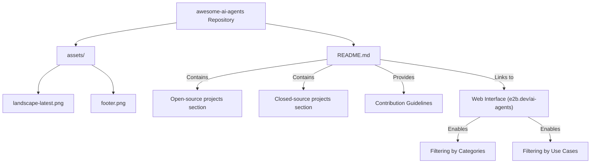
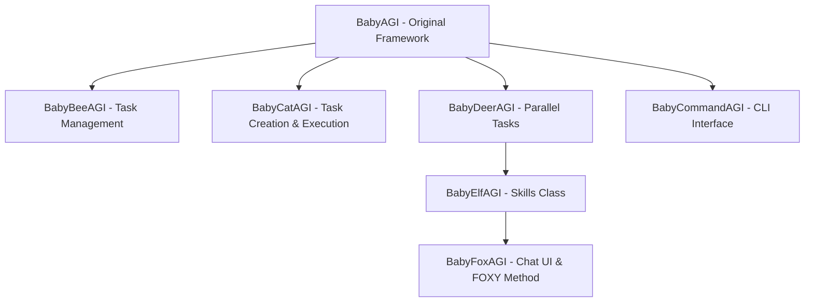
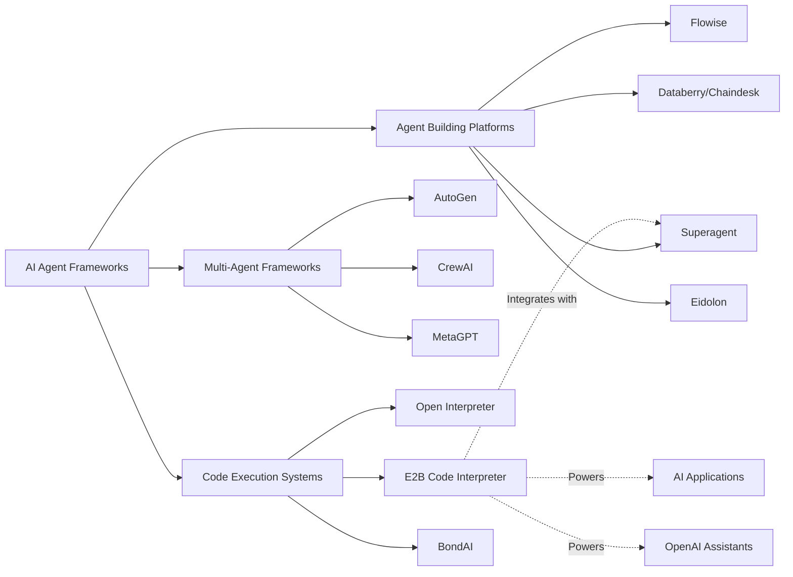
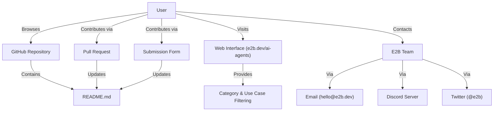
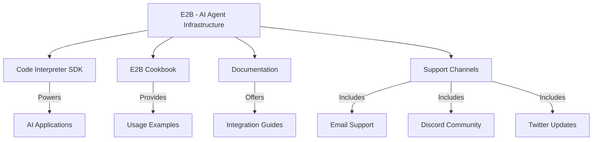

<!-- source: DeepWiki mcp.deepwiki.com · repo e2b-dev/awesome-ai-agents · page 1 Overview · fetched 2026-10-29 -->

# Overview

Relevant source files

The following files were used as context for generating this wiki page:

- [README.md](README.md)
- [assets/landscape-latest.png](assets/landscape-latest.png)

The Awesome AI Agents repository serves as a comprehensive curated list of AI agents, categorized into open-source and closed-source projects. This collection provides a valuable resource for researchers, developers, and organizations interested in implementing or working with AI agents. The repository aims to help users discover, compare, and select AI agents for various use cases.

For details about specific categories of AI agents, see [AI Agent Categories](#1.1). For information on how to contribute to the repository, see [How to Contribute](#1.2).

## Repository Structure and Organization

The repository is primarily organized around the README.md file, which contains the curated list of AI agents with detailed descriptions and categorizations.

**Repository Organization Diagram**

Sources: [README.md:1-53]()

## AI Agent Categories and Types

The repository categorizes AI agents into several functional categories, each addressing different use cases and capabilities.

**AI Agent Categories Diagram**

```mermaid
graph TD
    AIAgents["AI Agents in README.md"] --> GeneralPurpose["General Purpose"]
    AIAgents --> Coding["Coding/Development"]
    AIAgents --> Research["Research/Data Analysis"]
    AIAgents --> BuildYourOwn["Build-your-own Frameworks"]
    AIAgents --> Productivity["Productivity"]
    AIAgents --> MultiAgent["Multi-agent Systems"]
    
    GeneralPurpose --> AutoGPT["AutoGPT"]
    GeneralPurpose --> BabyAGI["BabyAGI"]
    GeneralPurpose --> GPTResearcher["GPT Researcher"]
    
    Coding --> Aider["Aider"]
    Coding --> GPTEngineer["GPT Engineer"]
    Coding --> Continue["Continue"]
    Coding --> OpenInterpreter["Open Interpreter"]
    
    Research --> ChemCrow["ChemCrow"]
    Research --> LocalGPT["LocalGPT"]
    Research --> PrivateGPT["PrivateGPT"]
    
    BuildYourOwn --> AutoGen["AutoGen"]
    BuildYourOwn --> CrewAI["CrewAI"]
    BuildYourOwn --> Flowise["Flowise"]
    
    Productivity --> CalAI["Cal.ai"]
    Productivity --> BeeBot["BeeBot"]
    
    MultiAgent --> ChatDev["ChatDev"]
    MultiAgent --> MetaGPT["MetaGPT"]
    MultiAgent --> AgentVerse["AgentVerse"]
```

Sources: [README.md:45-58](), [README.md:70-123]()

## Notable AI Agent Families

The repository features several notable AI agent families, with the BabyAGI family representing a significant evolution in AI agent frameworks. Each derivative adds specific capabilities that extend the functionality of the original framework.

**BabyAGI Family Evolution Diagram**

Sources: [README.md:477-503](), [README.md:506-530](), [README.md:533-568](), [README.md:570-598](), [README.md:600-623](), [README.md:651-682]()

## AI Agent Frameworks

The repository includes various AI agent frameworks with different capabilities and use cases. These frameworks can be broadly categorized into multi-agent frameworks, agent building platforms, and code execution systems.

**AI Agent Frameworks Diagram**

Sources: [README.md:323-346](), [README.md:1065-1089](), [README.md:2045-2071](), [README.md:1379-1398](), [README.md:1127-1161](), [README.md:1292-1313](), [README.md:2276-2297](), [README.md:65-69](), [README.md:784-814]()

## User Interaction and Contribution

The repository provides multiple ways for users to interact with the content and contribute to its growth.

**User Interaction Flow Diagram**

Sources: [README.md:40-41](), [README.md:50](), [README.md:55-58](), [README.md:65-69]()

## E2B Resources and Integration

The repository is maintained by the team behind E2B, which is building infrastructure for AI agents. E2B provides several resources that support the development and deployment of AI agents.

**E2B Resources Diagram**

Sources: [README.md:65-69]()

## Conclusion

The Awesome AI Agents repository serves as a comprehensive resource hub for those interested in AI agents. By categorizing a wide range of agents and providing detailed information about each, it helps users navigate the rapidly evolving AI agent landscape. The repository's web interface and contribution guidelines make it an accessible and community-driven resource.

---

