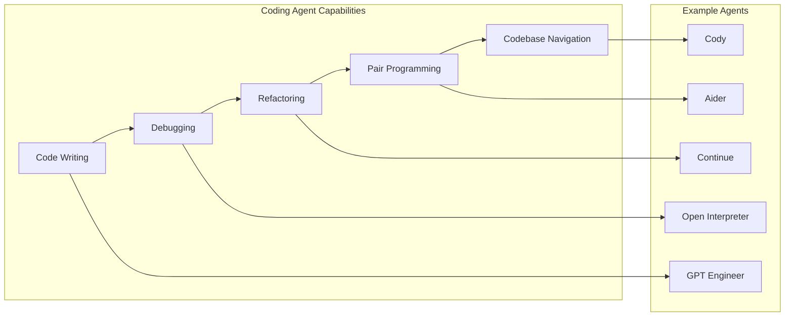
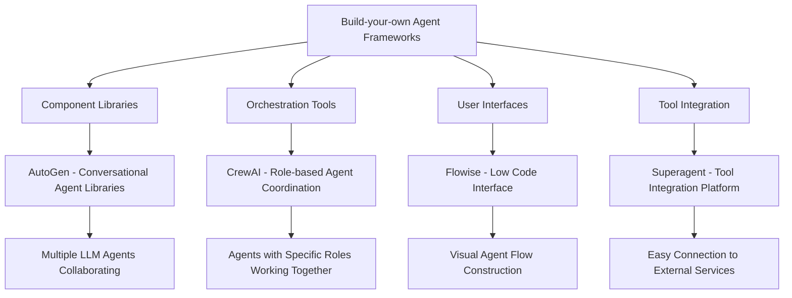
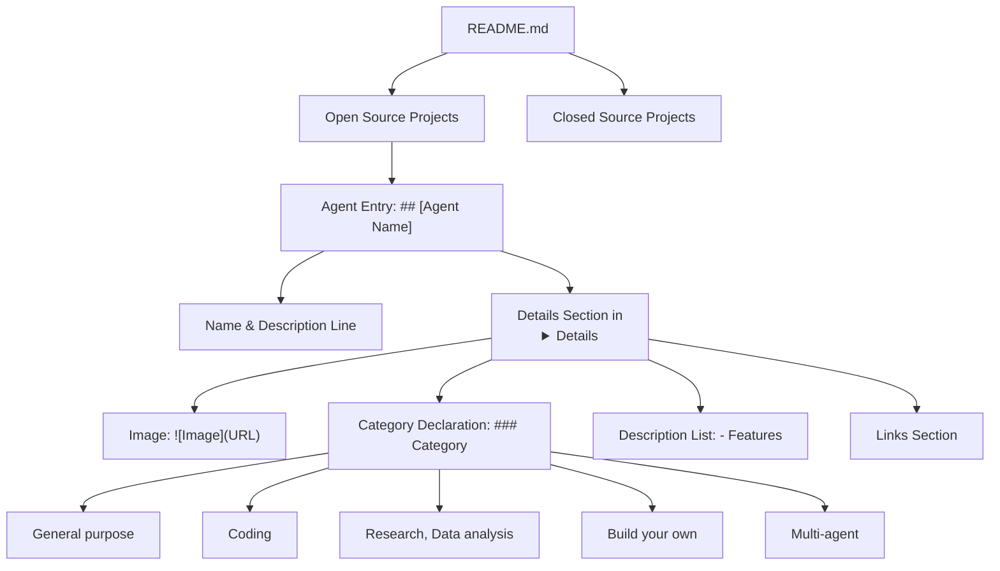
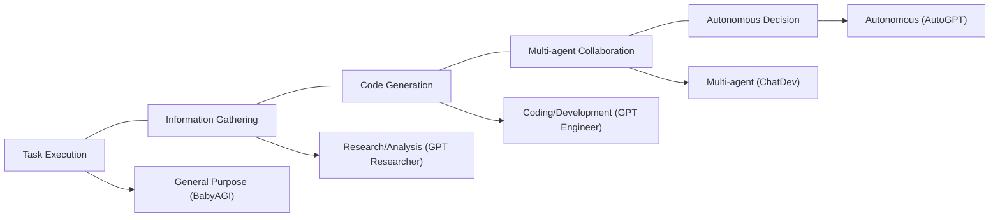

<!-- source: DeepWiki mcp.deepwiki.com · repo e2b-dev/awesome-ai-agents · page 1.1 AI Agent Categories · fetched 2026-10-29 -->

# AI Agent Categories

Relevant source files

The following files were used as context for generating this wiki page:

- [README.md](README.md)
- [assets/landscape-latest.png](assets/landscape-latest.png)

This page explains the different categories of AI agents featured in the Awesome AI Agents repository. Understanding these categories helps users navigate the repository and find agents that best suit their specific needs. For information on how to contribute new agents to the repository, see [How to Contribute](#1.2).

## Overview of Categories

AI agents in the repository are organized into several primary categories based on their functionality, domain focus, and implementation approach. Many agents fit into multiple categories, as they often serve various purposes or can be used in different ways.

### Primary Agent Categories

```mermaid
graph TD
    Root["AI Agent Categories"] --> GP["General Purpose"]
    Root --> CD["Coding/Development"]
    Root --> RD["Research/Data Analysis"]
    Root --> BY["Build-your-own Frameworks"]
    Root --> MA["Multi-agent Systems"]
    Root --> SP["Specialized Purpose"]
    
    GP --> GP1["AutoGPT"]
    GP --> GP2["BabyAGI"]
    GP --> GP3["GPT Researcher"]
    
    CD --> CD1["Aider"]
    CD --> CD2["GPT Engineer"]
    CD --> CD3["Continue"]
    CD --> CD4["Open Interpreter"]
    CD --> CD5["DevOpsGPT"]
    
    RD --> RD1["ChemCrow"]
    RD --> RD2["Julius"]
    RD --> RD3["Kadoa"]
    RD --> RD4["PrivateGPT"]
    
    BY --> BY1["AutoGen"]
    BY --> BY2["CrewAI"]
    BY --> BY3["Superagent"]
    BY --> BY4["Flowise"]
    
    SP --> SP1["Cal.ai"]
    SP --> SP2["Lindy"]
    SP --> SP3["Heymoon.ai"]
    
    MA --> MA1["ChatDev"]
    MA --> MA2["MetaGPT"]
    MA --> MA3["AgentVerse"]
```

Sources: [README.md:42-51]()

## General Purpose Agents

General purpose agents are designed to handle a wide variety of tasks without specializing in a particular domain. They typically have capabilities to:

- Process natural language instructions into actionable plans
- Execute multiple types of tasks
- Browse the web or interact with various tools
- Maintain memory of previous interactions
- Make autonomous decisions based on their goals

Examples include:

| Agent | Description | Key Features |
|-------|-------------|--------------|
| AutoGPT | Experimental autonomous agent | Chains LLM "thoughts", internet access, memory management |
| BabyAGI | Task-driven autonomous agent | Creates tasks based on results of previous tasks and predefined objectives |
| AgentGPT | Browser-based no-code version of AutoGPT | Web UI, accessible to non-programmers |
| Godmode | Web-based agent platform | Market analysis, negotiating, order fulfillment |
| Mini AGI | Minimal agent based on GPT-3.5/GPT-4 | Inner monologue, self-criticism, minimal toolset |

Sources: [README.md:342-387](), [README.md:468-502](), [README.md:142-180](), [README.md:1446-1470](), [README.md:2072-2094]()

## Coding/Development Agents

Coding and development agents assist with software development tasks, including:

- Writing code based on requirements
- Debugging existing code
- Refactoring and optimizing codebases
- Managing repositories and version control
- Understanding large codebases

Notable coding agents include:

- **Aider**: Command-line tool for pair programming with GPT, making edits directly to files in a Git repository [README.md:281-302]()
- **GPT Engineer**: Generates entire codebases from natural language prompts [README.md:1499-1526]()
- **Continue**: Open-source autopilot for software development in VS Code [README.md:1039-1063]()
- **Open Interpreter**: Code interpreter that executes code locally to complete tasks [README.md:2276-2297]()
- **DevOpsGPT**: AI-driven software development automation solution [README.md:1243-1269]()

Sources: [README.md:281-302](), [README.md:1499-1526](), [README.md:1039-1063](), [README.md:2276-2297](), [README.md:1243-1269]()

## Research/Data Analysis Agents

Research and data analysis agents help gather, process, and synthesize information. They typically:

- Search the internet for information
- Process and analyze documents
- Extract insights from data
- Generate reports and summaries
- Answer questions based on research

Key examples include:

| Agent | Focus | Capabilities |
|-------|-------|--------------|
| GPT Researcher | General research | Internet search, factual reporting, customizable focus |
| ChemCrow | Chemistry | Chemical tasks, integrates 13 expert-design tools |
| Local GPT | Privacy-focused | Document interaction without data leaving your device |
| BambooAI | Data exploration | Non-programmers can perform data analysis |
| PrivateGPT | Private document search | Chat with documents while maintaining privacy |

Sources: [README.md:1579-1603](), [README.md:939-959](), [README.md:1825-1853](), [README.md:686-712]()

## Build-your-own Frameworks

Build-your-own frameworks provide infrastructure and tools for creating custom AI agents. These frameworks offer:

- Components for agent construction
- Tools for managing agent interactions
- Memory and knowledge management
- Interfaces for user interaction
- Extensibility for custom functionality

Notable frameworks include:

- **AutoGen**: Microsoft framework for building applications with multiple conversational agents [README.md:323-345]()
- **CrewAI**: Framework for orchestrating role-playing autonomous agents [README.md:1065-1089]()
- **Flowise**: Low-code tool for building LLM orchestration flows and AI agents [README.md:1379-1398]()
- **Databerry/Chaindesk**: No-code platform for creating AI chatbots trained on custom data [README.md:1127-1161]()
- **LLM Stack**: No-code platform to build LLM Agents, workflows and applications [README.md:1798-1823]()

Sources: [README.md:323-345](), [README.md:1065-1089](), [README.md:1379-1398](), [README.md:1127-1161](), [README.md:1798-1823]()

## Multi-agent Systems

Multi-agent systems involve multiple AI agents working together to solve complex tasks. These systems feature:

- Agents with different roles and capabilities
- Communication protocols between agents
- Coordination mechanisms for complex tasks
- Emergent behavior from agent interactions
- Specialized frameworks for multi-agent deployment

Important multi-agent systems include:

- **ChatDev**: Virtual software company with agents as CEO, CPO, CTO, programmer, etc. [README.md:915-936]()
- **MetaGPT**: Multi-agent framework that assigns different roles for collaborative software development [README.md:2045-2071]()
- **AgentVerse**: Platform for multi-agent collaboration and emergent behavior exploration [README.md:237-256]()
- **Multiagent Debate**: System where agents debate to improve factuality and reasoning [README.md:2097-2118]()

Sources: [README.md:915-936](), [README.md:2045-2071](), [README.md:237-256](), [README.md:2097-2118]()

## Specialized Purpose Agents

Specialized purpose agents focus on specific domains or tasks:

### Productivity Agents
- **Cal.ai**: Open-source scheduling assistant built on Cal.com [README.md:839-857]()
- **BabyBeeAGI**: Task management and functionality expansion on top of BabyAGI [README.md:506-531]()
- **Lemon Agent**: Plan-Validate-Solve agent for workflow automation [README.md:1748-1772]()

### Science and Domain-Specific Agents
- **ChemCrow**: LangChain agent for chemistry-related tasks [README.md:939-959]()
- **Autonomous HR Chatbot**: Agent that answers HR-related queries [README.md:450-475]()
- **NLSOM**: Natural Language-Based Societies of Mind for scientific tasks [README.md:2174-2196]()

### Business and Enterprise Agents
- **CodeFuse-ChatBot**: Agent serving the entire software development lifecycle [README.md:983-998]()
- **GeniA**: Engineering platform engineering AI team member [README.md:1425-1444]()

Sources: [README.md:839-857](), [README.md:506-531](), [README.md:1748-1772](), [README.md:939-959](), [README.md:450-475](), [README.md:2174-2196](), [README.md:983-998](), [README.md:1425-1444]()

## Category Implementation in the Repository

The Awesome AI Agents repository implements categorization through structured entries in the README.md file:

The web interface at [e2b.dev/ai-agents](https://e2b.dev/ai-agents) allows users to filter agents by these categories for easier discovery.

Sources: [README.md:40-41](), [README.md:50-51](), [README.md:71-134]()

## Capability Spectrum Across Categories

AI agents in the repository span a spectrum of capabilities, from focused single-task execution to fully autonomous decision-making:

This spectrum helps users understand the level of autonomy and complexity each agent category typically provides.

Sources: [README.md:342-387](), [README.md:1579-1603](), [README.md:1499-1526](), [README.md:915-936](), [README.md:468-502]()

## Cross-Category Agents

Many agents in the repository span multiple categories, combining capabilities from different domains. Some notable examples:

| Agent | Categories | Description |
|-------|------------|-------------|
| AutoGen | Build-your-own, Multi-agent | Framework for developing applications with multiple conversational agents |
| GPT Researcher | General purpose, Research | Autonomous agent that researches topics comprehensively |
| DevOpsGPT | Coding, Business | AI-driven software development automation for enterprise |
| MetaGPT | Multi-agent, Coding | Role-based agents collaborating on software development |
| OpenDevin | Coding, General purpose | Open-source alternative to Devin coding agent |

The combination of categories reflects the versatility of modern AI agents and the increasingly blurred boundaries between specialized functions.

Sources: [README.md:323-345](), [README.md:1579-1603](), [README.md:1243-1269](), [README.md:2045-2071](), [README.md:2256-2273]()

## Conclusion

The categorization of AI agents provides a useful framework for understanding the diverse capabilities and purposes of agents in the Awesome AI Agents repository. As the field evolves, new categories may emerge, and existing ones may be refined. The repository maintains an up-to-date categorization to help users navigate the growing landscape of AI agents.

For information on how specific agent families have evolved, particularly the BabyAGI family, see [BabyAGI Family](#3.1).

---

