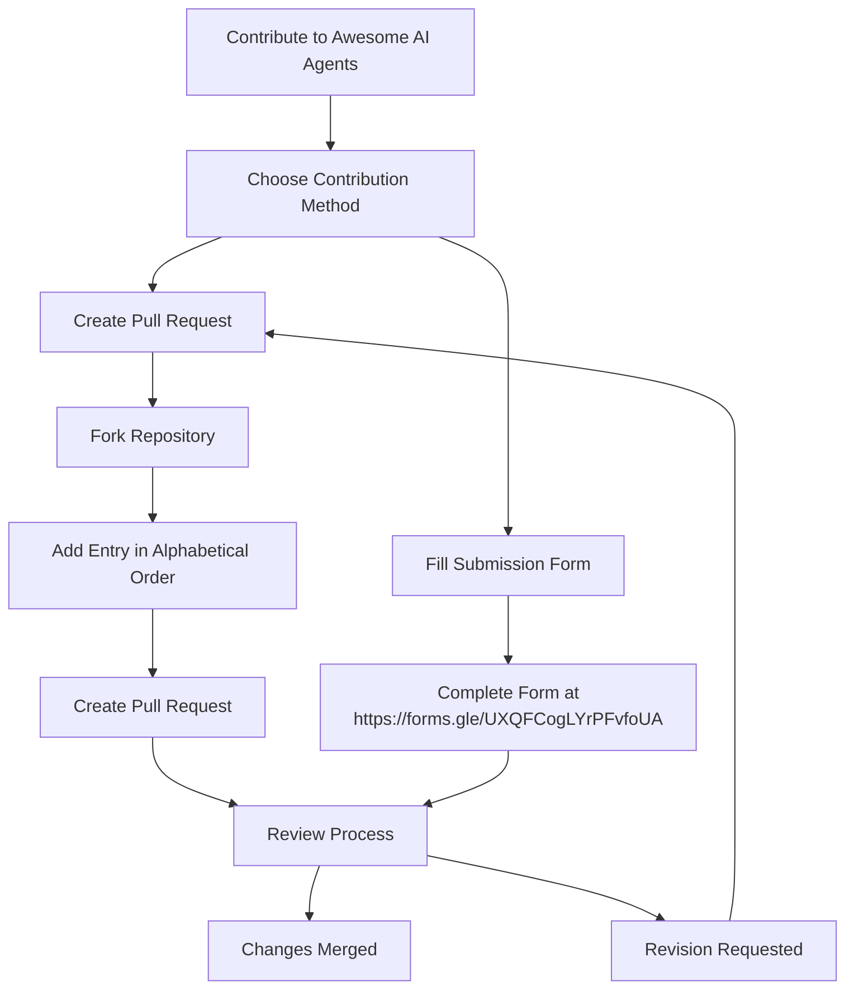
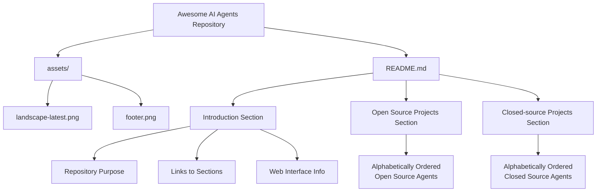
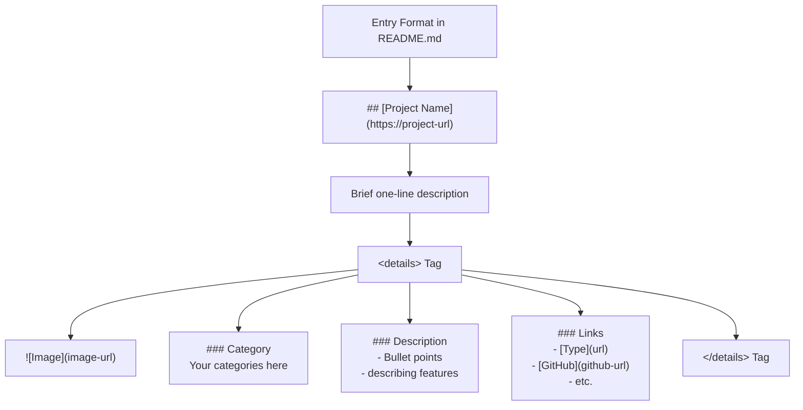
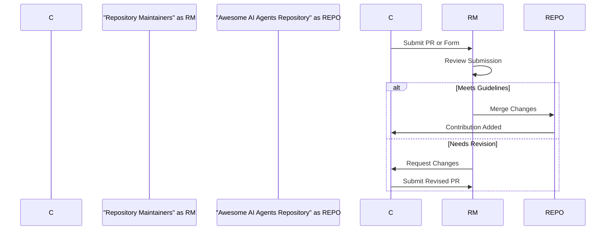

<!-- source: DeepWiki mcp.deepwiki.com · repo e2b-dev/awesome-ai-agents · page 1.2 How to Contribute · fetched 2026-10-29 -->

# How to Contribute

<details>
<summary>Relevant source files</summary>

The following files were used as context for generating this wiki page:

- [README.md](README.md)

</details>


This document outlines the process for contributing to the Awesome AI Agents list, a curated collection of AI agents categorized into open-source and closed-source projects. We welcome contributions from the community to help maintain this comprehensive resource. For information about AI agent categories featured in the repository, see [AI Agent Categories](#1.1).

## Overview of Contribution Process

There are two main ways to contribute to the Awesome AI Agents list:

1. Create a pull request on GitHub
2. Fill out the submission form

Both methods are reviewed by the repository maintainers before being merged into the main list.



Sources: [README.md:55-58]()

## General Contribution Guidelines

Before submitting your contribution, please ensure you follow these guidelines:

1. Your submission should be an AI agent or assistant, not an SDK or framework
2. Place your entry in alphabetical order within the correct category (open-source or closed-source)
3. Follow the established format for entries (see below)
4. For SDKs, frameworks, and tools related to AI agents, contribute to the separate [Awesome SDKs for AI Agents](https://github.com/e2b-dev/awesome-sdks-for-ai-agents) repository instead

Sources: [README.md:55-58]()

## Repository Structure

The Awesome AI Agents repository is primarily organized around the README.md file, which contains the curated list of AI agents. Understanding its structure will help you place your contribution correctly.



Sources: [README.md:24-69]()

## Submitting via Pull Request

Contributing via pull request gives you the most control over how your entry appears in the list. Follow these steps:

1. **Fork the repository**: Go to the [Awesome AI Agents](https://github.com/e2b-dev/awesome-ai-agents) GitHub page and click the "Fork" button in the top right
2. **Clone your fork**: Clone your forked repository to your local machine
3. **Make your changes**: Add your entry to the README.md file in the correct section and in alphabetical order
4. **Commit and push**: Commit your changes and push them to your forked repository
5. **Create a pull request**: Go to the original repository and click "New Pull Request" to submit your changes for review

When adding your entry, follow the established format as shown in the diagram below:



Sources: [README.md:70-100]()

## Example Entry Format

Here's an example of how an entry should be formatted in the README.md file:

```
## [Your Agent](https://your-agent-url)
Brief description of your agent

<details>


### Category
General purpose, Build your own, Multi-agent

### Description
- First key feature of your agent
- Second key feature of your agent
- Third key feature of your agent

### Links
- [Website](https://your-agent-website)
- [GitHub](https://github.com/your-username/your-agent)
- [Documentation](https://docs.your-agent.com)
- [Twitter](https://twitter.com/your-agent)

</details>
```

Sources: [README.md:70-100](), [README.md:183-207]()

## Submitting via Form

If you prefer not to use GitHub, you can submit your AI agent through the submission form:

1. Go to the [submission form](https://forms.gle/UXQFCogLYrPFvfoUA)
2. Fill out all the required information about your agent
3. Submit the form for review

The repository maintainers will review your submission and add it to the list if it meets the guidelines.

Sources: [README.md:55-58](), [README.md:40-41]()

## Entry Requirements and Best Practices

For your entry to be accepted, it should include the following key components:

| Component | Description | Required? |
|-----------|-------------|-----------|
| Name | Your AI agent's name | Required |
| URL | Link to your agent's website or repository | Required |
| Brief Description | One-line summary of what your agent does | Required |
| Image | Visual representation of your agent | Recommended |
| Category | Types of tasks your agent performs | Required |
| Detailed Description | Bullet points of features/capabilities | Required |
| Links | Additional resources (GitHub, docs, social) | Required |

When writing your description:
- Focus on the unique features and capabilities of your agent
- Use bullet points for readability
- Be concise but informative
- Highlight what makes your agent different from others

Sources: [README.md:70-100](), [README.md:183-207]()

## Categories for AI Agents

When adding your agent, you should specify the appropriate categories in the "Category" section. Common categories include:

- General purpose
- Coding/Development
- Research/Data Analysis
- Build-your-own Frameworks
- Productivity
- Multi-agent Systems
- Personal assistant
- Business intelligence
- Content creation
- Finance
- Marketing
- Sales
- Design
- Science

You can include multiple categories if your agent spans different domains.

Sources: [README.md:70-100](), [README.md:183-207]()

## Post-Submission Process



After you submit your contribution:

1. The repository maintainers will review your submission
2. If it meets all guidelines, it will be merged into the main repository
3. If revisions are needed, you'll be notified of the required changes
4. Once accepted, your agent will appear in both the GitHub repository and the web interface at [e2b.dev/ai-agents](https://e2b.dev/ai-agents)

Sources: [README.md:40-53]()

## Additional Resources

- [Awesome SDKs for AI Agents](https://github.com/e2b-dev/awesome-sdks-for-ai-agents): For contributing AI agent SDKs, frameworks, and tools
- [Web version of the list](https://e2b.dev/ai-agents): To see the current list with filtering capabilities
- For questions or additional help, you can contact the team at [hello@e2b.dev](mailto:hello@e2b.dev) or join their [Discord](https://discord.gg/35NF4Y8WSE)

Sources: [README.md:52-68]()

---

