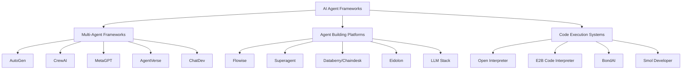
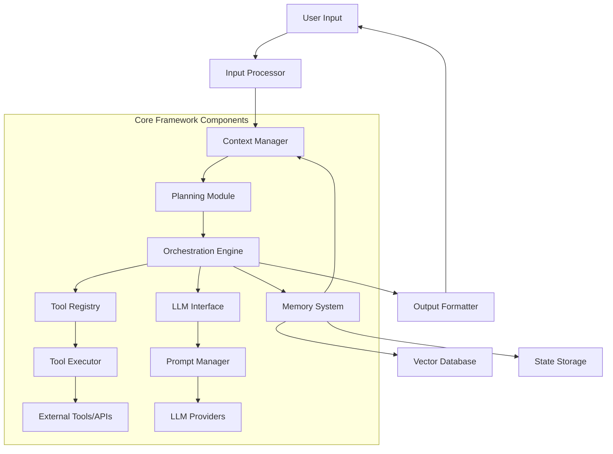
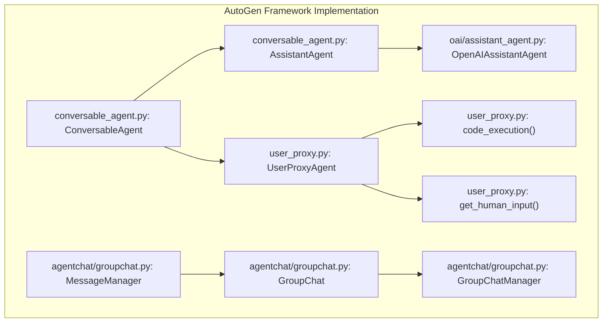
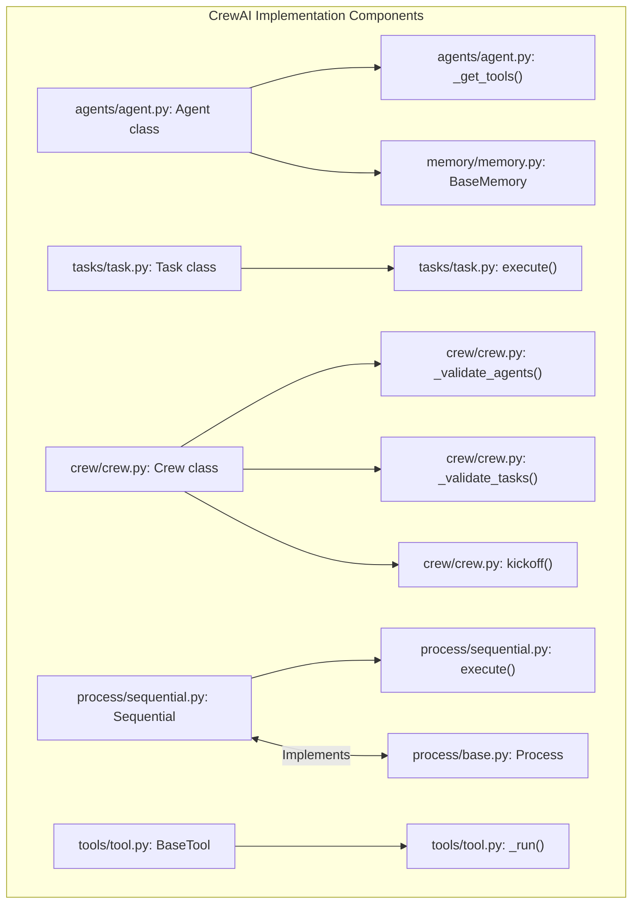
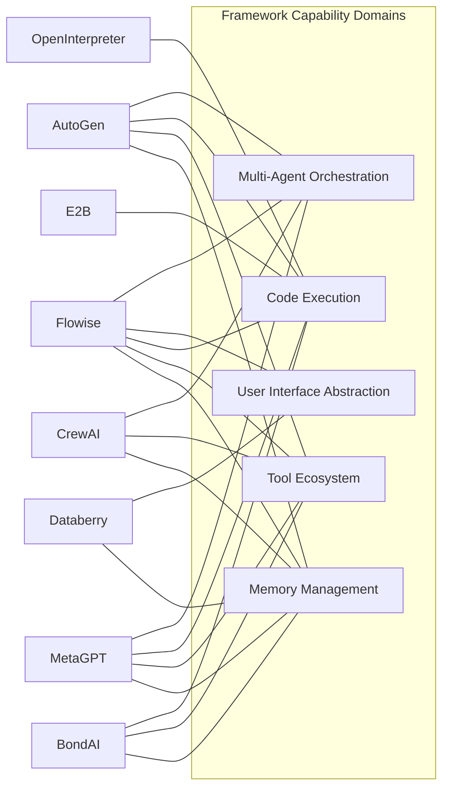
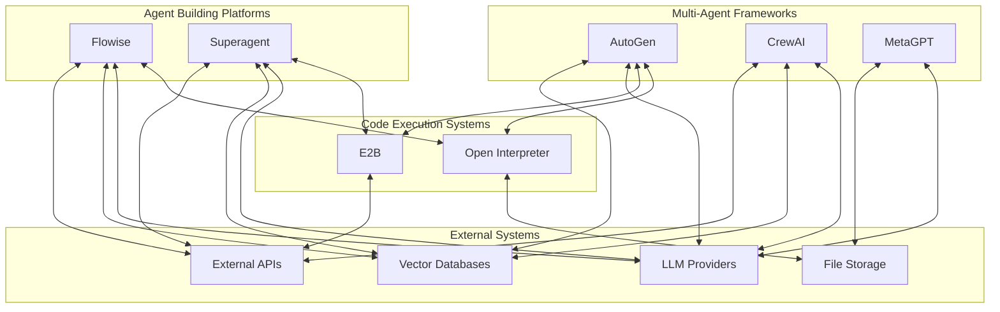
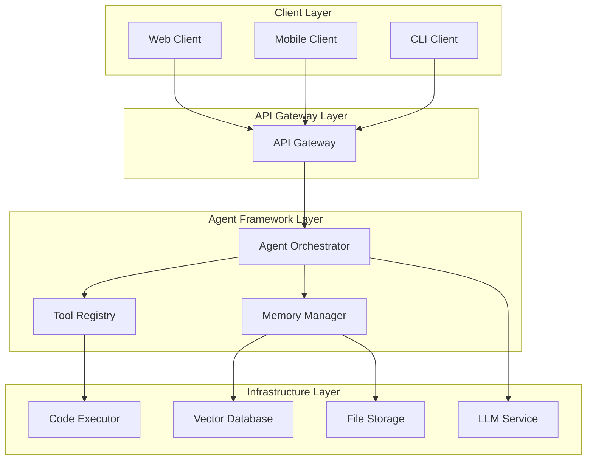

<!-- source: DeepWiki mcp.deepwiki.com · repo e2b-dev/awesome-ai-agents · page 2 AI Agent Frameworks · fetched 2026-10-29 -->

# AI Agent Frameworks

Relevant source files

The following files were used as context for generating this wiki page:

- [README.md](README.md)
- [assets/landscape-latest.png](assets/landscape-latest.png)

This page provides a technical overview of the major AI agent frameworks in the [Awesome AI Agents](https://github.com/e2b-dev/awesome-ai-agents) repository. It examines the architecture, components, and capabilities of various frameworks that enable the creation and orchestration of autonomous AI agents. For detailed information about specific framework categories, see [Multi-Agent Frameworks](#2.1), [Agent Building Platforms](#2.2), and [Code Execution Systems](#2.3).

## Classification of AI Agent Frameworks

AI agent frameworks can be categorized into three primary types based on their core functionality and design approach:

### Framework Taxonomy

AI Agent Frameworks Taxonomy

Sources: [README.md:323-346](), [README.md:1065-1089](), [README.md:237-256](), [README.md:915-937](), [README.md:2046-2071](), [README.md:1382-1398](), [README.md:1127-1161](), [README.md:2276-2298](), [README.md:784-815](), [README.md:1798-1823]()

1. **Multi-Agent Frameworks**: Systems designed to coordinate multiple specialized agents working together on complex tasks. Examples include:
   - **AutoGen**: Enables collaborative problem-solving with multiple conversational agents
   - **CrewAI**: Provides role-playing agents with distinct personas
   - **MetaGPT**: Transforms requirements into software artifacts via agent collaboration
   - **ChatDev**: Virtual software company with specialized agent roles

2. **Agent Building Platforms**: Tools that simplify the creation of custom agents with minimal coding. Examples include:
   - **Flowise**: Low-code platform for building AI workflows and agents
   - **Superagent**: No-code agent building with tool integrations
   - **Databerry/Chaindesk**: Platform for chatbots trained on custom data
   - **LLM Stack**: No-code platform for building LLM agents and workflows

3. **Code Execution Systems**: Frameworks enabling agents to write and execute code securely. Examples include:
   - **Open Interpreter**: Lets LLMs execute code locally with user permission
   - **E2B Code Interpreter**: Provides sandboxed environments for secure code execution
   - **BondAI**: Code interpreter with CLI and API interfaces

## Core Components of AI Agent Frameworks

Most agent frameworks share several foundational components, though their implementation details vary significantly:

### Common Architecture Components

AI Agent Framework Architecture

Sources: [README.md:323-346](), [README.md:1065-1089](), [README.md:1712-1746]()

1. **LLM Integration Layer**
   - Connects to LLM providers (OpenAI, Anthropic, open-source models)
   - Manages context windows and token limits
   - Implements specialized prompting techniques (Chain-of-Thought, ReAct)

2. **Memory Systems**
   - **Short-term memory**: Session context management
   - **Long-term memory**: Persistent storage across sessions
   - **Vector storage**: Semantic search and retrieval capabilities
   - **Working memory**: Active information processing space

3. **Tool Integration**
   - Function calling mechanisms
   - API connector systems
   - File system access controls
   - Custom tool registries

4. **Orchestration Logic**
   - Task planning and decomposition
   - Decision-making algorithms
   - Error handling and retry mechanisms
   - Inter-agent communication protocols

## Implementation Details of Popular Frameworks

### AutoGen Framework Implementation

AutoGen Code Structure

Sources: [README.md:323-346]()

AutoGen provides a framework for building applications with multiple conversational agents. Its core architecture is built around the `ConversableAgent` class, with specialized implementations like `AssistantAgent` and `UserProxyAgent`. The system enables multi-agent conversations through the `GroupChat` and `GroupChatManager` classes, which facilitate message routing and conversation state management.

### CrewAI Implementation Components

CrewAI Code Structure

Sources: [README.md:1065-1089]()

CrewAI's architecture centers around role-playing agents organized into crews. The main components include:
- `Agent` class: Defines agent capabilities, role, and backstory
- `Task` class: Encapsulates work to be performed
- `Crew` class: Orchestrates agents and tasks
- `Process` class: Defines task execution flow (Sequential by default)
- `BaseTool` class: Enables interaction with external systems

## Framework Capabilities Comparison

Different frameworks offer varying capabilities, best suited for different use cases:

| Framework | Multi-Agent Support | No-Code Interface | Code Execution | Memory Management | Custom Tool Support |
|-----------|---------------------|-------------------|----------------|-------------------|---------------------|
| AutoGen   | ✅                  | ❌                | ✅             | ✅                | ✅                  |
| CrewAI    | ✅                  | ❌                | ✅             | ✅                | ✅                  |
| MetaGPT   | ✅                  | ❌                | ✅             | ✅                | ✅                  |
| AgentVerse| ✅                  | ❌                | ✅             | ✅                | ✅                  |
| Flowise   | ✅                  | ✅                | ✅             | ✅                | ✅                  |
| Superagent| ✅                  | ✅                | ✅             | ✅                | ✅                  |
| Databerry | ❌                  | ✅                | ❌             | ✅                | ❌                  |
| Open Interpreter | ❌            | ❌                | ✅             | ❌                | ❌                  |
| E2B       | ❌                  | ❌                | ✅             | ❌                | ❌                  |
| BondAI    | ❌                  | ❌                | ✅             | ✅                | ✅                  |

Sources: [README.md:323-346](), [README.md:1065-1089](), [README.md:2046-2071](), [README.md:1382-1398](), [README.md:1127-1161](), [README.md:2276-2298](), [README.md:784-815]()

## Framework Capability Domains

Framework Capability Domains

Sources: [README.md:323-346](), [README.md:1065-1089](), [README.md:2046-2071](), [README.md:1382-1398](), [README.md:1127-1161](), [README.md:2276-2298](), [README.md:784-815]()

## Integration and Interoperability

Many frameworks are designed to work together, creating an ecosystem of complementary tools:

### Ecosystem Connectivity

Framework Ecosystem Connectivity

Sources: [README.md:323-346](), [README.md:1065-1089](), [README.md:2046-2071](), [README.md:1382-1398](), [README.md:2276-2298](), [README.md:784-815]()

Key integration patterns include:

1. **Framework-to-Framework Integration**
   - AutoGen + E2B: Secure code execution in multi-agent workflows
   - Flowise + Open Interpreter: Code execution in visual workflows
   - Superagent + Vector Databases: Enhanced knowledge retrieval

2. **External API Integration**
   - Authentication mechanisms for third-party services
   - Data transformation between different formats
   - Webhook support for event-driven architectures

3. **Plugin Systems**
   - Tool plugins extending agent capabilities
   - Model plugins for additional LLM providers
   - Connector plugins for external system integration

## Deployment Architectures

Typical Deployment Architecture

Sources: [README.md:323-346](), [README.md:1065-1089](), [README.md:2046-2071](), [README.md:1382-1398](), [README.md:2276-2298](), [README.md:784-815]()

## Implementation Considerations

When selecting and implementing an AI agent framework, consider the following factors:

### Selection Criteria

- **Use case alignment**: Match framework capabilities to specific requirements
- **Technical complexity**: Assess learning curve and development effort
- **Customization needs**: Evaluate flexibility and extensibility
- **Deployment environment**: Ensure compatibility with infrastructure
- **Cost considerations**: Factor API usage, hosting, and maintenance costs

### Performance Optimization

- **Token efficiency**: Optimize prompt designs to reduce token usage
- **Caching strategies**: Implement result caching to improve response times
- **Batching**: Group similar operations for reduced API calls
- **Fine-tuning**: Consider custom model fine-tuning for specialized domains
- **Resource allocation**: Balance CPU, memory, and network resources

### Scaling Challenges

- **Horizontal scaling**: Add more instances to handle increased load
- **Vertical scaling**: Increase resources for each instance
- **Cost management**: Control LLM API usage at scale
- **Reliability**: Ensure consistent performance under load
- **Monitoring**: Track performance metrics and detect issues

## Emerging Trends and Future Directions

The AI agent framework landscape continues to evolve rapidly with several key trends:

1. **Framework convergence**: Cross-adoption of successful patterns
2. **Domain specialization**: Frameworks optimized for specific use cases
3. **Enhanced interoperability**: Standardized interfaces between frameworks
4. **Reduced complexity**: More accessible interfaces for non-technical users
5. **Performance optimization**: Improved efficiency and reduced operational costs
6. **Local model support**: Increased focus on running models on-premises
7. **Improved reasoning capabilities**: More sophisticated planning and decision-making

## Conclusion

AI agent frameworks provide the foundation for building increasingly sophisticated autonomous systems. By understanding the architecture, capabilities, and implementation considerations of different frameworks, developers can select the most appropriate tools for their specific use cases and requirements.

The modular nature of many frameworks allows for mixing and matching components to create customized agent systems. As the field continues to mature, we can expect further advancements in multi-agent collaboration, reasoning capabilities, and tool integration, enabling even more powerful and flexible AI agent applications.

Sources: [README.md:323-346](), [README.md:1065-1089](), [README.md:2046-2071](), [README.md:1382-1398](), [README.md:1127-1161](), [README.md:2276-2298](), [README.md:784-815]()

---

