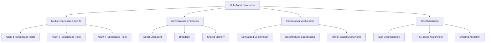
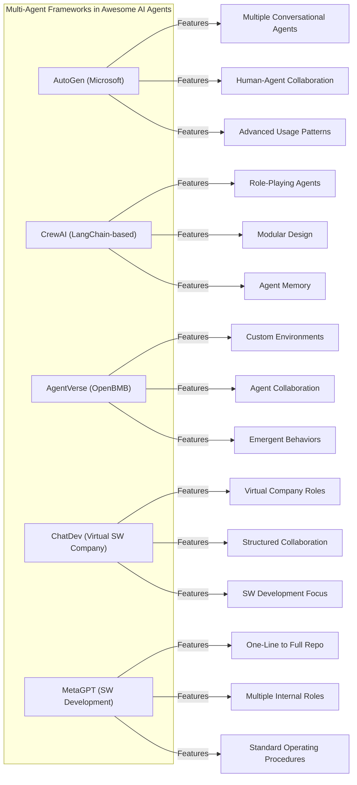
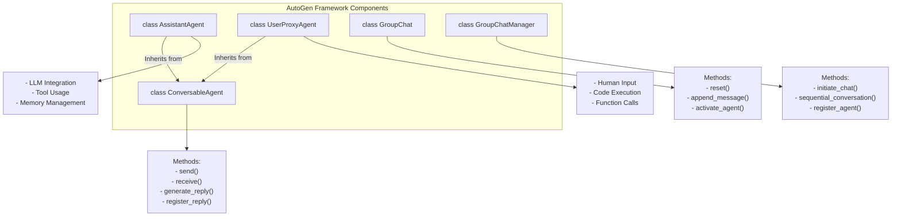
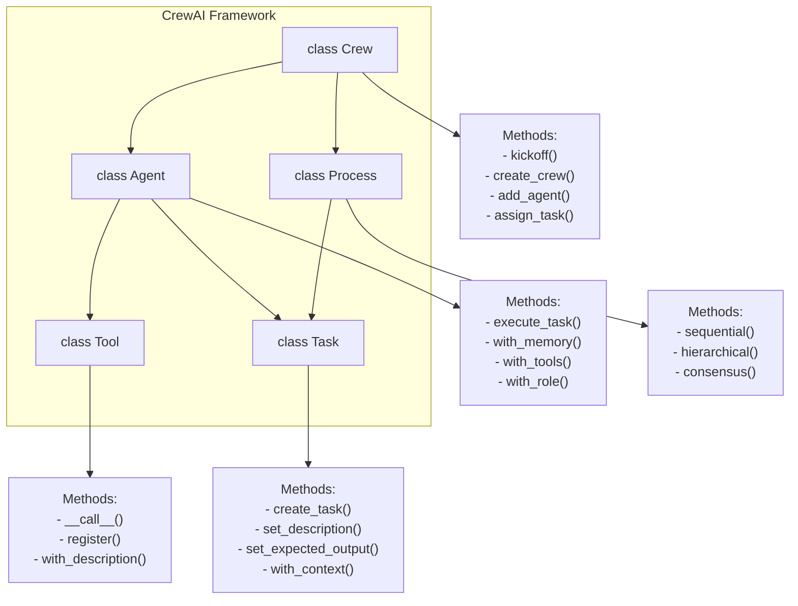
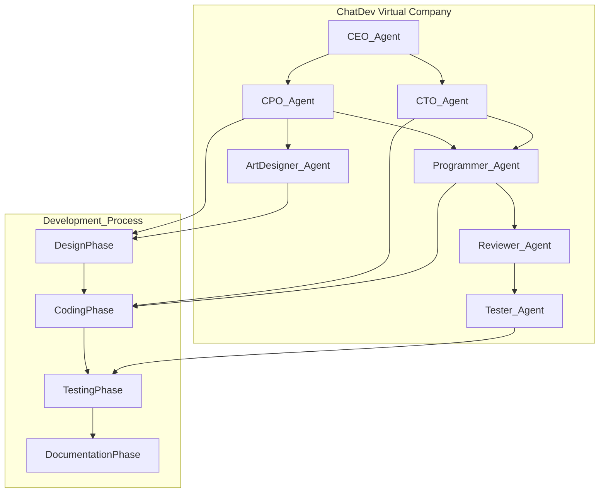
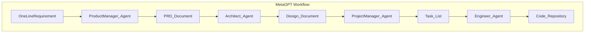
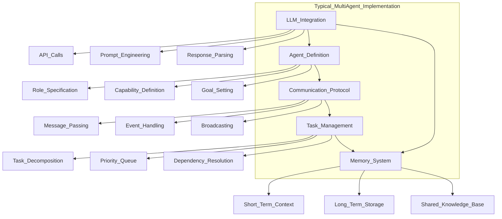

<!-- source: DeepWiki mcp.deepwiki.com · repo e2b-dev/awesome-ai-agents · page 2.1 Multi-Agent Frameworks · fetched 2026-10-29 -->

# Multi-Agent Frameworks

Relevant source files

The following files were used as context for generating this wiki page:

- [README.md](README.md)

This document provides a comprehensive overview of multi-agent frameworks found in the Awesome AI Agents repository. Multi-agent frameworks enable the coordination of multiple AI agents working together to solve complex tasks. Unlike single-agent systems, these frameworks leverage collaborative intelligence and agent specialization to tackle problems more effectively.

For information about tools for building your own agents without multi-agent capabilities, see [Agent Building Platforms](#2.2).

## Introduction to Multi-Agent Frameworks

Multi-agent frameworks coordinate multiple specialized AI agents, each with different roles or capabilities, to collaboratively solve complex problems. By distributing tasks among specialized agents, these frameworks can tackle more challenging problems than single-agent systems.

Sources: README.md:326-346, README.md:1066-1089, README.md:239-256

## Key Multi-Agent Frameworks

### Framework Comparison

Sources: README.md:326-346, README.md:1066-1089, README.md:239-256, README.md:914-936, README.md:2046-2072

### AutoGen

AutoGen is a Microsoft-developed framework that enables the development of LLM applications with multiple conversational agents. It supports agent collaboration, human-agent interaction, and offers various features to enhance LLM workflows.

Key features:
- Multiple agents collaborate to solve tasks and interact seamlessly with humans
- Simplifies complex LLM workflows, enhancing automation and optimization
- Offers working systems across various domains and complexities
- Improves LLM inference with performance tuning
- Supports advanced usage patterns including error handling and context programming

Sources: README.md:326-346

### CrewAI

CrewAI is a framework built on LangChain that focuses on role-playing agents, where each agent has a specific role, background story, goals, and memories. It emphasizes modularity and collaborative intelligence.

Key features:
- Orchestrates role-playing, autonomous AI agents
- Fosters collaborative intelligence to tackle complex tasks
- Built on LangChain with a focus on simplicity through modularity
- Each agent has specific roles, background stories, goals, and memories
- Makes the intricate world of AI agents accessible and manageable

Sources: README.md:1066-1089

### AgentVerse

AgentVerse is a platform that assembles multiple agents to collaboratively accomplish tasks and allows custom environments for observing or interacting with multiple agents.

Key features:
- Assembles multiple agents for collaborative task accomplishment
- Provides custom environments for agent observation and interaction
- Facilitates multi-agent collaboration and exploring emergent behaviors
- Supports diverse frameworks for agent interaction

Sources: README.md:239-256

### ChatDev

ChatDev simulates a virtual software company with agents assuming different roles like CEO, programmer, reviewer, etc. These agents collaborate in a structured environment to develop software.

Key features:
- Virtual software company driven by multiple intelligent agents with distinct roles
- Agents collaborate in a structured organizational environment
- Focuses on design, coding, testing, and documentation phases
- Provides an accessible, modular, and extensible platform
- Allows extensive customization of the software development process

Sources: README.md:914-936

### MetaGPT

MetaGPT is a framework that simulates a software development workflow, assigning different roles to GPTs to form a collaborative entity for completing complex tasks.

Key features:
- Given one line requirement, returns PRD, Design, Tasks, or Repo
- Assigns different roles to GPTs to form a collaborative software entity
- Outputs user stories, competitive analysis, requirements, data structures, APIs, etc.
- Includes internal roles like product managers, architects, project managers, and engineers
- Employs standard operating procedures (SOPs) to orchestrate the workflow

Sources: README.md:2046-2072

## Other Notable Multi-Agent Frameworks

Beyond the primary frameworks discussed above, the AI agent ecosystem includes several other notable multi-agent systems:

| Framework | Description | Key Features |
|-----------|-------------|--------------|
| AI Legion | Multi-agent TypeScript platform | Similar to AutoGPT, console-based interaction |
| Adala | Autonomous data labeling agent framework | Ground truth data, controllable output, specialized in data processing |
| Agent4Rec | Recommender system simulator | 1,000 LLM-empowered agents with varied social traits |
| AgentForge | LLM-agnostic platform for agent building | Customizable agents, support for multiple LLM models |
| L2MAC | Large-scale agent framework | Capable of producing complex codebases and entire books |
| DevGPT | Virtual developer team | Team of agents collaborating on software tasks |
| Multiagent Debate | Implementation of debate techniques | Improves factuality and reasoning in language models |
| NLSOM | Natural Language Societies of Mind | Societies and communities of different types of agents |

Sources: README.md:257-278, README.md:97-115, README.md:117-137, README.md:1889-1916, README.md:1190-1206, README.md:2098-2119, README.md:2174-2196

## Applications and Use Cases

```mermaid
graph TD
    subgraph "Applications_of_MultiAgent_Frameworks"
        SoftwareDev["Software_Development"]
        Research["Research_DataAnalysis"]
        Simulation["Simulation_Modeling"]
        Business["Business_Workflows"]
    end
    
    SoftwareDev --> SD1["Automated_Code_Generation"]
    SoftwareDev --> SD2["Code_Review"]
    SoftwareDev --> SD3["SDLC_Management"]
    
    Research --> R1["Complex_Data_Analysis"]
    Research --> R2["Agent_Debates_for_Validation"]
    Research --> R3["Information_Synthesis"]
    
    Simulation --> S1["Social_Interaction_Simulation"]
    Simulation --> S2["Complex_System_Modeling"]
    Simulation --> S3["Emergent_Behavior_Study"]
    
    Business --> B1["Workflow_Automation"]
    Business --> B2["Cross_functional_Coordination"]
    Business --> B3["Enhanced_Decision_Making"]
```

### Software Development
- ChatDev and MetaGPT focus on automating the software development lifecycle
- Agents simulate different team roles (product manager, architect, programmer)
- Automatically generate specifications, designs, code, and documentation
- AI Legion and DevGPT provide collaborative coding environments

Sources: README.md:914-936, README.md:2046-2072, README.md:1190-1206

### Research and Data Analysis
- Multiagent Debate improves factuality through structured agent interactions
- Agent4Rec simulates user behavior for recommender systems
- Adala specializes in data labeling and processing tasks
- Multiple agents can analyze data from different perspectives

Sources: README.md:2098-2119, README.md:97-115, README.md:117-137

### Business Workflows
- CrewAI enables orchestration of role-playing agents for business processes
- AutoGen simplifies complex LLM workflows with collaborative agents
- MetaGPT can generate business documents and specifications
- Multiple specialized agents can handle different aspects of business operations

Sources: README.md:326-346, README.md:1066-1089, README.md:2046-2072

## Implementation Patterns

A typical multi-agent system implementation incorporates several common patterns regardless of the specific framework:

This pattern highlights the common components found across different multi-agent frameworks, including agent definitions, communication protocols, task management, memory systems, and LLM integration.

Sources: README.md:326-346, README.md:1066-1089, README.md:239-256, README.md:914-936, README.md:2046-2072

## Challenges and Future Directions

```mermaid
graph TD
    subgraph "Challenges_in_MultiAgent_Systems"
        Coordination["Coordination_Communication"]
        Resources["Resource_Allocation"]
        Evaluation["Evaluation_Metrics"]
        Future["Future_Research"]
    end
    
    Coordination --> C1["Efficient_Communication"]
    Coordination --> C2["Conflict_Resolution"]
    Coordination --> C3["Coherence_in_Interactions"]
    
    Resources --> R1["Computational_Resource_Management"]
    Resources --> R2["Token_Usage_Optimization"]
    Resources --> R3["Workload_Balancing"]
    
    Evaluation --> E1["Individual_Agent_Performance"]
    Evaluation --> E2["System_Level_Metrics"]
    Evaluation --> E3["Collaboration_Quality_Assessment"]
    
    Future --> F1["Advanced_Coordination_Mechanisms"]
    Future --> F2["Uncertainty_Handling"]
    Future --> F3["Human_Agent_Teams"]
    Future --> F4["Adaptive_Collaboration"]
```

### Current Challenges
- **Coordination and Communication**: Ensuring efficient and coherent agent interactions
- **Resource Management**: Optimizing computational resources and token usage among multiple agents
- **Evaluation**: Developing appropriate metrics to assess individual and collective agent performance
- **Complexity Management**: Handling the increased complexity of multi-agent systems

### Future Directions
- More sophisticated coordination mechanisms for agent collaboration
- Better handling of uncertainty and incomplete information
- Improved integration with human teams in hybrid settings
- Enhanced learning capabilities for adaptive collaboration
- Standardized evaluation frameworks for multi-agent systems

Sources: README.md:326-346, README.md:1066-1089, README.md:914-936, README.md:2046-2072, README.md:2098-2119

## Conclusion

Multi-agent frameworks represent a significant advancement in AI agent technology, enabling complex problem-solving through collaborative intelligence. By orchestrating specialized agents with different roles and capabilities, these frameworks can tackle problems that would be challenging for single-agent systems. 

As the field continues to evolve, we can expect more sophisticated coordination mechanisms, improved integration with human teams, and broader application across various domains. The frameworks covered in this document provide a solid foundation for exploring and leveraging the power of multi-agent systems in AI applications.

Sources: README.md:326-346, README.md:1066-1089, README.md:239-256, README.md:914-936, README.md:2046-2072

---

