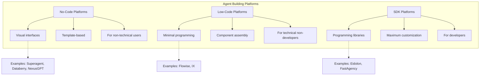
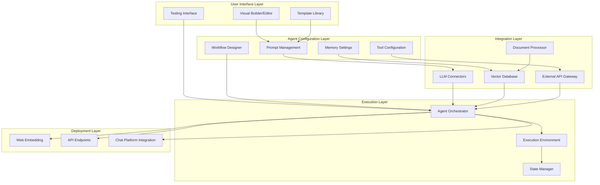
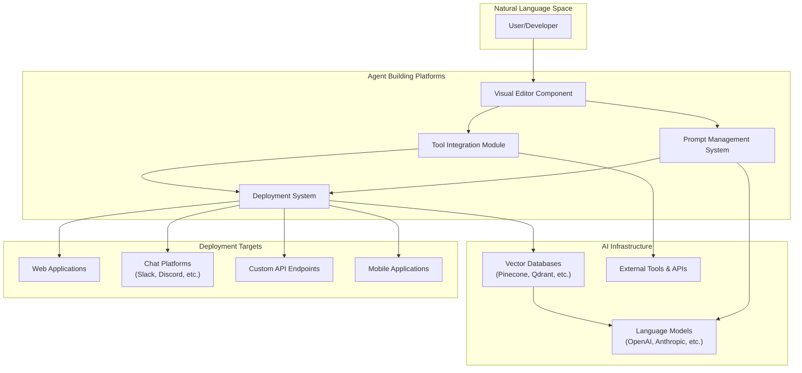

<!-- source: DeepWiki mcp.deepwiki.com · repo e2b-dev/awesome-ai-agents · page 2.2 Agent Building Platforms · fetched 2026-10-29 -->

# Agent Building Platforms

Relevant source files

The following files were used as context for generating this wiki page:

- [README.md](README.md)

This page provides a comprehensive overview of agent building platforms in the AI agent ecosystem. These platforms enable users to create, deploy, and manage custom AI agents with various levels of technical expertise requirements. For information about multi-agent frameworks that focus on coordinating multiple specialized agents, see [Multi-Agent Frameworks](#2.1). For details on systems that provide secure environments for running code, see [Code Execution Systems](#2.3).

## Purpose and Scope

Agent building platforms are tools, frameworks, and services designed to simplify the creation and deployment of AI agents. They bridge the gap between raw large language models (LLMs) and practical applications by providing:

1. Visual interfaces for agent design
2. Pre-built components and templates
3. Integration with various data sources and tools
4. Deployment and monitoring capabilities

These platforms democratize agent development, making it accessible to users with varying levels of technical expertise, from non-technical business users to experienced developers.

## Types of Agent Building Platforms

**Types of Agent Building Platforms:**

1. **No-Code Platforms**
   - Use visual interfaces with drag-and-drop functionality
   - Require no programming knowledge
   - Target business users and non-technical professionals
   - Examples: Superagent, Databerry/Chaindesk, NexusGPT

2. **Low-Code Platforms**
   - Use simplified programming interfaces
   - Require minimal coding knowledge
   - Target technical professionals with limited development experience
   - Examples: Flowise, IX, LLM Stack

3. **SDK-Based Platforms**
   - Provide programming libraries and frameworks
   - Require software development skills
   - Target developers seeking maximum customization
   - Examples: Eidolon, FastAgency, GPTSwarm

Sources: [README.md:2485-2487](). [README.md:2385-2387](). [README.md:1384-1386](). [README.md:1365-1367]().

## Architecture of Agent Building Platforms

**Agent Building Platform Architecture:**

The diagram above illustrates the typical architecture of an agent building platform, consisting of five key layers:

1. **User Interface Layer**: Provides tools for designing, testing, and managing agents
2. **Agent Configuration Layer**: Enables definition of agent behavior, capabilities, and workflows
3. **Integration Layer**: Connects agents with language models, databases, and external services
4. **Execution Layer**: Manages agent runtime behavior and state
5. **Deployment Layer**: Offers various deployment options for the finished agent

Sources: [README.md:2485-2487](). [README.md:2383-2387](). [README.md:1384-1398](). [README.md:3367-3371]().

## Open Source Agent Building Platforms

### Superagent

Superagent is a tool that allows creating agents without coding, simplifying the configuration and deployment of LLM agents to production. 

Key features:
- No-code agent creation interface
- Built-in memory and document retrieval via vector databases
- Powerful tool integration capabilities
- Support for webhooks and cron jobs
- Two main agent types: action agents and plan-and-execute agents

Sources: [README.md:2485-2507]().

### Flowise

Flowise is a low-code tool that enables developers to build customized LLM orchestration flows and AI agents.

Key features:
- Visual flow-based editor
- Support for various LLM providers
- Component-based architecture
- Open-source implementation

Sources: [README.md:1384-1398]().

### Databerry/Chaindesk

Originally named Databerry, now known as Chaindesk, this platform offers no-code chatbot building capabilities with a focus on easy data integration.

Key features:
- No-code user interface for managing datastores and chatting with data
- Data loading from multiple sources
- Secured API endpoint for querying data
- Auto-generation of ChatGPT plugins for each datastore
- Built on Next.js, Joy UI, LangchainJS, PostgreSQL, Prisma, and Qdrant

Sources: [README.md:1127-1160]().

### Eidolon

Eidolon is an open-source SDK for AI agents with pluggable, modular components.

Key features:
- Flexible SDK architecture
- Modular design allowing customization
- Pluggable components for various functionalities

Sources: [README.md:1292-1313]().

### Other Notable Open Source Platforms

- **LLM Stack**: No-code platform supporting major model providers like OpenAI, Cohere, and Hugging Face
- **AgentForge**: LLM-agnostic platform supporting multiple models and customizable memory management
- **IX**: Platform with a graphical interface and no-code graph editor for designing agents and workflows
- **FastAgency**: Framework for scaling prototype agents into production-ready applications

Sources: [README.md:1798-1823](). [README.md:117-140](). [README.md:1655-1687](). [README.md:1358-1376]().

## Closed Source Agent Building Platforms

Several commercial platforms offer advanced agent building capabilities with proprietary features:

### NexusGPT

A platform for building AI agents without coding, featuring a marketplace of pre-built agents and tools.

Key features:
- Over 1000 ready-made agents and 1500+ tools
- Custom knowledge integration from various sources
- One-click deployment to websites and communication platforms

Sources: [README.md:2838-2861]().

### Fine

A platform for building, deploying, and managing AI agents as virtual teammates.

Key features:
- Team-oriented with organizational memory
- Privacy-focused design with local execution
- Multi-agent platform supporting custom agent creation

Sources: [README.md:4030-4051]().

### Lutra AI

A platform for creating personal AI workflows and applications through natural language.

Key features:
- Conversational interface for understanding user goals
- Code generation for AI workflows
- Secure and reliable execution with data protection

Sources: [README.md:4646-4671]().

### Other Notable Closed Source Platforms

- **broadn**: No-code platform with conversational interface for non-technical users
- **Fixie**: Cloud-based platform for building smart agents with back-end logic
- **Invicta**: Platform for building teams of autonomous agents with collaboration features
- **AilaFlow**: No-code platform using templates for agent creation
- **Airkit.ai**: Browser-based studio with memory management and one-click deployment

Sources: [README.md:3472-3496](). [README.md:4081-4104](). [README.md:4431-4457](). [README.md:3088-3107](). [README.md:3110-3131]().

## Platform Ecosystem and Integration

The diagram above illustrates how agent building platforms interface with various components in the AI ecosystem:

1. **User/Developer Interaction**: Users design agents through visual interfaces
2. **Platform Core Components**: Handle prompt management, tool integration, and deployment
3. **AI Infrastructure Integration**: Connect with language models, vector databases, and external tools
4. **Deployment Options**: Enable agent deployment across various channels and applications

Sources: [README.md:2485-2507](). [README.md:1384-1398](). [README.md:1127-1160](). [README.md:2838-2861]().

## Key Features Comparison

| Feature | No-Code Platforms | Low-Code Platforms | SDK Platforms |
|---------|------------------|-------------------|---------------|
| **Target Users** | Business users, non-technical professionals | Technical users with limited coding skills | Developers |
| **Interface** | Visual, drag-and-drop | Visual with some coding | Code libraries and APIs |
| **Customization** | Limited to platform capabilities | Moderate customization | Extensive customization |
| **Learning Curve** | Low | Medium | High |
| **Deployment Options** | Platform-managed | Platform-managed with some custom options | Fully customizable |
| **Integration Depth** | Pre-built integrations | Configurable integrations | Custom integrations |
| **Example Platforms** | Superagent, NexusGPT | Flowise, IX | Eidolon, FastAgency |

Sources: [README.md:2485-2507](). [README.md:1384-1398](). [README.md:1292-1313](). [README.md:1358-1376]().

## Use Cases and Applications

Agent building platforms enable a wide range of applications:

1. **Customer Service Automation**
   - Building agents that handle customer inquiries
   - Creating knowledge base chatbots
   - Automating support ticket processing

2. **Content Creation and Management**
   - Generating marketing materials
   - Creating and managing content workflows
   - Producing documentation

3. **Research and Data Analysis**
   - Building research assistant agents
   - Creating data analysis workflows
   - Automating information gathering and synthesis

4. **Process Automation**
   - Automating business workflows
   - Creating agents for repetitive tasks
   - Building process orchestration systems

5. **Specialized Domain Applications**
   - Building agents for specific industries (healthcare, finance, legal)
   - Creating agents with domain-specific knowledge
   - Developing specialized analysis tools

Sources: [README.md:2485-2507](). [README.md:3472-3496](). [README.md:4646-4671](). [README.md:4030-4051]().

## Integration with Code Execution Systems

Agent building platforms often integrate with code execution systems to enhance agent capabilities:

- **E2B Integration**: Some platforms like Superagent integrate with E2B to provide secure code execution environments
- **Sandboxed Environments**: Platforms leverage sandboxed execution for safe code running
- **API-based Execution**: Many platforms offer API-based integration with code execution services

For more details on code execution systems, see [Code Execution Systems](#2.3).

Sources: [README.md:2485-2507](). [README.md:96-111]().

## Conclusion

Agent building platforms represent a critical layer in the AI agent ecosystem, bridging the gap between raw language models and practical applications. By providing various levels of abstraction and accessibility, these platforms enable users with different technical backgrounds to create, deploy, and manage AI agents for diverse use cases.

The landscape continues to evolve rapidly, with both open-source and commercial platforms introducing new features and capabilities to address the growing demand for custom AI agents across industries.

---

