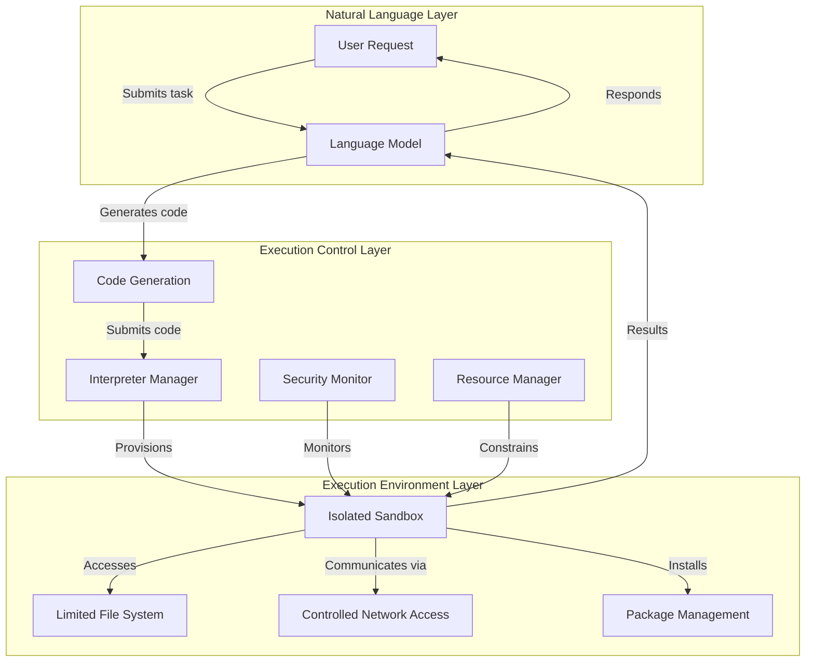
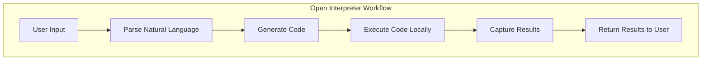
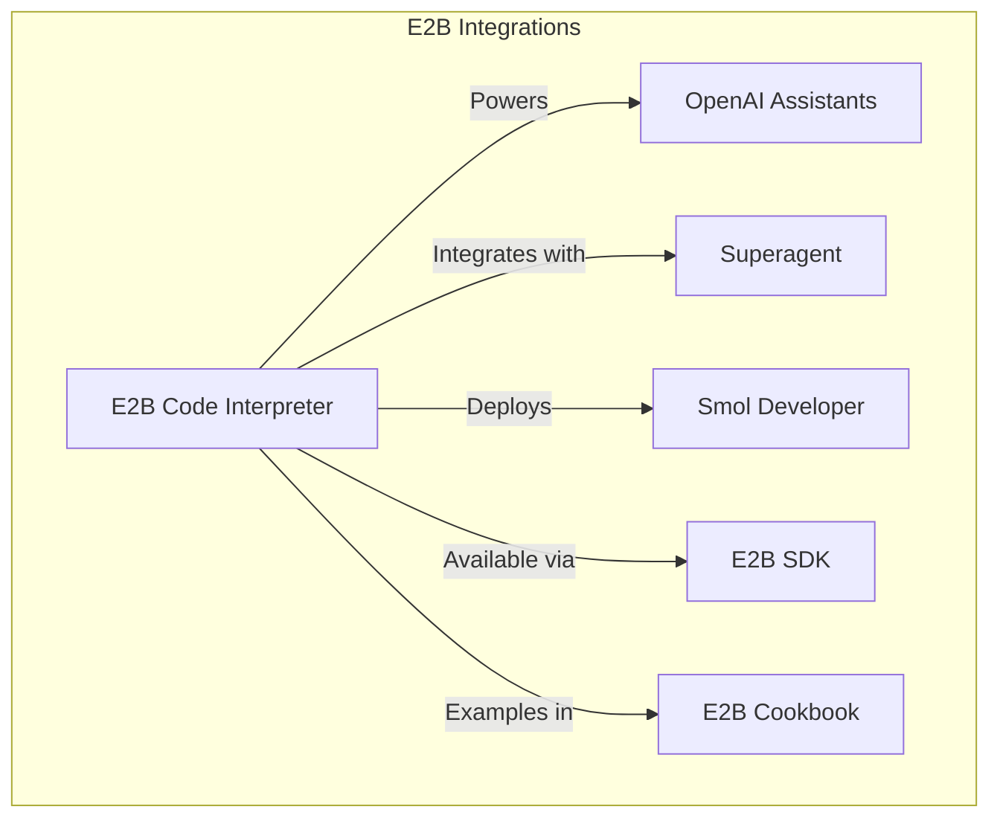
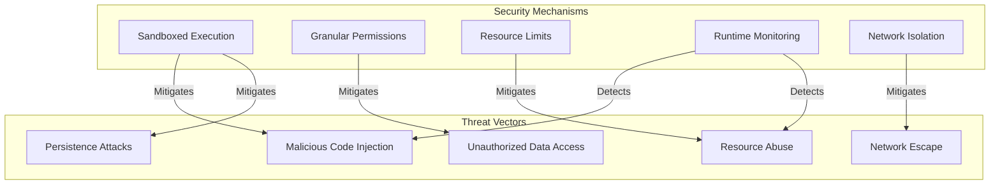
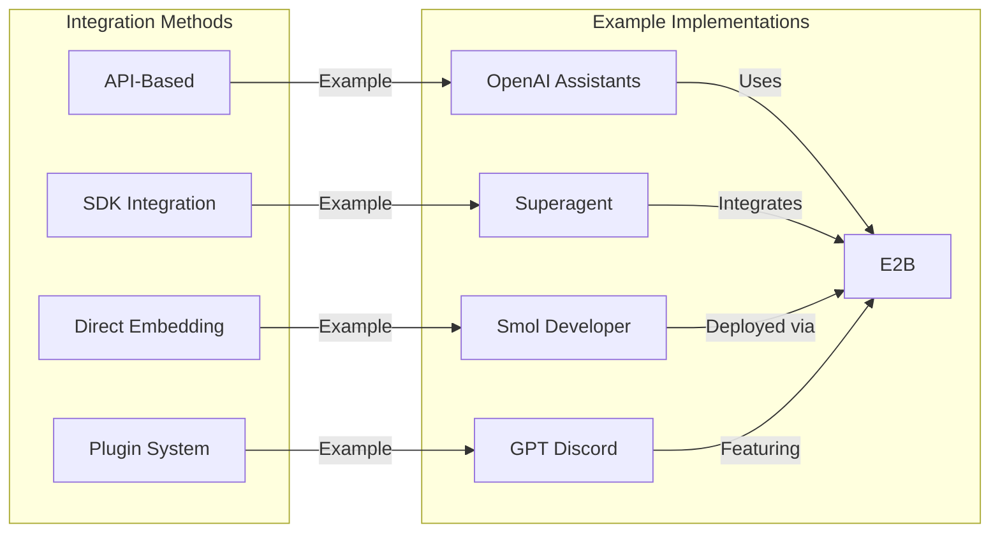

<!-- source: DeepWiki mcp.deepwiki.com · repo e2b-dev/awesome-ai-agents · page 2.3 Code Execution Systems · fetched 2026-10-29 -->

# Code Execution Systems

Relevant source files

The following files were used as context for generating this wiki page:

- [README.md](README.md)

## Purpose and Scope

This document details the systems that provide secure environments for running code within AI agent frameworks. Code execution systems bridge the gap between natural language instructions and actual code execution, enabling AI agents to perform computational tasks, manipulate data, and interact with external systems. These systems are critical infrastructure components that allow language models to safely execute code while providing appropriate sandboxing, resource management, and security controls.

For information about multi-agent frameworks that may use code execution systems, see [Multi-Agent Frameworks](#2.1). For agent building platforms that may incorporate code execution capabilities, see [Agent Building Platforms](#2.2).

## Architecture of Code Execution Systems

Code execution systems typically follow a layered architecture that mediates between language models and computational resources:

Sources: [README.md:2276-2296](), [README.md:784-814](), [README.md:66-68]()

## Core Code Execution Systems

The repository highlights several significant code execution systems that serve different use cases and implementation approaches:

### Open Interpreter

Open Interpreter is an open-source code interpreter that allows language models to execute code locally on a user's machine.

Key features:
- Terminal-based ChatGPT-like interface
- Local code execution for data tasks
- Ability to manipulate files, visualize datasets, and control browser
- Focus on user privacy with local execution

Sources: [README.md:2276-2296]()

### E2B Code Interpreter

E2B provides cloud-based sandboxed environments for executing code, with a focus on security and integration capabilities.

Key features:
- Sandboxed execution environments
- Integrates with various AI agent frameworks
- Powers OpenAI Assistants' code interpreter capability
- Provides SDK for developers to add code execution to applications

Sources: [README.md:35-39](), [README.md:66-68](), [README.md:421-422]()

### BondAI

BondAI offers a complete solution with code interpretation capabilities built into an autonomous agent framework.

Key features:
- CLI, RESTful/WebSocket API for interaction
- Docker-based secure execution environment
- Code interpretation integrated with other tools
- Support for all GPT-N, Embeddings, and DALL-E OpenAI models
- Integration with external services (Gmail, Google Search, etc.)

Sources: [README.md:784-814]()

### Smol Developer

A lightweight AI development agent deployed through E2B that functions as a junior developer.

Key features:
- Human-centric program synthesis
- Compact implementation (~200 LOC)
- Uses markdown as its primary prompting DSL
- Focuses on generating entire coherent programs

Sources: [README.md:2430-2458]()

## Comparison of Code Execution Systems

| System | Execution Environment | Primary Interface | Integration Method | Security Approach |
|--------|----------------------|-------------------|-------------------|------------------|
| Open Interpreter | Local Machine | Terminal | Python Package | Local Permissions |
| E2B Code Interpreter | Cloud Sandbox | SDK | API Integration | Containerization |
| BondAI | Docker Container | CLI/API | SDK Integration | Docker Isolation |
| Smol Developer | E2B Platform | Web UI | E2B Deployment | E2B Security Model |

Sources: [README.md:2276-2296](), [README.md:784-814](), [README.md:2430-2458](), [README.md:35-39]()

## Security Considerations

Code execution systems must balance functionality with security concerns:

Key security approaches:
- Containerization/virtualization for execution isolation
- Resource limits to prevent abuse
- Permission-based access control
- Input validation and sanitization
- Output inspection before returning results

Sources: [README.md:785-800](), [README.md:2283-2290]()

## Integration Patterns

Code execution systems can be integrated into AI agent workflows in several ways:

Common integration approaches:
1. API calls to the execution service
2. SDK integration for direct code control
3. Plugin systems for extending functionality
4. Direct embedding of the execution environment

Sources: [README.md:421-422](), [README.md:1486-1487](), [README.md:2430-2458]()

## Conclusion

Code execution systems form a critical component of the AI agent ecosystem, enabling AI to bridge the gap between language understanding and practical computation. As these systems evolve, we can expect to see more sophisticated security models, better integration capabilities, and enhanced performance.

The development of secure, efficient code execution systems remains an active area of research and development in the AI agent community, with ongoing improvements in sandboxing techniques, resource management, and integration patterns.

Sources: [README.md:35-39](), [README.md:66-68](), [README.md:421-422](), [README.md:784-814](), [README.md:2276-2296](), [README.md:2430-2458]()

---

