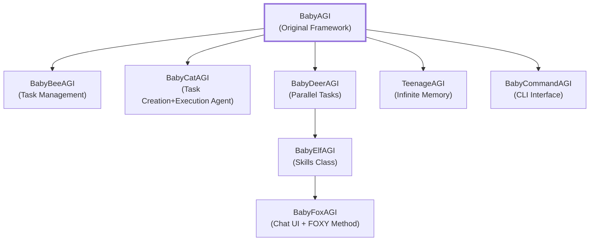
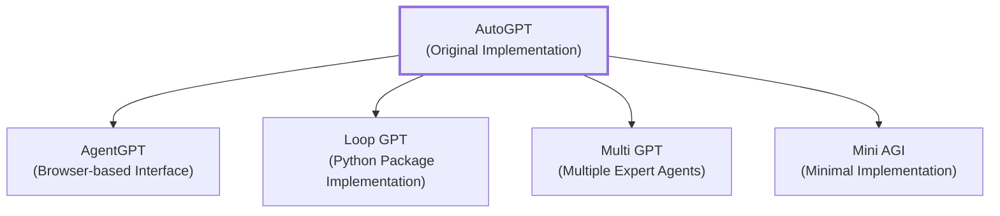
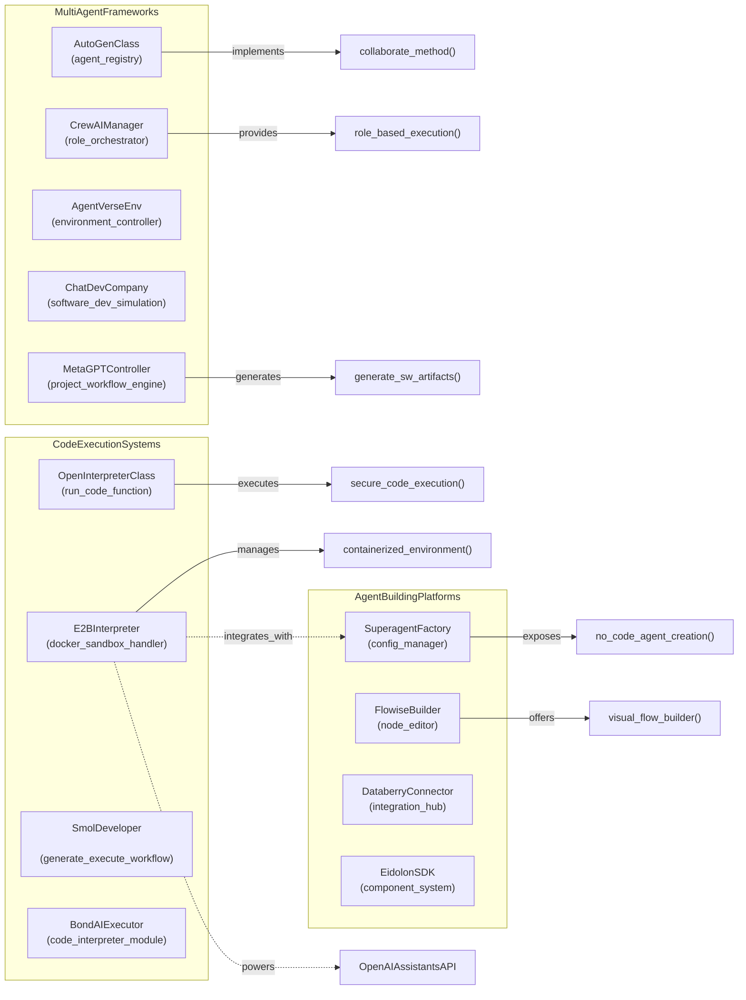
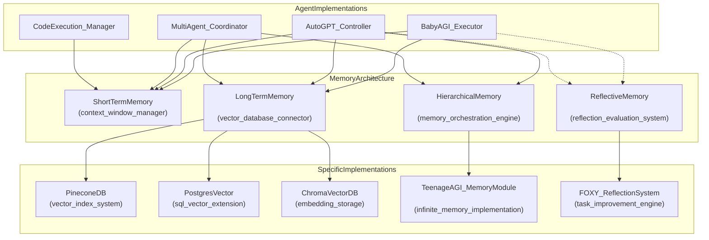
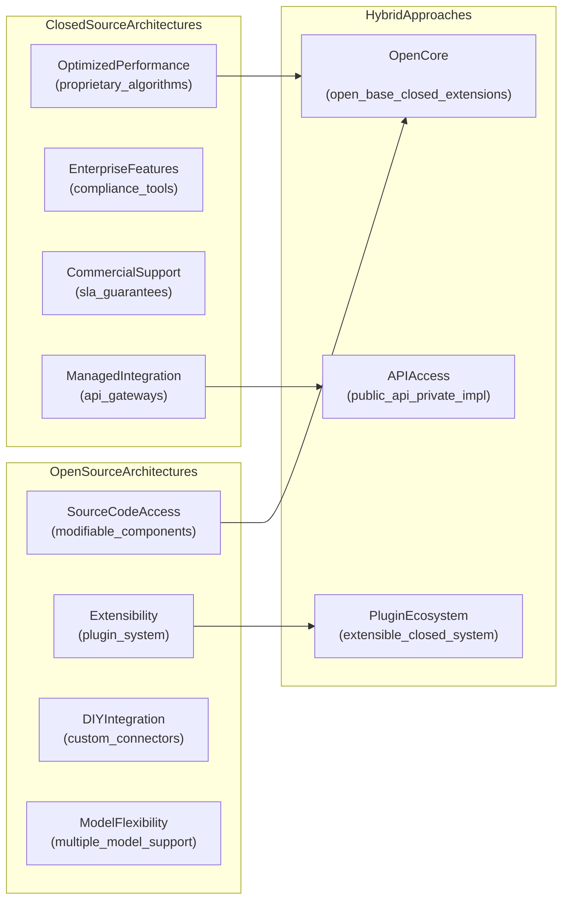

<!-- source: DeepWiki mcp.deepwiki.com · repo e2b-dev/awesome-ai-agents · page 3 Notable AI Agent Families · fetched 2026-10-29 -->

# Notable AI Agent Families

Relevant source files

The following files were used as context for generating this wiki page:

- [README.md](README.md)

## Purpose and Scope

This page documents significant families of AI agents within the awesome-ai-agents repository, focusing on their evolutionary development, architectural patterns, and key characteristics. It examines how different agent frameworks relate to each other and the progression of capabilities across variants.

For information about specific AI agent frameworks, see [AI Agent Frameworks](#2). For details on building and deploying your own agents, see [E2B Resources and Integration](#4).

## BabyAGI Family Evolution

The BabyAGI family represents one of the most prolific and well-documented evolutionary paths in the autonomous agent landscape. Beginning with the original BabyAGI framework, this family has spawned numerous variants, each introducing specific enhancements to the core architecture.

### BabyAGI Evolutionary Tree

Sources: [README.md:477-627]()

### Core Architecture and Evolution

The original **BabyAGI** established a foundational architecture for autonomous agents by implementing:
- Task-driven operations based on previous task results and defined objectives
- Integration with OpenAI's language models, primarily GPT3-turbo
- Vectorized memory using Pinecone for context storage
- LangChain framework integration for execution flow

Each subsequent variant in the family introduced specific architectural improvements:

| Variant | Key Architectural Innovations | Code Size | Key Technology Additions |
|---------|-------------------------------|-----------|--------------------------|
| BabyBeeAGI | Complex task management prompt | Not specified | Enhanced prompt system |
| BabyCatAGI | Separated task creation and execution agents | ~300 lines | Mini-agent tools, search integration |
| BabyDeerAGI | Parallel task processing architecture | ~350 lines | User input tool, query rewrite |
| BabyElfAGI | Skills class pattern for extensibility | ~895 lines | Dynamic task lists, reflection agent |
| BabyFoxAGI | Self-improving task lists via FOXY method | Not specified | Chat UI, parallel execution panel |
| TeenageAGI | Infinite memory architecture | Not specified | Pinecone for persistent memory |
| BabyCommandAGI | Shell command execution integration | Not specified | CLI interface patterns |

Sources: [README.md:477-499](), [README.md:506-530](), [README.md:533-567](), [README.md:570-598](), [README.md:600-623](), [README.md:652-680](), [README.md:626-649]()

### Implementation Detail: BabyAGI Task Management Loop

The core pattern across the BabyAGI family is the task management loop. The original implementation follows this sequence:

1. Initialize task list with a predefined objective
2. Execute highest-priority task using OpenAI's language models
3. Store result in vector database for context
4. Generate new tasks based on the result and objective
5. Prioritize and update task list
6. Repeat until completion or termination

This pattern is preserved across variants with specific enhancements. For example, BabyCatAGI splits step 4 into a separate agent, while BabyDeerAGI parallelizes step 2 for multiple tasks simultaneously.

Sources: [README.md:482-494]()

### Notable Feature: FOXY Method in BabyFoxAGI

BabyFoxAGI introduced the FOXY method for self-improving task lists:
- Stores final reflection at the end of task execution
- Retrieves the most relevant past reflections for future runs
- Incrementally improves task generation quality through this feedback loop

This represents a significant architectural advancement in the family's evolution, allowing for learning from past execution cycles.

Sources: [README.md:664-668]()

## AutoGPT-Derived Agent Family

The AutoGPT family represents another significant evolutionary path in autonomous agent development, characterized by a focus on full autonomy and chain-of-thought reasoning.

### AutoGPT Family Tree

Sources: [README.md:348-388](), [README.md:141-181](), [README.md:1857-1887](), [README.md:2122-2149](), [README.md:2073-2094]()

### Key Architectural Patterns in AutoGPT Family

The AutoGPT framework established several key architectural patterns that influenced subsequent autonomous agents:

1. **Chain-of-thought automation**: Linking together LLM "thoughts" to autonomously achieve user-defined goals
2. **Internet integration**: Built-in capabilities for searches and information gathering
3. **Memory management**: Sophisticated short-term and long-term memory systems
4. **Command execution**: Ability to execute various external commands (search, browse, file operations, code execution)
5. **Tool integration**: Access to popular websites and platforms

Derivatives in this family typically preserve these core patterns while making specific adaptations:

| Variant | Architectural Modifications | Key Implementation Features |
|---------|---------------------------|----------------------------|
| AgentGPT | Web-based no-code interface | OpenAI functions, database integrations (pinecone, pg_vector) |
| Loop GPT | Python package implementation | Modular framework, minimal token overhead, human-in-the-loop capabilities |
| Multi GPT | Multiple agent collaboration | Individual agent memory systems, inter-agent communication |
| Mini AGI | Minimal implementation | Chain-of-thoughts, short-term memory with summarization, inner monologue capabilities |

Sources: [README.md:359-366](), [README.md:154-165](), [README.md:1873-1878](), [README.md:2135-2142](), [README.md:2084-2088]()

## Multi-Agent Framework Families

Multi-agent frameworks represent a distinct architectural approach where multiple specialized agents collaborate to solve complex tasks. Several major families have emerged in this category.

### Multi-Agent Framework Technical Implementation

Sources: [README.md:323-344](), [README.md:1066-1086](), [README.md:238-256](), [README.md:915-936](), [README.md:2046-2069](), [README.md:2485-2507](), [README.md:1380-1397](), [README.md:1127-1160](), [README.md:1293-1312](), [README.md:2276-2297](), [README.md:35-39](), [README.md:784-815](), [README.md:2430-2458]()

### Architectural Patterns in Multi-Agent Frameworks

Each multi-agent framework family implements distinct architectural patterns:

#### AutoGen Architecture (Microsoft)

AutoGen implements a flexible architecture for multi-agent conversations:
- Agents with specialized roles communicate to solve tasks
- Seamless human-in-the-loop integration
- Advanced inference with performance tuning
- Error handling and context programming capabilities

Sources: [README.md:332-338]()

#### CrewAI Architecture

CrewAI focuses on role-playing agent orchestration:
- Agents with specific roles, backgrounds, and goals
- Collaborative decision-making through defined roles
- Task-oriented process management
- Modular design with agents, tools, tasks, and crews

Sources: [README.md:1076-1082]()

#### MetaGPT Architecture

MetaGPT implements a software company simulation architecture:
- Product managers, architects, project managers, and engineers as agents
- SOPs (Standard Operating Procedures) for workflow
- One-line requirement input producing comprehensive artifacts
- Multi-agent collaboration with specialized roles

Sources: [README.md:2056-2062]()

#### ChatDev Architecture

ChatDev creates a virtual software company environment:
- CEO, CPO, CTO, programmer, reviewer, tester, and art designer roles
- Structured organizational environment with functional seminars
- Design, coding, testing, and documentation phases
- Customizable development process definition

Sources: [README.md:926-931]()

### Agent Building Platform Architectures

Agent building platforms employ different architectural approaches to simplify agent creation:

| Platform | Core Architecture | Key Components | Integration Capabilities |
|----------|------------------|----------------|--------------------------|
| Superagent | Configuration-driven | Memory, vector db, webhooks, cron jobs | Third-party API integration |
| Flowise | Low-code flowchart | Visual node editor | Multiple LLM provider support |
| Databerry/Chaindesk | No-code chatbot | User-friendly interface, datastore management | API endpoint generation, ChatGPT plugin generation |
| Eidolon | Modular SDK | Pluggable components | Open-source extensibility |

Sources: [README.md:2499-2501](), [README.md:1390-1391](), [README.md:1148-1154](), [README.md:1303-1305]()

## Code Execution and Interpretation Families

A distinct family of AI agents focuses on code execution and interpretation, providing secure environments for running code generated by language models.

### Memory Management Implementation

Sources: [README.md:488-493](), [README.md:361-362](), [README.md:2500](), [README.md:2632-2685](), [README.md:665-667]()

### Task Processing Patterns

Different agent families implement various approaches to task processing:

| Family | Task Processing Pattern | Key Implementation | Distinguishing Feature |
|--------|------------------------|-------------------|------------------------|
| BabyAGI | Sequential by default, parallel in some variants | Task creation → execution → result evaluation → new tasks | Task-driven with objective focus |
| AutoGPT | Autonomous goal-directed | Thought → Action → Result → New thought | Chain-of-thought reasoning |
| Multi-Agent | Collaborative distributed | Task delegation to specialized agents | Role-based specialization |
| Code Execution | Interpret-execute-feedback | Code generation → sandboxed execution → result evaluation | Security and isolation focus |

Sources: [README.md:482-494](), [README.md:359-366](), [README.md:1076-1082](), [README.md:2288-2291]()

### Communication Patterns

Agent families also differ in their communication architectures:

- **BabyAGI Family**: Primarily internal communication via task list and results
- **AutoGPT Family**: Self-communication through chain-of-thought and memory systems
- **Multi-Agent Frameworks**: Inter-agent message passing with defined protocols
- **Code Execution Agents**: Command-result pattern with runtime feedback

Sources: [README.md:482-494](), [README.md:359-366](), [README.md:332-338](), [README.md:2288-2291]()

## Open Source vs. Closed Source Agent Architectures

The repository categorizes agents into open-source and closed-source implementations, which exhibit some architectural differences.

### Architectural Differences Between Open and Closed Source Agents

Sources: [README.md:47-52](), [README.md:2964-3657]()

Open-source agents typically offer:
- Full access to source code for inspection and modification
- Community-driven development and extensions
- Greater flexibility in model integration
- DIY deployment and customization

Closed-source agents often provide:
- Proprietary optimizations for performance
- Enterprise-grade features and compliance
- Managed integration with existing tools
- SLA guarantees and commercial support

Some agents adopt hybrid approaches:
- Open core with proprietary extensions
- Closed implementation with public API
- Plugin systems for third-party extensions

## Related Developments in the LLM Agent Ecosystem

The landscape of AI agents continues to evolve with new innovations emerging in each family. Some notable trends include:

1. **Increased autonomy**: Newer agents demonstrate greater ability to operate without human supervision
2. **Specialized domain expertise**: Evolution of agents tailored for specific domains like coding, research, and data analysis
3. **Improved tool integration**: More sophisticated integration with external tools and services
4. **Enhanced memory systems**: More complex and efficient memory architectures for better context retention
5. **Security-focused execution**: Greater emphasis on secure execution environments for running code and accessing resources

As these families continue to evolve, we're seeing cross-pollination of ideas between them, with architectural innovations from one family being adopted and adapted by others.

Sources: [README.md:25-53]()

## Conclusion

The AI agent landscape is characterized by several distinct family lineages, each with their own architectural patterns, innovations, and evolution paths. The BabyAGI and AutoGPT families represent two major evolutionary trees with numerous variants, while multi-agent frameworks and code execution agents constitute specialized architectural approaches for specific use cases.

Understanding these family relationships and architectural patterns provides valuable insights for developers looking to select, implement, or extend AI agents for their specific needs. Each family offers distinct advantages in terms of autonomy, collaboration capabilities, ease of use, and specialization.

Sources: [README.md:25-53]()

---

