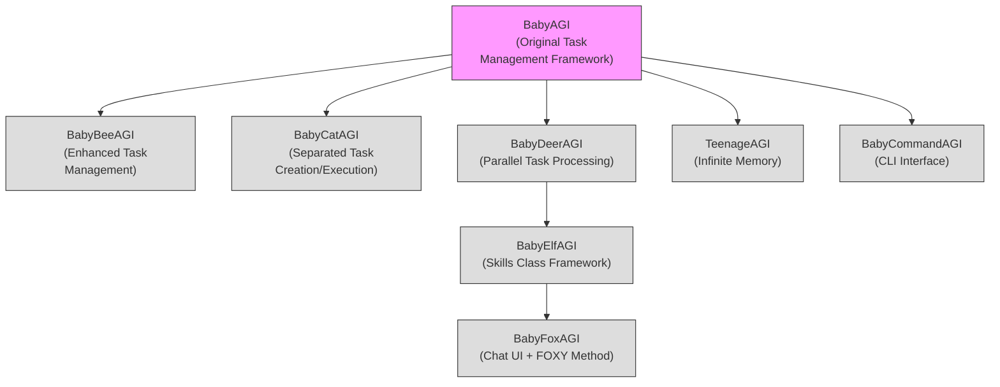
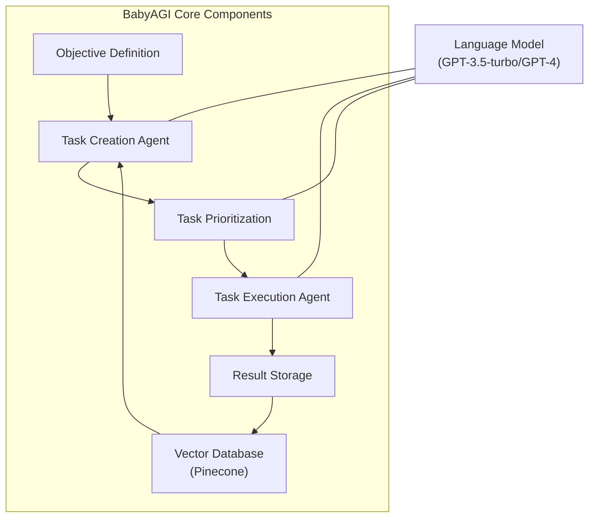
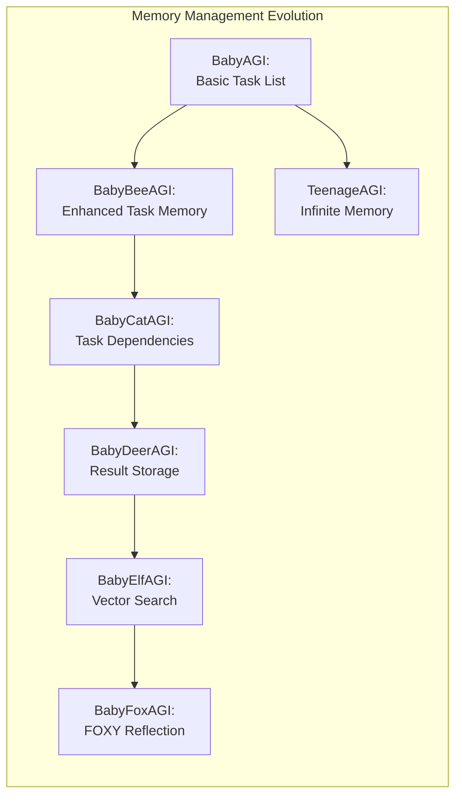

<!-- source: DeepWiki mcp.deepwiki.com · repo e2b-dev/awesome-ai-agents · page 3.1 BabyAGI Family · fetched 2026-10-29 -->

# BabyAGI Family

Relevant source files

The following files were used as context for generating this wiki page:

- [README.md](README.md)

This document provides an overview of the BabyAGI family of autonomous AI agents. The BabyAGI Family consists of the original BabyAGI framework and its various derivatives, each building upon and extending the capabilities of its predecessors. This page focuses on the evolution, architecture, and distinct features of each member of the BabyAGI Family.

## Overview and Origins

BabyAGI is a simple yet powerful framework for autonomous task management using artificial intelligence. Created by Yohei Nakajima, it represents a pared-down version of the original Task-Driven Autonomous Agent concept.

The core functionality of BabyAGI involves:

1. Creating tasks based on the results of previously completed tasks
2. Managing and prioritizing these tasks according to a predefined objective
3. Autonomously executing these tasks through language model capabilities

BabyAGI leverages OpenAI's GPT models (primarily GPT-3.5-turbo by default), Pinecone vector database for memory management, and the LangChain framework to orchestrate its components.

Sources: [README.md:478-494]()

## Evolution Timeline and Key Innovations

The BabyAGI family has expanded through progressive iterations, with each new "animal-themed" variant introducing specific enhancements to the original framework.

Sources: [README.md:20-40](), [README.md:478-494](), [README.md:506-682]()

## Core Architecture

The BabyAGI framework is built around a cyclical task management system that creates, executes, and prioritizes tasks based on their outcomes and relevance to the main objective.

Sources: [README.md:478-494]()

## BabyAGI Variants

### Original BabyAGI

The foundational framework that established the core functionality of task creation, prioritization, and execution based on results and objectives.

Key characteristics:
- Uses OpenAI's GPT-3.5-turbo by default
- Leverages Pinecone vector database for memory management
- Employs LangChain framework for component orchestration
- Sequential task processing

Sources: [README.md:478-494]()

### BabyBeeAGI

BabyBeeAGI represents a more advanced iteration with a focus on enhanced task management.

Key innovations:
- More complex task management prompt allowing for comprehensive analysis
- Designed to handle multiple functions within one task management prompt
- Built on the GPT-4 architecture
- Slower processing but more sophisticated reasoning
- Framework that can be further built upon for more complex AI applications

Sources: [README.md:506-530]()

### BabyCatAGI

BabyCatAGI modifies the execution flow by separating task creation and execution into distinct processes.

Key innovations:
- Just 300 lines of code
- Task Creation Agent runs once
- Execution Agent loops through tasks
- Task dependencies for pulling relevant results
- Two primary tools: search tool and text completion
- "Mini-agent" as tool concept
- Search tool combines search, scrape, chunking, and extraction
- Results are combined to create a summary report

Sources: [README.md:533-568]()

### BabyDeerAGI

BabyDeerAGI focuses on performance improvements through parallel task processing.

Key innovations:
- Approximately 350 lines of code
- Parallel tasks (making it faster)
- Uses GPT-3.5-turbo only (GPT-4 not required)
- User input tool for human-in-the-loop capability
- Query rewrite in web search tool
- Saves results for future reference

Sources: [README.md:570-597]()

### BabyElfAGI

BabyElfAGI builds on BabyDeerAGI by introducing a skills framework for extensibility.

Key innovations:
- Approximately 895 lines of code
- Skills class allows for creation of new skills
- 'Dynamic task list' example with vector search
- Beta reflection agent for self-improvement
- Can read, write, and review its own code

Sources: [README.md:600-623]()

### BabyFoxAGI

BabyFoxAGI represents the most advanced iteration, adding a chat UI and self-improvement capabilities.

Key innovations:
- Self-improving task lists (FOXY method)
- Novel Chat UI with parallel tasks panel
- Chat interface can use a single skill quickly or chain multiple skills
- New skills including:
  - DALLE skill with prompt assist
  - Music player with Deezer
  - Airtable search
  - Startup Analyst function
- Includes its own README

Sources: [README.md:651-682]()

### TeenageAGI

TeenageAGI focuses on memory capabilities, particularly infinite recall.

Key innovations:
- Can recall infinite memory
- "Thinks" before making actions
- Doesn't lose memory after being shut down
- Vectorizes and stores queries in Pinecone
- Finds relevant memories for current queries
- Processes thought before generating output

Sources: [README.md:2663-2690]()

### BabyCommandAGI

BabyCommandAGI tests the integration of traditional command-line interfaces with language models.

Key innovations:
- CLI interface for interaction
- Executes shell commands
- Successfully created applications through feedback
- Successfully installed complex environments (e.g., Flutter on Linux)
- Can handle general tasks like generating text and translating languages
- Requires virtual environment (e.g., Docker) for safety

Sources: [README.md:626-648]()

## Technical Implementation Comparison

The following table compares key technical aspects of the different BabyAGI variants:

| Variant | Lines of Code | Primary LLM | Task Processing | Key Technical Innovation |
|---------|---------------|-------------|----------------|--------------------------|
| BabyAGI | N/A | GPT-3.5-turbo | Sequential | Task-driven autonomous framework |
| BabyBeeAGI | N/A | GPT-4 | Sequential | Complex task management prompt |
| BabyCatAGI | ~300 | GPT-3.5/4 | Sequential with separation | Task Creation/Execution separation |
| BabyDeerAGI | ~350 | GPT-3.5-turbo | Parallel | Parallel task processing |
| BabyElfAGI | ~895 | GPT-3.5/4 | Parallel | Skills class framework |
| BabyFoxAGI | >895 | GPT-3.5/4 | Parallel with UI | Chat UI and FOXY method |
| TeenageAGI | N/A | GPT-4 | Sequential with thinking | Vector-based infinite memory |
| BabyCommandAGI | N/A | GPT-4 recommended | Sequential with CLI | Shell command execution |

Sources: [README.md:506-682](), [README.md:2663-2690]()

## Memory Management Evolution

One of the key areas of evolution across the BabyAGI family is memory management, progressing from basic task storage to sophisticated vector-based systems.

Sources: [README.md:506-682](), [README.md:2663-2690]()

## Implementation Details

### Task Creation Process

In BabyAGI and its variants, task creation follows a general pattern where the LLM analyzes the objective, previous results, and context to generate new tasks. The implementation varies across variants:

- Original BabyAGI: New tasks are created based on completed results
- BabyBeeAGI: More complex task management prompt allows for deeper analysis
- BabyCatAGI: Task Creation Agent runs once at the beginning
- BabyFoxAGI: FOXY method continuously improves task lists through reflection

Sources: [README.md:478-494](), [README.md:506-682]()

### Task Execution Flow

The execution flow also evolved significantly across variants:

- Original BabyAGI: Sequential execution of prioritized tasks
- BabyCatAGI: Execution Agent loops through tasks created by the Task Creation Agent
- BabyDeerAGI: Parallel execution of tasks for improved performance
- BabyElfAGI: Skills-based execution leveraging a skills class framework
- BabyFoxAGI: UI-separated execution allowing parallel task viewing and chat interface

Sources: [README.md:478-494](), [README.md:506-682]()

## Common Use Cases

The BabyAGI family of agents is designed for various autonomous task management scenarios:

1. Research projects requiring multiple sequential or parallel steps
2. Content creation with structured approach and summarization
3. Data analysis with iterative refinement
4. Learning new domains through structured exploration
5. Building and debugging software with self-correction
6. Environment setup and configuration (especially BabyCommandAGI)
7. Web-based tasks with search and extraction (especially BabyCatAGI)

Sources: [README.md:478-494](), [README.md:506-682]()

## Conclusion

The BabyAGI family represents a progressive evolution of autonomous AI agent architectures, starting from a simple task management framework and expanding into specialized variants with diverse capabilities. Each iteration introduces specific improvements in areas such as task management, execution flow, memory capabilities, user interfaces, and skill frameworks.

The alphabetical progression of animal names (Bee, Cat, Deer, Elf, Fox) provides a clear lineage of development, with each variant building upon the strengths of its predecessors while addressing limitations and introducing new functionalities.

As a research and development platform, the BabyAGI family offers valuable insights into autonomous agent design patterns, particularly in areas of task decomposition, memory management, self-improvement, and human-AI collaboration.

Sources: [README.md:478-494](), [README.md:506-682]()

---

