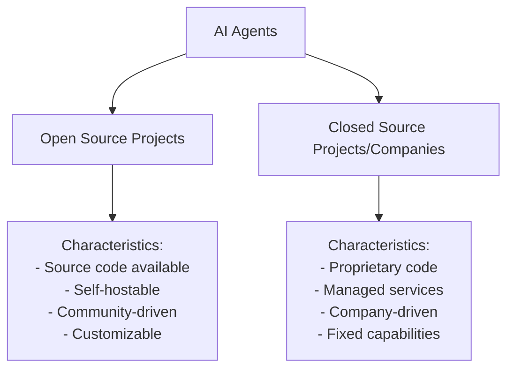
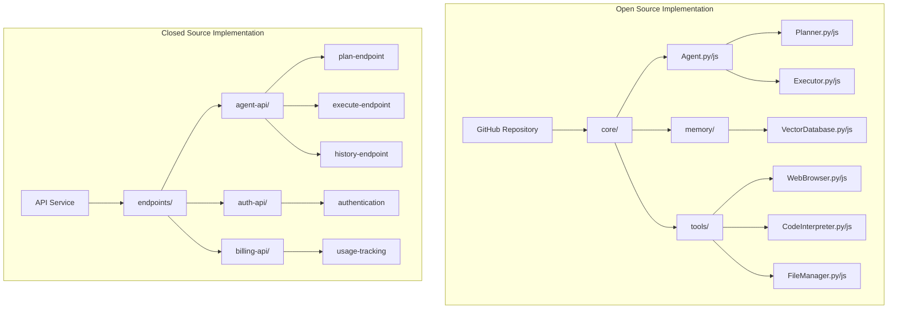
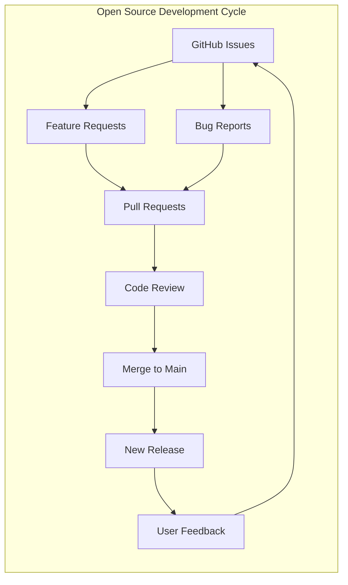
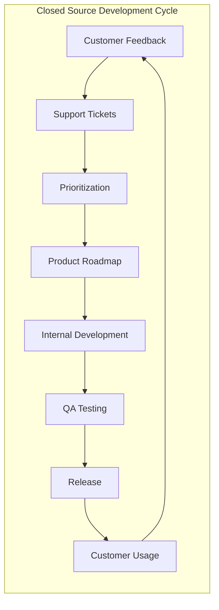
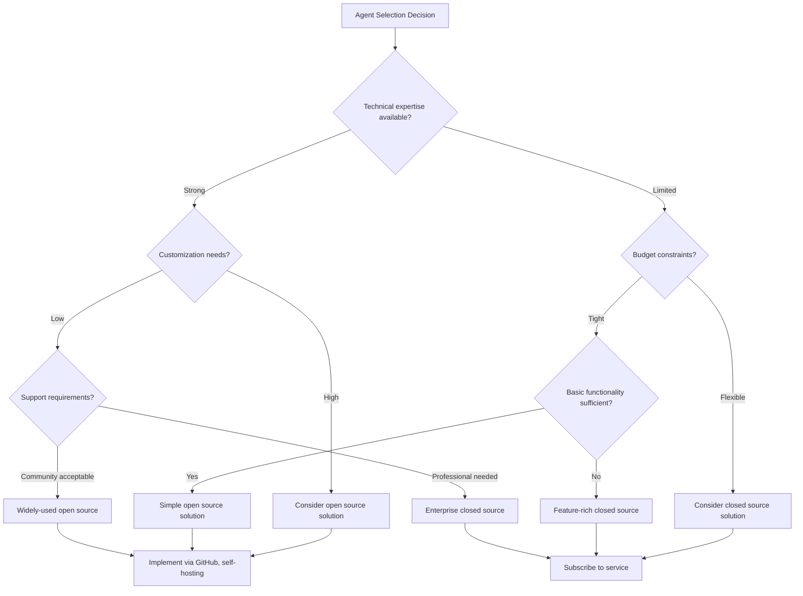

<!-- source: DeepWiki mcp.deepwiki.com · repo e2b-dev/awesome-ai-agents · page 3.2 Open Source vs. Closed Source Agents · fetched 2026-10-29 -->

# Open Source vs. Closed Source Agents

Relevant source files

The following files were used as context for generating this wiki page:

- [README.md](README.md)
- [assets/landscape-latest.png](assets/landscape-latest.png)

This document examines the fundamental distinctions between open-source and closed-source AI agents, comparing their characteristics, advantages, limitations, and implementation considerations. The Awesome AI Agents repository organizes agents into these two primary categories to help users navigate the agent landscape and select the appropriate solution for their needs.

## Categorization Overview

AI agents in the repository are deliberately categorized into two main sections:

Sources: [README.md:46-48]()

## Key Differences

The following table summarizes the primary differences between open-source and closed-source AI agents:

| Aspect | Open Source Agents | Closed Source Agents |
|--------|-------------------|----------------------|
| **Code Access** | Full source code available | Proprietary, inaccessible code |
| **Deployment** | Self-hosted or cloud-deployed | Provider-hosted services |
| **Customization** | Highly customizable | Limited to provided options |
| **Cost** | Free to use (API costs may apply) | Subscription/usage fees |
| **Support** | Community-based | Professional, dedicated |
| **Development** | Public contributions | Internal, private development |
| **Transparency** | Full visibility into operations | Black box operation |

Sources: [README.md:71-72](), [README.md:47-48]()

## Architecture Comparison

The architectural approaches differ significantly between open and closed source agents, affecting how they're built, deployed, and integrated.

```mermaid
graph TB
    subgraph "Open Source Architecture"
        OSRepo["Repository"] --> OSCode["Source Code"]
        OSCode --> OSBuild["Build Process"]
        OSBuild --> OSDeploy["Deployment Options"]
        OSDeploy --> OSLocal["Self-Hosted Installation"]
        OSDeploy --> OSCloud["User-Managed Cloud Deployment"]
        OSLocal & OSCloud --> OSInstance["Agent Instance"]
        OSInstance --> OSFeedback["Community Feedback Loop"]
        OSFeedback --> OSRepo
    end
    
    subgraph "Closed Source Architecture"
        CSCompany["Company"] --> CSCode["Proprietary Codebase"]
        CSCode --> CSBuild["Internal Build Pipeline"]
        CSBuild --> CSService["Managed Service Infrastructure"]
        CSService --> CSAPI["API/Interface Layer"]
        CSAPI --> CSClient["Client Applications"]
        CSClient --> CSSupport["Support Channels"]
        CSSupport --> CSCompany
    end
```

Sources: [README.md:65-70]()

## Implementation Models and Agent Structure

The following diagram maps typical code components in open-source vs. closed-source agent implementations, representing the connection between conceptual components and actual code structures:

Sources: [README.md:71-75](), [README.md:48-50]()

## Comparative Analysis of Advantages and Limitations

### Open Source Advantages

1. **Transparency**: Complete visibility into agent operation and data handling
2. **Customizability**: Ability to modify code for specific use cases
3. **Community-driven innovation**: Rapid iteration through distributed development
4. **Cost flexibility**: No licensing fees (though API costs may apply)
5. **Security auditability**: Code can be reviewed for vulnerabilities
6. **Independence**: No reliance on vendor business continuity

Sources: [README.md:71-91]()

### Open Source Limitations

1. **Technical expertise required**: Deployment and maintenance demand skills
2. **Variable support quality**: Community support may be inconsistent
3. **Deployment responsibility**: Self-hosting requires infrastructure management
4. **Integration effort**: May require additional work to integrate with existing systems
5. **Maintenance burden**: Keeping up with updates and security patches

Sources: [README.md:71-91]()

### Closed Source Advantages

1. **Ease of use**: Ready-to-use solutions with minimal setup
2. **Professional support**: Dedicated customer service and documentation
3. **Polished interfaces**: Refined user experiences
4. **Managed infrastructure**: No deployment or maintenance concerns
5. **Integrated ecosystems**: Seamless connection with provider's other services

Sources: [README.md:47-50]()

### Closed Source Limitations

1. **Limited transparency**: Cannot inspect or verify internal operations
2. **Ongoing costs**: Subscription or usage fees required
3. **Vendor lock-in**: Difficult to migrate away once committed
4. **Fixed capabilities**: Limited to features provided by vendor
5. **Data privacy concerns**: Data processing governed by vendor terms

Sources: [README.md:47-50]()

## Development and Contribution Models

### Open Source Development Process

Sources: [README.md:55-58]()

### Closed Source Development Process

Sources: [README.md:48-50]()

## Example Open Source AI Agents

Several notable open-source AI agents from the repository demonstrate the diversity of available options:

1. **AutoGPT** (lines 348-388): Experimental autonomous agent that can chain together LLM "thoughts" to achieve user-defined goals
2. **BabyAGI** (lines 477-503): Simple framework for managing tasks using AI, creating tasks based on previous results
3. **AgentVerse** (lines 237-256): Platform for multi-agent collaboration and task-solving simulations
4. **AutoGen** (lines 323-346): Framework for building applications with multiple conversational agents
5. **CrewAI** (lines 1065-1089): Framework for orchestrating role-playing autonomous agents

Sources: [README.md:348-388](), [README.md:477-503](), [README.md:237-256](), [README.md:323-346](), [README.md:1065-1089]()

## Deployment and Integration Comparison

The deployment and integration patterns differ significantly between open and closed source agents:

```mermaid
graph TB
    subgraph "Open Source Deployment"
        OSUser["User"] --> OSGit["Git Clone"]
        OSGit --> OSBuild["Build/Setup"]
        OSBuild --> OSConfig["Configuration"]
        OSConfig --> OSLLM["LLM API Key Setup"]
        OSLLM --> OSDeploy["Deployment"]
        OSDeploy --> OSLocal["Local Server"]
        OSDeploy --> OSCloud["Cloud Server"]
        OSLocal & OSCloud --> OSAccess["Agent Access"]
    end
    
    subgraph "Closed Source Deployment"
        CSUser["User"] --> CSSignup["Service Signup"]
        CSSignup --> CSPay["Payment Method"]
        CSPay --> CSAccount["Account Setup"]
        CSAccount --> CSAccess["Immediate Access"]
        CSAccess --> CSWebUI["Web Interface"]
        CSAccess --> CSAPI["API Integration"]
    end
```

Sources: [README.md:65-70](), [README.md:47-50]()

## LLM Integration Patterns

The way agents integrate with underlying language models reveals key architectural differences:

```mermaid
graph TB
    subgraph "Open Source LLM Integration"
        OSConfig["config.yaml/json"] --> OSAPIKey["LLM API Keys"]
        OSAPIKey --> OSModelSelection["Model Selection"]
        OSModelSelection --> OSLLMClient["LLM Client Module"]
        OSLLMClient --> OSPrompting["Prompt Templates"]
        OSPrompting --> OSResponse["Response Processing"]
        OSResponse --> OSMemory["Memory Management"]
    end
    
    subgraph "Closed Source LLM Integration"
        CSBackend["Proprietary Backend"] --> CSProxyAPI["Provider LLM Proxy"]
        CSProxyAPI --> CSOptimization["Optimized Prompting"]
        CSOptimization --> CSCaching["Response Caching"]
        CSCaching --> CSUsage["Usage Tracking"]
        CSUsage --> CSBilling["Billing System"]
    end
```

Sources: [README.md:51-52]()

## Decision Framework for Selection

When deciding between open-source and closed-source AI agents, consider these factors:

Sources: [README.md:55-58](), [README.md:47-50]()

## Contribution Models

The repository itself reflects the open-source contribution model, with mechanisms for adding both open and closed source agents:

1. **Pull Request**: Direct code contributions through GitHub
2. **Form Submission**: Structured submission for new project listings

Sources: [README.md:55-58]()

## Licensing Considerations

### Open Source Licenses

Open-source agents use various licenses with different implications:

- **MIT License**: Permissive, allows commercial use with attribution
- **Apache 2.0**: Permissive with patent protection clauses
- **GPL/AGPL**: Requires derivative works to also be open-sourced

### Closed Source Terms

Closed-source agents typically operate under:

- **Terms of Service**: Usage rights and limitations
- **Service Level Agreements**: Performance and availability guarantees
- **Privacy Policies**: Data handling practices

Sources: [README.md:71-72]()

## Future Trends

As the AI agent ecosystem evolves, several trends are emerging:

1. **Hybridization**: Increasing number of commercial services built on open-source foundations
2. **Enterprise Support**: Professional services around open-source agents
3. **Model Flexibility**: Both types supporting multiple LLM providers
4. **Specialization**: Domain-specific agents for particular industries
5. **Standardization**: Emerging interface standards for agent interoperability

Sources: [README.md:52-53]()

## Conclusion

The choice between open-source and closed-source AI agents depends on specific needs, technical capabilities, budget, customization requirements, and support preferences. Open-source agents offer transparency, customizability, and community innovation but require technical expertise. Closed-source agents provide convenience, professional support, and polished experiences but with less transparency and potential vendor lock-in.

Understanding these differences helps users make informed decisions based on their specific requirements and constraints. The Awesome AI Agents repository serves as a valuable resource by categorizing and documenting the expanding ecosystem of both open-source and closed-source AI agents.

Sources: [README.md:45-53]()

---

