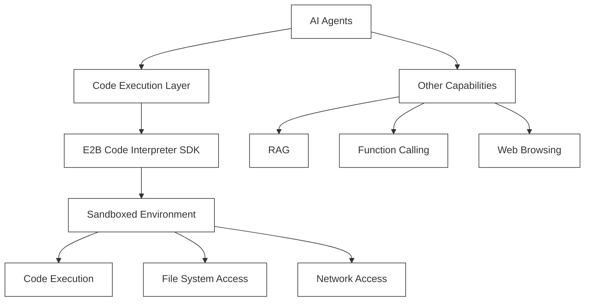
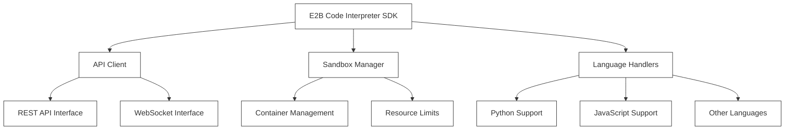
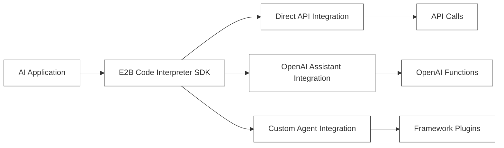
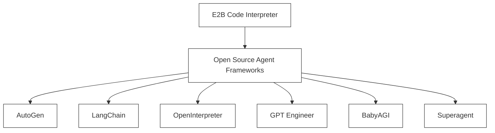
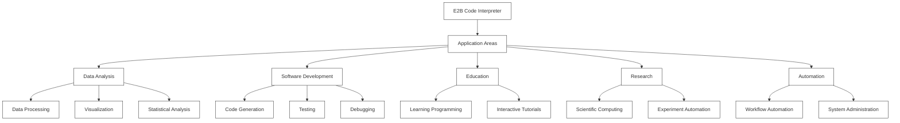

<!-- source: DeepWiki mcp.deepwiki.com · repo e2b-dev/awesome-ai-agents · page 4 E2B Resources and Integration · fetched 2026-10-29 -->

# E2B Resources and Integration

Relevant source files

The following files were used as context for generating this wiki page:

- [README.md](README.md)
- [assets/footer.png](assets/footer.png)

This document provides an overview of the resources offered by E2B, the maintainer of the Awesome AI Agents repository, and explains how their tools can be integrated with various AI agent frameworks. E2B focuses on providing a Code Interpreter service that enables AI agents to execute code in a secure, sandboxed environment.

## Overview of E2B

E2B is a company building infrastructure for AI agents, with a focus on providing tools for code interpretation and execution. Their primary offering is the E2B Code Interpreter SDK, which allows developers to add code execution capabilities to their AI applications.

### E2B's Role in the AI Agent Ecosystem

**Diagram: E2B in the AI Agent Ecosystem**

E2B provides a critical layer in the AI agent stack, enabling code execution in a secure, sandboxed environment. This allows AI agents to write and execute code as part of their workflow, expanding their capabilities beyond simple text generation.

Sources: [README.md:37-40](), [README.md:65-69]()

## E2B Code Interpreter SDK

The E2B Code Interpreter SDK is a tool that allows developers to add code execution capabilities to their AI applications. It provides a secure, sandboxed environment for executing code, making it safe to use in production applications.

### Architecture and Components

**Diagram: E2B Code Interpreter Architecture**

The E2B Code Interpreter SDK consists of several key components:

- **API Client**: Handles communication with the E2B backend services
- **Sandbox Manager**: Manages the lifecycle of sandboxed environments
- **Language Handlers**: Provides language-specific functionality for code execution

### Features and Capabilities

- Secure code execution in a sandboxed environment
- Support for multiple programming languages
- File system access within the sandbox
- Network access (configurable)
- Resource limiting (CPU, memory, etc.)
- Easy integration with existing AI applications

Sources: [README.md:66]()

### Integration Methods

**Diagram: E2B Integration Methods**

There are several ways to integrate the E2B Code Interpreter with your AI application:

1. **Direct API Integration**: Use the E2B API directly to execute code in a sandboxed environment.
2. **OpenAI Assistant Integration**: Integrate E2B with OpenAI Assistants to enable code execution, as mentioned in the README where E2B is described as powering OpenAI Assistants.
3. **Custom Agent Integration**: Build your own agent framework that uses E2B for code execution.

Sources: [README.md:1487-1488]()

## E2B Cookbook and Examples

The [E2B Cookbook](https://github.com/e2b-dev/e2b-cookbook) is a repository of examples demonstrating how to use the E2B Code Interpreter in various scenarios. It provides practical code samples and tutorials to help developers get started with E2B.

### Key Examples

| Example Type | Description |
|---------|-------------|
| Basic Code Execution | Simple examples of executing code using the E2B SDK |
| File System Access | Examples of reading and writing files within the sandbox |
| Network Access | Examples of making network requests from within the sandbox |
| OpenAI Assistant Integration | Examples of integrating E2B with OpenAI Assistants |
| Custom Agent Integration | Examples of building custom agents that use E2B for code execution |

Sources: [README.md:67]()

## Integration with AI Agent Frameworks

E2B's Code Interpreter can be integrated with various AI agent frameworks, both open source and closed source.

### Open Source Integration

**Diagram: E2B Integration with Open Source Frameworks**

E2B can be integrated with popular open source agent frameworks:

1. **AutoGen**: Use E2B for code execution in AutoGen agents
2. **LangChain**: Use E2B as a tool in LangChain agents
3. **OpenInterpreter**: Enhance OpenInterpreter with E2B's secure sandbox
4. **GPT Engineer**: Integrate E2B with GPT Engineer for secure code generation and execution
5. **BabyAGI**: Add code execution capabilities to BabyAGI agents
6. **Superagent**: The README explicitly mentions that E2B integrates with Superagent

Sources: [README.md:634-635]()

### Closed Source Integration

E2B also integrates with closed source AI platforms and services, including OpenAI Assistants. As mentioned in the README: "E2B powers OpenAI Assistants."

Sources: [README.md:634-635]()

## Real-World Applications

The integration of E2B's Code Interpreter with AI agents enables a wide range of applications:

**Diagram: E2B Application Areas**

With E2B's Code Interpreter, AI agents can execute code for various purposes, making them more capable and versatile.

## Getting Started with E2B

To get started with E2B, follow these steps:

1. Visit the [E2B documentation](https://e2b.dev/docs) to learn about the Code Interpreter SDK
2. Explore examples in the [E2B Cookbook](https://github.com/e2b-dev/e2b-cookbook)
3. Sign up for an API key at [e2b.dev](https://e2b.dev)
4. Install the E2B SDK for your platform
5. Integrate the E2B SDK with your AI application following the documentation

Sources: [README.md:66-68]()

### Contact Information

For more information about E2B, contact the team at:

- Email: hello@e2b.dev
- Discord: [E2B Discord](https://discord.gg/35NF4Y8WSE)
- Twitter: [@e2b](https://twitter.com/e2b)

Sources: [README.md:69]()

## E2B and the Awesome AI Agents Repository

E2B maintains the Awesome AI Agents repository as a comprehensive resource for the AI agent ecosystem. The repository includes:

1. A curated list of open-source AI agent projects
2. A curated list of closed-source AI agent projects and companies
3. A web interface for filtering agents by categories and use cases

As the maintainer of this repository, E2B contributes to the AI agent community by providing a central resource for discovering and comparing different AI agent solutions.

Sources: [README.md:25-53]()

## E2B Integration Examples in the Repository

Several projects in the Awesome AI Agents repository integrate with E2B:

1. **GPT Discord**: "Featuring code execution and environment manipulation by E2B"
2. **OpenAI Assistants**: "E2B powers OpenAI Assistants"
3. **Superagent**: "E2B integrates with Superagent"

These integrations demonstrate the versatility and utility of E2B's Code Interpreter in different AI agent contexts.

Sources: [README.md:1487-1488](), [README.md:634-635]()