# Page: Overview

# Overview

<details>
<summary>Relevant source files</summary>

The following files were used as context for generating this wiki page:

- [README.md](README.md)
- [assets/landscape-latest.png](assets/landscape-latest.png)

</details>


The Awesome AI Agents repository serves as a comprehensive curated list of AI agents, categorized into open-source and closed-source projects. This collection provides a valuable resource for researchers, developers, and organizations interested in implementing or working with AI agents. The repository aims to help users discover, compare, and select AI agents for various use cases.

For details about specific categories of AI agents, see [AI Agent Categories](#1.1). For information on how to contribute to the repository, see [How to Contribute](#1.2).

## Repository Structure and Organization

The repository is primarily organized around the README.md file, which contains the curated list of AI agents with detailed descriptions and categorizations.

**Repository Organization Diagram**
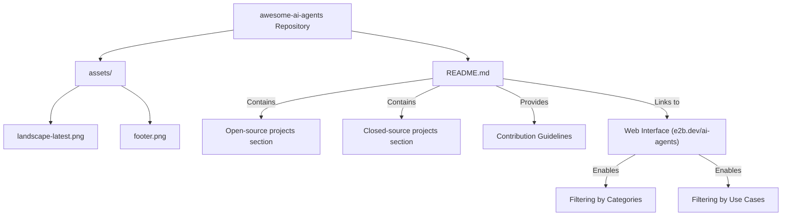

Sources: [README.md:1-53]()

## AI Agent Categories and Types

The repository categorizes AI agents into several functional categories, each addressing different use cases and capabilities.

**AI Agent Categories Diagram**
```mermaid
graph TD
    AIAgents["AI Agents in README.md"] --> GeneralPurpose["General Purpose"]
    AIAgents --> Coding["Coding/Development"]
    AIAgents --> Research["Research/Data Analysis"]
    AIAgents --> BuildYourOwn["Build-your-own Frameworks"]
    AIAgents --> Productivity["Productivity"]
    AIAgents --> MultiAgent["Multi-agent Systems"]
    
    GeneralPurpose --> AutoGPT["AutoGPT"]
    GeneralPurpose --> BabyAGI["BabyAGI"]
    GeneralPurpose --> GPTResearcher["GPT Researcher"]
    
    Coding --> Aider["Aider"]
    Coding --> GPTEngineer["GPT Engineer"]
    Coding --> Continue["Continue"]
    Coding --> OpenInterpreter["Open Interpreter"]
    
    Research --> ChemCrow["ChemCrow"]
    Research --> LocalGPT["LocalGPT"]
    Research --> PrivateGPT["PrivateGPT"]
    
    BuildYourOwn --> AutoGen["AutoGen"]
    BuildYourOwn --> CrewAI["CrewAI"]
    BuildYourOwn --> Flowise["Flowise"]
    
    Productivity --> CalAI["Cal.ai"]
    Productivity --> BeeBot["BeeBot"]
    
    MultiAgent --> ChatDev["ChatDev"]
    MultiAgent --> MetaGPT["MetaGPT"]
    MultiAgent --> AgentVerse["AgentVerse"]
```

Sources: [README.md:45-58](), [README.md:70-123]()

## Notable AI Agent Families

The repository features several notable AI agent families, with the BabyAGI family representing a significant evolution in AI agent frameworks. Each derivative adds specific capabilities that extend the functionality of the original framework.

**BabyAGI Family Evolution Diagram**
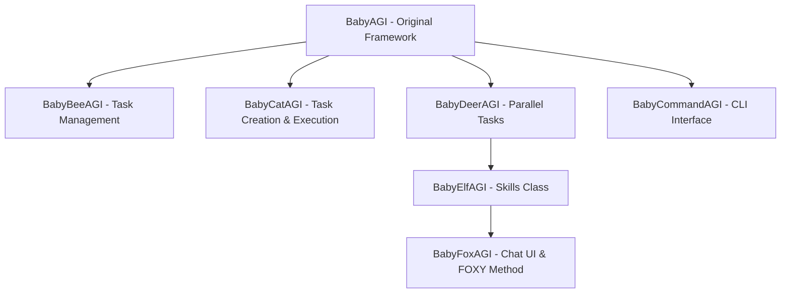

Sources: [README.md:477-503](), [README.md:506-530](), [README.md:533-568](), [README.md:570-598](), [README.md:600-623](), [README.md:651-682]()

## AI Agent Frameworks

The repository includes various AI agent frameworks with different capabilities and use cases. These frameworks can be broadly categorized into multi-agent frameworks, agent building platforms, and code execution systems.

**AI Agent Frameworks Diagram**
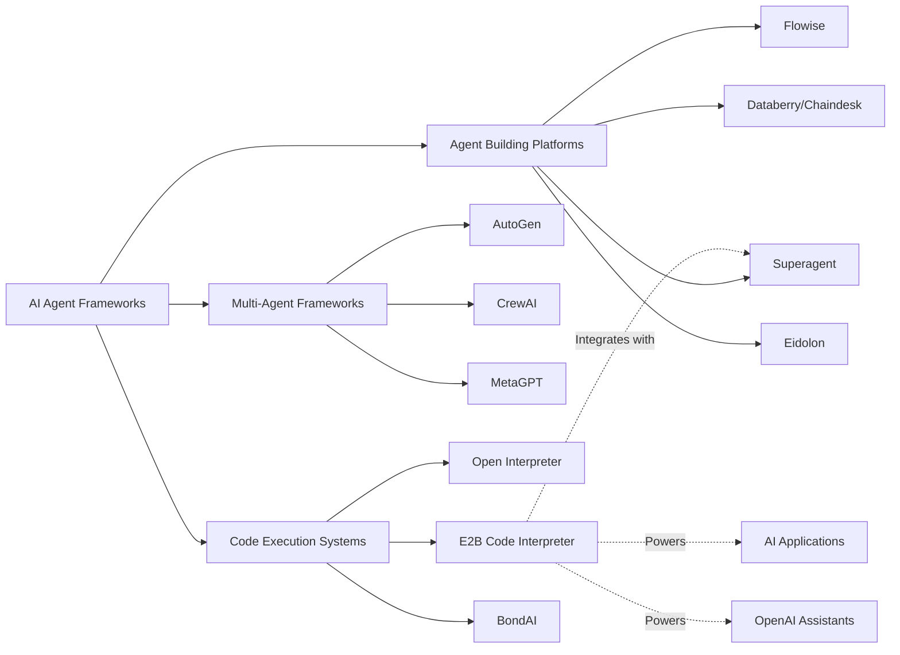

Sources: [README.md:323-346](), [README.md:1065-1089](), [README.md:2045-2071](), [README.md:1379-1398](), [README.md:1127-1161](), [README.md:1292-1313](), [README.md:2276-2297](), [README.md:65-69](), [README.md:784-814]()

## User Interaction and Contribution

The repository provides multiple ways for users to interact with the content and contribute to its growth.

**User Interaction Flow Diagram**
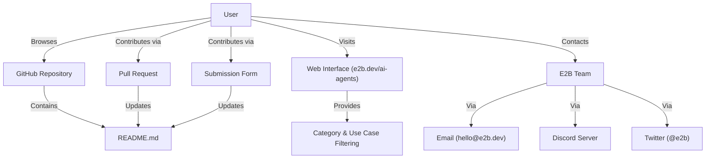

Sources: [README.md:40-41](), [README.md:50](), [README.md:55-58](), [README.md:65-69]()

## E2B Resources and Integration

The repository is maintained by the team behind E2B, which is building infrastructure for AI agents. E2B provides several resources that support the development and deployment of AI agents.

**E2B Resources Diagram**
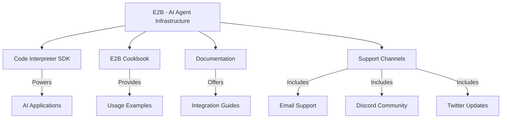

Sources: [README.md:65-69]()

## Conclusion

The Awesome AI Agents repository serves as a comprehensive resource hub for those interested in AI agents. By categorizing a wide range of agents and providing detailed information about each, it helps users navigate the rapidly evolving AI agent landscape. The repository's web interface and contribution guidelines make it an accessible and community-driven resource.

---

# Page: AI Agent Categories

# AI Agent Categories

<details>
<summary>Relevant source files</summary>

The following files were used as context for generating this wiki page:

- [README.md](README.md)
- [assets/landscape-latest.png](assets/landscape-latest.png)

</details>


This page explains the different categories of AI agents featured in the Awesome AI Agents repository. Understanding these categories helps users navigate the repository and find agents that best suit their specific needs. For information on how to contribute new agents to the repository, see [How to Contribute](#1.2).

## Overview of Categories

AI agents in the repository are organized into several primary categories based on their functionality, domain focus, and implementation approach. Many agents fit into multiple categories, as they often serve various purposes or can be used in different ways.

### Primary Agent Categories

```mermaid
graph TD
    Root["AI Agent Categories"] --> GP["General Purpose"]
    Root --> CD["Coding/Development"]
    Root --> RD["Research/Data Analysis"]
    Root --> BY["Build-your-own Frameworks"]
    Root --> MA["Multi-agent Systems"]
    Root --> SP["Specialized Purpose"]
    
    GP --> GP1["AutoGPT"]
    GP --> GP2["BabyAGI"]
    GP --> GP3["GPT Researcher"]
    
    CD --> CD1["Aider"]
    CD --> CD2["GPT Engineer"]
    CD --> CD3["Continue"]
    CD --> CD4["Open Interpreter"]
    CD --> CD5["DevOpsGPT"]
    
    RD --> RD1["ChemCrow"]
    RD --> RD2["Julius"]
    RD --> RD3["Kadoa"]
    RD --> RD4["PrivateGPT"]
    
    BY --> BY1["AutoGen"]
    BY --> BY2["CrewAI"]
    BY --> BY3["Superagent"]
    BY --> BY4["Flowise"]
    
    SP --> SP1["Cal.ai"]
    SP --> SP2["Lindy"]
    SP --> SP3["Heymoon.ai"]
    
    MA --> MA1["ChatDev"]
    MA --> MA2["MetaGPT"]
    MA --> MA3["AgentVerse"]
```

Sources: [README.md:42-51]()

## General Purpose Agents

General purpose agents are designed to handle a wide variety of tasks without specializing in a particular domain. They typically have capabilities to:

- Process natural language instructions into actionable plans
- Execute multiple types of tasks
- Browse the web or interact with various tools
- Maintain memory of previous interactions
- Make autonomous decisions based on their goals

Examples include:

| Agent | Description | Key Features |
|-------|-------------|--------------|
| AutoGPT | Experimental autonomous agent | Chains LLM "thoughts", internet access, memory management |
| BabyAGI | Task-driven autonomous agent | Creates tasks based on results of previous tasks and predefined objectives |
| AgentGPT | Browser-based no-code version of AutoGPT | Web UI, accessible to non-programmers |
| Godmode | Web-based agent platform | Market analysis, negotiating, order fulfillment |
| Mini AGI | Minimal agent based on GPT-3.5/GPT-4 | Inner monologue, self-criticism, minimal toolset |

Sources: [README.md:342-387](), [README.md:468-502](), [README.md:142-180](), [README.md:1446-1470](), [README.md:2072-2094]()

## Coding/Development Agents

Coding and development agents assist with software development tasks, including:

- Writing code based on requirements
- Debugging existing code
- Refactoring and optimizing codebases
- Managing repositories and version control
- Understanding large codebases

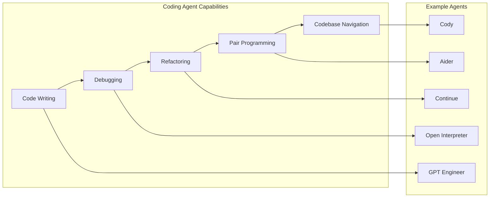

Notable coding agents include:

- **Aider**: Command-line tool for pair programming with GPT, making edits directly to files in a Git repository [README.md:281-302]()
- **GPT Engineer**: Generates entire codebases from natural language prompts [README.md:1499-1526]()
- **Continue**: Open-source autopilot for software development in VS Code [README.md:1039-1063]()
- **Open Interpreter**: Code interpreter that executes code locally to complete tasks [README.md:2276-2297]()
- **DevOpsGPT**: AI-driven software development automation solution [README.md:1243-1269]()

Sources: [README.md:281-302](), [README.md:1499-1526](), [README.md:1039-1063](), [README.md:2276-2297](), [README.md:1243-1269]()

## Research/Data Analysis Agents

Research and data analysis agents help gather, process, and synthesize information. They typically:

- Search the internet for information
- Process and analyze documents
- Extract insights from data
- Generate reports and summaries
- Answer questions based on research

Key examples include:

| Agent | Focus | Capabilities |
|-------|-------|--------------|
| GPT Researcher | General research | Internet search, factual reporting, customizable focus |
| ChemCrow | Chemistry | Chemical tasks, integrates 13 expert-design tools |
| Local GPT | Privacy-focused | Document interaction without data leaving your device |
| BambooAI | Data exploration | Non-programmers can perform data analysis |
| PrivateGPT | Private document search | Chat with documents while maintaining privacy |

Sources: [README.md:1579-1603](), [README.md:939-959](), [README.md:1825-1853](), [README.md:686-712]()

## Build-your-own Frameworks

Build-your-own frameworks provide infrastructure and tools for creating custom AI agents. These frameworks offer:

- Components for agent construction
- Tools for managing agent interactions
- Memory and knowledge management
- Interfaces for user interaction
- Extensibility for custom functionality

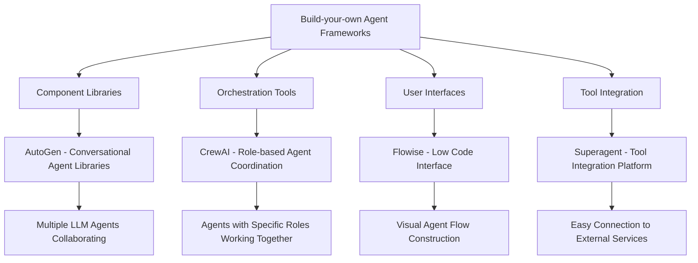

Notable frameworks include:

- **AutoGen**: Microsoft framework for building applications with multiple conversational agents [README.md:323-345]()
- **CrewAI**: Framework for orchestrating role-playing autonomous agents [README.md:1065-1089]()
- **Flowise**: Low-code tool for building LLM orchestration flows and AI agents [README.md:1379-1398]()
- **Databerry/Chaindesk**: No-code platform for creating AI chatbots trained on custom data [README.md:1127-1161]()
- **LLM Stack**: No-code platform to build LLM Agents, workflows and applications [README.md:1798-1823]()

Sources: [README.md:323-345](), [README.md:1065-1089](), [README.md:1379-1398](), [README.md:1127-1161](), [README.md:1798-1823]()

## Multi-agent Systems

Multi-agent systems involve multiple AI agents working together to solve complex tasks. These systems feature:

- Agents with different roles and capabilities
- Communication protocols between agents
- Coordination mechanisms for complex tasks
- Emergent behavior from agent interactions
- Specialized frameworks for multi-agent deployment

Important multi-agent systems include:

- **ChatDev**: Virtual software company with agents as CEO, CPO, CTO, programmer, etc. [README.md:915-936]()
- **MetaGPT**: Multi-agent framework that assigns different roles for collaborative software development [README.md:2045-2071]()
- **AgentVerse**: Platform for multi-agent collaboration and emergent behavior exploration [README.md:237-256]()
- **Multiagent Debate**: System where agents debate to improve factuality and reasoning [README.md:2097-2118]()

Sources: [README.md:915-936](), [README.md:2045-2071](), [README.md:237-256](), [README.md:2097-2118]()

## Specialized Purpose Agents

Specialized purpose agents focus on specific domains or tasks:

### Productivity Agents
- **Cal.ai**: Open-source scheduling assistant built on Cal.com [README.md:839-857]()
- **BabyBeeAGI**: Task management and functionality expansion on top of BabyAGI [README.md:506-531]()
- **Lemon Agent**: Plan-Validate-Solve agent for workflow automation [README.md:1748-1772]()

### Science and Domain-Specific Agents
- **ChemCrow**: LangChain agent for chemistry-related tasks [README.md:939-959]()
- **Autonomous HR Chatbot**: Agent that answers HR-related queries [README.md:450-475]()
- **NLSOM**: Natural Language-Based Societies of Mind for scientific tasks [README.md:2174-2196]()

### Business and Enterprise Agents
- **CodeFuse-ChatBot**: Agent serving the entire software development lifecycle [README.md:983-998]()
- **GeniA**: Engineering platform engineering AI team member [README.md:1425-1444]()

Sources: [README.md:839-857](), [README.md:506-531](), [README.md:1748-1772](), [README.md:939-959](), [README.md:450-475](), [README.md:2174-2196](), [README.md:983-998](), [README.md:1425-1444]()

## Category Implementation in the Repository

The Awesome AI Agents repository implements categorization through structured entries in the README.md file:

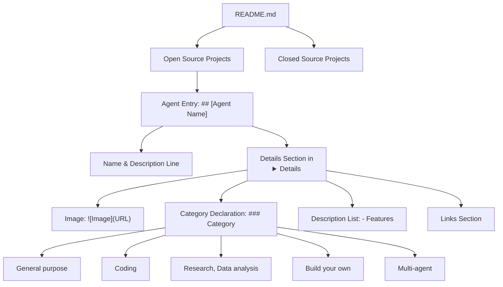

The web interface at [e2b.dev/ai-agents](https://e2b.dev/ai-agents) allows users to filter agents by these categories for easier discovery.

Sources: [README.md:40-41](), [README.md:50-51](), [README.md:71-134]()

## Capability Spectrum Across Categories

AI agents in the repository span a spectrum of capabilities, from focused single-task execution to fully autonomous decision-making:

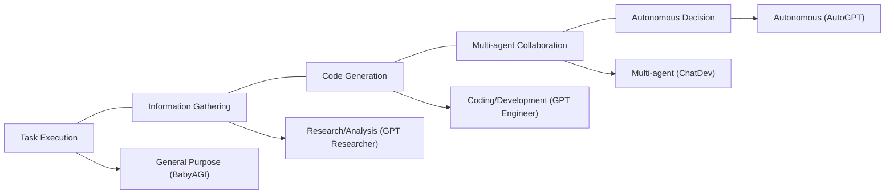

This spectrum helps users understand the level of autonomy and complexity each agent category typically provides.

Sources: [README.md:342-387](), [README.md:1579-1603](), [README.md:1499-1526](), [README.md:915-936](), [README.md:468-502]()

## Cross-Category Agents

Many agents in the repository span multiple categories, combining capabilities from different domains. Some notable examples:

| Agent | Categories | Description |
|-------|------------|-------------|
| AutoGen | Build-your-own, Multi-agent | Framework for developing applications with multiple conversational agents |
| GPT Researcher | General purpose, Research | Autonomous agent that researches topics comprehensively |
| DevOpsGPT | Coding, Business | AI-driven software development automation for enterprise |
| MetaGPT | Multi-agent, Coding | Role-based agents collaborating on software development |
| OpenDevin | Coding, General purpose | Open-source alternative to Devin coding agent |

The combination of categories reflects the versatility of modern AI agents and the increasingly blurred boundaries between specialized functions.

Sources: [README.md:323-345](), [README.md:1579-1603](), [README.md:1243-1269](), [README.md:2045-2071](), [README.md:2256-2273]()

## Conclusion

The categorization of AI agents provides a useful framework for understanding the diverse capabilities and purposes of agents in the Awesome AI Agents repository. As the field evolves, new categories may emerge, and existing ones may be refined. The repository maintains an up-to-date categorization to help users navigate the growing landscape of AI agents.

For information on how specific agent families have evolved, particularly the BabyAGI family, see [BabyAGI Family](#3.1).

---

# Page: How to Contribute

# How to Contribute

<details>
<summary>Relevant source files</summary>

The following files were used as context for generating this wiki page:

- [README.md](README.md)

</details>


This document outlines the process for contributing to the Awesome AI Agents list, a curated collection of AI agents categorized into open-source and closed-source projects. We welcome contributions from the community to help maintain this comprehensive resource. For information about AI agent categories featured in the repository, see [AI Agent Categories](#1.1).

## Overview of Contribution Process

There are two main ways to contribute to the Awesome AI Agents list:

1. Create a pull request on GitHub
2. Fill out the submission form

Both methods are reviewed by the repository maintainers before being merged into the main list.

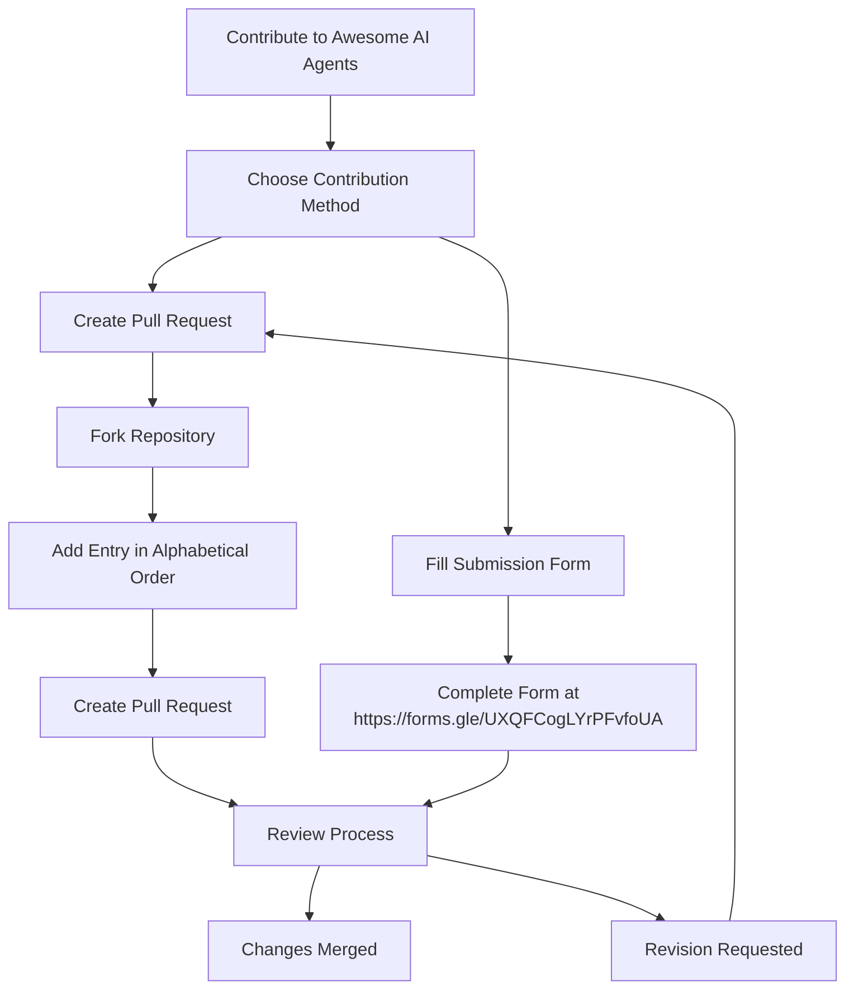

Sources: [README.md:55-58]()

## General Contribution Guidelines

Before submitting your contribution, please ensure you follow these guidelines:

1. Your submission should be an AI agent or assistant, not an SDK or framework
2. Place your entry in alphabetical order within the correct category (open-source or closed-source)
3. Follow the established format for entries (see below)
4. For SDKs, frameworks, and tools related to AI agents, contribute to the separate [Awesome SDKs for AI Agents](https://github.com/e2b-dev/awesome-sdks-for-ai-agents) repository instead

Sources: [README.md:55-58]()

## Repository Structure

The Awesome AI Agents repository is primarily organized around the README.md file, which contains the curated list of AI agents. Understanding its structure will help you place your contribution correctly.

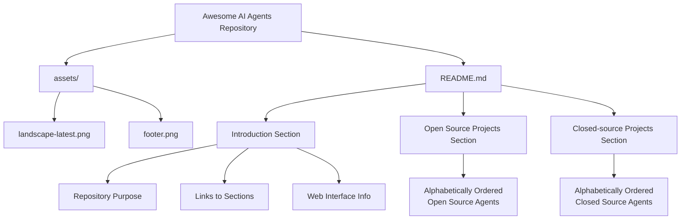

Sources: [README.md:24-69]()

## Submitting via Pull Request

Contributing via pull request gives you the most control over how your entry appears in the list. Follow these steps:

1. **Fork the repository**: Go to the [Awesome AI Agents](https://github.com/e2b-dev/awesome-ai-agents) GitHub page and click the "Fork" button in the top right
2. **Clone your fork**: Clone your forked repository to your local machine
3. **Make your changes**: Add your entry to the README.md file in the correct section and in alphabetical order
4. **Commit and push**: Commit your changes and push them to your forked repository
5. **Create a pull request**: Go to the original repository and click "New Pull Request" to submit your changes for review

When adding your entry, follow the established format as shown in the diagram below:

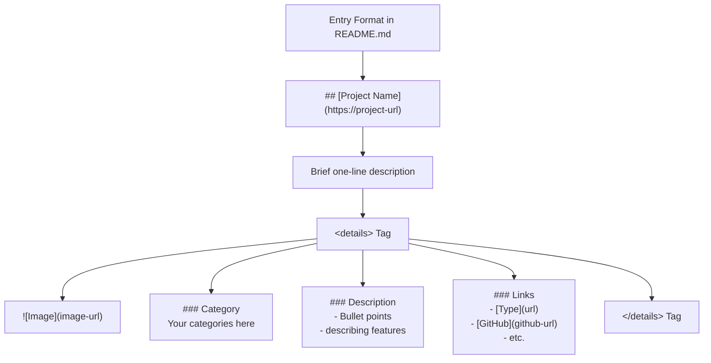

Sources: [README.md:70-100]()

## Example Entry Format

Here's an example of how an entry should be formatted in the README.md file:

```
## [Your Agent](https://your-agent-url)
Brief description of your agent

<details>


### Category
General purpose, Build your own, Multi-agent

### Description
- First key feature of your agent
- Second key feature of your agent
- Third key feature of your agent

### Links
- [Website](https://your-agent-website)
- [GitHub](https://github.com/your-username/your-agent)
- [Documentation](https://docs.your-agent.com)
- [Twitter](https://twitter.com/your-agent)

</details>
```

Sources: [README.md:70-100](), [README.md:183-207]()

## Submitting via Form

If you prefer not to use GitHub, you can submit your AI agent through the submission form:

1. Go to the [submission form](https://forms.gle/UXQFCogLYrPFvfoUA)
2. Fill out all the required information about your agent
3. Submit the form for review

The repository maintainers will review your submission and add it to the list if it meets the guidelines.

Sources: [README.md:55-58](), [README.md:40-41]()

## Entry Requirements and Best Practices

For your entry to be accepted, it should include the following key components:

| Component | Description | Required? |
|-----------|-------------|-----------|
| Name | Your AI agent's name | Required |
| URL | Link to your agent's website or repository | Required |
| Brief Description | One-line summary of what your agent does | Required |
| Image | Visual representation of your agent | Recommended |
| Category | Types of tasks your agent performs | Required |
| Detailed Description | Bullet points of features/capabilities | Required |
| Links | Additional resources (GitHub, docs, social) | Required |

When writing your description:
- Focus on the unique features and capabilities of your agent
- Use bullet points for readability
- Be concise but informative
- Highlight what makes your agent different from others

Sources: [README.md:70-100](), [README.md:183-207]()

## Categories for AI Agents

When adding your agent, you should specify the appropriate categories in the "Category" section. Common categories include:

- General purpose
- Coding/Development
- Research/Data Analysis
- Build-your-own Frameworks
- Productivity
- Multi-agent Systems
- Personal assistant
- Business intelligence
- Content creation
- Finance
- Marketing
- Sales
- Design
- Science

You can include multiple categories if your agent spans different domains.

Sources: [README.md:70-100](), [README.md:183-207]()

## Post-Submission Process

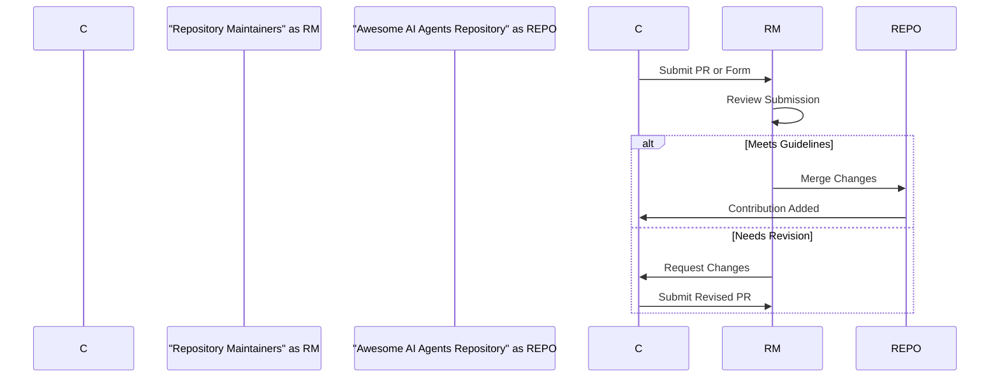

After you submit your contribution:

1. The repository maintainers will review your submission
2. If it meets all guidelines, it will be merged into the main repository
3. If revisions are needed, you'll be notified of the required changes
4. Once accepted, your agent will appear in both the GitHub repository and the web interface at [e2b.dev/ai-agents](https://e2b.dev/ai-agents)

Sources: [README.md:40-53]()

## Additional Resources

- [Awesome SDKs for AI Agents](https://github.com/e2b-dev/awesome-sdks-for-ai-agents): For contributing AI agent SDKs, frameworks, and tools
- [Web version of the list](https://e2b.dev/ai-agents): To see the current list with filtering capabilities
- For questions or additional help, you can contact the team at [hello@e2b.dev](mailto:hello@e2b.dev) or join their [Discord](https://discord.gg/35NF4Y8WSE)

Sources: [README.md:52-68]()

---

# Page: AI Agent Frameworks

# AI Agent Frameworks

<details>
<summary>Relevant source files</summary>

The following files were used as context for generating this wiki page:

- [README.md](README.md)
- [assets/landscape-latest.png](assets/landscape-latest.png)

</details>


This page provides a technical overview of the major AI agent frameworks in the [Awesome AI Agents](https://github.com/e2b-dev/awesome-ai-agents) repository. It examines the architecture, components, and capabilities of various frameworks that enable the creation and orchestration of autonomous AI agents. For detailed information about specific framework categories, see [Multi-Agent Frameworks](#2.1), [Agent Building Platforms](#2.2), and [Code Execution Systems](#2.3).

## Classification of AI Agent Frameworks

AI agent frameworks can be categorized into three primary types based on their core functionality and design approach:

### Framework Taxonomy

AI Agent Frameworks Taxonomy
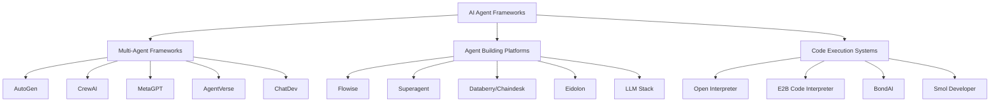

Sources: [README.md:323-346](), [README.md:1065-1089](), [README.md:237-256](), [README.md:915-937](), [README.md:2046-2071](), [README.md:1382-1398](), [README.md:1127-1161](), [README.md:2276-2298](), [README.md:784-815](), [README.md:1798-1823]()

1. **Multi-Agent Frameworks**: Systems designed to coordinate multiple specialized agents working together on complex tasks. Examples include:
   - **AutoGen**: Enables collaborative problem-solving with multiple conversational agents
   - **CrewAI**: Provides role-playing agents with distinct personas
   - **MetaGPT**: Transforms requirements into software artifacts via agent collaboration
   - **ChatDev**: Virtual software company with specialized agent roles

2. **Agent Building Platforms**: Tools that simplify the creation of custom agents with minimal coding. Examples include:
   - **Flowise**: Low-code platform for building AI workflows and agents
   - **Superagent**: No-code agent building with tool integrations
   - **Databerry/Chaindesk**: Platform for chatbots trained on custom data
   - **LLM Stack**: No-code platform for building LLM agents and workflows

3. **Code Execution Systems**: Frameworks enabling agents to write and execute code securely. Examples include:
   - **Open Interpreter**: Lets LLMs execute code locally with user permission
   - **E2B Code Interpreter**: Provides sandboxed environments for secure code execution
   - **BondAI**: Code interpreter with CLI and API interfaces

## Core Components of AI Agent Frameworks

Most agent frameworks share several foundational components, though their implementation details vary significantly:

### Common Architecture Components

AI Agent Framework Architecture
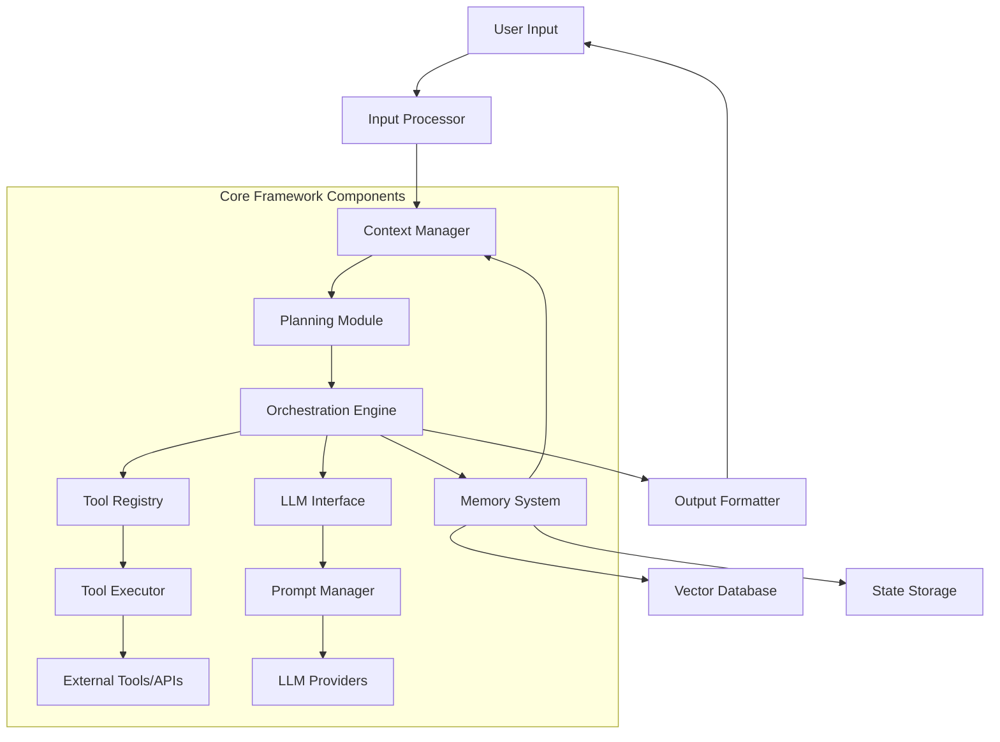

Sources: [README.md:323-346](), [README.md:1065-1089](), [README.md:1712-1746]()

1. **LLM Integration Layer**
   - Connects to LLM providers (OpenAI, Anthropic, open-source models)
   - Manages context windows and token limits
   - Implements specialized prompting techniques (Chain-of-Thought, ReAct)

2. **Memory Systems**
   - **Short-term memory**: Session context management
   - **Long-term memory**: Persistent storage across sessions
   - **Vector storage**: Semantic search and retrieval capabilities
   - **Working memory**: Active information processing space

3. **Tool Integration**
   - Function calling mechanisms
   - API connector systems
   - File system access controls
   - Custom tool registries

4. **Orchestration Logic**
   - Task planning and decomposition
   - Decision-making algorithms
   - Error handling and retry mechanisms
   - Inter-agent communication protocols

## Implementation Details of Popular Frameworks

### AutoGen Framework Implementation

AutoGen Code Structure
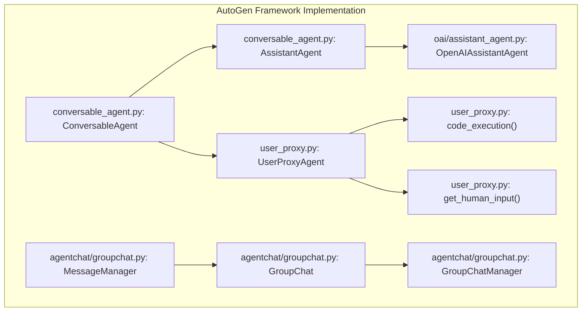

Sources: [README.md:323-346]()

AutoGen provides a framework for building applications with multiple conversational agents. Its core architecture is built around the `ConversableAgent` class, with specialized implementations like `AssistantAgent` and `UserProxyAgent`. The system enables multi-agent conversations through the `GroupChat` and `GroupChatManager` classes, which facilitate message routing and conversation state management.

### CrewAI Implementation Components

CrewAI Code Structure
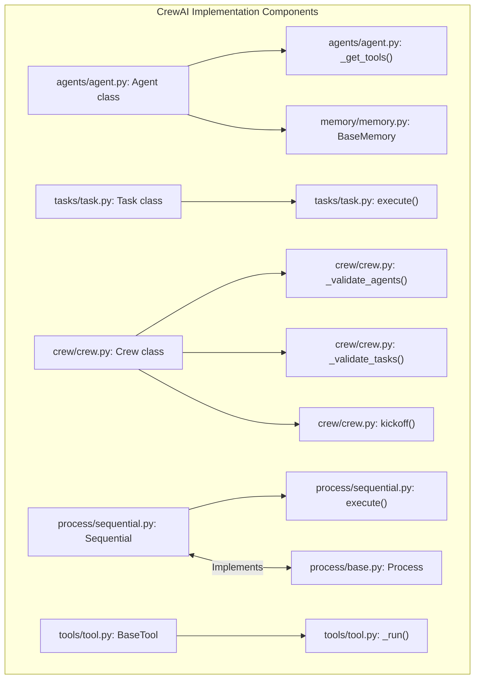

Sources: [README.md:1065-1089]()

CrewAI's architecture centers around role-playing agents organized into crews. The main components include:
- `Agent` class: Defines agent capabilities, role, and backstory
- `Task` class: Encapsulates work to be performed
- `Crew` class: Orchestrates agents and tasks
- `Process` class: Defines task execution flow (Sequential by default)
- `BaseTool` class: Enables interaction with external systems

## Framework Capabilities Comparison

Different frameworks offer varying capabilities, best suited for different use cases:

| Framework | Multi-Agent Support | No-Code Interface | Code Execution | Memory Management | Custom Tool Support |
|-----------|---------------------|-------------------|----------------|-------------------|---------------------|
| AutoGen   | ✅                  | ❌                | ✅             | ✅                | ✅                  |
| CrewAI    | ✅                  | ❌                | ✅             | ✅                | ✅                  |
| MetaGPT   | ✅                  | ❌                | ✅             | ✅                | ✅                  |
| AgentVerse| ✅                  | ❌                | ✅             | ✅                | ✅                  |
| Flowise   | ✅                  | ✅                | ✅             | ✅                | ✅                  |
| Superagent| ✅                  | ✅                | ✅             | ✅                | ✅                  |
| Databerry | ❌                  | ✅                | ❌             | ✅                | ❌                  |
| Open Interpreter | ❌            | ❌                | ✅             | ❌                | ❌                  |
| E2B       | ❌                  | ❌                | ✅             | ❌                | ❌                  |
| BondAI    | ❌                  | ❌                | ✅             | ✅                | ✅                  |

Sources: [README.md:323-346](), [README.md:1065-1089](), [README.md:2046-2071](), [README.md:1382-1398](), [README.md:1127-1161](), [README.md:2276-2298](), [README.md:784-815]()

## Framework Capability Domains

Framework Capability Domains
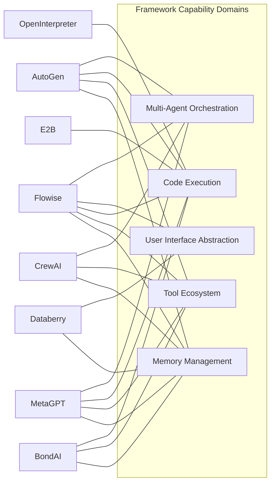

Sources: [README.md:323-346](), [README.md:1065-1089](), [README.md:2046-2071](), [README.md:1382-1398](), [README.md:1127-1161](), [README.md:2276-2298](), [README.md:784-815]()

## Integration and Interoperability

Many frameworks are designed to work together, creating an ecosystem of complementary tools:

### Ecosystem Connectivity

Framework Ecosystem Connectivity
```mermaid
graph TD
    subgraph "Multi-Agent Frameworks"
        AutoGen["AutoGen"]
        CrewAI["CrewAI"]
        MetaGPT["MetaGPT"]
    end
    
    subgraph "Agent Building Platforms"
        Flowise["Flowise"]
        Superagent["Superagent"]
    end
    
    subgraph "Code Execution Systems"
        OpenInterpreter["Open Interpreter"]
        E2B["E2B"]
    end
    
    subgraph "External Systems"
        LLMProviders["LLM Providers"]
        VectorDBs["Vector Databases"]
        APIs["External APIs"]
        FileStorage["File Storage"]
    end
    
    AutoGen <--> OpenInterpreter
    AutoGen <--> E2B
    AutoGen <--> LLMProviders
    AutoGen <--> VectorDBs
    
    CrewAI <--> LLMProviders
    CrewAI <--> VectorDBs
    CrewAI <--> APIs
    
    MetaGPT <--> LLMProviders
    MetaGPT <--> FileStorage
    
    Flowise <--> OpenInterpreter
    Flowise <--> LLMProviders
    Flowise <--> VectorDBs
    Flowise <--> APIs
    
    Superagent <--> E2B
    Superagent <--> LLMProviders
    Superagent <--> VectorDBs
    Superagent <--> APIs
    
    E2B <--> APIs
    OpenInterpreter <--> FileStorage
```

Sources: [README.md:323-346](), [README.md:1065-1089](), [README.md:2046-2071](), [README.md:1382-1398](), [README.md:2276-2298](), [README.md:784-815]()

Key integration patterns include:

1. **Framework-to-Framework Integration**
   - AutoGen + E2B: Secure code execution in multi-agent workflows
   - Flowise + Open Interpreter: Code execution in visual workflows
   - Superagent + Vector Databases: Enhanced knowledge retrieval

2. **External API Integration**
   - Authentication mechanisms for third-party services
   - Data transformation between different formats
   - Webhook support for event-driven architectures

3. **Plugin Systems**
   - Tool plugins extending agent capabilities
   - Model plugins for additional LLM providers
   - Connector plugins for external system integration

## Deployment Architectures

Typical Deployment Architecture
```mermaid
flowchart TD
    subgraph "Client Layer"
        WebClient["Web Client"]
        MobileClient["Mobile Client"]
        CLIClient["CLI Client"]
    end
    
    subgraph "API Gateway Layer"
        APIGateway["API Gateway"]
    end
    
    subgraph "Agent Framework Layer"
        AgentOrchestrator["Agent Orchestrator"]
        ToolRegistry["Tool Registry"]
        MemoryManager["Memory Manager"]
    end
    
    subgraph "Infrastructure Layer"
        LLMService["LLM Service"]
        VectorDB["Vector Database"]
        CodeExecutor["Code Executor"]
        FileStore["File Storage"]
    end
    
    WebClient --> APIGateway
    MobileClient --> APIGateway
    CLIClient --> APIGateway
    
    APIGateway --> AgentOrchestrator
    
    AgentOrchestrator --> ToolRegistry
    AgentOrchestrator --> MemoryManager
    
    ToolRegistry --> CodeExecutor
    MemoryManager --> VectorDB
    MemoryManager --> FileStore
    AgentOrchestrator --> LLMService
```

Sources: [README.md:323-346](), [README.md:1065-1089](), [README.md:2046-2071](), [README.md:1382-1398](), [README.md:2276-2298](), [README.md:784-815]()

## Implementation Considerations

When selecting and implementing an AI agent framework, consider the following factors:

### Selection Criteria

- **Use case alignment**: Match framework capabilities to specific requirements
- **Technical complexity**: Assess learning curve and development effort
- **Customization needs**: Evaluate flexibility and extensibility
- **Deployment environment**: Ensure compatibility with infrastructure
- **Cost considerations**: Factor API usage, hosting, and maintenance costs

### Performance Optimization

- **Token efficiency**: Optimize prompt designs to reduce token usage
- **Caching strategies**: Implement result caching to improve response times
- **Batching**: Group similar operations for reduced API calls
- **Fine-tuning**: Consider custom model fine-tuning for specialized domains
- **Resource allocation**: Balance CPU, memory, and network resources

### Scaling Challenges

- **Horizontal scaling**: Add more instances to handle increased load
- **Vertical scaling**: Increase resources for each instance
- **Cost management**: Control LLM API usage at scale
- **Reliability**: Ensure consistent performance under load
- **Monitoring**: Track performance metrics and detect issues

## Emerging Trends and Future Directions

The AI agent framework landscape continues to evolve rapidly with several key trends:

1. **Framework convergence**: Cross-adoption of successful patterns
2. **Domain specialization**: Frameworks optimized for specific use cases
3. **Enhanced interoperability**: Standardized interfaces between frameworks
4. **Reduced complexity**: More accessible interfaces for non-technical users
5. **Performance optimization**: Improved efficiency and reduced operational costs
6. **Local model support**: Increased focus on running models on-premises
7. **Improved reasoning capabilities**: More sophisticated planning and decision-making

## Conclusion

AI agent frameworks provide the foundation for building increasingly sophisticated autonomous systems. By understanding the architecture, capabilities, and implementation considerations of different frameworks, developers can select the most appropriate tools for their specific use cases and requirements.

The modular nature of many frameworks allows for mixing and matching components to create customized agent systems. As the field continues to mature, we can expect further advancements in multi-agent collaboration, reasoning capabilities, and tool integration, enabling even more powerful and flexible AI agent applications.

Sources: [README.md:323-346](), [README.md:1065-1089](), [README.md:2046-2071](), [README.md:1382-1398](), [README.md:1127-1161](), [README.md:2276-2298](), [README.md:784-815]()

---

# Page: Multi-Agent Frameworks

# Multi-Agent Frameworks

<details>
<summary>Relevant source files</summary>

The following files were used as context for generating this wiki page:

- [README.md](README.md)

</details>


This document provides a comprehensive overview of multi-agent frameworks found in the Awesome AI Agents repository. Multi-agent frameworks enable the coordination of multiple AI agents working together to solve complex tasks. Unlike single-agent systems, these frameworks leverage collaborative intelligence and agent specialization to tackle problems more effectively.

For information about tools for building your own agents without multi-agent capabilities, see [Agent Building Platforms](#2.2).

## Introduction to Multi-Agent Frameworks

Multi-agent frameworks coordinate multiple specialized AI agents, each with different roles or capabilities, to collaboratively solve complex problems. By distributing tasks among specialized agents, these frameworks can tackle more challenging problems than single-agent systems.

```mermaid
graph TD
    A["Multi-Agent Framework"] --> B["Multiple Specialized Agents"]
    A --> C["Communication Protocols"]
    A --> D["Coordination Mechanisms"]
    A --> E["Task Distribution"]
    
    B --> B1["Agent 1 (Specialized Role)"]
    B --> B2["Agent 2 (Specialized Role)"]
    B --> B3["Agent n (Specialized Role)"]
    
    C --> C1["Direct Messaging"]
    C --> C2["Broadcast"]
    C --> C3["Shared Memory"]
    
    D --> D1["Centralized Coordination"]
    D --> D2["Decentralized Coordination"]
    D --> D3["Market-based Mechanisms"]
    
    E --> E1["Task Decomposition"]
    E --> E2["Role-based Assignment"]
    E --> E3["Dynamic Allocation"]
```

Sources: README.md:326-346, README.md:1066-1089, README.md:239-256

## Key Multi-Agent Frameworks

### Framework Comparison

```mermaid
graph LR
    subgraph "Multi-Agent Frameworks in Awesome AI Agents"
        AutoGen["AutoGen (Microsoft)"]
        CrewAI["CrewAI (LangChain-based)"]
        AgentVerse["AgentVerse (OpenBMB)"]
        ChatDev["ChatDev (Virtual SW Company)"]
        MetaGPT["MetaGPT (SW Development)"]
    end
    
    AutoGen --> |Features| AG1["Multiple Conversational Agents"]
    AutoGen --> |Features| AG2["Human-Agent Collaboration"]
    AutoGen --> |Features| AG3["Advanced Usage Patterns"]
    
    CrewAI --> |Features| CR1["Role-Playing Agents"]
    CrewAI --> |Features| CR2["Modular Design"]
    CrewAI --> |Features| CR3["Agent Memory"]
    
    AgentVerse --> |Features| AV1["Custom Environments"]
    AgentVerse --> |Features| AV2["Agent Collaboration"]
    AgentVerse --> |Features| AV3["Emergent Behaviors"]
    
    ChatDev --> |Features| CD1["Virtual Company Roles"]
    ChatDev --> |Features| CD2["Structured Collaboration"]
    ChatDev --> |Features| CD3["SW Development Focus"]
    
    MetaGPT --> |Features| MG1["One-Line to Full Repo"]
    MetaGPT --> |Features| MG2["Multiple Internal Roles"]
    MetaGPT --> |Features| MG3["Standard Operating Procedures"]
```

Sources: README.md:326-346, README.md:1066-1089, README.md:239-256, README.md:914-936, README.md:2046-2072

### AutoGen

AutoGen is a Microsoft-developed framework that enables the development of LLM applications with multiple conversational agents. It supports agent collaboration, human-agent interaction, and offers various features to enhance LLM workflows.

Key features:
- Multiple agents collaborate to solve tasks and interact seamlessly with humans
- Simplifies complex LLM workflows, enhancing automation and optimization
- Offers working systems across various domains and complexities
- Improves LLM inference with performance tuning
- Supports advanced usage patterns including error handling and context programming

```mermaid
graph TD
    subgraph "AutoGen Framework Components"
        ConversableAgent["class ConversableAgent"]
        AssistantAgent["class AssistantAgent"]
        UserProxyAgent["class UserProxyAgent"]
        GroupChat["class GroupChat"]
        GroupChatManager["class GroupChatManager"]
    end
    
    ConversableAgent --> BaseMethods["Methods:
    - send()
    - receive()
    - generate_reply()
    - register_reply()"]
    
    AssistantAgent --> |"Inherits from"| ConversableAgent
    UserProxyAgent --> |"Inherits from"| ConversableAgent
    
    GroupChat --> GCMethods["Methods:
    - reset()
    - append_message()
    - activate_agent()"]
    
    GroupChatManager --> GCMMethods["Methods:
    - initiate_chat()
    - sequential_conversation()
    - register_agent()"]
    
    AssistantAgent --> AgentAPI["- LLM Integration
    - Tool Usage
    - Memory Management"]
    
    UserProxyAgent --> ProxyAPI["- Human Input
    - Code Execution
    - Function Calls"]
```

Sources: README.md:326-346

### CrewAI

CrewAI is a framework built on LangChain that focuses on role-playing agents, where each agent has a specific role, background story, goals, and memories. It emphasizes modularity and collaborative intelligence.

Key features:
- Orchestrates role-playing, autonomous AI agents
- Fosters collaborative intelligence to tackle complex tasks
- Built on LangChain with a focus on simplicity through modularity
- Each agent has specific roles, background stories, goals, and memories
- Makes the intricate world of AI agents accessible and manageable

```mermaid
graph TD
    subgraph "CrewAI Framework"
        Crew["class Crew"]
        Agent["class Agent"]
        Task["class Task"]
        Tool["class Tool"]
        Process["class Process"]
    end
    
    Crew --> CrewMethods["Methods:
    - kickoff()
    - create_crew()
    - add_agent()
    - assign_task()"]
    
    Agent --> AgentMethods["Methods:
    - execute_task()
    - with_memory()
    - with_tools()
    - with_role()"]
    
    Task --> TaskMethods["Methods:
    - create_task()
    - set_description()
    - set_expected_output()
    - with_context()"]
    
    Tool --> ToolMethods["Methods:
    - __call__()
    - register()
    - with_description()"]
    
    Process --> ProcessMethods["Methods:
    - sequential()
    - hierarchical()
    - consensus()"]
    
    Crew --> Agent
    Crew --> Process
    Agent --> Tool
    Agent --> Task
    Process --> Task
```

Sources: README.md:1066-1089

### AgentVerse

AgentVerse is a platform that assembles multiple agents to collaboratively accomplish tasks and allows custom environments for observing or interacting with multiple agents.

Key features:
- Assembles multiple agents for collaborative task accomplishment
- Provides custom environments for agent observation and interaction
- Facilitates multi-agent collaboration and exploring emergent behaviors
- Supports diverse frameworks for agent interaction

Sources: README.md:239-256

### ChatDev

ChatDev simulates a virtual software company with agents assuming different roles like CEO, programmer, reviewer, etc. These agents collaborate in a structured environment to develop software.

```mermaid
graph TD
    subgraph "ChatDev Virtual Company"
        CEO["CEO_Agent"]
        CPO["CPO_Agent"]
        CTO["CTO_Agent"]
        Programmer["Programmer_Agent"]
        Reviewer["Reviewer_Agent"]
        Tester["Tester_Agent"]
        Designer["ArtDesigner_Agent"]
    end
    
    CEO --> CPO
    CEO --> CTO
    CPO --> Programmer
    CTO --> Programmer
    Programmer --> Reviewer
    Reviewer --> Tester
    CPO --> Designer
    
    subgraph "Development_Process"
        Design["DesignPhase"]
        Coding["CodingPhase"]
        Testing["TestingPhase"]
        Documentation["DocumentationPhase"]
    end
    
    CPO --> Design
    Designer --> Design
    Design --> Coding
    CTO --> Coding
    Programmer --> Coding
    Coding --> Testing
    Tester --> Testing
    Testing --> Documentation
```

Key features:
- Virtual software company driven by multiple intelligent agents with distinct roles
- Agents collaborate in a structured organizational environment
- Focuses on design, coding, testing, and documentation phases
- Provides an accessible, modular, and extensible platform
- Allows extensive customization of the software development process

Sources: README.md:914-936

### MetaGPT

MetaGPT is a framework that simulates a software development workflow, assigning different roles to GPTs to form a collaborative entity for completing complex tasks.

```mermaid
graph TD
    subgraph "MetaGPT Workflow"
        Requirement["OneLineRequirement"]
        PM["ProductManager_Agent"]
        Architect["Architect_Agent"]
        ProjectMgr["ProjectManager_Agent"]
        Engineer["Engineer_Agent"]
        
        PRD["PRD_Document"]
        Design["Design_Document"]
        Tasks["Task_List"]
        Code["Code_Repository"]
    end
    
    Requirement --> PM
    PM --> PRD
    PRD --> Architect
    Architect --> Design
    Design --> ProjectMgr
    ProjectMgr --> Tasks
    Tasks --> Engineer
    Engineer --> Code
```

Key features:
- Given one line requirement, returns PRD, Design, Tasks, or Repo
- Assigns different roles to GPTs to form a collaborative software entity
- Outputs user stories, competitive analysis, requirements, data structures, APIs, etc.
- Includes internal roles like product managers, architects, project managers, and engineers
- Employs standard operating procedures (SOPs) to orchestrate the workflow

Sources: README.md:2046-2072

## Other Notable Multi-Agent Frameworks

Beyond the primary frameworks discussed above, the AI agent ecosystem includes several other notable multi-agent systems:

| Framework | Description | Key Features |
|-----------|-------------|--------------|
| AI Legion | Multi-agent TypeScript platform | Similar to AutoGPT, console-based interaction |
| Adala | Autonomous data labeling agent framework | Ground truth data, controllable output, specialized in data processing |
| Agent4Rec | Recommender system simulator | 1,000 LLM-empowered agents with varied social traits |
| AgentForge | LLM-agnostic platform for agent building | Customizable agents, support for multiple LLM models |
| L2MAC | Large-scale agent framework | Capable of producing complex codebases and entire books |
| DevGPT | Virtual developer team | Team of agents collaborating on software tasks |
| Multiagent Debate | Implementation of debate techniques | Improves factuality and reasoning in language models |
| NLSOM | Natural Language Societies of Mind | Societies and communities of different types of agents |

Sources: README.md:257-278, README.md:97-115, README.md:117-137, README.md:1889-1916, README.md:1190-1206, README.md:2098-2119, README.md:2174-2196

## Applications and Use Cases

```mermaid
graph TD
    subgraph "Applications_of_MultiAgent_Frameworks"
        SoftwareDev["Software_Development"]
        Research["Research_DataAnalysis"]
        Simulation["Simulation_Modeling"]
        Business["Business_Workflows"]
    end
    
    SoftwareDev --> SD1["Automated_Code_Generation"]
    SoftwareDev --> SD2["Code_Review"]
    SoftwareDev --> SD3["SDLC_Management"]
    
    Research --> R1["Complex_Data_Analysis"]
    Research --> R2["Agent_Debates_for_Validation"]
    Research --> R3["Information_Synthesis"]
    
    Simulation --> S1["Social_Interaction_Simulation"]
    Simulation --> S2["Complex_System_Modeling"]
    Simulation --> S3["Emergent_Behavior_Study"]
    
    Business --> B1["Workflow_Automation"]
    Business --> B2["Cross_functional_Coordination"]
    Business --> B3["Enhanced_Decision_Making"]
```

### Software Development
- ChatDev and MetaGPT focus on automating the software development lifecycle
- Agents simulate different team roles (product manager, architect, programmer)
- Automatically generate specifications, designs, code, and documentation
- AI Legion and DevGPT provide collaborative coding environments

Sources: README.md:914-936, README.md:2046-2072, README.md:1190-1206

### Research and Data Analysis
- Multiagent Debate improves factuality through structured agent interactions
- Agent4Rec simulates user behavior for recommender systems
- Adala specializes in data labeling and processing tasks
- Multiple agents can analyze data from different perspectives

Sources: README.md:2098-2119, README.md:97-115, README.md:117-137

### Business Workflows
- CrewAI enables orchestration of role-playing agents for business processes
- AutoGen simplifies complex LLM workflows with collaborative agents
- MetaGPT can generate business documents and specifications
- Multiple specialized agents can handle different aspects of business operations

Sources: README.md:326-346, README.md:1066-1089, README.md:2046-2072

## Implementation Patterns

A typical multi-agent system implementation incorporates several common patterns regardless of the specific framework:

```mermaid
graph TD
    subgraph "Typical_MultiAgent_Implementation"
        AgentDefinition["Agent_Definition"]
        CommunicationLayer["Communication_Protocol"]
        TaskManagement["Task_Management"]
        MemorySystem["Memory_System"]
        LLMIntegration["LLM_Integration"]
    end
    
    AgentDefinition --> AD1["Role_Specification"]
    AgentDefinition --> AD2["Capability_Definition"]
    AgentDefinition --> AD3["Goal_Setting"]
    
    CommunicationLayer --> CL1["Message_Passing"]
    CommunicationLayer --> CL2["Event_Handling"]
    CommunicationLayer --> CL3["Broadcasting"]
    
    TaskManagement --> TM1["Task_Decomposition"]
    TaskManagement --> TM2["Priority_Queue"]
    TaskManagement --> TM3["Dependency_Resolution"]
    
    MemorySystem --> MS1["Short_Term_Context"]
    MemorySystem --> MS2["Long_Term_Storage"]
    MemorySystem --> MS3["Shared_Knowledge_Base"]
    
    LLMIntegration --> LI1["API_Calls"]
    LLMIntegration --> LI2["Prompt_Engineering"]
    LLMIntegration --> LI3["Response_Parsing"]
    
    AgentDefinition --> CommunicationLayer
    CommunicationLayer --> TaskManagement
    TaskManagement --> MemorySystem
    LLMIntegration --> AgentDefinition
    LLMIntegration --> MemorySystem
```

This pattern highlights the common components found across different multi-agent frameworks, including agent definitions, communication protocols, task management, memory systems, and LLM integration.

Sources: README.md:326-346, README.md:1066-1089, README.md:239-256, README.md:914-936, README.md:2046-2072

## Challenges and Future Directions

```mermaid
graph TD
    subgraph "Challenges_in_MultiAgent_Systems"
        Coordination["Coordination_Communication"]
        Resources["Resource_Allocation"]
        Evaluation["Evaluation_Metrics"]
        Future["Future_Research"]
    end
    
    Coordination --> C1["Efficient_Communication"]
    Coordination --> C2["Conflict_Resolution"]
    Coordination --> C3["Coherence_in_Interactions"]
    
    Resources --> R1["Computational_Resource_Management"]
    Resources --> R2["Token_Usage_Optimization"]
    Resources --> R3["Workload_Balancing"]
    
    Evaluation --> E1["Individual_Agent_Performance"]
    Evaluation --> E2["System_Level_Metrics"]
    Evaluation --> E3["Collaboration_Quality_Assessment"]
    
    Future --> F1["Advanced_Coordination_Mechanisms"]
    Future --> F2["Uncertainty_Handling"]
    Future --> F3["Human_Agent_Teams"]
    Future --> F4["Adaptive_Collaboration"]
```

### Current Challenges
- **Coordination and Communication**: Ensuring efficient and coherent agent interactions
- **Resource Management**: Optimizing computational resources and token usage among multiple agents
- **Evaluation**: Developing appropriate metrics to assess individual and collective agent performance
- **Complexity Management**: Handling the increased complexity of multi-agent systems

### Future Directions
- More sophisticated coordination mechanisms for agent collaboration
- Better handling of uncertainty and incomplete information
- Improved integration with human teams in hybrid settings
- Enhanced learning capabilities for adaptive collaboration
- Standardized evaluation frameworks for multi-agent systems

Sources: README.md:326-346, README.md:1066-1089, README.md:914-936, README.md:2046-2072, README.md:2098-2119

## Conclusion

Multi-agent frameworks represent a significant advancement in AI agent technology, enabling complex problem-solving through collaborative intelligence. By orchestrating specialized agents with different roles and capabilities, these frameworks can tackle problems that would be challenging for single-agent systems. 

As the field continues to evolve, we can expect more sophisticated coordination mechanisms, improved integration with human teams, and broader application across various domains. The frameworks covered in this document provide a solid foundation for exploring and leveraging the power of multi-agent systems in AI applications.

Sources: README.md:326-346, README.md:1066-1089, README.md:239-256, README.md:914-936, README.md:2046-2072

---

# Page: Agent Building Platforms

# Agent Building Platforms

<details>
<summary>Relevant source files</summary>

The following files were used as context for generating this wiki page:

- [README.md](README.md)

</details>


This page provides a comprehensive overview of agent building platforms in the AI agent ecosystem. These platforms enable users to create, deploy, and manage custom AI agents with various levels of technical expertise requirements. For information about multi-agent frameworks that focus on coordinating multiple specialized agents, see [Multi-Agent Frameworks](#2.1). For details on systems that provide secure environments for running code, see [Code Execution Systems](#2.3).

## Purpose and Scope

Agent building platforms are tools, frameworks, and services designed to simplify the creation and deployment of AI agents. They bridge the gap between raw large language models (LLMs) and practical applications by providing:

1. Visual interfaces for agent design
2. Pre-built components and templates
3. Integration with various data sources and tools
4. Deployment and monitoring capabilities

These platforms democratize agent development, making it accessible to users with varying levels of technical expertise, from non-technical business users to experienced developers.

## Types of Agent Building Platforms

```mermaid
flowchart TD
    subgraph "Agent Building Platforms"
        A["No-Code Platforms"] --> A1["Visual interfaces"]
        A --> A2["Template-based"]
        A --> A3["For non-technical users"]
        
        B["Low-Code Platforms"] --> B1["Minimal programming"]
        B --> B2["Component assembly"]
        B --> B3["For technical non-developers"]
        
        C["SDK Platforms"] --> C1["Programming libraries"]
        C --> C2["Maximum customization"]
        C --> C3["For developers"]
    end
    
    A1 -.-> D["Examples: Superagent, Databerry, NexusGPT"]
    B1 -.-> E["Examples: Flowise, IX"]
    C1 -.-> F["Examples: Eidolon, FastAgency"]
```

**Types of Agent Building Platforms:**

1. **No-Code Platforms**
   - Use visual interfaces with drag-and-drop functionality
   - Require no programming knowledge
   - Target business users and non-technical professionals
   - Examples: Superagent, Databerry/Chaindesk, NexusGPT

2. **Low-Code Platforms**
   - Use simplified programming interfaces
   - Require minimal coding knowledge
   - Target technical professionals with limited development experience
   - Examples: Flowise, IX, LLM Stack

3. **SDK-Based Platforms**
   - Provide programming libraries and frameworks
   - Require software development skills
   - Target developers seeking maximum customization
   - Examples: Eidolon, FastAgency, GPTSwarm

Sources: [README.md:2485-2487](). [README.md:2385-2387](). [README.md:1384-1386](). [README.md:1365-1367]().

## Architecture of Agent Building Platforms

```mermaid
flowchart TD
    subgraph "User Interface Layer"
        A1["Visual Builder/Editor"]
        A2["Template Library"]
        A3["Testing Interface"]
    end
    
    subgraph "Agent Configuration Layer"
        B1["Prompt Management"]
        B2["Tool Configuration"]
        B3["Memory Settings"]
        B4["Workflow Designer"]
    end
    
    subgraph "Integration Layer"
        C1["LLM Connectors"]
        C2["Vector Database"]
        C3["External API Gateway"]
        C4["Document Processor"]
    end
    
    subgraph "Execution Layer"
        D1["Agent Orchestrator"]
        D2["Execution Environment"]
        D3["State Manager"]
    end
    
    subgraph "Deployment Layer"
        E1["Web Embedding"]
        E2["API Endpoints"]
        E3["Chat Platform Integration"]
    end
    
    A1 --> B1
    A2 --> B1
    A3 --> D1
    
    B1 --> C1
    B2 --> C3
    B3 --> C2
    B4 --> D1
    
    C1 --> D1
    C2 --> D1
    C3 --> D1
    C4 --> C2
    
    D1 --> D2
    D2 --> D3
    
    D1 --> E1
    D1 --> E2
    D1 --> E3
```

**Agent Building Platform Architecture:**

The diagram above illustrates the typical architecture of an agent building platform, consisting of five key layers:

1. **User Interface Layer**: Provides tools for designing, testing, and managing agents
2. **Agent Configuration Layer**: Enables definition of agent behavior, capabilities, and workflows
3. **Integration Layer**: Connects agents with language models, databases, and external services
4. **Execution Layer**: Manages agent runtime behavior and state
5. **Deployment Layer**: Offers various deployment options for the finished agent

Sources: [README.md:2485-2487](). [README.md:2383-2387](). [README.md:1384-1398](). [README.md:3367-3371]().

## Open Source Agent Building Platforms

### Superagent

Superagent is a tool that allows creating agents without coding, simplifying the configuration and deployment of LLM agents to production. 

Key features:
- No-code agent creation interface
- Built-in memory and document retrieval via vector databases
- Powerful tool integration capabilities
- Support for webhooks and cron jobs
- Two main agent types: action agents and plan-and-execute agents

Sources: [README.md:2485-2507]().

### Flowise

Flowise is a low-code tool that enables developers to build customized LLM orchestration flows and AI agents.

Key features:
- Visual flow-based editor
- Support for various LLM providers
- Component-based architecture
- Open-source implementation

Sources: [README.md:1384-1398]().

### Databerry/Chaindesk

Originally named Databerry, now known as Chaindesk, this platform offers no-code chatbot building capabilities with a focus on easy data integration.

Key features:
- No-code user interface for managing datastores and chatting with data
- Data loading from multiple sources
- Secured API endpoint for querying data
- Auto-generation of ChatGPT plugins for each datastore
- Built on Next.js, Joy UI, LangchainJS, PostgreSQL, Prisma, and Qdrant

Sources: [README.md:1127-1160]().

### Eidolon

Eidolon is an open-source SDK for AI agents with pluggable, modular components.

Key features:
- Flexible SDK architecture
- Modular design allowing customization
- Pluggable components for various functionalities

Sources: [README.md:1292-1313]().

### Other Notable Open Source Platforms

- **LLM Stack**: No-code platform supporting major model providers like OpenAI, Cohere, and Hugging Face
- **AgentForge**: LLM-agnostic platform supporting multiple models and customizable memory management
- **IX**: Platform with a graphical interface and no-code graph editor for designing agents and workflows
- **FastAgency**: Framework for scaling prototype agents into production-ready applications

Sources: [README.md:1798-1823](). [README.md:117-140](). [README.md:1655-1687](). [README.md:1358-1376]().

## Closed Source Agent Building Platforms

Several commercial platforms offer advanced agent building capabilities with proprietary features:

### NexusGPT

A platform for building AI agents without coding, featuring a marketplace of pre-built agents and tools.

Key features:
- Over 1000 ready-made agents and 1500+ tools
- Custom knowledge integration from various sources
- One-click deployment to websites and communication platforms

Sources: [README.md:2838-2861]().

### Fine

A platform for building, deploying, and managing AI agents as virtual teammates.

Key features:
- Team-oriented with organizational memory
- Privacy-focused design with local execution
- Multi-agent platform supporting custom agent creation

Sources: [README.md:4030-4051]().

### Lutra AI

A platform for creating personal AI workflows and applications through natural language.

Key features:
- Conversational interface for understanding user goals
- Code generation for AI workflows
- Secure and reliable execution with data protection

Sources: [README.md:4646-4671]().

### Other Notable Closed Source Platforms

- **broadn**: No-code platform with conversational interface for non-technical users
- **Fixie**: Cloud-based platform for building smart agents with back-end logic
- **Invicta**: Platform for building teams of autonomous agents with collaboration features
- **AilaFlow**: No-code platform using templates for agent creation
- **Airkit.ai**: Browser-based studio with memory management and one-click deployment

Sources: [README.md:3472-3496](). [README.md:4081-4104](). [README.md:4431-4457](). [README.md:3088-3107](). [README.md:3110-3131]().

## Platform Ecosystem and Integration

```mermaid
flowchart TD
    subgraph "Natural Language Space"
        User["User/Developer"]
    end
    
    subgraph "Agent Building Platforms"
        VisualEditor["Visual Editor Component"]
        PromptManager["Prompt Management System"]
        ToolIntegrator["Tool Integration Module"]
        DeploymentManager["Deployment System"]
        
        VisualEditor --> PromptManager
        VisualEditor --> ToolIntegrator
        PromptManager --> DeploymentManager
        ToolIntegrator --> DeploymentManager
    end
    
    subgraph "AI Infrastructure"
        LLMs["Language Models\n(OpenAI, Anthropic, etc.)"]
        VectorDBs["Vector Databases\n(Pinecone, Qdrant, etc.)"]
        ExternalAPIs["External Tools & APIs"]
    end
    
    subgraph "Deployment Targets"
        Web["Web Applications"]
        Chat["Chat Platforms\n(Slack, Discord, etc.)"]
        API["Custom API Endpoints"]
        Mobile["Mobile Applications"]
    end
    
    User --> VisualEditor
    
    PromptManager --> LLMs
    ToolIntegrator --> ExternalAPIs
    DeploymentManager --> VectorDBs
    
    DeploymentManager --> Web
    DeploymentManager --> Chat
    DeploymentManager --> API
    DeploymentManager --> Mobile
    
    VectorDBs --> LLMs
```

The diagram above illustrates how agent building platforms interface with various components in the AI ecosystem:

1. **User/Developer Interaction**: Users design agents through visual interfaces
2. **Platform Core Components**: Handle prompt management, tool integration, and deployment
3. **AI Infrastructure Integration**: Connect with language models, vector databases, and external tools
4. **Deployment Options**: Enable agent deployment across various channels and applications

Sources: [README.md:2485-2507](). [README.md:1384-1398](). [README.md:1127-1160](). [README.md:2838-2861]().

## Key Features Comparison

| Feature | No-Code Platforms | Low-Code Platforms | SDK Platforms |
|---------|------------------|-------------------|---------------|
| **Target Users** | Business users, non-technical professionals | Technical users with limited coding skills | Developers |
| **Interface** | Visual, drag-and-drop | Visual with some coding | Code libraries and APIs |
| **Customization** | Limited to platform capabilities | Moderate customization | Extensive customization |
| **Learning Curve** | Low | Medium | High |
| **Deployment Options** | Platform-managed | Platform-managed with some custom options | Fully customizable |
| **Integration Depth** | Pre-built integrations | Configurable integrations | Custom integrations |
| **Example Platforms** | Superagent, NexusGPT | Flowise, IX | Eidolon, FastAgency |

Sources: [README.md:2485-2507](). [README.md:1384-1398](). [README.md:1292-1313](). [README.md:1358-1376]().

## Use Cases and Applications

Agent building platforms enable a wide range of applications:

1. **Customer Service Automation**
   - Building agents that handle customer inquiries
   - Creating knowledge base chatbots
   - Automating support ticket processing

2. **Content Creation and Management**
   - Generating marketing materials
   - Creating and managing content workflows
   - Producing documentation

3. **Research and Data Analysis**
   - Building research assistant agents
   - Creating data analysis workflows
   - Automating information gathering and synthesis

4. **Process Automation**
   - Automating business workflows
   - Creating agents for repetitive tasks
   - Building process orchestration systems

5. **Specialized Domain Applications**
   - Building agents for specific industries (healthcare, finance, legal)
   - Creating agents with domain-specific knowledge
   - Developing specialized analysis tools

Sources: [README.md:2485-2507](). [README.md:3472-3496](). [README.md:4646-4671](). [README.md:4030-4051]().

## Integration with Code Execution Systems

Agent building platforms often integrate with code execution systems to enhance agent capabilities:

- **E2B Integration**: Some platforms like Superagent integrate with E2B to provide secure code execution environments
- **Sandboxed Environments**: Platforms leverage sandboxed execution for safe code running
- **API-based Execution**: Many platforms offer API-based integration with code execution services

For more details on code execution systems, see [Code Execution Systems](#2.3).

Sources: [README.md:2485-2507](). [README.md:96-111]().

## Conclusion

Agent building platforms represent a critical layer in the AI agent ecosystem, bridging the gap between raw language models and practical applications. By providing various levels of abstraction and accessibility, these platforms enable users with different technical backgrounds to create, deploy, and manage AI agents for diverse use cases.

The landscape continues to evolve rapidly, with both open-source and commercial platforms introducing new features and capabilities to address the growing demand for custom AI agents across industries.

---

# Page: Code Execution Systems

# Code Execution Systems

<details>
<summary>Relevant source files</summary>

The following files were used as context for generating this wiki page:

- [README.md](README.md)

</details>


## Purpose and Scope

This document details the systems that provide secure environments for running code within AI agent frameworks. Code execution systems bridge the gap between natural language instructions and actual code execution, enabling AI agents to perform computational tasks, manipulate data, and interact with external systems. These systems are critical infrastructure components that allow language models to safely execute code while providing appropriate sandboxing, resource management, and security controls.

For information about multi-agent frameworks that may use code execution systems, see [Multi-Agent Frameworks](#2.1). For agent building platforms that may incorporate code execution capabilities, see [Agent Building Platforms](#2.2).

## Architecture of Code Execution Systems

Code execution systems typically follow a layered architecture that mediates between language models and computational resources:

```mermaid
graph TD
    subgraph "Natural Language Layer"
        User["User Request"]
        LLM["Language Model"]
    end
    
    subgraph "Execution Control Layer"
        CodeGen["Code Generation"]
        InterpManager["Interpreter Manager"]
        SecurityMonitor["Security Monitor"]
        ResourceManager["Resource Manager"]
    end
    
    subgraph "Execution Environment Layer"
        Sandbox["Isolated Sandbox"]
        FileSystem["Limited File System"]
        Network["Controlled Network Access"]
        Dependencies["Package Management"]
    end
    
    User -->|"Submits task"| LLM
    LLM -->|"Generates code"| CodeGen
    CodeGen -->|"Submits code"| InterpManager
    InterpManager -->|"Provisions"| Sandbox
    SecurityMonitor -->|"Monitors"| Sandbox
    ResourceManager -->|"Constrains"| Sandbox
    Sandbox -->|"Accesses"| FileSystem
    Sandbox -->|"Communicates via"| Network
    Sandbox -->|"Installs"| Dependencies
    Sandbox -->|"Results"| LLM
    LLM -->|"Responds"| User
```

Sources: [README.md:2276-2296](), [README.md:784-814](), [README.md:66-68]()

## Core Code Execution Systems

The repository highlights several significant code execution systems that serve different use cases and implementation approaches:

### Open Interpreter

Open Interpreter is an open-source code interpreter that allows language models to execute code locally on a user's machine.

Key features:
- Terminal-based ChatGPT-like interface
- Local code execution for data tasks
- Ability to manipulate files, visualize datasets, and control browser
- Focus on user privacy with local execution

```mermaid
flowchart TD
    subgraph "Open Interpreter Workflow"
        Start["User Input"] --> ParsePrompt["Parse Natural Language"]
        ParsePrompt --> GenerateCode["Generate Code"]
        GenerateCode --> ExecuteCode["Execute Code Locally"]
        ExecuteCode --> CaptureResults["Capture Results"]
        CaptureResults --> ReturnResults["Return Results to User"]
    end
```

Sources: [README.md:2276-2296]()

### E2B Code Interpreter

E2B provides cloud-based sandboxed environments for executing code, with a focus on security and integration capabilities.

Key features:
- Sandboxed execution environments
- Integrates with various AI agent frameworks
- Powers OpenAI Assistants' code interpreter capability
- Provides SDK for developers to add code execution to applications

```mermaid
graph TD
    subgraph "E2B Integrations"
        E2B["E2B Code Interpreter"] -->|"Powers"| OpenAI["OpenAI Assistants"]
        E2B -->|"Integrates with"| SuperAgent["Superagent"]
        E2B -->|"Deploys"| Smol["Smol Developer"]
        E2B -->|"Available via"| SDK["E2B SDK"]
        E2B -->|"Examples in"| Cookbook["E2B Cookbook"]
    end
```

Sources: [README.md:35-39](), [README.md:66-68](), [README.md:421-422]()

### BondAI

BondAI offers a complete solution with code interpretation capabilities built into an autonomous agent framework.

Key features:
- CLI, RESTful/WebSocket API for interaction
- Docker-based secure execution environment
- Code interpretation integrated with other tools
- Support for all GPT-N, Embeddings, and DALL-E OpenAI models
- Integration with external services (Gmail, Google Search, etc.)

Sources: [README.md:784-814]()

### Smol Developer

A lightweight AI development agent deployed through E2B that functions as a junior developer.

Key features:
- Human-centric program synthesis
- Compact implementation (~200 LOC)
- Uses markdown as its primary prompting DSL
- Focuses on generating entire coherent programs

Sources: [README.md:2430-2458]()

## Comparison of Code Execution Systems

| System | Execution Environment | Primary Interface | Integration Method | Security Approach |
|--------|----------------------|-------------------|-------------------|------------------|
| Open Interpreter | Local Machine | Terminal | Python Package | Local Permissions |
| E2B Code Interpreter | Cloud Sandbox | SDK | API Integration | Containerization |
| BondAI | Docker Container | CLI/API | SDK Integration | Docker Isolation |
| Smol Developer | E2B Platform | Web UI | E2B Deployment | E2B Security Model |

Sources: [README.md:2276-2296](), [README.md:784-814](), [README.md:2430-2458](), [README.md:35-39]()

## Security Considerations

Code execution systems must balance functionality with security concerns:

```mermaid
graph TD
    subgraph "Security Mechanisms"
        Sandboxing["Sandboxed Execution"]
        Permissions["Granular Permissions"]
        ResourceLimits["Resource Limits"]
        Monitoring["Runtime Monitoring"]
        Isolation["Network Isolation"]
    end
    
    subgraph "Threat Vectors"
        Malicious["Malicious Code Injection"]
        ResourceAbuse["Resource Abuse"]
        DataAccess["Unauthorized Data Access"]
        NetworkEscape["Network Escape"]
        PersistentAccess["Persistence Attacks"]
    end
    
    Sandboxing -->|"Mitigates"| Malicious
    Sandboxing -->|"Mitigates"| PersistentAccess
    Permissions -->|"Mitigates"| DataAccess
    ResourceLimits -->|"Mitigates"| ResourceAbuse
    Monitoring -->|"Detects"| Malicious
    Monitoring -->|"Detects"| ResourceAbuse
    Isolation -->|"Mitigates"| NetworkEscape
```

Key security approaches:
- Containerization/virtualization for execution isolation
- Resource limits to prevent abuse
- Permission-based access control
- Input validation and sanitization
- Output inspection before returning results

Sources: [README.md:785-800](), [README.md:2283-2290]()

## Integration Patterns

Code execution systems can be integrated into AI agent workflows in several ways:

```mermaid
graph LR
    subgraph "Integration Methods"
        API["API-Based"]
        SDK["SDK Integration"]
        Plugin["Plugin System"]
        Direct["Direct Embedding"]
    end
    
    subgraph "Example Implementations"
        OAI["OpenAI Assistants"] -->|"Uses"| E2B["E2B"]
        Superagent["Superagent"] -->|"Integrates"| E2B
        SmolDev["Smol Developer"] -->|"Deployed via"| E2B
        GPTDiscord["GPT Discord"] -->|"Featuring"| E2B
    end
    
    API -->|"Example"| OAI
    SDK -->|"Example"| Superagent
    Direct -->|"Example"| SmolDev
    Plugin -->|"Example"| GPTDiscord
```

Common integration approaches:
1. API calls to the execution service
2. SDK integration for direct code control
3. Plugin systems for extending functionality
4. Direct embedding of the execution environment

Sources: [README.md:421-422](), [README.md:1486-1487](), [README.md:2430-2458]()

## Conclusion

Code execution systems form a critical component of the AI agent ecosystem, enabling AI to bridge the gap between language understanding and practical computation. As these systems evolve, we can expect to see more sophisticated security models, better integration capabilities, and enhanced performance.

The development of secure, efficient code execution systems remains an active area of research and development in the AI agent community, with ongoing improvements in sandboxing techniques, resource management, and integration patterns.

Sources: [README.md:35-39](), [README.md:66-68](), [README.md:421-422](), [README.md:784-814](), [README.md:2276-2296](), [README.md:2430-2458]()

---

# Page: Notable AI Agent Families

# Notable AI Agent Families

<details>
<summary>Relevant source files</summary>

The following files were used as context for generating this wiki page:

- [README.md](README.md)

</details>


## Purpose and Scope

This page documents significant families of AI agents within the awesome-ai-agents repository, focusing on their evolutionary development, architectural patterns, and key characteristics. It examines how different agent frameworks relate to each other and the progression of capabilities across variants.

For information about specific AI agent frameworks, see [AI Agent Frameworks](#2). For details on building and deploying your own agents, see [E2B Resources and Integration](#4).

## BabyAGI Family Evolution

The BabyAGI family represents one of the most prolific and well-documented evolutionary paths in the autonomous agent landscape. Beginning with the original BabyAGI framework, this family has spawned numerous variants, each introducing specific enhancements to the core architecture.

### BabyAGI Evolutionary Tree

```mermaid
graph TB
    BabyAGI["BabyAGI
    (Original Framework)"] --> BabyBeeAGI["BabyBeeAGI
    (Task Management)"]
    BabyAGI --> BabyCatAGI["BabyCatAGI
    (Task Creation+Execution Agent)"]
    BabyAGI --> BabyDeerAGI["BabyDeerAGI
    (Parallel Tasks)"]
    BabyDeerAGI --> BabyElfAGI["BabyElfAGI
    (Skills Class)"]
    BabyElfAGI --> BabyFoxAGI["BabyFoxAGI
    (Chat UI + FOXY Method)"]
    BabyAGI --> TeenageAGI["TeenageAGI
    (Infinite Memory)"]
    BabyAGI --> BabyCommandAGI["BabyCommandAGI
    (CLI Interface)"]
    
    classDef original stroke-width:3px;
    classDef enhanced stroke-width:1px;
    
    class BabyAGI original;
    class BabyBeeAGI,BabyCatAGI,BabyDeerAGI,BabyElfAGI,BabyFoxAGI,TeenageAGI,BabyCommandAGI enhanced;
```

Sources: [README.md:477-627]()

### Core Architecture and Evolution

The original **BabyAGI** established a foundational architecture for autonomous agents by implementing:
- Task-driven operations based on previous task results and defined objectives
- Integration with OpenAI's language models, primarily GPT3-turbo
- Vectorized memory using Pinecone for context storage
- LangChain framework integration for execution flow

Each subsequent variant in the family introduced specific architectural improvements:

| Variant | Key Architectural Innovations | Code Size | Key Technology Additions |
|---------|-------------------------------|-----------|--------------------------|
| BabyBeeAGI | Complex task management prompt | Not specified | Enhanced prompt system |
| BabyCatAGI | Separated task creation and execution agents | ~300 lines | Mini-agent tools, search integration |
| BabyDeerAGI | Parallel task processing architecture | ~350 lines | User input tool, query rewrite |
| BabyElfAGI | Skills class pattern for extensibility | ~895 lines | Dynamic task lists, reflection agent |
| BabyFoxAGI | Self-improving task lists via FOXY method | Not specified | Chat UI, parallel execution panel |
| TeenageAGI | Infinite memory architecture | Not specified | Pinecone for persistent memory |
| BabyCommandAGI | Shell command execution integration | Not specified | CLI interface patterns |

Sources: [README.md:477-499](), [README.md:506-530](), [README.md:533-567](), [README.md:570-598](), [README.md:600-623](), [README.md:652-680](), [README.md:626-649]()

### Implementation Detail: BabyAGI Task Management Loop

The core pattern across the BabyAGI family is the task management loop. The original implementation follows this sequence:

1. Initialize task list with a predefined objective
2. Execute highest-priority task using OpenAI's language models
3. Store result in vector database for context
4. Generate new tasks based on the result and objective
5. Prioritize and update task list
6. Repeat until completion or termination

This pattern is preserved across variants with specific enhancements. For example, BabyCatAGI splits step 4 into a separate agent, while BabyDeerAGI parallelizes step 2 for multiple tasks simultaneously.

Sources: [README.md:482-494]()

### Notable Feature: FOXY Method in BabyFoxAGI

BabyFoxAGI introduced the FOXY method for self-improving task lists:
- Stores final reflection at the end of task execution
- Retrieves the most relevant past reflections for future runs
- Incrementally improves task generation quality through this feedback loop

This represents a significant architectural advancement in the family's evolution, allowing for learning from past execution cycles.

Sources: [README.md:664-668]()

## AutoGPT-Derived Agent Family

The AutoGPT family represents another significant evolutionary path in autonomous agent development, characterized by a focus on full autonomy and chain-of-thought reasoning.

### AutoGPT Family Tree

```mermaid
graph TB
    AutoGPT["AutoGPT
    (Original Implementation)"] --> AgentGPT["AgentGPT
    (Browser-based Interface)"]
    AutoGPT --> LoopGPT["Loop GPT
    (Python Package Implementation)"]
    AutoGPT --> MultiGPT["Multi GPT
    (Multiple Expert Agents)"]
    AutoGPT --> MiniAGI["Mini AGI
    (Minimal Implementation)"]
    
    classDef original stroke-width:3px;
    classDef derivative stroke-width:1px;
    
    class AutoGPT original;
    class AgentGPT,LoopGPT,MultiGPT,MiniAGI derivative;
```

Sources: [README.md:348-388](), [README.md:141-181](), [README.md:1857-1887](), [README.md:2122-2149](), [README.md:2073-2094]()

### Key Architectural Patterns in AutoGPT Family

The AutoGPT framework established several key architectural patterns that influenced subsequent autonomous agents:

1. **Chain-of-thought automation**: Linking together LLM "thoughts" to autonomously achieve user-defined goals
2. **Internet integration**: Built-in capabilities for searches and information gathering
3. **Memory management**: Sophisticated short-term and long-term memory systems
4. **Command execution**: Ability to execute various external commands (search, browse, file operations, code execution)
5. **Tool integration**: Access to popular websites and platforms

Derivatives in this family typically preserve these core patterns while making specific adaptations:

| Variant | Architectural Modifications | Key Implementation Features |
|---------|---------------------------|----------------------------|
| AgentGPT | Web-based no-code interface | OpenAI functions, database integrations (pinecone, pg_vector) |
| Loop GPT | Python package implementation | Modular framework, minimal token overhead, human-in-the-loop capabilities |
| Multi GPT | Multiple agent collaboration | Individual agent memory systems, inter-agent communication |
| Mini AGI | Minimal implementation | Chain-of-thoughts, short-term memory with summarization, inner monologue capabilities |

Sources: [README.md:359-366](), [README.md:154-165](), [README.md:1873-1878](), [README.md:2135-2142](), [README.md:2084-2088]()

## Multi-Agent Framework Families

Multi-agent frameworks represent a distinct architectural approach where multiple specialized agents collaborate to solve complex tasks. Several major families have emerged in this category.

### Multi-Agent Framework Technical Implementation

```mermaid
flowchart LR
    subgraph "MultiAgentFrameworks"
        AutoGen["AutoGenClass
        (agent_registry)"]
        CrewAI["CrewAIManager
        (role_orchestrator)"]
        AgentVerse["AgentVerseEnv
        (environment_controller)"]
        ChatDev["ChatDevCompany
        (software_dev_simulation)"]
        MetaGPT["MetaGPTController
        (project_workflow_engine)"]
    end
    
    subgraph "AgentBuildingPlatforms"
        Superagent["SuperagentFactory
        (config_manager)"]
        Flowise["FlowiseBuilder
        (node_editor)"]
        Databerry["DataberryConnector
        (integration_hub)"]
        Eidolon["EidolonSDK
        (component_system)"]
    end
    
    subgraph "CodeExecutionSystems"
        OpenInterpreter["OpenInterpreterClass
        (run_code_function)"]
        E2B["E2BInterpreter
        (docker_sandbox_handler)"]
        Smol["SmolDeveloper
        (generate_execute_workflow)"]
        BondAI["BondAIExecutor
        (code_interpreter_module)"]
    end
    
    AutoGen --> |"implements"| CollaborateMethod["collaborate_method()"]
    CrewAI --> |"provides"| RolePlayMethod["role_based_execution()"]
    MetaGPT --> |"generates"| SoftwareArtifacts["generate_sw_artifacts()"]
    
    Superagent --> |"exposes"| NoCodeAPI["no_code_agent_creation()"]
    Flowise --> |"offers"| FlowEditor["visual_flow_builder()"]
    
    OpenInterpreter --> |"executes"| CodeRunMethod["secure_code_execution()"]
    E2B --> |"manages"| SandboxEnv["containerized_environment()"]
    
    E2B -.-> |"integrates_with"| Superagent
    E2B -.-> |"powers"| OpenAIAssistants["OpenAIAssistantsAPI"]
```

Sources: [README.md:323-344](), [README.md:1066-1086](), [README.md:238-256](), [README.md:915-936](), [README.md:2046-2069](), [README.md:2485-2507](), [README.md:1380-1397](), [README.md:1127-1160](), [README.md:1293-1312](), [README.md:2276-2297](), [README.md:35-39](), [README.md:784-815](), [README.md:2430-2458]()

### Architectural Patterns in Multi-Agent Frameworks

Each multi-agent framework family implements distinct architectural patterns:

#### AutoGen Architecture (Microsoft)

AutoGen implements a flexible architecture for multi-agent conversations:
- Agents with specialized roles communicate to solve tasks
- Seamless human-in-the-loop integration
- Advanced inference with performance tuning
- Error handling and context programming capabilities

Sources: [README.md:332-338]()

#### CrewAI Architecture

CrewAI focuses on role-playing agent orchestration:
- Agents with specific roles, backgrounds, and goals
- Collaborative decision-making through defined roles
- Task-oriented process management
- Modular design with agents, tools, tasks, and crews

Sources: [README.md:1076-1082]()

#### MetaGPT Architecture

MetaGPT implements a software company simulation architecture:
- Product managers, architects, project managers, and engineers as agents
- SOPs (Standard Operating Procedures) for workflow
- One-line requirement input producing comprehensive artifacts
- Multi-agent collaboration with specialized roles

Sources: [README.md:2056-2062]()

#### ChatDev Architecture

ChatDev creates a virtual software company environment:
- CEO, CPO, CTO, programmer, reviewer, tester, and art designer roles
- Structured organizational environment with functional seminars
- Design, coding, testing, and documentation phases
- Customizable development process definition

Sources: [README.md:926-931]()

### Agent Building Platform Architectures

Agent building platforms employ different architectural approaches to simplify agent creation:

| Platform | Core Architecture | Key Components | Integration Capabilities |
|----------|------------------|----------------|--------------------------|
| Superagent | Configuration-driven | Memory, vector db, webhooks, cron jobs | Third-party API integration |
| Flowise | Low-code flowchart | Visual node editor | Multiple LLM provider support |
| Databerry/Chaindesk | No-code chatbot | User-friendly interface, datastore management | API endpoint generation, ChatGPT plugin generation |
| Eidolon | Modular SDK | Pluggable components | Open-source extensibility |

Sources: [README.md:2499-2501](), [README.md:1390-1391](), [README.md:1148-1154](), [README.md:1303-1305]()

## Code Execution and Interpretation Families

A distinct family of AI agents focuses on code execution and interpretation, providing secure environments for running code generated by language models.

### Memory Management Implementation

```mermaid
graph TD
    subgraph "MemoryArchitecture"
        STM["ShortTermMemory
        (context_window_manager)"]
        LTM["LongTermMemory
        (vector_database_connector)"]
        HM["HierarchicalMemory
        (memory_orchestration_engine)"]
        RM["ReflectiveMemory
        (reflection_evaluation_system)"]
    end
    
    subgraph "AgentImplementations"
        BabyAGI["BabyAGI_Executor"]
        AutoGPT["AutoGPT_Controller"]
        MultiAgent["MultiAgent_Coordinator"]
        CodeExec["CodeExecution_Manager"]
    end
    
    BabyAGI --> STM
    AutoGPT --> STM
    MultiAgent --> STM
    CodeExec --> STM
    
    BabyAGI --> LTM
    AutoGPT --> LTM
    MultiAgent --> LTM
    
    AutoGPT --> HM
    MultiAgent --> HM
    
    BabyAGI -.-> RM
    AutoGPT -.-> RM
    
    subgraph "SpecificImplementations"
        Pinecone["PineconeDB
        (vector_index_system)"]
        PGVector["PostgresVector
        (sql_vector_extension)"]
        ChromaDB["ChromaVectorDB
        (embedding_storage)"]
        TeenageAGI_Mem["TeenageAGI_MemoryModule
        (infinite_memory_implementation)"]
        BabyFoxAGI_FOXY["FOXY_ReflectionSystem
        (task_improvement_engine)"]
    end
    
    LTM --> Pinecone
    LTM --> PGVector
    LTM --> ChromaDB
    HM --> TeenageAGI_Mem
    RM --> BabyFoxAGI_FOXY
```

Sources: [README.md:488-493](), [README.md:361-362](), [README.md:2500](), [README.md:2632-2685](), [README.md:665-667]()

### Task Processing Patterns

Different agent families implement various approaches to task processing:

| Family | Task Processing Pattern | Key Implementation | Distinguishing Feature |
|--------|------------------------|-------------------|------------------------|
| BabyAGI | Sequential by default, parallel in some variants | Task creation → execution → result evaluation → new tasks | Task-driven with objective focus |
| AutoGPT | Autonomous goal-directed | Thought → Action → Result → New thought | Chain-of-thought reasoning |
| Multi-Agent | Collaborative distributed | Task delegation to specialized agents | Role-based specialization |
| Code Execution | Interpret-execute-feedback | Code generation → sandboxed execution → result evaluation | Security and isolation focus |

Sources: [README.md:482-494](), [README.md:359-366](), [README.md:1076-1082](), [README.md:2288-2291]()

### Communication Patterns

Agent families also differ in their communication architectures:

- **BabyAGI Family**: Primarily internal communication via task list and results
- **AutoGPT Family**: Self-communication through chain-of-thought and memory systems
- **Multi-Agent Frameworks**: Inter-agent message passing with defined protocols
- **Code Execution Agents**: Command-result pattern with runtime feedback

Sources: [README.md:482-494](), [README.md:359-366](), [README.md:332-338](), [README.md:2288-2291]()

## Open Source vs. Closed Source Agent Architectures

The repository categorizes agents into open-source and closed-source implementations, which exhibit some architectural differences.

### Architectural Differences Between Open and Closed Source Agents

```mermaid
graph LR
    subgraph "OpenSourceArchitectures"
        OSAccess["SourceCodeAccess
        (modifiable_components)"]
        OSExtend["Extensibility
        (plugin_system)"]
        OSIntegration["DIYIntegration
        (custom_connectors)"]
        OSModel["ModelFlexibility
        (multiple_model_support)"]
    end
    
    subgraph "ClosedSourceArchitectures"
        CSOptimization["OptimizedPerformance
        (proprietary_algorithms)"]
        CSEnterprise["EnterpriseFeatures
        (compliance_tools)"]
        CSSupport["CommercialSupport
        (sla_guarantees)"]
        CSIntegration["ManagedIntegration
        (api_gateways)"]
    end
    
    subgraph "HybridApproaches"
        HybridCore["OpenCore
        (open_base_closed_extensions)"]
        APIAccess["APIAccess
        (public_api_private_impl)"]
        PluginSystem["PluginEcosystem
        (extensible_closed_system)"]
    end
    
    OSAccess --> HybridCore
    OSExtend --> PluginSystem
    CSOptimization --> HybridCore
    CSIntegration --> APIAccess
```

Sources: [README.md:47-52](), [README.md:2964-3657]()

Open-source agents typically offer:
- Full access to source code for inspection and modification
- Community-driven development and extensions
- Greater flexibility in model integration
- DIY deployment and customization

Closed-source agents often provide:
- Proprietary optimizations for performance
- Enterprise-grade features and compliance
- Managed integration with existing tools
- SLA guarantees and commercial support

Some agents adopt hybrid approaches:
- Open core with proprietary extensions
- Closed implementation with public API
- Plugin systems for third-party extensions

## Related Developments in the LLM Agent Ecosystem

The landscape of AI agents continues to evolve with new innovations emerging in each family. Some notable trends include:

1. **Increased autonomy**: Newer agents demonstrate greater ability to operate without human supervision
2. **Specialized domain expertise**: Evolution of agents tailored for specific domains like coding, research, and data analysis
3. **Improved tool integration**: More sophisticated integration with external tools and services
4. **Enhanced memory systems**: More complex and efficient memory architectures for better context retention
5. **Security-focused execution**: Greater emphasis on secure execution environments for running code and accessing resources

As these families continue to evolve, we're seeing cross-pollination of ideas between them, with architectural innovations from one family being adopted and adapted by others.

Sources: [README.md:25-53]()

## Conclusion

The AI agent landscape is characterized by several distinct family lineages, each with their own architectural patterns, innovations, and evolution paths. The BabyAGI and AutoGPT families represent two major evolutionary trees with numerous variants, while multi-agent frameworks and code execution agents constitute specialized architectural approaches for specific use cases.

Understanding these family relationships and architectural patterns provides valuable insights for developers looking to select, implement, or extend AI agents for their specific needs. Each family offers distinct advantages in terms of autonomy, collaboration capabilities, ease of use, and specialization.

Sources: [README.md:25-53]()

---

# Page: BabyAGI Family

# BabyAGI Family

<details>
<summary>Relevant source files</summary>

The following files were used as context for generating this wiki page:

- [README.md](README.md)

</details>


This document provides an overview of the BabyAGI family of autonomous AI agents. The BabyAGI Family consists of the original BabyAGI framework and its various derivatives, each building upon and extending the capabilities of its predecessors. This page focuses on the evolution, architecture, and distinct features of each member of the BabyAGI Family.

## Overview and Origins

BabyAGI is a simple yet powerful framework for autonomous task management using artificial intelligence. Created by Yohei Nakajima, it represents a pared-down version of the original Task-Driven Autonomous Agent concept.

The core functionality of BabyAGI involves:

1. Creating tasks based on the results of previously completed tasks
2. Managing and prioritizing these tasks according to a predefined objective
3. Autonomously executing these tasks through language model capabilities

BabyAGI leverages OpenAI's GPT models (primarily GPT-3.5-turbo by default), Pinecone vector database for memory management, and the LangChain framework to orchestrate its components.

Sources: [README.md:478-494]()

## Evolution Timeline and Key Innovations

The BabyAGI family has expanded through progressive iterations, with each new "animal-themed" variant introducing specific enhancements to the original framework.

```mermaid
graph TB
    BabyAGI["BabyAGI
    (Original Task Management Framework)"]

    BabyBeeAGI["BabyBeeAGI
    (Enhanced Task Management)"]
    
    BabyCatAGI["BabyCatAGI
    (Separated Task Creation/Execution)"]
    
    BabyDeerAGI["BabyDeerAGI
    (Parallel Task Processing)"]
    
    BabyElfAGI["BabyElfAGI
    (Skills Class Framework)"]
    
    BabyFoxAGI["BabyFoxAGI
    (Chat UI + FOXY Method)"]
    
    TeenageAGI["TeenageAGI
    (Infinite Memory)"]
    
    BabyCommandAGI["BabyCommandAGI
    (CLI Interface)"]

    BabyAGI --> BabyBeeAGI
    BabyAGI --> BabyCatAGI
    BabyAGI --> BabyDeerAGI
    BabyAGI --> TeenageAGI
    BabyAGI --> BabyCommandAGI
    
    BabyDeerAGI --> BabyElfAGI
    BabyElfAGI --> BabyFoxAGI
    
    classDef original fill:#f9f,stroke:#333,stroke-width:1px;
    classDef enhanced fill:#ddd,stroke:#333,stroke-width:1px;
    
    class BabyAGI original;
    class BabyBeeAGI,BabyCatAGI,BabyDeerAGI,BabyElfAGI,BabyFoxAGI,TeenageAGI,BabyCommandAGI enhanced;
```

Sources: [README.md:20-40](), [README.md:478-494](), [README.md:506-682]()

## Core Architecture

The BabyAGI framework is built around a cyclical task management system that creates, executes, and prioritizes tasks based on their outcomes and relevance to the main objective.

```mermaid
flowchart TD
    subgraph "BabyAGI Core Components"
        objective["Objective Definition"]
        taskCreation["Task Creation Agent"]
        taskPrioritization["Task Prioritization"]
        taskExecution["Task Execution Agent"]
        resultStorage["Result Storage"]
        vectorStore["Vector Database
        (Pinecone)"]
    end
    
    objective --> taskCreation
    taskCreation --> taskPrioritization
    taskPrioritization --> taskExecution
    taskExecution --> resultStorage
    resultStorage --> vectorStore
    vectorStore --> taskCreation
    
    LLM["Language Model
    (GPT-3.5-turbo/GPT-4)"] --- taskCreation
    LLM --- taskExecution
    LLM --- taskPrioritization
```

Sources: [README.md:478-494]()

## BabyAGI Variants

### Original BabyAGI

The foundational framework that established the core functionality of task creation, prioritization, and execution based on results and objectives.

Key characteristics:
- Uses OpenAI's GPT-3.5-turbo by default
- Leverages Pinecone vector database for memory management
- Employs LangChain framework for component orchestration
- Sequential task processing

Sources: [README.md:478-494]()

### BabyBeeAGI

BabyBeeAGI represents a more advanced iteration with a focus on enhanced task management.

Key innovations:
- More complex task management prompt allowing for comprehensive analysis
- Designed to handle multiple functions within one task management prompt
- Built on the GPT-4 architecture
- Slower processing but more sophisticated reasoning
- Framework that can be further built upon for more complex AI applications

Sources: [README.md:506-530]()

### BabyCatAGI

BabyCatAGI modifies the execution flow by separating task creation and execution into distinct processes.

Key innovations:
- Just 300 lines of code
- Task Creation Agent runs once
- Execution Agent loops through tasks
- Task dependencies for pulling relevant results
- Two primary tools: search tool and text completion
- "Mini-agent" as tool concept
- Search tool combines search, scrape, chunking, and extraction
- Results are combined to create a summary report

Sources: [README.md:533-568]()

### BabyDeerAGI

BabyDeerAGI focuses on performance improvements through parallel task processing.

Key innovations:
- Approximately 350 lines of code
- Parallel tasks (making it faster)
- Uses GPT-3.5-turbo only (GPT-4 not required)
- User input tool for human-in-the-loop capability
- Query rewrite in web search tool
- Saves results for future reference

Sources: [README.md:570-597]()

### BabyElfAGI

BabyElfAGI builds on BabyDeerAGI by introducing a skills framework for extensibility.

Key innovations:
- Approximately 895 lines of code
- Skills class allows for creation of new skills
- 'Dynamic task list' example with vector search
- Beta reflection agent for self-improvement
- Can read, write, and review its own code

Sources: [README.md:600-623]()

### BabyFoxAGI

BabyFoxAGI represents the most advanced iteration, adding a chat UI and self-improvement capabilities.

Key innovations:
- Self-improving task lists (FOXY method)
- Novel Chat UI with parallel tasks panel
- Chat interface can use a single skill quickly or chain multiple skills
- New skills including:
  - DALLE skill with prompt assist
  - Music player with Deezer
  - Airtable search
  - Startup Analyst function
- Includes its own README

Sources: [README.md:651-682]()

### TeenageAGI

TeenageAGI focuses on memory capabilities, particularly infinite recall.

Key innovations:
- Can recall infinite memory
- "Thinks" before making actions
- Doesn't lose memory after being shut down
- Vectorizes and stores queries in Pinecone
- Finds relevant memories for current queries
- Processes thought before generating output

Sources: [README.md:2663-2690]()

### BabyCommandAGI

BabyCommandAGI tests the integration of traditional command-line interfaces with language models.

Key innovations:
- CLI interface for interaction
- Executes shell commands
- Successfully created applications through feedback
- Successfully installed complex environments (e.g., Flutter on Linux)
- Can handle general tasks like generating text and translating languages
- Requires virtual environment (e.g., Docker) for safety

Sources: [README.md:626-648]()

## Technical Implementation Comparison

The following table compares key technical aspects of the different BabyAGI variants:

| Variant | Lines of Code | Primary LLM | Task Processing | Key Technical Innovation |
|---------|---------------|-------------|----------------|--------------------------|
| BabyAGI | N/A | GPT-3.5-turbo | Sequential | Task-driven autonomous framework |
| BabyBeeAGI | N/A | GPT-4 | Sequential | Complex task management prompt |
| BabyCatAGI | ~300 | GPT-3.5/4 | Sequential with separation | Task Creation/Execution separation |
| BabyDeerAGI | ~350 | GPT-3.5-turbo | Parallel | Parallel task processing |
| BabyElfAGI | ~895 | GPT-3.5/4 | Parallel | Skills class framework |
| BabyFoxAGI | >895 | GPT-3.5/4 | Parallel with UI | Chat UI and FOXY method |
| TeenageAGI | N/A | GPT-4 | Sequential with thinking | Vector-based infinite memory |
| BabyCommandAGI | N/A | GPT-4 recommended | Sequential with CLI | Shell command execution |

Sources: [README.md:506-682](), [README.md:2663-2690]()

## Memory Management Evolution

One of the key areas of evolution across the BabyAGI family is memory management, progressing from basic task storage to sophisticated vector-based systems.

```mermaid
graph LR
    subgraph "Memory Management Evolution"
        BabyAGI_Mem["BabyAGI:
        Basic Task List"]
        
        BabyBeeAGI_Mem["BabyBeeAGI:
        Enhanced Task Memory"]
        
        BabyCat_Mem["BabyCatAGI:
        Task Dependencies"]
        
        BabyDeer_Mem["BabyDeerAGI:
        Result Storage"]
        
        BabyElf_Mem["BabyElfAGI:
        Vector Search"]
        
        BabyFox_Mem["BabyFoxAGI:
        FOXY Reflection"]
        
        Teenage_Mem["TeenageAGI:
        Infinite Memory"]
    end
    
    BabyAGI_Mem --> BabyBeeAGI_Mem
    BabyBeeAGI_Mem --> BabyCat_Mem
    BabyCat_Mem --> BabyDeer_Mem
    BabyDeer_Mem --> BabyElf_Mem
    BabyElf_Mem --> BabyFox_Mem
    
    BabyAGI_Mem --> Teenage_Mem
```

Sources: [README.md:506-682](), [README.md:2663-2690]()

## Implementation Details

### Task Creation Process

In BabyAGI and its variants, task creation follows a general pattern where the LLM analyzes the objective, previous results, and context to generate new tasks. The implementation varies across variants:

- Original BabyAGI: New tasks are created based on completed results
- BabyBeeAGI: More complex task management prompt allows for deeper analysis
- BabyCatAGI: Task Creation Agent runs once at the beginning
- BabyFoxAGI: FOXY method continuously improves task lists through reflection

Sources: [README.md:478-494](), [README.md:506-682]()

### Task Execution Flow

The execution flow also evolved significantly across variants:

- Original BabyAGI: Sequential execution of prioritized tasks
- BabyCatAGI: Execution Agent loops through tasks created by the Task Creation Agent
- BabyDeerAGI: Parallel execution of tasks for improved performance
- BabyElfAGI: Skills-based execution leveraging a skills class framework
- BabyFoxAGI: UI-separated execution allowing parallel task viewing and chat interface

Sources: [README.md:478-494](), [README.md:506-682]()

## Common Use Cases

The BabyAGI family of agents is designed for various autonomous task management scenarios:

1. Research projects requiring multiple sequential or parallel steps
2. Content creation with structured approach and summarization
3. Data analysis with iterative refinement
4. Learning new domains through structured exploration
5. Building and debugging software with self-correction
6. Environment setup and configuration (especially BabyCommandAGI)
7. Web-based tasks with search and extraction (especially BabyCatAGI)

Sources: [README.md:478-494](), [README.md:506-682]()

## Conclusion

The BabyAGI family represents a progressive evolution of autonomous AI agent architectures, starting from a simple task management framework and expanding into specialized variants with diverse capabilities. Each iteration introduces specific improvements in areas such as task management, execution flow, memory capabilities, user interfaces, and skill frameworks.

The alphabetical progression of animal names (Bee, Cat, Deer, Elf, Fox) provides a clear lineage of development, with each variant building upon the strengths of its predecessors while addressing limitations and introducing new functionalities.

As a research and development platform, the BabyAGI family offers valuable insights into autonomous agent design patterns, particularly in areas of task decomposition, memory management, self-improvement, and human-AI collaboration.

Sources: [README.md:478-494](), [README.md:506-682]()

---

# Page: Open Source vs. Closed Source Agents

# Open Source vs. Closed Source Agents

<details>
<summary>Relevant source files</summary>

The following files were used as context for generating this wiki page:

- [README.md](README.md)
- [assets/landscape-latest.png](assets/landscape-latest.png)

</details>


This document examines the fundamental distinctions between open-source and closed-source AI agents, comparing their characteristics, advantages, limitations, and implementation considerations. The Awesome AI Agents repository organizes agents into these two primary categories to help users navigate the agent landscape and select the appropriate solution for their needs.

## Categorization Overview

AI agents in the repository are deliberately categorized into two main sections:

```mermaid
graph TD
    Root["AI Agents"] --> OS["Open Source Projects"]
    Root --> CS["Closed Source Projects/Companies"]
    
    OS --> OS_Char["Characteristics:
    - Source code available
    - Self-hostable
    - Community-driven
    - Customizable"]
    
    CS --> CS_Char["Characteristics:
    - Proprietary code
    - Managed services
    - Company-driven
    - Fixed capabilities"]
```

Sources: [README.md:46-48]()

## Key Differences

The following table summarizes the primary differences between open-source and closed-source AI agents:

| Aspect | Open Source Agents | Closed Source Agents |
|--------|-------------------|----------------------|
| **Code Access** | Full source code available | Proprietary, inaccessible code |
| **Deployment** | Self-hosted or cloud-deployed | Provider-hosted services |
| **Customization** | Highly customizable | Limited to provided options |
| **Cost** | Free to use (API costs may apply) | Subscription/usage fees |
| **Support** | Community-based | Professional, dedicated |
| **Development** | Public contributions | Internal, private development |
| **Transparency** | Full visibility into operations | Black box operation |

Sources: [README.md:71-72](), [README.md:47-48]()

## Architecture Comparison

The architectural approaches differ significantly between open and closed source agents, affecting how they're built, deployed, and integrated.

```mermaid
graph TB
    subgraph "Open Source Architecture"
        OSRepo["Repository"] --> OSCode["Source Code"]
        OSCode --> OSBuild["Build Process"]
        OSBuild --> OSDeploy["Deployment Options"]
        OSDeploy --> OSLocal["Self-Hosted Installation"]
        OSDeploy --> OSCloud["User-Managed Cloud Deployment"]
        OSLocal & OSCloud --> OSInstance["Agent Instance"]
        OSInstance --> OSFeedback["Community Feedback Loop"]
        OSFeedback --> OSRepo
    end
    
    subgraph "Closed Source Architecture"
        CSCompany["Company"] --> CSCode["Proprietary Codebase"]
        CSCode --> CSBuild["Internal Build Pipeline"]
        CSBuild --> CSService["Managed Service Infrastructure"]
        CSService --> CSAPI["API/Interface Layer"]
        CSAPI --> CSClient["Client Applications"]
        CSClient --> CSSupport["Support Channels"]
        CSSupport --> CSCompany
    end
```

Sources: [README.md:65-70]()

## Implementation Models and Agent Structure

The following diagram maps typical code components in open-source vs. closed-source agent implementations, representing the connection between conceptual components and actual code structures:

```mermaid
graph TB
    subgraph "Open Source Implementation"
        OSRepo["GitHub Repository"] --> OSCore["core/"]
        OSCore --> OSAgent["Agent.py/js"]
        OSCore --> OSTools["tools/"]
        OSCore --> OSMemory["memory/"]
        OSAgent --> OSPlanner["Planner.py/js"]
        OSAgent --> OSExecutor["Executor.py/js"]
        OSMemory --> OSVectorDB["VectorDatabase.py/js"]
        OSTools --> OSTool1["WebBrowser.py/js"]
        OSTools --> OSTool2["CodeInterpreter.py/js"]
        OSTools --> OSTool3["FileManager.py/js"]
    end
    
    subgraph "Closed Source Implementation"
        CSService["API Service"] --> CSEndpoints["endpoints/"]
        CSEndpoints --> CSAgentAPI["agent-api/"]
        CSEndpoints --> CSAuthAPI["auth-api/"]
        CSEndpoints --> CSBillingAPI["billing-api/"]
        CSAgentAPI --> CSPlanAPI["plan-endpoint"]
        CSAgentAPI --> CSExecAPI["execute-endpoint"]
        CSAgentAPI --> CSHistoryAPI["history-endpoint"]
        CSAuthAPI --> CSAuth["authentication"]
        CSBillingAPI --> CSUsage["usage-tracking"]
    end
```

Sources: [README.md:71-75](), [README.md:48-50]()

## Comparative Analysis of Advantages and Limitations

### Open Source Advantages

1. **Transparency**: Complete visibility into agent operation and data handling
2. **Customizability**: Ability to modify code for specific use cases
3. **Community-driven innovation**: Rapid iteration through distributed development
4. **Cost flexibility**: No licensing fees (though API costs may apply)
5. **Security auditability**: Code can be reviewed for vulnerabilities
6. **Independence**: No reliance on vendor business continuity

Sources: [README.md:71-91]()

### Open Source Limitations

1. **Technical expertise required**: Deployment and maintenance demand skills
2. **Variable support quality**: Community support may be inconsistent
3. **Deployment responsibility**: Self-hosting requires infrastructure management
4. **Integration effort**: May require additional work to integrate with existing systems
5. **Maintenance burden**: Keeping up with updates and security patches

Sources: [README.md:71-91]()

### Closed Source Advantages

1. **Ease of use**: Ready-to-use solutions with minimal setup
2. **Professional support**: Dedicated customer service and documentation
3. **Polished interfaces**: Refined user experiences
4. **Managed infrastructure**: No deployment or maintenance concerns
5. **Integrated ecosystems**: Seamless connection with provider's other services

Sources: [README.md:47-50]()

### Closed Source Limitations

1. **Limited transparency**: Cannot inspect or verify internal operations
2. **Ongoing costs**: Subscription or usage fees required
3. **Vendor lock-in**: Difficult to migrate away once committed
4. **Fixed capabilities**: Limited to features provided by vendor
5. **Data privacy concerns**: Data processing governed by vendor terms

Sources: [README.md:47-50]()

## Development and Contribution Models

### Open Source Development Process

```mermaid
graph LR
    subgraph "Open Source Development Cycle"
        Issues["GitHub Issues"] --> Features["Feature Requests"]
        Issues --> Bugs["Bug Reports"]
        Features & Bugs --> PR["Pull Requests"]
        PR --> Review["Code Review"]
        Review --> Merge["Merge to Main"]
        Merge --> Release["New Release"]
        Release --> Feedback["User Feedback"]
        Feedback --> Issues
    end
```

Sources: [README.md:55-58]()

### Closed Source Development Process

```mermaid
graph LR
    subgraph "Closed Source Development Cycle"
        CSFeedback["Customer Feedback"] --> CSSupport["Support Tickets"]
        CSSupport --> CSPriority["Prioritization"]
        CSPriority --> CSRoadmap["Product Roadmap"]
        CSRoadmap --> CSDevelopment["Internal Development"]
        CSDevelopment --> CSQuality["QA Testing"]
        CSQuality --> CSRelease["Release"]
        CSRelease --> CSCustomers["Customer Usage"]
        CSCustomers --> CSFeedback
    end
```

Sources: [README.md:48-50]()

## Example Open Source AI Agents

Several notable open-source AI agents from the repository demonstrate the diversity of available options:

1. **AutoGPT** (lines 348-388): Experimental autonomous agent that can chain together LLM "thoughts" to achieve user-defined goals
2. **BabyAGI** (lines 477-503): Simple framework for managing tasks using AI, creating tasks based on previous results
3. **AgentVerse** (lines 237-256): Platform for multi-agent collaboration and task-solving simulations
4. **AutoGen** (lines 323-346): Framework for building applications with multiple conversational agents
5. **CrewAI** (lines 1065-1089): Framework for orchestrating role-playing autonomous agents

Sources: [README.md:348-388](), [README.md:477-503](), [README.md:237-256](), [README.md:323-346](), [README.md:1065-1089]()

## Deployment and Integration Comparison

The deployment and integration patterns differ significantly between open and closed source agents:

```mermaid
graph TB
    subgraph "Open Source Deployment"
        OSUser["User"] --> OSGit["Git Clone"]
        OSGit --> OSBuild["Build/Setup"]
        OSBuild --> OSConfig["Configuration"]
        OSConfig --> OSLLM["LLM API Key Setup"]
        OSLLM --> OSDeploy["Deployment"]
        OSDeploy --> OSLocal["Local Server"]
        OSDeploy --> OSCloud["Cloud Server"]
        OSLocal & OSCloud --> OSAccess["Agent Access"]
    end
    
    subgraph "Closed Source Deployment"
        CSUser["User"] --> CSSignup["Service Signup"]
        CSSignup --> CSPay["Payment Method"]
        CSPay --> CSAccount["Account Setup"]
        CSAccount --> CSAccess["Immediate Access"]
        CSAccess --> CSWebUI["Web Interface"]
        CSAccess --> CSAPI["API Integration"]
    end
```

Sources: [README.md:65-70](), [README.md:47-50]()

## LLM Integration Patterns

The way agents integrate with underlying language models reveals key architectural differences:

```mermaid
graph TB
    subgraph "Open Source LLM Integration"
        OSConfig["config.yaml/json"] --> OSAPIKey["LLM API Keys"]
        OSAPIKey --> OSModelSelection["Model Selection"]
        OSModelSelection --> OSLLMClient["LLM Client Module"]
        OSLLMClient --> OSPrompting["Prompt Templates"]
        OSPrompting --> OSResponse["Response Processing"]
        OSResponse --> OSMemory["Memory Management"]
    end
    
    subgraph "Closed Source LLM Integration"
        CSBackend["Proprietary Backend"] --> CSProxyAPI["Provider LLM Proxy"]
        CSProxyAPI --> CSOptimization["Optimized Prompting"]
        CSOptimization --> CSCaching["Response Caching"]
        CSCaching --> CSUsage["Usage Tracking"]
        CSUsage --> CSBilling["Billing System"]
    end
```

Sources: [README.md:51-52]()

## Decision Framework for Selection

When deciding between open-source and closed-source AI agents, consider these factors:

```mermaid
flowchart TD
    Start["Agent Selection Decision"] --> Q1{"Technical expertise available?"}
    Q1 -->|Limited| Q2{"Budget constraints?"}
    Q1 -->|Strong| Q3{"Customization needs?"}
    
    Q2 -->|Tight| Q4{"Basic functionality sufficient?"}
    Q2 -->|Flexible| CS1["Consider closed source solution"]
    
    Q3 -->|High| OS1["Consider open source solution"]
    Q3 -->|Low| Q5{"Support requirements?"}
    
    Q4 -->|Yes| OS2["Simple open source solution"]
    Q4 -->|No| CS2["Feature-rich closed source"]
    
    Q5 -->|Community acceptable| OS3["Widely-used open source"]
    Q5 -->|Professional needed| CS3["Enterprise closed source"]
    
    OS1 & OS2 & OS3 --> OSImplement["Implement via GitHub, self-hosting"]
    CS1 & CS2 & CS3 --> CSImplement["Subscribe to service"]
```

Sources: [README.md:55-58](), [README.md:47-50]()

## Contribution Models

The repository itself reflects the open-source contribution model, with mechanisms for adding both open and closed source agents:

1. **Pull Request**: Direct code contributions through GitHub
2. **Form Submission**: Structured submission for new project listings

Sources: [README.md:55-58]()

## Licensing Considerations

### Open Source Licenses

Open-source agents use various licenses with different implications:

- **MIT License**: Permissive, allows commercial use with attribution
- **Apache 2.0**: Permissive with patent protection clauses
- **GPL/AGPL**: Requires derivative works to also be open-sourced

### Closed Source Terms

Closed-source agents typically operate under:

- **Terms of Service**: Usage rights and limitations
- **Service Level Agreements**: Performance and availability guarantees
- **Privacy Policies**: Data handling practices

Sources: [README.md:71-72]()

## Future Trends

As the AI agent ecosystem evolves, several trends are emerging:

1. **Hybridization**: Increasing number of commercial services built on open-source foundations
2. **Enterprise Support**: Professional services around open-source agents
3. **Model Flexibility**: Both types supporting multiple LLM providers
4. **Specialization**: Domain-specific agents for particular industries
5. **Standardization**: Emerging interface standards for agent interoperability

Sources: [README.md:52-53]()

## Conclusion

The choice between open-source and closed-source AI agents depends on specific needs, technical capabilities, budget, customization requirements, and support preferences. Open-source agents offer transparency, customizability, and community innovation but require technical expertise. Closed-source agents provide convenience, professional support, and polished experiences but with less transparency and potential vendor lock-in.

Understanding these differences helps users make informed decisions based on their specific requirements and constraints. The Awesome AI Agents repository serves as a valuable resource by categorizing and documenting the expanding ecosystem of both open-source and closed-source AI agents.

Sources: [README.md:45-53]()

---

# Page: E2B Resources and Integration

# E2B Resources and Integration

<details>
<summary>Relevant source files</summary>

The following files were used as context for generating this wiki page:

- [README.md](README.md)
- [assets/footer.png](assets/footer.png)

</details>


This document provides an overview of the resources offered by E2B, the maintainer of the Awesome AI Agents repository, and explains how their tools can be integrated with various AI agent frameworks. E2B focuses on providing a Code Interpreter service that enables AI agents to execute code in a secure, sandboxed environment.

## Overview of E2B

E2B is a company building infrastructure for AI agents, with a focus on providing tools for code interpretation and execution. Their primary offering is the E2B Code Interpreter SDK, which allows developers to add code execution capabilities to their AI applications.

### E2B's Role in the AI Agent Ecosystem

**Diagram: E2B in the AI Agent Ecosystem**
```mermaid
graph TB
    A["AI Agents"] --> B["Code Execution Layer"]
    B --> C["E2B Code Interpreter SDK"]
    C --> D["Sandboxed Environment"]
    D --> E["Code Execution"]
    D --> F["File System Access"]
    D --> G["Network Access"]
    A --> H["Other Capabilities"]
    H --> I["RAG"]
    H --> J["Function Calling"]
    H --> K["Web Browsing"]
    
    classDef default fill:#fff,stroke:#333,stroke-width:1px;
```

E2B provides a critical layer in the AI agent stack, enabling code execution in a secure, sandboxed environment. This allows AI agents to write and execute code as part of their workflow, expanding their capabilities beyond simple text generation.

Sources: [README.md:37-40](), [README.md:65-69]()

## E2B Code Interpreter SDK

The E2B Code Interpreter SDK is a tool that allows developers to add code execution capabilities to their AI applications. It provides a secure, sandboxed environment for executing code, making it safe to use in production applications.

### Architecture and Components

**Diagram: E2B Code Interpreter Architecture**
```mermaid
graph TB
    A["E2B Code Interpreter SDK"] --> B["API Client"]
    A --> C["Sandbox Manager"]
    A --> D["Language Handlers"]
    B --> E["REST API Interface"]
    B --> F["WebSocket Interface"]
    C --> G["Container Management"]
    C --> H["Resource Limits"]
    D --> I["Python Support"]
    D --> J["JavaScript Support"]
    D --> K["Other Languages"]
    
    classDef default fill:#fff,stroke:#333,stroke-width:1px;
```

The E2B Code Interpreter SDK consists of several key components:

- **API Client**: Handles communication with the E2B backend services
- **Sandbox Manager**: Manages the lifecycle of sandboxed environments
- **Language Handlers**: Provides language-specific functionality for code execution

### Features and Capabilities

- Secure code execution in a sandboxed environment
- Support for multiple programming languages
- File system access within the sandbox
- Network access (configurable)
- Resource limiting (CPU, memory, etc.)
- Easy integration with existing AI applications

Sources: [README.md:66]()

### Integration Methods

**Diagram: E2B Integration Methods**
```mermaid
graph LR
    A["AI Application"] --> B["E2B Code Interpreter SDK"]
    B --> C["Direct API Integration"]
    B --> D["OpenAI Assistant Integration"]
    B --> E["Custom Agent Integration"]
    
    C --> F["API Calls"]
    D --> H["OpenAI Functions"]
    E --> I["Framework Plugins"]
    
    classDef default fill:#fff,stroke:#333,stroke-width:1px;
```

There are several ways to integrate the E2B Code Interpreter with your AI application:

1. **Direct API Integration**: Use the E2B API directly to execute code in a sandboxed environment.
2. **OpenAI Assistant Integration**: Integrate E2B with OpenAI Assistants to enable code execution, as mentioned in the README where E2B is described as powering OpenAI Assistants.
3. **Custom Agent Integration**: Build your own agent framework that uses E2B for code execution.

Sources: [README.md:1487-1488]()

## E2B Cookbook and Examples

The [E2B Cookbook](https://github.com/e2b-dev/e2b-cookbook) is a repository of examples demonstrating how to use the E2B Code Interpreter in various scenarios. It provides practical code samples and tutorials to help developers get started with E2B.

### Key Examples

| Example Type | Description |
|---------|-------------|
| Basic Code Execution | Simple examples of executing code using the E2B SDK |
| File System Access | Examples of reading and writing files within the sandbox |
| Network Access | Examples of making network requests from within the sandbox |
| OpenAI Assistant Integration | Examples of integrating E2B with OpenAI Assistants |
| Custom Agent Integration | Examples of building custom agents that use E2B for code execution |

Sources: [README.md:67]()

## Integration with AI Agent Frameworks

E2B's Code Interpreter can be integrated with various AI agent frameworks, both open source and closed source.

### Open Source Integration

**Diagram: E2B Integration with Open Source Frameworks**
```mermaid
graph TD
    A["E2B Code Interpreter"] --> B["Open Source Agent Frameworks"]
    B --> C["AutoGen"]
    B --> D["LangChain"]
    B --> E["OpenInterpreter"]
    B --> F["GPT Engineer"]
    B --> G["BabyAGI"]
    B --> H["Superagent"]
    
    classDef default fill:#fff,stroke:#333,stroke-width:1px;
```

E2B can be integrated with popular open source agent frameworks:

1. **AutoGen**: Use E2B for code execution in AutoGen agents
2. **LangChain**: Use E2B as a tool in LangChain agents
3. **OpenInterpreter**: Enhance OpenInterpreter with E2B's secure sandbox
4. **GPT Engineer**: Integrate E2B with GPT Engineer for secure code generation and execution
5. **BabyAGI**: Add code execution capabilities to BabyAGI agents
6. **Superagent**: The README explicitly mentions that E2B integrates with Superagent

Sources: [README.md:634-635]()

### Closed Source Integration

E2B also integrates with closed source AI platforms and services, including OpenAI Assistants. As mentioned in the README: "E2B powers OpenAI Assistants."

Sources: [README.md:634-635]()

## Real-World Applications

The integration of E2B's Code Interpreter with AI agents enables a wide range of applications:

**Diagram: E2B Application Areas**
```mermaid
graph TD
    A["E2B Code Interpreter"] --> B["Application Areas"]
    B --> C["Data Analysis"]
    B --> D["Software Development"]
    B --> E["Education"]
    B --> F["Research"]
    B --> G["Automation"]
    
    C --> C1["Data Processing"]
    C --> C2["Visualization"]
    C --> C3["Statistical Analysis"]
    
    D --> D1["Code Generation"]
    D --> D2["Testing"]
    D --> D3["Debugging"]
    
    E --> E1["Learning Programming"]
    E --> E2["Interactive Tutorials"]
    
    F --> F1["Scientific Computing"]
    F --> F2["Experiment Automation"]
    
    G --> G1["Workflow Automation"]
    G --> G2["System Administration"]
    
    classDef default fill:#fff,stroke:#333,stroke-width:1px;
```

With E2B's Code Interpreter, AI agents can execute code for various purposes, making them more capable and versatile.

## Getting Started with E2B

To get started with E2B, follow these steps:

1. Visit the [E2B documentation](https://e2b.dev/docs) to learn about the Code Interpreter SDK
2. Explore examples in the [E2B Cookbook](https://github.com/e2b-dev/e2b-cookbook)
3. Sign up for an API key at [e2b.dev](https://e2b.dev)
4. Install the E2B SDK for your platform
5. Integrate the E2B SDK with your AI application following the documentation

Sources: [README.md:66-68]()

### Contact Information

For more information about E2B, contact the team at:

- Email: hello@e2b.dev
- Discord: [E2B Discord](https://discord.gg/35NF4Y8WSE)
- Twitter: [@e2b](https://twitter.com/e2b)

Sources: [README.md:69]()

## E2B and the Awesome AI Agents Repository

E2B maintains the Awesome AI Agents repository as a comprehensive resource for the AI agent ecosystem. The repository includes:

1. A curated list of open-source AI agent projects
2. A curated list of closed-source AI agent projects and companies
3. A web interface for filtering agents by categories and use cases

As the maintainer of this repository, E2B contributes to the AI agent community by providing a central resource for discovering and comparing different AI agent solutions.

Sources: [README.md:25-53]()

## E2B Integration Examples in the Repository

Several projects in the Awesome AI Agents repository integrate with E2B:

1. **GPT Discord**: "Featuring code execution and environment manipulation by E2B"
2. **OpenAI Assistants**: "E2B powers OpenAI Assistants"
3. **Superagent**: "E2B integrates with Superagent"

These integrations demonstrate the versatility and utility of E2B's Code Interpreter in different AI agent contexts.

Sources: [README.md:1487-1488](), [README.md:634-635]()