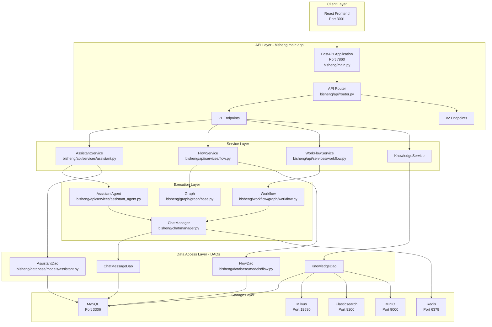
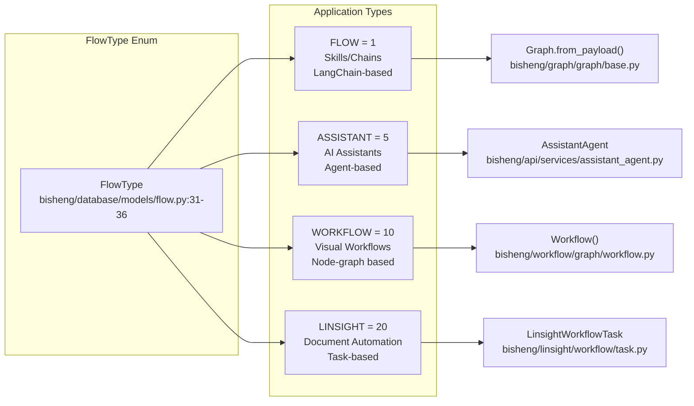
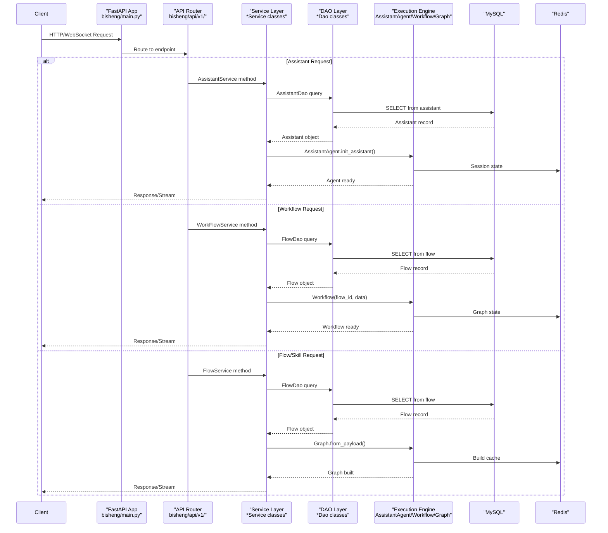
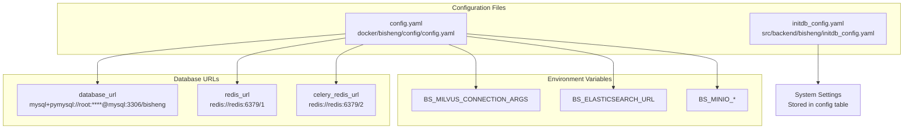
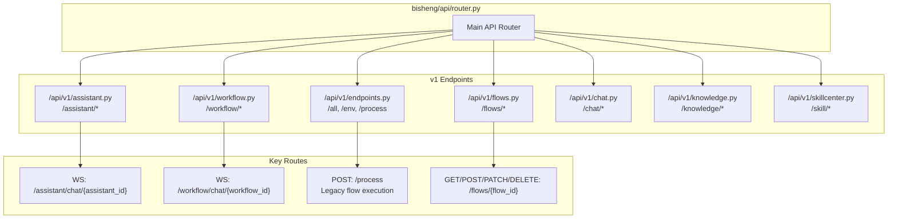
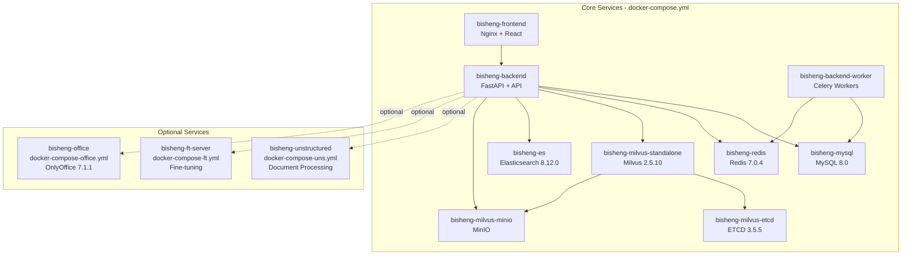
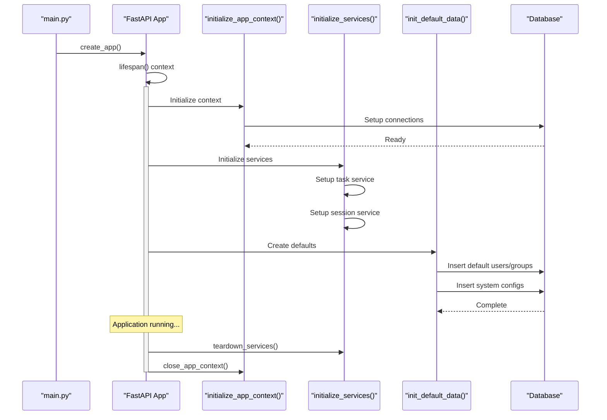

<!-- source: DeepWiki mcp.deepwiki.com · repo dataelement/bisheng · page 1 Overview · fetched 2026-10-29 -->

# Overview

Relevant source files

The following files were used as context for generating this wiki page:

- [docker/bisheng-ft/config.yaml](docker/bisheng-ft/config.yaml)
- [docker/bisheng-uns/config.yaml](docker/bisheng-uns/config.yaml)
- [docker/bisheng/config/config.yaml](docker/bisheng/config/config.yaml)
- [docker/docker-compose-ft.yml](docker/docker-compose-ft.yml)
- [docker/docker-compose-office.yml](docker/docker-compose-office.yml)
- [docker/docker-compose-uns.yml](docker/docker-compose-uns.yml)
- [docker/docker-compose.yml](docker/docker-compose.yml)
- [docker/mysql/conf/my.cnf](docker/mysql/conf/my.cnf)
- [docker/nginx/nginx.conf](docker/nginx/nginx.conf)
- [src/backend/bisheng/__init__.py](src/backend/bisheng/__init__.py)
- [src/backend/bisheng/api/services/assistant.py](src/backend/bisheng/api/services/assistant.py)
- [src/backend/bisheng/api/services/flow.py](src/backend/bisheng/api/services/flow.py)
- [src/backend/bisheng/api/services/workflow.py](src/backend/bisheng/api/services/workflow.py)
- [src/backend/bisheng/api/utils.py](src/backend/bisheng/api/utils.py)
- [src/backend/bisheng/api/v1/assistant.py](src/backend/bisheng/api/v1/assistant.py)
- [src/backend/bisheng/api/v1/endpoints.py](src/backend/bisheng/api/v1/endpoints.py)
- [src/backend/bisheng/api/v1/flows.py](src/backend/bisheng/api/v1/flows.py)
- [src/backend/bisheng/api/v1/schemas.py](src/backend/bisheng/api/v1/schemas.py)
- [src/backend/bisheng/api/v1/skillcenter.py](src/backend/bisheng/api/v1/skillcenter.py)
- [src/backend/bisheng/api/v1/workflow.py](src/backend/bisheng/api/v1/workflow.py)
- [src/backend/bisheng/database/base.py](src/backend/bisheng/database/base.py)
- [src/backend/bisheng/database/models/assistant.py](src/backend/bisheng/database/models/assistant.py)
- [src/backend/bisheng/database/models/flow.py](src/backend/bisheng/database/models/flow.py)
- [src/backend/bisheng/database/models/flow_version.py](src/backend/bisheng/database/models/flow_version.py)
- [src/backend/bisheng/database/models/template.py](src/backend/bisheng/database/models/template.py)
- [src/backend/bisheng/database/models/user_link.py](src/backend/bisheng/database/models/user_link.py)
- [src/backend/bisheng/graph/vertex/base.py](src/backend/bisheng/graph/vertex/base.py)
- [src/backend/bisheng/initdb_config.yaml](src/backend/bisheng/initdb_config.yaml)
- [src/backend/bisheng/interface/chains/base.py](src/backend/bisheng/interface/chains/base.py)
- [src/backend/bisheng/interface/chains/custom.py](src/backend/bisheng/interface/chains/custom.py)
- [src/backend/bisheng/interface/initialize/loading.py](src/backend/bisheng/interface/initialize/loading.py)
- [src/backend/bisheng/main.py](src/backend/bisheng/main.py)
- [src/backend/bisheng/template/frontend_node/chains.py](src/backend/bisheng/template/frontend_node/chains.py)
- [src/backend/bisheng/template/frontend_node/wrappers.py](src/backend/bisheng/template/frontend_node/wrappers.py)
- [src/backend/pyproject.toml](src/backend/pyproject.toml)
- [update.sh](update.sh)

## Purpose and Scope

Bisheng is a comprehensive AI application development platform that enables users to build, deploy, and manage AI-powered applications. The platform provides integrated subsystems for knowledge base management, conversational AI assistants, visual workflow orchestration, and document-centric task automation. This document provides a high-level overview of the entire Bisheng system architecture, core components, and deployment model.

For detailed information about specific subsystems, see:
- Knowledge base processing: [Knowledge Base Management](#3.1)
- Chat and assistant execution: [Chat and Messaging System](#3.2), [Assistant System](#3.3)
- Workflow automation: [Workflow Engine](#3.5), [Linsight AI Workbench](#3.4)
- Access control and permissions: [User and Access Control](#4)
- Deployment configurations: [Development and Deployment](#5)

## System Architecture

Bisheng implements a three-tier architecture consisting of a React/TypeScript frontend, FastAPI backend services, and a multi-database storage layer. The system supports multiple AI application paradigms including skills (flows), assistants, and workflows.

### High-Level Component Diagram

**Sources:** [src/backend/bisheng/main.py:64-102](), [src/backend/bisheng/api/services/assistant.py:1-516](), [src/backend/bisheng/api/services/flow.py:1-445](), [src/backend/bisheng/api/services/workflow.py:1-451](), [src/backend/bisheng/database/models/flow.py:1-550](), [src/backend/bisheng/database/models/assistant.py:1-300]()

## Core Application Types

Bisheng supports three primary application types, each with distinct execution models and use cases. The `FlowType` enum defines these types in the data model.

### Application Type Definitions

**Sources:** [src/backend/bisheng/database/models/flow.py:31-36](), [src/backend/bisheng/api/services/assistant.py:39-516](), [src/backend/bisheng/api/services/workflow.py:35-451]()

## Request Flow Architecture

The following diagram illustrates how user requests flow through the system, from API endpoints to execution engines and data persistence.

**Sources:** [src/backend/bisheng/main.py:64-102](), [src/backend/bisheng/api/v1/assistant.py:1-177](), [src/backend/bisheng/api/v1/workflow.py:1-312](), [src/backend/bisheng/api/v1/flows.py:1-226](), [src/backend/bisheng/api/services/assistant.py:39-516](), [src/backend/bisheng/api/services/workflow.py:35-451](), [src/backend/bisheng/api/services/flow.py:38-445]()

## Technology Stack

| Layer | Technology | Configuration |
|-------|-----------|---------------|
| **Frontend** | React 18, TypeScript, Vite | Port 3001 |
| **Backend API** | FastAPI 0.120.4+, Python 3.10+ | Port 7860 |
| **Relational DB** | MySQL 8.0 | Port 3306, database: `bisheng` |
| **Cache/Queue** | Redis 7.0.4 | Port 6379, databases: 0, 1, 2 |
| **Vector Store** | Milvus 2.5.10, pymilvus 2.5.10 | Port 19530 |
| **Full-text Search** | Elasticsearch 8.12.0 | Port 9200 |
| **Object Storage** | MinIO | Port 9000 (API), 9001 (Console) |
| **Coordination** | ETCD 3.5.5 | For Milvus metadata |
| **LLM Framework** | LangChain 0.3.23+, LangGraph 0.3.27+ | |
| **Async Workers** | Celery 5.5.3+ | Redis broker at db 2 |

**Sources:** [src/backend/pyproject.toml:1-87](), [docker/docker-compose.yml:1-201](), [docker/bisheng/config/config.yaml:1-88]()

## Database Configuration

The system uses environment-based configuration with encrypted credentials. The `database_url` and `redis_url` settings support password encryption using the platform's encryption utilities.

**Sources:** [docker/bisheng/config/config.yaml:1-88](), [src/backend/bisheng/initdb_config.yaml:1-81]()

## API Routing Structure

The FastAPI application organizes endpoints into versioned routers with specific functional domains.

### API Endpoint Organization

**Sources:** [src/backend/bisheng/api/v1/endpoints.py:1-428](), [src/backend/bisheng/api/v1/flows.py:1-226](), [src/backend/bisheng/api/v1/assistant.py:1-177](), [src/backend/bisheng/api/v1/workflow.py:1-312]()

## Version Information

The platform version is defined in multiple locations and kept synchronized via build scripts:

- Current version: `2.4.0-beta1`
- Version files: [src/backend/bisheng/__init__.py:10](), [src/backend/pyproject.toml:3](), [update.sh:3-7]()
- Docker images: `dataelement/bisheng-backend:v2.4.0-beta1`, `dataelement/bisheng-frontend:v2.4.0-beta1`

**Sources:** [src/backend/bisheng/__init__.py:1-17](), [src/backend/pyproject.toml:1-87](), [update.sh:1-8]()

## Deployment Model

Bisheng uses Docker Compose for orchestration with a modular service architecture. The base deployment includes 8 required services plus 3 optional services.

### Docker Compose Service Architecture

**Sources:** [docker/docker-compose.yml:1-201](), [docker/docker-compose-uns.yml:1-22](), [docker/docker-compose-ft.yml:1-31](), [docker/docker-compose-office.yml:1-15]()

## Initialization and Lifecycle

The FastAPI application uses an async lifespan context manager to handle startup and shutdown tasks. Key initialization steps include database setup, service initialization, and default data population.

### Application Lifecycle

**Sources:** [src/backend/bisheng/main.py:52-62](), [src/backend/bisheng/main.py:64-102]()

## Summary

Bisheng is a production-ready AI application platform built with modern Python web frameworks and supporting multiple AI application paradigms. The architecture emphasizes modularity through service-oriented design, type safety through SQLModel and Pydantic, and scalability through distributed task processing with Celery. The platform's multi-database approach leverages specialized storage systems (MySQL for relational data, Milvus for vectors, Elasticsearch for search, Redis for caching) to optimize different access patterns.

For implementation details of specific subsystems, refer to the dedicated pages in sections 2 through 6 of this wiki.

**Sources:** [src/backend/bisheng/main.py:1-113](), [src/backend/pyproject.toml:1-87](), [docker/docker-compose.yml:1-201](), [src/backend/bisheng/database/models/flow.py:1-550](), [src/backend/bisheng/database/models/assistant.py:1-300](), [src/backend/bisheng/api/services/assistant.py:1-516](), [src/backend/bisheng/api/services/workflow.py:1-451]()

---

