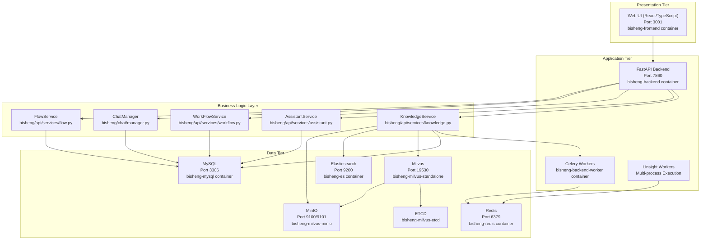
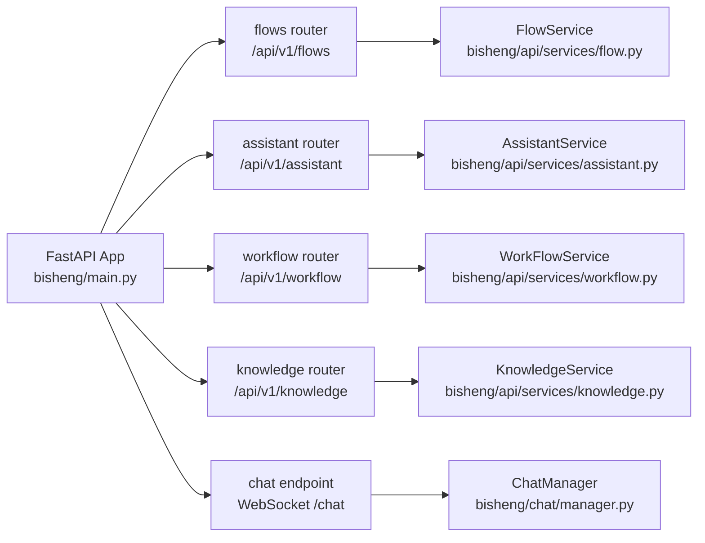
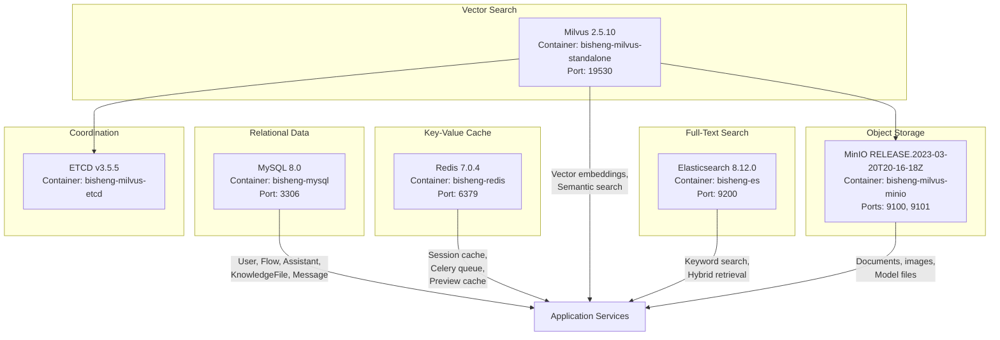
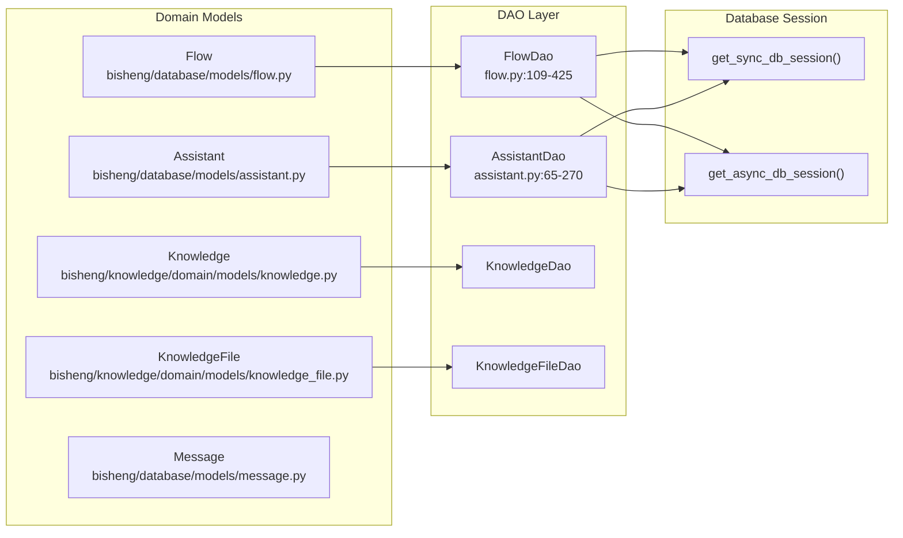
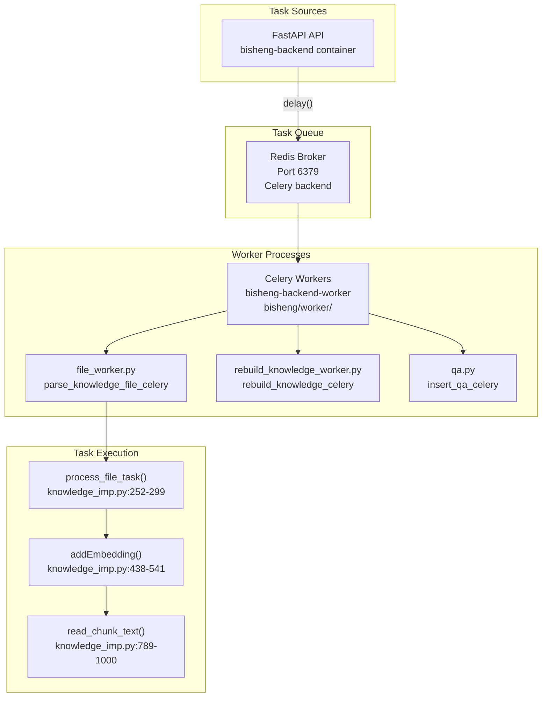
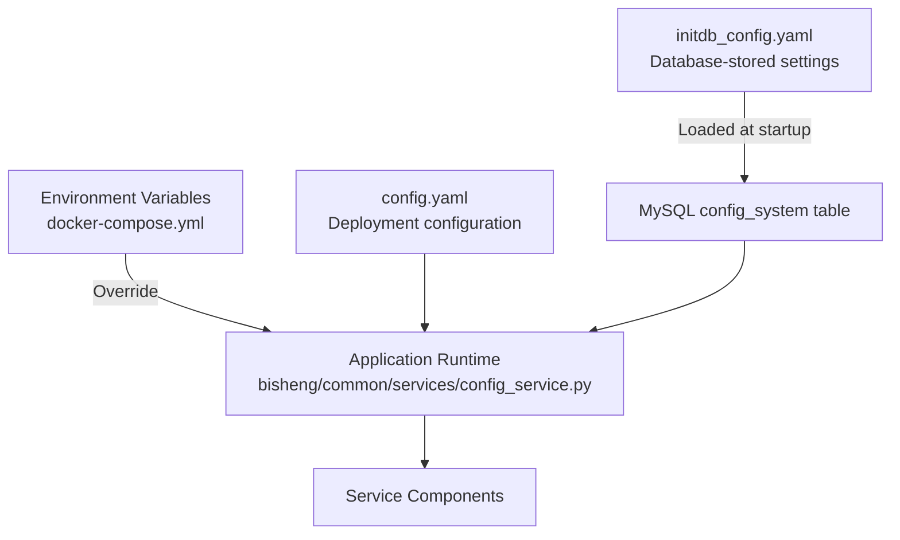
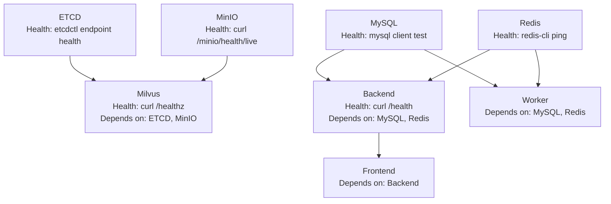

<!-- source: DeepWiki mcp.deepwiki.com · repo dataelement/bisheng · page 2 System Architecture · fetched 2026-10-29 -->

# System Architecture

Relevant source files

The following files were used as context for generating this wiki page:

- [docker/bisheng-ft/config.yaml](docker/bisheng-ft/config.yaml)
- [docker/bisheng-uns/config.yaml](docker/bisheng-uns/config.yaml)
- [docker/docker-compose-ft.yml](docker/docker-compose-ft.yml)
- [docker/docker-compose-office.yml](docker/docker-compose-office.yml)
- [docker/docker-compose-uns.yml](docker/docker-compose-uns.yml)
- [docker/docker-compose.yml](docker/docker-compose.yml)
- [docker/mysql/conf/my.cnf](docker/mysql/conf/my.cnf)
- [docker/nginx/nginx.conf](docker/nginx/nginx.conf)
- [src/backend/bisheng/__init__.py](src/backend/bisheng/__init__.py)
- [src/backend/bisheng/api/services/assistant.py](src/backend/bisheng/api/services/assistant.py)
- [src/backend/bisheng/api/services/flow.py](src/backend/bisheng/api/services/flow.py)
- [src/backend/bisheng/api/services/knowledge.py](src/backend/bisheng/api/services/knowledge.py)
- [src/backend/bisheng/api/services/knowledge_imp.py](src/backend/bisheng/api/services/knowledge_imp.py)
- [src/backend/bisheng/api/services/workflow.py](src/backend/bisheng/api/services/workflow.py)
- [src/backend/bisheng/api/v1/assistant.py](src/backend/bisheng/api/v1/assistant.py)
- [src/backend/bisheng/api/v1/flows.py](src/backend/bisheng/api/v1/flows.py)
- [src/backend/bisheng/api/v1/schemas.py](src/backend/bisheng/api/v1/schemas.py)
- [src/backend/bisheng/api/v1/skillcenter.py](src/backend/bisheng/api/v1/skillcenter.py)
- [src/backend/bisheng/api/v1/workflow.py](src/backend/bisheng/api/v1/workflow.py)
- [src/backend/bisheng/database/models/assistant.py](src/backend/bisheng/database/models/assistant.py)
- [src/backend/bisheng/database/models/flow.py](src/backend/bisheng/database/models/flow.py)
- [src/backend/bisheng/database/models/flow_version.py](src/backend/bisheng/database/models/flow_version.py)
- [src/backend/bisheng/database/models/template.py](src/backend/bisheng/database/models/template.py)
- [src/backend/bisheng/database/models/user_link.py](src/backend/bisheng/database/models/user_link.py)
- [src/backend/bisheng/template/frontend_node/wrappers.py](src/backend/bisheng/template/frontend_node/wrappers.py)
- [src/backend/bisheng/worker/knowledge/file_worker.py](src/backend/bisheng/worker/knowledge/file_worker.py)
- [src/backend/bisheng/worker/knowledge/qa.py](src/backend/bisheng/worker/knowledge/qa.py)
- [src/backend/bisheng/worker/knowledge/rebuild_knowledge_worker.py](src/backend/bisheng/worker/knowledge/rebuild_knowledge_worker.py)
- [src/backend/pyproject.toml](src/backend/pyproject.toml)
- [update.sh](update.sh)

## Purpose and Scope

This document provides a high-level overview of the Bisheng platform's system architecture, describing the three-tier structure, major components, and how they interact. Bisheng is a comprehensive AI application development platform supporting knowledge management, assistants, workflows, and chat capabilities.

For detailed information about specific subsystems:
- Frontend application structure: see [Frontend Architecture](#2.1)
- Backend service patterns: see [Backend Services](#2.2)  
- Storage layer details: see [Data Storage Layer](#2.3)
- Individual service implementations: see [Core Services](#3)

---

## Three-Tier Architecture Overview

Bisheng follows a classic three-tier architecture separating presentation, business logic, and data persistence layers. The system is containerized using Docker Compose and designed for scalability and modularity.

### High-Level System Diagram

**Sources:** [docker/docker-compose.yml:1-201](), [src/backend/bisheng/api/services/knowledge.py:1-1000](), [src/backend/bisheng/api/services/assistant.py:1-500](), [src/backend/bisheng/api/services/workflow.py:1-430]()

---

## Component Responsibilities

### Frontend Layer

The frontend is a single-page application built with React and TypeScript, served via Nginx on port 3001. It communicates with the backend exclusively through REST APIs and WebSocket connections.

| Component | Technology | Responsibility |
|-----------|-----------|----------------|
| Web UI | React 18, TypeScript | User interface for all platform features |
| State Management | React Context/Hooks | Application state and data flow |
| API Client | Axios, WebSocket | Backend communication layer |
| Routing | React Router | Client-side navigation |

**Sources:** [docker/docker-compose.yml:110-123]()

---

### Backend Services Layer

The backend is built on FastAPI and provides both REST and WebSocket endpoints. The main application runs on port 7860 inside the `bisheng-backend` container.

### API Router Structure

**Sources:** [src/backend/bisheng/api/v1/flows.py:1-205](), [src/backend/bisheng/api/v1/assistant.py:1-177](), [src/backend/bisheng/api/v1/workflow.py:1-290]()

### Core Service Classes

| Service Class | File Path | Primary Responsibility |
|--------------|-----------|----------------------|
| `KnowledgeService` | [bisheng/api/services/knowledge.py]() | Knowledge base CRUD, file processing orchestration |
| `AssistantService` | [bisheng/api/services/assistant.py]() | AI assistant lifecycle management |
| `WorkFlowService` | [bisheng/api/services/workflow.py]() | Workflow execution and node management |
| `FlowService` | [bisheng/api/services/flow.py]() | Flow/skill version control and comparison |
| `ChatManager` | [bisheng/chat/manager.py]() | WebSocket connection pool management |

**Sources:** [src/backend/bisheng/api/services/knowledge.py:72-377](), [src/backend/bisheng/api/services/assistant.py:39-453](), [src/backend/bisheng/api/services/workflow.py:35-425](), [src/backend/bisheng/api/services/flow.py:38-425]()

---

## Data Storage Layer

Bisheng employs a polyglot persistence strategy with six different storage systems, each optimized for specific data types and access patterns.

### Storage Systems Architecture

**Sources:** [docker/docker-compose.yml:2-201]()

### Data Model Layer

The system uses SQLModel for ORM, providing both synchronous and asynchronous database access patterns:

**Sources:** [src/backend/bisheng/database/models/flow.py:1-425](), [src/backend/bisheng/database/models/assistant.py:1-270]()

### Storage Responsibilities

| Storage System | Data Types | Access Pattern | Primary Use Cases |
|---------------|------------|----------------|------------------|
| MySQL | Structured relational data | ACID transactions | Users, flows, assistants, knowledge metadata, chat messages |
| Redis | Key-value ephemeral data | Fast in-memory access | Session caching, Celery task queue, file preview cache |
| Milvus | Vector embeddings | Approximate nearest neighbor | Semantic search on knowledge chunks |
| Elasticsearch | Text documents with metadata | Full-text search + filters | Keyword search, hybrid retrieval with Milvus |
| MinIO | Binary objects | S3-compatible API | Original files, generated PDFs, images, model artifacts |
| ETCD | Distributed configuration | Consensus-based KV store | Milvus cluster coordination |

**Sources:** [docker/docker-compose.yml:2-201](), [src/backend/bisheng/api/services/knowledge_imp.py:369-400]()

---

## Worker Process Architecture

Bisheng uses asynchronous task processing for long-running operations to avoid blocking the API server.

### Worker System Diagram

**Sources:** [docker/docker-compose.yml:79-108](), [src/backend/bisheng/worker/knowledge/file_worker.py:1-330](), [src/backend/bisheng/api/services/knowledge_imp.py:252-661]()

### Worker Task Types

| Worker Module | Task Function | Trigger | Purpose |
|--------------|---------------|---------|---------|
| `file_worker.py` | `parse_knowledge_file_celery` | File upload | Parse document, extract text, generate embeddings, store in Milvus/ES |
| `file_worker.py` | `retry_knowledge_file_celery` | Manual retry | Retry failed file processing |
| `file_worker.py` | `file_copy_celery` | Knowledge base copy | Copy files and vectors between knowledge bases |
| `rebuild_knowledge_worker.py` | `rebuild_knowledge_celery` | Embedding model change | Re-embed all chunks with new model |
| `qa.py` | `insert_qa_celery` | QA pair creation | Insert Q&A pair into vector stores |

**Sources:** [src/backend/bisheng/worker/knowledge/file_worker.py:25-330](), [src/backend/bisheng/worker/knowledge/rebuild_knowledge_worker.py:22-220](), [src/backend/bisheng/worker/knowledge/qa.py:20-180]()

---

## Configuration Management

The system uses a layered configuration approach with environment variables, YAML files, and database-stored settings.

### Configuration Sources

**Sources:** [docker/docker-compose.yml:46-58]()

### Key Configuration Categories

| Configuration Type | Storage Location | Scope | Examples |
|-------------------|------------------|-------|----------|
| Infrastructure | `docker-compose.yml` env vars | Container orchestration | Database URLs, ports, service endpoints |
| Deployment | `config.yaml` | Application runtime | Vector store connections, logging, storage paths |
| Feature flags | `initdb_config.yaml` → MySQL | Dynamic application settings | LLM models, knowledge base settings, UI configurations |

**Sources:** [docker/docker-compose.yml:1-201]()

---

## Version Information

The system maintains version consistency across multiple components:

| Component | Version | Location |
|-----------|---------|----------|
| Backend | 2.4.0-beta1 | [src/backend/bisheng/__init__.py:10]() |
| Python Package | 2.4.0-beta1 | [src/backend/pyproject.toml:3]() |
| Docker Images | v2.4.0-beta1 | [docker/docker-compose.yml:43](), [docker/docker-compose.yml:81](), [docker/docker-compose.yml:112]() |

Version updates are automated via the `update.sh` script which modifies all version references consistently.

**Sources:** [src/backend/bisheng/__init__.py:1-16](), [src/backend/pyproject.toml:1-87](), [update.sh:1-8]()

---

## Deployment Architecture

### Container Orchestration

The system uses Docker Compose to manage six core services and three optional services:

**Core Services:**
1. `bisheng-mysql` - Relational database
2. `bisheng-redis` - Cache and queue
3. `bisheng-backend` - FastAPI application server
4. `bisheng-backend-worker` - Celery async workers
5. `bisheng-frontend` - Nginx + React SPA
6. `bisheng-es` - Elasticsearch search engine
7. `bisheng-milvus-standalone` - Vector database
8. `bisheng-milvus-minio` - Object storage
9. `bisheng-milvus-etcd` - Coordination service

**Optional Services (separate compose files):**
- `bisheng-unstructured` - Advanced document processing ([docker/docker-compose-uns.yml:2-22]())
- `bisheng-ft-server` - Fine-tuning service ([docker/docker-compose-ft.yml:2-31]())
- `bisheng-office` - OnlyOffice document editing ([docker/docker-compose-office.yml:2-15]())

### Health Checks and Dependencies

All services implement health checks to ensure proper startup order:

**Sources:** [docker/docker-compose.yml:15-20](), [docker/docker-compose.yml:34-38](), [docker/docker-compose.yml:67-77](), [docker/docker-compose.yml:150-154](), [docker/docker-compose.yml:170-174](), [docker/docker-compose.yml:189-194]()

---

## Inter-Service Communication Patterns

### Synchronous Communication

REST API calls between frontend and backend use standard HTTP/HTTPS on port 7860. All API routes are versioned under `/api/v1/` or `/api/v2/`.

### Asynchronous Communication  

1. **WebSocket** - Real-time bidirectional communication for chat and workflow execution
2. **Celery Tasks** - Async job execution via Redis broker
3. **Event Streaming** - Server-sent events (SSE) for streaming responses

### Internal Service URLs

Within the Docker network, services reference each other by container names:
- Backend to MySQL: `mysql:3306`
- Backend to Redis: `redis:6379`  
- Backend to Milvus: `milvus:19530`
- Backend to Elasticsearch: `elasticsearch:9200`
- Backend to MinIO: `minio:9000`

**Sources:** [docker/docker-compose.yml:48-58](), [docker/docker-compose.yml:84-94]()

---

