<!-- source: DeepWiki mcp.deepwiki.com · repo dataelement/bisheng · page 2.1 Frontend Architecture · fetched 2026-10-29 -->

# Frontend Architecture

<details>
<summary>Relevant source files</summary>

The following files were used as context for generating this wiki page:

- [src/frontend/package-lock.json](src/frontend/package-lock.json)
- [src/frontend/platform/public/assets/dashboard/setting.svg](src/frontend/platform/public/assets/dashboard/setting.svg)
- [src/frontend/platform/public/locales/en-US/dashboard.json](src/frontend/platform/public/locales/en-US/dashboard.json)
- [src/frontend/platform/public/locales/ja/dashboard.json](src/frontend/platform/public/locales/ja/dashboard.json)
- [src/frontend/platform/public/locales/zh-Hans/dashboard.json](src/frontend/platform/public/locales/zh-Hans/dashboard.json)
- [src/frontend/platform/src/components/bs-ui/select/hover.tsx](src/frontend/platform/src/components/bs-ui/select/hover.tsx)
- [src/frontend/platform/src/layout/MainLayout.tsx](src/frontend/platform/src/layout/MainLayout.tsx)
- [src/frontend/platform/src/pages/BuildPage/flow/FlowNode/component/KnowledgeSelectItem.tsx](src/frontend/platform/src/pages/BuildPage/flow/FlowNode/component/KnowledgeSelectItem.tsx)
- [src/frontend/platform/src/pages/Dashboard/components/config/ChartSelector.tsx](src/frontend/platform/src/pages/Dashboard/components/config/ChartSelector.tsx)
- [src/frontend/platform/src/pages/Dashboard/components/config/ComponentConfigDrawer.tsx](src/frontend/platform/src/pages/Dashboard/components/config/ComponentConfigDrawer.tsx)
- [src/frontend/platform/src/pages/Dashboard/components/config/DashboardConfigPanel.tsx](src/frontend/platform/src/pages/Dashboard/components/config/DashboardConfigPanel.tsx)
- [src/frontend/platform/src/pages/Dashboard/components/config/DatasetSelector.tsx](src/frontend/platform/src/pages/Dashboard/components/config/DatasetSelector.tsx)
- [src/frontend/platform/src/pages/Dashboard/components/config/DimensionBlock.tsx](src/frontend/platform/src/pages/Dashboard/components/config/DimensionBlock.tsx)
- [src/frontend/platform/src/pages/Dashboard/components/config/FilterConditionDialog.tsx](src/frontend/platform/src/pages/Dashboard/components/config/FilterConditionDialog.tsx)
- [src/frontend/platform/src/pages/Dashboard/components/config/StyleConfigPanel.tsx](src/frontend/platform/src/pages/Dashboard/components/config/StyleConfigPanel.tsx)
- [src/frontend/platform/src/pages/Dashboard/components/config/useChartState.tsx](src/frontend/platform/src/pages/Dashboard/components/config/useChartState.tsx)
- [src/frontend/platform/src/pages/KnowledgePage/AdjustFilesUpload.tsx](src/frontend/platform/src/pages/KnowledgePage/AdjustFilesUpload.tsx)
- [src/frontend/platform/src/pages/KnowledgePage/KnowledgeFile.tsx](src/frontend/platform/src/pages/KnowledgePage/KnowledgeFile.tsx)
- [src/frontend/platform/src/pages/KnowledgePage/KnowledgeQa.tsx](src/frontend/platform/src/pages/KnowledgePage/KnowledgeQa.tsx)
- [src/frontend/platform/src/pages/KnowledgePage/components/FileUploadStep2.tsx](src/frontend/platform/src/pages/KnowledgePage/components/FileUploadStep2.tsx)
- [src/frontend/platform/src/pages/KnowledgePage/components/FileUploadStep4.tsx](src/frontend/platform/src/pages/KnowledgePage/components/FileUploadStep4.tsx)
- [src/frontend/platform/src/pages/KnowledgePage/components/Files.tsx](src/frontend/platform/src/pages/KnowledgePage/components/Files.tsx)
- [src/frontend/platform/src/pages/KnowledgePage/components/Header.tsx](src/frontend/platform/src/pages/KnowledgePage/components/Header.tsx)
- [src/frontend/platform/src/pages/KnowledgePage/components/Paragraphs.tsx](src/frontend/platform/src/pages/KnowledgePage/components/Paragraphs.tsx)
- [src/frontend/platform/src/pages/KnowledgePage/components/PreviewFile.tsx](src/frontend/platform/src/pages/KnowledgePage/components/PreviewFile.tsx)
- [src/frontend/platform/src/pages/KnowledgePage/components/PreviewParagraph.tsx](src/frontend/platform/src/pages/KnowledgePage/components/PreviewParagraph.tsx)
- [src/frontend/platform/src/pages/KnowledgePage/components/PreviewResult.tsx](src/frontend/platform/src/pages/KnowledgePage/components/PreviewResult.tsx)
- [src/frontend/platform/src/pages/KnowledgePage/components/RuleFile.tsx](src/frontend/platform/src/pages/KnowledgePage/components/RuleFile.tsx)
- [src/frontend/platform/src/pages/KnowledgePage/components/RuleTable.tsx](src/frontend/platform/src/pages/KnowledgePage/components/RuleTable.tsx)
- [src/frontend/platform/src/pages/KnowledgePage/detail.tsx](src/frontend/platform/src/pages/KnowledgePage/detail.tsx)
- [src/frontend/platform/src/pages/KnowledgePage/filesUpload.tsx](src/frontend/platform/src/pages/KnowledgePage/filesUpload.tsx)
- [src/frontend/platform/src/pages/KnowledgePage/qas.tsx](src/frontend/platform/src/pages/KnowledgePage/qas.tsx)

</details>


## Purpose and Scope

This document describes the React/TypeScript frontend architecture of the Bisheng platform. The frontend is a comprehensive single-page application (SPA) serving Port 3001, organized into distinct feature domains: Knowledge Management, Chat/Assistants, Dashboard/Analytics, and System Administration. This page covers the application structure, routing hierarchy, major page components, shared UI libraries, API integration patterns, and state management approaches.

For backend API services that this frontend communicates with, see [Backend Services](#2.2). For specific feature implementations, see [Knowledge Base Management](#3.1), [Chat and Messaging System](#3.2), [Assistant System](#3.3), and [Dashboard and Analytics](#3.6).

---

## Application Structure and Entry Points

The frontend application follows a standard React SPA architecture with centralized routing, layout management, and feature-based page organization.

### Application Root and Router Configuration

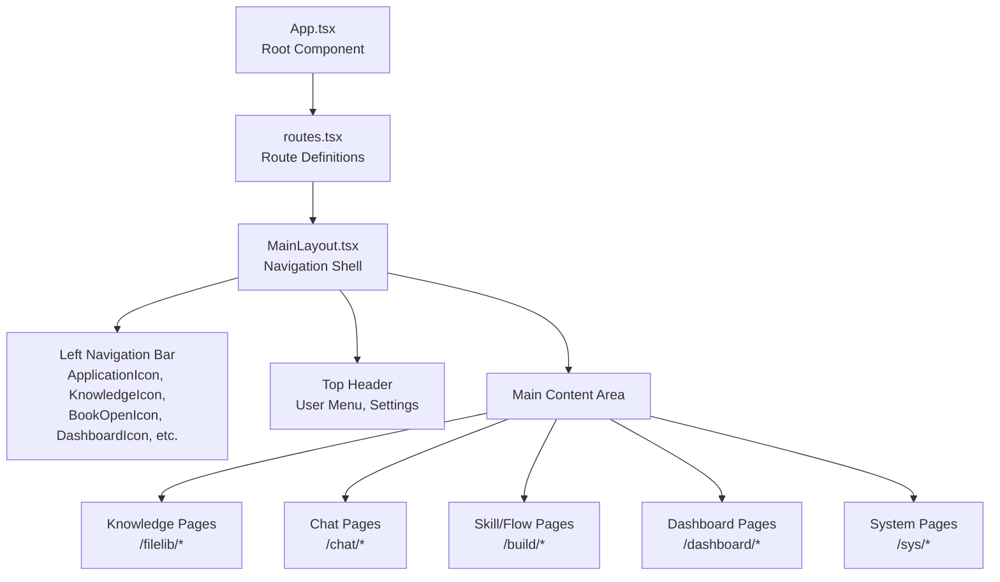

The `MainLayout` component provides the primary navigation structure with route-specific active state highlighting, user context integration, and responsive layout management.

**Sources:**
- [src/frontend/platform/src/layout/MainLayout.tsx:1-50]()
- [src/frontend/platform/src/layout/MainLayout.tsx:100-250]()

---

## Major Application Domains

The frontend is organized into five primary feature domains, each with dedicated page components and routing structures.

### Frontend Domain Architecture

```mermaid
graph TB
    Frontend["Frontend Application<br/>Port 3001"]
    
    subgraph "Knowledge Domain"
        KbList["KnowledgeFile.tsx<br/>/filelib"]
        QaList["KnowledgeQa.tsx<br/>/filelib/qalib"]
        KbDetail["detail.tsx + Files.tsx<br/>/filelib/:id"]
        KbUpload["filesUpload.tsx<br/>/filelib/upload/:id"]
        Paragraphs["Paragraphs.tsx<br/>Chunk Editor"]
    end
    
    subgraph "Chat/Assistant Domain"
        ChatUI["SkillChatPage<br/>Chat Interface"]
        AssistantMgmt["Assistant Management<br/>Configure Agents"]
        SkillList["SkillPage<br/>/build"]
        SkillEdit["Skill Editor<br/>Graph Builder"]
    end
    
    subgraph "Dashboard Domain"
        DashList["Dashboard List<br/>/dashboard"]
        DashEdit["Dashboard Editor<br/>Component Config"]
        ComponentDrawer["ComponentConfigDrawer<br/>Chart Configuration"]
        ChartRender["Chart Rendering<br/>ECharts Integration"]
    end
    
    subgraph "System Domain"
        UserMgmt["User Management<br/>/sys/user"]
        GroupMgmt["Group Management<br/>/sys/usergroup"]
        ModelMgmt["Model Page<br/>/sys/model"]
        AuditPage["Audit Log Viewer<br/>/sys/audit"]
    end
    
    subgraph "Shared Infrastructure"
        APICtrl["controllers/API/<br/>Centralized API Layer"]
        BsUI["components/bs-ui/<br/>UI Component Library"]
        Stores["Zustand Stores<br/>dashboardStore, etc."]
    end
    
    Frontend --> KbList
    Frontend --> ChatUI
    Frontend --> DashList
    Frontend --> UserMgmt
    
    KbList --> APICtrl
    ChatUI --> APICtrl
    DashEdit --> APICtrl
    
    ComponentDrawer --> BsUI
    KbUpload --> BsUI
    
    DashEdit --> Stores
```

**Sources:**
- [src/frontend/platform/src/pages/KnowledgePage/KnowledgeFile.tsx:314-640]()
- [src/frontend/platform/src/pages/Dashboard/components/config/ComponentConfigDrawer.tsx:91-700]()
- [src/frontend/platform/src/layout/MainLayout.tsx:1-400]()

### Knowledge Management Pages

The knowledge management system provides document ingestion, segmentation, preview, and chunk-level editing capabilities.

| Route Pattern | Component | Primary Functions |
|--------------|-----------|-------------------|
| `/filelib` | `KnowledgeFile.tsx` | Knowledge base list, create, copy, delete |
| `/filelib/qalib` | `KnowledgeQa.tsx` | QA knowledge base list and management |
| `/filelib/upload/:id` | `filesUpload.tsx` | 4-step file upload wizard |
| `/filelib/adjust/:id` | `AdjustFilesUpload.tsx` | 3-step segmentation adjustment |
| `/filelib/:id` | `detail.tsx` + `Files.tsx` | File list with status indicators |
| `/filelib/:id` (tab 2) | `Paragraphs.tsx` | Chunk preview and inline editing |

**Key Workflows**:
- **File Upload**: `FileUploadStep1` → `FileUploadStep2` → `PreviewResult` → `FileUploadStep4`
- **Segmentation Adjustment**: `FileUploadStep2` → `PreviewResult` → `FileUploadStep4`
- **Chunk Editing**: `Files.tsx` → `Paragraphs.tsx` → `PreviewFile` + `PreviewParagraph`

**Sources:**
- [src/frontend/platform/src/pages/KnowledgePage/KnowledgeFile.tsx:1-640]()
- [src/frontend/platform/src/pages/KnowledgePage/filesUpload.tsx:37-417]()
- [src/frontend/platform/src/pages/KnowledgePage/components/Paragraphs.tsx:26-796]()

### Dashboard and Analytics Pages

The dashboard system provides business intelligence capabilities with visual chart builders, dataset integration, and query components.

| Route | Component | Features |
|-------|-----------|----------|
| `/dashboard` | Dashboard List | Published/unpublished dashboards, search |
| `/dashboard/:id` | Dashboard Viewer | Component rendering, query parameter handling |
| `/dashboard/:id/edit` | Dashboard Editor | Drag-drop layout, component configuration |

**Core Dashboard Components**:
- **ComponentConfigDrawer**: Chart type selection, dimension/metric configuration, filter conditions, style customization
- **DatasetSelector**: Dataset picker with field browser (dimensions/metrics)
- **ChartSelector**: Query component configuration with linked charts and time ranges
- **StyleConfigPanel**: Theme colors, axis titles, legend positioning, font formatting

**Sources:**
- [src/frontend/platform/src/pages/Dashboard/components/config/ComponentConfigDrawer.tsx:91-700]()
- [src/frontend/platform/src/pages/Dashboard/components/config/DatasetSelector.tsx:22-300]()
- [src/frontend/platform/src/pages/Dashboard/components/config/ChartSelector.tsx:40-300]()
</old_str>

<new_str>
# Frontend Architecture

## Purpose and Scope

This document describes the React/TypeScript frontend architecture of the Bisheng platform. The frontend is a comprehensive single-page application (SPA) serving Port 3001, organized into distinct feature domains: Knowledge Management, Chat/Assistants, Dashboard/Analytics, and System Administration. This page covers the application structure, routing hierarchy, major page components, shared UI libraries, API integration patterns, and state management approaches.

For backend API services that this frontend communicates with, see [Backend Services](#2.2). For specific feature implementations, see [Knowledge Base Management](#3.1), [Chat and Messaging System](#3.2), [Assistant System](#3.3), and [Dashboard and Analytics](#3.6).

---

## Application Structure and Entry Points

The frontend application follows a standard React SPA architecture with centralized routing, layout management, and feature-based page organization.

### Application Root and Router Configuration

**Diagram: Application Bootstrap and Layout Structure**

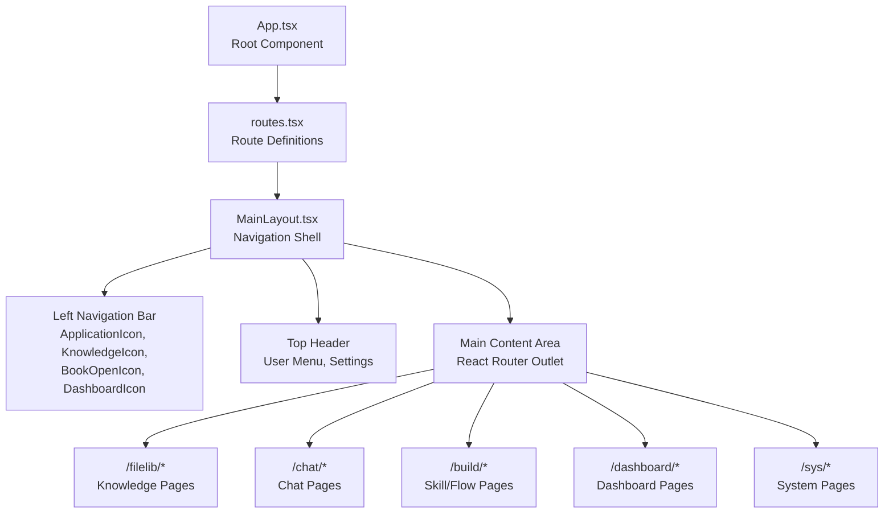

The `MainLayout` component [src/frontend/platform/src/layout/MainLayout.tsx:1-400]() provides the primary navigation structure with route-specific active state highlighting, user context integration via `userContext`, and responsive layout management. Navigation icons are imported from `@/components/bs-icons` [src/frontend/platform/src/layout/MainLayout.tsx:1-12]().

**Sources:**
- [src/frontend/platform/src/layout/MainLayout.tsx:1-50]()
- [src/frontend/platform/src/layout/MainLayout.tsx:100-400]()

---

## Major Application Domains

The frontend is organized into five primary feature domains, each with dedicated page components and routing structures.

### Frontend Domain Architecture

**Diagram: Feature Domain Organization with Code Entities**

```mermaid
graph TB
    Frontend["Frontend Application<br/>Port 3001 - Vite + React"]
    
    subgraph "Knowledge Domain /filelib"
        KbList["KnowledgeFile.tsx<br/>readFileLibDatabase API"]
        QaList["KnowledgeQa.tsx<br/>QA KB Management"]
        KbDetail["detail.tsx + Files.tsx<br/>readFileByLibDatabase"]
        KbUpload["filesUpload.tsx<br/>subUploadLibFile API"]
        Paragraphs["Paragraphs.tsx<br/>getKnowledgeChunkApi"]
    end
    
    subgraph "Chat/Assistant Domain /build"
        ChatUI["SkillChatPage<br/>WebSocket Chat"]
        AssistantMgmt["Assistant Management<br/>Assistant Config"]
        SkillList["SkillPage<br/>Flow/Skill List"]
        SkillEdit["Skill Editor<br/>Graph Builder Canvas"]
    end
    
    subgraph "Dashboard Domain /dashboard"
        DashList["Dashboard List<br/>getDashboards API"]
        DashEdit["Dashboard Editor<br/>useEditorDashboardStore"]
        ComponentDrawer["ComponentConfigDrawer<br/>Chart Configuration"]
        DatasetSelector["DatasetSelector<br/>getDatasets API"]
    end
    
    subgraph "System Domain /sys"
        UserMgmt["User Management<br/>UserDao backend"]
        GroupMgmt["Group Management<br/>GroupDao backend"]
        ModelMgmt["Model Page<br/>LLM Configuration"]
        AuditPage["Audit Log Viewer<br/>AuditLogDao"]
    end
    
    subgraph "Shared Infrastructure"
        APICtrl["controllers/API/index.ts<br/>captureAndAlertRequestErrorHoc"]
        BsUI["components/bs-ui/<br/>Button, Input, Dialog, etc."]
        Stores["Zustand Stores<br/>dashboardStore, knowledgeStore"]
    end
    
    Frontend --> KbList
    Frontend --> ChatUI
    Frontend --> DashList
    Frontend --> UserMgmt
    
    KbList --> APICtrl
    ChatUI --> APICtrl
    DashEdit --> APICtrl
    
    ComponentDrawer --> BsUI
    KbUpload --> BsUI
    
    DashEdit --> Stores
```

**Sources:**
- [src/frontend/platform/src/pages/KnowledgePage/KnowledgeFile.tsx:314-640]()
- [src/frontend/platform/src/pages/Dashboard/components/config/ComponentConfigDrawer.tsx:91-700]()
- [src/frontend/platform/src/layout/MainLayout.tsx:1-400]()

### Knowledge Management Pages

The knowledge management system provides document ingestion, segmentation, preview, and chunk-level editing capabilities.

| Route Pattern | Component | Primary Functions |
|--------------|-----------|-------------------|
| `/filelib` | `KnowledgeFile.tsx` | Knowledge base list, create via `createFileLib`, copy via `copyLibDatabase`, delete via `deleteFileLib` |
| `/filelib/qalib` | `KnowledgeQa.tsx` | QA knowledge base list, create via `createFileLib(type=1)` |
| `/filelib/upload/:id` | `filesUpload.tsx` | 4-step wizard: `FileUploadStep1` → `FileUploadStep2` → `PreviewResult` → `FileUploadStep4` |
| `/filelib/adjust/:id` | `AdjustFilesUpload.tsx` | 3-step re-segmentation: `FileUploadStep2` → `PreviewResult` → `FileUploadStep4` |
| `/filelib/:id` | `detail.tsx` + `Files.tsx` | File list table with `StatusIndicator`, uses `readFileByLibDatabase` |
| `/filelib/:id` (paragraphs) | `Paragraphs.tsx` | Chunk editor with `PreviewFile` + `PreviewParagraph`, calls `updateChunkApi` |

**Key Workflows**:
- **File Upload**: `FileUploadStep1` (file selection) → `FileUploadStep2` (segmentation rules) → `PreviewResult` (text comparison with `previewFileSplitApi`) → `FileUploadStep4` (polling status via `readFileByLibDatabase`)
- **Chunk Editing**: Click file in `Files.tsx` → Navigate to `Paragraphs.tsx` → Select chunk → `PreviewFile` highlights bbox → Edit in `PreviewParagraph` → Save via `updateChunkApi`

**Sources:**
- [src/frontend/platform/src/pages/KnowledgePage/KnowledgeFile.tsx:1-640]()
- [src/frontend/platform/src/pages/KnowledgePage/filesUpload.tsx:37-417]()
- [src/frontend/platform/src/pages/KnowledgePage/components/Paragraphs.tsx:26-796]()
- [src/frontend/platform/src/pages/KnowledgePage/components/Files.tsx:1-300]()

### Dashboard and Analytics Pages

The dashboard system provides business intelligence capabilities with visual chart builders, dataset integration via `getDatasets` API, and query component linking.

| Route | Component | Features |
|-------|-----------|----------|
| `/dashboard` | Dashboard List | Published/unpublished dashboards, search, default dashboard selection |
| `/dashboard/:id` | Dashboard Viewer | Component rendering with ECharts, query parameter handling |
| `/dashboard/:id/edit` | Dashboard Editor | Drag-drop layout using `react-grid-layout`, component configuration via `useEditorDashboardStore` |

**Core Dashboard Components**:
- **ComponentConfigDrawer** [src/frontend/platform/src/pages/Dashboard/components/config/ComponentConfigDrawer.tsx:91-700](): Chart type selection with `ComponentPicker`, dimension/metric drag-drop via `DimensionBlock`, filter conditions via `FilterConditionDialog`, style customization via `StyleConfigPanel`
- **DatasetSelector** [src/frontend/platform/src/pages/Dashboard/components/config/DatasetSelector.tsx:22-300](): Dataset picker with field browser, calls `getDatasets` and displays dimensions/metrics with time granularity support
- **ChartSelector** [src/frontend/platform/src/pages/Dashboard/components/config/ChartSelector.tsx:40-200](): Query component configuration with linked chart selection, time range picker via `AdvancedDatePicker`
- **useChartState** [src/frontend/platform/src/pages/Dashboard/components/config/useChartState.tsx:12-400](): Custom hook managing chart state including `categoryDimensions`, `stackDimensions`, `valueDimensions`, and sort priority

**Sources:**
- [src/frontend/platform/src/pages/Dashboard/components/config/ComponentConfigDrawer.tsx:91-700]()
- [src/frontend/platform/src/pages/Dashboard/components/config/DatasetSelector.tsx:22-300]()
- [src/frontend/platform/src/pages/Dashboard/components/config/ChartSelector.tsx:40-200]()
- [src/frontend/platform/src/pages/Dashboard/components/config/useChartState.tsx:12-300]()

### Chat and Assistant Pages

The chat system provides real-time conversational interfaces with AI assistants, supporting both pre-configured assistants and custom skill/flow execution.

**Chat Components**:
- **SkillChatPage**: Main chat interface with WebSocket connection (`ChatManager`), message streaming, and session management
- **Assistant Management**: Configure assistant parameters including model selection, tool integration, knowledge base linking, and system prompts
- **SkillPage** (`/build`): Visual flow editor with node-based programming interface for custom assistant logic

**Key Features**:
- Real-time message streaming via WebSocket endpoints
- Chat history persistence with session tracking
- Message marking and review workflows for quality control
- Multi-turn conversation with context management

**Sources:**
- Referenced in high-level architecture diagrams (components not in provided file excerpts)

### System Administration Pages

System pages provide platform administration capabilities including user management, group permissions, model configuration, and audit logging.

| Route | Component | Functions |
|-------|-----------|-----------|
| `/sys/user` | User Management | User creation, role assignment, group membership |
| `/sys/usergroup` | Group Management | Group creation, resource permissions, RBAC configuration |
| `/sys/model` | Model Page | LLM model registration, embedding model selection, API key management |
| `/sys/audit` | Audit Log Viewer | Search and filter audit events via `AuditLogService` backend |

**Permission Model**: The system implements group-based resource ownership combined with role-based access control (RBAC), where resources (flows, knowledge bases, assistants) belong to user groups and roles define fine-grained permissions within groups.

**Sources:**
- [src/frontend/platform/src/layout/MainLayout.tsx:1-12]() (navigation icons)
- Referenced in high-level architecture Diagram 4 (Data Access & Permission Architecture)

---

## Shared Component Library and UI Patterns

The frontend uses a custom component library (`components/bs-ui/`) providing consistent UI patterns across all feature domains.

### Core UI Components

**Diagram: Shared Component Architecture**

```mermaid
graph TB
    BsUI["components/bs-ui/<br/>Shared Component Library"]
    
    BsUI --> Forms["Form Components"]
    BsUI --> Layout["Layout Components"]
    BsUI --> Feedback["Feedback Components"]
    BsUI --> DataDisplay["Data Display"]
    BsUI --> Icons["Icon Library"]
    
    Forms --> Button["Button.tsx<br/>variant: outline, ghost, etc."]
    Forms --> Input["Input.tsx + SearchInput"]
    Forms --> Select["Select.tsx + SelectHover"]
    Forms --> Checkbox["checkBox.tsx"]
    Forms --> Radio["radio.tsx"]
    Forms --> Textarea["textarea in Input"]
    
    Layout --> Dialog["dialog.tsx<br/>Modal dialogs"]
    Layout --> Tabs["tabs.tsx<br/>Tab navigation"]
    Layout --> Accordion["accordion.tsx<br/>Collapsible sections"]
    Layout --> Tooltip["tooltip.tsx + Tip.tsx"]
    
    Feedback --> Toast["toast/use-toast.ts<br/>useToast hook"]
    Feedback --> Alert["alertDialog/useConfirm<br/>bsConfirm()"]
    Feedback --> Loading["LoadingIcon"]
    
    DataDisplay --> Table["table.tsx<br/>TableHeader, TableBody, etc."]
    DataDisplay --> Pagination["pagination/autoPagination"]
    DataDisplay --> Badge["badge.tsx"]
    
    Icons --> BsIcons["bs-icons/<br/>ApplicationIcon, KnowledgeIcon,<br/>BookOpenIcon, etc."]
    Icons --> Lucide["lucide-react<br/>Settings, Trash2, etc."]
```

**Common Patterns**:
- **Form Validation**: Input components with error states and validation messages
- **Confirmation Dialogs**: `bsConfirm()` for destructive actions [src/frontend/platform/src/components/bs-ui/alertDialog/useConfirm.ts]()
- **Toast Notifications**: `useToast()` hook for success/error/warning messages [src/frontend/platform/src/components/bs-ui/toast/use-toast.ts]()
- **Loading States**: `LoadingIcon` component with consistent spinner styling [src/frontend/platform/src/components/bs-icons/loading.tsx]()

**Sources:**
- [src/frontend/platform/src/pages/KnowledgePage/KnowledgeFile.tsx:1-30]() (component imports)
- [src/frontend/platform/src/pages/Dashboard/components/config/ComponentConfigDrawer.tsx:1-27]() (component imports)
- [src/frontend/platform/src/components/bs-ui/button.tsx]() (referenced)
- [src/frontend/platform/src/components/bs-ui/toast/use-toast.ts]() (referenced)

### Specialized Components

**File Preview Components**:
- **FileView**: Multi-format document viewer supporting PDF (with bbox highlighting), images, and structured data
- **DocxPreview**: DOCX file renderer [src/frontend/platform/src/pages/KnowledgePage/components/PreviewFile.tsx:8]()
- **ExcelPreview**: Spreadsheet viewer for XLSX/XLS/CSV [src/frontend/platform/src/pages/KnowledgePage/components/PreviewFile.tsx:12]()
- **TxtFileViewer**: Text and Markdown renderer [src/frontend/platform/src/pages/KnowledgePage/components/PreviewFile.tsx:11]()

**Editor Components**:
- **AceEditor**: Code editor with syntax highlighting, used for raw chunk editing [src/frontend/platform/src/pages/KnowledgePage/components/PreviewParagraph.tsx:11]()
- **Vditor**: WYSIWYG Markdown editor with instant rendering [src/frontend/platform/src/pages/KnowledgePage/components/PreviewParagraph.tsx:12-13]()

**Sources:**
- [src/frontend/platform/src/pages/KnowledgePage/components/PreviewFile.tsx:1-15]()
- [src/frontend/platform/src/pages/KnowledgePage/components/PreviewParagraph.tsx:11-13]()

---

## API Integration Layer

The frontend communicates with backend services through a centralized API module (`controllers/API/index.ts`) that provides typed API functions, error handling, and request/response transformations.

### API Controller Organization

**Diagram: API Layer Architecture with Backend Endpoints**

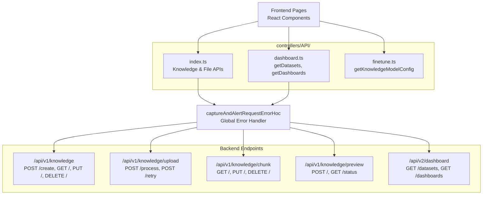

**Sources:**
- [src/frontend/platform/src/controllers/API/index.ts:139-531]()
- [src/frontend/platform/src/controllers/API/dashboard.ts]() (referenced)
- [src/frontend/platform/src/controllers/API/finetune.ts]() (referenced)

### Key API Function Categories

| Category | Functions | Backend Routes |
|----------|-----------|----------------|
| **Knowledge CRUD** | `createFileLib`, `readFileLibDatabase`, `updateKnowledge`, `deleteFileLib`, `copyLibDatabase` | `/api/v1/knowledge/*` |
| **File Operations** | `uploadLibFile`, `subUploadLibFile`, `retryKnowledgeFileApi`, `rebUploadFile`, `deleteFile` | `/api/v1/knowledge/upload`, `/api/v1/knowledge/process` |
| **Chunk Management** | `getKnowledgeChunkApi`, `updateChunkApi`, `delChunkApi` | `/api/v1/knowledge/chunk` |
| **Preview System** | `previewFileSplitApi`, `updatePreviewChunkApi`, `delChunkInPreviewApi` | `/api/v1/knowledge/preview` |
| **Metadata** | `addMetadata`, `updateMetadataFields`, `deleteMetadataFields`, `saveUserMetadataApi` | `/api/v1/knowledge/metadata` |
| **Dashboard** | `getDatasets`, `getDashboards`, `getFieldEnums` | `/api/v2/dashboard/*` |

**Error Handling Pattern**:
All API calls are wrapped with `captureAndAlertRequestErrorHoc()` [src/frontend/platform/src/controllers/request.ts](), which:
1. Catches async errors and rejected promises
2. Displays toast notifications with localized messages
3. Returns `null` on error for graceful degradation
4. Supports custom error handlers as optional second parameter

**Usage Example**:
```typescript
await captureAndAlertRequestErrorHoc(
  deleteFile(id).then(res => {
    reload();
  })
);
```

**Sources:**
- [src/frontend/platform/src/controllers/API/index.ts:139-531]()
- [src/frontend/platform/src/pages/KnowledgePage/components/Files.tsx:157-161]()
- [src/frontend/platform/src/controllers/request.ts]() (referenced)

### Polling-Based API Pattern

The `previewFileSplitApi()` function implements a polling mechanism for long-running preview tasks, simulating server-sent events (SSE).

**Polling State Machine**:

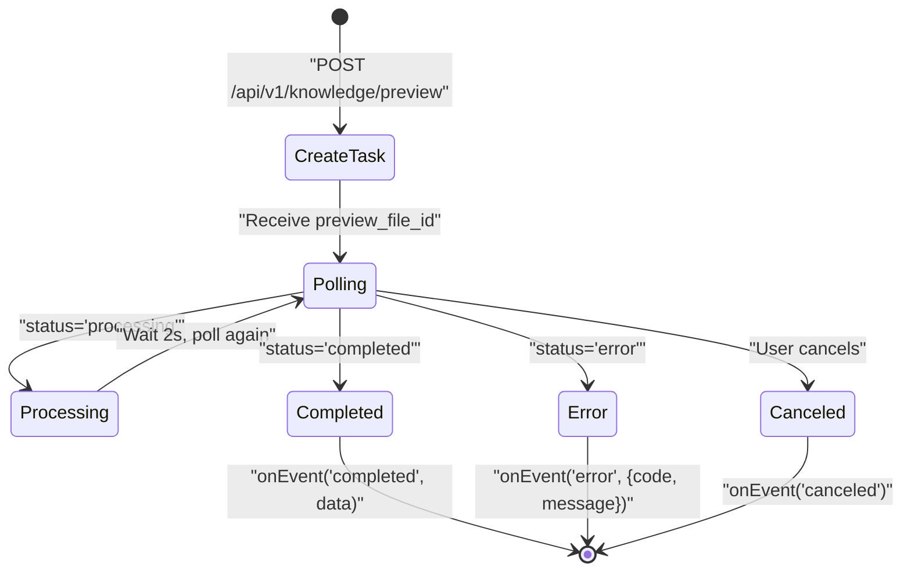

**Implementation Details** [src/frontend/platform/src/controllers/API/index.ts:313-461]():
- Uses dual `AbortController` instances for task creation and polling
- Default poll interval: 2000ms (configurable via `options.pollInterval`)
- Returns cancel function to abort requests and clear timers
- Emits events: `'processing'`, `'completed'`, `'error'`, `'canceled'`, `'closed'`
- Validates response format and emits structured errors

**Sources:**
- [src/frontend/platform/src/controllers/API/index.ts:313-461]()

---

## State Management Patterns

The frontend uses a combination of Zustand stores for global state, React Context for dependency injection, and local useState/useRef for component-specific state.

### Zustand Store Architecture

**Diagram: Store Structure with State Slices**

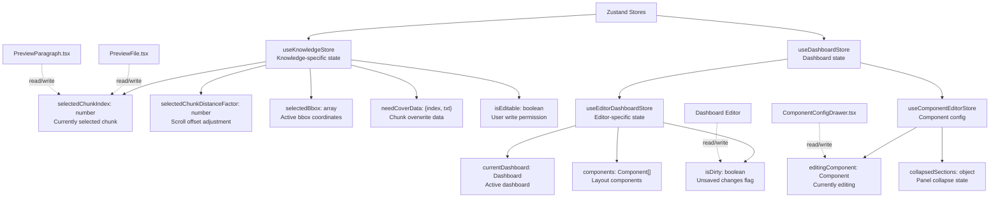

**Store Usage Patterns**:
- **Selective Subscriptions**: Components subscribe only to needed state slices using Zustand selectors
- **Action Methods**: Store exposes setter methods like `setSelectedChunkIndex()`, `updateEditingComponent()`
- **Derived State**: Computed values stored in components via `useMemo` rather than in stores

**Sources:**
- [src/frontend/platform/src/pages/KnowledgePage/components/PreviewParagraph.tsx:14-38]() (useKnowledgeStore usage)
- [src/frontend/platform/src/pages/Dashboard/components/config/ComponentConfigDrawer.tsx:14-34]() (dashboard stores)
- [src/frontend/platform/src/pages/Dashboard/components/config/useChartState.tsx:8-30]() (store integration)

### React Context Providers

| Context | Provider | Purpose | Accessed Via |
|---------|----------|---------|--------------|
| `userContext` | Root level | Current user info, permissions | `useContext(userContext)` |
| `locationContext` | Root level | Navigation state, route params | `useContext(locationContext)` |

**Sources:**
- [src/frontend/platform/src/pages/KnowledgePage/KnowledgeFile.tsx:316]() (userContext usage)
- [src/frontend/platform/src/pages/KnowledgePage/components/PreviewParagraph.tsx:5]() (locationContext usage)

### Local State and Ref Patterns

Complex components use `useRef` for values that shouldn't trigger re-renders and `useState` for UI state.

**Common Patterns**:
- **Debounced Updates**: `prevPreviewCountMapRef` prevents duplicate API calls [src/frontend/platform/src/pages/KnowledgePage/components/PreviewResult.tsx:67]()
- **Mutable Flags**: `submittingRef.current` prevents double-submit [src/frontend/platform/src/pages/KnowledgePage/filesUpload.tsx:59]()
- **Cached Data**: `labelsMapTempRef` stores bbox selections per chunk [src/frontend/platform/src/pages/KnowledgePage/components/PreviewFile.tsx:72]()
- **Latest Values**: `latestFileUrlRef` tracks most recent URL without re-renders [src/frontend/platform/src/pages/KnowledgePage/components/Paragraphs.tsx:79]()
- **Component Instances**: `fileUploadStep2Ref` enables parent-to-child method calls [src/frontend/platform/src/pages/KnowledgePage/filesUpload.tsx:57]()

**Sources:**
- [src/frontend/platform/src/pages/KnowledgePage/components/PreviewResult.tsx:67]()
- [src/frontend/platform/src/pages/KnowledgePage/filesUpload.tsx:56-59]()
- [src/frontend/platform/src/pages/KnowledgePage/components/PreviewFile.tsx:71-73]()

---

## File Upload Workflow Architecture

The file upload system implements two distinct multi-step wizards: a 4-step **normal upload flow** (`filesUpload.tsx`) and a 3-step **adjustment flow** (`AdjustFilesUpload.tsx`) for re-segmenting existing files.

### Upload Flow State Machines

**Diagram: Upload Workflow State Transitions**

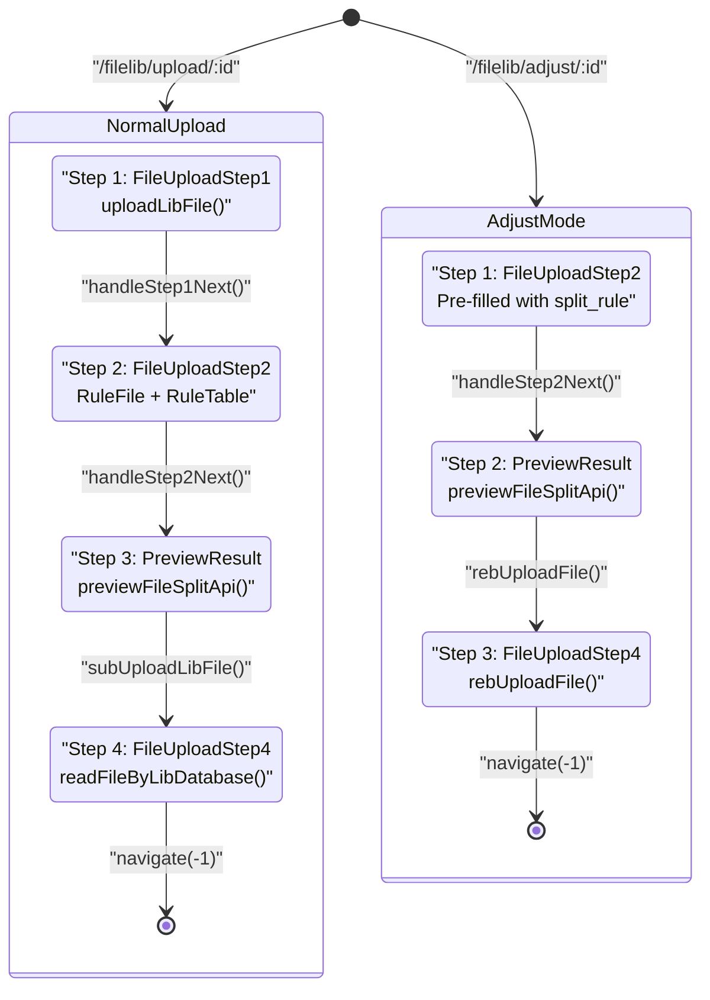

**Key Differences**:
- **Normal Upload**: Starts with file selection (`FileUploadStep1`), uploads files via `uploadLibFile`, processes via `subUploadLibFile`
- **Adjustment Mode**: Skips file selection, pre-fills `FileUploadStep2` with existing `split_rule` from `location.state`, re-processes via `rebUploadFile`

**Sources:**
- [src/frontend/platform/src/pages/KnowledgePage/filesUpload.tsx:17-138]()
- [src/frontend/platform/src/pages/KnowledgePage/AdjustFilesUpload.tsx:16-193]()

### Step 2: Segmentation Strategy Component

`FileUploadStep2.tsx` [src/frontend/platform/src/pages/KnowledgePage/components/FileUploadStep2.tsx:58-323]() handles both document and table file types with different rule configurations. It maintains persistent state across step navigation to preserve user inputs.

#### State Persistence Pattern

**Diagram: Step2 State Management with Persistence**

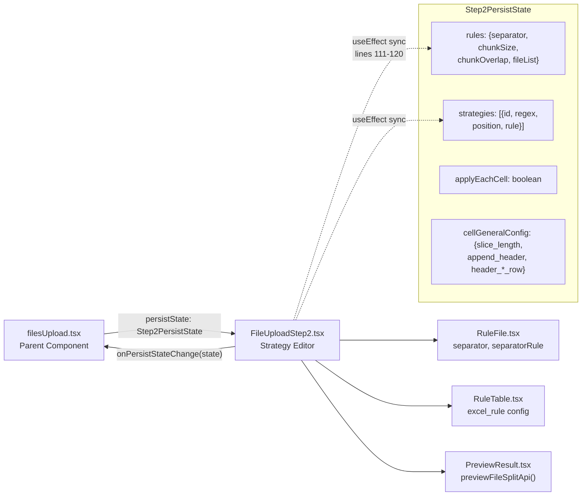

The parent component stores state via `step2PersistState` [src/frontend/platform/src/pages/KnowledgePage/filesUpload.tsx:54]() and passes it back to Step2 on re-mount via the `persistState` prop [src/frontend/platform/src/pages/KnowledgePage/filesUpload.tsx:345](), preventing data loss when navigating between steps.

**Key Implementation Details**:
- **Dual Rule Systems**: Documents use `separator`/`separator_rule` arrays [src/frontend/platform/src/pages/KnowledgePage/components/FileUploadStep2.tsx:413-425](); tables use `excel_rule` objects with `slice_length`, `append_header`, `header_start_row`, `header_end_row` [src/frontend/platform/src/pages/KnowledgePage/components/FileUploadStep2.tsx:376-383]()
- **Preview Toggle**: `showPreview` state controls side-by-side preview rendering [src/frontend/platform/src/pages/KnowledgePage/components/FileUploadStep2.tsx:65]()
- **Validation**: `vildateCell()` checks for empty separators, chunk overlap > chunk size, invalid header row ranges [src/frontend/platform/src/pages/KnowledgePage/components/FileUploadStep2.tsx:135-151]()
- **Tab Switching**: `displayMode` determines whether to show document tab, table tab, or both [src/frontend/platform/src/pages/KnowledgePage/components/FileUploadStep2.tsx:81-88]()

**Sources:**
- [src/frontend/platform/src/pages/KnowledgePage/components/FileUploadStep2.tsx:28-323]()
- [src/frontend/platform/src/pages/KnowledgePage/filesUpload.tsx:54-65]()
- [src/frontend/platform/src/pages/KnowledgePage/components/FileUploadStep2.tsx:111-120]()

### Step 3: Text Comparison and Preview

`PreviewResult.tsx` [src/frontend/platform/src/pages/KnowledgePage/components/PreviewResult.tsx:18-242]() orchestrates the preview system with four key responsibilities:
1. Calling `previewFileSplitApi()` (polling-based API) with segmentation rules
2. Displaying file selector `<Select>` dropdown for multi-file uploads
3. Rendering `PreviewFile.tsx` (left pane) and `PreviewParagraph.tsx` (right pane)
4. Synchronizing chunk edits with `updatePreviewChunkApi()`

**Preview API Flow**:

**Diagram: Preview Polling Sequence with Backend Interaction**

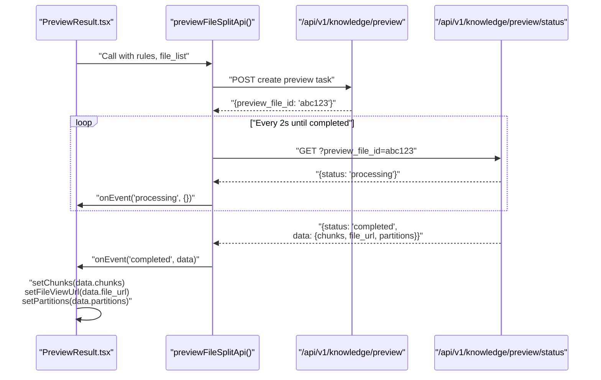

**State Management** [src/frontend/platform/src/pages/KnowledgePage/components/PreviewResult.tsx:38-80]():
- `chunks`: Array of chunk objects with `text`, `chunkIndex`, `bbox` metadata
- `partitions`: Partition data for bbox highlighting (UNS/OCR files)
- `syncChunksSelectId`: Tracks selected file to prevent stale chunk data
- `prevPreviewCountMapRef`: Prevents duplicate API calls via ref caching [src/frontend/platform/src/pages/KnowledgePage/components/PreviewResult.tsx:67]()

**Sources:**
- [src/frontend/platform/src/pages/KnowledgePage/components/PreviewResult.tsx:33-242]()
- [src/frontend/platform/src/controllers/API/index.ts:313-461]()

### Step 4: Processing Status Display

`FileUploadStep4.tsx` [src/frontend/platform/src/pages/KnowledgePage/components/FileUploadStep4.tsx:14-200]() implements a polling mechanism to track file processing status, displaying `ProgressItem` components for each file.

**File Status Transitions**:
- `await` (status=5): Queued, waiting for worker
- `parsing` (status=1 or 4): Being processed by Celery worker
- `end` (status=2): Successfully completed
- `error` (status=3 or 6): Failed or timed out

**Polling Logic** [src/frontend/platform/src/pages/KnowledgePage/components/FileUploadStep4.tsx:50-120]():
1. Maintains `processingRef` Set with file IDs being processed
2. Polls `readFileByLibDatabase()` every 5 seconds with `file_ids` filter
3. Matches results by `file_name.toLowerCase().trim()` for case-insensitive comparison
4. Removes completed/failed files from `processingRef` on status 2, 3, or 6
5. Stops polling when `processingRef.current.size === 0`
6. Displays success dialog when all files complete

**Sources:**
- [src/frontend/platform/src/pages/KnowledgePage/components/FileUploadStep4.tsx:14-200]()

---

## Document Preview and Editing System

The preview system supports multiple file formats (PDF, DOCX, Excel, Markdown, images) with unified bbox-based highlighting for OCR-parsed documents.

### Preview File Type Routing

**Diagram: File Format Routing with Component Mapping**

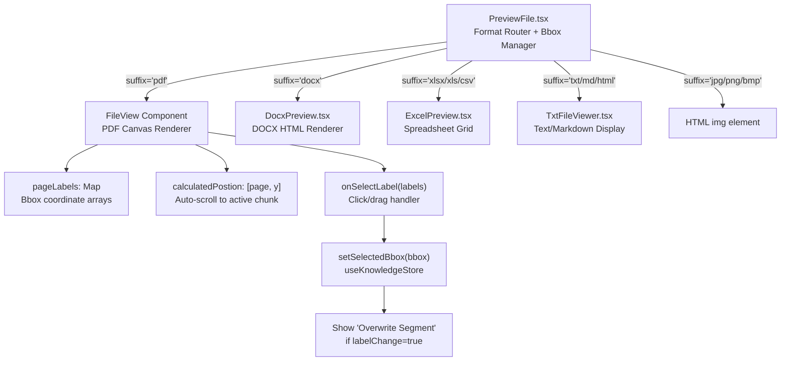

**File Type Detection Logic** [src/frontend/platform/src/pages/KnowledgePage/components/PreviewFile.tsx:43-66]():
1. Matches `rawFiles` array by `file.id` to get complete metadata
2. Determines `fileParseType`: if `step === 2` use `resultFiles[0].isEtl4lm`, else if `step === 3 && etl` use `etl`, else use `targetFile.fileType`
3. Computes `suffix` from URL extension: `url.split('?')[0].split('/').pop().split('.')[1].toLowerCase()`
4. Identifies `isUnsType`: `fileParseType === 'uns' || targetFile.fileType.includes('uns')`

**Sources:**
- [src/frontend/platform/src/pages/KnowledgePage/components/PreviewFile.tsx:14-210]()
- [src/frontend/platform/src/pages/KnowledgePage/components/PreviewFile.tsx:43-66]()

### Bbox Label Management and Chunk Synchronization

For PDF and UNS-type documents, `PreviewFile.tsx` maintains a `labelsMap` state (Map structure) that synchronizes with chunk selections via the `selectedChunkIndex` Zustand store value.

#### Label Synchronization Flow

**Diagram: Bbox Selection and Chunk Overwrite Flow**

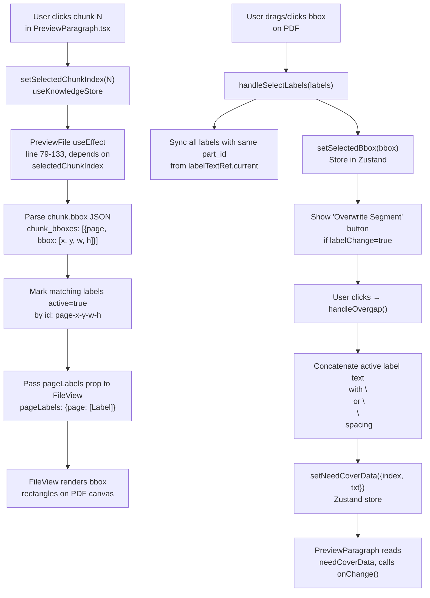

**Key Functions**:
- **`convertJsonData(partitions)`** [src/frontend/platform/src/pages/KnowledgePage/components/ParagraphEdit.tsx:1-50](): Converts partition object `{id: {text, type, part_id}}` to array `[{id, page, label: [x,y,w,h], active}]`
- **`handleSelectLabels(labels)`** [src/frontend/platform/src/pages/KnowledgePage/components/PreviewFile.tsx:170-206](): Groups selections by `part_id`, updates `labelsMap` state, calls `setSelectedBbox()`
- **`handleOvergap()`** [src/frontend/platform/src/pages/KnowledgePage/components/PreviewFile.tsx:287-320](): Merges active label text with intelligent spacing: uses `\n\n` if label type is `title`, else `\n`

**Sources:**
- [src/frontend/platform/src/pages/KnowledgePage/components/PreviewFile.tsx:79-206]()
- [src/frontend/platform/src/pages/KnowledgePage/components/PreviewFile.tsx:287-320]()
- [src/frontend/platform/src/pages/KnowledgePage/components/ParagraphEdit.tsx:1-50]()

### Chunk Editing Interface

`PreviewParagraph.tsx` [src/frontend/platform/src/pages/KnowledgePage/components/PreviewParagraph.tsx:1-250]() renders the right-side chunk list with inline editing capabilities. Each chunk is an `EditMarkdown` component supporting two editor modes.

#### Editor Mode Toggle

| Mode | Component | Features | Implementation |
|------|-----------|----------|----------------|
| **WYSIWYG** (default) | `VditorEditor` | Instant rendering, Markdown shortcuts, math support (`katex`), toolbar hidden | Uses `Vditor` library [line 12-13]() |
| **Raw Markdown** | `AceEditorCom` | Syntax highlighting, GitHub theme, no gutter, live validation | Uses `react-ace` with `markdown` mode [line 11]() |

**Editor Lifecycle** [src/frontend/platform/src/pages/KnowledgePage/components/PreviewParagraph.tsx:115-230]():
1. User clicks chunk → `setSelectedChunkIndex(index)` → highlights in `PreviewFile`
2. User toggles mode icon → `setEdit(!edit)` → switches between Vditor and Ace components
3. User edits text → `debounced setValue()` (via `useMiniDebounce` hook) → local state update
4. User blurs field → `handleBlur()` → validates non-empty → calls `onChange(chunkIndex, newValue)`
5. Parent (`Paragraphs.tsx` or `PreviewResult.tsx`) calls API → `updateChunkApi()` or `updatePreviewChunkApi()`

**Validation Rules** [src/frontend/platform/src/pages/KnowledgePage/components/PreviewParagraph.tsx:195-210]():
- Empty chunks rejected with error toast: `t('chunkContentCannotBeEmpty')`
- Unchanged chunks skip API call (text comparison after `.trim()`)
- Deleted chunks removed from array, triggering `reload()` in parent

**Sources:**
- [src/frontend/platform/src/pages/KnowledgePage/components/PreviewParagraph.tsx:34-249]()
- [src/frontend/platform/src/pages/KnowledgePage/components/Paragraphs.tsx:209-231]()

---

## State Management Architecture

The knowledge base UI uses a hybrid state management approach: Zustand for cross-component shared state, React hooks for local state, and URL parameters for navigation persistence.

### Zustand Store: `useKnowledgeStore`

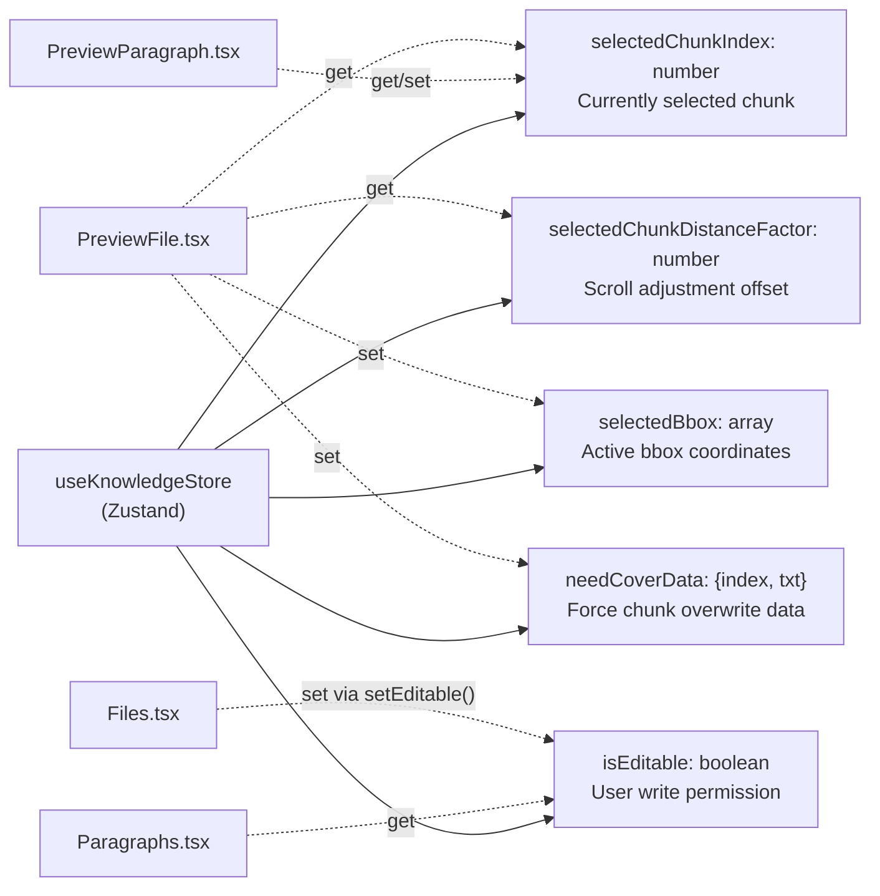

**Store Definition** (inferred pattern from usage):
```typescript
interface KnowledgeStore {
  selectedChunkIndex: number;
  setSelectedChunkIndex: (index: number) => void;
  selectedChunkDistanceFactor: number;
  setSelectedChunkDistanceFactor: (factor: number) => void;
  selectedBbox: Array<{page: number, bbox: number[]}>;
  setSelectedBbox: (bbox: Array) => void;
  needCoverData: {index: number, txt: string};
  setNeedCoverData: (data: {index: number, txt: string}) => void;
  isEditable: boolean;
  setEditable: (editable: boolean) => void;
}
```

**Sources:**
- [src/frontend/platform/src/pages/KnowledgePage/components/PreviewParagraph.tsx:259]()
- [src/frontend/platform/src/pages/KnowledgePage/components/PreviewFile.tsx:37-40]()
- [src/frontend/platform/src/pages/KnowledgePage/components/Paragraphs.tsx:32-96]()

### Local State Patterns

Complex components use `useRef` for values that shouldn't trigger re-renders and `useState` for UI state:

**Common Patterns**:
- **Debounced Updates**: `prevPreviewCountMapRef` prevents duplicate API calls [src/frontend/platform/src/pages/KnowledgePage/components/PreviewResult.tsx:67]()
- **Mutable Flags**: `submittingRef.current` prevents double-submit [src/frontend/platform/src/pages/KnowledgePage/filesUpload.tsx:59]()
- **Cached Data**: `labelsMapTempRef` stores bbox selections per chunk [src/frontend/platform/src/pages/KnowledgePage/components/PreviewFile.tsx:72]()
- **Latest Values**: `latestFileUrlRef` tracks most recent URL without causing re-renders [src/frontend/platform/src/pages/KnowledgePage/components/Paragraphs.tsx:79]()

**Sources:**
- [src/frontend/platform/src/pages/KnowledgePage/components/PreviewResult.tsx:67]()
- [src/frontend/platform/src/pages/KnowledgePage/filesUpload.tsx:56-59]()
- [src/frontend/platform/src/pages/KnowledgePage/components/PreviewFile.tsx:71-73]()

---

## API Integration Patterns

The frontend communicates with the backend via a centralized API module that implements polling, SSE-style interfaces, and CRUD operations.

### API Function Categories

```mermaid
graph TB
    API["controllers/API/index.ts"]
    
    subgraph "Knowledge Base CRUD"
        createFileLib["createFileLib(data)<br/>POST /api/v1/knowledge/create"]
        readFileLibDatabase["readFileLibDatabase(params)<br/>GET /api/v1/knowledge"]
        updateKnowledgeApi["updateKnowledgeApi(data)<br/>PUT /api/v1/knowledge"]
        deleteFileLib["deleteFileLib(id)<br/>DELETE /api/v1/knowledge"]
    end
    
    subgraph "File Operations"
        uploadLibFile["uploadLibFile(data, config)<br/>POST /api/v1/knowledge/upload"]
        subUploadLibFile["subUploadLibFile(data)<br/>POST /api/v1/knowledge/process"]
        rebUploadFile["rebUploadFile(data)<br/>POST /rebuild"]
        retryKnowledgeFileApi["retryKnowledgeFileApi(data)<br/>POST /retry"]
        deleteFile["deleteFile(id)<br/>DELETE /file/:id"]
    end
    
    subgraph "Chunk Management"
        getKnowledgeChunkApi["getKnowledgeChunkApi(params)<br/>GET /chunk?file_ids=..."]
        updateChunkApi["updateChunkApi(data)<br/>PUT /chunk"]
        delChunkApi["delChunkApi(data)<br/>DELETE /chunk"]
    end
    
    subgraph "Preview System"
        previewFileSplitApi["previewFileSplitApi(data, onEvent)<br/>POST /preview + Polling"]
        updatePreviewChunkApi["updatePreviewChunkApi(data)<br/>PUT /preview"]
        delChunkInPreviewApi["delChunkInPreviewApi(data)<br/>DELETE /preview"]
    end
    
    subgraph "Metadata"
        addMetadata["addMetadata(kb_id, fields)<br/>POST /add_metadata_fields"]
        updateMetadataFields["updateMetadataFields(kb_id, updates)<br/>PUT /update_metadata_fields"]
        deleteMetadataFields["deleteMetadataFields(kb_id, names)<br/>DELETE /delete_metadata_fields"]
        saveUserMetadataApi["saveUserMetadataApi(file_id, list)<br/>PUT /file/user_metadata"]
    end
    
    API --> createFileLib
    API --> readFileLibDatabase
    API --> uploadLibFile
    API --> previewFileSplitApi
    API --> getKnowledgeChunkApi
    API --> addMetadata
```

**Sources:**
- [src/frontend/platform/src/controllers/API/index.ts:139-531]()

### Preview API Polling Implementation

The `previewFileSplitApi()` function implements a polling-based SSE-like interface that creates a task and polls for status updates.

**Polling State Machine**:

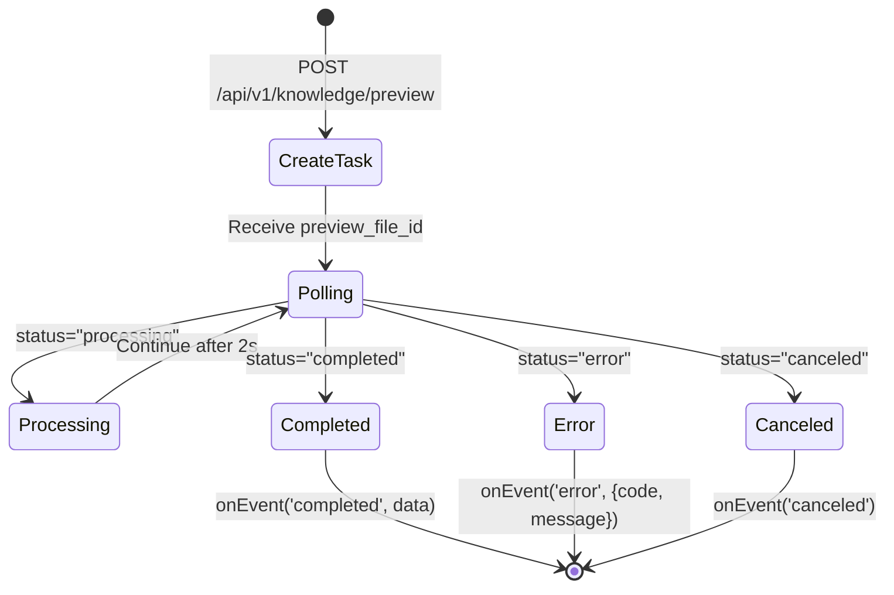

**Implementation Details**:
- Uses two `AbortController` instances: one for task creation, one for polling
- Default poll interval: 2000ms (configurable via `options.pollInterval`)
- Returns cancel function that aborts both controllers and clears timers
- Emits events: `'processing'`, `'completed'`, `'error'`, `'canceled'`, `'closed'`

**Error Handling**:
- Catches `ERR_CANCELED` / `CanceledError` and silently returns
- Falls back to generic error event for network failures
- Validates response format and emits structured error on invalid status

**Sources:**
- [src/frontend/platform/src/controllers/API/index.ts:313-461]()

### Request Error Handling

All API calls are wrapped with `captureAndAlertRequestErrorHoc()`, which:
1. Catches errors from async functions
2. Displays toast notifications with localized error messages
3. Returns `null` on error to allow graceful fallback
4. Supports optional custom error handler as second parameter

**Usage Pattern**:
```typescript
await captureAndAlertRequestErrorHoc(
  deleteFile(id).then(res => {
    reload();
  })
);
```

**Sources:**
- [src/frontend/platform/src/controllers/request.ts]() (referenced but not in provided files)
- [src/frontend/platform/src/pages/KnowledgePage/components/Files.tsx:157-161]()

---

## Metadata Management System

The metadata system allows users to define custom fields for knowledge base files with type validation and built-in field protection.

### Metadata Dialog Architecture

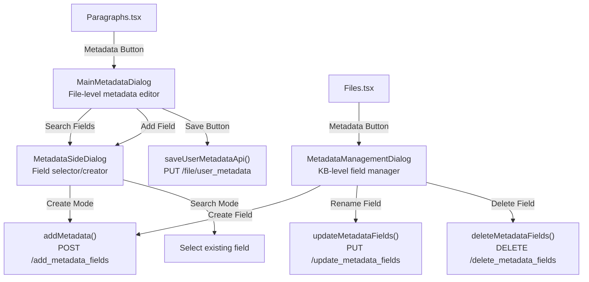

**Built-in Metadata Fields** (read-only, reserved names):
- `document_id`, `document_name` (String)
- `upload_time`, `update_time` (Time)
- `uploader`, `updater` (String)
- `chunk_index`, `page`, `knowledge_id` (Number)
- `bbox`, `abstract`, `user_metadata` (String)

**Field Naming Rules**:
- Must start with lowercase letter
- Only lowercase letters, digits, underscores allowed: `/^[a-z][a-z0-9_]*$/`
- Maximum length: 255 characters
- Cannot overlap with built-in field names

**Sources:**
- [src/frontend/platform/src/pages/KnowledgePage/components/Paragraphs.tsx:475-509]()
- [src/frontend/platform/src/pages/KnowledgePage/components/MetadataManagementDialog.tsx:31-44]()
- [src/frontend/platform/src/pages/KnowledgePage/components/MetadataManagementDialog.tsx:188-231]()

---

## Internationalization (i18n)

All user-facing text uses `react-i18next` with the `knowledge` namespace. The system supports dynamic language switching and provides context-aware translations.

**Common Translation Keys**:
- File operations: `uploadFile`, `deleteFile`, `retry`, `parseFailed`
- Segmentation: `splitStrategy`, `chunkSize`, `chunkOverlap`, `previewResults`
- Status: `parsing`, `completed`, `failed`, `copying`
- Validation: `nameRequired`, `nameExceedsLimit`, `chunkContentCannotBeEmpty`

**Usage Pattern**:
```typescript
const { t } = useTranslation('knowledge');
<span>{t('chunk')}{data.chunkIndex + 1}</span>
```

**Sources:**
- [src/frontend/platform/src/pages/KnowledgePage/components/PreviewParagraph.tsx:16-28]()
- [src/frontend/platform/src/pages/KnowledgePage/KnowledgeFile.tsx:416-419]()

---

