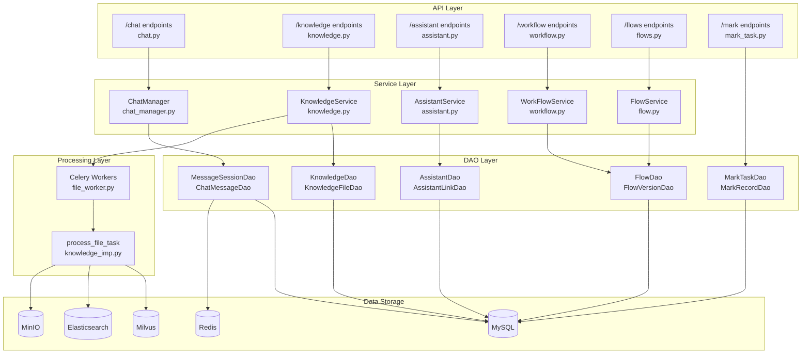
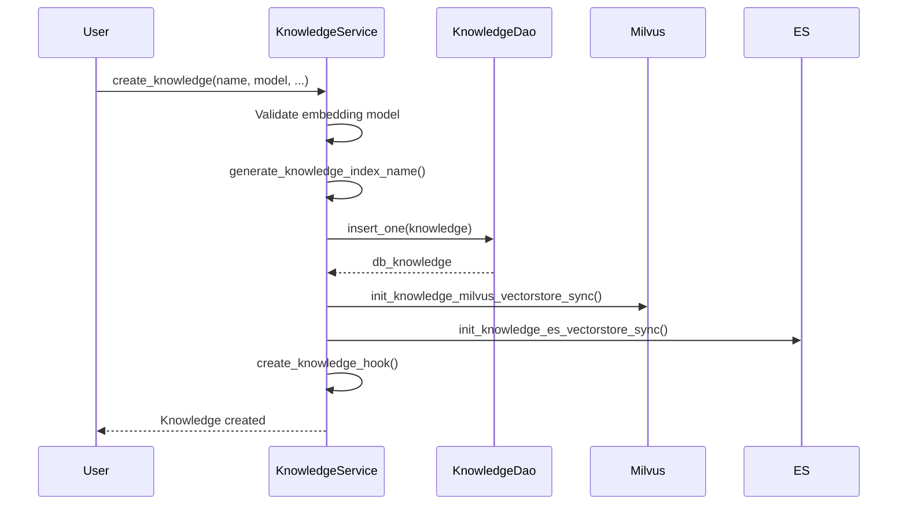
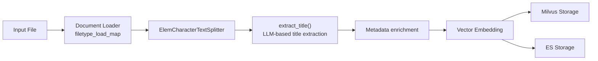
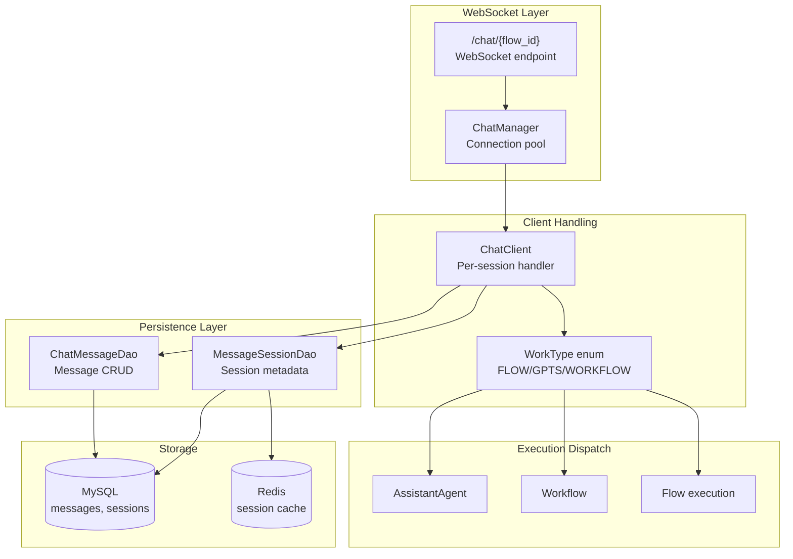
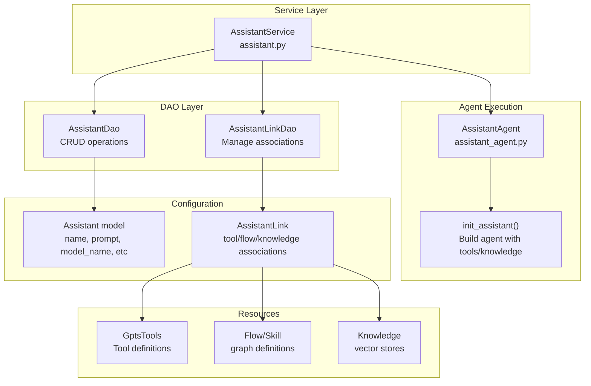
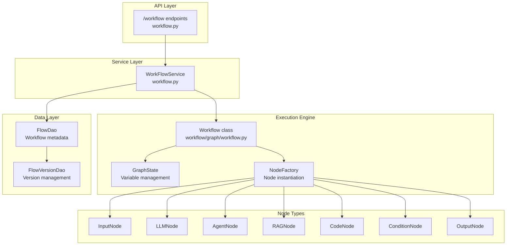
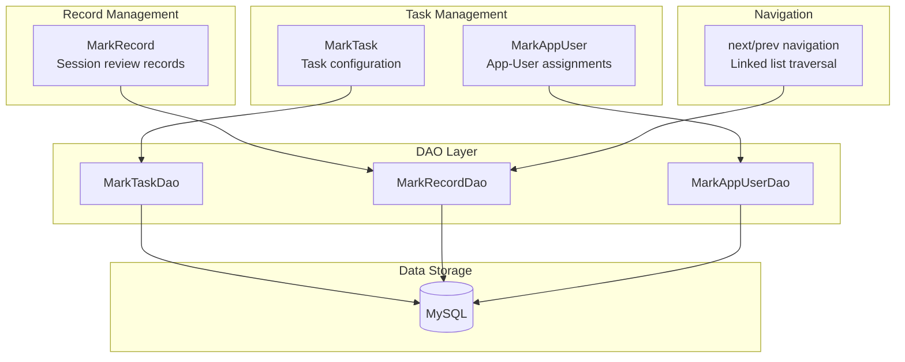
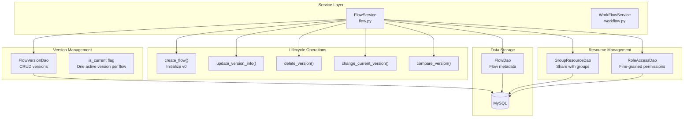

<!-- source: DeepWiki mcp.deepwiki.com · repo dataelement/bisheng · page 3 Core Services · fetched 2026-10-29 -->

# Core Services

<details>
<summary>Relevant source files</summary>

The following files were used as context for generating this wiki page:

- [src/backend/bisheng/api/services/assistant.py](src/backend/bisheng/api/services/assistant.py)
- [src/backend/bisheng/api/services/flow.py](src/backend/bisheng/api/services/flow.py)
- [src/backend/bisheng/api/services/knowledge.py](src/backend/bisheng/api/services/knowledge.py)
- [src/backend/bisheng/api/services/knowledge_imp.py](src/backend/bisheng/api/services/knowledge_imp.py)
- [src/backend/bisheng/api/services/workflow.py](src/backend/bisheng/api/services/workflow.py)
- [src/backend/bisheng/api/v1/assistant.py](src/backend/bisheng/api/v1/assistant.py)
- [src/backend/bisheng/api/v1/chat.py](src/backend/bisheng/api/v1/chat.py)
- [src/backend/bisheng/api/v1/flows.py](src/backend/bisheng/api/v1/flows.py)
- [src/backend/bisheng/api/v1/mark_task.py](src/backend/bisheng/api/v1/mark_task.py)
- [src/backend/bisheng/api/v1/schema/chat_schema.py](src/backend/bisheng/api/v1/schema/chat_schema.py)
- [src/backend/bisheng/api/v1/schema/mark_schema.py](src/backend/bisheng/api/v1/schema/mark_schema.py)
- [src/backend/bisheng/api/v1/schemas.py](src/backend/bisheng/api/v1/schemas.py)
- [src/backend/bisheng/api/v1/skillcenter.py](src/backend/bisheng/api/v1/skillcenter.py)
- [src/backend/bisheng/api/v1/workflow.py](src/backend/bisheng/api/v1/workflow.py)
- [src/backend/bisheng/database/models/assistant.py](src/backend/bisheng/database/models/assistant.py)
- [src/backend/bisheng/database/models/flow.py](src/backend/bisheng/database/models/flow.py)
- [src/backend/bisheng/database/models/flow_version.py](src/backend/bisheng/database/models/flow_version.py)
- [src/backend/bisheng/database/models/mark_app_user.py](src/backend/bisheng/database/models/mark_app_user.py)
- [src/backend/bisheng/database/models/mark_record.py](src/backend/bisheng/database/models/mark_record.py)
- [src/backend/bisheng/database/models/mark_task.py](src/backend/bisheng/database/models/mark_task.py)
- [src/backend/bisheng/database/models/message.py](src/backend/bisheng/database/models/message.py)
- [src/backend/bisheng/database/models/template.py](src/backend/bisheng/database/models/template.py)
- [src/backend/bisheng/database/models/user_link.py](src/backend/bisheng/database/models/user_link.py)
- [src/backend/bisheng/utils/linked_list.py](src/backend/bisheng/utils/linked_list.py)
- [src/backend/bisheng/worker/knowledge/file_worker.py](src/backend/bisheng/worker/knowledge/file_worker.py)
- [src/backend/bisheng/worker/knowledge/qa.py](src/backend/bisheng/worker/knowledge/qa.py)
- [src/backend/bisheng/worker/knowledge/rebuild_knowledge_worker.py](src/backend/bisheng/worker/knowledge/rebuild_knowledge_worker.py)

</details>


## Purpose and Scope

This document provides an overview of the major functional services that comprise Bisheng's core capabilities. These services are implemented as distinct service classes and DAO (Data Access Object) layers that orchestrate business logic, data persistence, and system integrations.

The services covered here include:
- **Knowledge Base Management** - file upload, processing, chunking, embedding, and vector storage
- **Chat and Messaging System** - real-time WebSocket communication, message persistence, and session management
- **Assistant System** - AI assistant configuration, tool/knowledge/skill integration, and agent orchestration
- **Workflow Engine** - node-based visual programming with typed inputs/outputs
- **Marking and Annotation** - session review workflows and quality assurance tasks
- **Flow and Skill Management** - application lifecycle, versioning, and permission management

For implementation details of specific execution engines (AssistantAgent, Workflow, Linsight), see [Assistant System](#3.3), [Linsight AI Workbench](#3.4), and [Workflow Engine](#3.5). For data storage architecture, see [Data Storage Layer](#2.3). For frontend UI patterns, see [Frontend Architecture](#2.1).

---

## Service Architecture Overview

The following diagram shows how the core services relate to each other and the data layer:



**Sources:** 
- [src/backend/bisheng/api/v1/chat.py:1-565]()
- [src/backend/bisheng/api/services/knowledge.py:1-1000]()
- [src/backend/bisheng/api/services/assistant.py:1-450]()
- [src/backend/bisheng/api/services/workflow.py:1-363]()
- [src/backend/bisheng/api/services/flow.py:1-350]()

---

## Knowledge Base Management

The Knowledge Base Management service handles the complete lifecycle of document ingestion, processing, chunking, embedding, and retrieval.

### Service Architecture

| Component | File | Key Classes | Responsibility |
|-----------|------|-------------|----------------|
| **Service Layer** | `knowledge.py` | `KnowledgeService` | Orchestrates knowledge base operations, authorization checks |
| **Implementation Layer** | `knowledge_imp.py` | `KnowledgeUtils`, `addEmbedding()`, `process_file_task()` | File parsing, chunking, embedding logic |
| **Worker Layer** | `file_worker.py` | `parse_knowledge_file_celery()` | Asynchronous Celery tasks for file processing |
| **DAO Layer** | `knowledge.py` (domain) | `KnowledgeDao`, `KnowledgeFileDao` | Database CRUD operations |

### Key Operations

#### Creating a Knowledge Base

The `KnowledgeService.create_knowledge()` method handles knowledge base creation:



**Sources:** [src/backend/bisheng/api/services/knowledge.py:156-199]()

#### File Upload and Processing

File processing follows an asynchronous pipeline:

1. **Upload Phase** - `save_knowledge_file()` uploads files to MinIO and creates database records with `WAITING` status
2. **Async Processing** - Celery task `parse_knowledge_file_celery()` downloads file, parses content, chunks text, embeds to Milvus/ES
3. **Preview/Edit** - Users can preview chunks via `get_preview_file_chunk()` and edit via `update_preview_file_chunk()`
4. **Finalization** - Status updates to `SUCCESS` or `FAILED`

The main processing function is `process_file_task()` in [src/backend/bisheng/api/services/knowledge_imp.py:252-298]():

```python
def process_file_task(
    knowledge: Knowledge,
    db_files: List[KnowledgeFile],
    separator: List[str],
    separator_rule: List[str],
    chunk_size: int,
    chunk_overlap: int,
    callback_url: str = None,
    extra_metadata: Dict = None,
    preview_cache_keys: List[str] = None,
    ...
)
```

**Sources:** 
- [src/backend/bisheng/api/services/knowledge.py:511-591]()
- [src/backend/bisheng/api/services/knowledge_imp.py:252-541]()
- [src/backend/bisheng/worker/knowledge/file_worker.py:25-145]()

#### Text Chunking and Embedding

The `read_chunk_text()` function orchestrates document parsing and chunking:



The system supports multiple file types via specialized loaders defined in [src/backend/bisheng/api/services/knowledge_imp.py:75-82]():

```python
filetype_load_map = {
    "txt": TextLoader,
    "pdf": PyPDFLoader,
    "html": BSHTMLLoader,
    "md": TextLoader,
    "docx": UnstructuredWordDocumentLoader,
    "pptx": UnstructuredPowerPointLoader,
}
```

**Sources:** [src/backend/bisheng/api/services/knowledge_imp.py:789-962]()

#### Preview Cache Management

The `KnowledgeUtils` class provides Redis-based caching for preview operations:

- `get_preview_cache_key()` - generates cache key: `preview_file_chunk:{knowledge_id}:{md5}`
- `async_save_preview_cache()` - stores chunked text and metadata as JSON in Redis hash
- `async_get_preview_cache()` - retrieves cached chunks for editing
- `delete_preview_cache()` - clears cache after final processing

**Sources:** [src/backend/bisheng/api/services/knowledge_imp.py:85-174]()

### Vector Storage Integration

Knowledge bases use dual storage for hybrid retrieval:

| Storage | Purpose | Initialization |
|---------|---------|----------------|
| **Milvus** | Semantic vector similarity search | `KnowledgeRag.init_knowledge_milvus_vectorstore_sync()` |
| **Elasticsearch** | Keyword/BM25 full-text search | `KnowledgeRag.init_knowledge_es_vectorstore_sync()` |

Both are initialized with `KNOWLEDGE_RAG_METADATA_SCHEMA` for consistent metadata fields.

**Sources:** [src/backend/bisheng/api/services/knowledge_imp.py:369-399](), [src/backend/bisheng/api/services/knowledge_imp.py:458-464]()

---

## Chat and Messaging System

The Chat and Messaging System provides real-time WebSocket communication, message persistence, session tracking, and conversation history management.

### Core Components



**Sources:** [src/backend/bisheng/api/v1/chat.py:510-565]()

### WebSocket Chat Endpoint

The main chat endpoint is defined at [src/backend/bisheng/api/v1/chat.py:510-565]():

```python
@router.websocket('/chat/{flow_id}')
async def chat(
    *,
    flow_id: UUID,
    websocket: WebSocket,
    chat_id: Optional[str] = None,
    version_id: Optional[int] = None,
    login_user: UserPayload = Depends(UserPayload.get_login_user_from_ws),
):
    """Websocket endpoint for chat."""
```

The endpoint:
1. Validates flow existence and online status
2. Retrieves graph data from Redis cache or database
3. Delegates to `ChatManager.handle_websocket()` for connection management
4. Handles exceptions and sends error messages via WebSocket

**Sources:** [src/backend/bisheng/api/v1/chat.py:510-565]()

### Message Persistence

Messages are persisted using the `ChatMessage` model and `ChatMessageDao`:

| Field | Type | Description |
|-------|------|-------------|
| `is_bot` | bool | Whether message is from bot (True) or user (False) |
| `message` | str | Message content (LONGTEXT) |
| `type` | str | Message type: 'start', 'stream', 'end', 'error', 'info', 'file' |
| `category` | str | Message category: 'question', 'answer', 'processing', 'tool' |
| `flow_id` | str | Associated flow/assistant/workflow ID |
| `chat_id` | str | Session identifier |
| `user_id` | int | User who created the message |
| `liked` | int | User rating: 0=unrated, 1=liked, 2=disliked |
| `intermediate_steps` | str | Process log for debugging |

**Sources:** [src/backend/bisheng/database/models/message.py:20-47]()

### Session Management

The `MessageSession` model tracks conversation sessions:

```python
class MessageSessionDao:
    @classmethod
    def get_one(cls, chat_id: str) -> MessageSession
    
    @classmethod
    def filter_session(
        cls,
        flow_ids: List[str] = None,
        user_ids: List[int] = None,
        flow_type: List[int] = None,
        page: int = 1,
        limit: int = 10,
        include_delete: bool = False
    ) -> List[MessageSession]
    
    @classmethod
    def delete_session(cls, chat_id: str)
    
    @classmethod
    def update_sensitive_status(cls, chat_id: str, status: SensitiveStatus)
```

**Sources:** [src/backend/bisheng/database/models/session.py:1-200]() (inferred from usage patterns)

### REST API Endpoints

| Endpoint | Method | Purpose |
|----------|--------|---------|
| `/chat/history` | GET | Retrieve chat message history with pagination |
| `/chat/list` | GET | Get user's session list filtered by flow type |
| `/chat/app/list` | GET | Get sessions for marking/review tasks |
| `/chat/{chat_id}` | DELETE | Delete a chat session and associated data |
| `/chat/message` | POST | Add a full Q&A record (for security checks) |
| `/chat/message/{message_id}` | PUT | Update message content (for security review) |
| `/liked` | POST | Record user's like/dislike feedback |
| `/chat/copied` | POST | Track when user copies message content |

**Sources:** [src/backend/bisheng/api/v1/chat.py:54-461]()

### Message Feedback System

The system tracks three types of user feedback:

```python
class LikedType(Enum):
    UNRATED = 0
    LIKED = 1
    DISLIKED = 2

# Counters maintained at session level:
# - like_count: Number of liked messages
# - dislike_count: Number of disliked messages  
# - copied_count: Number of copied messages
```

When feedback changes, both the message record and session counters are updated atomically.

**Sources:** [src/backend/bisheng/api/v1/chat.py:408-442](), [src/backend/bisheng/database/models/message.py:14-17]()

---

## Assistant System

The Assistant System provides a configuration-driven AI agent framework that integrates tools, knowledge bases, skills, and LLMs into coherent conversational assistants.

### Service Architecture



**Sources:** [src/backend/bisheng/api/services/assistant.py:1-450]()

### Assistant Configuration Model

The `Assistant` model stores assistant metadata:

| Field | Type | Description |
|-------|------|-------------|
| `id` | str | UUID primary key |
| `name` | str | Assistant display name |
| `desc` | str | Description shown to users |
| `logo` | str | Logo image URL/path |
| `system_prompt` | str | Internal system-level prompt |
| `prompt` | str | User-visible prompt/instructions |
| `guide_word` | str | Opening message/ice breaker |
| `guide_question` | List | Suggested questions |
| `model_name` | str | LLM model ID from model management |
| `temperature` | float | Model temperature (0.0-1.0) |
| `max_token` | int | Maximum token limit |
| `status` | int | 1=offline, 2=online |
| `user_id` | int | Creator user ID |

**Sources:** [src/backend/bisheng/database/models/assistant.py:22-43]()

### Assistant-Resource Linking

The `AssistantLink` table maintains many-to-many relationships:

```python
class AssistantLinkBase:
    assistant_id: str  # Foreign key to Assistant
    tool_id: int       # Foreign key to GptsTools (nullable)
    flow_id: str       # Foreign key to Flow (nullable)
    knowledge_id: int  # Foreign key to Knowledge (nullable)
```

Helper methods manage these associations:

```python
class AssistantLinkDao:
    @classmethod
    def update_assistant_tool(cls, assistant_id: str, tool_list: List[int])
    
    @classmethod
    def update_assistant_flow(cls, assistant_id: str, flow_list: List[str])
    
    @classmethod
    def update_assistant_knowledge(cls, assistant_id: str, knowledge_list: List[int])
```

**Sources:** [src/backend/bisheng/database/models/assistant.py:45-140]()

### Key Service Methods

#### Creating an Assistant

```python
class AssistantService:
    @classmethod
    async def create_assistant(
        cls, 
        request: Request, 
        login_user: UserPayload, 
        assistant: Assistant
    ) -> AssistantInfo:
        # 1. Check for name conflicts
        # 2. Auto-populate default LLM model
        # 3. Generate auto info (description, guide word/questions)
        # 4. Create database record
        # 5. Execute create_assistant_hook() for group resources
```

**Sources:** [src/backend/bisheng/api/services/assistant.py:149-186]()

#### Updating an Assistant

The update flow validates permissions and atomically updates configuration:

```python
@classmethod
async def update_assistant(
    cls,
    request: Request,
    login_user: UserPayload, 
    req: AssistantUpdateReq
) -> AssistantInfo:
    # 1. Check write permission via access_check()
    # 2. Validate name uniqueness if changed
    # 3. Update assistant fields
    # 4. Update tool/flow/knowledge associations if provided
    # 5. Execute update_assistant_hook()
```

**Sources:** [src/backend/bisheng/api/services/assistant.py:282-327]()

#### Status Management

Assistants can be online (2) or offline (1). Going online requires validation:

```python
@classmethod
async def update_status(
    cls,
    request: Request,
    login_user: UserPayload,
    assistant_id: str,
    status: int
) -> bool:
    if status == AssistantStatus.ONLINE.value:
        # Try to initialize agent to validate configuration
        tmp_agent = AssistantAgent(assistant, '', login_user.user_id)
        await tmp_agent.init_assistant()  # Raises if invalid config
```

**Sources:** [src/backend/bisheng/api/services/assistant.py:342-368]()

### REST API Endpoints

| Endpoint | Method | Purpose |
|----------|--------|---------|
| `/assistant` | GET | List assistants with filtering and pagination |
| `/assistant/info/{assistant_id}` | GET | Get detailed assistant configuration |
| `/assistant` | POST | Create new assistant |
| `/assistant` | PUT | Update assistant configuration |
| `/assistant/delete` | POST | Delete assistant and cleanup resources |
| `/assistant/status` | POST | Change online/offline status |
| `/assistant/prompt` | POST | Update prompt only |
| `/assistant/flow` | POST | Update skill list |
| `/assistant/tool` | POST | Update tool list |
| `/assistant/auto/task` | POST | Create auto-optimization task |
| `/assistant/auto` | GET | Stream auto-generated prompt/tools (SSE) |
| `/assistant/chat/{assistant_id}` | WebSocket | Chat with assistant |

**Sources:** [src/backend/bisheng/api/v1/assistant.py:1-177]()

---

## Workflow Engine

The Workflow Engine enables node-based visual programming with typed inputs/outputs, supporting complex branching, loops, and conditional logic.

### Service Architecture



**Sources:** [src/backend/bisheng/api/services/workflow.py:1-363]()

### Workflow Data Model

Workflows reuse the `Flow` model with `flow_type = FlowType.WORKFLOW.value` (10):

```python
class Flow:
    id: str                  # UUID
    name: str                # Workflow name
    description: str         # Description
    data: Dict              # Node graph: {"nodes": [...], "edges": [...]}
    status: int             # 1=offline, 2=online
    flow_type: int          # 10 for workflows
    user_id: int            # Creator
```

**Sources:** [src/backend/bisheng/database/models/flow.py:80-83]()

### Key Service Methods

#### Running Single Node

The `run_once()` method executes a single node for testing:

```python
@classmethod
def run_once(
    cls,
    login_user: UserPayload,
    node_input: Dict[str, any],
    node_data: Dict[any, any],
    workflow_id: str
):
    # 1. Get workflow info
    # 2. Create BaseNodeData from node_data
    # 3. Instantiate node via NodeFactory
    # 4. Handle input based on node type
    # 5. Execute node._run()
    # 6. Parse and return log data
```

**Sources:** [src/backend/bisheng/api/services/workflow.py:115-178]()

#### Status Management

Workflows must be online to execute. The `update_flow_status()` method validates before going online:

```python
@classmethod
async def update_flow_status(
    cls,
    login_user: UserPayload,
    flow_id: str,
    version_id: int,
    status: int
):
    if status == FlowStatus.ONLINE.value:
        # Initialize workflow to validate configuration
        _ = Workflow(flow_id, db_flow.name, login_user.user_id, 
                    version_info.data, False, 10, 10, None)
        # If successful, change current version
        await FlowVersionDao.change_current_version(flow_id, version_info)
```

**Sources:** [src/backend/bisheng/api/services/workflow.py:181-212]()

### Event Conversion

Workflows use a specialized event schema for WebSocket communication. The `convert_chat_response_to_workflow_event()` method transforms `ChatResponse` objects into `WorkflowEvent` objects:

| Event Type | Conversion Logic |
|------------|------------------|
| `UserInput` | Extract input schema, convert form definitions |
| `GuideWord` | Extract guide word message |
| `GuideQuestion` | Extract guide question list |
| `OutputMsg` | Extract message, files, handle source traceability |
| `OutputWithChoose` | Include inline option selection |
| `OutputWithInput` | Include inline text input |
| `StreamMsg` | Stream status, reasoning content, output key |
| `Error` | Convert to Close event with error message |

**Sources:** [src/backend/bisheng/api/services/workflow.py:215-334]()

### REST API Endpoints

| Endpoint | Method | Purpose |
|----------|--------|---------|
| `/workflow/write/auth` | GET | Check user write permissions |
| `/workflow/report/file` | GET | Get report template file URL |
| `/workflow/report/copy` | POST | Copy report template file |
| `/workflow/report/callback` | POST | OnlyOffice callback for saving templates |
| `/workflow/run_once` | POST | Execute single node for testing |
| `/workflow/chat/{workflow_id}` | WebSocket | Execute workflow via WebSocket |
| `/workflow/create` | POST | Create new workflow |
| `/workflow/versions` | GET | Get workflow version list |
| `/workflow/versions` | POST | Create new workflow version |

**Sources:** [src/backend/bisheng/api/v1/workflow.py:1-300]()

---

## Marking and Annotation

The Marking and Annotation system enables quality assurance workflows where designated reviewers evaluate and annotate chat sessions for training data creation, quality monitoring, and compliance review.

### System Architecture



**Sources:** [src/backend/bisheng/api/v1/mark_task.py:1-261]()

### Data Models

#### MarkTask

Defines a review task with assigned apps and reviewers:

```python
class MarkTask:
    id: int                    # Primary key
    create_user: str           # Creator name
    create_id: int             # Creator user ID
    app_id: str                # Comma-separated app IDs: "flow1,flow2,flow3"
    process_users: str         # Comma-separated reviewer IDs: "1,2,3"
    mark_user: str             # Current reviewer (optional)
    status: int                # 1=default, 2=done, 3=in-progress
```

**Sources:** [src/backend/bisheng/database/models/mark_task.py:19-30]()

#### MarkRecord

Tracks individual session review status:

```python
class MarkRecord:
    id: int                    # Primary key
    create_user: str           # Reviewer name
    create_id: int             # Reviewer user ID
    app_id: int                # Associated app ID
    task_id: int               # Parent task ID
    session_id: str            # Chat session ID being reviewed
    flow_type: int             # Flow/assistant/workflow type
    status: int                # 1=default, 2=done, 3=rejected
```

**Sources:** [src/backend/bisheng/database/models/mark_record.py:19-31]()

#### MarkAppUser

Junction table for many-to-many task-app-user relationships:

```python
class MarkAppUser:
    app_id: str                # Application ID
    user_id: int               # Reviewer user ID  
    task_id: int               # Task ID
    create_id: int             # Task creator ID
    status: int                # Status flag
```

**Sources:** [src/backend/bisheng/database/models/mark_app_user.py:12-17]()

### Task Lifecycle

#### Creating a Task

```python
@router.post('/mark/create_task')
async def create(task_create: MarkTaskCreate, login_user: UserPayload):
    # 1. Create MarkTask with comma-separated IDs
    task = MarkTask(
        create_id=login_user.user_id,
        create_user=login_user.user_name,
        app_id=",".join(task_create.app_list),
        process_users=",".join(task_create.user_list)
    )
    MarkTaskDao.create_task(task)
    
    # 2. Create MarkAppUser records for all combinations
    user_app = [
        MarkAppUser(task_id=task.id, create_id=login_user.user_id, 
                   app_id=app, user_id=user)
        for app in task_create.app_list 
        for user in task_create.user_list
    ]
    MarkAppUserDao.create_task(user_app)
```

**Sources:** [src/backend/bisheng/api/v1/mark_task.py:79-96]()

#### Marking Sessions

The `mark()` endpoint handles session review status updates:

```python
@router.post('/mark/mark')
async def mark(data: MarkData, login_user: UserPayload):
    # 1. Get or create MarkRecord
    db_r = MarkRecordDao.get_record(data.task_id, data.session_id)
    
    if db_r:
        db_r.status = data.status
        MarkRecordDao.update_record(db_r)
    else:
        record_info = MarkRecord(
            create_user=login_user.user_name,
            create_id=login_user.user_id,
            session_id=data.session_id,
            task_id=data.task_id,
            status=data.status,
            flow_type=data.flow_type
        )
        MarkRecordDao.create_record(record_info)
    
    # 2. Check if task is complete
    msg_list = ChatMessageDao.get_msg_by_flows(task.app_id.split(","))
    r_list = MarkRecordDao.get_list_by_taskid(data.task_id)
    if all_sessions_reviewed:
        MarkTaskDao.update_task(data.task_id, MarkTaskStatus.DONE.value)
```

**Sources:** [src/backend/bisheng/api/v1/mark_task.py:117-169]()

### Session Navigation

The system provides prev/next navigation through unmarked sessions using a double-linked list structure:

```python
@router.get("/mark/next")
async def pre_or_next(chat_id: str, action: str, task_id: int):
    if action == "next":
        # Get all messages not yet marked
        msg = MessageSessionDao.filter_session(
            flow_ids=task.app_id.split(","), 
            exclude_chats=marked_chat_ids
        )
        
        # Build linked list
        linked = DoubleLinkList()
        for m in msg:
            linked.append(m.chat_id)
        
        # Find current position and navigate
        cur = linked.find(chat_id)
        if cur.next:
            return cur.next.data
        else:
            return linked.head().data  # Wrap around
```

**Sources:** [src/backend/bisheng/api/v1/mark_task.py:178-246]()

### REST API Endpoints

| Endpoint | Method | Purpose |
|----------|--------|---------|
| `/mark/list` | GET | List tasks (filtered by user role) |
| `/mark/get_status` | GET | Get review status for a session |
| `/mark/create_task` | POST | Create new review task |
| `/mark/get_user` | GET | Get reviewers assigned to task |
| `/mark/mark` | POST | Mark session with status |
| `/mark/get_record` | GET | Get individual mark record |
| `/mark/next` | GET | Navigate to next/previous session |
| `/mark/del` | DELETE | Delete task and all records |

**Sources:** [src/backend/bisheng/api/v1/mark_task.py:22-261]()

---

## Flow and Skill Management

Flow and Skill Management provides lifecycle operations for Flow-type applications (flow_type=1), including creation, versioning, comparison, and permission management.

### Service Architecture



**Sources:** [src/backend/bisheng/api/services/flow.py:1-350]()

### Version Management

#### Version Data Model

```python
class FlowVersion:
    id: int                    # Primary key
    flow_id: str               # Parent flow UUID
    name: str                  # Version name (e.g., "v1", "production")
    data: Dict                 # Node graph definition
    description: str           # Version description
    is_current: int            # 1 if active version, 0 otherwise
    is_delete: int             # Soft delete flag
    user_id: int               # Creator user ID
    flow_type: int             # Flow type (1=flow, 10=workflow)
```

Only one version can have `is_current=1` at a time per flow.

**Sources:** [src/backend/bisheng/database/models/flow_version.py:16-50]()

#### Creating Versions

```python
@classmethod
async def create_new_version(
    cls,
    user: UserPayload,
    flow_id: str,
    flow_version: FlowVersionCreate
) -> FlowVersion:
    # 1. Validate flow existence and permissions
    flow_info = await FlowDao.aget_flow_by_id(flow_id)
    await cls.judge_flow_write_permission(user, flow_id)
    
    # 2. Check version name uniqueness
    versions = FlowVersionDao.get_list_by_flow(flow_id)
    if any(v.name == flow_version.name for v in versions):
        raise VersionNameExistsError()
    
    # 3. Create version record
    db_version = FlowVersion(
        flow_id=flow_id,
        name=flow_version.name,
        data=flow_version.data or flow_info.data,
        is_current=0,  # New versions start inactive
        ...
    )
    return FlowVersionDao.insert_one(db_version)
```

**Sources:** [src/backend/bisheng/api/services/flow.py:121-179]()

#### Switching Active Version

```python
@classmethod
async def change_current_version(
    cls,
    request: Request,
    user: UserPayload,
    flow_id: str,
    version_id: int
):
    # 1. Validate permissions and status
    if flow_info.status == FlowStatus.ONLINE.value:
        raise FlowOnlineEditError()
    
    # 2. Change active version
    await FlowVersionDao.change_current_version(flow_id, version_info)
    
    # 3. Sync flow.data with version.data
    flow_info.data = version_info.data
    await FlowDao.aupdate_flow(flow_info)
```

**Sources:** [src/backend/bisheng/api/services/flow.py:186-226]()

### Version Comparison

The system supports automated A/B testing across versions:

```python
class FlowCompareReq:
    inputs: Any                      # Shared inputs for all versions
    question_list: List[str]         # Test cases
    version_list: List[int]          # Version IDs to compare
    node_id: str                     # Target node for output comparison
    thread_num: int = 1              # Parallel execution threads

@classmethod
async def compare_version(
    cls,
    user: UserPayload,
    flow_id: str,
    req: FlowCompareReq
) -> AsyncGenerator:
    # For each version:
    #   1. Build graph from version data
    #   2. Execute with each test question
    #   3. Collect outputs from specified node
    #   4. Yield comparison results
```

**Sources:** [src/backend/bisheng/api/services/flow.py:286-478]()

### Flow Hooks

The service layer uses hooks for cross-cutting concerns:

```python
@classmethod
def create_flow_hook(
    cls,
    request: Request,
    login_user: UserPayload,
    db_flow: Flow,
    version_id: int,
    flow_type: int = FlowType.FLOW.value
):
    # 1. Add flow to user's groups
    user_groups = UserGroupDao.get_user_group(login_user.user_id)
    GroupResourceDao.insert_group_batch([
        GroupResource(group_id=g.group_id, third_id=db_flow.id, 
                     type=ResourceTypeEnum.FLOW)
        for g in user_groups
    ])
    
    # 2. Write audit log
    AuditLogService.create_build_flow(login_user, get_request_ip(request), 
                                      db_flow.id)
    
    # 3. Initialize variable values
    VariableDao.init_variables(version_id, db_flow.data)
```

**Sources:** [src/backend/bisheng/api/services/flow.py:231-275]()

### REST API Endpoints

| Endpoint | Method | Purpose |
|----------|--------|---------|
| `/flows/` | POST | Create new flow |
| `/flows/` | GET | List flows with filtering |
| `/flows/{flow_id}` | GET | Get flow details |
| `/flows/{flow_id}` | PATCH | Update flow metadata |
| `/flows/{flow_id}` | DELETE | Delete flow |
| `/flows/versions` | GET | List versions for a flow |
| `/flows/versions` | POST | Create new version |
| `/flows/versions/{version_id}` | PUT | Update version |
| `/flows/versions/{version_id}` | DELETE | Delete version |
| `/flows/versions/{version_id}` | GET | Get version details |
| `/flows/change_version` | POST | Switch active version |
| `/flows/status` | POST | Update online/offline status |
| `/flows/copy/{flow_id}` | POST | Copy flow to new flow |
| `/flows/check_valid` | POST | Validate flow configuration |
| `/flows/compare` | POST | Compare version outputs (SSE) |

**Sources:** [src/backend/bisheng/api/v1/flows.py:1-300]()

---

## Summary Table

The following table summarizes the core services:

| Service | Primary Files | Key Classes | Main Responsibilities |
|---------|---------------|-------------|----------------------|
| **Knowledge Base** | `knowledge.py`, `knowledge_imp.py`, `file_worker.py` | `KnowledgeService`, `KnowledgeDao`, `process_file_task()` | File upload, parsing, chunking, embedding to Milvus/ES, preview/edit |
| **Chat & Messaging** | `chat.py`, `message.py`, `session.py` | `ChatManager`, `MessageSessionDao`, `ChatMessageDao` | WebSocket handling, message persistence, session tracking, feedback |
| **Assistant** | `assistant.py`, `assistant.py` (model) | `AssistantService`, `AssistantDao`, `AssistantLinkDao` | Assistant configuration, tool/knowledge/skill linking, status management |
| **Workflow** | `workflow.py`, `workflow.py` (engine) | `WorkFlowService`, `Workflow`, `NodeFactory` | Node-based execution, graph state, single node testing, event conversion |
| **Marking** | `mark_task.py`, `mark_record.py`, `mark_app_user.py` | `MarkTaskDao`, `MarkRecordDao` | Review task creation, session marking, navigation, completion tracking |
| **Flow/Skill** | `flow.py`, `flows.py`, `flow_version.py` | `FlowService`, `FlowDao`, `FlowVersionDao` | Version management, lifecycle hooks, comparison, permission enforcement |

**Sources:** All files cited throughout this document.

---

