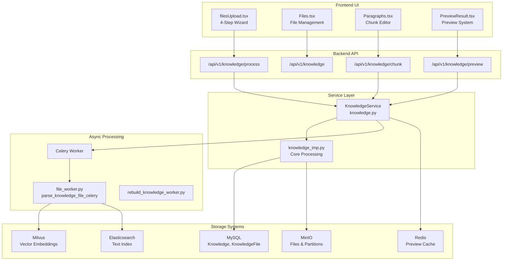
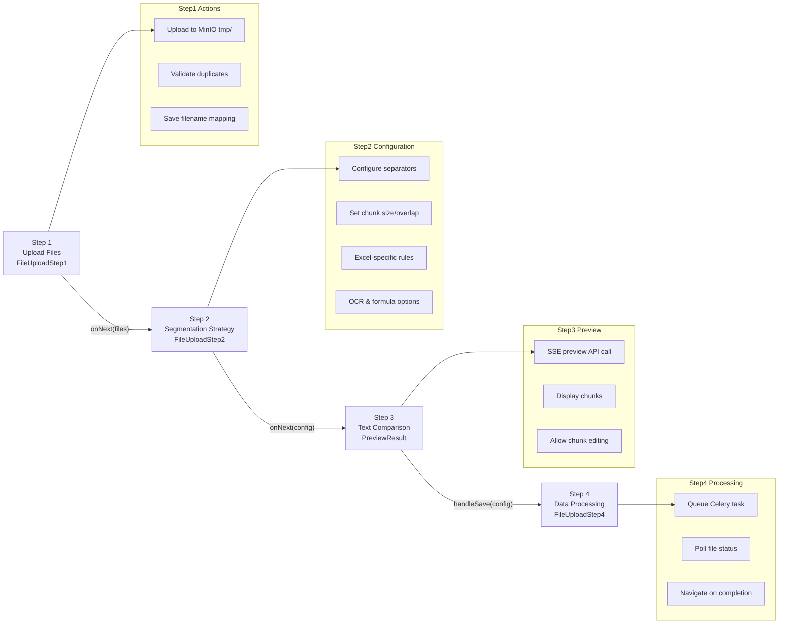
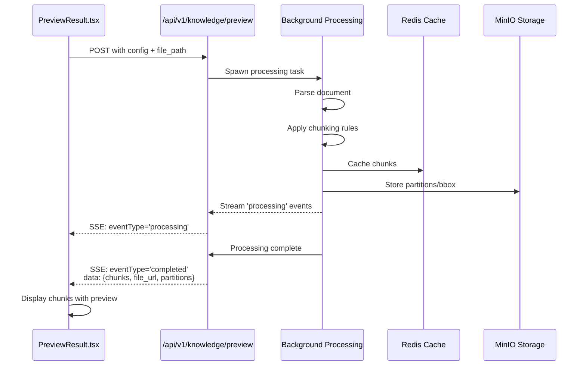
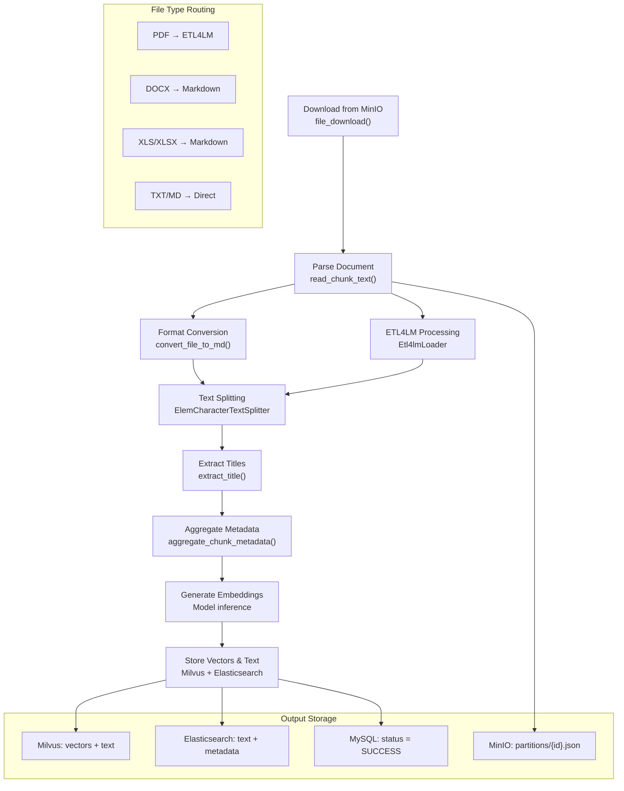
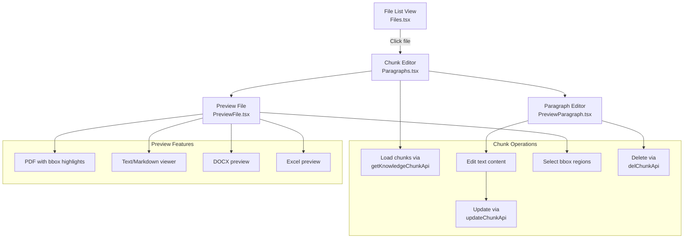
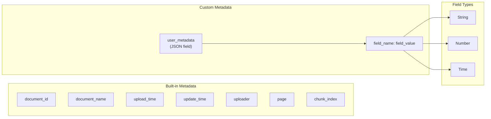
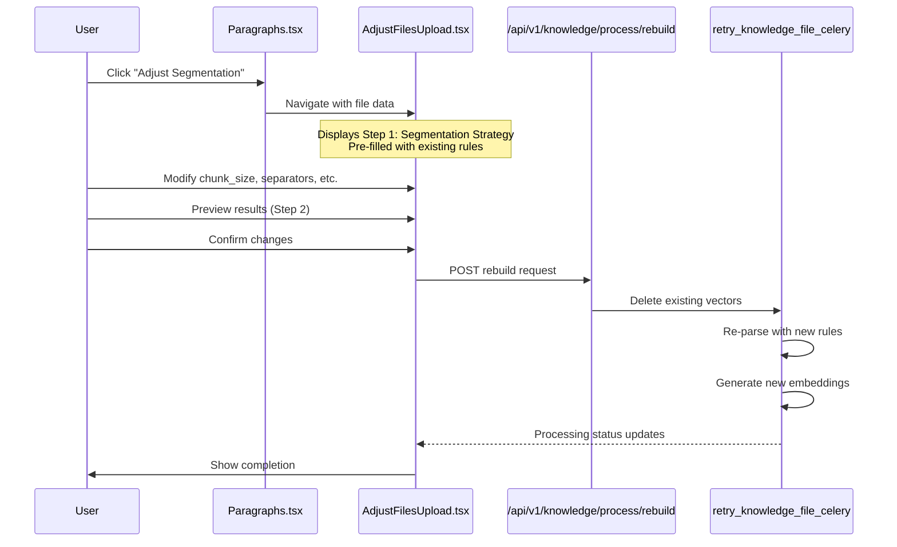
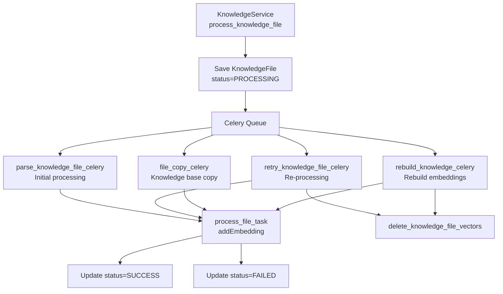
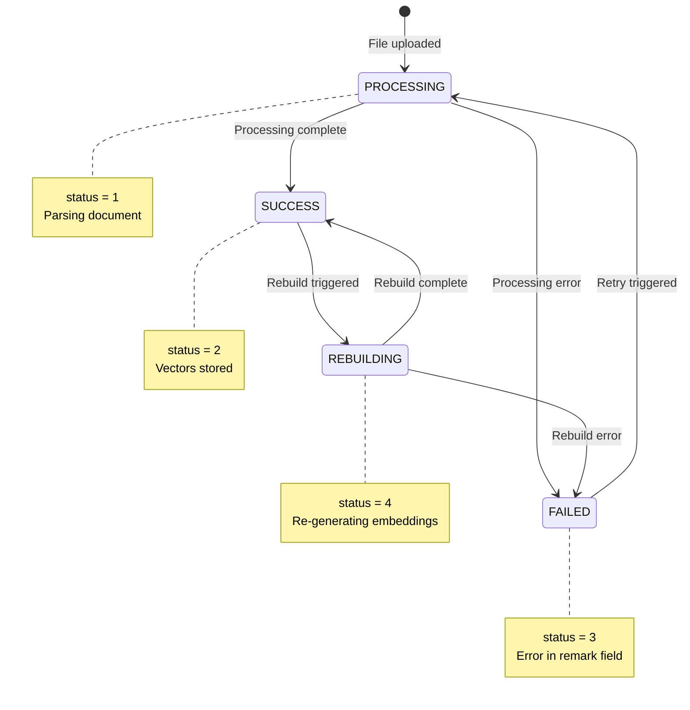
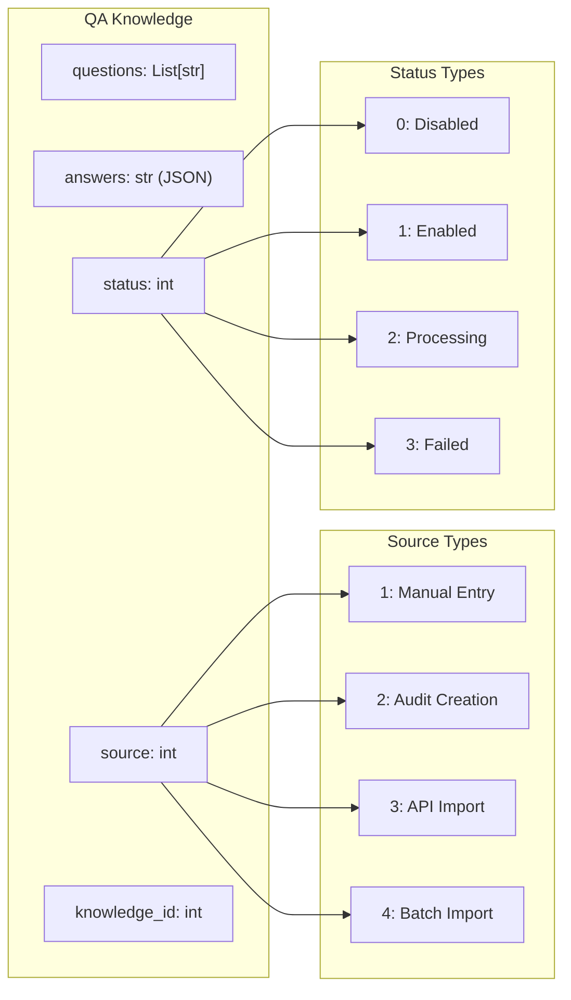

<!-- source: DeepWiki mcp.deepwiki.com · repo dataelement/bisheng · page 3.1 Knowledge Base Management · fetched 2026-10-29 -->

# Knowledge Base Management

<details>
<summary>Relevant source files</summary>

The following files were used as context for generating this wiki page:

- [src/backend/bisheng/api/services/knowledge.py](src/backend/bisheng/api/services/knowledge.py)
- [src/backend/bisheng/api/services/knowledge_imp.py](src/backend/bisheng/api/services/knowledge_imp.py)
- [src/backend/bisheng/worker/knowledge/file_worker.py](src/backend/bisheng/worker/knowledge/file_worker.py)
- [src/backend/bisheng/worker/knowledge/qa.py](src/backend/bisheng/worker/knowledge/qa.py)
- [src/backend/bisheng/worker/knowledge/rebuild_knowledge_worker.py](src/backend/bisheng/worker/knowledge/rebuild_knowledge_worker.py)
- [src/frontend/platform/src/components/bs-ui/select/hover.tsx](src/frontend/platform/src/components/bs-ui/select/hover.tsx)
- [src/frontend/platform/src/layout/MainLayout.tsx](src/frontend/platform/src/layout/MainLayout.tsx)
- [src/frontend/platform/src/pages/BuildPage/flow/FlowNode/component/KnowledgeSelectItem.tsx](src/frontend/platform/src/pages/BuildPage/flow/FlowNode/component/KnowledgeSelectItem.tsx)
- [src/frontend/platform/src/pages/KnowledgePage/AdjustFilesUpload.tsx](src/frontend/platform/src/pages/KnowledgePage/AdjustFilesUpload.tsx)
- [src/frontend/platform/src/pages/KnowledgePage/KnowledgeFile.tsx](src/frontend/platform/src/pages/KnowledgePage/KnowledgeFile.tsx)
- [src/frontend/platform/src/pages/KnowledgePage/KnowledgeQa.tsx](src/frontend/platform/src/pages/KnowledgePage/KnowledgeQa.tsx)
- [src/frontend/platform/src/pages/KnowledgePage/components/FileUploadStep2.tsx](src/frontend/platform/src/pages/KnowledgePage/components/FileUploadStep2.tsx)
- [src/frontend/platform/src/pages/KnowledgePage/components/FileUploadStep4.tsx](src/frontend/platform/src/pages/KnowledgePage/components/FileUploadStep4.tsx)
- [src/frontend/platform/src/pages/KnowledgePage/components/Files.tsx](src/frontend/platform/src/pages/KnowledgePage/components/Files.tsx)
- [src/frontend/platform/src/pages/KnowledgePage/components/Header.tsx](src/frontend/platform/src/pages/KnowledgePage/components/Header.tsx)
- [src/frontend/platform/src/pages/KnowledgePage/components/Paragraphs.tsx](src/frontend/platform/src/pages/KnowledgePage/components/Paragraphs.tsx)
- [src/frontend/platform/src/pages/KnowledgePage/components/PreviewFile.tsx](src/frontend/platform/src/pages/KnowledgePage/components/PreviewFile.tsx)
- [src/frontend/platform/src/pages/KnowledgePage/components/PreviewParagraph.tsx](src/frontend/platform/src/pages/KnowledgePage/components/PreviewParagraph.tsx)
- [src/frontend/platform/src/pages/KnowledgePage/components/PreviewResult.tsx](src/frontend/platform/src/pages/KnowledgePage/components/PreviewResult.tsx)
- [src/frontend/platform/src/pages/KnowledgePage/components/RuleFile.tsx](src/frontend/platform/src/pages/KnowledgePage/components/RuleFile.tsx)
- [src/frontend/platform/src/pages/KnowledgePage/components/RuleTable.tsx](src/frontend/platform/src/pages/KnowledgePage/components/RuleTable.tsx)
- [src/frontend/platform/src/pages/KnowledgePage/detail.tsx](src/frontend/platform/src/pages/KnowledgePage/detail.tsx)
- [src/frontend/platform/src/pages/KnowledgePage/filesUpload.tsx](src/frontend/platform/src/pages/KnowledgePage/filesUpload.tsx)
- [src/frontend/platform/src/pages/KnowledgePage/qas.tsx](src/frontend/platform/src/pages/KnowledgePage/qas.tsx)

</details>


## Purpose and Scope

The Knowledge Base Management system provides a complete document lifecycle management solution including file upload, parsing, chunking, embedding generation, dual indexing (vector and text), retrieval, and interactive chunk editing with bounding box support. This system transforms raw documents into searchable, AI-ready knowledge bases.

The system features a 4-step upload wizard on the frontend and sophisticated backend processing pipelines that support multiple document formats with intelligent text segmentation and preview generation.

For information about chat systems that consume knowledge bases, see page 3.2. For details about retrieval strategies and RAG implementation, see page 6.3.

## System Architecture

The Knowledge Base Management system integrates frontend components, backend services, and multiple storage systems:

**System Architecture: Frontend to Backend**



**Sources:** [src/backend/bisheng/api/services/knowledge.py:72-263](), [src/backend/bisheng/api/services/knowledge_imp.py:250-297](), [src/frontend/platform/src/pages/KnowledgePage/filesUpload.tsx:37-416](), [src/backend/bisheng/worker/knowledge/file_worker.py:247-337]()

## Knowledge Base Types

The system supports three distinct knowledge base types defined in `KnowledgeTypeEnum`:

| Type | Value | Description | Storage Model |
|------|-------|-------------|---------------|
| `NORMAL` | 0 | Document-based knowledge bases | `KnowledgeFile` with chunking |
| `QA` | 1 | Question-Answer pair knowledge bases | `QAKnowledge` with Q&A pairs |
| `PRIVATE` | 2 | Personal workstation knowledge bases | Per-user file storage |

**Sources:** [src/backend/bisheng/knowledge/domain/models/knowledge.py:17-21](), [src/backend/bisheng/knowledge/domain/models/knowledge_file.py:15-64]()

## File Upload Workflow

The frontend implements a 4-step upload wizard that guides users through the complete file processing workflow:

**4-Step Upload Wizard Flow**



### Step 1: File Upload

The `FileUploadStep1` component handles initial file selection and upload:

- **File upload**: Uploads to MinIO temporary storage (`tmp/` prefix)
- **UUID mapping**: Stores original filename in Redis with UUID key for 24 hours
- **Duplicate detection**: Checks MD5 hash against existing files
- **Format validation**: Supports PDF, DOCX, DOC, PPTX, PPT, XLS, XLSX, CSV, TXT, MD, HTML

**Sources:** [src/frontend/platform/src/pages/KnowledgePage/filesUpload.tsx:68-83](), [src/backend/bisheng/api/services/knowledge.py:376-389]()

### Step 2: Segmentation Strategy

The `FileUploadStep2` component provides configuration for text chunking:

**Segmentation Configuration Options:**

| Parameter | Type | Description | Default |
|-----------|------|-------------|---------|
| `separator` | `string[]` | Regex patterns for splitting | `['\\n\\n', '\\n']` |
| `separator_rule` | `string[]` | Split position ('before'/'after') | `['after', 'after']` |
| `chunk_size` | `number` | Maximum chunk size in characters | 1000 |
| `chunk_overlap` | `number` | Overlap between chunks | 200 |
| `retain_images` | `boolean` | Keep extracted images | true |
| `enable_formula` | `boolean` | Enable formula recognition | true |
| `force_ocr` | `boolean` | Force OCR processing | false |
| `filter_page_header_footer` | `boolean` | Remove headers/footers | false |

**Excel-specific rules** (via `ExcelRule`):
- `slice_length`: Number of rows per chunk
- `append_header`: Include header in each chunk
- `header_start_row`: First header row (1-based)
- `header_end_row`: Last header row (1-based)

**Sources:** [src/frontend/platform/src/pages/KnowledgePage/components/FileUploadStep2.tsx:75-108](), [src/backend/bisheng/api/v1/schemas.py:1-50]()

### Step 3: Text Comparison (Preview)

The preview system uses Server-Sent Events (SSE) to stream processing results:



Users can edit chunks before final submission. Changes are stored in Redis cache with key format: `preview_file_chunk:{knowledge_id}:{md5}`.

**Sources:** [src/frontend/platform/src/pages/KnowledgePage/components/PreviewResult.tsx:67-162](), [src/backend/bisheng/api/services/knowledge.py:391-473]()

### Step 4: Data Processing

The final step submits files for asynchronous processing:

1. **API call**: `POST /api/v1/knowledge/process` with all configuration
2. **File creation**: Creates `KnowledgeFile` records with status `PROCESSING` (1)
3. **Celery task**: Queues `parse_knowledge_file_celery` for each file
4. **Status polling**: Frontend polls file status every 5 seconds
5. **Completion**: Updates status to `SUCCESS` (2) or `FAILED` (3)

**Sources:** [src/frontend/platform/src/pages/KnowledgePage/components/FileUploadStep4.tsx:60-110](), [src/backend/bisheng/api/services/knowledge.py:543-589]()

## Document Processing Pipeline

The core processing pipeline is implemented in `addEmbedding` and handles the transformation from raw files to searchable chunks:

**Processing Pipeline: File to Vectors**



### Document Parsing

The `read_chunk_text` function orchestrates document parsing with format-specific handlers:

**Format-Specific Processing:**

| Format | Handler | Special Processing |
|--------|---------|-------------------|
| PDF | `Etl4lmLoader` or local `PyPDFLoader` | ETL4LM for OCR, bbox extraction |
| DOCX/DOC | `convert_file_to_md()` + `TextLoader` | Convert to Markdown via OnlyOffice |
| PPTX/PPT | `convert_file_to_md()` + `convert_ppt_to_pdf()` | Markdown + PDF preview |
| XLS/XLSX/CSV | `convert_file_to_md()` | Table to Markdown with header handling |
| TXT/MD | `TextLoader` | Direct loading with encoding detection |
| HTML | `BSHTMLLoader` | HTML parsing with structure preservation |

**ETL4LM Processing** (for complex documents):
- OCR with bounding box extraction
- Table detection and structure preservation
- Formula recognition (when enabled)
- Page header/footer filtering
- Image extraction to MinIO

**Sources:** [src/backend/bisheng/api/services/knowledge_imp.py:773-936](), [src/backend/bisheng/api/services/etl4lm_loader.py:1-200]()

### Text Chunking

The `ElemCharacterTextSplitter` implements intelligent text segmentation:

```python
# Example configuration
text_splitter = ElemCharacterTextSplitter(
    separators=['\\n\\n', '\\n'],        # Regex patterns
    separator_rule=['after', 'after'],   # Split position
    chunk_size=1000,                     # Max characters
    chunk_overlap=200,                   # Overlap size
    is_separator_regex=True              # Enable regex
)
texts = text_splitter.split_documents(documents)
```

**Chunking Strategy:**
1. Apply separators in order (longest match first)
2. Respect `separator_rule` (split before/after separator)
3. Ensure chunks don't exceed `chunk_size` (with overflow handling)
4. Add `chunk_overlap` from previous chunk
5. Preserve metadata including bounding boxes

**Sources:** [src/backend/bisheng/api/services/knowledge_imp.py:805-811](), [src/backend/bisheng_langchain/text_splitter.py:1-300]()

### Metadata Enrichment

Each chunk is enriched with metadata via `aggregate_chunk_metadata`:

```python
# Metadata structure
metadata = {
    'document_id': file.id,
    'document_name': file.file_name,
    'knowledge_id': knowledge.id,
    'upload_time': int(file.create_time.timestamp()),
    'update_time': int(file.update_time.timestamp()),
    'uploader': user.user_name,
    'updater': user.user_name,
    'abstract': extracted_title,  # LLM-generated summary
    'chunk_index': index,
    'page': page_number,
    'bbox': json.dumps({'chunk_bboxes': [...]}),  # Bounding boxes
    'user_metadata': {}  # Custom metadata fields
}
```

The `aggregate_chunk_metadata` function wraps chunk text with metadata:
```
{<file_title>document_name</file_title>
<file_abstract>abstract</file_abstract>
<paragraph_content>chunk_text</paragraph_content>}
```

**Sources:** [src/backend/bisheng/api/services/knowledge_imp.py:94-100](), [src/backend/bisheng/api/services/knowledge_imp.py:637-646]()

## Storage Systems Integration

### Vector Storage with Milvus

The system uses Milvus for storing document embeddings, initialized via `KnowledgeRag.init_knowledge_milvus_vectorstore_sync`:

**Milvus Collection Schema:**

| Field | Type | Description |
|-------|------|-------------|
| `pk` | `int64` | Auto-generated primary key |
| `vector` | `float[]` | Embedding vector (dimension based on model) |
| `text` | `varchar` | Full chunk text with metadata wrapper |
| `document_id` | `int64` | Reference to `KnowledgeFile.id` |
| `knowledge_id` | `int64` | Reference to `Knowledge.id` |
| `document_name` | `varchar` | Original filename |
| `source` | `varchar` | File path reference |
| `page` | `int64` | Page number (for PDFs) |
| `bbox` | `varchar` | JSON with bounding box coordinates |
| `chunk_index` | `int64` | Index within document |
| `upload_time` | `int64` | Unix timestamp |
| `update_time` | `int64` | Unix timestamp |
| `uploader` | `varchar` | Username |
| `updater` | `varchar` | Username |
| `abstract` | `varchar` | LLM-generated summary |
| `user_metadata` | `varchar` | JSON with custom fields |

**Collection Naming Strategies:**
- **Single collection**: `col_{timestamp}_{uuid}` - Dedicated collection per knowledge base
- **Partition mode**: `partition_embedding_knowledge_{suffix}` - Shared collection with partition keys

**Sources:** [src/backend/bisheng/knowledge/domain/knowledge_rag.py:40-120](), [src/backend/bisheng/api/services/knowledge_imp.py:456-460]()

### Elasticsearch Integration

Elasticsearch provides full-text search initialized via `KnowledgeRag.init_knowledge_es_vectorstore_sync`:

**Index Naming:** `index_{timestamp}_{uuid}` or reuses `collection_name`

**Document Structure:**
```json
{
  "_id": "uuid",
  "text": "chunk content with metadata",
  "metadata": {
    "document_id": 123,
    "knowledge_id": 456,
    "document_name": "file.pdf",
    "chunk_index": 0,
    "page": 1,
    "bbox": "{\"chunk_bboxes\": [...]}",
    "upload_time": 1234567890,
    "user_metadata": {}
  }
}
```

The system performs parallel writes to Milvus and Elasticsearch via `add_texts()`.

**Sources:** [src/backend/bisheng/api/services/knowledge_imp.py:461-462](), [src/backend/bisheng/api/services/knowledge_imp.py:650-655]()

### MinIO Object Storage

MinIO organizes files using standardized object naming via `KnowledgeUtils` methods:

**Storage Organization:**

| Object Type | Path Pattern | Purpose |
|-------------|--------------|---------|
| Original files | `original/{file_id}.{ext}` | Source documents |
| Preview files | `preview/{file_id}.{converted_ext}` | Converted for viewing (DOC→DOCX, PPT→PDF) |
| Bbox data | `partitions/{file_id}.json` | OCR bounding boxes and partition info |
| Images | `knowledge/images/{knowledge_id}/{doc_id}/{filename}` | Extracted images from documents |
| Temporary | `tmp/{uuid}.{ext}` | Files during upload (24h TTL) |

**File Conversion:**
- `.doc` → `.docx` (stored in `preview/`)
- `.ppt`, `.pptx` → `.pdf` (stored in `preview/`)
- Excel files → Markdown (temporary processing)

**Sources:** [src/backend/bisheng/api/services/knowledge_imp.py:182-216](), [src/backend/bisheng/api/services/knowledge_imp.py:218-248]()

### Redis Cache

Redis provides temporary storage for preview data and file metadata:

**Cache Keys:**
- **Preview chunks**: `preview_file_chunk:{knowledge_id}:{md5_hash}` - Hash map of chunk index to chunk data
- **Parse type**: `preview_file_chunk:{knowledge_id}:{md5_hash}_parse_type` - "etl4lm" or "un_etl4lm"
- **File path**: `preview_file_chunk:{knowledge_id}:{md5_hash}_file_path` - Temporary file URL
- **Partitions**: `preview_file_chunk:{knowledge_id}:{md5_hash}_partitions` - Bbox data
- **File names**: `file_name:{uuid}` - Original filename mapping (24h expiration)

**Sources:** [src/backend/bisheng/api/services/knowledge_imp.py:88-172](), [src/backend/bisheng/api/services/knowledge.py:376-389]()

## Chunk Management and Editing

The system provides interactive chunk editing through the `Paragraphs` component, allowing users to modify chunks after processing:

**Chunk Management Flow**



### Bounding Box Support

For documents processed with ETL4LM, chunks include bounding box coordinates that map text to specific regions in the document:

**Bbox Data Structure:**
```typescript
interface ChunkBbox {
  page: number;           // Page number (1-based)
  bbox: [x0, y0, x1, y1]; // Coordinates in PDF points
}

interface BboxMetadata {
  chunk_bboxes: ChunkBbox[];
}
```

**Interactive Selection:**
1. User clicks on highlighted regions in PDF preview
2. Frontend tracks selected bboxes via `useKnowledgeStore.selectedBbox`
3. Selected regions are synchronized across chunks
4. Updates sent to backend via `updateChunkApi`

**Partition Data** (stored in MinIO `partitions/{file_id}.json`):
```json
{
  "page-x0-y0-x1-y1": {
    "text": "extracted text",
    "type": "Title|Text|Table",
    "part_id": 0
  }
}
```

The frontend uses this data to enable region-based chunk editing where users can select/deselect text blocks to rebuild chunks.

**Sources:** [src/frontend/platform/src/pages/KnowledgePage/components/Paragraphs.tsx:166-188](), [src/backend/bisheng/api/services/knowledge_imp.py:698-716](), [src/frontend/platform/src/pages/KnowledgePage/components/PreviewFile.tsx:79-134]()

### Chunk Editing API

**Get Chunks:**
```
GET /api/v1/knowledge/chunks?knowledge_id={id}&file_ids[]={file_id}&page={page}&page_size={size}
```
Returns paginated chunks with metadata.

**Update Chunk:**
```
PUT /api/v1/knowledge/chunk
{
  "knowledge_id": 123,
  "file_id": 456,
  "chunk_index": 0,
  "text": "updated text",
  "bbox": "{\"chunk_bboxes\": [...]}"
}
```
Updates both Milvus and Elasticsearch in real-time.

**Delete Chunk:**
```
DELETE /api/v1/knowledge/chunk
{
  "knowledge_id": 123,
  "file_id": 456,
  "chunk_index": 0
}
```
Removes chunk from both vector and text indexes.

**Sources:** [src/backend/bisheng/api/v1/knowledge.py:1-100](), [src/frontend/platform/src/controllers/API/index.ts:1-300]()

## Metadata Management

The system supports custom metadata fields for knowledge bases, allowing users to add structured information to chunks:

**Metadata System Architecture**



**Metadata Operations:**

**Add Metadata Fields:**
```
POST /api/v1/knowledge/add_metadata_fields
{
  "knowledge_id": 123,
  "metadata_fields": [
    {"field_name": "department", "field_type": "string"},
    {"field_name": "priority", "field_type": "number"}
  ]
}
```

**Update File User Metadata:**
```
PUT /api/v1/knowledge/file/user_metadata
{
  "knowledge_file_id": 456,
  "user_metadata_list": [
    {"field_name": "department", "field_value": "Engineering"},
    {"field_name": "priority", "field_value": 1}
  ]
}
```

**Field Validation:**
- Field names must match `^[a-z][a-z0-9_]*$` (lowercase, alphanumeric, underscore)
- Field names cannot conflict with built-in fields
- Maximum field name length: 255 characters

**Sources:** [src/frontend/platform/src/pages/KnowledgePage/components/MetadataManagementDialog.tsx:1-400](), [src/backend/bisheng/api/v1/knowledge.py:200-250]()

## Adjustment and Re-segmentation

The system allows users to adjust segmentation strategies for already-processed files through the `AdjustFilesUpload` component:

**Re-segmentation Workflow**



**Adjustment Process:**

1. **Entry Point**: User clicks "Adjust Segmentation" button in `Paragraphs.tsx`
2. **Navigation**: Navigate to `/filelib/adjust/{knowledge_id}` with `fileData` in state
3. **Configuration**: `AdjustFilesUpload` displays `FileUploadStep2` with pre-filled split rules
4. **Preview**: Same preview system as initial upload (Step 2 → Step 3)
5. **Submission**: Calls `POST /api/v1/knowledge/process/rebuild`
6. **Processing**: 
   - Deletes existing vectors via `delete_knowledge_file_vectors`
   - Queues `retry_knowledge_file_celery` task
   - Re-parses file with new configuration
   - Updates status to `PROCESSING` → `SUCCESS`/`FAILED`

**API Endpoint:**
```
POST /api/v1/knowledge/process/rebuild
{
  "knowledge_id": 123,
  "kb_file_id": 456,
  "separator": ["\\n\\n"],
  "separator_rule": ["after"],
  "chunk_size": 1500,
  "chunk_overlap": 150,
  "excel_rule": {...}
}
```

**Sources:** [src/frontend/platform/src/pages/KnowledgePage/components/Paragraphs.tsx:512-533](), [src/frontend/platform/src/pages/KnowledgePage/AdjustFilesUpload.tsx:1-200](), [src/backend/bisheng/api/services/knowledge.py:592-631]()

## API Endpoints

### Knowledge Base Operations

| Endpoint | Method | Purpose | Key Parameters |
|----------|--------|---------|----------------|
| `POST /api/v1/knowledge` | POST | Create knowledge base | `name`, `description`, `model` (embedding model ID) |
| `GET /api/v1/knowledge` | GET | List knowledge bases | `page`, `page_size`, `name`, `type` (0/1/2) |
| `PUT /api/v1/knowledge` | PUT | Update knowledge base | `knowledge_id`, `name`, `description` |
| `DELETE /api/v1/knowledge` | DELETE | Delete knowledge base | `knowledge_id` |
| `POST /api/v1/knowledge/copy` | POST | Copy knowledge base | `knowledge_id`, `knowledge_name` |

**Sources:** [src/backend/bisheng/api/v1/knowledge.py:1-100]()

### File Processing Endpoints

| Endpoint | Method | Purpose | Key Parameters |
|----------|--------|---------|----------------|
| `POST /api/v1/knowledge/upload` | POST | Upload files to MinIO tmp | `file` (multipart) |
| `POST /api/v1/knowledge/process` | POST | Process uploaded files | `knowledge_id`, `file_list`, `separator`, `chunk_size`, `chunk_overlap` |
| `POST /api/v1/knowledge/process/rebuild` | POST | Re-process with new config | `knowledge_id`, `kb_file_id`, segmentation params |
| `POST /api/v1/knowledge/preview` | POST | Preview chunks (SSE) | Same as `/process` but returns preview |
| `GET /api/v1/knowledge/file_list/{knowledge_id}` | GET | List files | `page`, `page_size`, `file_name`, `status` |
| `DELETE /api/v1/knowledge/file/{file_id}` | DELETE | Delete file | `file_id` |
| `POST /api/v1/knowledge/retry` | POST | Retry failed files | `file_objs` (list of files) |

**Sources:** [src/backend/bisheng/api/v1/knowledge.py:100-350]()

### Chunk Management Endpoints

| Endpoint | Method | Purpose | Key Parameters |
|----------|--------|---------|----------------|
| `GET /api/v1/knowledge/chunks` | GET | Get paginated chunks | `knowledge_id`, `file_ids`, `page`, `page_size` |
| `PUT /api/v1/knowledge/chunk` | PUT | Update chunk | `knowledge_id`, `file_id`, `chunk_index`, `text`, `bbox` |
| `DELETE /api/v1/knowledge/chunk` | DELETE | Delete chunk | `knowledge_id`, `file_id`, `chunk_index` |
| `PUT /api/v1/knowledge/chunk/preview` | PUT | Update preview chunk | Same as update but targets Redis cache |
| `DELETE /api/v1/knowledge/chunk/preview` | DELETE | Delete preview chunk | Same as delete but targets Redis cache |

**Sources:** [src/backend/bisheng/api/v1/knowledge.py:1-200]()

### Metadata Management Endpoints

| Endpoint | Method | Purpose |
|----------|--------|---------|
| `POST /api/v1/knowledge/add_metadata_fields` | POST | Add custom metadata fields to knowledge base |
| `PUT /api/v1/knowledge/update_metadata_fields` | PUT | Rename metadata fields |
| `DELETE /api/v1/knowledge/delete_metadata_fields` | DELETE | Remove metadata fields |
| `GET /api/v1/knowledge/file/info/{file_id}` | GET | Get file info with user metadata |
| `PUT /api/v1/knowledge/file/user_metadata` | PUT | Set user metadata for specific file |

**Sources:** [src/backend/bisheng/api/v1/knowledge.py:200-300]()

### QA Knowledge Endpoints

| Endpoint | Method | Purpose |
|----------|--------|---------|
| `POST /api/v1/knowledge/qa/add` | POST | Add Q&A pairs |
| `GET /api/v1/knowledge/qa/list/{qa_knowledge_id}` | GET | List Q&A pairs |
| `PUT /api/v1/knowledge/qa` | PUT | Update Q&A pair |
| `DELETE /api/v1/knowledge/qa` | DELETE | Delete Q&A pair |
| `GET /api/v1/knowledge/qa/export/{qa_knowledge_id}` | GET | Export Q&A to Excel |
| `POST /api/v1/knowledge/qa/import/{qa_knowledge_id}` | POST | Import Q&A from Excel |

**Sources:** [src/backend/bisheng/api/v1/knowledge.py:400-617]()

## Background Processing

### Celery Worker Tasks

The system uses Celery for asynchronous file processing with multiple specialized worker tasks:

**Async Processing Flow**



### Key Worker Tasks

**`parse_knowledge_file_celery(file_id, preview_cache_key, callback_url)`**

Main processing task queued after file upload:

1. Loads `KnowledgeFile` record by ID
2. Validates status is `PROCESSING`
3. Extracts split rules from `split_rule` JSON field
4. Calls `process_file_task` with configuration
5. Updates status to `SUCCESS` or `FAILED`
6. Optionally calls `callback_url` with result

**Sources:** [src/backend/bisheng/worker/knowledge/file_worker.py:247-302]()

**`retry_knowledge_file_celery(file_id, preview_cache_key, callback_url)`**

Retry task for failed or duplicate files:

1. Deletes existing vectors via `delete_knowledge_file_vectors`
2. Calls `_parse_knowledge_file` to re-process
3. Preserves original file in MinIO (no re-upload)
4. Used for both failed files and duplicate resolution

**Sources:** [src/backend/bisheng/worker/knowledge/file_worker.py:304-322]()

**`file_copy_celery(params)`**

Copies all files from source to target knowledge base:

1. Queries files from source knowledge base (paginated)
2. For each file:
   - Copies MySQL record with new knowledge_id
   - Copies MinIO objects (original, bbox, preview)
   - Copies vectors from source Milvus collection
   - Copies ES documents with updated IDs
3. Updates knowledge base state when complete

**Parameters:**
```python
{
  "source_knowledge_id": 123,
  "target_id": 456,
  "login_user_id": 789
}
```

**Sources:** [src/backend/bisheng/worker/knowledge/file_worker.py:26-79]()

**`rebuild_knowledge_celery(knowledge_id, new_model_id, invoke_user_id)`**

Rebuilds entire knowledge base with new embedding model:

1. Updates all successful files to status `REBUILDING` (4)
2. Deletes all vectors from Milvus (keeps ES for text)
3. For each file:
   - Fetches chunks from Elasticsearch
   - Generates new embeddings with new model
   - Inserts into Milvus
4. Updates files to `SUCCESS` or `FAILED`
5. Updates knowledge base state

**Sources:** [src/backend/bisheng/worker/knowledge/rebuild_knowledge_worker.py:22-106]()

### File Status Transitions



**Status Values:**

| Status | Value | Description | Displayed As |
|--------|-------|-------------|--------------|
| `PROCESSING` | 1 | File being parsed/embedded | "Parsing" (blue) |
| `SUCCESS` | 2 | Successfully processed | "Completed" (green) |
| `FAILED` | 3 | Processing failed | "Parse Failed" (red) |
| `REBUILDING` | 4 | Re-embedding with new model | "Parsing" (blue, merged with 1) |

**Error Tracking:**

Failed files store error details in the `remark` field as JSON:
```json
{
  "status_code": "KNOWLEDGE_FILE_FAILED",
  "data": {
    "exception": "error message"
  }
}
```

Common error codes:
- `KNOWLEDGE_FILE_EMPTY`: File parsed but no text extracted
- `KNOWLEDGE_FILE_CHUNK_MAX`: Chunk exceeds 10,000 characters
- `KNOWLEDGE_FILE_DAMAGED`: PDF file corrupted
- `KNOWLEDGE_ETL4LM_TIMEOUT`: ETL4LM service timeout
- `KNOWLEDGE_FILE_NOT_SUPPORTED`: Unsupported file format

**Sources:** [src/backend/bisheng/knowledge/domain/models/knowledge_file.py:15-19](), [src/frontend/platform/src/pages/KnowledgePage/components/Files.tsx:36-91]()

## QA Management System

### QA Knowledge Structure

QA knowledge bases store question-answer pairs with the following structure:



**Sources:** [src/backend/bisheng/database/models/knowledge_file.py:59-95](), [src/backend/bisheng/database/models/knowledge_file.py:243-340]()

### QA Import/Export

The system supports Excel-based batch import/export of QA data:

- **Template Generation**: Creates Excel templates with proper column structure
- **Batch Import**: Processes Excel files with question/answer pairs
- **Similar Question Support**: Handles multiple similar questions per answer
- **Export Functionality**: Generates Excel files with current QA data

**Sources:** [src/backend/bisheng/api/v1/knowledge.py:422-617]()

## Cache and Preview System

### Preview Caching

The system implements Redis-based caching for file preview data:

- **Cache Key Format**: `preview_file_chunk:{knowledge_id}:{md5_hash}`
- **Chunk Editing**: Allows real-time editing of document chunks before processing
- **Cache Management**: Automatic cleanup after processing completion

**Sources:** [src/backend/bisheng/api/services/knowledge_imp.py:83-149](), [src/backend/bisheng/api/services/knowledge.py:389-465]()

---

