<!-- source: DeepWiki mcp.deepwiki.com · repo dataelement/bisheng · page 3.2 Chat and Messaging System · fetched 2026-10-29 -->

# Chat and Messaging System

Relevant source files

The following files were used as context for generating this wiki page:

- [src/backend/bisheng/api/services/assistant_agent.py](src/backend/bisheng/api/services/assistant_agent.py)
- [src/backend/bisheng/api/services/base.py](src/backend/bisheng/api/services/base.py)
- [src/backend/bisheng/api/v1/callback.py](src/backend/bisheng/api/v1/callback.py)
- [src/backend/bisheng/api/v1/chat.py](src/backend/bisheng/api/v1/chat.py)
- [src/backend/bisheng/api/v1/mark_task.py](src/backend/bisheng/api/v1/mark_task.py)
- [src/backend/bisheng/api/v1/schema/chat_schema.py](src/backend/bisheng/api/v1/schema/chat_schema.py)
- [src/backend/bisheng/api/v1/schema/mark_schema.py](src/backend/bisheng/api/v1/schema/mark_schema.py)
- [src/backend/bisheng/chat/client.py](src/backend/bisheng/chat/client.py)
- [src/backend/bisheng/chat/handlers.py](src/backend/bisheng/chat/handlers.py)
- [src/backend/bisheng/chat/manager.py](src/backend/bisheng/chat/manager.py)
- [src/backend/bisheng/database/models/mark_app_user.py](src/backend/bisheng/database/models/mark_app_user.py)
- [src/backend/bisheng/database/models/mark_record.py](src/backend/bisheng/database/models/mark_record.py)
- [src/backend/bisheng/database/models/mark_task.py](src/backend/bisheng/database/models/mark_task.py)
- [src/backend/bisheng/database/models/message.py](src/backend/bisheng/database/models/message.py)
- [src/backend/bisheng/utils/linked_list.py](src/backend/bisheng/utils/linked_list.py)
- [src/backend/bisheng/utils/threadpool.py](src/backend/bisheng/utils/threadpool.py)

## Purpose and Scope

The Chat and Messaging System manages real-time chat sessions, message persistence, and user feedback collection within the Bisheng platform. It provides WebSocket-based communication for interactive conversations with AI assistants and workflows, tracks user interactions through like/dislike/copy mechanisms, and implements a comprehensive marking/annotation task system for quality assurance workflows.

The system consists of three primary subsystems:
1. **Real-time Chat**: WebSocket-based communication with message streaming and session management
2. **Message Management**: Persistent storage of chat history with categorization and metadata tracking
3. **Marking System**: Task assignment and session annotation for QA workflows with navigation support

For information about the knowledge retrieval aspects of chat interactions, see [Knowledge Management](#3.1). For details about assistant and agent orchestration during chat, see [Assistant System](#3.3). For workflow execution triggered through chat, see [Workflow Engine](#3.5).

## System Architecture

### Chat System Architecture

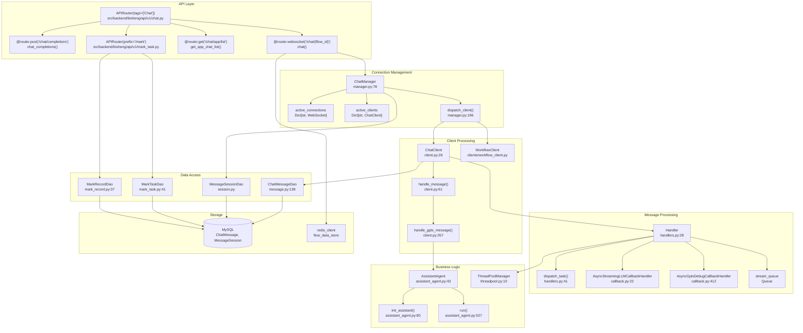

**Sources:** [src/backend/bisheng/api/v1/chat.py:48-715](), [src/backend/bisheng/api/v1/mark_task.py:19-261]()

### WebSocket Communication Flow

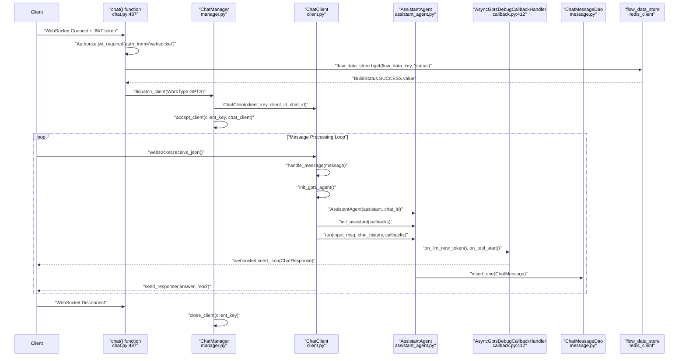

**Sources:** [src/backend/bisheng/api/v1/chat.py:506-561]()

## Core Components

### ChatManager and Client Architecture

The chat system uses a dual-architecture approach with `ChatManager` coordinating multiple `ChatClient` instances:

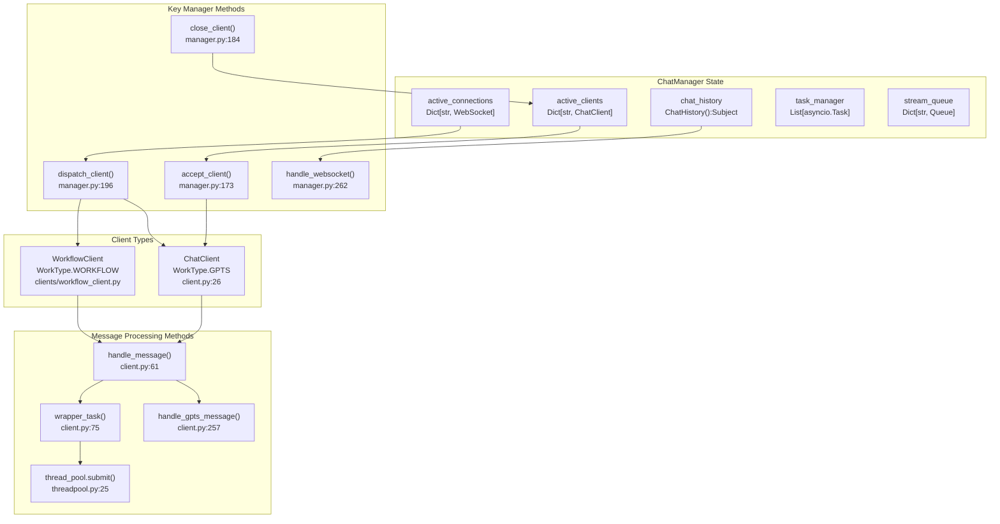

**Sources:** [src/backend/bisheng/api/v1/chat.py:49-50]()

### WebSocket Chat Handler

The main chat endpoint at `/chat/{flow_id}` provides real-time communication through WebSocket connections:

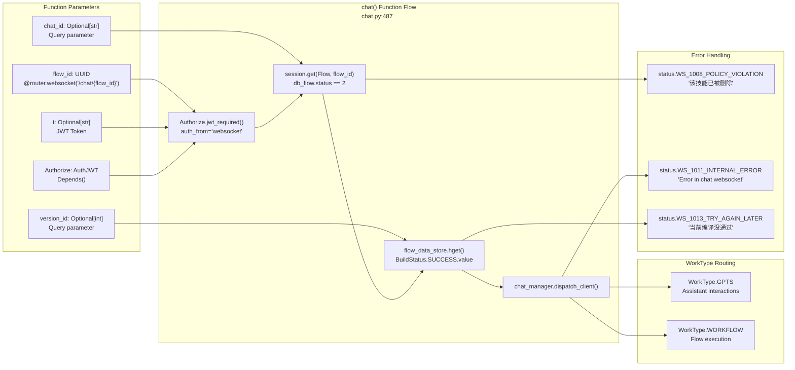

**Sources:** [src/backend/bisheng/api/v1/chat.py:506-561]()

### Message Data Model and Streaming

The `ChatMessage` model represents individual chat messages with comprehensive metadata:

| Field | Type | Purpose |
|-------|------|---------|
| `id` | int | Primary key |
| `flow_id` | str | Associated skill/assistant ID |
| `chat_id` | str | Session identifier |
| `user_id` | int | User who sent message |
| `is_bot` | bool | Distinguishes human vs AI messages |
| `message` | str | Message content |
| `type` | str | Message type (human/bot/stream) |
| `category` | str | Message category (question/answer/tool_call/tool_result) |
| `liked` | int | User rating (LikedType: UNRATED=0, LIKED=1, DISLIKED=2) |
| `copied` | int | Copy tracking |
| `sensitive_status` | int | Content moderation status |
| `intermediate_steps` | str | Process logs |
| `files` | str | Attached files JSON |
| `sender` | str | AutoGen sender identification |
| `receiver` | dict | AutoGen receiver data |
| `remark` | str | Special flags (e.g., 'break_answer') |

**Sources:** [src/backend/bisheng/database/models/message.py:14-58]()

### Streaming and Callback System

The chat system implements comprehensive streaming through callback handlers:

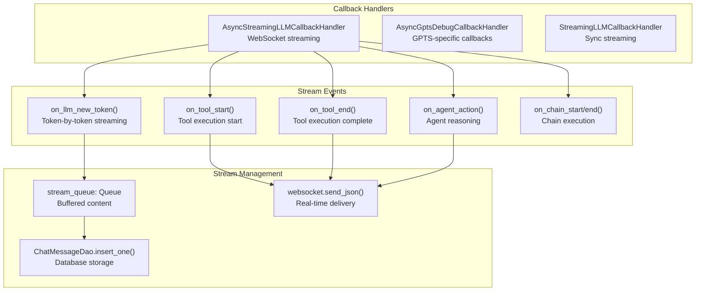

**Sources:** [src/backend/bisheng/api/v1/chat.py:506-561]()

### Chat Session Management

The system manages chat sessions through the `MessageSession` model and `MessageSessionDao` data access operations:

#### MessageSession Data Model

The `MessageSession` table stores chat session metadata with the following key fields:

| Field | Type | Purpose |
|-------|------|---------|
| `chat_id` | str | Unique session identifier (primary key) |
| `flow_id` | str | Associated application/skill ID |
| `flow_type` | int | Application type (FlowType enum) |
| `flow_name` | str | Display name of application |
| `user_id` | int | Session owner |
| `like` | int | Count of liked messages |
| `dislike` | int | Count of disliked messages |
| `copied` | int | Count of copied messages |
| `sensitive_status` | int | Content moderation status |
| `is_delete` | int | Soft delete flag (0=active, 1=deleted) |

#### Session Operations

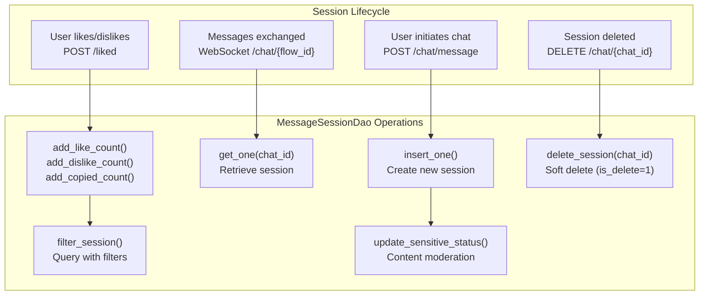

**Sources:** [src/backend/bisheng/database/models/session.py](), [src/backend/bisheng/api/v1/chat.py:266-365](), [src/backend/bisheng/api/v1/chat.py:404-450]()

## Chat Message Operations

### Message Lifecycle Management

The `ChatMessageDao` class provides comprehensive message operations:

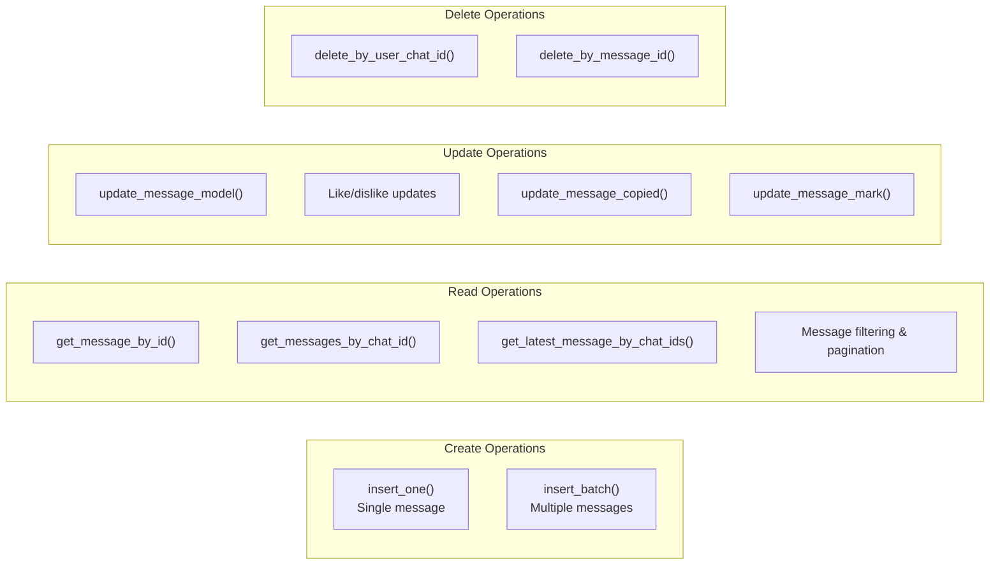

**Sources:** [src/backend/bisheng/database/models/message.py:143-369]()

### Message Interaction Tracking

The system tracks user interactions with messages:

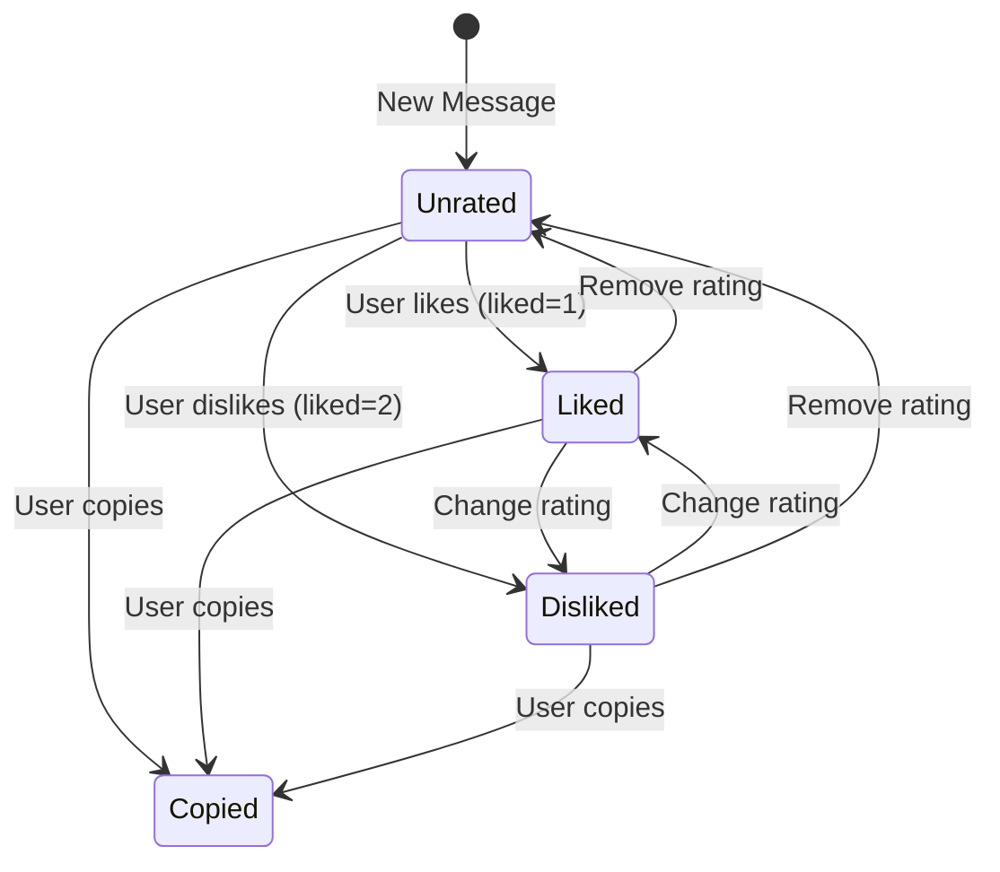

**Sources:** [src/backend/bisheng/api/v1/chat.py:404-456]()

## Chat Annotation and Quality Control System

### Marking Tasks and Records

The chat system includes a sophisticated annotation system for quality control through `MarkTask` and `MarkRecord` models:

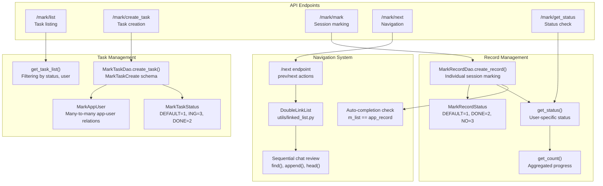

**Sources:** [src/backend/bisheng/api/v1/mark_task.py:22-261](), [src/backend/bisheng/database/models/mark_task.py:13-134](), [src/backend/bisheng/database/models/mark_record.py:13-112](), [src/backend/bisheng/utils/linked_list.py:17-150]()

### Chat Application List with Marking Integration

The system provides filtered chat lists for annotation workflows:

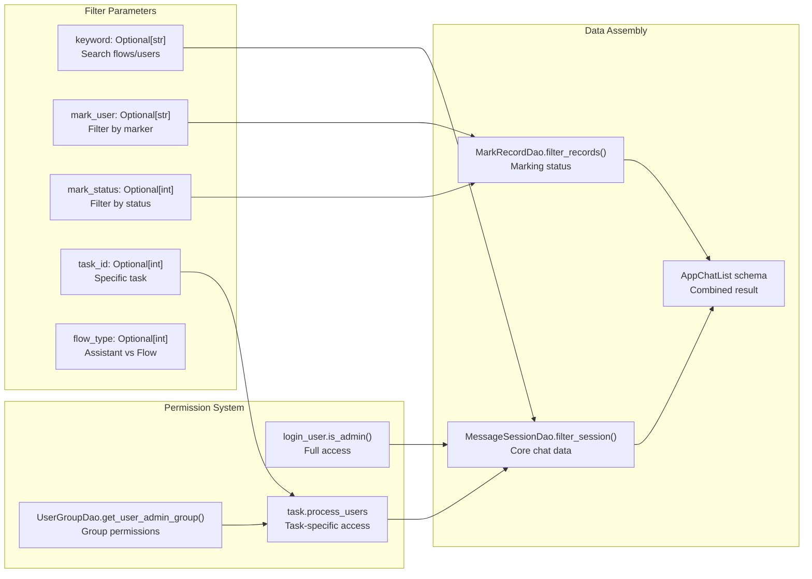

**Sources:** [src/backend/bisheng/api/v1/chat.py:53-152]()

## API Endpoints

### REST API Routes

The chat system exposes multiple REST endpoints for different functionalities:

| Endpoint | Method | Purpose |
|----------|--------|---------|
| `/chat/completions` | POST | OpenAI-compatible chat completions |
| `/chat/app/list` | GET | Application chat list with marking filters |
| `/chat/history` | GET | Chat message history pagination |
| `/chat/conversation/rename` | POST | Rename chat sessions |
| `/chat/conversation/copy` | POST | Copy chat sessions |
| `/chat/{chat_id}` | DELETE | Delete chat sessions + cleanup |
| `/chat/message` | POST | Add complete Q&A records |
| `/chat/message/{message_id}` | PUT/DELETE | Update/delete messages |
| `/liked` | POST | Rate messages (LikedType values) |
| `/chat/copied` | POST | Track message copying |
| `/chat/comment` | POST | Add message comments |
| `/chat/list` | GET | User chat session list |
| `/chat/online` | GET | Available online skills/assistants |
| `/chat/{flow_id}` | WebSocket | Real-time chat communication |

**Sources:** [src/backend/bisheng/api/v1/chat.py:48-715]()

### Marking System API Routes

The annotation system provides dedicated endpoints for quality control workflows:

| Endpoint | Method | Purpose |
|----------|--------|---------|
| `/mark/list` | GET | List marking tasks with progress |
| `/mark/create_task` | POST | Create new annotation task |
| `/mark/mark` | POST | Mark individual chat session |
| `/mark/get_status` | GET | Get marking status for session |
| `/mark/get_user` | GET | Get users assigned to task |
| `/mark/next` | GET | Navigate to next/prev session |
| `/mark/get_record` | GET | Get marking record details |
| `/mark/del` | DELETE | Delete marking task |

**Sources:** [src/backend/bisheng/api/v1/mark_task.py:22-261]()

### Build System Integration

The chat system integrates with a build system for flow compilation and graph execution:

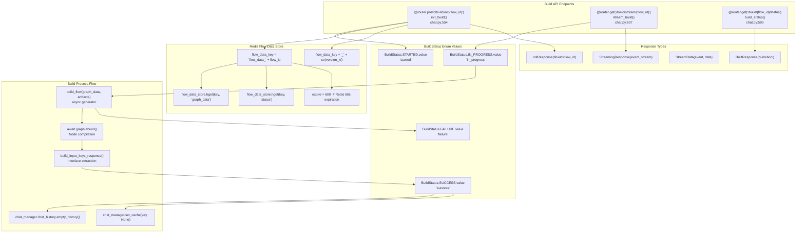

**Sources:** [src/backend/bisheng/api/v1/chat.py:563-715]()

## Integration Points

### External System Connections

The chat system connects to other platform components:

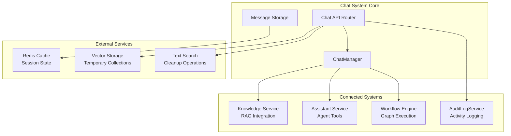

**Sources:** [src/backend/bisheng/api/v1/chat.py:13-42](), [src/backend/bisheng/api/v1/chat.py:246-261]()

---

