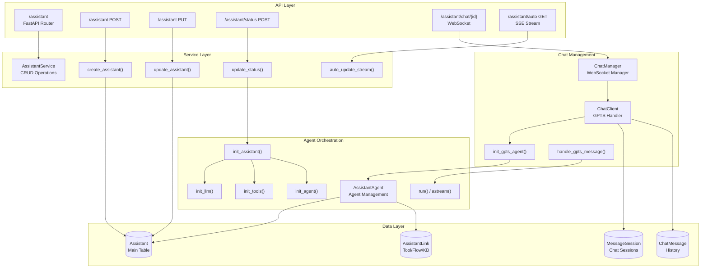
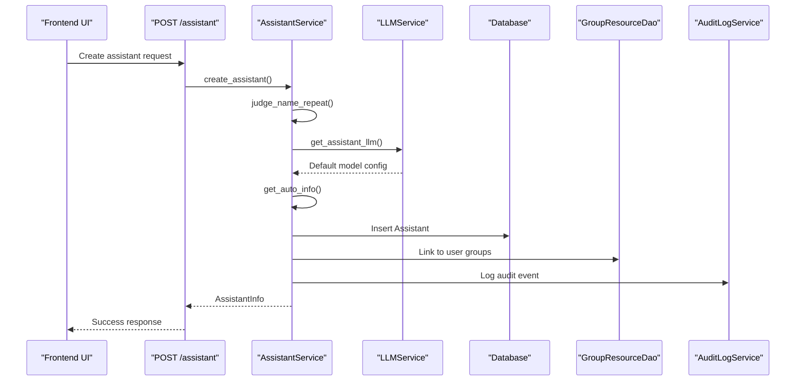
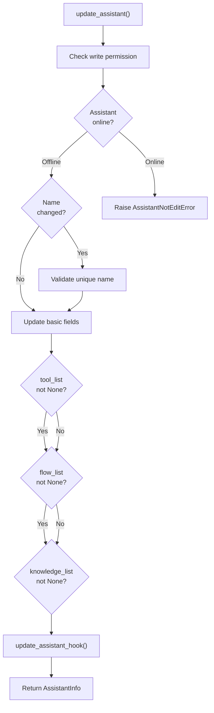
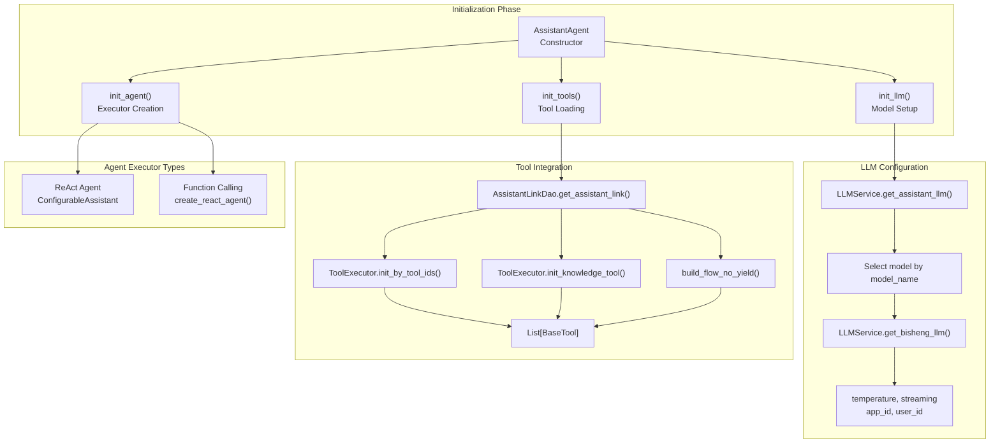
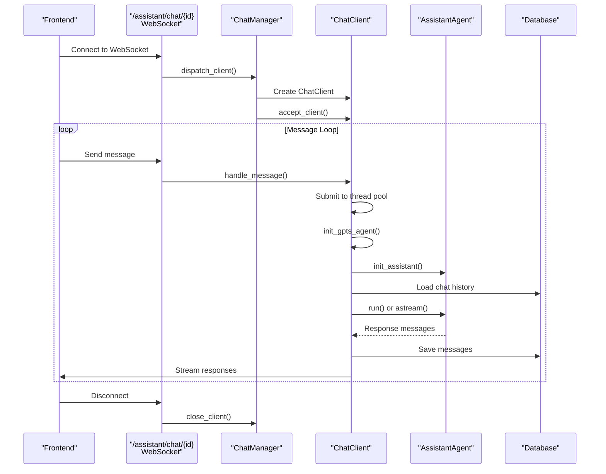
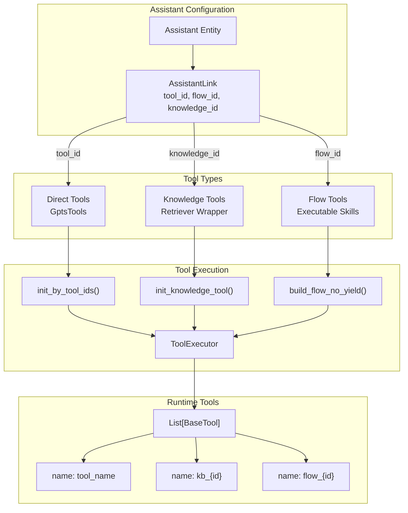
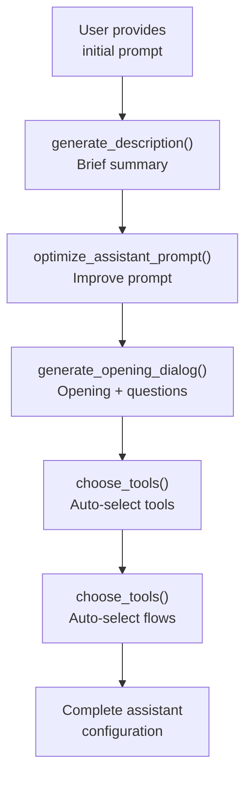

<!-- source: DeepWiki mcp.deepwiki.com · repo dataelement/bisheng · page 3.3 Assistant System · fetched 2026-10-29 -->

# Assistant System

<details>
<summary>Relevant source files</summary>

The following files were used as context for generating this wiki page:

- [src/backend/bisheng/api/services/assistant.py](src/backend/bisheng/api/services/assistant.py)
- [src/backend/bisheng/api/services/assistant_agent.py](src/backend/bisheng/api/services/assistant_agent.py)
- [src/backend/bisheng/api/services/base.py](src/backend/bisheng/api/services/base.py)
- [src/backend/bisheng/api/services/flow.py](src/backend/bisheng/api/services/flow.py)
- [src/backend/bisheng/api/services/knowledge.py](src/backend/bisheng/api/services/knowledge.py)
- [src/backend/bisheng/api/services/knowledge_imp.py](src/backend/bisheng/api/services/knowledge_imp.py)
- [src/backend/bisheng/api/services/workflow.py](src/backend/bisheng/api/services/workflow.py)
- [src/backend/bisheng/api/v1/assistant.py](src/backend/bisheng/api/v1/assistant.py)
- [src/backend/bisheng/api/v1/callback.py](src/backend/bisheng/api/v1/callback.py)
- [src/backend/bisheng/api/v1/flows.py](src/backend/bisheng/api/v1/flows.py)
- [src/backend/bisheng/api/v1/schemas.py](src/backend/bisheng/api/v1/schemas.py)
- [src/backend/bisheng/api/v1/skillcenter.py](src/backend/bisheng/api/v1/skillcenter.py)
- [src/backend/bisheng/api/v1/workflow.py](src/backend/bisheng/api/v1/workflow.py)
- [src/backend/bisheng/chat/client.py](src/backend/bisheng/chat/client.py)
- [src/backend/bisheng/chat/handlers.py](src/backend/bisheng/chat/handlers.py)
- [src/backend/bisheng/chat/manager.py](src/backend/bisheng/chat/manager.py)
- [src/backend/bisheng/database/models/assistant.py](src/backend/bisheng/database/models/assistant.py)
- [src/backend/bisheng/database/models/flow.py](src/backend/bisheng/database/models/flow.py)
- [src/backend/bisheng/database/models/flow_version.py](src/backend/bisheng/database/models/flow_version.py)
- [src/backend/bisheng/database/models/template.py](src/backend/bisheng/database/models/template.py)
- [src/backend/bisheng/database/models/user_link.py](src/backend/bisheng/database/models/user_link.py)
- [src/backend/bisheng/utils/threadpool.py](src/backend/bisheng/utils/threadpool.py)
- [src/backend/bisheng/worker/knowledge/file_worker.py](src/backend/bisheng/worker/knowledge/file_worker.py)
- [src/backend/bisheng/worker/knowledge/qa.py](src/backend/bisheng/worker/knowledge/qa.py)
- [src/backend/bisheng/worker/knowledge/rebuild_knowledge_worker.py](src/backend/bisheng/worker/knowledge/rebuild_knowledge_worker.py)

</details>


## Purpose and Scope

The Assistant System provides the core infrastructure for creating, managing, and executing conversational AI assistants (also called GPTS) within the Bisheng platform. This system handles the complete lifecycle of assistants, from creation and configuration through real-time conversation execution with support for tools, skills (flows), and knowledge bases.

For workflow-based applications, see [Workflow Engine](#3.5). For knowledge base integration details, see [Knowledge Base Management](#3.1). For general application lifecycle management across all application types, see [Application Lifecycle Management](#3.6).

---

## System Architecture

The Assistant System is built on a layered architecture consisting of API endpoints, service layer, agent orchestration, and real-time chat handling:



**Sources**: [src/backend/bisheng/api/v1/assistant.py:1-177](), [src/backend/bisheng/api/services/assistant.py:1-517](), [src/backend/bisheng/api/services/assistant_agent.py:1-421](), [src/backend/bisheng/chat/client.py:1-372](), [src/backend/bisheng/chat/manager.py:1-447]()

---

## Data Model

### Assistant Entity

The `Assistant` model represents an AI assistant configuration stored in the database:

| Field | Type | Description |
|-------|------|-------------|
| `id` | str | Unique identifier (UUID) |
| `name` | str | Assistant display name |
| `logo` | str | Path to logo image in MinIO |
| `desc` | str | User-visible description |
| `system_prompt` | str | Internal system prompt (not user-visible) |
| `prompt` | str | User-visible prompt/instructions |
| `guide_word` | str | Opening greeting message |
| `guide_question` | List | Suggested starter questions |
| `model_name` | str | LLM model ID from model management |
| `temperature` | float | Model temperature (default: 0.5) |
| `max_token` | int | Maximum context window (default: 32000) |
| `status` | int | Online (2) or Offline (1) status |
| `user_id` | int | Creator user ID |
| `is_delete` | int | Soft delete flag |

The `AssistantStatus` enum defines valid status values at [src/backend/bisheng/database/models/assistant.py:17-19]().

### Assistant Link Entity

The `AssistantLink` model creates many-to-many relationships between assistants and their capabilities:

| Field | Type | Description |
|-------|------|-------------|
| `assistant_id` | str | Assistant ID reference |
| `tool_id` | int | Tool ID (if linking a tool) |
| `flow_id` | str | Flow/skill ID (if linking a flow) |
| `knowledge_id` | int | Knowledge base ID (if linking KB) |

Each assistant can have multiple links to tools, flows, and knowledge bases. The system validates that each link has exactly one non-zero foreign key field.

**Sources**: [src/backend/bisheng/database/models/assistant.py:22-61](), [src/backend/bisheng/api/v1/schemas.py:244-293]()

---

## Assistant Lifecycle Management

### Creation Flow



The creation process implements several automatic features:

1. **Name Validation**: Checks for duplicate names within user scope via `judge_name_repeat()` at [src/backend/bisheng/api/services/assistant.py:448-453]()
2. **Default Model Selection**: Automatically assigns default LLM from configuration at [src/backend/bisheng/api/services/assistant.py:162-167]()
3. **Auto Description**: Generates description from prompt using `get_auto_info()` at [src/backend/bisheng/api/services/assistant.py:456-468]()
4. **Group Association**: Links assistant to creator's user groups via `create_assistant_hook()` at [src/backend/bisheng/api/services/assistant.py:189-211]()

**Sources**: [src/backend/bisheng/api/services/assistant.py:151-187](), [src/backend/bisheng/api/v1/assistant.py:58-66]()

### Update and Status Management

Assistant updates are handled by `update_assistant()` which validates several constraints:



Key update rules:
- **Online assistants cannot be edited** except for status changes (offline → online or vice versa)
- Name changes require uniqueness validation via `judge_name_repeat()`
- Tool, flow, and knowledge lists use `None` to indicate no change, empty list `[]` to clear associations
- All updates trigger `update_assistant_hook()` for audit logging and cache updates

Status changes are special-cased in `update_status()` at [src/backend/bisheng/api/services/assistant.py:343-369](), which validates the assistant can be initialized before setting status to online.

**Sources**: [src/backend/bisheng/api/services/assistant.py:284-341](), [src/backend/bisheng/api/services/assistant.py:343-369](), [src/backend/bisheng/api/v1/assistant.py:79-86]()

---

## Agent Orchestration and Execution

### AssistantAgent Architecture

The `AssistantAgent` class at [src/backend/bisheng/api/services/assistant_agent.py:34-421]() serves as the core orchestrator for assistant execution:



**Sources**: [src/backend/bisheng/api/services/assistant_agent.py:53-76](), [src/backend/bisheng/api/services/assistant_agent.py:78-107](), [src/backend/bisheng/api/services/assistant_agent.py:122-190](), [src/backend/bisheng/api/services/assistant_agent.py:192-223]()

### LLM Initialization

The `init_llm()` method at [src/backend/bisheng/api/services/assistant_agent.py:78-107]() performs model configuration:

1. Retrieves assistant LLM configuration via `LLMService.get_assistant_llm()`
2. Matches `assistant.model_name` to configured models
3. Falls back to default model if specified model not found
4. Creates LLM instance with telemetry tracking (app_id, app_name, app_type, user_id)
5. Stores agent executor type and knowledge retriever parameters

The system supports two agent executor types stored in `llm_agent_executor`:
- `"ReAct"` - Traditional ReAct agent pattern
- `"function call"` - OpenAI-style function calling

**Sources**: [src/backend/bisheng/api/services/assistant_agent.py:78-107]()

### Tool Initialization

The `init_tools()` method at [src/backend/bisheng/api/services/assistant_agent.py:122-190]() loads three types of tools:

1. **Direct Tools**: Loaded via `ToolExecutor.init_by_tool_ids()` for tool IDs from `AssistantLink`
2. **Knowledge Tools**: Each linked knowledge base becomes a retrieval tool via `ToolExecutor.init_knowledge_tool()`
3. **Flow Tools**: Linked flows are built into callable tools via `build_flow_no_yield()`, wrapped in LangChain `Tool` objects

Flow tools handle offline flows specially by tracking them in `self.offline_flows` and later sending fake callbacks to notify the UI via `fake_callback()` at [src/backend/bisheng/api/services/assistant_agent.py:261-272]().

**Sources**: [src/backend/bisheng/api/services/assistant_agent.py:122-190]()

### Agent Executor Creation

The `init_agent()` method at [src/backend/bisheng/api/services/assistant_agent.py:192-223]() creates the appropriate agent executor:

**ReAct Mode**:
```python
self.agent = ConfigurableAssistant(
    agent_executor_type='get_react_agent_executor',
    tools=self.tools,
    llm=self.llm,
    assistant_message=prompt
)
```

**Function Calling Mode**:
```python
self.agent = create_react_agent(
    self.llm, 
    self.tools, 
    prompt=prompt, 
    checkpointer=False
)
self.agent = self.agent.with_config({'recursion_limit': 100})
```

Special handling for Cohere models uses `ASSISTANT_PROMPT_COHERE` template at [src/backend/bisheng/api/services/assistant_agent.py:36-51]().

**Sources**: [src/backend/bisheng/api/services/assistant_agent.py:192-223]()

### Execution Methods

The agent provides two execution interfaces:

**Synchronous Execution** via `run()` at [src/backend/bisheng/api/services/assistant_agent.py:320-344]():
- Appends user query to chat history
- Trims history to fit within `max_token` via `trim_messages()`
- Executes appropriate agent executor (ReAct or function calling)
- Records full conversation history to file if `BISHENG_RECORD_HISTORY` is set

**Streaming Execution** via `astream()` at [src/backend/bisheng/api/services/assistant_agent.py:346-406]():
- Uses same history management as `run()`
- For function calling mode, uses `agent.astream()` with `stream_mode="messages"` for token-level streaming
- ReAct mode falls back to non-streaming execution
- Yields individual message chunks as they're generated

**Sources**: [src/backend/bisheng/api/services/assistant_agent.py:320-406]()

---

## Real-time Chat Interface

### WebSocket Connection Flow



**Sources**: [src/backend/bisheng/api/v1/assistant.py:158-176](), [src/backend/bisheng/chat/manager.py:204-288](), [src/backend/bisheng/chat/client.py:68-153]()

### ChatClient Implementation

The `ChatClient` class at [src/backend/bisheng/chat/client.py:33-372]() manages individual assistant chat sessions:

**Key Properties**:
- `client_id`: Assistant ID
- `chat_id`: Session ID (empty for debug mode)
- `gpts_agent`: Cached `AssistantAgent` instance
- `chat_history`: In-memory chat history buffer
- `stream_queue`: Queue for collecting streaming output during interruptions

**Message Handling** via `handle_gpts_message()` at [src/backend/bisheng/chat/client.py:294-371]():

1. Checks for stop action to handle interruptions
2. Initializes agent via `init_gpts_agent()` if needed
3. Loads latest chat history (configured rounds via `latest_history_num`)
4. Submits to thread pool with `wrapper_task()` for async execution
5. Invokes `AssistantAgent.run()` with chat history
6. Saves conversation including tool calls to database
7. Streams responses to WebSocket

**History Management** via `get_latest_history()` at [src/backend/bisheng/chat/client.py:227-250]():
- Loads up to `latest_history_num` (default 10) complete Q&A pairs
- Reconstructs message objects: `HumanMessage`, `AIMessage`, `ToolMessage`
- Filters out incomplete conversations (e.g., interrupted answers)
- Includes tool call/result pairs in history

**Sources**: [src/backend/bisheng/chat/client.py:33-372](), [src/backend/bisheng/chat/client.py:171-209](), [src/backend/bisheng/chat/client.py:294-371]()

### Message Categories

The system uses a category-based message tracking scheme:

| Category | Description | `is_bot` | Example |
|----------|-------------|----------|---------|
| `question` | User input | 0 | `{"input": "What is AI?"}` |
| `answer` | Final LLM response | 1 | Plain text answer |
| `reasoning_answer` | Chain-of-thought reasoning | 1 | Internal reasoning steps |
| `tool_call` | Tool invocation | 1 | AIMessage with tool_calls |
| `tool_result` | Tool output | 1 | ToolMessage with result |

Messages are saved via `add_message()` at [src/backend/bisheng/chat/client.py:108-153](), which creates both in-memory entries and database records.

**Sources**: [src/backend/bisheng/chat/client.py:108-153](), [src/backend/bisheng/database/models/message.py]()

---

## Tool and Knowledge Integration

### Tool Integration Architecture



**Sources**: [src/backend/bisheng/api/services/assistant_agent.py:122-190](), [src/backend/bisheng/tool/domain/services/executor.py]()

### Knowledge Base Tool Integration

Knowledge bases are integrated as retrieval tools at [src/backend/bisheng/api/services/assistant_agent.py:152-156]():

```python
knowledge_tool = await ToolExecutor.init_knowledge_tool(
    self.invoke_user_id, 
    knowledge_id, 
    llm=self.llm,
    callbacks=callbacks,
    **self.knowledge_retriever
)
```

The `knowledge_retriever` dict contains:
- `max_content`: Maximum characters to return (from LLM config)
- `sort_by_source_and_index`: Whether to sort results by source document

Knowledge tools use the system's hybrid retrieval (Milvus vector + Elasticsearch keyword) under the hood. See [Vector Search and Retrieval](#6.3) for details.

**Sources**: [src/backend/bisheng/api/services/assistant_agent.py:94-97](), [src/backend/bisheng/api/services/assistant_agent.py:152-156]()

### Flow Tool Integration

Flows (skills) are converted to tools at [src/backend/bisheng/api/services/assistant_agent.py:157-189]():

1. Retrieves flow data from `FlowDao.get_flow_by_ids()`
2. Checks flow online status, tracking offline flows separately
3. Builds flow graph via `build_flow_no_yield()`
4. Wraps built object in LangChain `Tool` with:
   - Name: `flow_{flow_id}`
   - Description: `{flow.name}:{flow.description}`
   - Args schema: `InputRequest` (simple string input)
   - Coroutine: Flow's `ainvoke` method

Offline flows are tracked in `self.offline_flows` and trigger fake callbacks during execution at [src/backend/bisheng/api/services/assistant_agent.py:261-272]().

**Sources**: [src/backend/bisheng/api/services/assistant_agent.py:157-189]()

---

## Auto-optimization Features

### Auto-generation System



**Sources**: [src/backend/bisheng/api/services/assistant.py:456-468](), [src/backend/bisheng/api/services/assistant.py:247-277](), [src/backend/bisheng/api/services/assistant_agent.py:224-259]()

### Auto-update Stream API

The `POST /assistant/auto/task` and `GET /assistant/auto` endpoints at [src/backend/bisheng/api/v1/assistant.py:89-125]() provide streaming auto-optimization:

**Process Flow**:
1. Client submits task with `assistant_id` and new `prompt`
2. System generates `task_id` and caches request in Redis
3. Client opens SSE connection with `task_id`
4. Server streams updates for each optimization step:
   - `type: 'prompt'` - Optimized prompt text chunks
   - `type: 'guide_word'` - Generated opening message
   - `type: 'guide_question'` - Suggested questions
   - `type: 'tool_list'` - Auto-selected tools
   - `type: 'flow_list'` - Auto-selected flows

**Streaming Implementation** via `auto_update_stream()` at [src/backend/bisheng/api/services/assistant.py:247-282]():
- Uses `optimize_assistant_prompt()` for streaming prompt generation via LLM
- Calls `generate_guide()` for opening dialog/questions
- Iterates through tools and flows in batches (50 at a time)
- Invokes `choose_tools()` on each batch with original prompt as context

**Sources**: [src/backend/bisheng/api/v1/assistant.py:89-125](), [src/backend/bisheng/api/services/assistant.py:247-282]()

### Tool Selection Algorithm

The `choose_tools()` method at [src/backend/bisheng/api/services/assistant_agent.py:249-259]() uses LLM-based selection:

```python
tool_selector = ToolSelector(llm=self.llm, tools=tool_list)
return tool_selector.select(self.assistant.name, prompt)
```

The `ToolSelector` from `bisheng_langchain.gpts.auto_tool_selected` evaluates each tool's relevance to the assistant's purpose based on tool descriptions and the user's prompt.

**Auto Tool Selection** at [src/backend/bisheng/api/services/assistant.py:471-496]():
- Loads all user tools in batches of 50
- Converts to `{name, description}` format
- Invokes `choose_tools()` for each batch
- Aggregates selected tools across batches

**Auto Flow Selection** at [src/backend/bisheng/api/services/assistant.py:499-516]():
- Loads top 50 online flows user can access
- Uses same selection algorithm as tools
- Returns flows matching assistant purpose

**Sources**: [src/backend/bisheng/api/services/assistant_agent.py:249-259](), [src/backend/bisheng/api/services/assistant.py:471-516]()

### Prompt Optimization Functions

The system uses functions from `bisheng_langchain.gpts.auto_optimization`:

- **`generate_breif_description(llm, prompt)`** - Creates concise description from prompt
- **`optimize_assistant_prompt(llm, name, description)`** - Improves prompt clarity and effectiveness
- **`generate_opening_dialog(llm, prompt)`** - Generates opening message and 3-5 suggested questions

These are invoked via `AssistantAgent` methods at [src/backend/bisheng/api/services/assistant_agent.py:224-247]():
- `optimize_assistant_prompt()` - Async streaming version
- `generate_description()` - Synchronous brief description
- `generate_guide()` - Opening dialog and questions

**Sources**: [src/backend/bisheng/api/services/assistant_agent.py:224-247](), [src/backend/bisheng_langchain/gpts/auto_optimization.py]()

---

## Database Schema

### Assistant Table Structure

The `assistant` table stores core assistant configurations:

```sql
CREATE TABLE assistant (
    id VARCHAR(32) PRIMARY KEY,
    name VARCHAR(255) NOT NULL,
    logo VARCHAR(255),
    desc TEXT,
    system_prompt TEXT,
    prompt TEXT,
    guide_word TEXT,
    guide_question JSON,
    model_name VARCHAR(255),
    temperature FLOAT DEFAULT 0.5,
    max_token INT DEFAULT 32000,
    status INT DEFAULT 1,
    user_id INT,
    is_delete INT DEFAULT 0,
    create_time DATETIME DEFAULT CURRENT_TIMESTAMP,
    update_time DATETIME DEFAULT CURRENT_TIMESTAMP ON UPDATE CURRENT_TIMESTAMP,
    INDEX idx_user_id (user_id),
    INDEX idx_create_time (create_time)
)
```

**Sources**: [src/backend/bisheng/database/models/assistant.py:22-41]()

### AssistantLink Table Structure

The `assistant_link` table creates associations between assistants and capabilities:

```sql
CREATE TABLE assistant_link (
    id INT PRIMARY KEY AUTO_INCREMENT,
    assistant_id VARCHAR(32),
    tool_id INT,
    flow_id VARCHAR(32),
    knowledge_id INT,
    create_time DATETIME DEFAULT CURRENT_TIMESTAMP,
    update_time DATETIME DEFAULT CURRENT_TIMESTAMP ON UPDATE CURRENT_TIMESTAMP,
    INDEX idx_assistant_id (assistant_id),
    INDEX idx_tool_id (tool_id),
    INDEX idx_flow_id (flow_id),
    INDEX idx_knowledge_id (knowledge_id)
)
```

Each row represents one capability link with exactly one of `tool_id`, `flow_id`, or `knowledge_id` set.

**Link Update Methods**:
- `update_assistant_tool()` at [src/backend/bisheng/database/models/assistant.py:220-239]() - Replace tool associations
- `update_assistant_flow()` at [src/backend/bisheng/database/models/assistant.py:241-262]() - Replace flow associations  
- `update_assistant_knowledge()` at [src/backend/bisheng/database/models/assistant.py:264-285]() - Replace KB associations

**Sources**: [src/backend/bisheng/database/models/assistant.py:43-61](), [src/backend/bisheng/database/models/assistant.py:220-285]()

---

## Access Control and Permissions

Assistant access control integrates with the platform's role-based access control system:

**Permission Types**:
- `AccessType.ASSISTANT_READ` - View assistant details, use in chat
- `AccessType.ASSISTANT_WRITE` - Edit assistant configuration, manage status

**Access Check Flow**:
1. Check if user is assistant owner via `assistant.user_id == login_user.user_id`
2. Check if user is system admin via `login_user.is_admin()`
3. Check role-based permissions via `RoleAccessDao.get_role_access()` with user's role IDs
4. Check group-based access via `GroupResourceDao` for shared assistants

The `check_update_permission()` helper at [src/backend/bisheng/api/services/assistant.py:414-422]() enforces:
- User must have write access
- Assistant must be offline for configuration changes
- Online assistants can only have status changed

**Sources**: [src/backend/bisheng/api/services/assistant.py:414-422](), [src/backend/bisheng/api/services/assistant.py:44-96](), [src/backend/bisheng/api/services/assistant.py:110-123]()

---

## Telemetry and Monitoring

The Assistant System integrates comprehensive telemetry tracking:

**Event Types**:
- `NEW_APPLICATION` - Assistant creation at [src/backend/bisheng/api/services/assistant.py:174-181]()
- `EDIT_APPLICATION` - Assistant updates at [src/backend/bisheng/api/services/assistant.py:309-310]()
- `DELETE_APPLICATION` - Assistant deletion at [src/backend/bisheng/api/services/assistant.py:225-227]()
- `NEW_MESSAGE_SESSION` - New chat session at [src/backend/bisheng/chat/client.py:141-151]()
- `APPLICATION_PROCESS` - Message processing time at [src/backend/bisheng/chat/client.py:84-106]()
- `APPLICATION_ALIVE` - Session duration at [src/backend/bisheng/chat/manager.py:277-287]()

**Tracked Metadata**:
- `app_id`: Assistant ID
- `app_name`: Assistant name
- `app_type`: `ApplicationTypeEnum.ASSISTANT`
- `user_id`: Operating user
- `session_id` / `chat_id`: Chat session identifier
- `start_time` / `end_time`: Timestamps for duration events
- `process_time`: Milliseconds for processing events

**Sources**: [src/backend/bisheng/api/services/assistant.py:174-181](), [src/backend/bisheng/chat/client.py:81-106](), [src/backend/bisheng/chat/manager.py:277-287]()

---

## Error Handling

The Assistant System defines specialized error types in `bisheng.common.errcode.assistant`:

| Error | HTTP Status | Scenario |
|-------|-------------|----------|
| `AssistantNotExistsError` | 404 | Assistant ID not found or deleted |
| `AssistantNameRepeatError` | 400 | Name already exists for user |
| `AssistantNotEditError` | 400 | Attempted edit on online assistant |
| `AssistantDeletedError` | 404 | Assistant was deleted |
| `AssistantNotOnlineError` | 400 | Chat attempted with offline assistant |
| `AssistantInitError` | 500 | Failed to initialize agent executor |
| `AssistantModelEmptyError` | 500 | No LLM models configured |
| `AssistantModelNotConfigError` | 500 | Specified model not found |
| `AssistantAutoLLMError` | 500 | Auto-optimization LLM not configured |
| `AssistantOtherError` | 500 | Generic unexpected error |

Errors are raised at appropriate points:
- CRUD operations in `AssistantService`
- Agent initialization in `AssistantAgent.init_assistant()`
- Chat handling in `ChatClient.handle_gpts_message()`

All errors inherit from `BaseErrorCode` and provide structured JSON responses via `websocket_close_message()` for WebSocket contexts.

**Sources**: [src/backend/bisheng/common/errcode/assistant.py](), [src/backend/bisheng/api/services/assistant.py:218-223](), [src/backend/bisheng/chat/client.py:204-209]()

---

