<!-- source: DeepWiki mcp.deepwiki.com · repo dataelement/bisheng · page 3.4 Linsight AI Workbench · fetched 2026-10-29 -->

# Linsight AI Workbench

<details>
<summary>Relevant source files</summary>

The following files were used as context for generating this wiki page:

- [src/backend/bisheng/core/cache/redis_conn.py](src/backend/bisheng/core/cache/redis_conn.py)
- [src/backend/bisheng/linsight/domain/task_exec.py](src/backend/bisheng/linsight/domain/task_exec.py)
- [src/backend/bisheng/linsight/domain/utils.py](src/backend/bisheng/linsight/domain/utils.py)
- [src/backend/bisheng/linsight/worker.py](src/backend/bisheng/linsight/worker.py)

</details>


## Purpose and Scope

The Linsight AI Workbench is an AI-driven system for generating and executing Standard Operating Procedures (SOPs). It enables users to submit questions or tasks, automatically generates structured SOPs using LLM agents, and executes those SOPs through an asynchronous workflow engine with support for interactive user input, file processing, and tool invocation.

This page covers the complete Linsight subsystem including question submission, SOP generation, task execution, and the supporting infrastructure. For general chat interactions, see [Chat and Messaging System](#3.2). For knowledge base integration, see [Knowledge Base Management](#3.1). For workflow concepts beyond Linsight, see [Workflow Engine](#3.5).

## System Overview

The Linsight AI Workbench follows a multi-stage pipeline architecture:

```mermaid
graph TB
    subgraph "Frontend Interaction"
        USER[User]
        UI_SUBMIT["Submit Question<br/>+ Files + Tools"]
        UI_GENERATE["Generate SOP<br/>View & Edit"]
        UI_EXECUTE["Execute SOP<br/>Monitor Progress"]
        UI_FEEDBACK["Provide Feedback<br/>& Rating"]
    end
    
    subgraph "API Layer - /api/v1/linsight.py"
        API_SUBMIT["/workbench/submit<br/>POST EventSourceResponse"]
        API_GEN["/workbench/generate-sop<br/>POST EventSourceResponse"]
        API_START["/workbench/start-execute<br/>POST"]
        API_WS["/workbench/task-message-stream<br/>WebSocket"]
        API_INPUT["/workbench/user-input<br/>POST"]
        API_TERMINATE["/workbench/terminate-execute<br/>POST"]
    end
    
    subgraph "Service Layer"
        IMPL["LinsightWorkbenchImpl<br/>workbench_impl.py"]
        SOP_MGR["SOPManageService<br/>sop_manage.py"]
    end
    
    subgraph "Execution Infrastructure"
        QUEUE["LinsightQueue<br/>Redis-based"]
        WORKER["ScheduleCenterProcess<br/>worker.py"]
        TASK_EXEC["LinsightWorkflowTask<br/>task_exec.py"]
        STATE_MGR["LinsightStateMessageManager<br/>state_message_manager.py"]
    end
    
    subgraph "AI Components"
        AGENT["LinsightAgent<br/>bisheng_langchain"]
        LLM["BishengLLM<br/>Task Model"]
        TOOLS["Tool Executor<br/>Code Interpreter, etc"]
    end
    
    subgraph "Storage"
        MYSQL[(MySQL<br/>linsight_session_version<br/>linsight_execute_task<br/>linsight_sop)]
        REDIS[(Redis<br/>Task Queue<br/>State Cache)]
        MILVUS[(Milvus<br/>SOP Vector Store)]
        ES[(Elasticsearch<br/>SOP Keyword Search)]
        MINIO[(MinIO<br/>Files & Results)]
    end
    
    USER --> UI_SUBMIT --> API_SUBMIT
    API_SUBMIT --> IMPL
    
    UI_GENERATE --> API_GEN
    API_GEN --> IMPL
    IMPL --> SOP_MGR
    IMPL --> AGENT
    
    UI_EXECUTE --> API_START
    API_START --> QUEUE
    QUEUE --> WORKER
    WORKER --> TASK_EXEC
    
    TASK_EXEC --> AGENT
    TASK_EXEC --> TOOLS
    TASK_EXEC --> STATE_MGR
    
    UI_EXECUTE -.Monitor.- API_WS
    API_WS -.Stream.- STATE_MGR
    
    UI_FEEDBACK -.User Input.- API_INPUT
    API_INPUT --> STATE_MGR
    
    IMPL --> MYSQL
    IMPL --> MINIO
    SOP_MGR --> MILVUS
    SOP_MGR --> ES
    SOP_MGR --> MYSQL
    
    STATE_MGR --> REDIS
    STATE_MGR --> MYSQL
    TASK_EXEC --> MINIO
```

Sources: [src/backend/bisheng/api/v1/linsight.py:48-707](), [src/backend/bisheng/api/services/linsight/workbench_impl.py:68-1313](), [src/backend/bisheng/linsight/worker.py:1-195](), [src/backend/bisheng/linsight/task_exec.py:1-680]()

## Core Components

### Workbench Implementation Layer

The `LinsightWorkbenchImpl` class serves as the main service layer orchestrating Linsight operations:

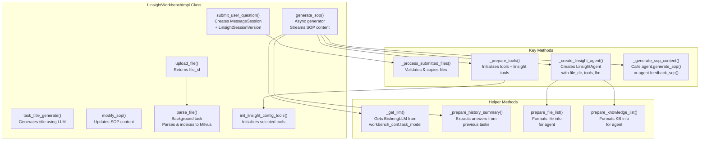

**Key Constants and Configuration:**

| Constant | Value | Purpose |
|----------|-------|---------|
| `COLLECTION_NAME_PREFIX` | `"col_linsight_file_"` | Milvus collection naming |
| `FILE_INFO_REDIS_KEY_PREFIX` | `"linsight_file:"` | Redis key for file metadata |
| `CACHE_EXPIRATION_HOURS` | `24` | File cache expiration |

Sources: [src/backend/bisheng/api/services/linsight/workbench_impl.py:68-1313]()

### API Layer

The FastAPI router exposes Linsight functionality through RESTful endpoints and WebSocket:

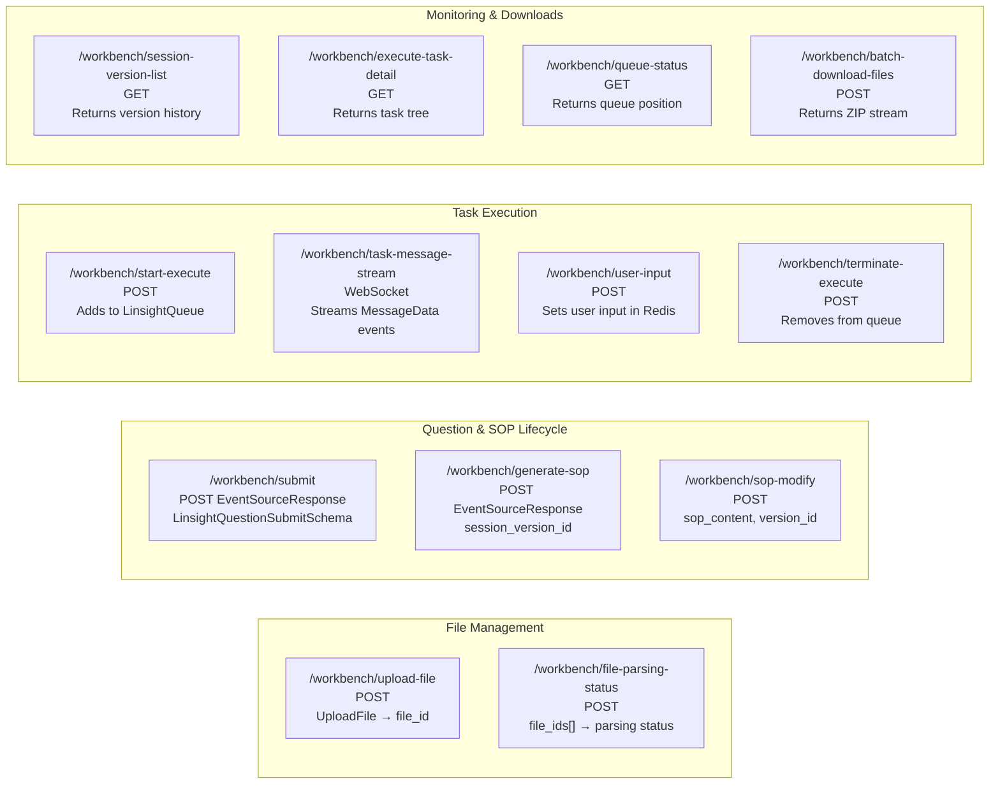

**Request/Response Schemas:**

| Schema | Fields | Purpose |
|--------|--------|---------|
| `LinsightQuestionSubmitSchema` | question, tools[], files[], org_knowledge_enabled, personal_knowledge_enabled | Submit user question |
| `SubmitFileSchema` | file_id, file_name, parsing_status | File reference |
| `DownloadFilesSchema` | file_name, file_url | Download specification |
| `UserInputEventSchema` | user_input, files[], is_completed | User interaction data |

Sources: [src/backend/bisheng/api/v1/linsight.py:48-885](), [src/backend/bisheng/api/v1/schema/linsight_schema.py:1-62]()

### Task Execution Engine

The `LinsightWorkflowTask` class manages the execution lifecycle of SOP tasks:

```mermaid
graph TB
    subgraph "LinsightWorkflowTask Lifecycle"
        ENTRY["async_run(session_version_id)<br/>Entry point"]
        MGD_EXEC["_managed_execution()<br/>Context manager<br/>Resource management"]
        EXEC_WF["_execute_workflow()<br/>Core execution logic"]
        CLEANUP["_cleanup_resources()<br/>Stop monitor, delete files"]
    end
    
    subgraph "Initialization Phase"
        GET_SESSION["_get_session_model()<br/>Load from DB"]
        CHECK_STATUS["_is_session_in_progress()<br/>Prevent duplicate runs"]
        INIT_DIR["_init_file_directory()<br/>Download files from MinIO"]
        START_MONITOR["_start_termination_monitor()<br/>Check for user termination"]
    end
    
    subgraph "Execution Phase"
        UPDATE_STATUS["_update_session_status()<br/>Set IN_PROGRESS"]
        GET_LLM_E["_get_llm()<br/>Initialize LLM"]
        GEN_TOOLS["_generate_tools()<br/>Initialize configured tools"]
        CREATE_AGENT_E["_create_agent()<br/>LinsightAgent instance"]
        GEN_TASK["agent.generate_task(sop)<br/>Generate task tree"]
        SAVE_TASK["_save_task_info()<br/>Save to DB & Redis"]
        EXEC_AGENT["_execute_agent_tasks()<br/>Execute with monitoring"]
    end
    
    subgraph "Event Handling"
        HANDLE_EVENT["_handle_event()<br/>Dispatch based on type"]
        H_GEN_SUB["_handle_generate_subtask()<br/>Save new subtasks"]
        H_START["_handle_task_start()<br/>Update status, push message"]
        H_END["_handle_task_end()<br/>Save result, push message"]
        H_INPUT["_handle_need_user_input()<br/>Wait for input"]
        H_STEP["_handle_exec_step()<br/>Log step, upload files"]
    end
    
    subgraph "Completion Phase"
        HANDLE_COMPLETE["_handle_task_completion()"]
        H_SUCCESS["_handle_task_success()<br/>Upload files to MinIO<br/>Set COMPLETED"]
        H_FAILURE["_handle_task_failure()<br/>Set FAILED<br/>Revoke invite code"]
        H_TERMINATE["_handle_user_termination()<br/>Set TERMINATED<br/>Mark tasks failed"]
    end
    
    ENTRY --> MGD_EXEC
    MGD_EXEC --> GET_SESSION
    MGD_EXEC --> CHECK_STATUS
    MGD_EXEC --> INIT_DIR
    MGD_EXEC --> START_MONITOR
    MGD_EXEC --> EXEC_WF
    MGD_EXEC --> CLEANUP
    
    EXEC_WF --> UPDATE_STATUS
    EXEC_WF --> GET_LLM_E
    EXEC_WF --> GEN_TOOLS
    EXEC_WF --> CREATE_AGENT_E
    EXEC_WF --> GEN_TASK
    EXEC_WF --> SAVE_TASK
    EXEC_WF --> EXEC_AGENT
    
    EXEC_AGENT --> HANDLE_EVENT
    HANDLE_EVENT --> H_GEN_SUB
    HANDLE_EVENT --> H_START
    HANDLE_EVENT --> H_END
    HANDLE_EVENT --> H_INPUT
    HANDLE_EVENT --> H_STEP
    
    EXEC_AGENT --> HANDLE_COMPLETE
    HANDLE_COMPLETE --> H_SUCCESS
    HANDLE_COMPLETE --> H_FAILURE
    HANDLE_COMPLETE --> H_TERMINATE
```

**Task Status Enumeration:**

| Status | Description |
|--------|-------------|
| `NOT_STARTED` | Initial state |
| `IN_PROGRESS` | Currently executing |
| `SUCCESS` | Completed successfully |
| `WAITING_FOR_USER_INPUT` | Paused for user interaction |
| `USER_INPUT_COMPLETED` | User provided input |
| `FAILED` | Execution failed |
| `TERMINATED` | User stopped execution |

Sources: [src/backend/bisheng/linsight/task_exec.py:50-680](), [src/backend/bisheng/database/models/linsight_execute_task.py:23-41]()

### SOP Management System

The `SOPManageService` manages a library of reusable SOPs with vector-based search:

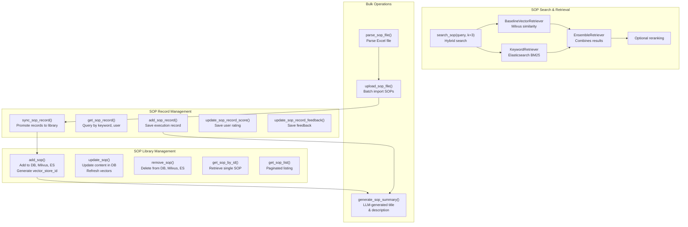

**Storage Configuration:**

| Store | Collection/Index | Purpose |
|-------|-----------------|---------|
| Milvus | `col_linsight_sop` | Vector embeddings (first 10k chars) |
| Elasticsearch | `col_linsight_sop` | Full-text keyword search |
| MySQL | `linsight_sop` | SOP metadata & content |
| MySQL | `linsight_sop_record` | Execution history records |

Sources: [src/backend/bisheng/api/services/linsight/sop_manage.py:42-547](), [src/backend/bisheng/database/models/linsight_sop.py:1-311]()

### Worker Infrastructure

The worker system uses Redis-based queuing with multi-process execution:

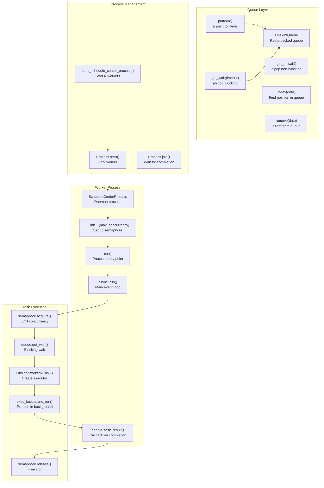

**Configuration Parameters:**

| Parameter | Default | Description |
|-----------|---------|-------------|
| `worker_num` | 4 | Number of worker processes |
| `max_concurrency` | 32 | Tasks per worker process |
| `queue_key` | `linsight:queue` | Redis queue key |

Sources: [src/backend/bisheng/linsight/worker.py:19-195]()

### State and Message Management

The `LinsightStateMessageManager` handles real-time state synchronization:

```mermaid
graph TB
    subgraph "LinsightStateMessageManager"
        INIT["__init__(session_version_id)<br/>Initialize keys"]
        KEYS["Redis Key Structure:<br/>linsight_tasks:{id}:session_version_info<br/>linsight_tasks:{id}:messages<br/>linsight_tasks:{id}:execution_tasks:{task_id}"]
    end
    
    subgraph "Session Management"
        SET_SESSION["set_session_version_info()<br/>Write to DB + Redis<br/>Atomic transaction"]
        GET_SESSION["get_session_version_info()<br/>Read from Redis<br/>Fallback to DB"]
    end
    
    subgraph "Task Management"
        SET_TASKS["set_execution_tasks()<br/>Batch write to Redis<br/>mset operation"]
        GET_TASK["get_execution_task(task_id)<br/>Read single task<br/>Fallback to DB"]
        GET_ALL["get_execution_tasks()<br/>Pattern match keys<br/>Batch read"]
        UPDATE_STATUS["update_execution_task_status()<br/>Update DB then Redis"]
        ADD_STEP["add_execution_task_step()<br/>Append to history<br/>Sync to DB"]
    end
    
    subgraph "Message Streaming"
        PUSH["push_message(MessageData)<br/>arpush to list"]
        POP["pop_message()<br/>ablpop from list"]
        EVENT_TYPES["MessageEventType enum:<br/>TASK_START, TASK_GENERATE<br/>TASK_EXECUTE_STEP, TASK_END<br/>USER_INPUT, ERROR_MESSAGE<br/>FINAL_RESULT, TASK_TERMINATED"]
    end
    
    subgraph "User Input Handling"
        SET_INPUT["set_user_input()<br/>Update task history<br/>Set USER_INPUT_COMPLETED"]
        WAIT_INPUT["Task waits for<br/>status == USER_INPUT_COMPLETED"]
    end
    
    subgraph "Cleanup"
        CLEANUP["cleanup_session_data()<br/>Delete pattern keys"]
        CLEANUP_ALL["cleanup_all_sessions()<br/>Class method"]
        STATS["get_session_stats()<br/>Count messages & tasks"]
    end
    
    INIT --> KEYS
    
    SET_SESSION -.Atomic transaction.- GET_SESSION
    
    SET_TASKS --> GET_TASK
    SET_TASKS --> GET_ALL
    GET_TASK --> UPDATE_STATUS
    UPDATE_STATUS --> ADD_STEP
    
    PUSH --> EVENT_TYPES
    POP --> EVENT_TYPES
    
    SET_INPUT --> WAIT_INPUT
    
    CLEANUP --> CLEANUP_ALL
```

**Retry Configuration:**

| Setting | Value | Purpose |
|---------|-------|---------|
| `DEFAULT_RETRY_ATTEMPTS` | 3 | Number of retry attempts |
| `DEFAULT_RETRY_DELAY` | 1 | Seconds between retries |
| `DEFAULT_EXPIRATION` | 3600 | Redis key TTL in seconds |

Sources: [src/backend/bisheng/linsight/state_message_manager.py:52-481]()

## Data Flow

### Question Submission Flow

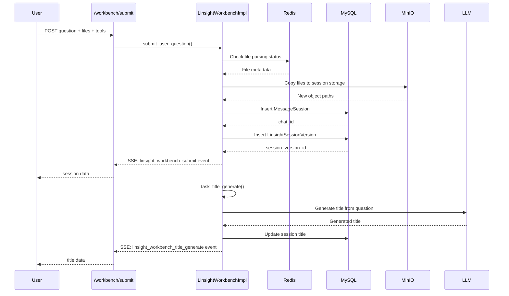

Sources: [src/backend/bisheng/api/v1/linsight.py:109-169](), [src/backend/bisheng/api/services/linsight/workbench_impl.py:129-191](), [src/backend/bisheng/api/services/linsight/workbench_impl.py:250-290]()

### SOP Generation Flow

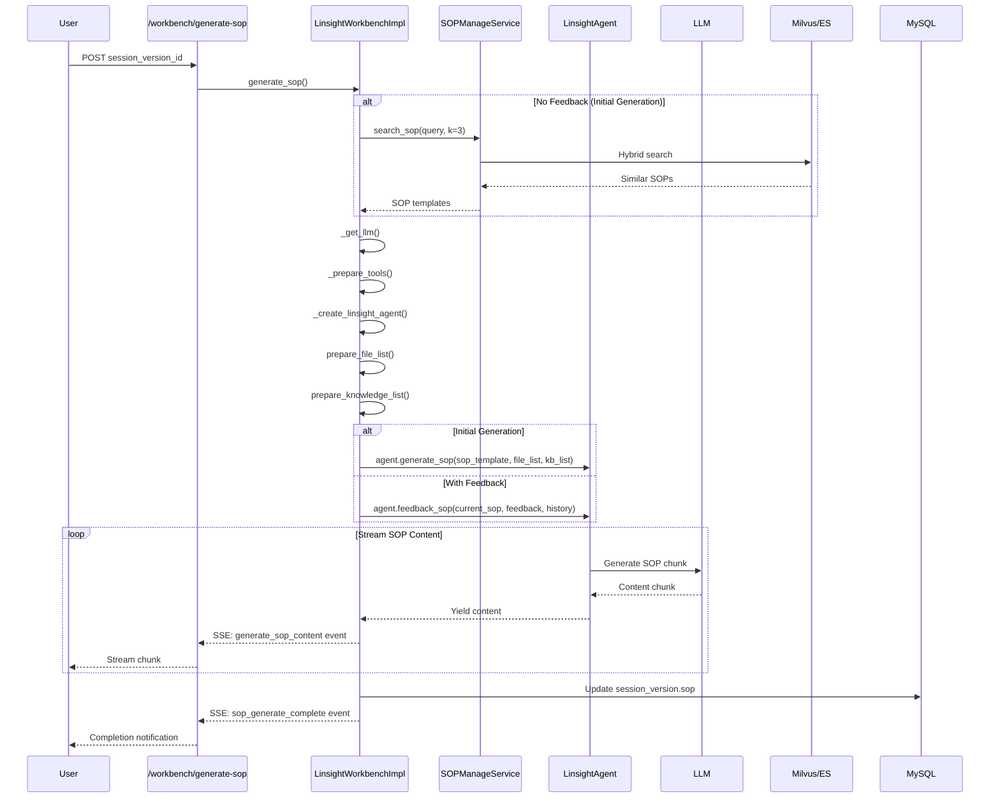

Sources: [src/backend/bisheng/api/v1/linsight.py:173-273](), [src/backend/bisheng/api/services/linsight/workbench_impl.py:357-449](), [src/backend/bisheng/api/services/linsight/sop_manage.py:475-547]()

### Task Execution Flow

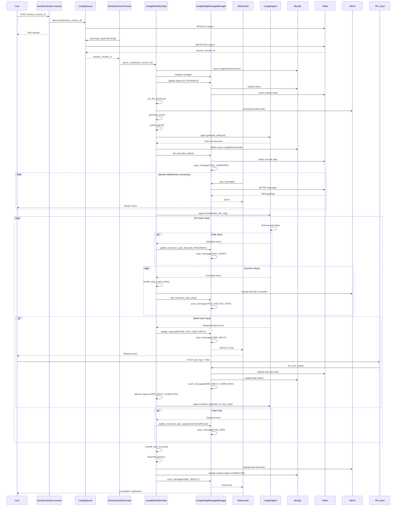

Sources: [src/backend/bisheng/api/v1/linsight.py:307-353](), [src/backend/bisheng/linsight/worker.py:88-118](), [src/backend/bisheng/linsight/task_exec.py:106-680](), [src/backend/bisheng/api/v1/linsight.py:602-651]()

## Key Features

### File Processing Pipeline

Linsight supports file upload, parsing, and indexing for use in SOP execution:

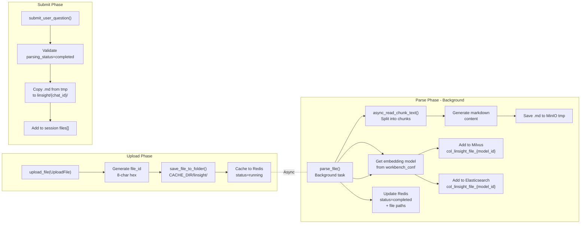

**File Metadata Schema:**

```typescript
{
  file_id: string;              // 8-char unique ID
  original_filename: string;    // User's filename
  filename: string;             // Stored filename with file_id
  file_path: string;            // Local cache path
  parsing_status: string;       // "running" | "completed" | "failed"
  markdown_filename?: string;   // Generated .md filename
  markdown_file_path?: string;  // MinIO object path
  markdown_file_md5?: string;   // MD5 hash
  embedding_model_id?: number;  // Used embedding model
  collection_name?: string;     // Milvus collection
}
```

Sources: [src/backend/bisheng/api/services/linsight/workbench_impl.py:699-863](), [src/backend/bisheng/api/v1/linsight.py:52-106]()

### Tool Integration

Linsight initializes and manages tools for agent execution:

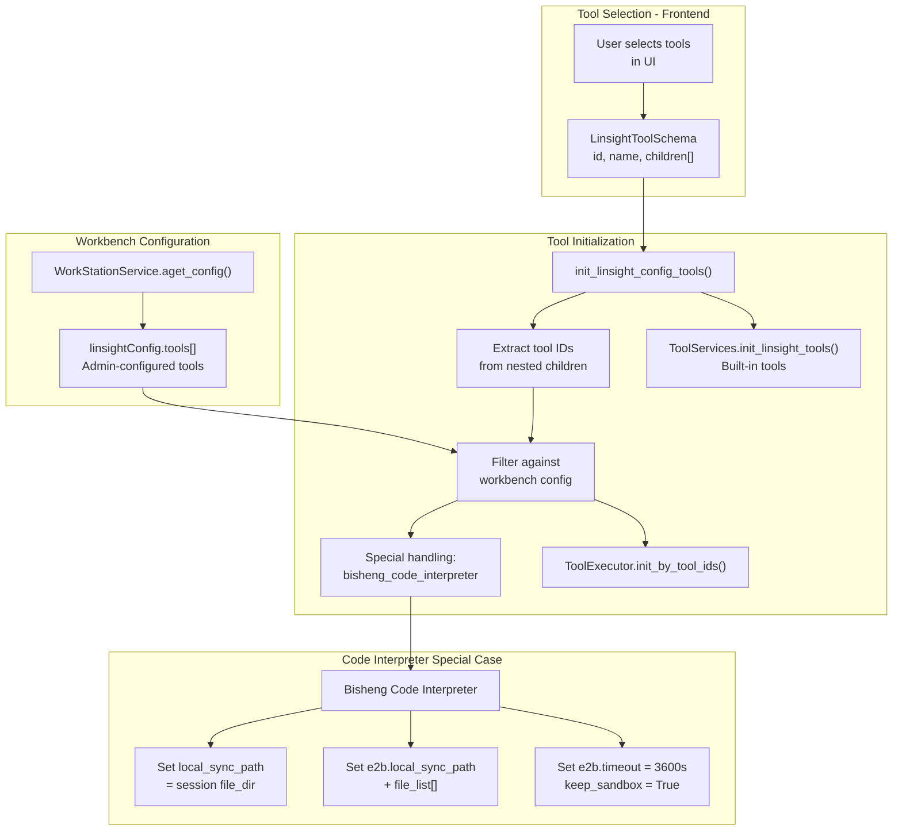

**Built-in Linsight Tools:**

The system automatically adds these tools from `ToolServices.init_linsight_tools()`:
- File manipulation tools (read, write, replace)
- Directory operations
- Text processing utilities

**Tool Configuration Structure:**

```json
{
  "id": 1,
  "name": "Code & Analysis",
  "children": [
    {
      "id": 42,
      "tool_key": "bisheng_code_interpreter",
      "name": "Code Interpreter",
      "desc": "Execute Python code"
    }
  ]
}
```

Sources: [src/backend/bisheng/api/services/linsight/workbench_impl.py:902-963](), [src/backend/bisheng/api/services/linsight/workbench_impl.py:459-474]()

### Interactive User Input

Tasks can request user input during execution through the `NeedUserInput` event:

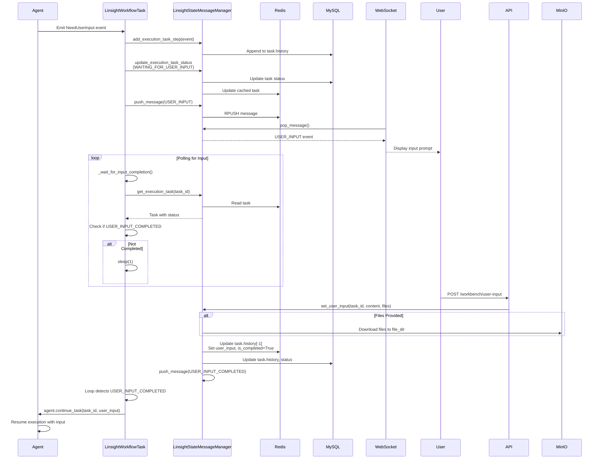

**User Input Event Schema:**

```python
class UserInputEventSchema(NeedUserInput):
    files: Optional[List[Dict[str, str]]]  # Uploaded files
    user_input: Optional[str]               # Text input
    is_completed: bool                      # Completion flag
```

Sources: [src/backend/bisheng/linsight/task_exec.py:427-512](), [src/backend/bisheng/api/v1/linsight.py:357-390](), [src/backend/bisheng/linsight/state_message_manager.py:262-309]()

## Storage and Persistence

### Database Schema

The Linsight system uses three primary MySQL tables:

**`linsight_session_version` Table:**

| Column | Type | Description |
|--------|------|-------------|
| `id` | CHAR(36) | Primary key, UUID hex |
| `session_id` | CHAR(36) | FK to message_session.chat_id |
| `user_id` | INT | FK to user.user_id |
| `question` | TEXT | User's original question |
| `title` | TEXT | Generated session title |
| `tools` | JSON | Selected tools configuration |
| `personal_knowledge_enabled` | BOOLEAN | Personal KB flag |
| `org_knowledge_enabled` | BOOLEAN | Organization KB flag |
| `files` | JSON | Array of file metadata |
| `sop` | TEXT | Generated SOP content |
| `output_result` | JSON | Execution results |
| `status` | ENUM | Session status |
| `score` | INT | User rating (1-5) |
| `execute_feedback` | TEXT | User feedback |
| `has_reexecute` | BOOLEAN | Re-execution flag |
| `version` | DATETIME | Version timestamp |

**`linsight_execute_task` Table:**

| Column | Type | Description |
|--------|------|-------------|
| `id` | CHAR(36) | Primary key, UUID hex |
| `session_version_id` | CHAR(36) | FK to session version |
| `parent_task_id` | CHAR(36) | FK to parent task (nullable) |
| `previous_task_id` | CHAR(36) | Previous sibling task |
| `next_task_id` | CHAR(36) | Next sibling task |
| `task_type` | ENUM | SINGLE or COMPOSITE |
| `task_data` | JSON | Task definition |
| `history` | JSON | Array of execution steps |
| `status` | ENUM | Task execution status |
| `result` | JSON | Task output |

**`linsight_sop` & `linsight_sop_record` Tables:**

| Column | Type | Description |
|--------|------|-------------|
| `id` | INT | Primary key (auto-increment) |
| `name` | TEXT | SOP name |
| `description` | TEXT | SOP description |
| `user_id` | INT | Creator user ID |
| `content` | LONGTEXT | Full SOP content |
| `rating` | INT | Quality rating (0-5) |
| `vector_store_id` | CHAR(36) | Link to vector store |
| `linsight_version_id` | CHAR(36) | Source session version |
| `showcase` | BOOLEAN | Featured SOP flag (sop only) |
| `execute_feedback` | TEXT | Execution feedback (record only) |

Sources: [src/backend/bisheng/database/models/linsight_session_version.py:34-77](), [src/backend/bisheng/database/models/linsight_execute_task.py:43-84](), [src/backend/bisheng/database/models/linsight_sop.py:15-66]()

### Redis Data Structures

Linsight uses Redis for caching and message streaming:

**Key Patterns:**

| Key Pattern | Type | TTL | Purpose |
|-------------|------|-----|---------|
| `linsight_file:{file_id}` | Hash | 24h | File parsing metadata |
| `linsight:queue` | List | - | Task execution queue |
| `linsight_tasks:{version_id}:session_version_info` | String | 1h | Cached session data |
| `linsight_tasks:{version_id}:messages` | List | 1h | Event message queue |
| `linsight_tasks:{version_id}:execution_tasks:{task_id}` | Hash | 1h | Cached task data |

**Queue Operations:**

```python
# Adding task to queue
await queue.put(session_version_id)  # RPUSH
await queue.get_wait()                # BLPOP (blocking)

# Queue monitoring
await queue.qsize()                   # LLEN
await queue.index(data)               # LRANGE + search
await queue.remove(data)              # LREM
```

Sources: [src/backend/bisheng/linsight/worker.py:19-62](), [src/backend/bisheng/linsight/state_message_manager.py:52-79](), [src/backend/bisheng/api/services/linsight/workbench_impl.py:72-74]()

### Vector Storage

SOP content is indexed in both Milvus and Elasticsearch for hybrid retrieval:

**Indexing Strategy:**

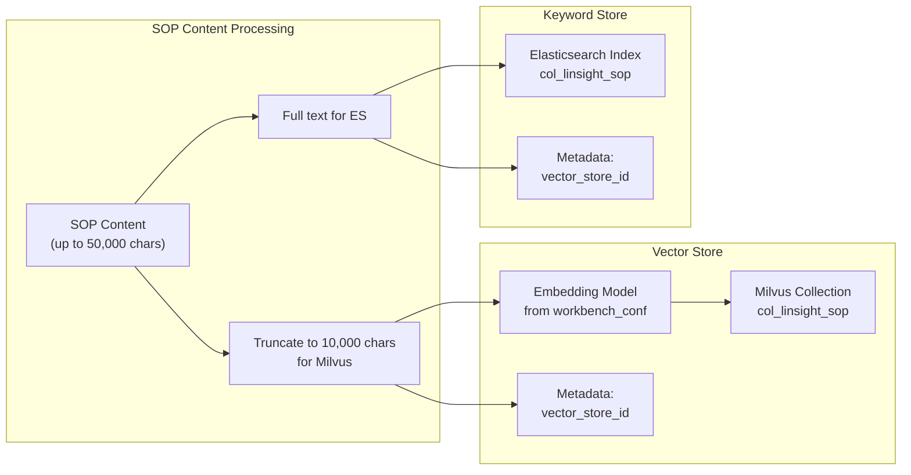

**Search Process:**

```python
# Hybrid search with ensemble retriever
keyword_retriever = KeywordRetriever(
    keyword_store=es_client,
    search_kwargs={"k": 100},
    text_splitter=text_splitter
)

baseline_vector_retriever = BaselineVectorRetriever(
    vector_store=vector_client,
    search_kwargs={"k": 100},
    text_splitter=text_splitter
)

ensemble = EnsembleRetriever(
    retrievers=[keyword_retriever, baseline_vector_retriever],
    weights=[0.3, 0.7]  # 30% keyword, 70% vector
)

results = await ensemble.ainvoke(query, k=3)
```

Sources: [src/backend/bisheng/api/services/linsight/sop_manage.py:323-372](), [src/backend/bisheng/api/services/linsight/sop_manage.py:475-547]()

---

