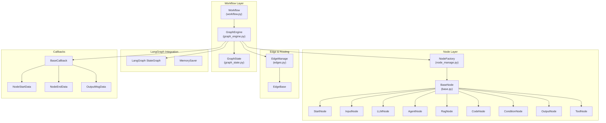
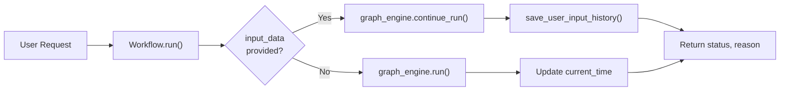
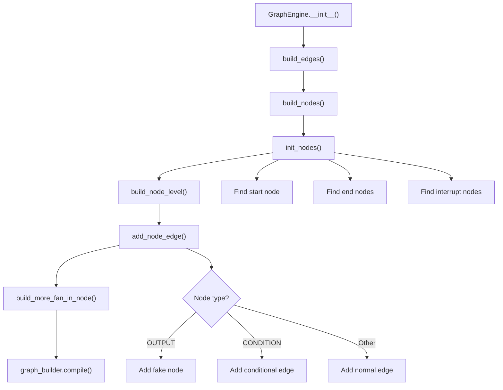
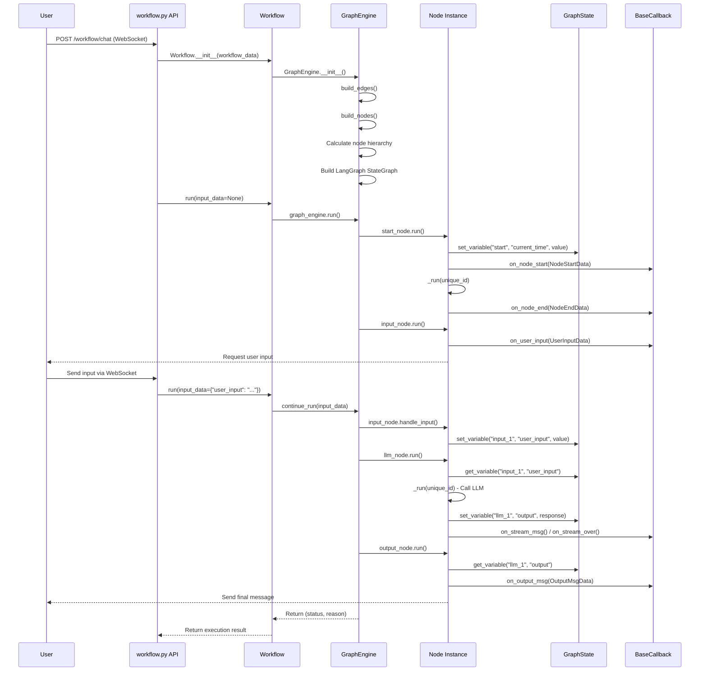
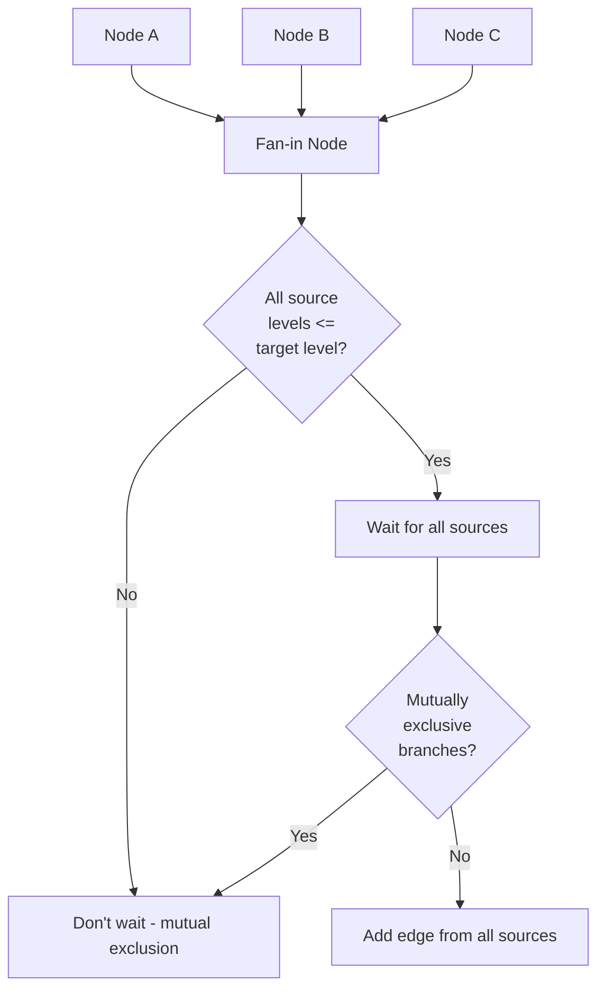
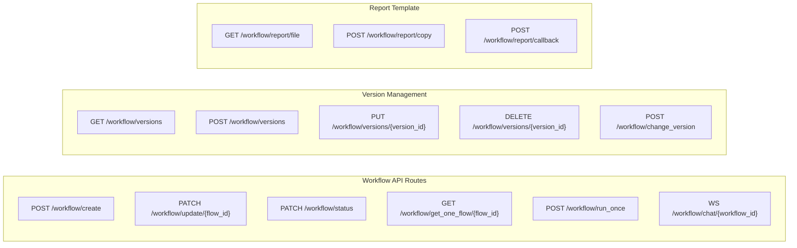

<!-- source: DeepWiki mcp.deepwiki.com · repo dataelement/bisheng · page 3.5 Workflow Engine · fetched 2026-10-29 -->

# Workflow Engine

<details>
<summary>Relevant source files</summary>

The following files were used as context for generating this wiki page:

- [src/backend/bisheng/api/services/assistant.py](src/backend/bisheng/api/services/assistant.py)
- [src/backend/bisheng/api/services/flow.py](src/backend/bisheng/api/services/flow.py)
- [src/backend/bisheng/api/services/workflow.py](src/backend/bisheng/api/services/workflow.py)
- [src/backend/bisheng/api/v1/assistant.py](src/backend/bisheng/api/v1/assistant.py)
- [src/backend/bisheng/api/v1/flows.py](src/backend/bisheng/api/v1/flows.py)
- [src/backend/bisheng/api/v1/schemas.py](src/backend/bisheng/api/v1/schemas.py)
- [src/backend/bisheng/api/v1/skillcenter.py](src/backend/bisheng/api/v1/skillcenter.py)
- [src/backend/bisheng/api/v1/workflow.py](src/backend/bisheng/api/v1/workflow.py)
- [src/backend/bisheng/database/models/assistant.py](src/backend/bisheng/database/models/assistant.py)
- [src/backend/bisheng/database/models/flow.py](src/backend/bisheng/database/models/flow.py)
- [src/backend/bisheng/database/models/flow_version.py](src/backend/bisheng/database/models/flow_version.py)
- [src/backend/bisheng/database/models/template.py](src/backend/bisheng/database/models/template.py)
- [src/backend/bisheng/database/models/user_link.py](src/backend/bisheng/database/models/user_link.py)
- [src/backend/bisheng/workflow/callback/event.py](src/backend/bisheng/workflow/callback/event.py)
- [src/backend/bisheng/workflow/common/node.py](src/backend/bisheng/workflow/common/node.py)
- [src/backend/bisheng/workflow/edges/edges.py](src/backend/bisheng/workflow/edges/edges.py)
- [src/backend/bisheng/workflow/graph/graph_engine.py](src/backend/bisheng/workflow/graph/graph_engine.py)
- [src/backend/bisheng/workflow/graph/graph_state.py](src/backend/bisheng/workflow/graph/graph_state.py)
- [src/backend/bisheng/workflow/graph/workflow.py](src/backend/bisheng/workflow/graph/workflow.py)
- [src/backend/bisheng/workflow/nodes/agent/agent.py](src/backend/bisheng/workflow/nodes/agent/agent.py)
- [src/backend/bisheng/workflow/nodes/base.py](src/backend/bisheng/workflow/nodes/base.py)
- [src/backend/bisheng/workflow/nodes/code/code.py](src/backend/bisheng/workflow/nodes/code/code.py)
- [src/backend/bisheng/workflow/nodes/condition/condition.py](src/backend/bisheng/workflow/nodes/condition/condition.py)
- [src/backend/bisheng/workflow/nodes/input/input.py](src/backend/bisheng/workflow/nodes/input/input.py)
- [src/backend/bisheng/workflow/nodes/llm/llm.py](src/backend/bisheng/workflow/nodes/llm/llm.py)
- [src/backend/bisheng/workflow/nodes/output/output.py](src/backend/bisheng/workflow/nodes/output/output.py)
- [src/backend/bisheng/workflow/nodes/qa_retriever/qa_retriever.py](src/backend/bisheng/workflow/nodes/qa_retriever/qa_retriever.py)
- [src/backend/bisheng/workflow/nodes/rag/rag.py](src/backend/bisheng/workflow/nodes/rag/rag.py)
- [src/backend/bisheng/workflow/nodes/start/start.py](src/backend/bisheng/workflow/nodes/start/start.py)
- [src/backend/bisheng/workflow/nodes/tool/tool.py](src/backend/bisheng/workflow/nodes/tool/tool.py)

</details>


The Workflow Engine is Bisheng's node-based visual programming system that enables complex AI workflows with typed inputs/outputs, conditional branching, and multi-step orchestration. It provides a graph-based execution model where nodes represent processing units (LLM calls, RAG retrieval, code execution, etc.) connected by edges that define data flow and execution order.

**Scope**: This document covers the workflow execution engine, graph state management, and node-based processing. For general skill/flow management (type 1), see [Flow and Skill Management](#3.7). For assistant-based execution (type 5), see [Assistant System](#3.3). For advanced document workflows, see [Linsight AI Workbench](#3.4).

## Architecture Overview

The workflow engine is built on top of LangGraph and provides a graph-based execution framework where nodes execute in a defined order based on edge connections and conditional logic.



**Sources**: [src/backend/bisheng/workflow/graph/workflow.py:1-62](), [src/backend/bisheng/workflow/graph/graph_engine.py:1-71](), [src/backend/bisheng/workflow/nodes/base.py:1-67]()

## Core Components

### Workflow Class

The `Workflow` class is the top-level orchestrator that manages workflow execution lifecycle, timeout handling, and user input continuations.

**Key responsibilities**:
- Initialize `GraphEngine` with workflow configuration
- Manage execution state and timeout
- Handle user input for interactive nodes
- Save conversation history

**Main methods**:
- `run(input_data)` - Execute workflow or continue from interruption
- `save_user_input_history(input_data)` - Persist user input to conversation memory



**Sources**: [src/backend/bisheng/workflow/graph/workflow.py:10-62]()

### GraphEngine

The `GraphEngine` is the core execution engine that builds and executes the node graph using LangGraph's `StateGraph`.

**Key responsibilities**:
- Parse workflow data into nodes and edges
- Build LangGraph state graph with proper routing
- Handle node fan-in/fan-out scenarios
- Manage node execution order based on hierarchy
- Support both sync and async execution modes

**Initialization flow**:
1. `build_edges()` - Parse edges into `EdgeManage`
2. `build_nodes()` - Instantiate all nodes via `NodeFactory`
3. Calculate node hierarchy levels for execution ordering
4. Add nodes and edges to LangGraph `StateGraph`
5. Handle complex routing (conditional edges, fan-in nodes)



**Sources**: [src/backend/bisheng/workflow/graph/graph_engine.py:27-71](), [src/backend/bisheng/workflow/graph/graph_engine.py:72-131]()

### GraphState

The `GraphState` manages global state across all nodes during workflow execution, including variable storage and conversation history.

**Data structures**:
- `history_memory` - `ConversationBufferWindowMemory` for chat context
- `variables_pool` - `Dict[node_id, Dict[key, value]]` for node outputs

**Key methods**:

| Method | Purpose | Example |
|--------|---------|---------|
| `set_variable(node_id, key, value)` | Store node output | `set_variable("llm_1", "output", "response")` |
| `get_variable(node_id, key)` | Retrieve node output | `get_variable("input_1", "user_input")` |
| `get_variable_by_str(contact_key)` | Parse and retrieve | `get_variable_by_str("input_1.user_input#0")` |
| `save_context(content, msg_sender)` | Store chat message | `save_context("Hello", "human")` |
| `get_history_memory(count)` | Get chat history | `get_history_memory(5)` |
| `get_all_variables()` | Get all stored data | Returns `{"node_id.key": value}` dict |

**Variable reference syntax**:
- Simple: `node_id.key` - Get node's output variable
- Array index: `node_id.key#0` - Get first element of array
- Dict key: `node_id.key#field` - Get dict field value
- Special: `node_id.chat_history` - Get conversation history

**Sources**: [src/backend/bisheng/workflow/graph/graph_state.py:1-109]()

## Node Types

Nodes are the fundamental building blocks of workflows. Each node type implements specific functionality and can reference variables from other nodes.

| Node Type | Description | Input Example | Output Example | File |
|-----------|-------------|---------------|----------------|------|
| `start` | Workflow entry point, initializes context | - | `current_time`, user info | [nodes/start/start.py]() |
| `input` | User input collection (dialog or form) | - | `user_input`, uploaded files | [nodes/input/input.py]() |
| `llm` | LLM completion with prompt templates | `system_prompt`, `user_prompt` | `output` | [nodes/llm/llm.py]() |
| `agent` | ReAct/function-call agent with tools | `system_prompt`, `user_prompt`, tools | `output` | [nodes/agent/agent.py]() |
| `rag` | RAG retrieval + LLM answer | `user_question`, knowledge sources | Retrieved docs + answer | [nodes/rag/rag.py]() |
| `qa_retriever` | QA knowledge retrieval | `user_question` | `retrieved_result` | [nodes/qa_retriever/qa_retriever.py]() |
| `code` | Python code execution | `code_input` variables | `code_output` variables | [nodes/code/code.py]() |
| `tool` | External tool invocation | Tool-specific params | `output` | [nodes/tool/tool.py]() |
| `condition` | Conditional branching | Variables to evaluate | Routes to next node | [nodes/condition/condition.py]() |
| `output` | User-facing output (message/choice/input) | `message`, files | Interaction result | [nodes/output/output.py]() |
| `end` | Workflow termination | - | - | - |

**Sources**: [src/backend/bisheng/workflow/common/node.py:8-26](), [src/backend/bisheng/workflow/nodes/base.py:20-67]()

### BaseNode Interface

All nodes inherit from `BaseNode` and implement:

**Required methods**:
- `_run(unique_id)` - Execute node logic, return dict of outputs
- `parse_log(unique_id, result)` - Format execution log for display

**Optional methods**:
- `get_input_schema()` - Return form schema for user input (INPUT/OUTPUT nodes)
- `handle_input(user_input)` - Process user input for interactive nodes
- `is_condition_node()` - Return True for CONDITION/OUTPUT nodes
- `route_node(state)` - Determine next node(s) for conditional routing

**Common utilities**:
- `get_other_node_variable(variable_key)` - Retrieve other node's output
- `parse_msg_with_variables(msg)` - Replace `{node_id.key}` in strings
- `contact_file_into_prompt(human_message, image_prompt)` - Add files to LLM input

**Sources**: [src/backend/bisheng/workflow/nodes/base.py:20-159]()

## Execution Flow

### Workflow Execution Sequence



**Sources**: [src/backend/bisheng/workflow/graph/workflow.py:50-62](), [src/backend/bisheng/workflow/graph/graph_engine.py:219-313]()

### Node Execution Lifecycle

Each node follows this execution pattern:

1. **Pre-execution**:
   - `on_node_start()` callback fired
   - Retrieve referenced variables from `GraphState`
   - Parse prompt templates with variable substitution

2. **Execution**:
   - `_run(unique_id)` performs core logic
   - Stream callbacks for real-time updates (LLM/Agent nodes)
   - Store results in `GraphState`

3. **Post-execution**:
   - `parse_log()` formats execution details
   - `on_node_end()` callback with log data
   - Determine next node(s) based on edges/conditions

4. **Routing**:
   - Normal nodes: Follow outgoing edges
   - Condition nodes: Evaluate conditions, call `route_node()`
   - Output nodes (choice): Wait for user selection, then route

**Sources**: [src/backend/bisheng/workflow/graph/graph_engine.py:219-272]()

### Fan-In Node Handling

The GraphEngine implements special logic for nodes with multiple incoming edges (fan-in):



The algorithm in `parse_fan_in_node()`:
1. Check if all source nodes have level ≤ target node level
2. If no, sources are downstream - no waiting needed
3. If yes, check for mutually exclusive branches (from CONDITION/OUTPUT nodes)
4. If mutually exclusive, no waiting needed
5. Otherwise, wait for all fan-in sources

**Sources**: [src/backend/bisheng/workflow/graph/graph_engine.py:119-177]()

## State Management Details

### Variable Storage and Retrieval

The `GraphState` stores all intermediate results using a nested dictionary structure:

```
variables_pool = {
    "input_1": {
        "user_input": "What is AI?",
        "dialog_files": []
    },
    "llm_1": {
        "output": "AI is artificial intelligence..."
    },
    "rag_1": {
        "retrieved_result": [Document(...)],
        "output": "Based on the context..."
    }
}
```

**Variable reference patterns**:

| Pattern | Example | Resolves To |
|---------|---------|-------------|
| Simple | `input_1.user_input` | `"What is AI?"` |
| Array index | `rag_1.retrieved_result#0` | First document |
| Dict key | `start.custom_variables#user_name` | Custom variable value |
| Special | `start.chat_history` | Formatted conversation history |

**Sources**: [src/backend/bisheng/workflow/graph/graph_state.py:43-109]()

### Conversation Memory

Chat history is managed through LangChain's `ConversationBufferWindowMemory`:

- Initialized in `StartNode` with configurable window size (default 10)
- Messages added via `save_context(content, msg_sender)`
- Retrieved as string via `get_history_memory(count)` or as message list via `get_history_list(count)`
- Used by LLM/Agent nodes to maintain conversation context

**Sources**: [src/backend/bisheng/workflow/graph/graph_state.py:17-42](), [src/backend/bisheng/workflow/nodes/start/start.py:25-26]()

## Key Node Implementations

### Input Node

The Input Node handles user input in two modes: dialog input and form input.

**Dialog mode** (`tab='dialog_input'`):
- Collects `user_input` text
- Handles file uploads (parse mode: keep_raw, extract_text, ingest_to_temp_kb)
- Stores files in temporary Milvus/ES collections for retrieval
- Outputs: `user_input`, `dialog_files_content`, `dialog_file_paths`, `dialog_image_files`

**Form mode** (`tab='form_input'`):
- Defines custom form fields with types (text, number, file, etc.)
- Each field becomes a separate output variable
- Supports file upload with same parsing modes as dialog

**File processing modes**:
1. `KEEP_RAW` - Store file paths only
2. `EXTRACT_TEXT` - Extract text content into variable
3. `INGEST_TO_KNOWLEDGE_BASE` - Chunk, embed, store in vector DB for later retrieval

**Sources**: [src/backend/bisheng/workflow/nodes/input/input.py:33-347]()

### LLM Node

Executes LLM completions with configurable prompts and supports batch processing.

**Configuration**:
- `model_id` - LLM model selection from configured models
- `temperature` - Model temperature parameter
- `system_prompt` - System message template
- `user_prompt` - User message template
- `tab` - Single or batch mode
- `output_user` - Whether to stream to user

**Batch mode**:
- `batch_variable` - List of variables to iterate over
- `output` - List of output keys, one per batch item
- Each batch item gets separate system/user prompts with variable substitution

**Execution**:
1. Parse prompt templates, substitute variables
2. Invoke LLM via `LLMService.get_bisheng_llm_sync()`
3. Stream tokens if `output_user=True`
4. Return completion(s) in dict

**Sources**: [src/backend/bisheng/workflow/nodes/llm/llm.py:14-135]()

### Agent Node

Implements ReAct or function-calling agents with tools, knowledge, and SQL capabilities.

**Configuration**:
- `system_prompt`, `user_prompt` - Agent prompts
- `model_id` - LLM for agent reasoning
- `tool_list` - Selected tools from tool management
- `knowledge_id` - Knowledge bases or temporary files for retrieval
- `sql_agent` - Optional NL2SQL configuration
- `chat_history_flag` - Whether to include conversation history

**Agent types**:
- **ReAct** - Uses `ConfigurableAssistant` with tool reasoning
- **Function Call** - Uses `create_react_agent` with native function calling

**Tool initialization**:
1. Load configured tools via `ToolExecutor.init_by_tool_ids_sync()`
2. Initialize knowledge retrieval tools for each knowledge base
3. Initialize SQL agent tool if configured
4. Combine all tools for agent

**Execution**:
1. Build agent with tools and system prompt
2. Format user prompt with variables
3. Invoke agent with chat history
4. Track tool invocations via callback
5. Return agent output and reasoning content

**Sources**: [src/backend/bisheng/workflow/nodes/agent/agent.py:50-405]()

### RAG Node

Performs retrieval-augmented generation by combining knowledge retrieval with LLM synthesis.

**Configuration**:
- `user_question` - Question(s) to retrieve for
- `knowledge_id` - Knowledge sources (type: knowledge | file_metadata)
- `rerank_model` - Optional reranking model
- `retrieval_mode` - Vector, keyword, or hybrid search
- `model_id` - LLM for answer generation
- `system_prompt`, `user_prompt` - QA prompts

**Execution flow**:
1. Initialize multi-retriever (Milvus + Elasticsearch)
2. Retrieve relevant documents for question
3. Optional reranking to improve relevance
4. Format QA prompt with retrieved context
5. Invoke LLM to generate answer
6. Return answer and source documents

**Prompt variables**:
- `{question}` - User question
- `{context}` - Retrieved document content
- Custom variables from other nodes

**Sources**: [src/backend/bisheng/workflow/nodes/rag/rag.py:22-197]()

### Condition Node

Routes execution based on conditional logic evaluation.

**Configuration**:
- `condition` - List of condition cases with:
  - `id` - Condition identifier for routing
  - `conditions` - List of comparison expressions
  - `logical_operator` - AND/OR for multiple conditions

**Condition evaluation**:
1. Iterate through condition cases in order
2. Evaluate each case's conditions against variables
3. First matching case determines next node(s)
4. Fall back to default route if no match

**Supported operators**:
- Comparison: `==`, `!=`, `>`, `<`, `>=`, `<=`
- String: `contains`, `not contains`, `is empty`, `is not empty`
- Logical: `AND`, `OR`

**Sources**: [src/backend/bisheng/workflow/nodes/condition/condition.py:8-48]()

### Output Node

Sends messages to users with optional interaction (input/choice).

**Output types**:
- `message` - Simple text output
- `input` - Output with inline text input request
- `choose` - Output with option selection

**Configuration**:
- `output_msg` - Message template with variable substitution
- `output_files` - File attachments (converted to share links)
- `output_result` - User input schema or choice options
- `output_type` - Message, input, or choose

**Execution**:
1. Parse output message template
2. Substitute variables from graph state
3. Get file share links from MinIO
4. Send via callback (`on_output_msg`, `on_output_input`, `on_output_choose`)
5. For interactive types, workflow pauses until user responds

**Sources**: [src/backend/bisheng/workflow/nodes/output/output.py:10-137]()

## Service Layer Integration

### WorkFlowService

The `WorkFlowService` provides business logic for workflow management and execution.

**Key methods**:

| Method | Purpose | HTTP Endpoint |
|--------|---------|---------------|
| `get_all_flows()` | List workflows with filters | GET `/workflow/list` |
| `run_once()` | Execute single node for testing | POST `/workflow/run_once` |
| `update_flow_status()` | Online/offline workflow | PATCH `/workflow/status` |
| `get_one_workflow_simple_info()` | Get workflow metadata | - |

**Workflow status management**:
- `OFFLINE (1)` - Draft mode, can be edited
- `ONLINE (2)` - Published, requires initialization check

When changing to ONLINE:
1. Validate workflow structure via `Workflow.__init__()`
2. Check all nodes can be instantiated
3. If valid, update status and current version
4. If invalid, raise `WorkFlowInitError`

**Sources**: [src/backend/bisheng/api/services/workflow.py:35-451]()

### API Endpoints



**WebSocket chat flow** (`/workflow/chat/{workflow_id}`):
1. Client connects with workflow_id and optional chat_id
2. Server dispatches to `ChatManager.dispatch_client()`
3. `ChatClient` initializes `Workflow` instance
4. User messages trigger `workflow.run(input_data)`
5. Callbacks stream events back to client (node start/end, outputs, errors)
6. Workflow execution continues until completion or user input needed

**Sources**: [src/backend/bisheng/api/v1/workflow.py:1-312]()

## Callback System

The workflow engine uses callbacks to provide real-time execution feedback via WebSocket.

**Event types**:

| Event | Data Class | When Fired | Purpose |
|-------|-----------|------------|---------|
| `node_start` | `NodeStartData` | Node begins execution | Show node in "running" state |
| `node_end` | `NodeEndData` | Node completes | Show results/logs, mark complete |
| `user_input` | `UserInputData` | INPUT/OUTPUT needs input | Display input form to user |
| `guide_word` | `GuideWordData` | START node greeting | Show welcome message |
| `guide_question` | `GuideQuestionData` | Recommended questions | Show quick reply options |
| `output_msg` | `OutputMsgData` | OUTPUT node message | Display final message |
| `output_input` | `OutputMsgInputData` | OUTPUT with input | Display message + input field |
| `output_choose` | `OutputMsgChooseData` | OUTPUT with choice | Display message + options |
| `stream_msg` | `StreamMsgData` | LLM/Agent streaming | Stream token-by-token |
| `stream_over` | `StreamMsgOverData` | LLM/Agent complete | End stream, show sources |

**Callback flow**:
```
BaseNode.run()
  -> callback_manager.on_node_start(NodeStartData)
  -> node._run(unique_id)
     -> (LLM nodes) callback_manager.on_stream_msg(StreamMsgData)
     -> (LLM nodes) callback_manager.on_stream_over(StreamMsgOverData)
     -> (Output nodes) callback_manager.on_output_msg(OutputMsgData)
  -> callback_manager.on_node_end(NodeEndData)
```

**Sources**: [src/backend/bisheng/workflow/callback/event.py:1-72](), [src/backend/bisheng/workflow/graph/graph_engine.py:219-272]()

## Integration with Other Systems

### LLM Service Integration

Nodes that use LLMs (LLM, Agent, RAG) obtain model instances via `LLMService`:

```python
llm = LLMService.get_bisheng_llm_sync(
    model_id=node_params['model_id'],
    temperature=node_params.get('temperature', 0.3),
    app_id=workflow_id,
    app_name=workflow_name,
    app_type=ApplicationTypeEnum.WORKFLOW,
    user_id=user_id
)
```

This integrates with the LLM management system to:
- Validate model availability
- Track usage for telemetry
- Apply user-specific configurations
- Support various providers (OpenAI, Azure, xinference, etc.)

**Sources**: [src/backend/bisheng/workflow/nodes/llm/llm.py:39-44](), [src/backend/bisheng/workflow/nodes/agent/agent.py:75-80]()

### Knowledge Base Integration

RAG and Agent nodes retrieve from knowledge bases via:

1. **Knowledge-based retrieval** - From persisted knowledge bases:
   - `ToolExecutor.init_knowledge_tool_sync()` creates retrieval tool
   - Uses Milvus for vector search + Elasticsearch for keyword
   - Applies user permissions via `MilvusWithPermissionCheck`

2. **File-based retrieval** - From INPUT node uploaded files:
   - Files ingested to temporary Milvus/ES collections
   - Collection name includes embedding model ID
   - Filtered by `document_id` from file metadata

**Sources**: [src/backend/bisheng/workflow/nodes/agent/agent.py:160-204](), [src/backend/bisheng/workflow/common/knowledge.py]()

### Tool System Integration

Agent and Tool nodes execute external tools via `ToolExecutor`:

```python
tools = ToolExecutor.init_by_tool_ids_sync(
    tool_ids=[1, 2, 3],
    app_id=workflow_id,
    app_name=workflow_name,
    app_type=ApplicationTypeEnum.WORKFLOW,
    user_id=user_id
)
```

This supports:
- API tools (HTTP requests with auth)
- Knowledge retrieval tools
- SQL query tools (NL2SQL)
- Custom tool implementations

**Sources**: [src/backend/bisheng/workflow/nodes/agent/agent.py:140-147](), [src/backend/bisheng/workflow/nodes/tool/tool.py:10-58]()

### Session and Version Management

Workflows integrate with:

1. **Flow versions** - Multiple versions per workflow:
   - Current version used for execution
   - Version data stored in `FlowVersion` table
   - Status change requires validation of current version

2. **Chat sessions** - Persistent conversation tracking:
   - Session ID maps to conversation history
   - Stored in `MessageSession` table
   - Linked to user and workflow

3. **Audit logging** - All workflow operations logged:
   - Create, update, delete, status change
   - Tracks user, timestamp, affected resources

**Sources**: [src/backend/bisheng/api/services/workflow.py:181-212](), [src/backend/bisheng/database/models/flow_version.py:1-50]()

---

