<!-- source: DeepWiki mcp.deepwiki.com · repo dataelement/bisheng · page 3.6 Dashboard and Analytics · fetched 2026-10-29 -->

# Dashboard and Analytics

<details>
<summary>Relevant source files</summary>

The following files were used as context for generating this wiki page:

- [src/frontend/platform/public/assets/dashboard/setting.svg](src/frontend/platform/public/assets/dashboard/setting.svg)
- [src/frontend/platform/public/locales/en-US/dashboard.json](src/frontend/platform/public/locales/en-US/dashboard.json)
- [src/frontend/platform/public/locales/ja/dashboard.json](src/frontend/platform/public/locales/ja/dashboard.json)
- [src/frontend/platform/public/locales/zh-Hans/dashboard.json](src/frontend/platform/public/locales/zh-Hans/dashboard.json)
- [src/frontend/platform/src/pages/Dashboard/components/config/ChartSelector.tsx](src/frontend/platform/src/pages/Dashboard/components/config/ChartSelector.tsx)
- [src/frontend/platform/src/pages/Dashboard/components/config/ComponentConfigDrawer.tsx](src/frontend/platform/src/pages/Dashboard/components/config/ComponentConfigDrawer.tsx)
- [src/frontend/platform/src/pages/Dashboard/components/config/DashboardConfigPanel.tsx](src/frontend/platform/src/pages/Dashboard/components/config/DashboardConfigPanel.tsx)
- [src/frontend/platform/src/pages/Dashboard/components/config/DatasetSelector.tsx](src/frontend/platform/src/pages/Dashboard/components/config/DatasetSelector.tsx)
- [src/frontend/platform/src/pages/Dashboard/components/config/DimensionBlock.tsx](src/frontend/platform/src/pages/Dashboard/components/config/DimensionBlock.tsx)
- [src/frontend/platform/src/pages/Dashboard/components/config/FilterConditionDialog.tsx](src/frontend/platform/src/pages/Dashboard/components/config/FilterConditionDialog.tsx)
- [src/frontend/platform/src/pages/Dashboard/components/config/StyleConfigPanel.tsx](src/frontend/platform/src/pages/Dashboard/components/config/StyleConfigPanel.tsx)
- [src/frontend/platform/src/pages/Dashboard/components/config/useChartState.tsx](src/frontend/platform/src/pages/Dashboard/components/config/useChartState.tsx)

</details>


## Purpose and Scope

The Dashboard and Analytics system provides business intelligence capabilities for visualizing and analyzing data within Bisheng. It enables users to create interactive dashboards with multiple chart types, configure data queries with dimensions and metrics, apply filters, and customize visual styling. This system is primarily a frontend feature that integrates with backend dataset APIs to provide a complete data visualization solution.

For information about other analytics features such as audit logging, see [User and Access Control](#4).

---

## System Architecture

The dashboard system follows a component-based architecture with three main layers: dataset management, chart configuration, and rendering.

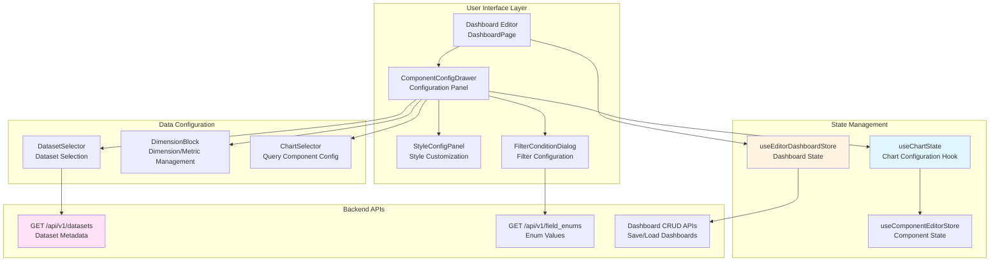

**Sources:** 
- [src/frontend/platform/src/pages/Dashboard/components/config/ComponentConfigDrawer.tsx:1-100]()
- [src/frontend/platform/src/pages/Dashboard/components/config/useChartState.tsx:1-50]()
- [src/frontend/platform/src/pages/Dashboard/components/config/DatasetSelector.tsx:1-30]()

### Core Components

| Component | File | Purpose |
|-----------|------|---------|
| `ComponentConfigDrawer` | `ComponentConfigDrawer.tsx` | Main configuration interface for charts |
| `StyleConfigPanel` | `StyleConfigPanel.tsx` | Visual style customization |
| `DatasetSelector` | `DatasetSelector.tsx` | Dataset and field selection |
| `DimensionBlock` | `DimensionBlock.tsx` | Dimension/metric drag-drop area |
| `FilterConditionDialog` | `FilterConditionDialog.tsx` | Filter configuration dialog |
| `ChartSelector` | `ChartSelector.tsx` | Query component linking |
| `DashboardConfigPanel` | `DashboardConfigPanel.tsx` | Dashboard-level settings |
| `useChartState` | `useChartState.tsx` | Chart state management hook |

**Sources:** 
- [src/frontend/platform/src/pages/Dashboard/components/config/ComponentConfigDrawer.tsx:91-100]()

---

## Dataset Management

### Dataset Structure

Datasets are the foundation of the dashboard system, providing structured data with dimensions and metrics.

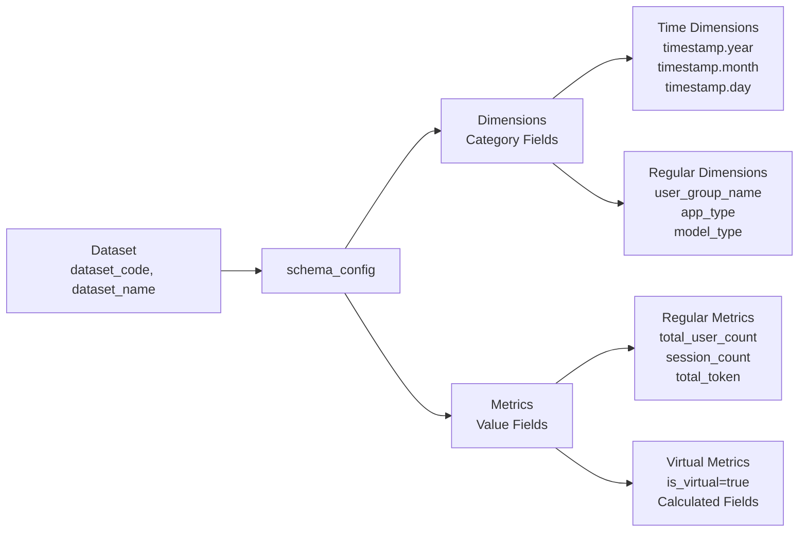

**Sources:** 
- [src/frontend/platform/src/pages/Dashboard/components/config/DatasetSelector.tsx:108-130]()
- [src/frontend/platform/public/locales/zh-Hans/dashboard.json:391-466]()

### DatasetField Type Definition

The `DatasetField` interface represents individual fields within a dataset:

```typescript
interface DatasetField {
    fieldCode: string          // SQL field name (e.g., "timestamp", "total_user_count")
    displayName: string        // UI display name (localized)
    fieldType: "string" | "number" | "date"
    role: "dimension" | "metric"
    enumValues?: string[]      // For enum filtering
    isVirtual?: boolean        // Calculated metrics
    timeGranularity?: string   // For time dimensions: "year", "month", "day", "hour"
}
```

**Sources:** 
- [src/frontend/platform/src/pages/Dashboard/components/config/DatasetSelector.tsx:12-20]()

### Dataset Selector Component

The `DatasetSelector` component handles dataset selection and field exploration:

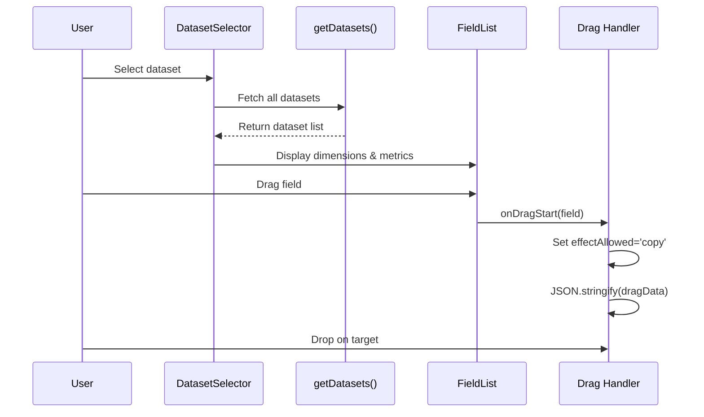

**Sources:** 
- [src/frontend/platform/src/pages/Dashboard/components/config/DatasetSelector.tsx:56-102]()
- [src/frontend/platform/src/pages/Dashboard/components/config/DatasetSelector.tsx:143-185]()

### Time Dimension Handling

Time dimensions support multiple granularities:

| Granularity | Icon | Display Key | Example |
|-------------|------|-------------|---------|
| Year | Clock3 | `timestamp.year` | `timestamp: {year: "2024"}` |
| Quarter | Clock3 | `timestamp.quarter` | `timestamp: {quarter: "2024-Q1"}` |
| Month | Clock3 | `timestamp.month` | `timestamp: {month: "2024-01"}` |
| Week | Clock3 | `timestamp.week` | `timestamp: {week: "2024-W01"}` |
| Day | Clock3 | `timestamp.day` | `timestamp: {day: "2024-01-15"}` |
| Hour | Clock3 | `timestamp.hour` | `timestamp: {hour: "2024-01-15-14"}` |

**Sources:** 
- [src/frontend/platform/src/pages/Dashboard/components/config/DatasetSelector.tsx:30-37]()
- [src/frontend/platform/src/pages/Dashboard/components/config/DatasetSelector.tsx:206-232]()

---

## Chart Configuration System

### Configuration Workflow

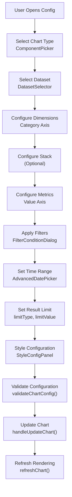

**Sources:** 
- [src/frontend/platform/src/pages/Dashboard/components/config/ComponentConfigDrawer.tsx:489-607]()
- [src/frontend/platform/src/pages/Dashboard/components/config/useChartState.tsx:42-193]()

### Chart Types

The system supports multiple chart types organized in groups:

```typescript
enum ChartType {
    // Bar Charts
    Bar = 'bar',
    StackedBar = 'stacked-bar',
    GroupedBar = 'grouped-bar',
    
    // Horizontal Bar Charts
    HorizontalBar = 'horizontal-bar',
    StackedHorizontalBar = 'stacked-horizontal-bar',
    GroupedHorizontalBar = 'grouped-horizontal-bar',
    
    // Line Charts
    Line = 'line',
    StackedLine = 'stacked-line',
    MultipleLine = 'multiple-line',
    
    // Area Charts
    Area = 'area',
    StackedArea = 'stacked-area',
    
    // Pie Charts
    Pie = 'pie',
    Donut = 'donut',
    
    // Special
    Metric = 'metric',  // Single metric card
    Query = 'query'     // Query component
}
```

**Sources:** 
- [src/frontend/platform/public/locales/en-US/dashboard.json:393-412]()
- [src/frontend/platform/src/pages/Dashboard/components/config/ComponentConfigDrawer.tsx:152-159]()

### Dimension and Metric Configuration

#### Three Configuration Sections

1. **Category Dimensions** (类别轴): X-axis, max 2 dimensions
2. **Stack Dimensions** (堆叠项): For stacked charts, max 1 dimension
3. **Value Dimensions** (指标): Y-axis metrics

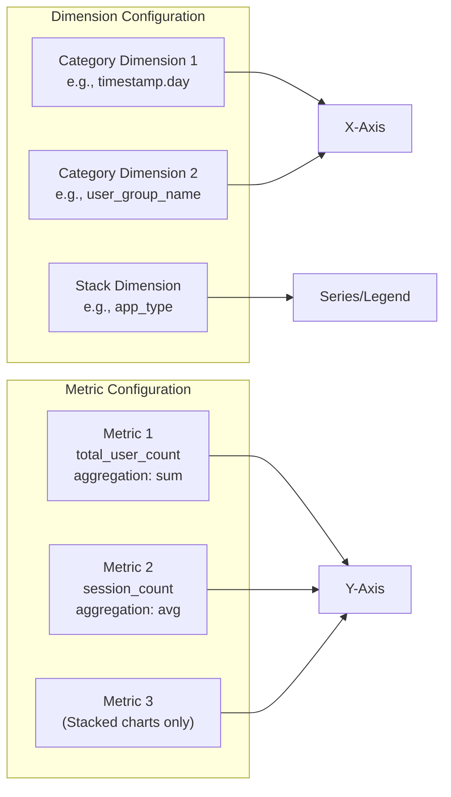

**Sources:** 
- [src/frontend/platform/src/pages/Dashboard/components/config/ComponentConfigDrawer.tsx:924-974]()
- [src/frontend/platform/src/pages/Dashboard/components/config/useChartState.tsx:22-28]()

#### Drag-and-Drop System

Fields can be dragged from the `DatasetSelector` to dimension blocks:

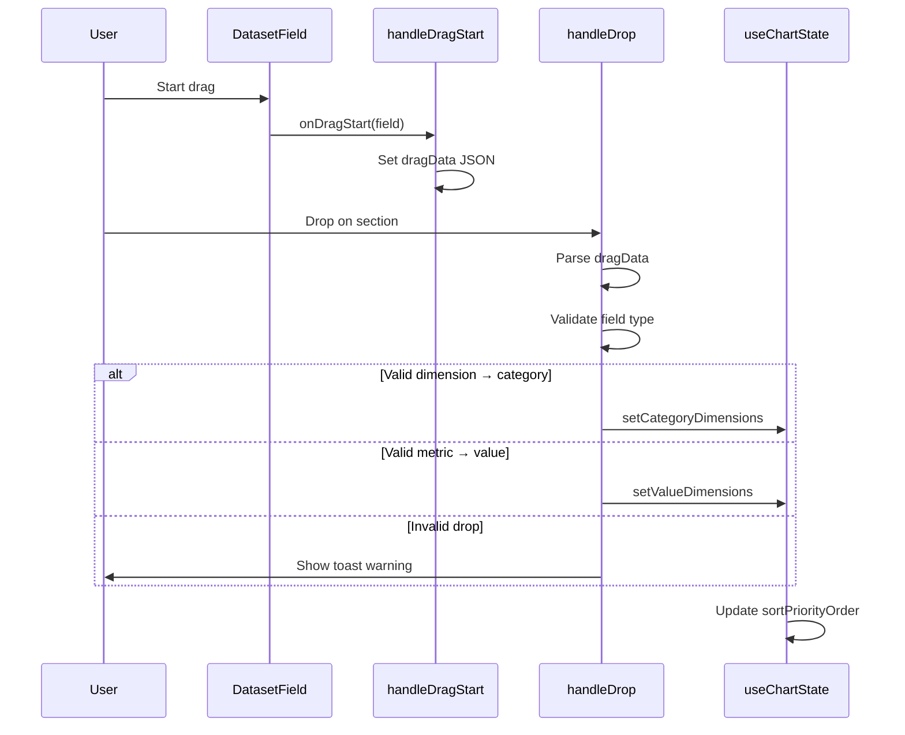

**Sources:** 
- [src/frontend/platform/src/pages/Dashboard/components/config/DatasetSelector.tsx:85-102]()
- [src/frontend/platform/src/pages/Dashboard/components/config/useChartState.tsx:299-445]()

### Dimension Block Component

The `DimensionBlock` component displays configured dimensions with controls:

| Control | Purpose | Available For |
|---------|---------|---------------|
| Sort | Ascending/Descending/None | Dimensions |
| Aggregation | Sum/Avg/Count/Max/Min/Distinct Count | Metrics |
| Number Format | Type/Decimals/Units/Separator | Metrics |
| Edit Name | Change display name | All |
| Delete | Remove from configuration | All |

**Sources:** 
- [src/frontend/platform/src/pages/Dashboard/components/config/DimensionBlock.tsx:66-82]()
- [src/frontend/platform/src/pages/Dashboard/components/config/DimensionBlock.tsx:160-173]()

### Aggregation Functions

For metrics, the following aggregations are supported:

```typescript
type AggregationType = 
    | 'sum'            // 求和
    | 'average'        // 平均
    | 'count'          // 计数
    | 'max'            // 最大值
    | 'min'            // 最小值
    | 'distinct_count' // 去重计数
```

**Sources:** 
- [src/frontend/platform/src/pages/Dashboard/components/config/DimensionBlock.tsx:160-167]()
- [src/frontend/platform/public/locales/en-US/dashboard.json:157-163]()

### Virtual Metrics

Virtual metrics are calculated fields that cannot use aggregation:

```typescript
const isVirtualMetric = (field: DatasetField) => {
    return field.isVirtual === true
}

// Virtual metrics skip aggregation menu
if (!isVirtualMetric(dimension)) {
    // Show aggregation options
}
```

**Sources:** 
- [src/frontend/platform/src/pages/Dashboard/components/config/ComponentConfigDrawer.tsx:160-162]()
- [src/frontend/platform/src/pages/Dashboard/components/config/DimensionBlock.tsx:156-158]()

### Number Formatting

Metrics support comprehensive number formatting:

```typescript
type MetricFormat = {
    type: 'number' | 'percent' | 'duration' | 'storage'
    decimalPlaces: number
    unit?: string           // e.g., '', '万', '亿'
    suffix?: string         // Custom suffix
    thousandSeparator: boolean
}
```

**Format Examples:**

| Type | Input | Output |
|------|-------|--------|
| Number (2 decimals) | 1234567.89 | 1,234,567.89 |
| Percent | 0.8543 | 85.43% |
| Duration | 3661 | 1h 1m 1s |
| Storage | 1234567890 | 1.15 GB |

**Sources:** 
- [src/frontend/platform/src/pages/Dashboard/components/config/DimensionBlock.tsx:58-64]()
- [src/frontend/platform/public/locales/en-US/dashboard.json:178-193]()

---

## Filtering System

### Filter Architecture

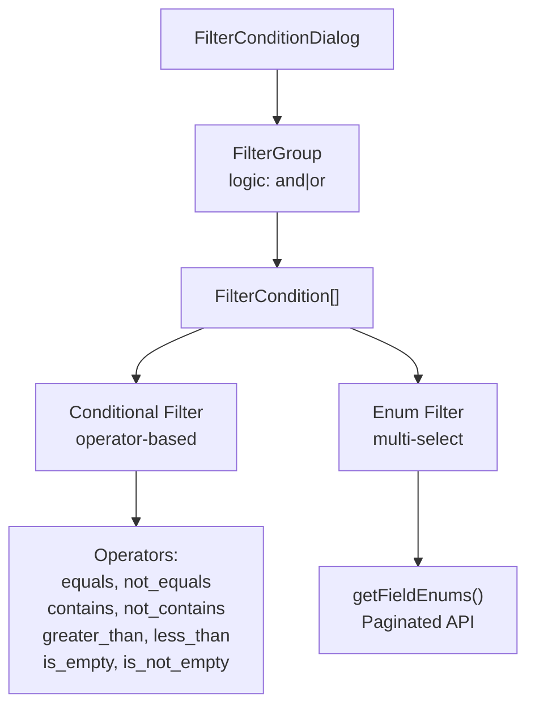

**Sources:** 
- [src/frontend/platform/src/pages/Dashboard/components/config/FilterConditionDialog.tsx:28-70]()
- [src/frontend/platform/src/pages/Dashboard/components/config/FilterConditionDialog.tsx:364-487]()

### Filter Data Structure

```typescript
interface FilterGroup {
    logic: "and" | "or"
    conditions: FilterCondition[]
}

interface FilterCondition {
    id: string
    fieldCode?: string
    fieldId?: string
    fieldName?: string
    fieldType?: "string" | "number"
    operator?: FilterOperator
    value?: string | number | string[]
    filterType?: "conditional" | "enum"
}

type FilterOperator =
    | "equals" | "not_equals"
    | "contains" | "not_contains"
    | "greater_than" | "greater_than_or_equal"
    | "less_than" | "less_than_or_equal"
    | "is_empty" | "is_not_empty"
    | "enum_in" | "enum_not_in"
```

**Sources:** 
- [src/frontend/platform/src/pages/Dashboard/components/config/FilterConditionDialog.tsx:28-70]()

### Enum Filter with Pagination

For fields with many distinct values, the enum filter uses paginated loading:

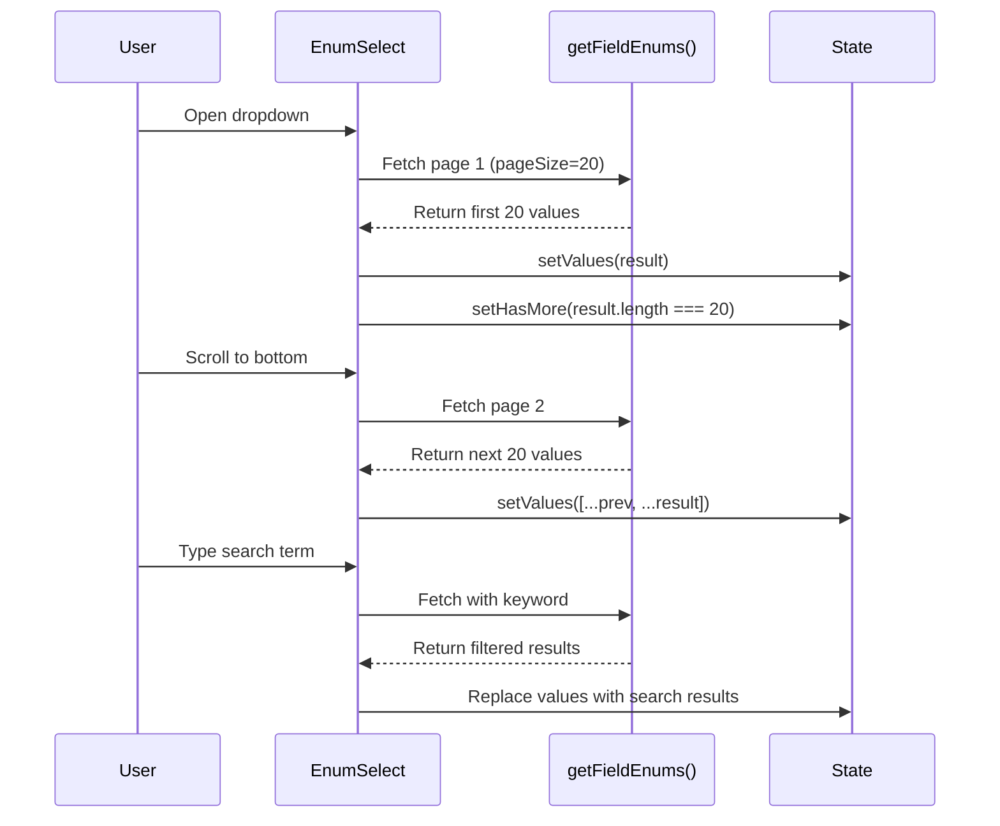

**Sources:** 
- [src/frontend/platform/src/pages/Dashboard/components/config/FilterConditionDialog.tsx:92-164]()
- [src/frontend/platform/src/pages/Dashboard/components/config/FilterConditionDialog.tsx:188-197]()

### Time Range Filtering

Time filtering is handled separately through the `AdvancedDatePicker`:

```typescript
interface TimeFilter {
    recentDays?: number        // e.g., 7, 30, 90, 180
    type: "recent_days" | "custom" | "all"
    startDate?: string
    endDate?: string
    mode: "dynamic" | "fixed"
}
```

**Shortcut Options:**
- Last 7 days
- Last 30 days
- Last 90 days
- Last 180 days
- Custom range (with dynamic update option)

**Sources:** 
- [src/frontend/platform/src/pages/Dashboard/components/config/ComponentConfigDrawer.tsx:609-634]()
- [src/frontend/platform/public/locales/en-US/dashboard.json:333-338]()

---

## Style Customization

### Style Configuration Structure

```typescript
interface ComponentStyleConfig {
    // Color Theme
    themeColor: string
    bgColor: string
    
    // Title
    title: string
    titleFontSize: number
    titleBold: boolean
    titleItalic: boolean
    titleUnderline: boolean
    titleStrikethrough: boolean
    titleAlign: "left" | "center" | "right"
    titleColor: string
    
    // X-Axis
    xAxisTitle: string
    xAxisFontSize: number
    xAxisBold: boolean
    xAxisItalic: boolean
    xAxisAlign: "left" | "center" | "right"
    xAxisColor: string
    
    // Y-Axis
    yAxisTitle: string
    yAxisFontSize: number
    yAxisBold: boolean
    yAxisItalic: boolean
    yAxisAlign: "left" | "center" | "right"
    yAxisColor: string
    
    // Legend
    legendPosition: "top" | "bottom" | "left" | "right"
    legendFontSize: number
    legendBold: boolean
    legendItalic: boolean
    legendAlign: "left" | "center" | "right"
    legendColor: string
    
    // Metric Card (for type='metric')
    metricFontSize: number
    metricBold: boolean
    metricItalic: boolean
    metricAlign: "left" | "center" | "right"
    metricColor: string
    
    showSubtitle: boolean
    subtitle: string
    subtitleFontSize: number
    
    // Chart Options
    showLegend: boolean
    showAxis: boolean
    showDataLabel: boolean
    showGrid: boolean
}
```

**Sources:** 
- [src/frontend/platform/src/pages/Dashboard/components/config/ComponentConfigDrawer.tsx:27-89]()
- [src/frontend/platform/src/pages/Dashboard/components/config/StyleConfigPanel.tsx:269-365]()

### Color Schemes

The system provides predefined color schemes defined in `colorSchemes`:

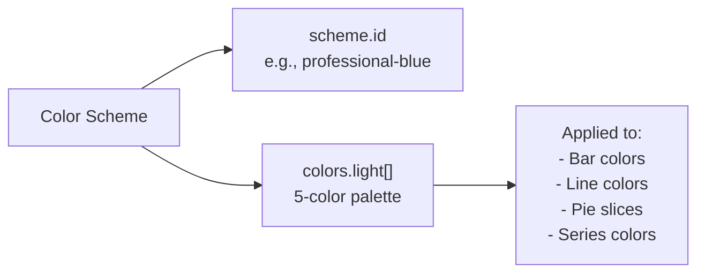

**Sources:** 
- [src/frontend/platform/src/pages/Dashboard/components/config/StyleConfigPanel.tsx:290-300]()
- [src/frontend/platform/src/pages/Dashboard/components/config/StyleConfigPanel.tsx:376-421]()

### TextFormat Component

The reusable `TextFormat` component provides font customization:

| Control | Options | Default |
|---------|---------|---------|
| Font Size | 10, 12, 14, 16, 18, 20, 24, 28 | 14 |
| Color | Color picker | #000000 |
| Alignment | Left, Center, Right | Left |
| Bold | Toggle | false |
| Italic | Toggle | false |

**Sources:** 
- [src/frontend/platform/src/pages/Dashboard/components/config/StyleConfigPanel.tsx:30-180]()

### Dashboard Theme

At the dashboard level, users can choose between light and dark themes:

```typescript
interface DashboardStyleConfig {
    theme: 'light' | 'dark'
}

// Dashboard-level theme affects all components
const handleThemeChange = (theme: 'light' | 'dark') => {
    updateCurrentDashboard({
        ...currentDashboard,
        style_config: { theme }
    })
}
```

**Sources:** 
- [src/frontend/platform/src/pages/Dashboard/components/config/DashboardConfigPanel.tsx:15-44]()

---

## Query Components

Query components provide date range selectors that can link to multiple charts.

### Query Component Architecture

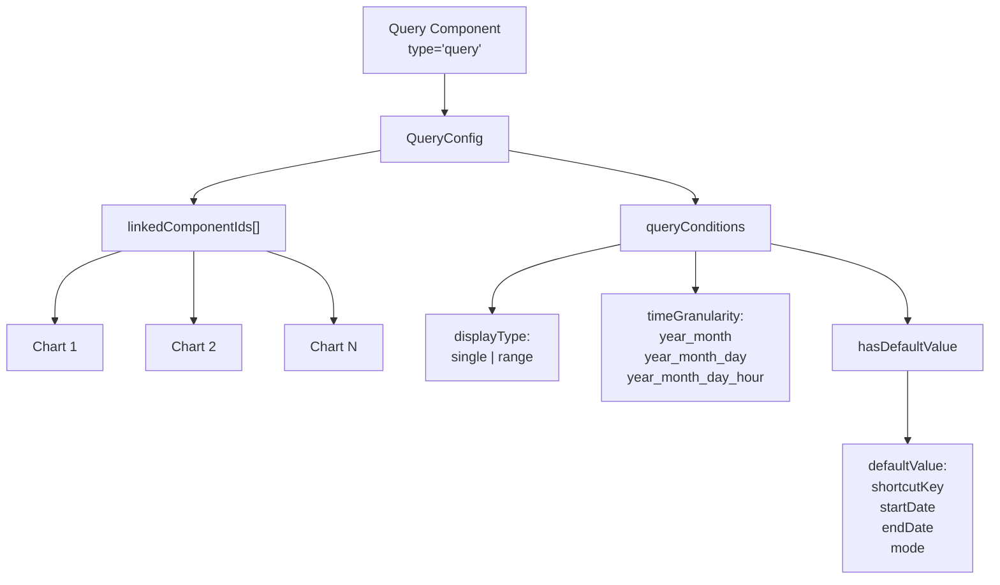

**Sources:** 
- [src/frontend/platform/src/pages/Dashboard/components/config/ComponentConfigDrawer.tsx:702-748]()
- [src/frontend/platform/src/pages/Dashboard/components/config/ChartSelector.tsx:21-33]()

### ChartSelector Configuration

The `ChartSelector` component allows users to:

1. Select which charts to link
2. Choose display type (single time vs. time range)
3. Set time granularity
4. Configure default values

```typescript
interface QueryConfig {
    linkedComponentIds: string[]
    queryConditions: {
        id: string
        displayType: "single" | "range"
        timeGranularity: "year_month" | "year_month_day" | "year_month_day_hour"
        hasDefaultValue: boolean
        defaultValue: {
            shortcutKey?: number
            type: "recent_days" | "custom" | "all"
            mode: TimeRangeMode.Dynamic | TimeRangeMode.Fixed
            recentDays?: number
            startDate?: string
            endDate?: string
        }
    }
}
```

**Sources:** 
- [src/frontend/platform/src/pages/Dashboard/components/config/ChartSelector.tsx:41-267]()
- [src/frontend/platform/src/pages/Dashboard/components/config/ComponentConfigDrawer.tsx:708-732]()

---

## Data Flow and State Management

### State Management Architecture

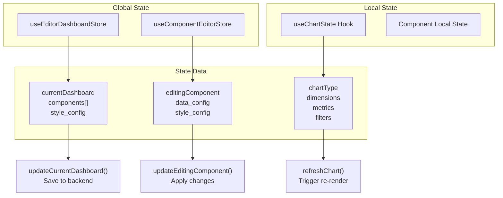

**Sources:** 
- [src/frontend/platform/src/pages/Dashboard/components/config/ComponentConfigDrawer.tsx:93-94]()
- [src/frontend/platform/src/pages/Dashboard/components/config/useChartState.tsx:8-36]()

### Chart Update Flow

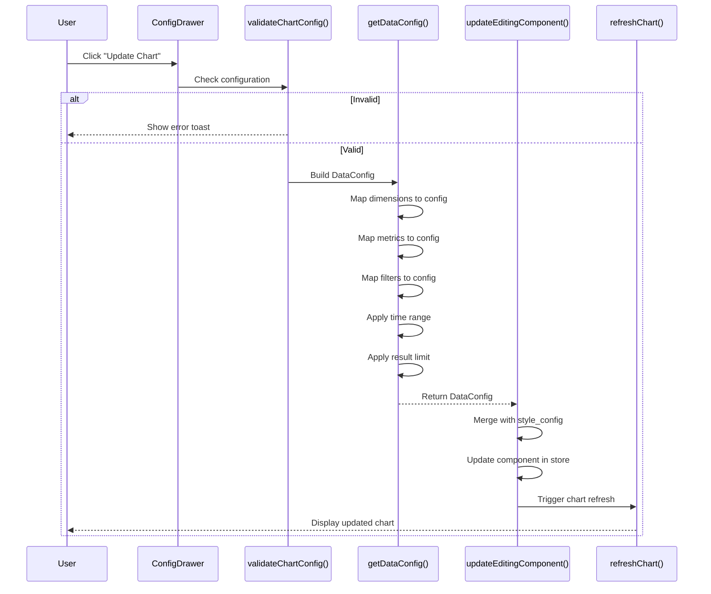

**Sources:** 
- [src/frontend/platform/src/pages/Dashboard/components/config/ComponentConfigDrawer.tsx:489-606]()
- [src/frontend/platform/src/pages/Dashboard/components/config/useChartState.tsx:520-639]()

### Data Configuration Generation

The `getDataConfig` method in `useChartState` builds the final configuration:

```typescript
const getDataConfig = (
    limitType: "all" | "limit",
    limitValue: string,
    timeFilter?: TimeFilter
): DataConfig => {
    return {
        dimensions: categoryDimensions.map(d => ({
            fieldId: d.fieldId,
            fieldCode: d.name,
            fieldName: d.originalName,
            displayName: d.displayName,
            sort: d.sort,
            timeGranularity: d.timeGranularity
        })),
        
        stackDimension: stackDimensions.length > 0 ? {
            fieldId: stackDimensions[0].fieldId,
            fieldCode: stackDimensions[0].name,
            fieldName: stackDimensions[0].originalName,
            displayName: stackDimensions[0].displayName,
            sort: stackDimensions[0].sort
        } : undefined,
        
        metrics: valueDimensions.map(d => ({
            fieldId: d.fieldId,
            fieldCode: d.name,
            fieldName: d.originalName,
            displayName: d.displayName,
            aggregation: d.aggregation,
            sort: d.sort,
            numberFormat: d.numberFormat,
            isVirtual: d.isVirtual,
            formula: d.isDivide
        })),
        
        filters: filterGroup?.conditions || [],
        filtersLogic: filterGroup?.logic || "and",
        
        timeFilter: timeFilter,
        
        resultLimit: limitType === "limit" ? {
            limit: limitValue
        } : undefined,
        
        fieldOrder: sortPriorityOrder.map(componentId => {
            const field = [...categoryDimensions, ...stackDimensions, ...valueDimensions]
                .find(d => d.id === componentId)
            return {
                fieldId: field?.fieldId,
                sortPriority: 0
            }
        }).filter(f => f.fieldId)
    }
}
```

**Sources:** 
- [src/frontend/platform/src/pages/Dashboard/components/config/useChartState.tsx:520-639]()

### Validation Rules

The `validateChartConfig` function enforces:

1. **Chart Type Required** (except for query/metric types)
2. **Category Required** (for non-metric cards, at least 1)
3. **Metric Required** (at least 1 value dimension)
4. **Dataset Required** (must select a dataset)
5. **No Invalid Fields** (all fields must exist in dataset)

**Sources:** 
- [src/frontend/platform/src/pages/Dashboard/components/config/ComponentConfigDrawer.tsx:489-528]()

---

## Localization

The dashboard system supports multiple languages (Chinese, English, Japanese) with comprehensive translation keys:

| Category | Key Prefix | Examples |
|----------|-----------|----------|
| Charts | `chart.*` | `chart.barChart`, `chart.lineChart` |
| Datasets | Dataset codes | `mid_user_increment`, `timestamp.day` |
| Filters | `filterConditionDialog.*` | `operators.equals`, `filterTypes.conditional` |
| Config | `componentConfigDrawer.*` | `chartType`, `categoryAxis` |
| Style | `styleConfigPanel.*` | `sections.color`, `labels.themeColor` |
| Validation | `validation.*` | `chartTypeRequired`, `metricRequired` |

**Sources:** 
- [src/frontend/platform/public/locales/en-US/dashboard.json:1-489]()
- [src/frontend/platform/public/locales/zh-Hans/dashboard.json:1-467]()
- [src/frontend/platform/public/locales/ja/dashboard.json:1-490]()

---

