<!-- source: DeepWiki mcp.deepwiki.com · repo dataelement/bisheng · page 3.7 Flow and Skill Management · fetched 2026-10-29 -->

# Flow and Skill Management

<details>
<summary>Relevant source files</summary>

The following files were used as context for generating this wiki page:

- [docker/bisheng/config/config.yaml](docker/bisheng/config/config.yaml)
- [src/backend/bisheng/api/services/assistant.py](src/backend/bisheng/api/services/assistant.py)
- [src/backend/bisheng/api/services/flow.py](src/backend/bisheng/api/services/flow.py)
- [src/backend/bisheng/api/services/workflow.py](src/backend/bisheng/api/services/workflow.py)
- [src/backend/bisheng/api/utils.py](src/backend/bisheng/api/utils.py)
- [src/backend/bisheng/api/v1/assistant.py](src/backend/bisheng/api/v1/assistant.py)
- [src/backend/bisheng/api/v1/endpoints.py](src/backend/bisheng/api/v1/endpoints.py)
- [src/backend/bisheng/api/v1/flows.py](src/backend/bisheng/api/v1/flows.py)
- [src/backend/bisheng/api/v1/schemas.py](src/backend/bisheng/api/v1/schemas.py)
- [src/backend/bisheng/api/v1/skillcenter.py](src/backend/bisheng/api/v1/skillcenter.py)
- [src/backend/bisheng/api/v1/workflow.py](src/backend/bisheng/api/v1/workflow.py)
- [src/backend/bisheng/database/base.py](src/backend/bisheng/database/base.py)
- [src/backend/bisheng/database/models/assistant.py](src/backend/bisheng/database/models/assistant.py)
- [src/backend/bisheng/database/models/flow.py](src/backend/bisheng/database/models/flow.py)
- [src/backend/bisheng/database/models/flow_version.py](src/backend/bisheng/database/models/flow_version.py)
- [src/backend/bisheng/database/models/template.py](src/backend/bisheng/database/models/template.py)
- [src/backend/bisheng/database/models/user_link.py](src/backend/bisheng/database/models/user_link.py)
- [src/backend/bisheng/graph/vertex/base.py](src/backend/bisheng/graph/vertex/base.py)
- [src/backend/bisheng/initdb_config.yaml](src/backend/bisheng/initdb_config.yaml)
- [src/backend/bisheng/interface/chains/base.py](src/backend/bisheng/interface/chains/base.py)
- [src/backend/bisheng/interface/chains/custom.py](src/backend/bisheng/interface/chains/custom.py)
- [src/backend/bisheng/interface/initialize/loading.py](src/backend/bisheng/interface/initialize/loading.py)
- [src/backend/bisheng/main.py](src/backend/bisheng/main.py)
- [src/backend/bisheng/template/frontend_node/chains.py](src/backend/bisheng/template/frontend_node/chains.py)

</details>


## Purpose and Scope

This document describes the Flow and Skill management system in Bisheng, which handles the complete lifecycle of node-based AI skill compositions. It covers flow creation, multi-version management, graph building and caching, status transitions, updates, and deletion.

Flows (also called "Skills") are the primary building blocks for creating AI capabilities in Bisheng. Each flow is a directed graph of nodes representing LLMs, chains, tools, retrievers, and other components connected by edges that define data flow.

For workflow execution (different from flows), see [Workflow Engine](#3.5). For assistant configuration using flows, see [Assistant System](#3.3). For user access control mechanisms, see [User and Access Control](#4).

---

## Core Data Models

### Flow and FlowVersion Tables

Flows use a two-table structure to support version management:

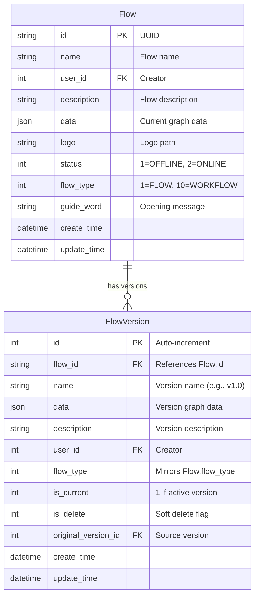

**Key Relationships:**
- One `Flow` has many `FlowVersion` records
- Only one version per flow has `is_current=1` at a time
- The `Flow.data` field always mirrors the current version's data
- Version creation copies from an `original_version_id`

**Sources:** [src/backend/bisheng/database/models/flow.py:49-83](), [src/backend/bisheng/database/models/flow_version.py:16-51]()

### Flow Graph Data Structure

The `data` field in both `Flow` and `FlowVersion` tables stores the complete node graph as JSON:

```json
{
  "nodes": [
    {
      "id": "node_uuid",
      "type": "LLMNode",
      "data": {
        "node": {
          "template": {
            "param_name": {
              "value": "param_value",
              "type": "str",
              "required": true
            }
          },
          "base_classes": ["BaseLanguageModel"],
          "description": "Node description"
        }
      },
      "position": {"x": 100, "y": 200}
    }
  ],
  "edges": [
    {
      "id": "edge_uuid",
      "source": "source_node_id",
      "target": "target_node_id",
      "sourceHandle": "output_handle",
      "targetHandle": "input_handle"
    }
  ]
}
```

**Sources:** [src/backend/bisheng/database/models/flow.py:63-77](), [src/backend/bisheng/database/models/flow_version.py:32-46]()

---

## Flow Lifecycle States

Flows transition through two primary states:

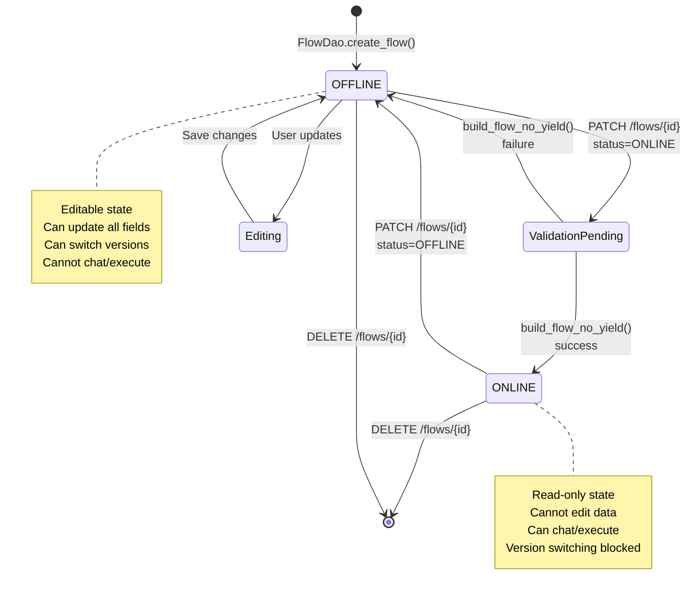

**Status Enum (`FlowStatus`):**
- `OFFLINE = 1`: Draft mode, editable, not accessible for execution
- `ONLINE = 2`: Published mode, read-only, available for chat and execution

**Sources:** [src/backend/bisheng/database/models/flow.py:26-28](), [src/backend/bisheng/api/v1/flows.py:126-168]()

---

## Flow Creation

### Creation Flow

Creating a flow involves initializing both the `Flow` record and a default version (`v0`):

**API Endpoint:** `POST /flows/`

**Request Schema (`FlowCreate`):**
```python
{
  "name": "My Skill",
  "description": "Skill description",
  "data": {
    "nodes": [...],
    "edges": [...]
  },
  "logo": "path/to/logo.png",
  "guide_word": "How can I help you?"
}
```

**Creation Sequence:**

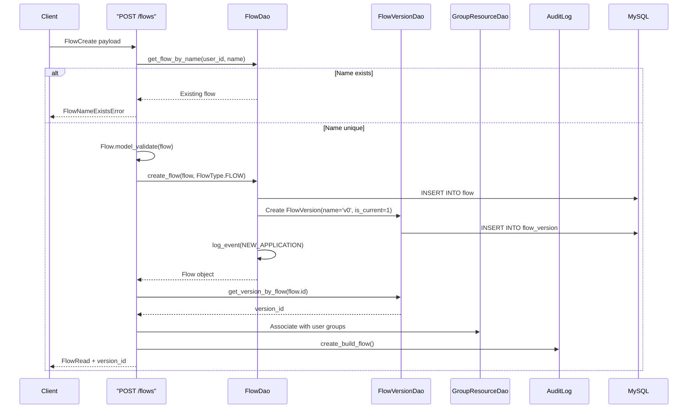

**Key Steps:**
1. **Name validation**: Check uniqueness within user's flows via `FlowDao.get_flow_by_name()`
2. **Flow creation**: Insert into `flow` table with `status=1` (OFFLINE)
3. **Default version**: Automatically create version "v0" with `is_current=1`
4. **Group association**: Link flow to user's groups via `GroupResourceDao`
5. **Audit logging**: Record creation event with operator IP and timestamp
6. **Telemetry**: Log `NEW_APPLICATION` event with app metadata

**Sources:** [src/backend/bisheng/api/v1/flows.py:29-45](), [src/backend/bisheng/database/models/flow.py:112-149](), [src/backend/bisheng/api/services/flow.py:1-36]()

---

## Version Management System

### Version Lifecycle and Operations

Flows support comprehensive version control allowing users to maintain multiple snapshots:

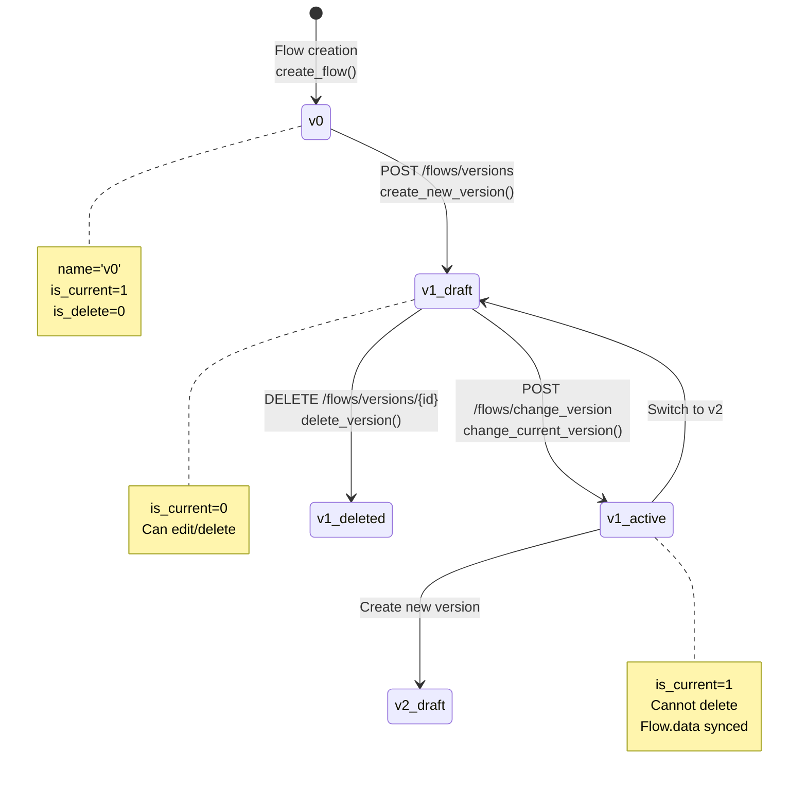

**Version Constraints:**
- Version names must be unique per `flow_id`
- Cannot delete version where `is_current=1`
- Cannot switch version when flow `status=ONLINE`
- Only one version has `is_current=1` at a time
- Deleted versions have `is_delete=1` (soft delete)

**Sources:** [src/backend/bisheng/database/models/flow_version.py:16-51]()

### Creating New Versions

**API Endpoint:** `POST /flows/versions?flow_id={flow_id}`

**Request Schema (`FlowVersionCreate`):**
```python
{
  "name": "v1.1.0",                    # Version name (unique per flow)
  "description": "Added RAG node",     # Version description
  "data": {...},                       # Complete graph data (nodes + edges)
  "original_version_id": 5,            # Source version to copy from
  "flow_type": 1                       # FlowType.FLOW
}
```

**Creation Sequence:**

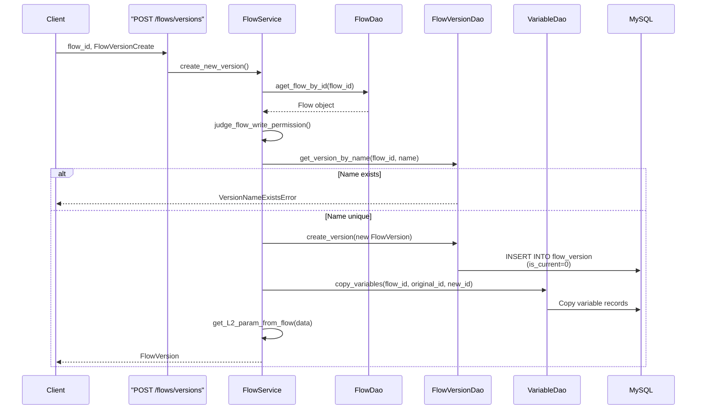

**Post-Creation Processing:**
1. **Variable copying**: For flows with form inputs, copies variable definitions from `original_version_id`
2. **L2 parameter extraction**: Parses graph to extract file nodes and form parameters via `get_L2_param_from_flow()`
3. **Version is inactive**: New version has `is_current=0`, must be explicitly activated

**Sources:** [src/backend/bisheng/api/services/flow.py:138-172](), [src/backend/bisheng/api/v1/flows.py:56-64](), [src/backend/bisheng/database/models/flow_version.py:60-68]()

### Switching Active Version

**API Endpoint:** `POST /flows/change_version?flow_id={flow_id}&version_id={version_id}`

Only offline flows can switch versions:

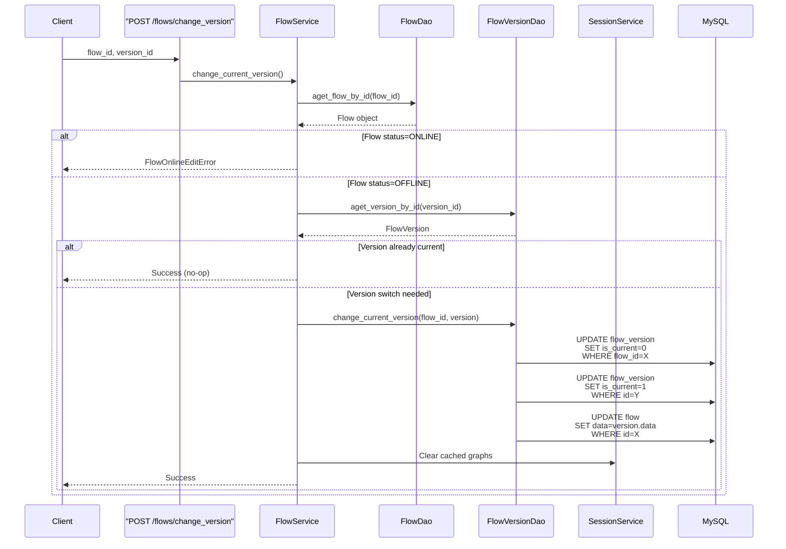

**Critical Steps:**
1. **Status check**: Flow must have `status=OFFLINE` (enforced before switch)
2. **Atomic update**: Three-step database update:
   - Clear all `is_current` flags for flow: `UPDATE flow_version SET is_current=0 WHERE flow_id=X`
   - Set new current: `UPDATE flow_version SET is_current=1 WHERE id=version_id`
   - Sync Flow.data: `UPDATE flow SET data=version.data WHERE id=flow_id`
3. **Cache invalidation**: Clears any cached graphs in `SessionService`

**Sources:** [src/backend/bisheng/api/services/flow.py:108-136](), [src/backend/bisheng/database/models/flow_version.py:127-154]()

### Updating Version Data

**API Endpoint:** `PUT /flows/versions/{version_id}`

Allows editing version name, description, and graph data:

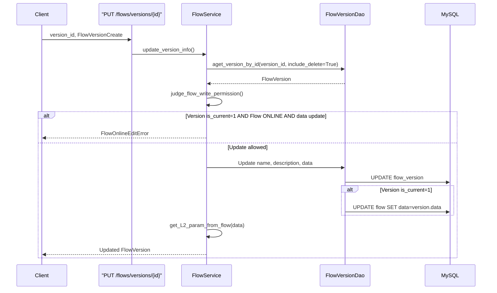

**Update Rules:**
- Can always update `name` and `description`
- Can update `data` if version is not current, or flow is offline
- Cannot update current version's `data` when flow is `ONLINE`
- Sets `is_delete=0` (restores deleted versions)

**Sources:** [src/backend/bisheng/api/services/flow.py:175-215](), [src/backend/bisheng/database/models/flow_version.py:87-102]()

### Deleting Versions

**API Endpoint:** `DELETE /flows/versions/{version_id}`

Versions are soft-deleted:

```python
# Deletion rules enforced by FlowService.delete_version()
if version_info.is_current == 1:
    raise CurVersionDelError
    
FlowVersionDao.delete_flow_version(version_id)
# Sets is_delete=1 in database
```

**Constraints:**
- Cannot delete version where `is_current=1`
- Must have `FLOW_WRITE` permission
- Deleted versions remain in database with `is_delete=1`
- Can be restored via update operation

**Sources:** [src/backend/bisheng/api/services/flow.py:62-91](), [src/backend/bisheng/database/models/flow_version.py:181-191]()

---

## Graph Building and Caching

### Building Flows into Executable Graphs

Flows are converted from JSON `data` into executable `Graph` objects via the build process:

**Title:** Flow Build Process

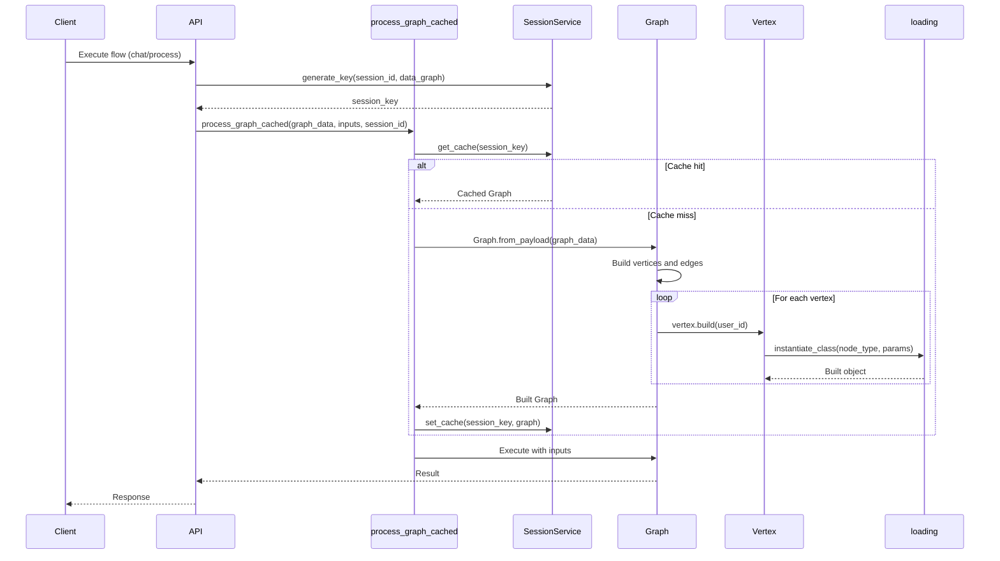

**Sources:** [src/backend/bisheng/processing/process.py](), [src/backend/bisheng/services/deps.py](), [src/backend/bisheng/graph/graph/base.py]()

### Session Service Integration

The `SessionService` manages caching of built graphs:

**Title:** SessionService Caching Mechanism

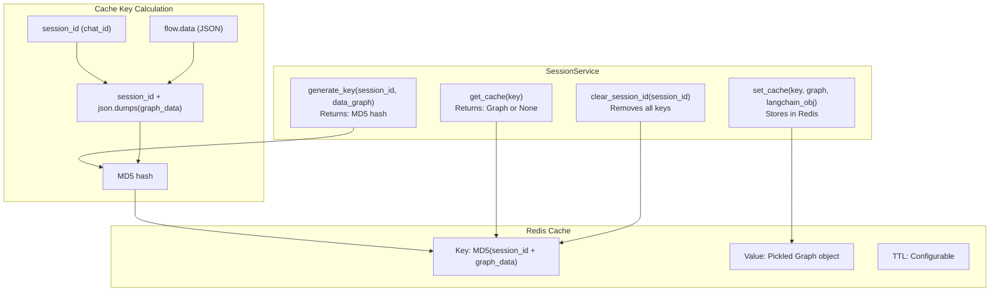

**Cache Key Generation:**
```python
def generate_key(session_id: str, data_graph: dict) -> str:
    json_str = json.dumps(data_graph, sort_keys=True)
    return hashlib.md5(f"{session_id}{json_str}".encode()).hexdigest()
```

**Cache Behavior:**
- **Key uniqueness**: Each `(session_id, graph_data)` pair gets unique cache key
- **Invalidation**: Changing flow data or session creates new key
- **Clear operations**: `clear_session_id()` removes all cached graphs for a session
- **Storage**: Uses Redis with pickle serialization

**Sources:** [src/backend/bisheng/services/deps.py](), [src/backend/bisheng/core/cache/utils.py]()

### Build Process Details

The `build_flow()` generator streams build progress:

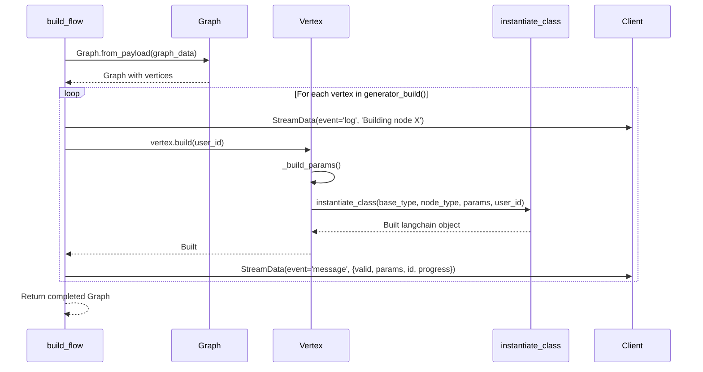

**Special Build Logic:**
- **Document loaders**: Skip file processing if `process_file=False`
- **Vector stores**: Auto-generate `collection_name` if not provided: `f'tmp_{flow_id}_{chat_id}'`
- **Error handling**: Streams error events to client if build fails

**Sources:** [src/backend/bisheng/api/utils.py:71-155](), [src/backend/bisheng/graph/vertex/base.py]()

---

## Flow Status Management

### Online/Offline Transitions

Status changes control flow availability and require validation:

**API Endpoint:** `PATCH /flows/{flow_id}`

**Title:** Flow Status Transition with Validation

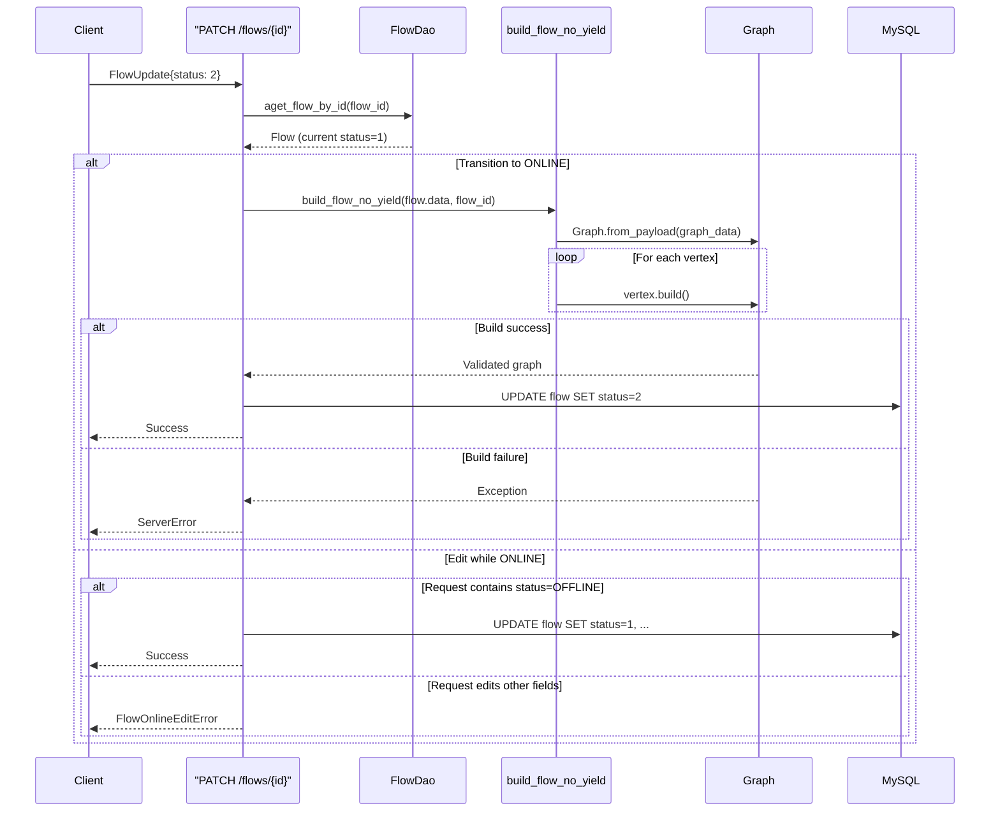

**Validation Steps:**
1. **Graph construction**: Calls `Graph.from_payload()` to parse nodes and edges
2. **Node building**: Each vertex calls `vertex.build()` to instantiate components
3. **Parameter validation**: All required node parameters must be provided
4. **Connection validation**: All edges must connect valid nodes and ports
5. **Component instantiation**: LLMs, chains, tools must be instantiable

**Status Constraints:**
- **OFFLINE → ONLINE**: Requires successful `build_flow_no_yield()`
- **ONLINE → OFFLINE**: Allowed without validation
- **Edit while ONLINE**: Only `status` field can change (to OFFLINE)
- **Version switch**: Blocked when ONLINE

**Sources:** [src/backend/bisheng/api/v1/flows.py:126-168](), [src/backend/bisheng/api/utils.py:158-220]()

---

## Flow Updates

### Updating Flow Metadata

**API Endpoint:** `PATCH /flows/{flow_id}`

Flow updates follow strict rules based on online status:

**Request Schema (`FlowUpdate`):**
```python
{
  "name": "Updated name",          # Optional
  "description": "New description", # Optional
  "logo": "new/logo/path.png",     # Optional
  "guide_word": "New greeting",    # Optional
  "data": {...},                   # Optional (graph changes)
  "status": 1 or 2                 # Optional
}
```

**Update Constraints:**

| Flow Status | Allowed Updates | Forbidden Updates |
|-------------|----------------|-------------------|
| **OFFLINE** | All fields | None |
| **ONLINE** | `status` (only to OFFLINE) | `data`, `name`, `description`, `logo`, `guide_word` |

**Title:** Flow Update Logic

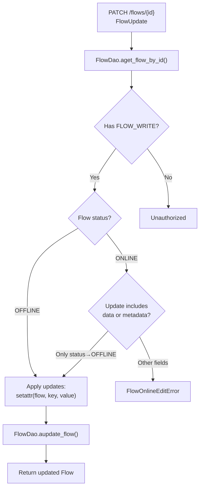

**Special Handling:**
- **Empty logo**: If `logo=""`, field is not updated (preserves existing)
- **Ignored fields**: `create_time`, `update_time`, `data` are never updated directly via PATCH
- **Graph data updates**: Must be done through version operations

**Sources:** [src/backend/bisheng/api/v1/flows.py:126-168](), [src/backend/bisheng/database/models/flow.py:374-387]()

---

## Flow Deletion

### Deletion Process

**API Endpoint:** `DELETE /flows/{flow_id}`

Deletion permanently removes the flow and cascades to related resources:

**Title:** Flow Deletion Sequence

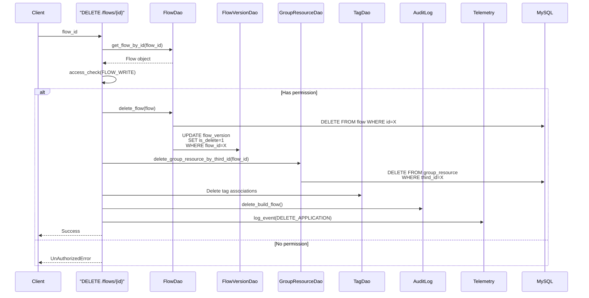

**Cascading Cleanup:**

| Resource | Action | Table | Effect |
|----------|--------|-------|--------|
| **Flow record** | Hard delete | `flow` | `DELETE FROM flow WHERE id=X` |
| **All versions** | Soft delete | `flow_version` | `UPDATE flow_version SET is_delete=1 WHERE flow_id=X` |
| **Group links** | Hard delete | `group_resource` | `DELETE FROM group_resource WHERE third_id=X AND type='flow'` |
| **Tag links** | Hard delete | `resource_tag` | Delete tag associations |
| **Chat sessions** | Update | `message_session` | Update `flow_name`, `desc`, `logo` (preserves history) |
| **Variables** | Orphaned | `variable_value` | Remain in database (unused) |

**Permission Requirements:**
- Must have `FLOW_WRITE` access type
- Owner always has permission
- Admin users have permission
- Role-based access checked via `RoleAccessDao`

**Sources:** [src/backend/bisheng/api/v1/flows.py:171-195](), [src/backend/bisheng/database/models/flow.py:152-161](), [src/backend/bisheng/api/services/flow.py]()

---

## Access Control

### Permission Types for Flows

| Access Type | Enum Value | Description | Required For |
|------------|------------|-------------|--------------|
| `FLOW` | `AccessType.FLOW` | Read access | View flow, list flows, execute |
| `FLOW_WRITE` | `AccessType.FLOW_WRITE` | Write access | Edit, delete, change status, manage versions |

**Title:** Flow Permission Check Logic

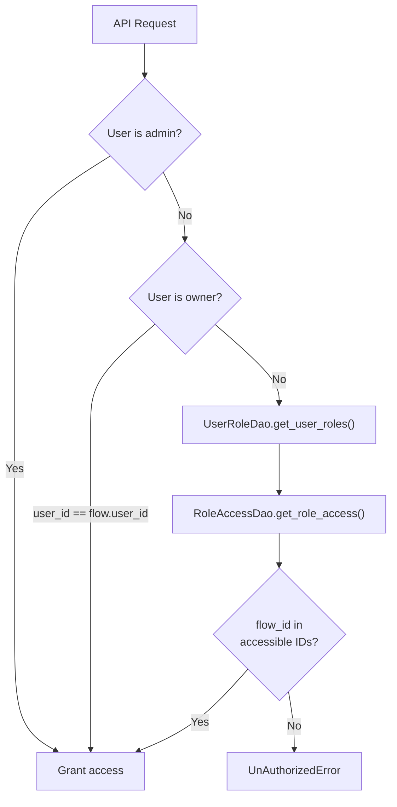

**Access Hierarchy:**
1. **System admin** (`user.is_admin()`): Full access to all flows
2. **Flow owner** (`user_id == flow.user_id`): Full read/write access
3. **Role-based access**: Granted via `role_access` table entries
4. **Group membership**: Flows linked to user's groups via `group_resource`

**Checking Permissions in Code:**
```python
# Read permission check
if not await login_user.async_access_check(flow.user_id, flow_id, AccessType.FLOW):
    raise UnAuthorizedError()

# Write permission check  
if not await login_user.async_access_check(flow.user_id, flow_id, AccessType.FLOW_WRITE):
    raise UnAuthorizedError()
```

**Sources:** [src/backend/bisheng/common/dependencies/user_deps.py](), [src/backend/bisheng/database/models/role_access.py]()


---

## API Routes

### Flow Management Endpoints

**Base Path:** `/api/v1/flows`

| Method | Endpoint | Function | Purpose | Permission |
|--------|----------|----------|---------|------------|
| POST | `/flows/` | `create_flow()` | Create new flow | Authenticated user |
| GET | `/flows/` | `read_flows()` | List flows (paginated, filtered) | User's accessible flows |
| GET | `/flows/{flow_id}` | `read_flow()` | Get flow details | `FLOW` read |
| PATCH | `/flows/{flow_id}` | `update_flow()` | Update flow metadata/status | `FLOW_WRITE` |
| DELETE | `/flows/{flow_id}` | `delete_flow()` | Delete flow | `FLOW_WRITE` |

**Sources:** [src/backend/bisheng/api/v1/flows.py:29-195]()

### Version Management Endpoints

| Method | Endpoint | Function | Purpose | Permission |
|--------|----------|----------|---------|------------|
| GET | `/flows/versions?flow_id=X` | `get_versions()` | List all versions | `FLOW` read |
| POST | `/flows/versions?flow_id=X` | `create_versions()` | Create new version | `FLOW_WRITE` |
| GET | `/flows/versions/{version_id}` | `get_version_info()` | Get version details | `FLOW` read |
| PUT | `/flows/versions/{version_id}` | `update_versions()` | Update version | `FLOW_WRITE` |
| DELETE | `/flows/versions/{version_id}` | `delete_versions()` | Delete version | `FLOW_WRITE` |
| POST | `/flows/change_version` | `change_version()` | Switch active version | `FLOW_WRITE` |

**Query Parameters:**
- `flow_id`: Required for list/create operations
- `version_id`: Version identifier for get/update/delete

**Sources:** [src/backend/bisheng/api/v1/flows.py:48-104]()

### Flow Execution Endpoint

| Method | Endpoint | Function | Purpose |
|--------|----------|----------|---------|
| POST | `/process` | `process_flow()` | Execute flow synchronously with inputs |

**Request Body:**
```json
{
  "flow_id": "uuid",
  "inputs": {"input_key": "value"},
  "session_id": "optional_session",
  "clear_cache": false,
  "history_count": 10
}
```

**Sources:** [src/backend/bisheng/api/v1/endpoints.py:174-349]()

---

## Audit Logging

All lifecycle operations are logged via `AuditLogService`:

**Logged Events:**
- `create_build_flow()`: Flow/Workflow creation
- `create_build_assistant()`: Assistant creation
- `update_build_flow()`: Flow/Workflow updates
- `update_build_assistant()`: Assistant updates
- `delete_build_flow()`: Flow/Workflow deletion
- `delete_build_assistant()`: Assistant deletion
- `create_chat_flow()`: New flow chat session
- `create_chat_assistant()`: New assistant chat session

**Audit Log Fields:**
- `user_id`: Operator
- `group_ids`: Associated groups
- `ip`: Request IP address
- `event_type`: Operation type
- `object_id`: Target application ID
- `timestamp`: Operation time

**Sources:** [src/backend/bisheng/api/services/audit_log.py]()

---

## Telemetry Events

Application lifecycle events trigger telemetry logging:

| Event Type | Trigger | Event Data |
|------------|---------|------------|
| `NEW_APPLICATION` | Creation | `app_id`, `app_name`, `app_type` |
| `EDIT_APPLICATION` | Update/Version change | None |
| `DELETE_APPLICATION` | Deletion | None |
| `APPLICATION_ALIVE` | WebSocket session | `app_id`, `chat_id`, `start_time`, `end_time` |
| `APPLICATION_PROCESS` | Message processing | `app_id`, `chat_id`, `process_time` |

**Sources:** [src/backend/bisheng/database/models/flow.py:139-147](), [src/backend/bisheng/api/services/assistant.py:174-181]()

---

