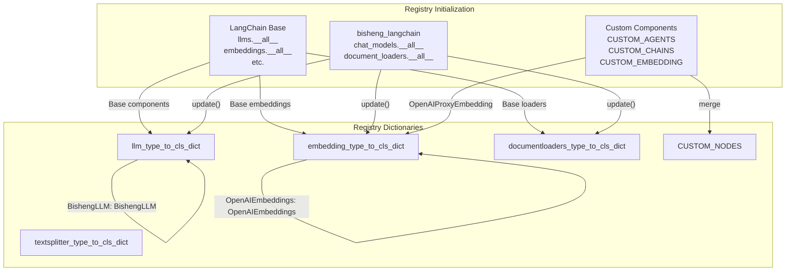
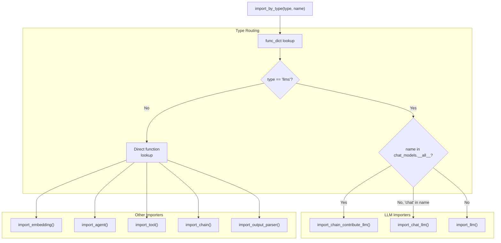
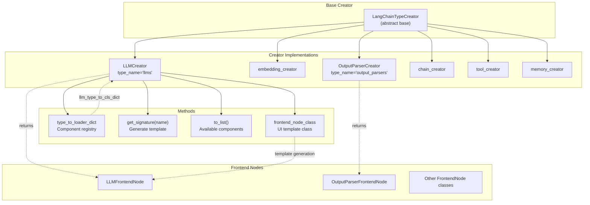
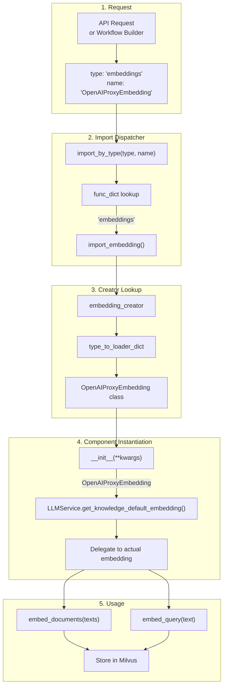

<!-- source: DeepWiki mcp.deepwiki.com · repo dataelement/bisheng · page 3.8 LLM and Component Integration · fetched 2026-10-29 -->

# LLM and Component Integration

<details>
<summary>Relevant source files</summary>

The following files were used as context for generating this wiki page:

- [.github/workflows/ci.yml](.github/workflows/ci.yml)
- [.github/workflows/release.yml](.github/workflows/release.yml)
- [.pre-commit-config.yaml](.pre-commit-config.yaml)
- [docker/bisheng/config/config.yaml](docker/bisheng/config/config.yaml)
- [src/backend/bisheng/api/services/chat_imp.py](src/backend/bisheng/api/services/chat_imp.py)
- [src/backend/bisheng/api/utils.py](src/backend/bisheng/api/utils.py)
- [src/backend/bisheng/api/v1/endpoints.py](src/backend/bisheng/api/v1/endpoints.py)
- [src/backend/bisheng/database/base.py](src/backend/bisheng/database/base.py)
- [src/backend/bisheng/graph/vertex/base.py](src/backend/bisheng/graph/vertex/base.py)
- [src/backend/bisheng/initdb_config.yaml](src/backend/bisheng/initdb_config.yaml)
- [src/backend/bisheng/interface/chains/base.py](src/backend/bisheng/interface/chains/base.py)
- [src/backend/bisheng/interface/chains/custom.py](src/backend/bisheng/interface/chains/custom.py)
- [src/backend/bisheng/interface/initialize/loading.py](src/backend/bisheng/interface/initialize/loading.py)
- [src/backend/bisheng/interface/initialize/vector_store.py](src/backend/bisheng/interface/initialize/vector_store.py)
- [src/backend/bisheng/main.py](src/backend/bisheng/main.py)
- [src/backend/bisheng/processing/base.py](src/backend/bisheng/processing/base.py)
- [src/backend/bisheng/processing/process.py](src/backend/bisheng/processing/process.py)
- [src/backend/bisheng/services/session/service.py](src/backend/bisheng/services/session/service.py)
- [src/backend/bisheng/template/frontend_node/chains.py](src/backend/bisheng/template/frontend_node/chains.py)
- [src/backend/bisheng/template/frontend_node/embeddings.py](src/backend/bisheng/template/frontend_node/embeddings.py)
- [src/backend/bisheng/template/frontend_node/llms.py](src/backend/bisheng/template/frontend_node/llms.py)
- [src/backend/bisheng/template/frontend_node/vectorstores.py](src/backend/bisheng/template/frontend_node/vectorstores.py)
- [src/backend/test/test_filelib.py](src/backend/test/test_filelib.py)

</details>


## Purpose and Scope

This document explains how Bisheng integrates Large Language Models (LLMs) and other AI components into the workflow system. It covers:

1. **LLM Service Integration**: How the `LLMService` manages model lifecycle and configuration
2. **Model Selection**: Mechanisms for choosing and configuring LLM and embedding models
3. **Component Initialization Framework**: The `instantiate_class()` routing system that creates component instances
4. **Frontend Node Configuration**: How component parameters are exposed and validated in the UI
5. **Xinference Client Integration**: Using xinference as a model serving backend

For workflow execution details, see [Workflow Engine](#3.5). For custom component development, see [Custom Component System](#6.4).

---

## Component Type System

Bisheng supports multiple component types, each with its own registry and loader. The type system is defined in [src/backend/bisheng/interface/importing/utils.py:36-59]() within the `import_by_type()` function.

### Supported Component Types

| Type | Description | Registry Location | Example Classes |
|------|-------------|-------------------|-----------------|
| `llms` | Language models (LLM and Chat) | `llm_type_to_cls_dict` | `ChatOpenAI`, `ChatAnthropic`, `BishengLLM` |
| `embeddings` | Text embedding models | `embedding_type_to_cls_dict` | `OpenAIEmbeddings`, `OpenAIProxyEmbedding` |
| `agents` | Agent implementations | Dynamic import | `JsonAgent`, `VectorStoreAgent` |
| `chains` | Chain components | `chain_creator` | `SeriesCharacterChain`, `load_qa_chain` |
| `tools` | Tool implementations | `tool_creator` | `PythonFunctionTool`, custom tools |
| `memory` | Memory/history stores | `memory_type_to_cls_dict` | `PostgresChatMessageHistory` |
| `vectorstores` | Vector database clients | `vectorstore_creator` | Milvus, Elasticsearch wrappers |
| `documentloaders` | Document loaders | `documentloaders_type_to_cls_dict` | PDF loaders, text loaders |
| `textsplitters` | Text chunking strategies | `textsplitter_type_to_cls_dict` | Character splitters, recursive splitters |
| `output_parsers` | Output format parsers | `output_parser_creator` | `StructuredOutputParser` |
| `custom_components` | User-defined components | Dynamic evaluation | Custom classes |

**Sources:** [src/backend/bisheng/interface/importing/utils.py:36-59]()

---

## Component Registry Architecture

### Registry Structure

The component registry system uses dictionaries to map component names (strings) to their corresponding Python classes. The primary registry is defined in [src/backend/bisheng/interface/custom_lists.py]().



**Sources:** [src/backend/bisheng/interface/custom_lists.py:21-121]()

### LLM Registry

The LLM registry aggregates models from multiple sources:

```python
# Base LangChain LLMs
llm_type_to_cls_dict = llms.get_type_to_cls_dict()

# Major chat models
llm_type_to_cls_dict['ChatOpenAI'] = ChatOpenAI
llm_type_to_cls_dict['ChatAnthropic'] = ChatAnthropic
llm_type_to_cls_dict['ChatVertexAI'] = ChatVertexAI
llm_type_to_cls_dict['MiniMaxChat'] = MiniMaxChat
llm_type_to_cls_dict['ChatTongyi'] = ChatTongyi
llm_type_to_cls_dict['ChatZhipuAI'] = ChatZhipuAI
llm_type_to_cls_dict['ChatDeepSeek'] = ChatDeepSeek

# Contribute models from bisheng_langchain
llm_type_to_cls_dict.update({
    llm_name: import_class(f'bisheng_langchain.chat_models.{llm_name}')
    for llm_name in chat_models.__all__
})
```

**Sources:** [src/backend/bisheng/interface/custom_lists.py:22-45]()

### Embedding Registry

The embedding registry similarly combines multiple sources:

```python
# LangChain community embeddings
embedding_type_to_cls_dict = {
    embedding_name: import_class(f'langchain_community.embeddings.{embedding_name}')
    for embedding_name in embeddings.__all__
}

# Bisheng contribute embeddings
embedding_type_to_cls_dict.update({
    embedding_name: import_class(f'bisheng_langchain.embeddings.{embedding_name}')
    for embedding_name in contribute_embeddings.__all__
})

# OpenAI embeddings
embedding_type_to_cls_dict.update({
    "OpenAIEmbeddings": OpenAIEmbeddings,
    "AzureOpenAIEmbeddings": AzureOpenAIEmbeddings,
})
```

**Sources:** [src/backend/bisheng/interface/custom_lists.py:82-95]()

### Custom Nodes Merge

Custom implementations are merged into a unified registry:

```python
CUSTOM_NODES = {
    **CUSTOM_AGENTS,      # From bisheng.interface.agents.custom
    **CUSTOM_CHAINS,      # From bisheng.interface.chains.custom
    **CUSTOM_EMBEDDING,   # From bisheng.interface.embeddings.custom
}
```

**Sources:** [src/backend/bisheng/interface/custom_lists.py:116-120]()

---

## Dynamic Import Mechanism

The dynamic import system provides a unified interface for loading components by type and name. The core function is `import_by_type()` which dispatches to type-specific import functions.

### Import Dispatcher Flow



**Sources:** [src/backend/bisheng/interface/importing/utils.py:31-67]()

### Import Function Hierarchy

Each component type has a dedicated import function that knows where to find the component:

**LLM Import** [src/backend/bisheng/interface/importing/utils.py:89-94]():
```python
def import_chat_llm(llm: str) -> BaseChatModel:
    from bisheng.interface.llms.base import llm_creator
    if llm in llm_creator.type_to_loader_dict:
        return llm_creator.type_to_loader_dict[llm]
    return import_class(f'bisheng_langchain.chat_models.{llm}')
```

**Embedding Import** [src/backend/bisheng/interface/importing/utils.py:186-190]():
```python
def import_embedding(embedding: str) -> Any:
    from bisheng.interface.embeddings.base import embedding_creator
    return next(x for x in embedding_creator.type_to_loader_dict.values()
                if x.__name__ == embedding)
```

**Agent Import** [src/backend/bisheng/interface/importing/utils.py:155-161]():
```python
def import_agent(agent: str) -> Agent:
    from bisheng_langchain import agents
    if agent in agents.__all__:
        return import_class(f'bisheng_langchain.agents.{agent}')
    return import_class(f'langchain.agents.{agent}')
```

**Tool Import** [src/backend/bisheng/interface/importing/utils.py:170-177]():
```python
def import_tool(tool: str) -> BaseTool:
    from bisheng.interface.tools.base import tool_creator
    if tool in tool_creator.type_to_loader_dict:
        return tool_creator.type_to_loader_dict[tool]['fcn']
    return import_class(f'langchain_community.tools.{tool}')
```

**Sources:** [src/backend/bisheng/interface/importing/utils.py:89-177]()

### Module Import Utilities

The `import_class()` and `import_module()` functions provide low-level import capabilities:

**import_class()** [src/backend/bisheng/interface/importing/utils.py:126-130]():
```python
def import_class(class_path: str) -> Any:
    """Import class from class path"""
    module_path, class_name = class_path.rsplit('.', 1)
    module = import_module(module_path)
    return getattr(module, class_name)
```

**import_module()** [src/backend/bisheng/interface/importing/utils.py:17-28]():
```python
def import_module(module_path: str) -> Any:
    """Import module from module path"""
    if 'from' not in module_path:
        return importlib.import_module(module_path)
    
    # Parse "from X import Y" syntax
    _, module_path, _, object_name = module_path.split()
    module = importlib.import_module(module_path)
    return getattr(module, object_name)
```

**Sources:** [src/backend/bisheng/interface/importing/utils.py:17-130]()

---

## Proxy and Custom Component Implementations

### OpenAIProxyEmbedding

The `OpenAIProxyEmbedding` class provides a proxy pattern for dynamically loading the default knowledge base embedding model:

```python
class OpenAIProxyEmbedding(Embeddings):
    embeddings: Optional[Embeddings] = Field(default=None)

    def __init__(self, **kwargs) -> None:
        super().__init__(**kwargs)
        from bisheng.llm.domain.services import LLMService
        # Dynamically load default embedding
        self.embeddings = LLMService.get_knowledge_default_embedding(0)

    def embed_documents(self, texts: List[str]) -> List[List[float]]:
        if not texts:
            return []
        return self.embeddings.embed_documents(texts)

    def embed_query(self, text: str) -> List[float]:
        return self.embeddings.embed_query(text)
```

This pattern allows:
1. **Runtime Configuration**: The actual embedding model is determined at runtime from system configuration
2. **Transparent Delegation**: All embedding calls are delegated to the configured model
3. **Centralized Management**: Embedding model selection is managed by `LLMService`

**Sources:** [src/backend/bisheng/interface/embeddings/custom.py:12-31]()

### FakeEmbedding

The `FakeEmbedding` class provides a placeholder implementation for cases where a model has been decommissioned but vector stores still reference it:

```python
class FakeEmbedding(Embeddings):
    """为了保证milvus等，在模型下线还能继续用"""
    
    def embed_documents(self, texts: List[str]) -> List[List[float]]:
        return []
    
    def embed_query(self, text: str) -> List[float]:
        return []
```

This ensures that:
- Vector stores using retired models can still be loaded
- System remains stable when models are removed
- Graceful degradation instead of crashes

**Sources:** [src/backend/bisheng/interface/embeddings/custom.py:33-42]()

### Custom Embedding Registry

Custom embedding implementations are registered in a dictionary:

```python
CUSTOM_EMBEDDING = {
    'OpenAIProxyEmbedding': OpenAIProxyEmbedding,
    'BishengEmbedding': BishengEmbedding,  # From bisheng.llm.domain.llm.embedding
}
```

**Sources:** [src/backend/bisheng/interface/embeddings/custom.py:45-48]()

### BishengLLM Integration

The `BishengLLM` class is registered in the LLM creator as a special custom LLM implementation:

```python
class LLMCreator(LangChainTypeCreator):
    @property
    def type_to_loader_dict(self) -> Dict:
        if self.type_dict is None:
            self.type_dict = llm_type_to_cls_dict
            self.type_dict.update({
                'BishengLLM': BishengLLM,
            })
        return self.type_dict
```

**Sources:** [src/backend/bisheng/interface/llms/base.py:20-26]()

---

## Creator Pattern and Frontend Integration

The system uses a "Creator" pattern to manage component types and generate frontend templates. Each component type has a dedicated creator class that extends `LangChainTypeCreator`.

### Creator Class Architecture



**Sources:** [src/backend/bisheng/interface/llms/base.py:12-48](), [src/backend/bisheng/interface/output_parsers/base.py:12-61]()

### LLMCreator Implementation

The `LLMCreator` class manages LLM component registration and frontend template generation:

```python
class LLMCreator(LangChainTypeCreator):
    type_name: str = 'llms'

    @property
    def frontend_node_class(self) -> Type[LLMFrontendNode]:
        return LLMFrontendNode

    @property
    def type_to_loader_dict(self) -> Dict:
        if self.type_dict is None:
            self.type_dict = llm_type_to_cls_dict
            self.type_dict.update({'BishengLLM': BishengLLM})
        return self.type_dict

    def get_signature(self, name: str) -> Optional[Dict]:
        """Get the signature of an llm."""
        try:
            return build_template_from_class(name, llm_type_to_cls_dict)
        except ValueError as exc:
            raise ValueError('LLM not found') from exc
        except AttributeError as exc:
            logger.error(f'LLM {name} not loaded: {exc}')
            return None

    def to_list(self) -> List[str]:
        return [
            llm.__name__
            for llm in self.type_to_loader_dict.values()
            if llm.__name__ in settings.llms or settings.dev
        ]
```

**Key Methods:**
- `type_to_loader_dict`: Returns the registry of LLM classes
- `get_signature()`: Generates UI template from class introspection
- `to_list()`: Returns filtered list of available LLMs based on settings
- `frontend_node_class`: Returns the frontend template class

**Sources:** [src/backend/bisheng/interface/llms/base.py:12-47]()

### OutputParserCreator Implementation

The `OutputParserCreator` demonstrates support for alternative constructor patterns:

```python
class OutputParserCreator(LangChainTypeCreator):
    type_name: str = 'output_parsers'
    from_method_nodes: ClassVar[Dict] = {
        'StructuredOutputParser': 'from_response_schemas',
    }

    @property
    def type_to_loader_dict(self) -> Dict:
        if self.type_dict is None:
            self.type_dict = {}
            for output_parser_name in output_parsers.__all__:
                if not settings.dev and output_parser_name not in settings.output_parsers:
                    continue
                if output_parser_name == "GuardrailsOutputParser":
                    self.type_dict[output_parser_name] = import_class(
                        f'langchain_community.output_parsers.rail_parser.{output_parser_name}'
                    )
                else:
                    self.type_dict[output_parser_name] = import_class(
                        f'langchain.output_parsers.{output_parser_name}'
                    )
        return self.type_dict

    def get_signature(self, name: str) -> Optional[Dict]:
        try:
            if name in self.from_method_nodes:
                # Use factory method instead of constructor
                return build_template_from_method(
                    name,
                    type_to_cls_dict=self.type_to_loader_dict,
                    method_name=self.from_method_nodes[name],
                )
            else:
                return build_template_from_class(
                    name,
                    type_to_cls_dict=self.type_to_loader_dict,
                )
        except (ValueError, AttributeError) as exc:
            logger.error(f'OutputParser {name} not loaded: {exc}')
        return None
```

**Special Features:**
- `from_method_nodes`: Maps component names to factory methods (e.g., `from_response_schemas`)
- Conditional template generation based on constructor pattern
- Settings-based filtering of available components

**Sources:** [src/backend/bisheng/interface/output_parsers/base.py:12-61]()

---

## Frontend Node Definitions

Frontend nodes define the UI templates for components in the visual editor. These are stored in [src/backend/bisheng/custom/customs.py]().

### Custom Nodes Structure

```python
CUSTOM_NODES = {
    'tools': {
        'PythonFunctionTool': frontend_node.tools.PythonFunctionToolNode(),
        'PythonFunction': frontend_node.tools.PythonFunctionNode(),
        'Tool': frontend_node.tools.ToolNode(),
    },
    'agents': {
        'JsonAgent': frontend_node.agents.JsonAgentNode(),
        'AgentInitializer': frontend_node.agents.InitializeAgentNode(),
        'VectorStoreAgent': frontend_node.agents.VectorStoreAgentNode(),
        'VectorStoreRouterAgent': frontend_node.agents.VectorStoreRouterAgentNode(),
    },
    'utilities': {
        'SQLDatabase': frontend_node.agents.SQLDatabaseNode(),
    },
    'memories': {
        'PostgresChatMessageHistory': 
            frontend_node.memories.PostgresChatMessageHistoryFrontendNode(),
        'MongoDBChatMessageHistory': 
            frontend_node.memories.MongoDBChatMessageHistoryFrontendNode(),
    },
    'chains': {
        'SeriesCharacterChain': frontend_node.chains.SeriesCharacterChainNode(),
        'TimeTravelGuideChain': frontend_node.chains.TimeTravelGuideChainNode(),
        'MidJourneyPromptChain': frontend_node.chains.MidJourneyPromptChainNode(),
        'load_qa_chain': frontend_node.chains.CombineDocsChainNode(),
        'load_summarize_chain': frontend_node.chains.SummarizeDocsChain(),
    },
    'embeddings': {
        'OpenAIProxyEmbedding': frontend_node.embeddings.OpenAIProxyEmbedding(),
    },
    'input_output': {
        'InputNode': frontend_node.input_output.InputNode(),
        'OutputNode': frontend_node.input_output.OutputNode(),
        'InputFileNode': frontend_node.input_output.InputFileNode(),
    },
}
```

The `get_custom_nodes()` function provides access to type-specific custom nodes:

```python
def get_custom_nodes(node_type: str):
    """Get custom nodes."""
    return CUSTOM_NODES.get(node_type, {})
```

**Sources:** [src/backend/bisheng/custom/customs.py:4-53]()

---

## Component Loading Flow

The following diagram illustrates the complete flow from a component request to instantiation:



**Sources:** [src/backend/bisheng/interface/importing/utils.py:31-67](), [src/backend/bisheng/interface/embeddings/custom.py:12-31]()

---

## Configuration and Streaming Options

The system provides utilities for managing component behavior at runtime.

### Streaming Configuration

The `try_setting_streaming_options()` function configures streaming behavior for LLM components:

```python
def try_setting_streaming_options(langchain_object, websocket):
    # Find the LLM instance in the langchain object
    llm = None
    if hasattr(langchain_object, 'llm'):
        llm = langchain_object.llm
    elif hasattr(langchain_object, 'llm_chain') and hasattr(langchain_object.llm_chain, 'llm'):
        llm = langchain_object.llm_chain.llm

    if isinstance(llm, BaseLanguageModel):
        if hasattr(llm, 'streaming') and isinstance(llm.streaming, bool):
            llm.streaming = settings.get_from_db('llm_request').get('stream') \
                if 'stream' in settings.get_from_db('llm_request') \
                else ChatConfig.streaming
        elif hasattr(llm, 'stream') and isinstance(llm.stream, bool):
            llm.stream = settings.get_from_db('llm_request').get('stream') \
                if 'stream' in settings.get_from_db('llm_request') \
                else ChatConfig.streaming
    return langchain_object
```

This function:
1. Locates the LLM instance within composite objects (chains, agents)
2. Checks for streaming attributes (`streaming` or `stream`)
3. Applies streaming configuration from database settings or defaults

**Sources:** [src/backend/bisheng/interface/utils.py:38-57]()

### File Loading Utilities

The `load_file_into_dict()` function provides flexible configuration file loading:

```python
def load_file_into_dict(file_path: str) -> dict:
    if not os.path.exists(file_path):
        raise FileNotFoundError(f'File not found: {file_path}')

    with open(file_path, 'r') as file:
        try:
            data = json.load(file)
        except json.JSONDecodeError:
            file.seek(0)
            data = yaml.safe_load(file)
        except ValueError as exc:
            raise ValueError('Invalid file type. Expected .json or .yaml.') from exc
    return data
```

This supports loading component configurations from both JSON and YAML formats.

**Sources:** [src/backend/bisheng/interface/utils.py:15-28]()

---

## Component Type Summary Table

| Component Type | Primary Registry | Creator Class | Import Function | Example Usage |
|----------------|------------------|---------------|-----------------|---------------|
| **LLMs** | `llm_type_to_cls_dict` | `LLMCreator` | `import_chat_llm()` | Chat models, completion models |
| **Embeddings** | `embedding_type_to_cls_dict` | `embedding_creator` | `import_embedding()` | Text vectorization, semantic search |
| **Agents** | Dynamic import | `agent_creator` | `import_agent()` | ReAct agents, function calling |
| **Chains** | `chain_creator` | `ChainCreator` | `import_chain()` | Sequential processing, QA chains |
| **Tools** | `tool_creator` | `ToolCreator` | `import_tool()` | API calls, Python functions |
| **Memories** | `memory_type_to_cls_dict` | `memory_creator` | `import_memory()` | Chat history, context management |
| **Vector Stores** | `vectorstore_creator` | `VectorstoreCreator` | `import_vectorstore()` | Milvus, Elasticsearch clients |
| **Document Loaders** | `documentloaders_type_to_cls_dict` | `documentloader_creator` | `import_documentloader()` | PDF, text, web loaders |
| **Text Splitters** | `textsplitter_type_to_cls_dict` | `textsplitter_creator` | `import_textsplitter()` | Character, recursive splitters |
| **Output Parsers** | `output_parser_creator` | `OutputParserCreator` | `import_output_parser()` | JSON, structured output |

**Sources:** [src/backend/bisheng/interface/custom_lists.py](), [src/backend/bisheng/interface/importing/utils.py]()

---

## Integration Points

### With Workflow Engine

The workflow engine uses `import_by_type()` to instantiate nodes dynamically based on node configurations. See [Workflow Engine](#3.5) for details on how components are used in graph execution.

### With LLMService

The `LLMService` manages LLM and embedding model lifecycle, using the component registry to instantiate models based on system configuration. The `OpenAIProxyEmbedding` class demonstrates tight integration with `LLMService`.

### With Frontend

Frontend nodes are generated using the creator pattern's `get_signature()` method, which introspects component classes to generate UI templates with appropriate input fields, validation rules, and default values.

**Sources:** [src/backend/bisheng/interface/llms/base.py:28-37](), [src/backend/bisheng/interface/embeddings/custom.py:15-18]()

---

