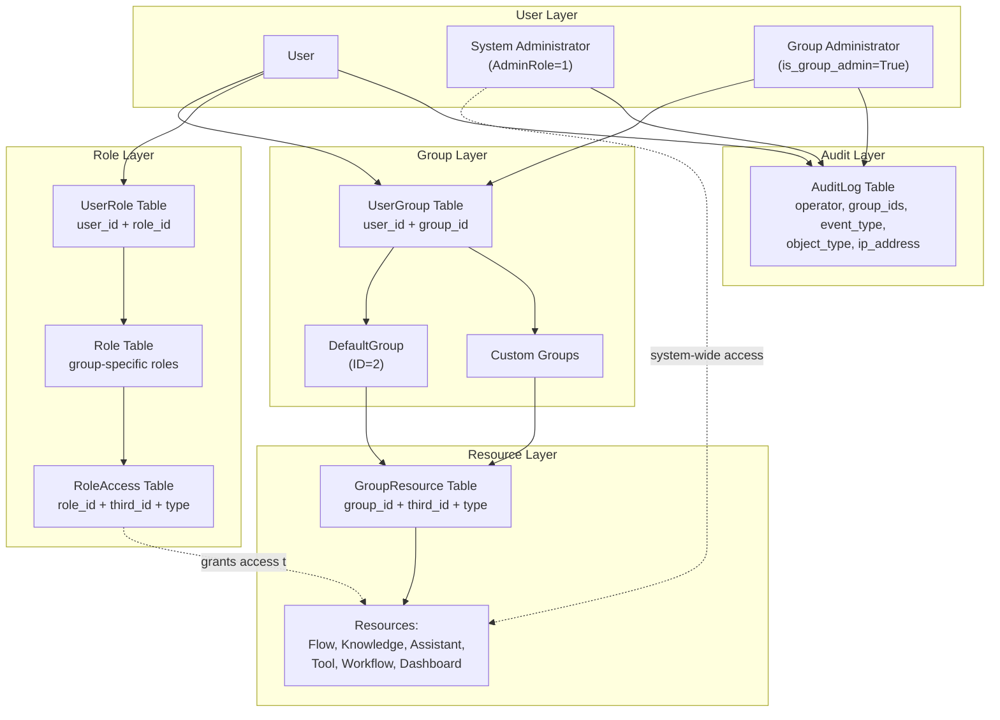
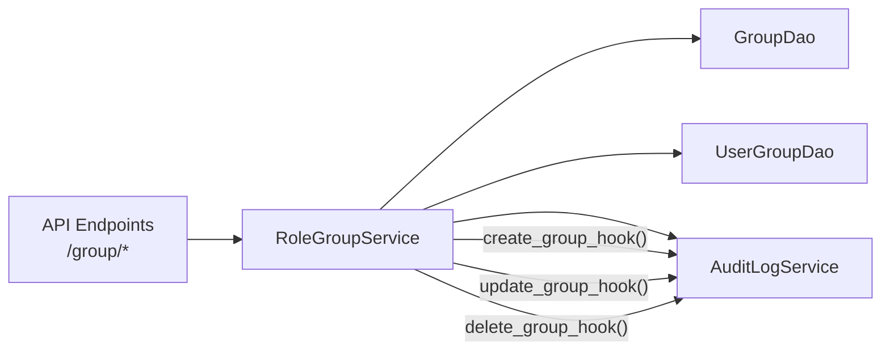
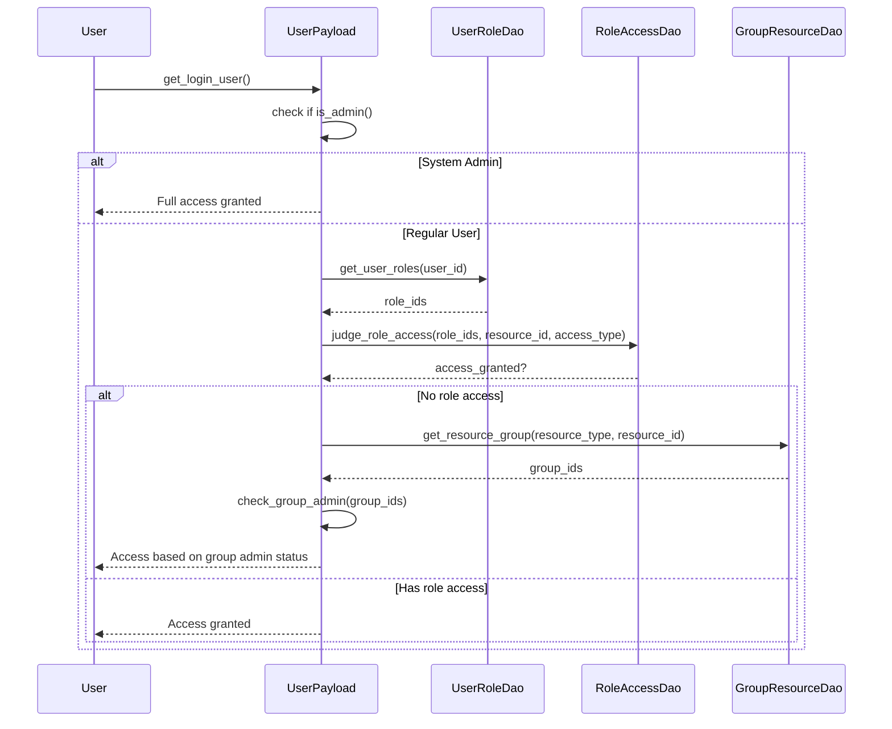
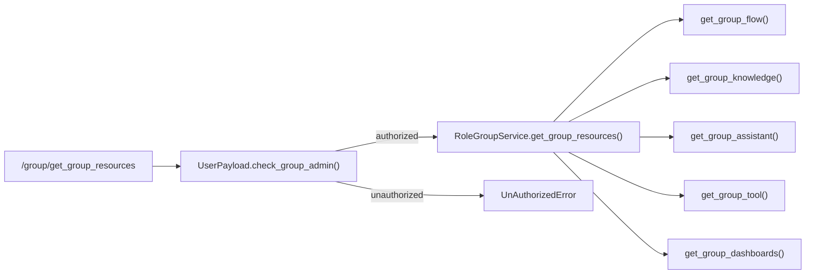
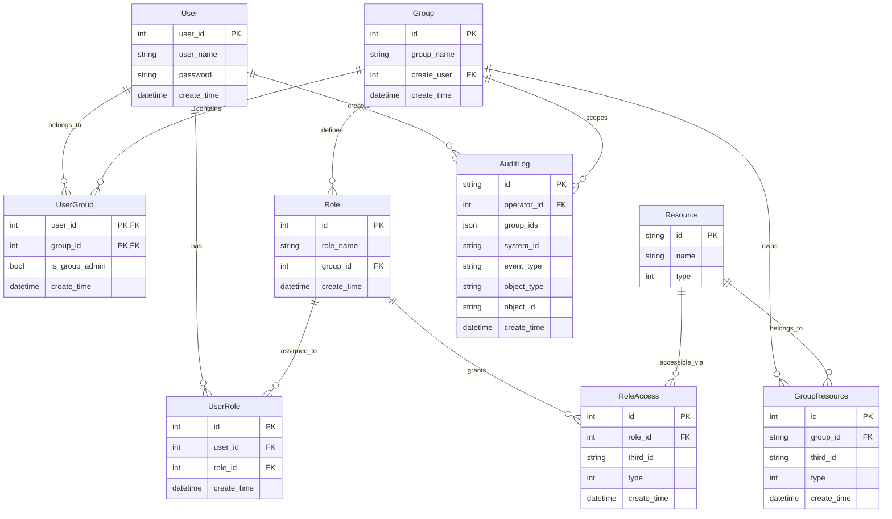

<!-- source: DeepWiki mcp.deepwiki.com · repo dataelement/bisheng · page 4 User and Access Control · fetched 2026-10-29 -->

# User and Access Control

<details>
<summary>Relevant source files</summary>

The following files were used as context for generating this wiki page:

- [src/backend/bisheng/api/services/audit_log.py](src/backend/bisheng/api/services/audit_log.py)
- [src/backend/bisheng/api/services/role_group_service.py](src/backend/bisheng/api/services/role_group_service.py)
- [src/backend/bisheng/api/v1/audit.py](src/backend/bisheng/api/v1/audit.py)
- [src/backend/bisheng/api/v1/usergroup.py](src/backend/bisheng/api/v1/usergroup.py)
- [src/backend/bisheng/database/models/audit_log.py](src/backend/bisheng/database/models/audit_log.py)
- [src/backend/bisheng/database/models/group.py](src/backend/bisheng/database/models/group.py)
- [src/backend/bisheng/database/models/group_resource.py](src/backend/bisheng/database/models/group_resource.py)
- [src/backend/bisheng/database/models/role.py](src/backend/bisheng/database/models/role.py)
- [src/backend/bisheng/database/models/role_access.py](src/backend/bisheng/database/models/role_access.py)
- [src/backend/bisheng/database/models/session.py](src/backend/bisheng/database/models/session.py)
- [src/backend/bisheng/database/models/user_group.py](src/backend/bisheng/database/models/user_group.py)
- [src/backend/bisheng/user/domain/models/user_role.py](src/backend/bisheng/user/domain/models/user_role.py)

</details>


This document describes Bisheng's multi-tenant authorization system, including user groups, role-based access control (RBAC), resource permissions, group administration, and comprehensive audit logging. For system configuration settings, see [Configuration Management](#5.1). For deployment considerations, see [Docker Deployment](#5.2).

## Overview

Bisheng implements a sophisticated two-layer permission model:
1. **Group-based access**: Users belong to Groups, and resources (flows, knowledge bases, assistants, tools, workflows, dashboards) are owned by groups
2. **Role-based access control (RBAC)**: Fine-grained permissions via group-specific roles

Every operation is logged via `AuditLogService` with comprehensive metadata including operator, timestamp, affected resources, and associated groups.

Sources: [src/backend/bisheng/api/services/role_group_service.py:1-396](), [src/backend/bisheng/api/services/audit_log.py:1-161]()

## System Architecture



**Authorization Architecture**

The system provides three levels of access control:
- **System Administrators** (`AdminRole=1`): Full system access, can manage all groups and resources
- **Group Administrators** (`is_group_admin=True`): Manage users, roles, and resources within their groups
- **Regular Users**: Access resources based on group membership and assigned roles

Sources: [src/backend/bisheng/database/models/user_group.py:12-36](), [src/backend/bisheng/database/models/role.py:14-41](), [src/backend/bisheng/database/models/group_resource.py:12-47](), [src/backend/bisheng/database/constants.py:1-10]()

## User Groups

### Group Model

The `Group` table defines user groups with the following structure:

| Field | Type | Description |
|-------|------|-------------|
| `id` | int | Primary key (ID=2 is DefaultGroup) |
| `group_name` | str | Unique display name |
| `remark` | str | Optional description |
| `create_user` | int | User ID who created the group |
| `update_user` | int | User ID who last updated the group |
| `create_time` | datetime | Creation timestamp |
| `update_time` | datetime | Last update timestamp |

Sources: [src/backend/bisheng/database/models/group.py:14-28]()

### DefaultGroup Concept

`DefaultGroup` (ID=2) serves as a fallback for orphaned resources. When a group is deleted, resources that belong only to that group are automatically moved to `DefaultGroup` to prevent data loss.

```python
# src/backend/bisheng/database/models/group.py:11
DefaultGroup = 2
```

Sources: [src/backend/bisheng/database/models/group.py:10-11](), [src/backend/bisheng/api/services/role_group_service.py:116-130]()

### UserGroup Relationship

The `UserGroup` table manages user-group membership:

| Field | Type | Description |
|-------|------|-------------|
| `user_id` | int | Foreign key to user.user_id |
| `group_id` | int | Foreign key to group.id |
| `is_group_admin` | bool | Whether user is group administrator |
| `remark` | str | Optional notes |
| `create_time` | datetime | When user joined group |
| `update_time` | datetime | Last update timestamp |

Key methods in `UserGroupDao`:
- `get_user_group(user_id)`: Get groups where user is a member (not admin)
- `get_user_admin_group(user_id)`: Get groups where user is administrator
- `insert_user_group_admin(user_id, group_id)`: Set user as group admin
- `add_default_user_group(user_id)`: Add user to DefaultGroup

Sources: [src/backend/bisheng/database/models/user_group.py:12-115]()

### Group Management Service

`RoleGroupService` provides high-level operations:



**Group Management Flow**

Key operations:
- `create_group(request, login_user, group)`: Create new group with optional admins
- `update_group(request, login_user, group)`: Update group name/description
- `delete_group(request, login_user, group_id)`: Delete group after validation
- `set_group_admin(request, login_user, user_ids, group_id)`: Set group administrators
- `replace_user_groups(request, login_user, user_id, group_ids)`: Update user's group memberships

When a group is deleted, the system:
1. Checks if any users remain in the group (prevents deletion if users exist)
2. Moves orphaned resources to `DefaultGroup`
3. Deletes all roles associated with the group
4. Removes all group administrators
5. Publishes a Redis event for cache invalidation

Sources: [src/backend/bisheng/api/services/role_group_service.py:32-243](), [src/backend/bisheng/api/v1/usergroup.py:16-186]()

## Resource Ownership

### GroupResource Model

The `GroupResource` table links resources to groups:

| Field | Type | Description |
|-------|------|-------------|
| `group_id` | str | Foreign key to group.id |
| `third_id` | str | Resource identifier (flow_id, knowledge_id, etc.) |
| `type` | int | ResourceTypeEnum value |
| `create_time` | datetime | Creation timestamp |
| `update_time` | datetime | Last update timestamp |

### ResourceTypeEnum

```python
class ResourceTypeEnum(Enum):
    KNOWLEDGE = 1        # Knowledge bases
    FLOW = 2            # Skills/Flows
    ASSISTANT = 3       # Assistants
    GPTS_TOOL = 4       # Tools
    WORK_FLOW = 5       # Workflows
    DASHBOARD = 6       # Dashboards
    WORKSTATION = 7     # Workstation sessions
```

Sources: [src/backend/bisheng/database/models/group_resource.py:12-20]()

### Resource Access Methods

`GroupResourceDao` provides:
- `get_group_resource(group_id, resource_type)`: Get resources in a group
- `get_resource_group(resource_type, third_id)`: Get groups owning a resource
- `insert_group_batch(group_resources)`: Add multiple resource-group associations
- `delete_group_resource_by_third_id(third_id, resource_type)`: Remove resource associations

Resources can belong to multiple groups simultaneously. The `group_ids` field in session tracking and audit logs stores all associated groups.

Sources: [src/backend/bisheng/database/models/group_resource.py:49-181]()

## Role-Based Access Control

### Role Model

Roles are group-specific and provide fine-grained permissions:

| Field | Type | Description |
|-------|------|-------------|
| `id` | int | Primary key (ID=1 is AdminRole) |
| `role_name` | str | Display name (unique within group) |
| `group_id` | int | Foreign key to group.id |
| `remark` | str | Optional description |
| `create_time` | datetime | Creation timestamp |
| `update_time` | datetime | Last update timestamp |

The `AdminRole` (ID=1) is a special system-wide role for super administrators.

Sources: [src/backend/bisheng/database/models/role.py:14-41](), [src/backend/bisheng/database/constants.py:1-10]()

### UserRole Relationship

The `UserRole` table assigns roles to users:

| Field | Type | Description |
|-------|------|-------------|
| `user_id` | int | Foreign key to user.user_id |
| `role_id` | int | Foreign key to role.id |
| `create_time` | datetime | Assignment timestamp |
| `update_time` | datetime | Last update timestamp |

Key methods:
- `get_user_roles(user_id)`: Get all roles assigned to user
- `set_admin_user(user_id)`: Assign AdminRole to user
- `add_user_roles(user_id, role_ids)`: Bulk assign roles
- `delete_user_roles(user_id, role_ids)`: Remove role assignments

Sources: [src/backend/bisheng/user/domain/models/user_role.py:13-110]()

### RoleAccess Model

The `RoleAccess` table defines what resources a role can access:

| Field | Type | Description |
|-------|------|-------------|
| `role_id` | int | Foreign key to role.id |
| `third_id` | str | Resource identifier or menu name |
| `type` | int | AccessType value |
| `create_time` | datetime | Creation timestamp |
| `update_time` | datetime | Last update timestamp |

### AccessType Enumeration

```python
class AccessType(Enum):
    KNOWLEDGE = 1              # Knowledge base read
    FLOW = 2                   # Skill read
    KNOWLEDGE_WRITE = 3        # Knowledge base write
    FLOW_WRITE = 4             # Skill write
    ASSISTANT_READ = 5         # Assistant read
    ASSISTANT_WRITE = 6        # Assistant write
    GPTS_TOOL_READ = 7         # Tool read
    GPTS_TOOL_WRITE = 8        # Tool write
    WORKFLOW = 9               # Workflow read
    WORKFLOW_WRITE = 10        # Workflow write
    DASHBOARD = 11             # Dashboard read
    DASHBOARD_WRITE = 12       # Dashboard write
    WEB_MENU = 99              # Frontend menu restrictions
```

### WebMenuResource

Frontend menu permissions are controlled via:

```python
class WebMenuResource(Enum):
    BUILD = 'build'                    # Build menu
    KNOWLEDGE = 'knowledge'            # Knowledge menu
    MODEL = 'model'                    # Model menu
    EVALUATION = 'evaluation'          # Evaluation menu
    FRONTEND = 'frontend'              # Frontend permissions
    BACKEND = 'backend'                # Backend access
    CREATE_DASHBOARD = 'create_dashboard'  # Dashboard creation
```

Sources: [src/backend/bisheng/database/models/role_access.py:13-67]()

### Permission Checking



**Permission Verification Flow**

The permission check follows this hierarchy:
1. **System Admin Check**: If user has `AdminRole`, grant full access
2. **Role-Based Check**: Query `RoleAccess` for specific resource permissions
3. **Group Admin Check**: If no role access, check if user is group administrator
4. **Group Membership Check**: Verify user belongs to resource's groups

Sources: [src/backend/bisheng/database/models/role_access.py:74-169](), [src/backend/bisheng/api/services/role_group_service.py:161-208]()

## Group Administration

### Admin Permissions

Group administrators (`is_group_admin=True`) can:
- View and manage users within their groups
- Create and manage roles within their groups
- View and manage resources (flows, knowledge bases, assistants, etc.) within their groups
- View audit logs for their groups
- Modify user group memberships (limited to their managed groups)

System administrators (`AdminRole`) can:
- Perform all group administrator operations across all groups
- Create and delete groups
- Set group administrators
- Access system-wide audit logs

Sources: [src/backend/bisheng/api/services/role_group_service.py:161-180](), [src/backend/bisheng/api/v1/usergroup.py:19-38]()

### Admin Restrictions

Certain operations are restricted to protect system integrity:

1. **DefaultGroup Protection**: The default group (ID=2) cannot be deleted
2. **Admin User Protection**: Users with `AdminRole` cannot have their group memberships modified by group administrators
3. **Group Deletion Restriction**: Groups cannot be deleted if they contain users

```python
# Prevent admin user modification
if any(one.role_id == AdminRole for one in user_role_list):
    raise AdminUserUpdateForbiddenError()
```

Sources: [src/backend/bisheng/api/services/role_group_service.py:96-99](), [src/backend/bisheng/api/services/role_group_service.py:163-166]()

### Resource Management API

The `/group/get_group_resources` endpoint retrieves resources for a group:



**Group Resource Retrieval**

Each resource type has a dedicated retrieval method:
- `get_group_flow()`: Skills and workflows with pagination
- `get_group_knowledge()`: Knowledge bases with user info
- `get_group_assistant()`: Assistants with simplified info
- `get_group_tool()`: Tools with user mapping
- `get_group_dashboards()`: Dashboards with layout excluded

Sources: [src/backend/bisheng/api/v1/usergroup.py:126-150](), [src/backend/bisheng/api/services/role_group_service.py:249-375]()

## Audit Logging

### AuditLog Model

The `AuditLog` table tracks all system operations:

| Field | Type | Description |
|-------|------|-------------|
| `id` | str | UUID primary key |
| `operator_id` | int | User who performed action |
| `operator_name` | str | Username |
| `group_ids` | List[int] | Associated groups |
| `system_id` | str | SystemId enum value |
| `event_type` | str | EventType enum value |
| `object_type` | str | ObjectType enum value |
| `object_id` | str | Resource identifier |
| `object_name` | str | Resource name |
| `note` | str | Optional notes |
| `ip_address` | str | Client IP address |
| `create_time` | datetime | Action timestamp |

Sources: [src/backend/bisheng/database/models/audit_log.py:72-92]()

### System Modules (SystemId)

```python
class SystemId(Enum):
    CHAT = "chat"            # Chat sessions
    BUILD = "build"          # Build/development
    KNOWLEDGE = "knowledge"  # Knowledge bases
    SYSTEM = "system"        # System administration
    DASHBOARD = "dashboard"  # Dashboards
```

Sources: [src/backend/bisheng/database/models/audit_log.py:13-19]()

### Event Types (EventType)

| Event | Description |
|-------|-------------|
| `CREATE_CHAT` | New chat session |
| `DELETE_CHAT` | Delete chat session |
| `CREATE_BUILD` | New application (flow/assistant/workflow) |
| `UPDATE_BUILD` | Edit application |
| `DELETE_BUILD` | Delete application |
| `CREATE_KNOWLEDGE` | New knowledge base |
| `DELETE_KNOWLEDGE` | Delete knowledge base |
| `UPLOAD_FILE` | Upload file to knowledge base |
| `DELETE_FILE` | Delete file from knowledge base |
| `UPDATE_USER` | Edit user account/groups/roles |
| `FORBID_USER` | Disable user account |
| `RECOVER_USER` | Enable user account |
| `CREATE_USER_GROUP` | Create user group |
| `UPDATE_USER_GROUP` | Edit user group |
| `DELETE_USER_GROUP` | Delete user group |
| `CREATE_ROLE` | Create role |
| `UPDATE_ROLE` | Edit role |
| `DELETE_ROLE` | Delete role |
| `ADD_TOOL` | Add tool |
| `UPDATE_TOOL` | Edit tool |
| `DELETE_TOOL` | Delete tool |
| `USER_LOGIN` | User login |
| `CREATE_DASHBOARD` | Create dashboard |
| `UPDATE_DASHBOARD` | Edit dashboard |
| `DELETE_DASHBOARD` | Delete dashboard |

Sources: [src/backend/bisheng/database/models/audit_log.py:22-54]()

### Object Types (ObjectType)

```python
class ObjectType(Enum):
    NONE = "none"                    # No specific object
    FLOW = "flow"                    # Skill
    WORK_FLOW = "work_flow"          # Workflow
    ASSISTANT = "assistant"          # Assistant
    WORKSTATION = "workstation"      # Workstation session
    KNOWLEDGE = "knowledge"          # Knowledge base
    FILE = "file"                    # Document
    USER_CONF = "user_conf"          # User configuration
    USER_GROUP_CONF = "user_group_conf"  # User group config
    ROLE_CONF = "role_conf"          # Role configuration
    TOOL = "tool"                    # Tool
    DASHBOARD = "dashboard"          # Dashboard
```

Sources: [src/backend/bisheng/database/models/audit_log.py:57-70]()

### Audit Service Methods

```mermaid
graph TB
    subgraph "Chat Events"
        CREATE_CHAT_ASSISTANT["create_chat_assistant()"]
        CREATE_CHAT_FLOW["create_chat_flow()"]
        DELETE_CHAT_FLOW["delete_chat_flow()"]
    end
    
    subgraph "Build Events"
        CREATE_BUILD_FLOW["create_build_flow()"]
        UPDATE_BUILD_FLOW["update_build_flow()"]
        DELETE_BUILD_FLOW["delete_build_flow()"]
        CREATE_BUILD_ASSISTANT["create_build_assistant()"]
    end
    
    subgraph "Knowledge Events"
        CREATE_KNOWLEDGE["create_knowledge()"]
        DELETE_KNOWLEDGE["delete_knowledge()"]
        UPLOAD_FILE["upload_knowledge_file()"]
        DELETE_FILE["delete_knowledge_file()"]
    end
    
    subgraph "System Events"
        UPDATE_USER["update_user()"]
        FORBID_USER["forbid_user()"]
        CREATE_GROUP["create_user_group()"]
        CREATE_ROLE["create_role()"]
        USER_LOGIN["user_login()"]
    end
    
    subgraph "Dashboard Events"
        CREATE_DASHBOARD["create_dashboard()"]
        UPDATE_DASHBOARD["update_dashboard()"]
        DELETE_DASHBOARD["delete_dashboard()"]
    end
    
    ALL["AuditLogDao.insert_audit_logs()"]
    
    CREATE_CHAT_ASSISTANT --> ALL
    CREATE_BUILD_FLOW --> ALL
    CREATE_KNOWLEDGE --> ALL
    UPDATE_USER --> ALL
    CREATE_DASHBOARD --> ALL
```



**Audit Logging Methods**

Each audit method follows a pattern:
1. Retrieve resource details (name, ID)
2. Determine associated groups via `GroupResourceDao` or user groups
3. Create `AuditLog` object with metadata
4. Insert via `AuditLogDao.insert_audit_logs()` or `ainsert_audit_logs()`

Sources: [src/backend/bisheng/api/services/audit_log.py:34-552]()

### Group-Scoped Audit Queries

Audit logs can be filtered by group membership:

```python
# Filter logs by user-managed groups
if not login_user.is_admin():
    groups = [one.group_id for one in UserGroupDao.get_user_admin_group(user_id)]
    # Only show logs for managed groups
    
# Query with group filter
data, total = await AuditLogDao.get_audit_logs(
    groups, operator_ids, start_time, end_time,
    system_id, event_type, page, limit
)
```

The `group_ids` field in audit logs uses JSON storage and supports `json_contains()` queries to find logs associated with specific groups.

Sources: [src/backend/bisheng/api/services/audit_log.py:36-56](), [src/backend/bisheng/database/models/audit_log.py:102-136]()

## Session Group Tracking

### MessageSession Model

Chat sessions track group associations via the `group_ids` field:

```python
class MessageSessionBase(SQLModelSerializable):
    chat_id: str              # Session unique ID
    flow_id: str              # Application ID
    flow_type: int            # App type (skill/assistant/workflow)
    user_id: int              # Session creator
    group_ids: List[int]      # Associated groups (JSON column)
    sensitive_status: int     # Review status
    create_time: datetime
```

When creating a session, the system automatically populates `group_ids` from the user's group memberships:

```python
if not data.group_ids:
    user_groups = UserGroupDao.get_user_group(data.user_id)
    data.group_ids = [ug.group_id for ug in user_groups]
```

This enables group administrators to view sessions from users in their groups.

Sources: [src/backend/bisheng/database/models/session.py:18-43](), [src/backend/bisheng/database/models/session.py:47-72]()

### Session List Filtering

The `/audit/session` endpoint filters sessions by group:

```python
# For regular users, limit to managed groups
if not user.is_admin():
    user_managed_groups = await UserGroupDao.aget_user_admin_group(user.user_id)
    managed_group_ids = {one.group_id for one in user_managed_groups}
    
    # Intersect with requested groups
    if group_ids:
        valid_group_ids = list(set(group_ids) & managed_group_ids)
    else:
        valid_group_ids = list(managed_group_ids)

# Query sessions using JSON contains
group_filters = [
    func.json_contains(MessageSession.group_ids, str(gid))
    for gid in search_group_ids
]
```

Sources: [src/backend/bisheng/api/services/audit_log.py:600-675]()

## API Endpoints

### User Group Endpoints

| Method | Path | Description | Permission |
|--------|------|-------------|------------|
| GET | `/group/list` | List all groups | Group admin or system admin |
| POST | `/group/create` | Create new group | System admin |
| PUT | `/group/create` | Update group | System admin |
| DELETE | `/group/create` | Delete group | System admin |
| POST | `/group/set_user_group` | Set user's groups | Group admin or system admin |
| GET | `/group/get_user_group` | Get user's groups | Authenticated user |
| GET | `/group/get_group_user` | Get group members | Authenticated user |
| POST | `/group/set_group_admin` | Set group admins | System admin |
| GET | `/group/get_group_resources` | Get group resources | Group admin |
| GET | `/group/roles` | Get group roles | Group admin |
| GET | `/group/manage/resources` | Get managed resources | Group admin |

Sources: [src/backend/bisheng/api/v1/usergroup.py:16-186]()

### Audit Log Endpoints

| Method | Path | Description | Permission |
|--------|------|-------------|------------|
| GET | `/audit` | Query audit logs | Group admin or system admin |
| GET | `/audit/operators` | Get all operators | Group admin or system admin |
| GET | `/audit/session` | Get session list | Group admin or system admin |
| GET | `/audit/session/export` | Export sessions to CSV | Group admin or system admin |
| GET | `/audit/session/export/data` | Export session data | Group admin or system admin |

Sources: [src/backend/bisheng/api/v1/audit.py:10-99]()

## Data Model Relationships



**Entity Relationship Diagram**

Key relationships:
- Users belong to multiple Groups via `UserGroup`
- Users have multiple Roles via `UserRole`
- Groups own Resources via `GroupResource`
- Roles grant access to Resources via `RoleAccess`
- All operations logged in `AuditLog` with group associations

Sources: [src/backend/bisheng/database/models/user_group.py:12-36](), [src/backend/bisheng/database/models/group.py:14-28](), [src/backend/bisheng/database/models/role.py:14-27](), [src/backend/bisheng/database/models/user_role.py:13-33](), [src/backend/bisheng/database/models/group_resource.py:21-33](), [src/backend/bisheng/database/models/role_access.py:13-24](), [src/backend/bisheng/database/models/audit_log.py:72-92]()

## Permission Verification Examples

### Checking Group Admin Status

```python
# UserPayload method
def check_group_admin(self, group_id: int) -> bool:
    """Check if user is admin of specific group"""
    if self.is_admin():
        return True
    
    admin_groups = UserGroupDao.get_user_admin_group(self.user_id)
    return group_id in [ug.group_id for ug in admin_groups]
```

### Checking Resource Access

```python
# Example: Verify user can access a flow
user_roles = UserRoleDao.get_user_roles(user_id)
role_ids = [ur.role_id for ur in user_roles]

# Check if user has read permission for this flow
access = RoleAccessDao.judge_role_access(
    role_ids, 
    flow_id, 
    AccessType.FLOW
)

if not access:
    # Check group membership as fallback
    resource_groups = GroupResourceDao.get_resource_group(
        ResourceTypeEnum.FLOW, 
        flow_id
    )
    user_groups = UserGroupDao.get_user_group(user_id)
    
    # User must belong to at least one resource group
    has_access = any(
        rg.group_id in [ug.group_id for ug in user_groups]
        for rg in resource_groups
    )
```

Sources: [src/backend/bisheng/database/models/role_access.py:112-130](), [src/backend/bisheng/database/models/group_resource.py:119-127]()

### Filtering Resources by Permission

```python
# Get resources user can manage
async def get_manage_resources(login_user, keyword, page, page_size):
    """Get resources in user's managed groups"""
    groups = []
    
    if not login_user.is_admin():
        # Get groups where user is admin
        user_groups = await UserGroupDao.aget_user_admin_group(login_user.user_id)
        groups = [str(one.group_id) for one in user_groups]
        
        if not groups:
            return [], 0
    
    # Get resources in those groups
    if groups:
        group_resources = await GroupResourceDao.get_groups_resource(
            groups,
            resource_types=[
                ResourceTypeEnum.FLOW,
                ResourceTypeEnum.ASSISTANT,
                ResourceTypeEnum.WORK_FLOW
            ]
        )
        resource_ids = [one.third_id for one in group_resources]
    
    return await FlowDao.aget_all_apps(keyword, id_list=resource_ids, page=page, limit=page_size)
```

Sources: [src/backend/bisheng/api/services/role_group_service.py:377-396]()

## Security Considerations

### Admin User Protection

The system prevents modification of super administrator accounts:

```python
# Check if operating on admin user
user_role_list = UserRoleDao.get_user_roles(user_id)
if any(one.role_id == AdminRole for one in user_role_list):
    raise AdminUserUpdateForbiddenError()
```

Sources: [src/backend/bisheng/api/services/role_group_service.py:163-166](), [src/backend/bisheng/common/errcode/user.py:1-50]()

### Group Deletion Safety

Before deleting a group:
1. Verify no users remain in the group
2. Move orphaned resources to `DefaultGroup`
3. Clean up associated roles and permissions
4. Publish Redis event for distributed cache invalidation

Sources: [src/backend/bisheng/api/services/role_group_service.py:96-140]()

### IP Address Logging

All audit logs capture the client's IP address via `get_request_ip(request)`:

```python
def get_request_ip(request: Request) -> str:
    """Extract client IP from request headers or connection"""
    # Check X-Forwarded-For header first
    # Fall back to X-Real-IP
    # Finally use client connection info
```

This enables security auditing and forensic analysis.

Sources: [src/backend/bisheng/api/services/audit_log.py:73-115](), [src/backend/bisheng/utils.py:1-500]()

---

