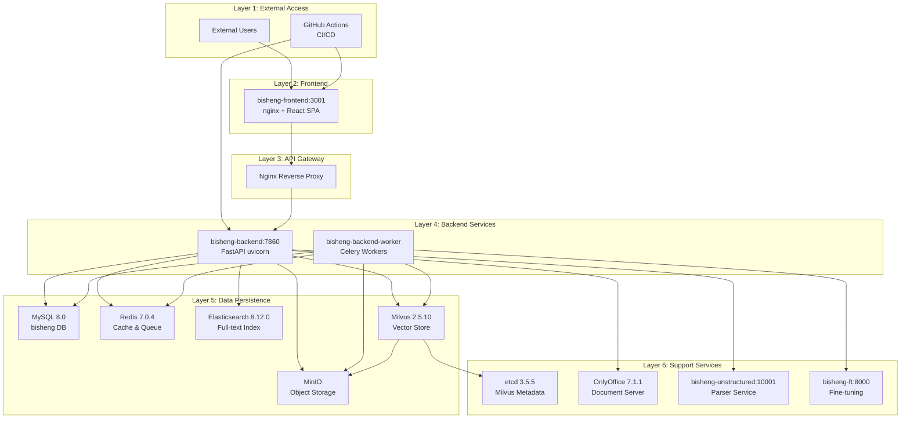
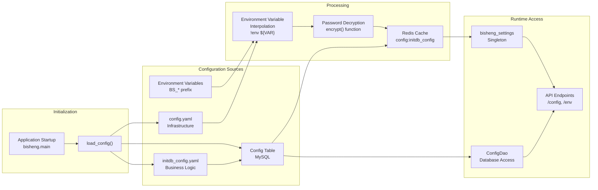
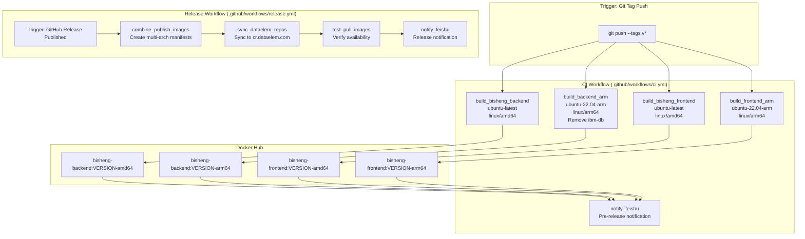
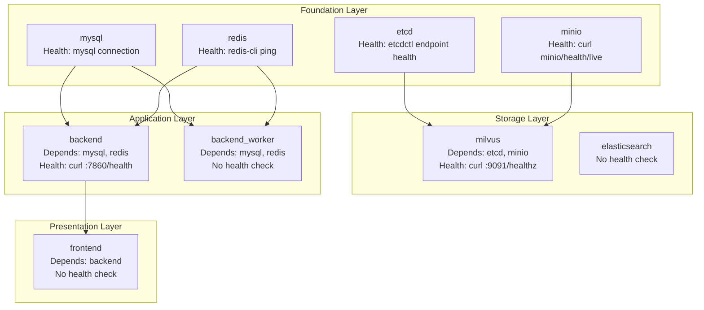

<!-- source: DeepWiki mcp.deepwiki.com · repo dataelement/bisheng · page 5 Development and Deployment · fetched 2026-10-29 -->

# Development and Deployment

<details>
<summary>Relevant source files</summary>

The following files were used as context for generating this wiki page:

- [.drone.yml](.drone.yml)
- [.github/workflows/base_ci.yml](.github/workflows/base_ci.yml)
- [.github/workflows/ci.yml](.github/workflows/ci.yml)
- [.github/workflows/release.yml](.github/workflows/release.yml)
- [.pre-commit-config.yaml](.pre-commit-config.yaml)
- [docker/bisheng-ft/config.yaml](docker/bisheng-ft/config.yaml)
- [docker/bisheng-uns/config.yaml](docker/bisheng-uns/config.yaml)
- [docker/docker-compose-ft.yml](docker/docker-compose-ft.yml)
- [docker/docker-compose-office.yml](docker/docker-compose-office.yml)
- [docker/docker-compose-uns.yml](docker/docker-compose-uns.yml)
- [docker/docker-compose.yml](docker/docker-compose.yml)
- [docker/mysql/conf/my.cnf](docker/mysql/conf/my.cnf)
- [docker/nginx/nginx.conf](docker/nginx/nginx.conf)
- [src/backend/Dockerfile](src/backend/Dockerfile)
- [src/backend/base.Dockerfile](src/backend/base.Dockerfile)
- [src/backend/bisheng/.gitignore](src/backend/bisheng/.gitignore)
- [src/backend/bisheng/__init__.py](src/backend/bisheng/__init__.py)
- [src/backend/bisheng/api/services/chat_imp.py](src/backend/bisheng/api/services/chat_imp.py)
- [src/backend/bisheng/core/ai/rerank/xinference/__init__.py](src/backend/bisheng/core/ai/rerank/xinference/__init__.py)
- [src/backend/bisheng/core/ai/rerank/xinference/_compat.py](src/backend/bisheng/core/ai/rerank/xinference/_compat.py)
- [src/backend/bisheng/core/ai/rerank/xinference/client/__init__.py](src/backend/bisheng/core/ai/rerank/xinference/client/__init__.py)
- [src/backend/bisheng/core/ai/rerank/xinference/client/common.py](src/backend/bisheng/core/ai/rerank/xinference/client/common.py)
- [src/backend/bisheng/core/ai/rerank/xinference/client/handlers.py](src/backend/bisheng/core/ai/rerank/xinference/client/handlers.py)
- [src/backend/bisheng/core/ai/rerank/xinference/client/restful/__init__.py](src/backend/bisheng/core/ai/rerank/xinference/client/restful/__init__.py)
- [src/backend/bisheng/core/ai/rerank/xinference/client/restful/async_restful_client.py](src/backend/bisheng/core/ai/rerank/xinference/client/restful/async_restful_client.py)
- [src/backend/bisheng/core/ai/rerank/xinference/client/restful/restful_client.py](src/backend/bisheng/core/ai/rerank/xinference/client/restful/restful_client.py)
- [src/backend/bisheng/core/ai/rerank/xinference/fields.py](src/backend/bisheng/core/ai/rerank/xinference/fields.py)
- [src/backend/bisheng/interface/initialize/vector_store.py](src/backend/bisheng/interface/initialize/vector_store.py)
- [src/backend/bisheng/processing/base.py](src/backend/bisheng/processing/base.py)
- [src/backend/bisheng/processing/process.py](src/backend/bisheng/processing/process.py)
- [src/backend/bisheng/services/session/service.py](src/backend/bisheng/services/session/service.py)
- [src/backend/bisheng/template/frontend_node/embeddings.py](src/backend/bisheng/template/frontend_node/embeddings.py)
- [src/backend/bisheng/template/frontend_node/llms.py](src/backend/bisheng/template/frontend_node/llms.py)
- [src/backend/bisheng/template/frontend_node/vectorstores.py](src/backend/bisheng/template/frontend_node/vectorstores.py)
- [src/backend/bisheng/template/frontend_node/wrappers.py](src/backend/bisheng/template/frontend_node/wrappers.py)
- [src/backend/pyproject.toml](src/backend/pyproject.toml)
- [src/backend/test/test_filelib.py](src/backend/test/test_filelib.py)
- [update.sh](update.sh)

</details>


This page provides an overview of the development, deployment, and release management processes for the Bisheng platform. The system uses a containerized architecture with multi-stage CI/CD pipelines supporting both AMD64 and ARM64 architectures.

**Key Topics**:
- **Configuration Management** (page 5.1): Two-tier configuration system with `initdb_config.yaml` for business logic and `config.yaml` for infrastructure
- **Docker Deployment** (page 5.2): Docker Compose orchestration with 10+ microservices including MySQL, Redis, Milvus, Elasticsearch, and MinIO
- **CI/CD Pipeline** (page 5.3): GitHub Actions workflows for automated multi-architecture builds, manifest creation, and registry synchronization

## System Overview

The Bisheng platform follows a modern cloud-native architecture with clear separation between development, deployment, and operations concerns. The system is packaged as Docker containers and deployed via Docker Compose, with automated CI/CD pipelines handling multi-architecture builds.

### Technology Stack

The backend is built using Python 3.10+ with dependency management via `pyproject.toml`. Key technology categories:

| Category | Key Dependencies | Version |
|----------|------------------|---------|
| Web Framework | `fastapi`, `uvicorn` | >=0.120.4, >=0.38.0 |
| AI/ML Libraries | `langchain`, `langgraph`, `openai`, `transformers` | 0.3.x, 0.3.x, 1.68.2, 4.57.1 |
| Database | `sqlmodel`, `pymysql`, `aiomysql`, `alembic` | >=0.0.27, >=1.1.2, >=0.3.2, >=1.17.1 |
| Vector Storage | `pymilvus`, `langchain-milvus` | 2.5.10, 0.2.1 |
| Search | `langchain-elasticsearch` | >=0.4.0 |
| Task Queue | `celery`, `redis` | >=5.5.3, >=7.0.1 |
| Object Storage | `minio`, `miniopy-async` | 7.2.18, >=1.23.4 |

The project version is defined as `2.3.0-beta2` in [src/backend/pyproject.toml:3]() and synchronized across [src/backend/bisheng/__init__.py:10]() and [docker/docker-compose.yml:43]().

### Deployment Architecture Layers



**Sources**: [src/backend/pyproject.toml:1-85](), [docker/docker-compose.yml:1-201](), [src/backend/bisheng/__init__.py:10]()

## Configuration System

Bisheng uses a two-tier configuration system separating business logic from infrastructure configuration. See page 5.1 for complete details.

### Configuration Files

| File | Purpose | Key Settings |
|------|---------|--------------|
| `initdb_config.yaml` | Business logic configuration | Knowledge base ETL, LLM timeouts, password policies, workflow settings, Linsight parameters |
| `config.yaml` | Infrastructure configuration | Database URLs, Redis connections, Celery queues, vector stores, object storage, logging |

### Configuration Loading Flow



Key configuration endpoints in [src/backend/bisheng/api/v1/endpoints.py:102-156]():
- `GET /config`: Retrieves `initdb_config.yaml` content (admin only)
- `POST /config/save`: Updates and validates configuration (admin only)
- `GET /env`: Returns frontend environment settings
- `GET /web/config`: Retrieves web-specific configuration
- `POST /web/config`: Updates web configuration (admin only)

**Sources**: [src/backend/bisheng/initdb_config.yaml:1-81](), [docker/bisheng/config/config.yaml:1-87](), [src/backend/bisheng/api/v1/endpoints.py:102-156]()

## Docker Deployment

The platform is deployed using Docker Compose with separate service definitions for core components and optional services. See page 5.2 for complete deployment details.

### Core Services (docker-compose.yml)

The main compose file [docker/docker-compose.yml:1-201]() defines:

| Service | Image | Port | Purpose |
|---------|-------|------|---------|
| `mysql` | `mysql:8.0` | 3306 | Primary database with `bisheng` schema |
| `redis` | `redis:7.0.4` | 6379 | Cache and Celery broker |
| `backend` | `dataelement/bisheng-backend:v2.3.0-beta2` | 7860 | FastAPI application server |
| `backend_worker` | `dataelement/bisheng-backend:v2.3.0-beta2` | - | Celery async workers |
| `frontend` | `dataelement/bisheng-frontend:v2.3.0-beta2` | 3001 | Nginx + React SPA |
| `elasticsearch` | `bitnamilegacy/elasticsearch:8.12.0` | 9200, 9300 | Full-text search engine |
| `etcd` | `quay.io/coreos/etcd:v3.5.5` | 2379 | Milvus metadata store |
| `minio` | `minio/minio:RELEASE.2023-03-20T20-16-18Z` | 9100, 9101 | Object storage for files and vectors |
| `milvus` | `milvusdb/milvus:v2.5.10` | 19530, 9091 | Vector database |

### Optional Services

Additional compose files for specialized features:
- **Document Processing**: `docker-compose-uns.yml` - Unstructured service with OCR capabilities
- **Model Fine-tuning**: `docker-compose-ft.yml` - GPU-enabled fine-tuning server
- **Document Editing**: `docker-compose-office.yml` - OnlyOffice document server

### Service Startup Modes

The backend container supports two startup modes via `entrypoint.sh`:

```bash
# API mode - FastAPI server
command: sh entrypoint.sh api

# Worker mode - Celery + Linsight workers  
command: sh entrypoint.sh worker
```

The worker mode starts three types of workers:
1. **Knowledge Celery Worker**: Queue `knowledge_celery`, 20 threads for file processing
2. **Workflow Celery Worker**: Queue `workflow_celery`, 100 threads for workflow execution
3. **Linsight Worker**: 4 processes with 5 max concurrency for SOP tasks

**Sources**: [docker/docker-compose.yml:1-201](), [docker/docker-compose-uns.yml:1-22](), [docker/docker-compose-ft.yml:1-31](), [docker/docker-compose-office.yml:1-15]()

## CI/CD Pipeline

Bisheng uses GitHub Actions for automated build, test, and deployment. The CI/CD system supports multi-architecture builds (AMD64/ARM64) with separate workflows for pre-release and production releases. See page 5.3 for complete pipeline details.

### Build Pipeline Architecture



### CI Workflow (Pre-release)

Triggered on git tag push matching pattern `v*` [.github/workflows/ci.yml:4-7]():

1. **Build AMD64 Images**: Uses `ubuntu-latest` runners with Docker Buildx [.github/workflows/ci.yml:18-55]()
2. **Build ARM64 Images**: Uses `ubuntu-22.04-arm` runners, removes `ibm-db` dependency for ARM compatibility [.github/workflows/ci.yml:56-96]()
3. **Push to Docker Hub**: Tags images with `-amd64` or `-arm64` suffix
4. **Notification**: Sends build status to Feishu webhook [.github/workflows/ci.yml:161-188]()

### Release Workflow (Production)

Triggered when a GitHub Release is published [.github/workflows/release.yml:4-6]():

1. **Combine Images**: Creates multi-arch manifests combining AMD64 and ARM64 images [.github/workflows/release.yml:38-51]()
2. **Sync to Private Registry**: Pulls from Docker Hub and pushes to `cr.dataelem.com` [.github/workflows/release.yml:53-101]()
3. **Test Availability**: Validates images can be pulled from both registries [.github/workflows/release.yml:103-140]()
4. **Release Notification**: Sends completion status to Feishu [.github/workflows/release.yml:142-166]()

### Version Management

Version updates are synchronized across the codebase using [update.sh:1-8]():
- `docker/docker-compose.yml`: Service image tags
- `src/backend/pyproject.toml`: Package version
- `src/backend/bisheng/__init__.py`: Module version constant

**Sources**: [.github/workflows/ci.yml:1-188](), [.github/workflows/release.yml:1-166](), [update.sh:1-8]()

## Environment Variable Interpolation

The configuration system supports environment variable substitution using the `!env` YAML tag, enabling dynamic configuration without hardcoding sensitive values.

### Environment Variable Pattern

Configuration in [docker/bisheng/config/config.yaml:33-56]() uses environment variables for infrastructure settings:

```yaml
vector_stores:
  milvus:
    connection_args: !env ${BS_MILVUS_CONNECTION_ARGS}
    is_partition: !env ${BS_MILVUS_IS_PARTITION}
    partition_suffix: !env ${BS_MILVUS_PARTITION_SUFFIX}
  elasticsearch:
    url: !env ${BS_ELASTICSEARCH_URL}
    ssl_verify: !env ${BS_ELASTICSEARCH_SSL_VERIFY}

object_storage:
  minio:
    schema: !env ${BS_MINIO_SCHEMA}
    endpoint: !env ${BS_MINIO_ENDPOINT}
    access_key: !env ${BS_MINIO_ACCESS_KEY}
    secret_key: !env ${BS_MINIO_SECRET_KEY}
```

These environment variables are set in [docker/docker-compose.yml:46-58]() for the backend service:

```yaml
environment:
  BS_MILVUS_CONNECTION_ARGS: '{"host":"milvus","port":"19530",...}'
  BS_ELASTICSEARCH_URL: 'http://elasticsearch:9200'
  BS_MINIO_ENDPOINT: 'minio:9000'
  BS_MINIO_ACCESS_KEY: 'minioadmin'
  BS_MINIO_SECRET_KEY: 'minioadmin'
```

This pattern allows the same configuration file to work across different deployment environments by changing only environment variables.

**Sources**: [docker/bisheng/config/config.yaml:33-56](), [docker/docker-compose.yml:46-58]()

## Service Dependencies and Health Checks

The Docker Compose deployment enforces startup order through dependency declarations and health checks to ensure services are ready before dependent services start.

### Dependency Chain



### Health Check Configuration

Health checks are defined in [docker/docker-compose.yml:15-72]():

| Service | Test Command | Interval | Timeout | Retries |
|---------|--------------|----------|---------|---------|
| `mysql` | `mysql -u root -p$MYSQL_ROOT_PASSWORD` | 20s | 10s | 4 |
| `redis` | `redis-cli ping \| grep -e "PONG\|NOAUTH"` | 10s | 5s | 3 |
| `backend` | `curl -f http://localhost:7860/health` | 90s | 30s | 3 |
| `milvus` | `curl -f http://localhost:9091/healthz` | 30s | 20s | 3 |
| `etcd` | `etcdctl endpoint health` | 30s | 20s | 3 |
| `minio` | `curl -f http://localhost:9000/minio/health/live` | 30s | 20s | 3 |

The backend health check endpoint is implemented in the FastAPI application and verifies basic service availability.

**Sources**: [docker/docker-compose.yml:15-72](), [docker/docker-compose.yml:73-107]()

## Version Management and Updates

The platform uses a centralized version management system to ensure consistency across all components.

### Version Update Process

The version update script [update.sh:1-8]() synchronizes version numbers across:
- Docker Compose configuration: `./docker/docker-compose.yml`
- Python package configuration: `./src/backend/pyproject.toml`
- Python package module: `./src/backend/bisheng/__init__.py`

Current platform version is defined as `2.0.3` in [src/backend/bisheng/__init__.py:9]().

### Container Image Versioning

All Docker images follow the same versioning scheme:
- Backend: `dataelement/bisheng-backend:v2.0.3`
- Frontend: `dataelement/bisheng-frontend:v2.0.3`
- Unstructured: `dataelement/bisheng-unstructured:v0.0.3.14`
- Fine-tuning: `dataelement/bisheng-ft:v0.2.0`

**Sources**: [update.sh:1-8](), [src/backend/bisheng/__init__.py:9](), [docker/docker-compose.yml:56-128]()

---

