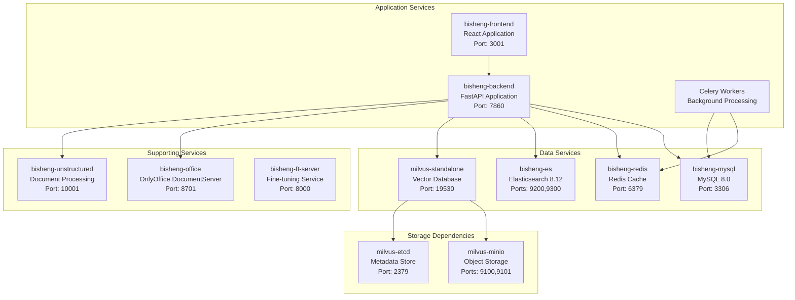
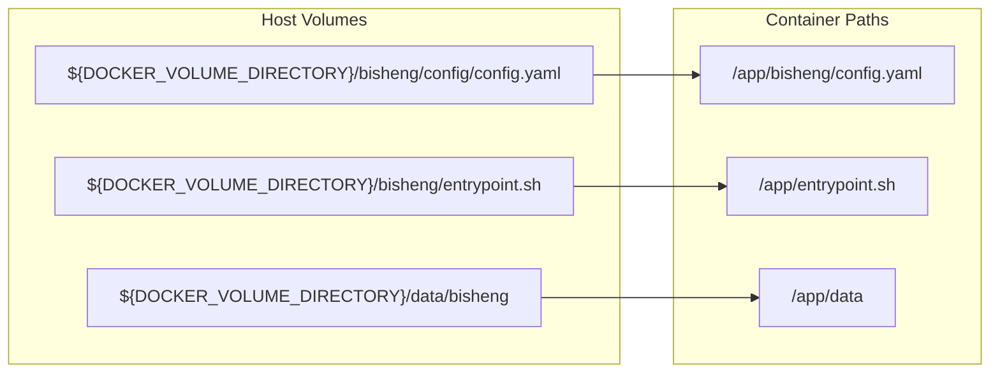
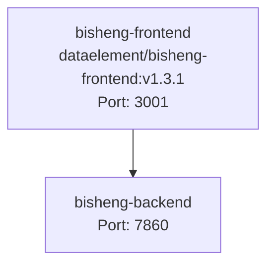
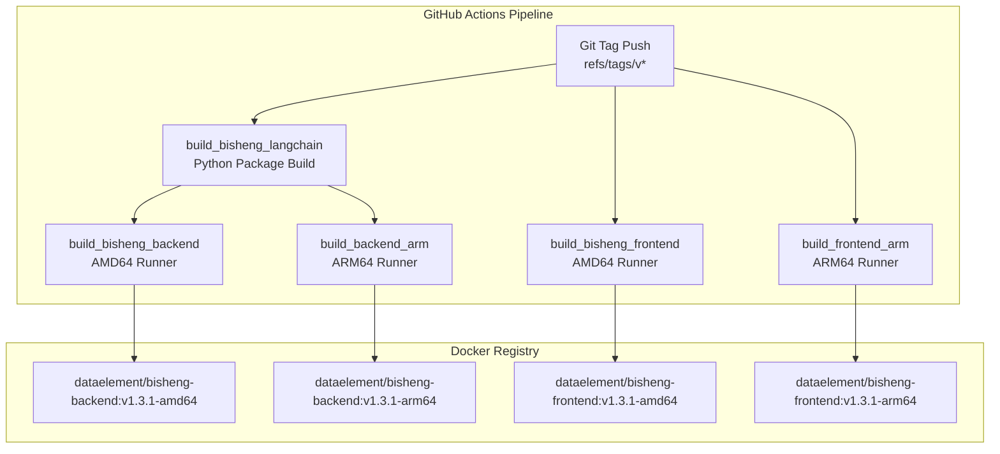
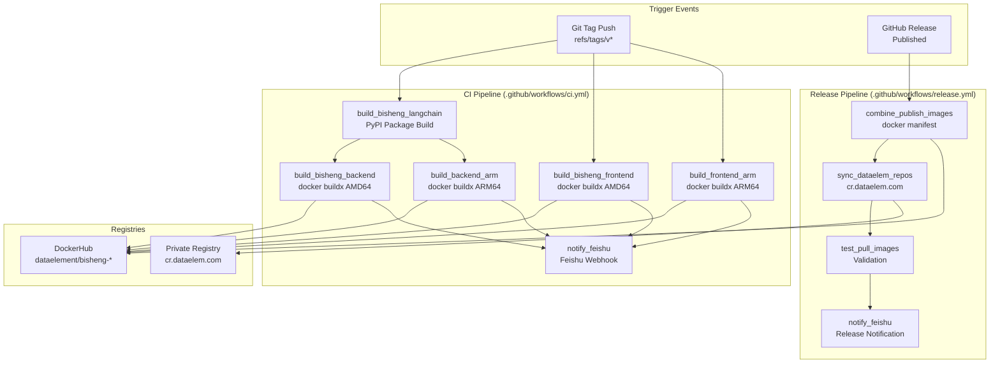

<!-- source: DeepWiki mcp.deepwiki.com · repo dataelement/bisheng · page 5.2 Docker Deployment · fetched 2026-10-29 -->

# Deployment

<details>
<summary>Relevant source files</summary>

The following files were used as context for generating this wiki page:

- [.drone.yml](.drone.yml)
- [.github/workflows/base_ci.yml](.github/workflows/base_ci.yml)
- [docker/bisheng-ft/config.yaml](docker/bisheng-ft/config.yaml)
- [docker/bisheng-uns/config.yaml](docker/bisheng-uns/config.yaml)
- [docker/docker-compose-ft.yml](docker/docker-compose-ft.yml)
- [docker/docker-compose-office.yml](docker/docker-compose-office.yml)
- [docker/docker-compose-uns.yml](docker/docker-compose-uns.yml)
- [docker/docker-compose.yml](docker/docker-compose.yml)
- [docker/mysql/conf/my.cnf](docker/mysql/conf/my.cnf)
- [docker/nginx/nginx.conf](docker/nginx/nginx.conf)
- [src/backend/Dockerfile](src/backend/Dockerfile)
- [src/backend/base.Dockerfile](src/backend/base.Dockerfile)
- [src/backend/bisheng/.gitignore](src/backend/bisheng/.gitignore)
- [src/backend/bisheng/__init__.py](src/backend/bisheng/__init__.py)
- [src/backend/bisheng/core/ai/rerank/xinference/__init__.py](src/backend/bisheng/core/ai/rerank/xinference/__init__.py)
- [src/backend/bisheng/core/ai/rerank/xinference/_compat.py](src/backend/bisheng/core/ai/rerank/xinference/_compat.py)
- [src/backend/bisheng/core/ai/rerank/xinference/client/__init__.py](src/backend/bisheng/core/ai/rerank/xinference/client/__init__.py)
- [src/backend/bisheng/core/ai/rerank/xinference/client/common.py](src/backend/bisheng/core/ai/rerank/xinference/client/common.py)
- [src/backend/bisheng/core/ai/rerank/xinference/client/handlers.py](src/backend/bisheng/core/ai/rerank/xinference/client/handlers.py)
- [src/backend/bisheng/core/ai/rerank/xinference/client/restful/__init__.py](src/backend/bisheng/core/ai/rerank/xinference/client/restful/__init__.py)
- [src/backend/bisheng/core/ai/rerank/xinference/client/restful/async_restful_client.py](src/backend/bisheng/core/ai/rerank/xinference/client/restful/async_restful_client.py)
- [src/backend/bisheng/core/ai/rerank/xinference/client/restful/restful_client.py](src/backend/bisheng/core/ai/rerank/xinference/client/restful/restful_client.py)
- [src/backend/bisheng/core/ai/rerank/xinference/fields.py](src/backend/bisheng/core/ai/rerank/xinference/fields.py)
- [src/backend/bisheng/template/frontend_node/wrappers.py](src/backend/bisheng/template/frontend_node/wrappers.py)
- [src/backend/pyproject.toml](src/backend/pyproject.toml)
- [update.sh](update.sh)

</details>


This document covers BISHENG's deployment architecture, containerization strategy, and production deployment workflows. It details the Docker-based service orchestration, CI/CD pipeline configuration, and infrastructure requirements for running BISHENG in production environments.

For system configuration details, see [Configuration](#5.1). For CI/CD pipeline specifics, see [CI/CD Pipeline](#5.3).

## Container Architecture

BISHENG uses a microservices architecture deployed through Docker containers with service orchestration managed by Docker Compose. The system consists of core application services, data storage services, and supporting services.



**Core Service Dependencies**

The deployment architecture ensures proper service dependencies and health checks. The backend service depends on healthy MySQL, Redis, and OnlyOffice services before starting.

Sources: [docker/docker-compose.yml:86-92](), [docker/docker-compose.yml:54-93]()

## Service Configuration

### Backend Service Configuration

The backend service runs on port 7860 using image `dataelement/bisheng-backend:v1.3.1` with comprehensive environment variables for service integration:

| Environment Variable | Purpose | Default Value |
|----------------------|---------|---------------|
| `BS_MILVUS_CONNECTION_ARGS` | Milvus connection parameters | `{"host":"milvus","port":"19530","user":"","password":"","secure":false}` |
| `BS_MILVUS_IS_PARTITION` | Enable Milvus partitioning | `true` |
| `BS_MILVUS_PARTITION_SUFFIX` | Partition identifier | `1` |
| `BS_ELASTICSEARCH_URL` | Elasticsearch endpoint | `http://elasticsearch:9200` |
| `BS_ELASTICSEARCH_SSL_VERIFY` | ES authentication config | `{}` |
| `BS_MINIO_ENDPOINT` | MinIO storage endpoint | `minio:9000` |
| `BS_MINIO_SHAREPOINT` | MinIO share endpoint | `minio:9000` |
| `BS_MINIO_ACCESS_KEY` | MinIO access credentials | `minioadmin` |
| `BS_MINIO_SECRET_KEY` | MinIO secret credentials | `minioadmin` |
| `BS_MINIO_SCHEMA` | Use HTTPS for MinIO | `false` |
| `BS_MINIO_CERT_CHECK` | SSL certificate verification | `false` |

**Container Volume Mapping:**


**Backend Worker Service:**
The `backend_worker` service uses the same image and configuration but runs Celery workers for background task processing using command `sh entrypoint.sh worker`.

Sources: [docker/docker-compose.yml:54-93](), [docker/docker-compose.yml:94-125](), [docker/docker-compose.yml:60-71]()

### Frontend Service Configuration

The frontend service runs on port 3001 using image `dataelement/bisheng-frontend:v1.3.1` with Nginx reverse proxy configuration. The service depends on the backend service and mounts custom Nginx configuration files:

| Volume Mount | Purpose | Container Path |
|--------------|---------|----------------|
| `nginx/nginx.conf` | Main Nginx configuration | `/etc/nginx/nginx.conf` |
| `nginx/conf.d` | Virtual host configurations | `/etc/nginx/conf.d` |

**Service Dependencies:**


The frontend container serves the React application and proxies API requests to the backend service.

Sources: [docker/docker-compose.yml:126-139](), [docker/docker-compose.yml:134-135]()

### Database Services

**MySQL Configuration (`bisheng-mysql`):**
- Image: `mysql:8.0`
- Port: 3306
- Database: `bisheng`
- Root password: `1234` (configurable via `MYSQL_ROOT_PASSWORD`)
- Volume mounts:
  - Configuration: `mysql/conf/my.cnf` → `/etc/mysql/my.cnf`
  - Data persistence: `mysql/data` → `/var/lib/mysql`
- Health check: `mysql -u root -p$$MYSQL_ROOT_PASSWORD`

**Redis Configuration (`bisheng-redis`):**
- Image: `redis:7.0.4`
- Port: 6379
- Volume mounts:
  - Data: `data/redis` → `/data`
  - Config: `redis/redis.conf` → `/etc/redis.conf`
- Command: `redis-server /etc/redis.conf`
- Health check: `redis-cli ping|grep -e "PONG\|NOAUTH"`

**Elasticsearch Configuration (`bisheng-es`):**
- Image: `docker.io/bitnami/elasticsearch:8.12.0`
- Ports: 9200, 9300
- Data volume: `data/es` → `/bitnami/elasticsearch/data`
- User: `root`

**Milvus Vector Database (`bisheng-milvus-standalone`):**
- Image: `milvusdb/milvus:v2.5.10`
- Port: 19530 (gRPC), 9091 (HTTP)
- Dependencies: `etcd:2379`, `minio:9000`
- Data volume: `data/milvus` → `/var/lib/milvus`
- Health check: `curl -f http://localhost:9091/healthz`

Sources: [docker/docker-compose.yml:2-21](), [docker/docker-compose.yml:23-39](), [docker/docker-compose.yml:140-151](), [docker/docker-compose.yml:192-217]()

## Docker Image Building

### Multi-Architecture Build Process

BISHENG supports both AMD64 and ARM64 architectures through GitHub Actions CI/CD pipeline. The build process creates separate images for each architecture and combines them into multi-platform manifests.

**Build Architecture:**


**Backend Build Process:**
The backend build uses `src/backend/Dockerfile` with platform-specific tags:
- AMD64: `bisheng-backend:$VERSION-amd64`
- ARM64: `bisheng-backend:$VERSION-arm64`

**Frontend Build Process:**
The frontend build uses `src/frontend/Dockerfile` with corresponding architecture tags.

Sources: [.github/workflows/ci.yml:84-87](), [.github/workflows/ci.yml:120-123](), [.github/workflows/ci.yml:149-152]()

### Version Management

Version synchronization is handled through the `update.sh` script and maintained consistently across:

| File | Version Location | Current Version |
|------|------------------|-----------------|
| Docker Compose | `image: dataelement/bisheng-backend:v1.3.1` | 1.3.1 |
| Python Package | `version = "1.3.1"` | 1.3.1 |
| Backend Module | `__version__ = '1.3.1'` | 1.3.1 |
| CI Environment | `RELEASE_VERSION=1.3.1` | 1.3.1 |

```bash
old_version="1.3.0"
new_version="1.3.1"
```

Sources: [update.sh:3-7](), [src/backend/pyproject.toml:3](), [src/backend/bisheng/__init__.py:9](), [docker/docker-compose.yml:56]()

## CI/CD Pipeline Architecture

BISHENG uses GitHub Actions for automated building, testing, and deployment with two main workflows: CI pipeline for tag builds and release pipeline for production deployments.

**GitHub Actions Workflow:**


### Build Stages

**Package Stage (`build_bisheng_langchain`):**
- Builds `bisheng-langchain` wheel using `python setup.py bdist_wheel`
- Publishes to PyPI using `twine upload`
- Required dependency for backend builds

**Multi-Architecture Docker Builds:**
- Uses `docker buildx` for cross-platform builds
- Separate runners for AMD64 and ARM64 architectures
- Platform-specific tags: `${VERSION}-amd64`, `${VERSION}-arm64`

**Release Manifest Creation:**
- Combines architecture-specific images into multi-platform manifests
- Creates both versioned and `latest` tags
- Synchronizes to private registry `cr.dataelem.com`

### Environment Configuration

**DockerHub Integration:**
- Uses `DOCKERHUB_USERNAME` and `DOCKERHUB_TOKEN` secrets
- Repository prefix: `dataelement/`
- Automatic image tagging based on Git tag version

**Private Registry Sync:**
- Secondary deployment to `cr.dataelem.com`
- Uses separate credentials: `CR_DOCKERHUB_USERNAME`, `CR_DOCKERHUB_TOKEN`
- Validation through pull testing

Sources: [.github/workflows/ci.yml:16-216](), [.github/workflows/release.yml:15-156](), [.github/workflows/ci.yml:38-48]()

## Service Orchestration Files

### Main Services Compose

The primary `docker-compose.yml` defines the core BISHENG services with proper dependency management and health checks:

```yaml
services:
  backend:
    depends_on:
      mysql:
        condition: service_healthy
      redis:
        condition: service_healthy
      office:
        condition: service_started
```

Sources: [docker/docker-compose.yml:1-185]()

### Additional Services

**Document Processing Service (`docker-compose-uns.yml`):**
- Service name: `bisheng-unstructured`
- Image: `dataelement/bisheng-unstructured:v0.0.3.14`
- Port: 10001
- Configuration: `bisheng-uns/config.yaml` with PDF model endpoints
- Health check: `curl -f http://localhost:10001/health`

**Fine-tuning Service (`docker-compose-ft.yml`):**
- Service name: `bisheng-ft-server` 
- Image: `dataelement/bisheng-ft:v0.2.0`
- Port: 8000
- GPU requirements: `driver: nvidia, count: all, capabilities: [gpu]`
- Volume mounts:
  - Model repository: `/opt/bisheng-ft/models/model_repository`
  - Training output: `/opt/bisheng-ft/finetune_output`
- Redis connection: `redis://bisheng-redis:6379/5`

Sources: [docker/docker-compose-uns.yml:1-22](), [docker/docker-compose-ft.yml:1-30](), [docker/bisheng-ft/config.yaml:3]()

## Production Deployment Considerations

### Resource Requirements

The deployment requires adequate resources for all services:

| Service | CPU | Memory | Storage | Special Requirements |
|---------|-----|--------|---------|---------------------|
| Backend | 2+ cores | 4GB+ | - | - |
| Frontend | 1 core | 1GB | - | - |
| MySQL | 2+ cores | 2GB+ | 50GB+ | Persistent storage |
| Milvus | 4+ cores | 8GB+ | 100GB+ | Vector storage |
| Elasticsearch | 2+ cores | 4GB+ | 50GB+ | Search indices |

### Security Configuration

Production deployments should implement:
- SSL/TLS termination at the load balancer
- Database credential encryption
- JWT secret key rotation
- Network isolation between services

### Monitoring and Health Checks

Each service includes comprehensive health check configuration:
- HTTP endpoint checks for web services
- Database connection validation
- Custom health check intervals and retry policies

Sources: [docker/docker-compose.yml:15-20](), [docker/docker-compose.yml:80-85](), [docker/docker-compose.yml:173-178]()

---

