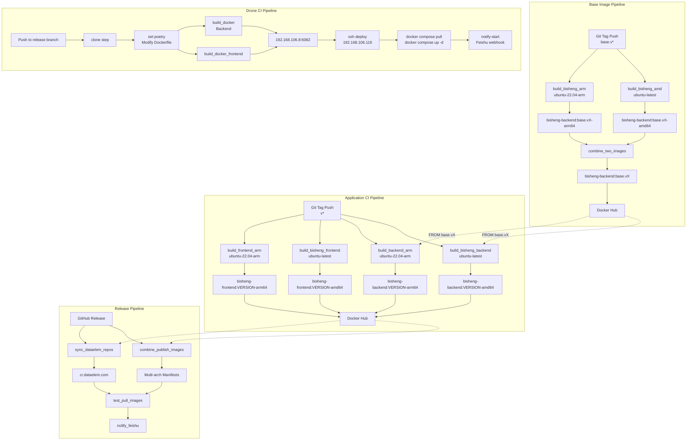
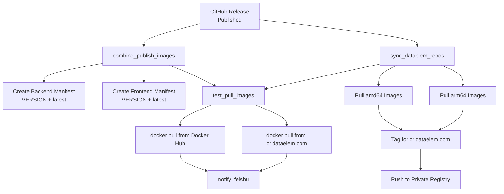
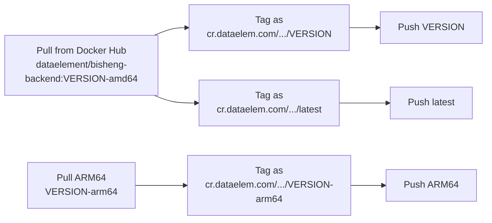
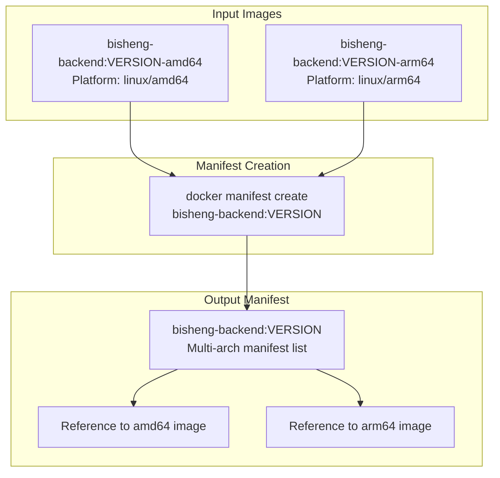
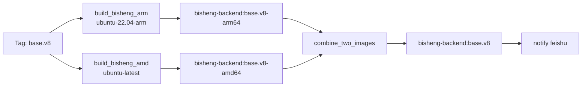
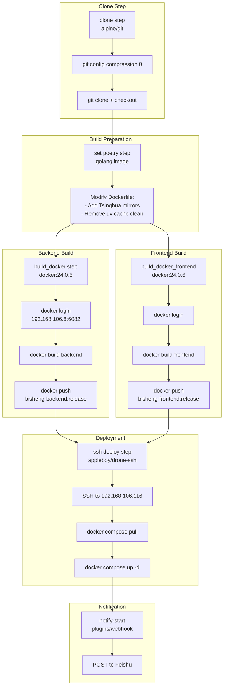
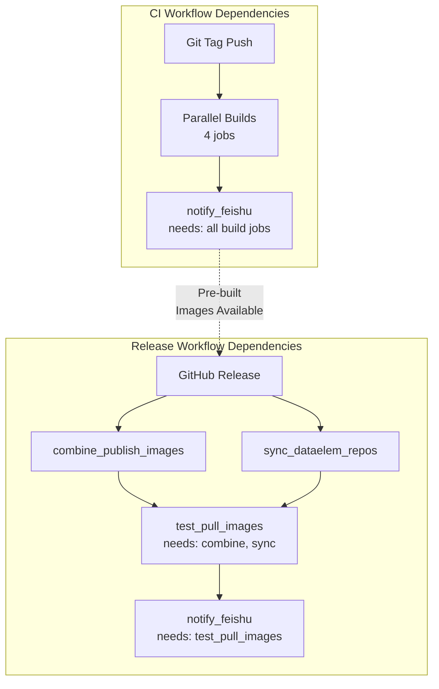

<!-- source: DeepWiki mcp.deepwiki.com · repo dataelement/bisheng · page 5.3 CI/CD Pipeline · fetched 2026-10-29 -->

# CI/CD Pipeline

<details>
<summary>Relevant source files</summary>

The following files were used as context for generating this wiki page:

- [.drone.yml](.drone.yml)
- [.github/workflows/base_ci.yml](.github/workflows/base_ci.yml)
- [.github/workflows/ci.yml](.github/workflows/ci.yml)
- [.github/workflows/release.yml](.github/workflows/release.yml)
- [.pre-commit-config.yaml](.pre-commit-config.yaml)
- [src/backend/Dockerfile](src/backend/Dockerfile)
- [src/backend/base.Dockerfile](src/backend/base.Dockerfile)
- [src/backend/bisheng/.gitignore](src/backend/bisheng/.gitignore)
- [src/backend/bisheng/api/services/chat_imp.py](src/backend/bisheng/api/services/chat_imp.py)
- [src/backend/bisheng/core/ai/rerank/xinference/__init__.py](src/backend/bisheng/core/ai/rerank/xinference/__init__.py)
- [src/backend/bisheng/core/ai/rerank/xinference/_compat.py](src/backend/bisheng/core/ai/rerank/xinference/_compat.py)
- [src/backend/bisheng/core/ai/rerank/xinference/client/__init__.py](src/backend/bisheng/core/ai/rerank/xinference/client/__init__.py)
- [src/backend/bisheng/core/ai/rerank/xinference/client/common.py](src/backend/bisheng/core/ai/rerank/xinference/client/common.py)
- [src/backend/bisheng/core/ai/rerank/xinference/client/handlers.py](src/backend/bisheng/core/ai/rerank/xinference/client/handlers.py)
- [src/backend/bisheng/core/ai/rerank/xinference/client/restful/__init__.py](src/backend/bisheng/core/ai/rerank/xinference/client/restful/__init__.py)
- [src/backend/bisheng/core/ai/rerank/xinference/client/restful/async_restful_client.py](src/backend/bisheng/core/ai/rerank/xinference/client/restful/async_restful_client.py)
- [src/backend/bisheng/core/ai/rerank/xinference/client/restful/restful_client.py](src/backend/bisheng/core/ai/rerank/xinference/client/restful/restful_client.py)
- [src/backend/bisheng/core/ai/rerank/xinference/fields.py](src/backend/bisheng/core/ai/rerank/xinference/fields.py)
- [src/backend/bisheng/interface/initialize/vector_store.py](src/backend/bisheng/interface/initialize/vector_store.py)
- [src/backend/bisheng/processing/base.py](src/backend/bisheng/processing/base.py)
- [src/backend/bisheng/processing/process.py](src/backend/bisheng/processing/process.py)
- [src/backend/bisheng/services/session/service.py](src/backend/bisheng/services/session/service.py)
- [src/backend/bisheng/template/frontend_node/embeddings.py](src/backend/bisheng/template/frontend_node/embeddings.py)
- [src/backend/bisheng/template/frontend_node/llms.py](src/backend/bisheng/template/frontend_node/llms.py)
- [src/backend/bisheng/template/frontend_node/vectorstores.py](src/backend/bisheng/template/frontend_node/vectorstores.py)
- [src/backend/test/test_filelib.py](src/backend/test/test_filelib.py)

</details>


## Purpose and Scope

This document describes the Continuous Integration and Continuous Deployment (CI/CD) pipeline for the Bisheng platform. The pipeline automates the building, testing, and publishing of Docker images for both backend and frontend components across multiple architectures (amd64 and arm64).

For information about Docker deployment configuration, see [Docker Deployment](#5.2). For general configuration management, see [Configuration Management](#5.1).

---

## Overview

The Bisheng CI/CD pipeline consists of three distinct automation systems that work together to build, test, and deploy the platform:

1. **Base Image Workflow** (`.github/workflows/base_ci.yml`) - Triggered on tags matching `base.v*`, builds foundational Docker images with system dependencies and Python packages for both amd64 and arm64 architectures
2. **Application CI Workflow** (`.github/workflows/ci.yml`) - Triggered on Git tag pushes matching `v*`, builds application-specific Docker images that extend the base images with Bisheng code
3. **Release Workflow** (`.github/workflows/release.yml`) - Triggered on GitHub release publication, creates unified multi-architecture manifests and synchronizes images to the private registry at `cr.dataelem.com`
4. **Drone CI Workflow** (`.drone.yml`) - Provides continuous deployment for the `release` branch and feature branches to private infrastructure, with automatic Docker builds and SSH-based deployment to test servers

The GitHub Actions workflows handle public releases to Docker Hub, while Drone CI manages internal deployments to private infrastructure with Chinese mirror repositories for faster builds. Base images are versioned separately (e.g., `base.v8`) to allow dependency updates independent of application releases.

**Sources:** [.github/workflows/base_ci.yml:1-129](), [.github/workflows/ci.yml:1-188](), [.github/workflows/release.yml:1-166](), [.drone.yml:1-338]()

---

## Pipeline Architecture

### Complete Pipeline Overview



**Sources:** [.github/workflows/base_ci.yml:3-7](), [.github/workflows/ci.yml:3-7](), [.github/workflows/release.yml:4-6](), [.drone.yml:1-6,156-160]()

### Pipeline Comparison

| Pipeline | Trigger | Registry | Purpose | Architecture |
|----------|---------|----------|---------|--------------|
| Base Image | Tag `base.v*` | Docker Hub | Build foundation images with dependencies | amd64, arm64 |
| Application CI | Tag `v*` | Docker Hub | Build app images on top of base | amd64, arm64 |
| Release | GitHub Release | Docker Hub + cr.dataelem.com | Publish multi-arch manifests | Multi-arch |
| Drone CI | Push to `release` branch | 192.168.106.8:6082 | Deploy to test environment | Single-arch |

**Sources:** [.github/workflows/base_ci.yml:3-7](), [.github/workflows/ci.yml:3-7](), [.github/workflows/release.yml:4-6](), [.drone.yml:156-160]()

---

## CI Workflow Details

The CI workflow is triggered when a tag matching the pattern `v*` is pushed to the repository. It builds four separate Docker images in parallel jobs.

### Trigger Configuration

```yaml
on:
  push:
    tags:
      - "v*"
```

**Sources:** [.github/workflows/ci.yml:3-7]()

### Build Jobs

| Job Name | Runner | Platform | Image | Notes |
|----------|--------|----------|-------|-------|
| `build_bisheng_backend` | `ubuntu-latest` | `linux/amd64` | `bisheng-backend:VERSION-amd64` | Standard backend build |
| `build_backend_arm` | `ubuntu-22.04-arm` | `linux/arm64` | `bisheng-backend:VERSION-arm64` | Removes `ibm-db` dependency |
| `build_bisheng_frontend` | `ubuntu-latest` | `linux/amd64` | `bisheng-frontend:VERSION-amd64` | Standard frontend build |
| `build_frontend_arm` | `ubuntu-22.04-arm` | `linux/arm64` | `bisheng-frontend:VERSION-arm64` | Standard frontend build |

**Sources:** [.github/workflows/ci.yml:18-96](), [.github/workflows/ci.yml:97-159]()

### Backend Build Process (amd64)


**Sources:** [.github/workflows/ci.yml:22-54]()

### ARM64-Specific Handling

The ARM64 backend build includes a critical preprocessing step to remove the `ibm-db` dependency, which is not compatible with ARM64 architecture:

```bash
# Remove ibm-db lib
sed -i '/ibm-db*/d' ./src/backend/pyproject.toml
```

This step modifies the `pyproject.toml` file before building to exclude the `ibm-db` package.

**Sources:** [.github/workflows/ci.yml:86-90]()

### Version Extraction

Each job extracts the version from the Git tag using GitHub Actions expressions:

```bash
echo ::set-output name=VERSION::${GITHUB_REF/refs\/tags\//}
```

This removes the `refs/tags/` prefix, converting `refs/tags/v1.0.0` to `v1.0.0`.

**Sources:** [.github/workflows/ci.yml:25-28](), [.github/workflows/ci.yml:62-65]()

### Docker Build Command

The actual build command uses Docker Buildx for multi-platform support:

```bash
docker buildx build \
  --file ./src/backend/Dockerfile \
  --platform linux/amd64 \
  --provenance false \
  --tag dataelement/bisheng-backend:VERSION-amd64 \
  --push \
  ./src/backend/
```

The `--provenance false` flag disables provenance attestation to avoid compatibility issues with some registries.

**Sources:** [.github/workflows/ci.yml:51-54](), [.github/workflows/ci.yml:92-95]()

---

## Release Workflow Details

The Release workflow is triggered when a GitHub release is published (not just created as a draft).

### Workflow Structure



**Sources:** [.github/workflows/release.yml:15-166]()

### Manifest Creation

The `combine_publish_images` job creates multi-architecture manifests that reference both amd64 and arm64 images:

```bash
# Create VERSION manifest
docker manifest create \
  dataelement/bisheng-backend:VERSION \
  dataelement/bisheng-backend:VERSION-arm64 \
  dataelement/bisheng-backend:VERSION-amd64

docker manifest push dataelement/bisheng-backend:VERSION

# Create latest manifest
docker manifest create \
  dataelement/bisheng-backend:latest \
  dataelement/bisheng-backend:VERSION-arm64 \
  dataelement/bisheng-backend:VERSION-amd64

docker manifest push dataelement/bisheng-backend:latest
```

This process is repeated for both backend and frontend images.

**Sources:** [.github/workflows/release.yml:38-51]()

### Private Registry Synchronization

The `sync_dataelem_repos` job synchronizes images to the private registry at `cr.dataelem.com`:



**Sources:** [.github/workflows/release.yml:72-101]()

### Image Validation

The `test_pull_images` job validates that all images can be successfully pulled from both registries:

```bash
# Test Docker Hub
docker pull dataelement/bisheng-backend:VERSION
docker pull dataelement/bisheng-frontend:VERSION

# Test Private Registry
docker pull cr.dataelem.com/dataelement/bisheng-backend:VERSION
docker pull cr.dataelem.com/dataelement/bisheng-frontend:VERSION
```

This ensures the release process completed successfully before sending notifications.

**Sources:** [.github/workflows/release.yml:133-139]()

---

## Image Naming Convention

The pipeline uses a systematic naming convention for Docker images:

### Architecture-Specific Tags (CI Stage)

| Component | Architecture | Tag Format | Example |
|-----------|-------------|------------|---------|
| Backend | amd64 | `bisheng-backend:VERSION-amd64` | `bisheng-backend:v1.0.0-amd64` |
| Backend | arm64 | `bisheng-backend:VERSION-arm64` | `bisheng-backend:v1.0.0-arm64` |
| Frontend | amd64 | `bisheng-frontend:VERSION-amd64` | `bisheng-frontend:v1.0.0-amd64` |
| Frontend | arm64 | `bisheng-frontend:VERSION-arm64` | `bisheng-frontend:v1.0.0-arm64` |

### Multi-Architecture Tags (Release Stage)

| Component | Tag Type | Tag Format | Points To |
|-----------|----------|------------|-----------|
| Backend | Version | `bisheng-backend:VERSION` | Manifest referencing both architectures |
| Backend | Latest | `bisheng-backend:latest` | Manifest referencing both architectures |
| Frontend | Version | `bisheng-frontend:VERSION` | Manifest referencing both architectures |
| Frontend | Latest | `bisheng-frontend:latest` | Manifest referencing both architectures |

**Sources:** [.github/workflows/ci.yml:54](), [.github/workflows/release.yml:41-51]()

---

## Registry Configuration

### Docker Hub (Public)

- **Registry:** `docker.io`
- **Repository Prefix:** `dataelement/`
- **Authentication:** Uses GitHub Secrets `DOCKERHUB_USERNAME` and `DOCKERHUB_TOKEN`
- **Purpose:** Primary public distribution channel

**Sources:** [.github/workflows/ci.yml:10](), [.github/workflows/ci.yml:35-42]()

### Private Registry

- **Registry:** `cr.dataelem.com`
- **Repository Prefix:** `dataelement/`
- **Authentication:** Uses GitHub Secrets `CR_DOCKERHUB_USERNAME` and `CR_DOCKERHUB_TOKEN`
- **Purpose:** Private distribution for enterprise deployments

**Sources:** [.github/workflows/release.yml:68-70]()

### Authentication Configuration

Both workflows authenticate to Docker registries using the `docker/login-action@v1` action:

```yaml
- name: Login to DockerHub
  uses: docker/login-action@v1
  with:
    username: ${{ secrets.DOCKERHUB_USERNAME }}
    password: ${{ secrets.DOCKERHUB_TOKEN }}
```

For the private registry, the `registry` parameter is specified:

```yaml
- name: Login to DockerHub
  uses: docker/login-action@v1
  with:
    registry: https://cr.dataelem.com/
    username: ${{ secrets.CR_DOCKERHUB_USERNAME }}
    password: ${{ secrets.CR_DOCKERHUB_TOKEN }}
```

**Sources:** [.github/workflows/ci.yml:35-42](), [.github/workflows/release.yml:65-70]()

---

## Multi-Architecture Support

The pipeline implements comprehensive multi-architecture support using Docker Buildx and manifest lists.

### Platform-Specific Build Matrix

| Architecture | Runner | Special Handling |
|-------------|--------|------------------|
| `linux/amd64` | `ubuntu-latest` | Standard build process |
| `linux/arm64` | `ubuntu-22.04-arm` | - Native ARM runner<br/>- Removes `ibm-db` dependency for backend |

**Sources:** [.github/workflows/ci.yml:19](), [.github/workflows/ci.yml:57]()

### Docker Buildx Setup

Each build job sets up Docker Buildx for cross-platform builds:

```yaml
- name: Set up QEMU
  uses: docker/setup-qemu-action@v1

- name: set up Docker Buildx
  uses: docker/setup-buildx-action@v3
```

QEMU enables emulation of different CPU architectures, while Buildx provides the multi-platform build capability.

**Sources:** [.github/workflows/ci.yml:45-49]()

### Manifest List Creation

The release workflow combines architecture-specific images into multi-architecture manifest lists:



When a client pulls `bisheng-backend:VERSION`, Docker automatically selects the appropriate architecture-specific image based on the client's platform.

**Sources:** [.github/workflows/release.yml:40-42]()

---

## Notification System

Both workflows integrate with Feishu (a collaboration platform) to send build and release notifications.

### Notification Jobs

| Workflow | Job Name | Trigger | Content |
|----------|----------|---------|---------|
| CI | `notify_feishu` | After all builds complete | Pre-release success with version and commit message |
| Release | `notify_feishu` | After image validation | Release success with version and commit message |

**Sources:** [.github/workflows/ci.yml:161-188](), [.github/workflows/release.yml:142-166]()

### Message Format

Notifications are sent via HTTP POST to a Feishu webhook URL:

```json
{
  "msg_type": "post",
  "content": {
    "post": {
      "zh_cn": {
        "title": "VERSION-amd64镜像预发布成功",
        "content": [
          [
            {"tag": "text", "text": "发布功能："},
            {"tag": "text", "text": "COMMIT_MESSAGE"}
          ]
        ]
      }
    }
  }
}
```

**Sources:** [.github/workflows/ci.yml:187]()

### Commit Message Processing

The workflows process commit messages to handle newlines for JSON formatting:

```bash
value=$(echo "${{ github.event.head_commit.message }}" | sed -e ':a' -e 'N' -e '$!ba' -e 's/\n/%0A/g')
value=$(echo "${value}" | sed -e ':a' -e 'N' -e '$!ba' -e 's/\r/%0A/g')
echo "message=${value}" >> $GITHUB_ENV
```

**Sources:** [.github/workflows/ci.yml:174-180]()

---

## Base Image Pipeline

The base image pipeline builds foundational Docker images containing system dependencies, Python environment, and common packages. These images are versioned independently from application releases to allow dependency updates without triggering full application rebuilds.

### Base Image Workflow Structure



**Sources:** [.github/workflows/base_ci.yml:16-129]()

### Base Dockerfile Contents

The base image ([src/backend/base.Dockerfile:1-60]()) includes:

1. **System Dependencies** - libreoffice, FFmpeg, fonts, OpenCV libraries
2. **Document Processing Tools** - Pandoc 3.6.4 for document conversion
3. **Python Package Manager** - UV for fast dependency installation
4. **Python Dependencies** - Compiled from `pyproject.toml` and installed system-wide
5. **NLTK Data** - punkt, averaged_perceptron_tagger
6. **Playwright** - Chromium browser with system dependencies

The base image build process:

```dockerfile
FROM python:3.10-slim

# Install system dependencies
RUN apt-get update && apt-get install -y --no-install-recommends \
    gcc g++ curl build-essential libreoffice \
    wget procps vim fonts-wqy-zenhei \
    libglib2.0-0 libsm6 libxrender1 libxext6 libgl1

# Install uv package manager
RUN curl -LsSf https://astral.sh/uv/install.sh | sh

# Compile and install Python dependencies
RUN uv pip compile pyproject.toml --output-file requirements.txt && \
    uv pip install -r requirements.txt --system --no-cache-dir && \
    uv cache clean
```

**Sources:** [src/backend/base.Dockerfile:1-60]()

### ARM64 Base Image Handling

The ARM64 base image build removes the `ibm-db` dependency before compiling requirements:

```yaml
- name: fix ibm-db lib error
  run: |
    # remove ibm-db lib
    sed -i '/ibm-db*/d' ./src/backend/pyproject.toml
```

This step is critical because the IBM DB2 driver does not support ARM64 architecture.

**Sources:** [.github/workflows/base_ci.yml:45-49]()

### Base Image Build Arguments

The base Dockerfile accepts a `PANDOC_ARCH` build argument to download the correct Pandoc binary:

```dockerfile
ARG PANDOC_ARCH=amd64
ENV PANDOC_ARCH=$PANDOC_ARCH

RUN wget https://github.com/jgm/pandoc/releases/download/3.6.4/pandoc-3.6.4-linux-${PANDOC_ARCH}.tar.gz
```

The GitHub Actions workflow passes this argument during build:

```yaml
docker buildx build \
  --build-arg PANDOC_ARCH=arm64 \
  --file ./src/backend/base.Dockerfile \
  --platform linux/arm64 \
  --tag dataelement/bisheng-backend:base.v8-arm64 \
  --push ./src/backend/
```

**Sources:** [src/backend/base.Dockerfile:3-4,22-27](), [.github/workflows/base_ci.yml:51-54]()

---

## Drone CI Pipeline

Drone CI provides continuous deployment to private infrastructure for development and testing. Unlike GitHub Actions which publishes to Docker Hub, Drone builds images with Chinese mirror repositories and deploys them directly to test servers.

### Drone Pipeline Architecture



**Sources:** [.drone.yml:8-124]()

### Drone Pipeline Configuration

The Drone pipeline is defined in [.drone.yml:1-338]() with two separate pipelines:

1. **cicd Pipeline** - Triggers on pushes to `release` branch
2. **feat_cicd Pipeline** - Triggers on pushes to feature branches (currently disabled via `add_some_branch_you_need`)

**Sources:** [.drone.yml:1-6,156-160,319-323]()

### Dockerfile Modification for Chinese Mirrors

A critical step in the Drone pipeline modifies the backend Dockerfile to use Chinese mirror repositories for faster builds:

```yaml
- name: set poetry
  image: golang
  commands:
    - cd ./src/backend
    - sed -i '6i\RUN pip config set global.index-url https://pypi.tuna.tsinghua.edu.cn/simple' Dockerfile
    - sed -i '7i\ENV UV_PIP_INDEX_URL=https://pypi.tuna.tsinghua.edu.cn/simple' Dockerfile
    - sed -i '8i\ENV UV_DEFAULT_INDEX=https://pypi.tuna.tsinghua.edu.cn/simple' Dockerfile
    - sed -i '9i\ENV PIP_INDEX_URL=https://pypi.tuna.tsinghua.edu.cn/simple' Dockerfile
    - sed -i.bak 's/uv cache clean.*$/ /' Dockerfile
```

These modifications:
- Configure pip and uv to use Tsinghua University's PyPI mirror
- Remove the `uv cache clean` command to preserve cached packages across builds

**Sources:** [.drone.yml:22-48]()

### Drone Volume Mounts

Drone uses host volume mounts to cache dependencies and share data:

```yaml
volumes:
  - name: bisheng-cache
    host:
      path: /opt/drone/data/bisheng/
  - name: pro-cache
    host:
      path: /opt/drone/data/pro/
  - name: apt-cache
    host:
      path: /opt/drone/data/bisheng/apt/
  - name: socket
    host:
      path: /var/run/docker.sock
```

These volumes persist between builds to speed up subsequent runs by caching:
- Python packages (`pro-cache`)
- APT packages (`apt-cache`)
- General build artifacts (`bisheng-cache`)

The `socket` volume mount provides access to the Docker daemon for building images.

**Sources:** [.drone.yml:162-175]()

### SSH-Based Deployment

The deployment step uses the `appleboy/drone-ssh` plugin to execute commands on the target server:

```yaml
- name: ssh deploy
  image: appleboy/drone-ssh
  settings:
    host: 192.168.106.116
    username: root
    password:
      from_secret: sshpwd
    script:
      - echo =======找到目录=======
      - cd /opt/server/bisheng-test
      - echo =======直接启动=======
      - docker compose pull
      - docker compose up -d
```

This assumes the target server has a pre-configured Docker Compose environment at `/opt/server/bisheng-test`.

**Sources:** [.drone.yml:110-123]()

### Drone Image Tagging Strategy

The Drone pipeline uses different tagging strategies based on the branch:

**Release Branch:**
- Backend: `192.168.106.8:6082/dataelement/bisheng-backend:release`
- Frontend: `192.168.106.8:6082/dataelement/bisheng-frontend:release`

**Feature Branches:**
- Backend: `192.168.106.8:6082/dataelement/bisheng-backend:${DRONE_BRANCH}` (with `/` replaced by `_`)
- Frontend: `192.168.106.8:6082/dataelement/bisheng-frontend:${DRONE_BRANCH}` (with `/` replaced by `_`)

The branch name transformation:
```bash
version=$(echo $version | sed 's/\\//_/g')
```

**Sources:** [.drone.yml:69-80,241-255,272-286]()

---

## Required Secrets

The CI/CD pipeline requires the following secrets to be configured:

### GitHub Actions Secrets

| Secret Name | Purpose | Used In |
|-------------|---------|---------|
| `DOCKERHUB_USERNAME` | Docker Hub account username | Base CI, Application CI, Release |
| `DOCKERHUB_TOKEN` | Docker Hub access token | Base CI, Application CI, Release |
| `CR_DOCKERHUB_USERNAME` | Private registry username (cr.dataelem.com) | Release |
| `CR_DOCKERHUB_TOKEN` | Private registry access token | Release |
| `FEISHU_WEBHOOK` | Feishu webhook URL for notifications | Base CI, Application CI, Release |

**Sources:** [.github/workflows/ci.yml:38-42](), [.github/workflows/release.yml:69-70](), [.github/workflows/ci.yml:185](), [.github/workflows/base_ci.yml:39-40]()

### Drone Secrets

| Secret Name | Purpose | Used In |
|-------------|---------|---------|
| `PROXY` | HTTP proxy for git and package downloads | Clone, Build |
| `NEXUS_USER` | Username for private Docker registry | Build |
| `NEXUS_PASSWORD` | Password for private Docker registry | Build |
| `PY_NEXUS` | Python package repository URL (unused in current config) | Build preparation |
| `APT-GET` | APT mirror configuration | Build preparation |
| `sshpwd` | SSH password for deployment server | Deployment |
| `FEISHU_URL` | Feishu webhook URL for notifications | Notification |

**Sources:** [.drone.yml:13-16,27-34,64-75,116-117,130-131]()

---

## Concurrency Control

Both workflows implement concurrency control to prevent multiple simultaneous runs:

```yaml
concurrency:
  group: ${{ github.workflow }}-${{ github.ref }}
  cancel-in-progress: true
```

This configuration ensures that:
- Only one instance of each workflow runs per Git reference (branch/tag)
- New triggers cancel in-progress runs for the same reference
- Resources are not wasted on outdated builds

**Sources:** [.github/workflows/ci.yml:12-14](), [.github/workflows/release.yml:11-13]()

---

## Workflow Dependencies



### CI Workflow Dependencies

The `notify_feishu` job requires all build jobs to complete successfully:

```yaml
notify_feishu:
  needs:
    - build_bisheng_backend
    - build_backend_arm
    - build_bisheng_frontend
    - build_frontend_arm
```

**Sources:** [.github/workflows/ci.yml:162-166]()

### Release Workflow Dependencies

The release workflow has a chain of dependencies:

```yaml
test_pull_images:
  needs:
    - combine_publish_images
    - sync_dataelem_repos

notify_feishu:
  needs:
    - test_pull_images
```

**Sources:** [.github/workflows/release.yml:104-106](), [.github/workflows/release.yml:143-144]()

---

## Build Context and Dockerfiles

The pipeline builds Docker images from specific contexts with corresponding Dockerfiles:

| Component | Dockerfile Path | Build Context | Notes |
|-----------|----------------|---------------|-------|
| Backend | `./src/backend/Dockerfile` | `./src/backend/` | Contains Python application and dependencies |
| Frontend | `./src/frontend/Dockerfile` | `./src/frontend/` | Contains React application build |

The build commands specify both the Dockerfile location and the build context:

```bash
docker buildx build \
  --file ./src/backend/Dockerfile \
  --platform linux/amd64 \
  --provenance false \
  --tag dataelement/bisheng-backend:VERSION-amd64 \
  --push \
  ./src/backend/
```

The final argument (`./src/backend/`) is the build context directory that Docker uses to locate files referenced in the Dockerfile.

**Sources:** [.github/workflows/ci.yml:54](), [.github/workflows/ci.yml:124]()

---

