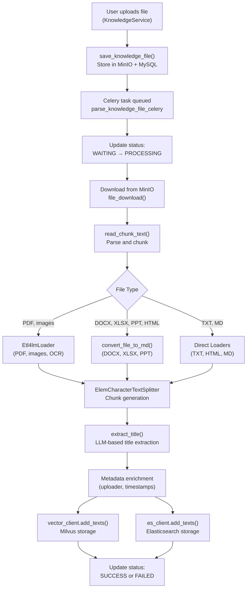
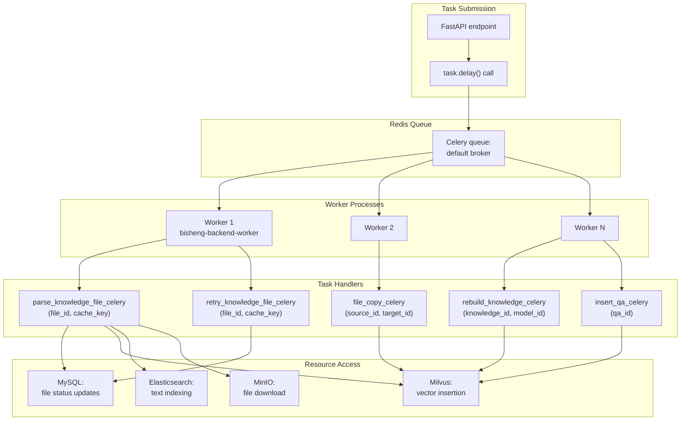
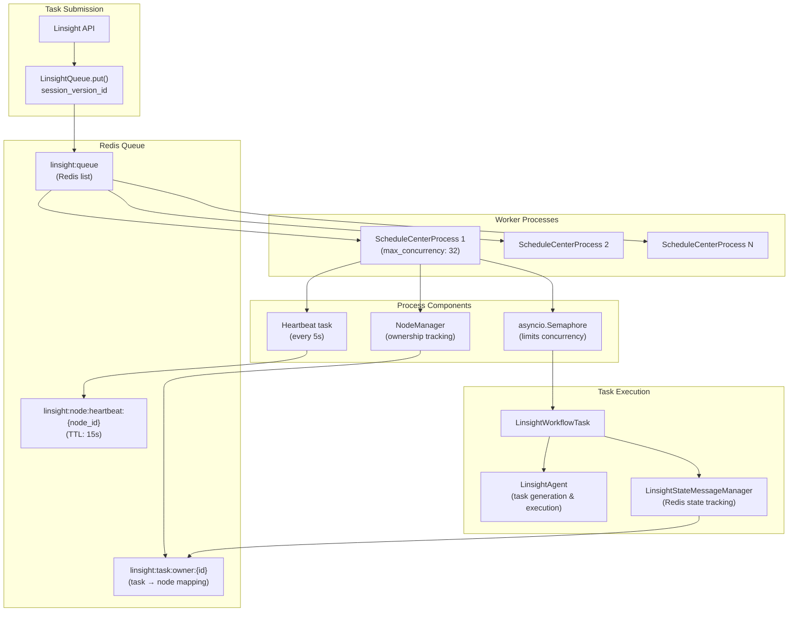
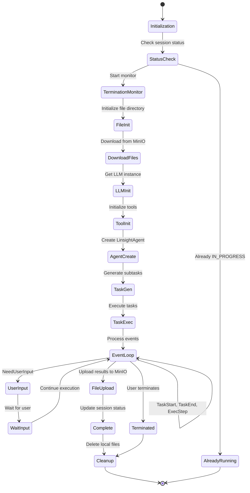
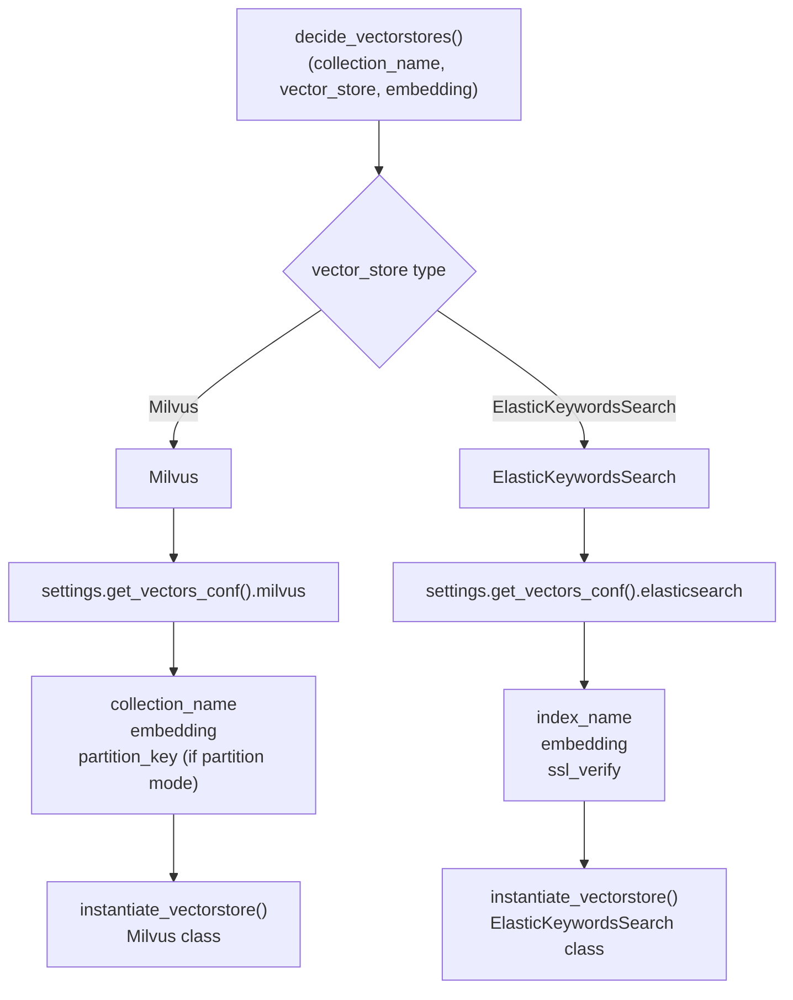
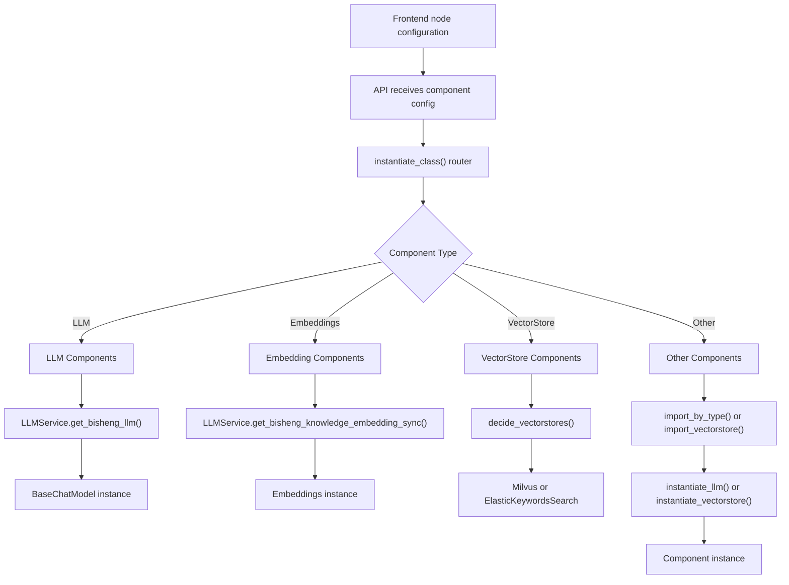
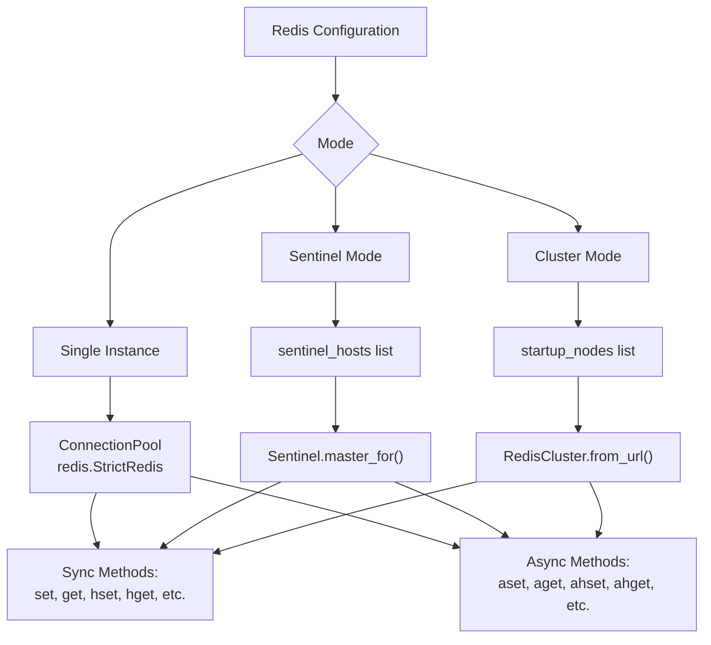

<!-- source: DeepWiki mcp.deepwiki.com · repo dataelement/bisheng · page 6 Advanced Topics · fetched 2026-10-29 -->

# Advanced Topics

<details>
<summary>Relevant source files</summary>

The following files were used as context for generating this wiki page:

- [src/backend/bisheng/api/services/knowledge.py](src/backend/bisheng/api/services/knowledge.py)
- [src/backend/bisheng/api/services/knowledge_imp.py](src/backend/bisheng/api/services/knowledge_imp.py)
- [src/backend/bisheng/core/cache/redis_conn.py](src/backend/bisheng/core/cache/redis_conn.py)
- [src/backend/bisheng/linsight/domain/task_exec.py](src/backend/bisheng/linsight/domain/task_exec.py)
- [src/backend/bisheng/linsight/domain/utils.py](src/backend/bisheng/linsight/domain/utils.py)
- [src/backend/bisheng/linsight/worker.py](src/backend/bisheng/linsight/worker.py)
- [src/backend/bisheng/worker/knowledge/file_worker.py](src/backend/bisheng/worker/knowledge/file_worker.py)
- [src/backend/bisheng/worker/knowledge/qa.py](src/backend/bisheng/worker/knowledge/qa.py)
- [src/backend/bisheng/worker/knowledge/rebuild_knowledge_worker.py](src/backend/bisheng/worker/knowledge/rebuild_knowledge_worker.py)

</details>


This page provides deep technical dives into specialized subsystems of the Bisheng platform. It covers implementation details of document processing, asynchronous task execution, vector storage strategies, component initialization patterns, and caching mechanisms. For general system architecture, see [System Architecture](#2). For development setup and deployment, see [Development and Deployment](#5).

## Document Processing Pipeline

The document processing pipeline transforms uploaded files into searchable vector embeddings stored in both Milvus and Elasticsearch. The pipeline supports multiple file formats with specialized parsing strategies.

### Pipeline Architecture



**Sources:** [src/backend/bisheng/api/services/knowledge_imp.py:789-960](), [src/backend/bisheng/api/services/knowledge.py:510-591](), [src/backend/bisheng/worker/knowledge/file_worker.py:274-333]()

### File Type Processing Matrix

| File Extension | Preprocessing | Parser | Special Handling |
|----------------|---------------|--------|------------------|
| `.pdf` | Damage check via `is_pdf_damaged()` | `Etl4lmLoader` with OCR | Force OCR option, formula extraction, header/footer filtering |
| `.docx` | Convert `.doc` → `.docx` via LibreOffice | `convert_file_to_md()` | Extract images to MinIO, replace original with fixed version |
| `.doc` | Convert to `.docx` | `convert_doc_to_docx()` | Upload `.docx` as preview file |
| `.xlsx`, `.xls`, `.csv` | N/A | `convert_file_to_md()` with `ExcelRule` | Header row config, slice length, append header option |
| `.ppt`, `.pptx` | Convert to PDF for preview | `convert_file_to_md()` | Upload PDF preview to MinIO |
| `.txt`, `.md` | N/A | `TextLoader` with autodetect encoding | Direct loading |
| `.html`, `.mhtml` | Convert to Markdown | `convert_file_to_md()` | Same as DOCX processing |

**Sources:** [src/backend/bisheng/api/services/knowledge_imp.py:789-960]()

### Text Chunking Strategy

The `ElemCharacterTextSplitter` class implements configurable text segmentation:


Configuration parameters are stored in the `KnowledgeFile.split_rule` field as JSON:
- `separator`: List of regex patterns (e.g., `["\n\n", "\n", "。", "！", "？"]`)
- `separator_rule`: List of conditional rules
- `chunk_size`: Maximum characters per chunk
- `chunk_overlap`: Overlapping characters between chunks
- `retain_images`: Whether to preserve images (0/1)
- `enable_formula`: Whether to extract formulas (0/1)
- `force_ocr`: Force OCR on all content (0/1)
- `filter_page_header_footer`: Remove headers/footers (0/1)

**Sources:** [src/backend/bisheng/api/services/knowledge_imp.py:821-827]()

### LLM-Based Title Extraction

For each chunk, the system optionally extracts a descriptive title using an LLM:

1. **LLM Selection**: `decide_knowledge_llm()` retrieves the configured model via `LLMService.get_knowledge_llm().extract_title_model_id`
2. **Title Generation**: `extract_title()` or `async_extract_title()` sends the chunk text to the LLM
3. **Post-processing**: `parse_document_title()` removes thinking model artifacts (``) and extracts code blocks if present
4. **Metadata Storage**: Title stored in `Metadata.bbox` field as structured data

**Sources:** [src/backend/bisheng/api/services/knowledge_imp.py:402-436](), [src/backend/bisheng/api/services/knowledge_imp.py:774-786]()

### Preview and Edit Workflow

Before final processing, users can preview and edit chunks:

1. **Preview Generation**: `get_preview_file_chunk()` parses file and caches chunks in Redis
   - Cache key format: `preview_file_chunk:{knowledge_id}:{md5_hash}`
   - Each chunk stored as hash field with text and metadata
   - Associated keys store parse type, file path, and OCR partitions
2. **Chunk Editing**: `update_preview_file_chunk()` modifies cached chunks
   - Updates text content
   - Updates bbox coordinates for OCR-processed files
3. **Deletion**: `delete_preview_file_chunk()` removes specific chunks from cache
4. **Final Processing**: If preview cache exists, `add_file_embedding()` uses cached data instead of re-parsing

**Sources:** [src/backend/bisheng/api/services/knowledge.py:393-475](), [src/backend/bisheng/api/services/knowledge.py:477-508](), [src/backend/bisheng/api/services/knowledge_imp.py:603-665]()

### Metadata Schema

Each chunk is enriched with metadata conforming to `KNOWLEDGE_RAG_METADATA_SCHEMA`:

| Field | Type | Description |
|-------|------|-------------|
| `document_id` | int | Knowledge file ID |
| `knowledge_id` | int | Knowledge base ID |
| `document_name` | str | Original filename |
| `abstract` | str | LLM-generated title/summary |
| `bbox` | str | OCR bounding box coordinates (JSON) |
| `page` | int | Page number (for PDFs) |
| `upload_time` | int | Unix timestamp |
| `update_time` | int | Unix timestamp |
| `uploader` | str | Username who uploaded |
| `updater` | str | Username who last modified |
| `user_metadata` | dict | Custom key-value pairs |

Text and metadata are concatenated before vector storage using `aggregate_chunk_metadata()`:
```
{<file_title>filename</file_title>
<file_abstract>summary</file_abstract>
<paragraph_content>chunk text</paragraph_content>}
```

**Sources:** [src/backend/bisheng/api/services/knowledge_imp.py:96-102](), [src/backend/bisheng/api/services/knowledge_imp.py:637-660]()

## Asynchronous Task Processing

Bisheng uses two asynchronous execution systems: Celery for knowledge processing and a custom multi-process worker for Linsight workflows.

### Celery Worker Architecture



**Sources:** [src/backend/bisheng/worker/knowledge/file_worker.py:1-374](), [src/backend/bisheng/worker/knowledge/rebuild_knowledge_worker.py:1-278]()

### Celery Task Definitions

#### parse_knowledge_file_celery

Processes a single uploaded file:

1. Retrieves file record from `KnowledgeFileDao.get_file_by_ids()`
2. Updates status to `PROCESSING` if currently `WAITING`
3. Extracts split rules from `KnowledgeFile.split_rule` JSON field
4. Calls `process_file_task()` to execute pipeline
5. Updates final status to `SUCCESS` or `FAILED`
6. Sends callback to `callback_url` if provided
7. Logs telemetry event via `telemetry_service.log_event_sync()`

**Task signature:** `parse_knowledge_file_celery(file_id: int, preview_cache_key: str, callback_url: str)`

**Sources:** [src/backend/bisheng/worker/knowledge/file_worker.py:274-292]()

#### retry_knowledge_file_celery

Retries failed file processing:

1. Calls `delete_knowledge_file_vectors()` to remove existing vectors (keeps MinIO files)
2. Re-executes `_parse_knowledge_file()` with same parameters
3. Handles preview cache if available

**Task signature:** `retry_knowledge_file_celery(file_id: int, preview_cache_key: str, callback_url: str)`

**Sources:** [src/backend/bisheng/worker/knowledge/file_worker.py:335-359]()

#### rebuild_knowledge_celery

Rebuilds entire knowledge base with new embedding model:

1. Queries all files with status `SUCCESS` or `REBUILDING`
2. Deletes Milvus collection via `delete_knowledge_file_in_vector()`
3. Updates file statuses to `REBUILDING`
4. Queries Elasticsearch for all chunks
5. Re-embeds each chunk with new model via `LLMService.get_bisheng_knowledge_embedding_sync()`
6. Inserts into Milvus via `vector_client.add_texts()`
7. Updates knowledge state to `PUBLISHED` or `FAILED`

**Task signature:** `rebuild_knowledge_celery(knowledge_id: int, new_model_id: int, invoke_user_id: int)`

**Sources:** [src/backend/bisheng/worker/knowledge/rebuild_knowledge_worker.py:22-106]()

#### file_copy_celery

Copies knowledge base files and vectors:

1. Iterates through source files in batches of 20
2. Creates new `KnowledgeFile` records with new IDs
3. Copies MinIO objects: source file, PDF conversion, bbox JSON, preview file
4. Queries source Milvus vectors by `document_id` and `knowledge_id`
5. Updates vector metadata with new IDs
6. Inserts into target Milvus collection and Elasticsearch index
7. Creates target collection/index if not exists

**Task signature:** `file_copy_celery(param: dict)` where `param` contains `source_knowledge_id`, `target_id`, `login_user_id`

**Sources:** [src/backend/bisheng/worker/knowledge/file_worker.py:25-165]()

### Linsight Worker Architecture

The Linsight system uses a custom multi-process worker pool with Redis-based task queue and node heartbeat mechanism.



**Sources:** [src/backend/bisheng/linsight/worker.py:1-276](), [src/backend/bisheng/linsight/domain/task_exec.py:1-676]()

### NodeManager and Heartbeat System

The `NodeManager` class provides distributed node coordination:

**Initialization:**
- `node_id`: Generated as `{hostname}-{uuid[:8]}`
- `heartbeat_key`: `linsight:node:heartbeat:{node_id}`
- `interval`: 5 seconds between heartbeats
- `ttl`: 15 seconds Redis key expiration

**Key Methods:**

| Method | Purpose | Redis Operation |
|--------|---------|-----------------|
| `start_heartbeat()` | Maintains node liveness | `SETEX heartbeat_key "1" 15` every 5s |
| `register_task_ownership()` | Claims task ownership | `SETEX linsight:task:owner:{session_version_id} {node_id} 86400` |
| `release_task_ownership()` | Releases ownership | `DEL linsight:task:owner:{session_version_id}` |
| `is_node_alive()` | Checks target node health | `EXISTS linsight:node:heartbeat:{target_node_id}` |

**Sources:** [src/backend/bisheng/linsight/worker.py:20-69]()

### LinsightQueue Implementation

Custom Redis-backed queue using `RedisClient`:

```python
# Queue operations
await queue.put(session_version_id)           # RPUSH linsight:queue {id}
session_id = await queue.get_wait(timeout)    # BLPOP linsight:queue {timeout}
session_id = await queue.get_nowait()         # LPOP linsight:queue
size = await queue.qsize()                    # LLEN linsight:queue
position = await queue.index(session_id)      # LRANGE + search
await queue.remove(session_id)                # LREM linsight:queue 0 {id}
```

**Sources:** [src/backend/bisheng/linsight/worker.py:71-115]()

### ScheduleCenterProcess Execution Flow

Each worker process follows this lifecycle:

1. **Initialization:**
   - Create `asyncio.Semaphore(max_concurrency)` to limit concurrent tasks
   - Initialize `LinsightQueue` from Redis
   - Start `NodeManager.start_heartbeat()` background task

2. **Task Loop:**
   ```python
   while True:
       await semaphore.acquire()               # Block if at max concurrency
       session_version_id = await queue.get_wait()
       await node_manager.register_task_ownership(session_version_id)
       exec_task = LinsightWorkflowTask()
       task = asyncio.create_task(exec_task.async_run(session_version_id))
       task.add_done_callback(handle_task_result)  # Release semaphore when done
   ```

3. **Concurrency Control:**
   - Semaphore acquired before task start
   - Released in callback after task completion or error
   - Prevents process from accepting more tasks than configured limit

**Sources:** [src/backend/bisheng/linsight/worker.py:117-215]()

### Task Ownership and Failure Recovery

On worker startup, `check_and_terminate_incomplete_tasks()` recovers orphaned tasks:

1. Query all sessions with status `IN_PROGRESS` from database
2. For each session:
   - Check `linsight:task:owner:{session_id}` for owner node
   - If no owner or owner node heartbeat expired: mark as `FAILED`
3. Batch update session status and execution task status
4. Rollback invitation codes if enabled

This ensures tasks are cleaned up when worker processes crash.

**Sources:** [src/backend/bisheng/linsight/domain/utils.py:262-353]()

### LinsightWorkflowTask Lifecycle

The `LinsightWorkflowTask` class orchestrates document generation workflows:



**Sources:** [src/backend/bisheng/linsight/domain/task_exec.py:49-676]()

Key implementation details:

**Resource Management:**
- Context manager `_managed_execution()` ensures cleanup
- File directory: `{CACHE_DIR}/linsight/{session_id[:8]}/`
- Termination monitor runs every 2 seconds checking session status
- Cleanup deletes local directory via `shutil.rmtree()`

**Task Execution:**
- Creates `LinsightAgent` with LLM, tools, and file directory
- Calls `agent.generate_task()` to get task list
- Saves tasks via `LinsightExecuteTaskDao.batch_create_tasks()`
- Executes via `agent.ainvoke()` async generator
- Concurrent execution of agent task and termination monitor

**Event Handling:**
- `GenerateSubTask`: Save additional subtasks to database
- `TaskStart`: Update status to `IN_PROGRESS`, push message
- `TaskEnd`: Update status to `SUCCESS`/`FAILED`, store result
- `NeedUserInput`: Wait for user input completion
- `ExecStep`: Add to task history, upload files to MinIO if needed

**Sources:** [src/backend/bisheng/linsight/domain/task_exec.py:105-371]()

## Vector Search and Retrieval

Bisheng implements hybrid search combining Milvus (vector similarity) and Elasticsearch (keyword matching).

### VectorStore Initialization

The `decide_vectorstores()` function initializes vector stores with environment-specific configuration:



**Milvus Configuration:**
```python
{
    "collection_name": str,           # or partition_{suffix} for partition mode
    "embedding": Embeddings,
    "partition_key": int,             # knowledge_id if partition mode
    "connection_args": {
        "host": str,
        "port": int,
        "user": str,
        "password": str
    }
}
```

**Elasticsearch Configuration:**
```python
{
    "index_name": str,
    "embedding": Embeddings,
    "es_url": str,
    "es_user": str,
    "es_password": str,
    "ssl_verify": bool                # eval() if string
}
```

**Sources:** [src/backend/bisheng/api/services/knowledge_imp.py:369-399]()

### KnowledgeRag Helper Class

The `KnowledgeRag` class provides factory methods for knowledge-specific vector stores:

| Method | Purpose | Key Parameters |
|--------|---------|----------------|
| `init_knowledge_milvus_vectorstore_sync()` | Initialize Milvus with metadata schemas | `knowledge_id`, `knowledge`, `metadata_schemas` |
| `init_knowledge_es_vectorstore_sync()` | Initialize Elasticsearch with metadata schemas | `knowledge_id`, `knowledge`, `metadata_schemas` |

Both methods:
1. Determine collection/index name from `Knowledge` model
2. Get embedding model via `LLMService.get_bisheng_knowledge_embedding_sync()`
3. Pass `metadata_schemas` to configure field types and indexing

**Sources:** References to `KnowledgeRag.init_knowledge_milvus_vectorstore_sync()` in [src/backend/bisheng/api/services/knowledge_imp.py:307-311](), [src/backend/bisheng/api/services/knowledge_imp.py:459-464]()

### Partition vs. Collection Mode

Milvus supports two collection strategies:

**Collection Mode** (prefix: `col`):
- One collection per knowledge base
- Collection name: `col{uuid}`
- Dropped entirely on delete: `col.drop()`

**Partition Mode** (prefix: `partition`):
- Shared collection across knowledge bases
- Partition key: `knowledge_id`
- Deletion by partition key: `col.delete(f"pk in {[...]}")`

Detection logic:
```python
if collection_name.startswith("col"):
    # Collection mode
    vector_client.col.drop()
else:
    # Partition mode - query by knowledge_id, then delete by pk
    pk = vector_client.col.query(expr=f'knowledge_id=="{knowledge_id}"', output_fields=["pk"])
    vector_client.col.delete(f"pk in {[p['pk'] for p in pk]}")
```

**Sources:** [src/backend/bisheng/api/services/knowledge.py:301-329]()

### Metadata Schema Configuration

The `KNOWLEDGE_RAG_METADATA_SCHEMA` constant defines field types and indexing:

```python
KNOWLEDGE_RAG_METADATA_SCHEMA = [
    {"name": "document_id", "type": "int", "index": True},
    {"name": "knowledge_id", "type": "int", "index": True},
    {"name": "document_name", "type": "str", "index": False},
    {"name": "abstract", "type": "str", "index": False},
    {"name": "bbox", "type": "str", "index": False},
    {"name": "page", "type": "int", "index": False},
    {"name": "upload_time", "type": "int", "index": True},
    {"name": "update_time", "type": "int", "index": True},
    {"name": "uploader", "type": "str", "index": False},
    {"name": "updater", "type": "str", "index": False},
]
```

Indexed fields support efficient filtering in vector queries.

**Sources:** [bisheng/common/constants/vectorstore_metadata.py]() (referenced in imports)

### Hybrid Search Strategy

Knowledge retrieval combines both vector stores:

1. **Milvus (Semantic Search):**
   - Vector similarity search via `col.query()` or `search()`
   - Filters by `knowledge_id` and `document_id` if needed
   - Returns top-k results by cosine similarity

2. **Elasticsearch (Keyword Search):**
   - Full-text search via `client.search()`
   - Supports term queries, match queries, filters
   - Query structure: `{"query": {"terms": {"metadata.document_id": [...]}}}`

Both stores maintain identical text content and metadata, enabling flexible retrieval strategies.

**Sources:** [src/backend/bisheng/api/services/knowledge_imp.py:301-324]()

### Vector Store Operations

**Insertion:**
```python
# Both stores accept same signature
texts = ["chunk1", "chunk2", ...]
metadatas = [{"document_id": 1, ...}, {"document_id": 1, ...}, ...]

vector_client.add_texts(texts=texts, metadatas=metadatas)  # Milvus
es_client.add_texts(texts=texts, metadatas=metadatas)      # Elasticsearch
```

**Deletion:**
```python
# Milvus: by document_id
vector_client.col.delete(expr=f"document_id in {file_ids}", timeout=10)

# Elasticsearch: by metadata field
es_client.client.delete_by_query(
    index=index_name,
    query={"terms": {"metadata.document_id": file_ids}}
)
```

**Sources:** [src/backend/bisheng/api/services/knowledge_imp.py:655-660](), [src/backend/bisheng/api/services/knowledge_imp.py:301-324]()

## Custom Component System

The component system provides a flexible framework for instantiating LangChain-compatible classes with frontend configuration.

### Component Initialization Flow



**Sources:** [src/backend/bisheng/interface/initialize/loading.py]() (referenced in imports), [src/backend/bisheng/llm/domain/services.py]() (referenced in imports)

### LLM Service Integration

The `LLMService` class provides unified access to language models:

**Synchronous Methods:**
```python
# Get LLM for general use
llm = LLMService.get_bisheng_llm_sync(
    model_id=int,
    app_id=str,
    app_name=str,
    app_type=ApplicationTypeEnum,
    user_id=int
)

# Get LLM for knowledge processing (title extraction)
llm = LLMService.get_bisheng_llm_sync(
    model_id=knowledge_llm.extract_title_model_id,
    app_id=ApplicationTypeEnum.KNOWLEDGE_BASE.value,
    app_name=ApplicationTypeEnum.KNOWLEDGE_BASE.value,
    app_type=ApplicationTypeEnum.KNOWLEDGE_BASE,
    user_id=invoke_user_id
)
```

**Asynchronous Methods:**
```python
# Async LLM retrieval
llm = await LLMService.get_bisheng_llm(...)

# Async Linsight LLM
llm = await LLMService.get_bisheng_linsight_llm(
    invoke_user_id=int,
    model_id=int,
    temperature=float
)
```

Configuration retrieved via `LLMService.get_knowledge_llm()` returns model with `extract_title_model_id` field.

**Sources:** [src/backend/bisheng/api/services/knowledge_imp.py:402-436](), [src/backend/bisheng/linsight/domain/task_exec.py:188-197]()

### Embedding Service Integration

Embeddings are retrieved similarly to LLMs:

```python
# Synchronous embedding retrieval for knowledge base
embeddings = LLMService.get_bisheng_knowledge_embedding_sync(
    model_id=int,
    invoke_user_id=int
)

# Async embedding retrieval
embeddings = await LLMService.get_bisheng_knowledge_embedding()
```

The embedding model is used for:
- Initial file processing: converting chunks to vectors
- Knowledge base rebuilding: re-embedding with new model
- Query-time retrieval: embedding user questions

**Sources:** [src/backend/bisheng/worker/knowledge/rebuild_knowledge_worker.py:155-168]()

### FakeEmbedding Utility

The `FakeEmbedding` class provides a no-op embedding implementation for operations that don't require actual embeddings:

```python
from bisheng.interface.embeddings.custom import FakeEmbedding

# Used when only accessing vector store metadata, not embedding
embeddings = FakeEmbedding()
vector_client = decide_vectorstores(collection_name, "Milvus", embeddings)

# Can query/delete but not insert new vectors
vector_client.col.delete(expr=f"document_id in {file_ids}")
```

This pattern is used in:
- File deletion operations
- Knowledge base copying (vectors already embedded)
- Vector store inspection

**Sources:** [src/backend/bisheng/api/services/knowledge.py:303-306](), [src/backend/bisheng/worker/knowledge/file_worker.py:174-177]()

### instantiate_vectorstore Pattern

Generic vector store instantiation:

```python
from bisheng.interface.importing.utils import import_vectorstore
from bisheng.interface.initialize.loading import instantiate_vectorstore

# Import class
class_obj = import_vectorstore("Milvus")  # or "ElasticKeywordsSearch"

# Prepare parameters
param = {
    "embedding": embeddings,
    "collection_name": "partition_xxx",
    "partition_key": knowledge_id,
    **vector_config  # From settings.get_vectors_conf()
}

# Instantiate
vectorstore = instantiate_vectorstore("Milvus", class_object=class_obj, params=param)
```

The `instantiate_vectorstore()` function:
1. Validates parameters against class signature
2. Handles special cases (e.g., `ssl_verify` string → bool)
3. Returns initialized instance

**Sources:** [src/backend/bisheng/api/services/knowledge_imp.py:369-399]()

## Session Management and Caching

Bisheng uses Redis extensively for session state, graph caching, and distributed coordination.

### RedisClient Architecture

The `RedisClient` class abstracts Redis operations with support for multiple deployment modes:



**Configuration Examples:**

```python
# Single instance
redis_url = "redis://localhost:6379/0"

# Sentinel mode
redis_conf = {
    "mode": "sentinel",
    "sentinel_hosts": ["('host1', 26379)", "('host2', 26379)"],
    "sentinel_master": "mymaster",
    "sentinel_password": "pass",
    "password": "redis_pass"
}

# Cluster mode
redis_conf = {
    "mode": "cluster",
    "startup_nodes": [
        {"host": "node1", "port": 6379},
        {"host": "node2", "port": 6379}
    ]
}
```

**Sources:** [src/backend/bisheng/core/cache/redis_conn.py:18-56]()

### Core Redis Operations

The `RedisClient` provides unified sync/async methods:

| Operation | Sync Method | Async Method | Redis Command | Use Case |
|-----------|-------------|--------------|---------------|----------|
| Set value | `set(key, value, expiration)` | `aset(key, value, expiration)` | `SETEX` | Cache data with TTL |
| Get value | `get(key)` | `aget(key)` | `GET` | Retrieve cached data |
| Set if not exists | `setNx(key, value, expiration)` | `asetNx(key, value, expiration)` | `SETNX` + `EXPIRE` | Distributed locks |
| Hash set | `hset(name, key, value, mapping)` | `ahset(name, key, value, mapping)` | `HSET` | Store structured data |
| Hash get | `hget(name, key)` | `ahget(name, key)` | `HGET` | Retrieve hash field |
| Hash get all | `hgetall(name)` | `ahgetall(name)` | `HGETALL` | Get entire hash |
| Hash delete | `hdel(name, *keys)` | `ahdel(name, *keys)` | `HDEL` | Remove hash fields |
| Increment | `incr(key, expiration)` | `aincr(key, expiration)` | `INCR` | Counters |
| Delete | `delete(key)` | `adelete(key)` | `DEL` | Remove key |
| List push | `rpush(key, value, expiration)` | `arpush(key, value, expiration)` | `RPUSH` | Queue operations |
| Blocking pop | N/A | `ablpop(key, timeout)` | `BLPOP` | Queue consumption |
| List range | N/A | `alrange(key, start, end)` | `LRANGE` | Get list items |
| List remove | N/A | `alrem(key, value)` | `LREM` | Remove from queue |

All methods automatically pickle/unpickle Python objects.

**Sources:** [src/backend/bisheng/core/cache/redis_conn.py:57-430]()

### Preview Cache Implementation

Knowledge file preview uses Redis hash for chunk storage:

**Cache Structure:**
```
Key: preview_file_chunk:{knowledge_id}:{md5_hash}
Type: Hash
Fields:
  0: {"text": "chunk 0 text", "metadata": {...}}
  1: {"text": "chunk 1 text", "metadata": {...}}
  ...
  
Associated Keys:
  preview_file_chunk:{knowledge_id}:{md5_hash}_parse_type: "etl4lm" or "un_etl4lm"
  preview_file_chunk:{knowledge_id}:{md5_hash}_file_path: "share_url"
  preview_file_chunk:{knowledge_id}:{md5_hash}_partitions: {...}
```

**Operations:**

```python
# Save all chunks
cache_map = {index: {"text": text, "metadata": metadata}}
await KnowledgeUtils.async_save_preview_cache(cache_key, mapping=cache_map)

# Update single chunk
chunk_info = await KnowledgeUtils.async_get_preview_cache(cache_key, chunk_index)
chunk_info["text"] = new_text
await KnowledgeUtils.async_save_preview_cache(cache_key, chunk_index=chunk_index, value=chunk_info)

# Delete cache
KnowledgeUtils.delete_preview_cache(cache_key)  # Deletes all associated keys
```

**Sources:** [src/backend/bisheng/api/services/knowledge_imp.py:123-173](), [src/backend/bisheng/api/services/knowledge.py:414-475]()

### Linsight State Management

The `LinsightStateMessageManager` tracks workflow execution state in Redis:

**State Keys:**
```
linsight:session_version:{session_version_id}         # LinsightSessionVersion model
linsight:execution_tasks:{session_version_id}          # List of LinsightExecuteTask models
linsight:execution_task:{task_id}                      # Individual task details
linsight:message_queue:{session_version_id}            # Message queue for real-time updates
```

**State Operations:**

```python
state_mgr = LinsightStateMessageManager(session_version_id)

# Session version
await state_mgr.set_session_version_info(session_model)
session = await state_mgr.get_session_version_info()

# Execution tasks
await state_mgr.set_execution_tasks(tasks)
tasks = await state_mgr.get_execution_tasks()
task = await state_mgr.get_execution_task(task_id)

# Update task status
task_data = await state_mgr.update_execution_task_status(
    task_id=task_id,
    status=ExecuteTaskStatusEnum.IN_PROGRESS,
    result={"answer": "..."}
)

# Add execution step
await state_mgr.add_execution_task_step(task_id, step=exec_step_event)

# Push messages for real-time updates
await state_mgr.push_message(MessageData(
    event_type=MessageEventType.TASK_START,
    data=task_data
))
```

**Sources:** References to `LinsightStateMessageManager` in [src/backend/bisheng/linsight/domain/task_exec.py:70-675]()

### Graph Caching Pattern

Session service caches flow graphs to avoid rebuilding:

**Cache Key Pattern:**
```python
cache_key = f"session:{session_id}:graph"
```

**Usage:**
```python
# Check cache
cached_graph = await redis_client.aget(cache_key)
if cached_graph:
    return pickle.loads(cached_graph)

# Build and cache
graph = build_graph_from_flow()
await redis_client.aset(cache_key, graph, expiration=3600)
```

The graph includes:
- Compiled LangChain runnable
- Component instances (LLMs, embeddings, retrievers)
- Tool definitions
- Memory/state management

**Cache Invalidation:**
- On flow/skill update
- When configuration changes
- Manual deletion via API

**Sources:** Pattern inferred from Redis operations and SessionService references

### Batch Operations

Redis supports efficient batch operations via pipelining:

```python
# Sync pipeline
pipe = redis_client.pipeline(transaction=True)
for key, value in items:
    pipe.set(key, value)
    pipe.expire(key, 3600)
pipe.execute()

# Async pipeline
pipe = redis_client.async_pipeline(transaction=True)
for key, value in items:
    await pipe.set(key, value)
    await pipe.expire(key, 3600)
await pipe.execute()

# Bulk set with expiration
await redis_client.amset(mapping={"key1": val1, "key2": val2}, expiration=3600)

# Bulk get
values = await redis_client.amget(keys=["key1", "key2", "key3"])
```

**Sources:** [src/backend/bisheng/core/cache/redis_conn.py:135-194](), [src/backend/bisheng/core/cache/redis_conn.py:469-477]()

### Distributed Coordination Patterns

**Distributed Lock (Set if Not Exists):**
```python
lock_acquired = await redis_client.asetNx(f"lock:{resource_id}", "owner_id", expiration=30)
if lock_acquired:
    try:
        # Critical section
        pass
    finally:
        await redis_client.adelete(f"lock:{resource_id}")
```

**Task Ownership (with TTL):**
```python
# Register ownership
await redis_client.aset(f"task:owner:{task_id}", node_id, expiration=86400)

# Check owner
owner = await redis_client.aget(f"task:owner:{task_id}")

# Release ownership
await redis_client.adelete(f"task:owner:{task_id}")
```

**Heartbeat (node liveness):**
```python
# Send heartbeat
await redis_client.aset(f"node:heartbeat:{node_id}", "1", expiration=15)

# Check liveness
is_alive = await redis_client.aexists(f"node:heartbeat:{node_id}") > 0
```

**Sources:** [src/backend/bisheng/linsight/worker.py:40-68]()

---

