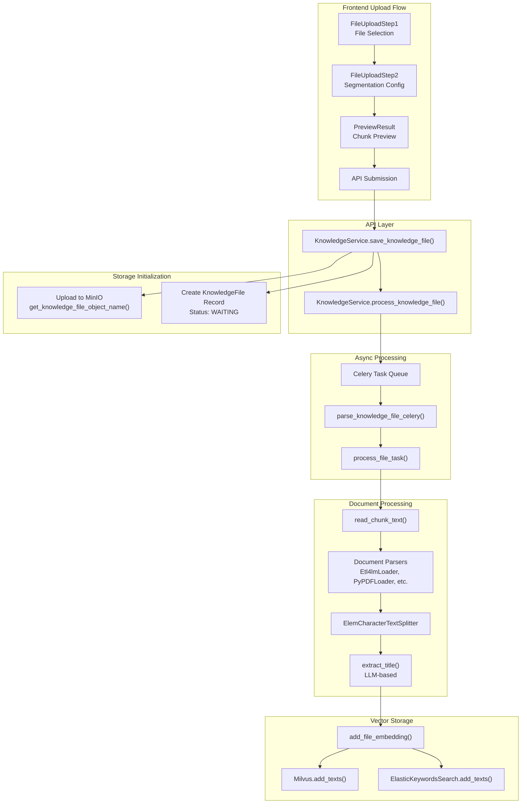
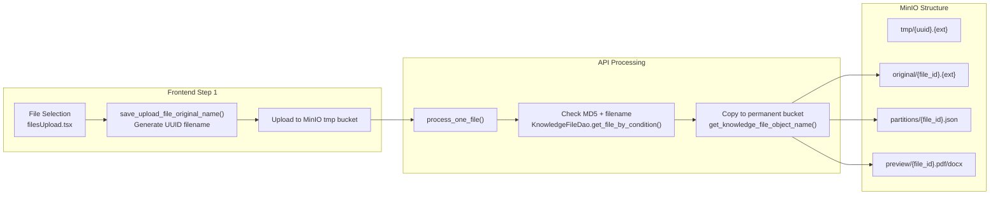
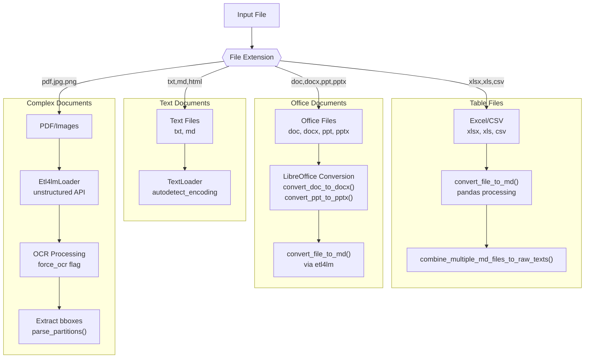
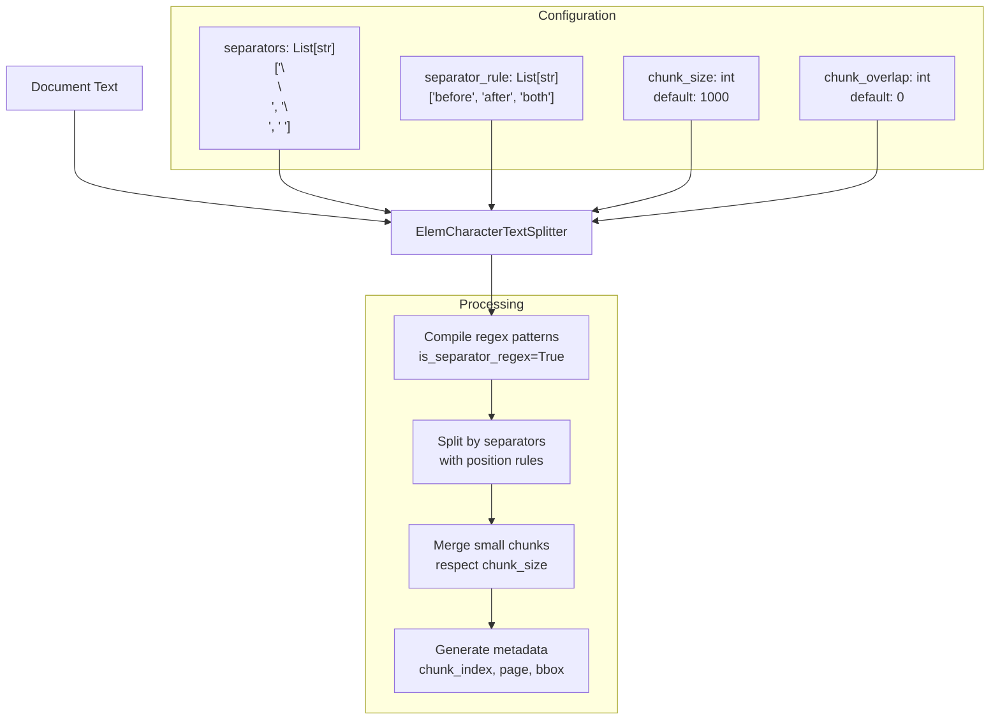
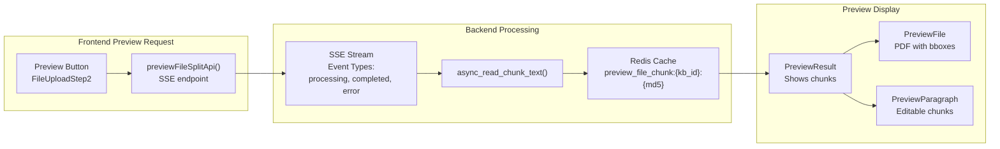
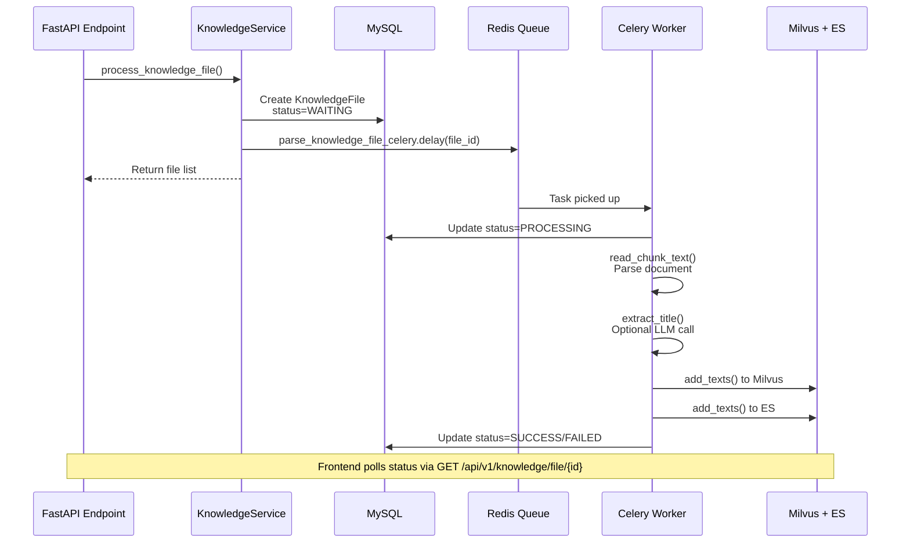
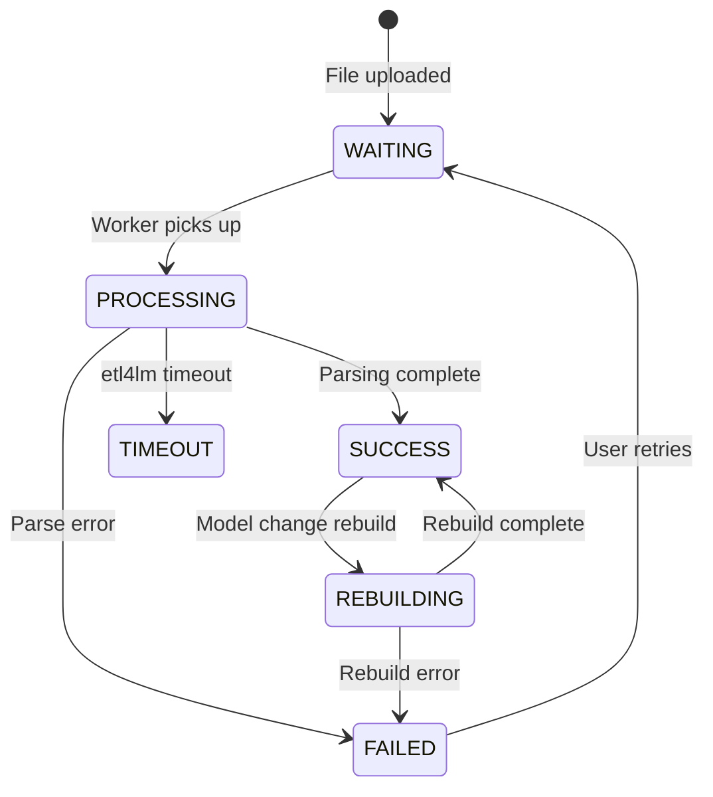

<!-- source: DeepWiki mcp.deepwiki.com · repo dataelement/bisheng · page 6.1 Document Processing Pipeline · fetched 2026-10-29 -->

# Document Processing Pipeline

<details>
<summary>Relevant source files</summary>

The following files were used as context for generating this wiki page:

- [src/backend/bisheng/api/services/knowledge.py](src/backend/bisheng/api/services/knowledge.py)
- [src/backend/bisheng/api/services/knowledge_imp.py](src/backend/bisheng/api/services/knowledge_imp.py)
- [src/backend/bisheng/worker/knowledge/file_worker.py](src/backend/bisheng/worker/knowledge/file_worker.py)
- [src/backend/bisheng/worker/knowledge/qa.py](src/backend/bisheng/worker/knowledge/qa.py)
- [src/backend/bisheng/worker/knowledge/rebuild_knowledge_worker.py](src/backend/bisheng/worker/knowledge/rebuild_knowledge_worker.py)
- [src/frontend/platform/src/components/bs-ui/select/hover.tsx](src/frontend/platform/src/components/bs-ui/select/hover.tsx)
- [src/frontend/platform/src/layout/MainLayout.tsx](src/frontend/platform/src/layout/MainLayout.tsx)
- [src/frontend/platform/src/pages/BuildPage/flow/FlowNode/component/KnowledgeSelectItem.tsx](src/frontend/platform/src/pages/BuildPage/flow/FlowNode/component/KnowledgeSelectItem.tsx)
- [src/frontend/platform/src/pages/KnowledgePage/AdjustFilesUpload.tsx](src/frontend/platform/src/pages/KnowledgePage/AdjustFilesUpload.tsx)
- [src/frontend/platform/src/pages/KnowledgePage/KnowledgeFile.tsx](src/frontend/platform/src/pages/KnowledgePage/KnowledgeFile.tsx)
- [src/frontend/platform/src/pages/KnowledgePage/KnowledgeQa.tsx](src/frontend/platform/src/pages/KnowledgePage/KnowledgeQa.tsx)
- [src/frontend/platform/src/pages/KnowledgePage/components/FileUploadStep2.tsx](src/frontend/platform/src/pages/KnowledgePage/components/FileUploadStep2.tsx)
- [src/frontend/platform/src/pages/KnowledgePage/components/FileUploadStep4.tsx](src/frontend/platform/src/pages/KnowledgePage/components/FileUploadStep4.tsx)
- [src/frontend/platform/src/pages/KnowledgePage/components/Files.tsx](src/frontend/platform/src/pages/KnowledgePage/components/Files.tsx)
- [src/frontend/platform/src/pages/KnowledgePage/components/Header.tsx](src/frontend/platform/src/pages/KnowledgePage/components/Header.tsx)
- [src/frontend/platform/src/pages/KnowledgePage/components/Paragraphs.tsx](src/frontend/platform/src/pages/KnowledgePage/components/Paragraphs.tsx)
- [src/frontend/platform/src/pages/KnowledgePage/components/PreviewFile.tsx](src/frontend/platform/src/pages/KnowledgePage/components/PreviewFile.tsx)
- [src/frontend/platform/src/pages/KnowledgePage/components/PreviewParagraph.tsx](src/frontend/platform/src/pages/KnowledgePage/components/PreviewParagraph.tsx)
- [src/frontend/platform/src/pages/KnowledgePage/components/PreviewResult.tsx](src/frontend/platform/src/pages/KnowledgePage/components/PreviewResult.tsx)
- [src/frontend/platform/src/pages/KnowledgePage/components/RuleFile.tsx](src/frontend/platform/src/pages/KnowledgePage/components/RuleFile.tsx)
- [src/frontend/platform/src/pages/KnowledgePage/components/RuleTable.tsx](src/frontend/platform/src/pages/KnowledgePage/components/RuleTable.tsx)
- [src/frontend/platform/src/pages/KnowledgePage/detail.tsx](src/frontend/platform/src/pages/KnowledgePage/detail.tsx)
- [src/frontend/platform/src/pages/KnowledgePage/filesUpload.tsx](src/frontend/platform/src/pages/KnowledgePage/filesUpload.tsx)
- [src/frontend/platform/src/pages/KnowledgePage/qas.tsx](src/frontend/platform/src/pages/KnowledgePage/qas.tsx)

</details>


## Purpose and Scope

This document details the document processing pipeline in Bisheng, which handles the complete lifecycle of file ingestion into knowledge bases. The pipeline encompasses file upload, parsing, text extraction, chunking, embedding generation, and storage in both vector (Milvus) and full-text (Elasticsearch) search engines.

For information about knowledge base creation and management, see [Knowledge Base Management](#3.1). For details on vector search and retrieval strategies, see [Vector Search and Retrieval](#6.3). For asynchronous task processing patterns, see [Asynchronous Task Processing](#6.2).

---

## Pipeline Architecture Overview

The document processing pipeline follows a multi-stage architecture with clear separation between synchronous user interactions and asynchronous background processing.



**Sources:** [src/backend/bisheng/api/services/knowledge.py:511-565](), [src/backend/bisheng/api/services/knowledge_imp.py:252-298](), [src/backend/bisheng/worker/knowledge/file_worker.py:274-332]()

---

## File Upload and MinIO Storage

### Upload Flow and Storage Structure

The frontend manages a 4-step upload wizard that guides users through file selection, segmentation configuration, preview, and final submission. Files are temporarily stored with UUID-based names to avoid conflicts before being moved to permanent locations.



The system uses three storage path patterns defined in `KnowledgeUtils`:

| Path Type | Method | Format | Purpose |
|-----------|--------|--------|---------|
| **Original File** | `get_knowledge_file_object_name()` | `original/{file_id}.{ext}` | Source document storage |
| **BBox Data** | `get_knowledge_bbox_file_object_name()` | `partitions/{file_id}.json` | OCR bounding box metadata |
| **Preview File** | `get_knowledge_preview_file_object_name()` | `preview/{file_id}.pdf/docx` | Converted files for preview |
| **Images** | `get_knowledge_file_image_dir()` | `knowledge/images/{kb_id}/{doc_id}` | Extracted document images |

**Sources:** [src/backend/bisheng/api/services/knowledge.py:718-765](), [src/backend/bisheng/api/services/knowledge_imp.py:184-217](), [src/frontend/platform/src/pages/KnowledgePage/filesUpload.tsx:68-98]()

### Duplicate Detection Strategy

The system implements a two-level duplicate detection mechanism:

1. **Content-based**: MD5 hash comparison of file contents
2. **Name-based**: Filename matching within the same knowledge base

When a duplicate is detected, the file is uploaded to a temporary location with status `FAILED` and a remark indicating the conflict. Users can then choose to overwrite the existing file via the retry interface.

**Sources:** [src/backend/bisheng/api/services/knowledge.py:736-765]()

---

## Document Parsing Strategies

### Parser Selection Matrix

The system routes files to different parsers based on file type, with fallback strategies for unsupported formats:



**Sources:** [src/backend/bisheng/api/services/knowledge_imp.py:789-931]()

### Etl4lm Loader Configuration

For complex document types (PDF, images, unsupported formats), the system uses the `Etl4lmLoader` which connects to an external unstructured service:

```python
# Configuration from settings
etl4lm_settings = settings.get_knowledge().etl4lm
loader = Etl4lmLoader(
    file_name,
    input_file,
    unstructured_api_url=etl4lm_settings.url,
    ocr_sdk_url=etl4lm_settings.ocr_sdk_url,
    force_ocr=bool(force_ocr),
    enable_formular=bool(enable_formula),
    timeout=etl4lm_settings.timeout,
    filter_page_header_footer=bool(filter_page_header_footer),
    knowledge_id=knowledge_id,
)
```

The loader returns structured partitions with bounding box data for each text element, enabling precise location tracking and re-segmentation later.

**Sources:** [src/backend/bisheng/api/services/knowledge_imp.py:907-930]()

### Excel-Specific Processing

Excel files require special handling due to their tabular structure. The system converts them to Markdown format with configurable row slicing:

| Parameter | Default | Purpose |
|-----------|---------|---------|
| `header_start_row` | 1 | First row of header |
| `header_end_row` | 1 | Last row of header |
| `slice_length` | 10 | Rows per chunk |
| `append_header` | true | Include header in each chunk |

**Sources:** [src/backend/bisheng/api/services/knowledge_imp.py:837-856](), [src/frontend/platform/src/pages/KnowledgePage/components/RuleTable.tsx:17-95]()

---

## Text Chunking and Segmentation

### ElemCharacterTextSplitter Architecture

The chunking system uses `ElemCharacterTextSplitter` which implements a sophisticated regex-based splitting strategy with position-aware rules:



**Sources:** [src/backend/bisheng/api/services/knowledge_imp.py:821-827]()

### Separator Position Rules

The system supports three position rules for each separator:

- **`before`**: Split occurs before the separator (separator included in next chunk)
- **`after`**: Split occurs after the separator (separator included in current chunk)
- **`both`**: Split occurs around the separator (separator forms its own chunk)

This is visualized in the frontend with scissors emoji (✂️) to show cut positions:

```
before: ✂️\n\n  → cut before newlines
after: \n\n✂️   → cut after newlines
```

**Sources:** [src/frontend/platform/src/pages/KnowledgePage/components/Paragraphs.tsx:576-590]()

### Chunk Metadata Schema

Each chunk receives comprehensive metadata defined in `KNOWLEDGE_RAG_METADATA_SCHEMA`:

| Field | Type | Description |
|-------|------|-------------|
| `document_id` | int | File ID in database |
| `knowledge_id` | int | Knowledge base ID |
| `chunk_index` | int | Sequential chunk number |
| `document_name` | str | Original filename |
| `page` | int | Source page number |
| `bbox` | JSON | Bounding box coordinates |
| `upload_time` | int | Unix timestamp |
| `uploader` | str | Username |
| `user_metadata` | dict | Custom metadata fields |

**Sources:** [src/backend/bisheng/api/services/knowledge_imp.py:637-651]()

---

## LLM-Based Title Extraction

### Title Extraction Workflow

The system optionally enhances chunks with LLM-generated titles/summaries before storage. This is controlled by the `extract_title_model_id` configuration:

```mermaid
sequenceDiagram
    participant Chunk as Text Chunk
    participant Config as LLMService.get_knowledge_llm()
    participant LLM as decide_knowledge_llm()
    participant Extract as extract_title()
    participant Storage as Vector Storage
    
    Chunk->>Config: Check extract_title_model_id
    alt Title extraction enabled
        Config->>LLM: Get LLM instance<br/>model_id, user_id
        LLM->>Extract: invoke with chunk text
        Extract->>Extract: Parse title from response<br/>remove ` patterns
2. Extract code blocks if present (removes markdown code fences)
3. Strip extra whitespace

This ensures clean, usable titles even from verbose model outputs.

**Sources:** [src/backend/bisheng/api/services/knowledge_imp.py:774-786]()

---

## Vector Storage Architecture

### Dual Storage Strategy

The system implements a dual-storage approach for optimal retrieval performance:

```mermaid
graph TB
    subgraph "Input Processing"
        CHUNKS["Chunked Text + Metadata"]
        AGG["KnowledgeUtils.aggregate_chunk_metadata()<br/>Format: <file_title>...<paragraph_content>"]
    end
    
    subgraph "Milvus (Vector Similarity)"
        MILVUS_EMBED["Generate embeddings<br/>via configured embedding model"]
        MILVUS_STORE["Milvus.add_texts()<br/>Collection: partition_{kb_id} or col_{kb_id}"]
        MILVUS_INDEX["Vector Index<br/>IVF_FLAT / HNSW"]
    end
    
    subgraph "Elasticsearch (Keyword Search)"
        ES_STORE["ElasticKeywordsSearch.add_texts()<br/>Index: kb_{kb_id}"]
        ES_INDEX["Full-text Index<br/>BM25 scoring"]
    end
    
    subgraph "Metadata Storage"
        META_SCHEMA["KNOWLEDGE_RAG_METADATA_SCHEMA<br/>Document ID, Chunk Index, BBox, User Metadata"]
    end
    
    CHUNKS --> AGG
    AGG --> MILVUS_EMBED
    AGG --> ES_STORE
    MILVUS_EMBED --> MILVUS_STORE
    MILVUS_STORE --> MILVUS_INDEX
    ES_STORE --> ES_INDEX
    META_SCHEMA --> MILVUS_STORE
    META_SCHEMA --> ES_STORE
```

**Sources:** [src/backend/bisheng/api/services/knowledge_imp.py:654-660](), [src/backend/bisheng/api/services/knowledge_imp.py:96-102]()

### Collection Naming Conventions

The system supports two collection strategies:

1. **Partition Mode**: Single collection `partition_knowledge` with partition key = `knowledge_id`
2. **Individual Collections**: Separate collections `col_{uuid}` per knowledge base

The naming is determined by `settings.get_vectors_conf().milvus.is_partition` configuration.

**Sources:** [src/backend/bisheng/api/services/knowledge_imp.py:369-399]()

### Metadata Aggregation Format

Before storage, chunks are enriched with a structured format:

```
{<file_title>document_name</file_title>
<file_abstract>abstract_text</file_abstract>
<paragraph_content>chunk_text</paragraph_content>}
```

This format enables the retrieval system to provide rich context when returning search results.

**Sources:** [src/backend/bisheng/api/services/knowledge_imp.py:96-102]()

---

## Preview and Editing Workflow

### Real-Time Preview Architecture

The frontend provides real-time preview of segmentation results using Server-Sent Events (SSE) for streaming updates:



**Sources:** [src/frontend/platform/src/pages/KnowledgePage/components/PreviewResult.tsx:94-152](), [src/frontend/platform/src/pages/KnowledgePage/components/FileUploadStep2.tsx:199-219]()

### BBox-Based Chunk Editing

For documents parsed with OCR (via Etl4lm), users can visually select text regions in the PDF preview to modify chunk boundaries:

1. **Label Selection**: Click bounding boxes in PDF viewer (`FileView` component)
2. **Label Activation**: Selected boxes become "active" labels
3. **Text Aggregation**: Active labels' text is concatenated respecting partition types (Title, Table, etc.)
4. **Chunk Update**: Modified text overwrites the chunk via `updatePreviewChunkApi()`

The label structure:

```typescript
{
  id: string,           // "{page}-{x1}-{y1}-{x2}-{y2}"
  page: number,         // PDF page number
  label: [x1,y1,x2,y2], // Bounding box coordinates
  active: boolean,      // Selected for current chunk
  text: string,         // OCR-extracted text
  type: string,         // "Title" | "Text" | "Table"
  part_id: number       // Partition group ID
}
```

**Sources:** [src/frontend/platform/src/pages/KnowledgePage/components/PreviewFile.tsx:169-205](), [src/frontend/platform/src/pages/KnowledgePage/components/ParagraphEdit.tsx:1-339]()

### Cache-Based Editing Flow

Preview data is cached in Redis using `KnowledgeUtils.get_preview_cache_key()` with format:

```
preview_file_chunk:{knowledge_id}:{file_md5}
```

When users submit the final file for processing, if cache data exists, it is used instead of re-parsing, preserving user edits.

**Sources:** [src/backend/bisheng/api/services/knowledge_imp.py:90-93](), [src/backend/bisheng/api/services/knowledge_imp.py:603-608]()

---

## Asynchronous Processing Architecture

### Celery Worker Task Flow

The system uses Celery for background file processing to avoid blocking the API:



**Sources:** [src/backend/bisheng/worker/knowledge/file_worker.py:274-332](), [src/backend/bisheng/api/services/knowledge.py:545-564]()

### Task Retry Logic

Failed files can be retried via `retry_knowledge_file_celery()` which:

1. Deletes existing vector data via `delete_knowledge_file_vectors()`
2. Re-processes the file with updated parameters
3. Preserves the original file in MinIO (no re-upload needed)

The retry API accepts file objects with updated `split_rule` configuration:

```python
{
    "file_objs": [
        {
            "id": file_id,
            "file_path": "tmp/uuid.pdf",
            "split_rule": {
                "separator": ["\\n\\n", "\\n"],
                "chunk_size": 1500,
                "chunk_overlap": 100
            }
        }
    ]
}
```

**Sources:** [src/backend/bisheng/worker/knowledge/file_worker.py:335-359](), [src/backend/bisheng/api/services/knowledge.py:634-694]()

### Status Tracking and Polling

File processing status follows this state machine:



The frontend polls file status every 5 seconds when files are in `PROCESSING` or `WAITING` states.

**Sources:** [src/frontend/platform/src/pages/KnowledgePage/components/Files.tsx:127-135](), [src/backend/bisheng/knowledge/domain/models/knowledge_file.py:1-200]()

---

## Error Handling and Recovery

### Structured Error Codes

The system uses structured error codes defined in `bisheng.common.errcode.knowledge`:

| Error Code | Class | Trigger Condition |
|------------|-------|-------------------|
| `100301` | `KnowledgeFileEmptyError` | No text extracted from file |
| `100302` | `KnowledgeFileChunkMaxError` | Chunk exceeds 10,000 characters |
| `100303` | `KnowledgeFileDamagedError` | PDF corruption detected |
| `100304` | `KnowledgeEtl4lmTimeoutError` | Unstructured API timeout |
| `100305` | `KnowledgeExcelChunkMaxError` | Excel cell exceeds size limit |

Errors are serialized to JSON and stored in `KnowledgeFile.remark` field for display to users.

**Sources:** [src/backend/bisheng/api/services/knowledge_imp.py:498-518](), [src/backend/bisheng/common/errcode/knowledge.py:1-300]()

### Duplicate File Handling

When duplicate files are detected (by MD5 or filename), the system:

1. Uploads to temporary location: `tmp/{file_id}.{ext}`
2. Sets status to `FAILED` with remark: `{"new_name": "...", "old_name": "..."}`
3. Displays dialog with options: **Overwrite** or **Skip**
4. On overwrite: Calls `retryKnowledgeFileApi()` to move temp file to permanent location and re-process

**Sources:** [src/backend/bisheng/api/services/knowledge.py:749-765](), [src/frontend/platform/src/pages/KnowledgePage/filesUpload.tsx:217-275]()

### Cleanup on Deletion

When files are deleted during processing, the Celery worker detects missing records and cleans up orphaned vector data:

```python
db_file = KnowledgeFileDao.get_file_by_ids([file_id])
if not db_file:
    # File deleted during processing - cleanup vectors
    delete_vector_files([file_id], knowledge)
```

This ensures no orphaned data remains in Milvus or Elasticsearch.

**Sources:** [src/backend/bisheng/worker/knowledge/file_worker.py:286-292]()

---

## Configuration and Extensibility

### File Type Extension Points

To add support for new file types, implement the following:

1. **Add loader mapping** in `filetype_load_map` dictionary
2. **Add conversion logic** in `read_chunk_text()` for preprocessing
3. **Update frontend validation** in upload components

Example for new type:

```python
filetype_load_map = {
    "txt": TextLoader,
    "pdf": PyPDFLoader,
    "newtype": CustomNewTypeLoader,  # Add here
}
```

**Sources:** [src/backend/bisheng/api/services/knowledge_imp.py:75-82]()

### Segmentation Strategy Customization

The frontend provides a visual strategy builder (`FileUploadStep2`) with:

- **Predefined strategies**: Double newline, single newline
- **Custom strategies**: Regex-based with position rules
- **Per-file overrides**: Different strategies for different files in batch
- **Excel-specific**: Row-based slicing with header handling

All strategies are serialized to `KnowledgeFile.split_rule` as JSON for persistence.

**Sources:** [src/frontend/platform/src/pages/KnowledgePage/components/FileUploadStep2.tsx:75-109](), [src/frontend/platform/src/pages/KnowledgePage/components/RuleFile.tsx:1-450]()

### Embedding Model Configuration

The system retrieves embedding configuration from `LLMService.get_knowledge_llm()` which reads from database-stored settings. To change models:

1. Update via knowledge base settings dialog (frontend)
2. Triggers rebuild workflow via `rebuild_knowledge_celery()` task
3. Re-embeds all successful chunks with new model

**Sources:** [src/backend/bisheng/worker/knowledge/rebuild_knowledge_worker.py:22-106]()

---

