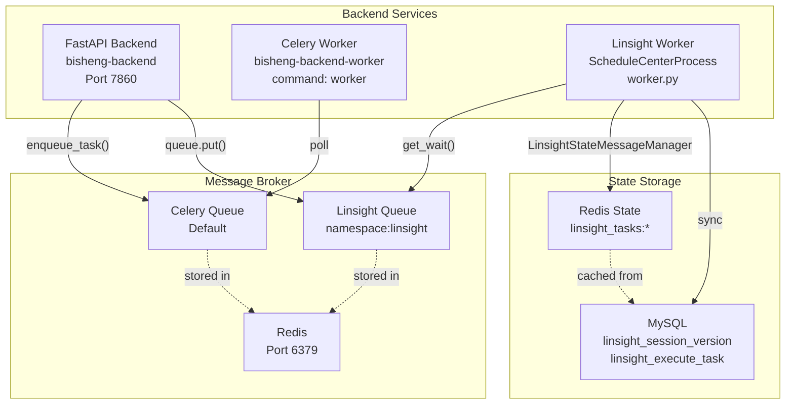
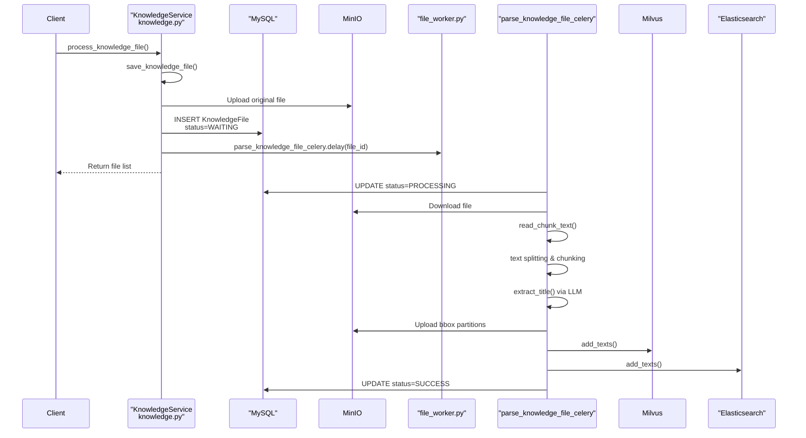
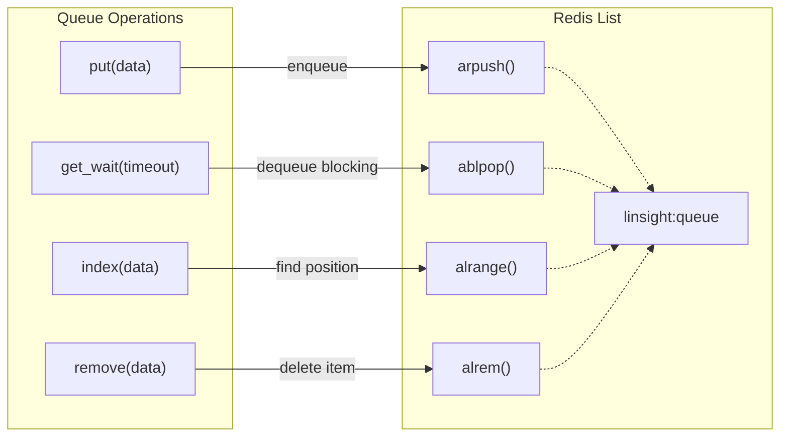
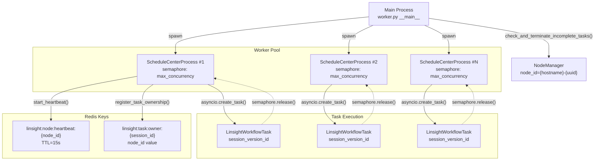
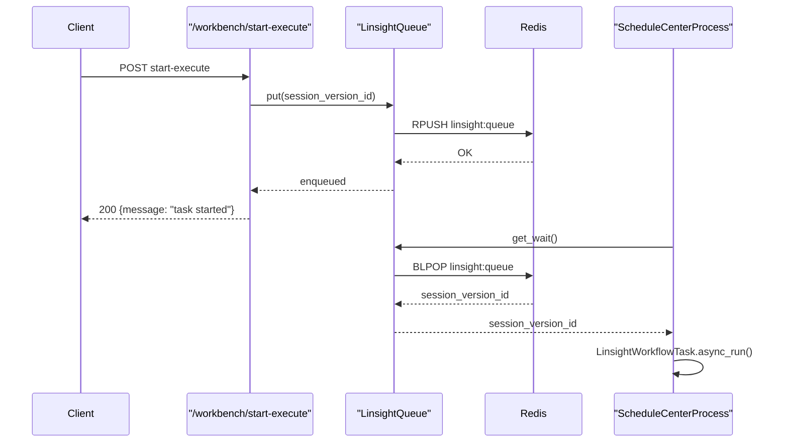
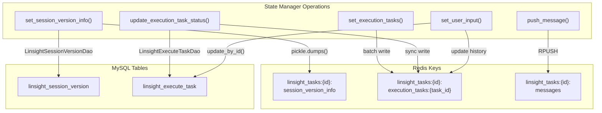
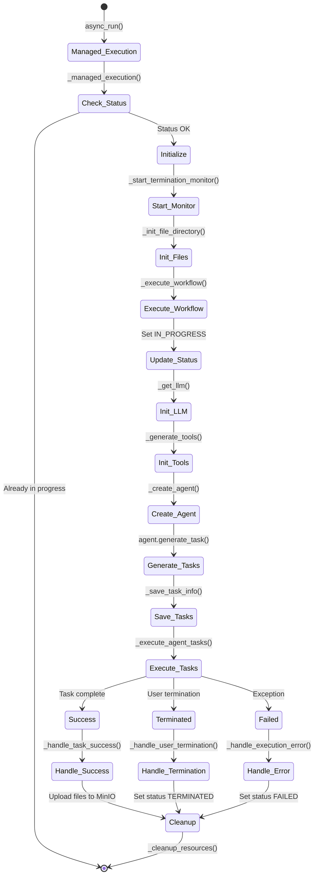
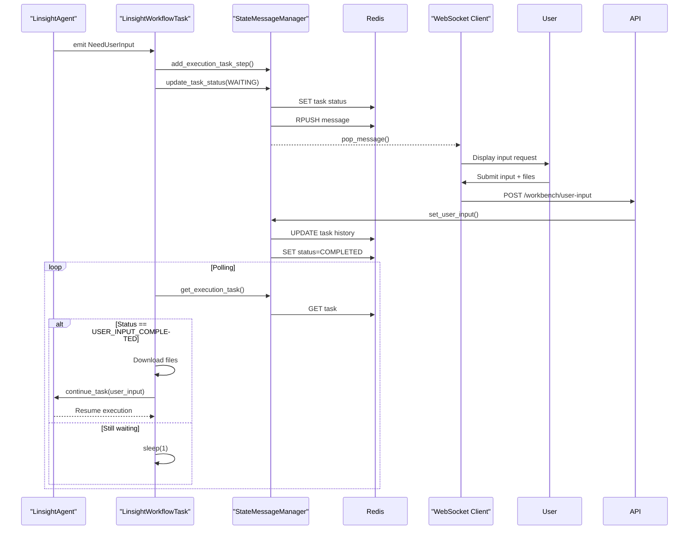
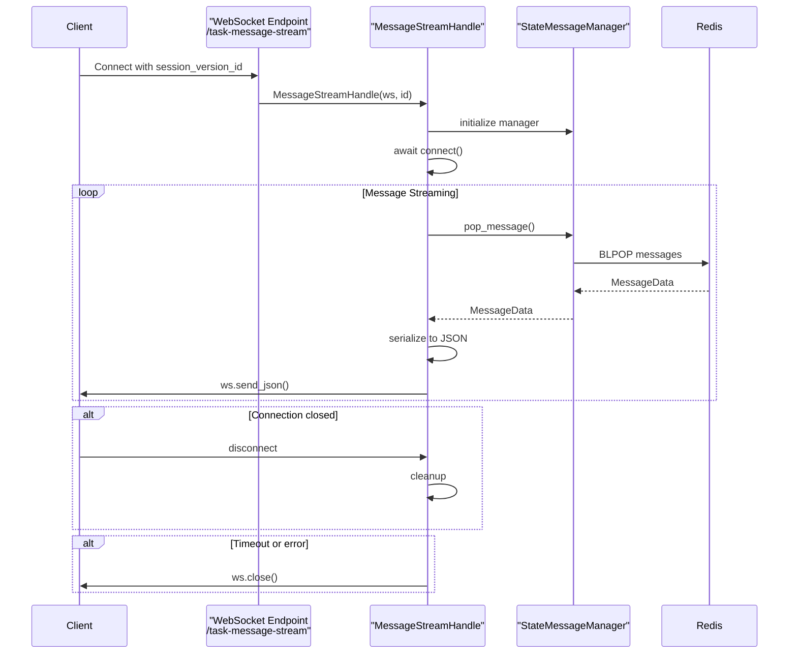

<!-- source: DeepWiki mcp.deepwiki.com · repo dataelement/bisheng · page 6.2 Asynchronous Task Processing · fetched 2026-10-29 -->

# Asynchronous Task Processing

<details>
<summary>Relevant source files</summary>

The following files were used as context for generating this wiki page:

- [src/backend/bisheng/api/services/knowledge.py](src/backend/bisheng/api/services/knowledge.py)
- [src/backend/bisheng/api/services/knowledge_imp.py](src/backend/bisheng/api/services/knowledge_imp.py)
- [src/backend/bisheng/core/cache/redis_conn.py](src/backend/bisheng/core/cache/redis_conn.py)
- [src/backend/bisheng/linsight/domain/task_exec.py](src/backend/bisheng/linsight/domain/task_exec.py)
- [src/backend/bisheng/linsight/domain/utils.py](src/backend/bisheng/linsight/domain/utils.py)
- [src/backend/bisheng/linsight/worker.py](src/backend/bisheng/linsight/worker.py)
- [src/backend/bisheng/worker/knowledge/file_worker.py](src/backend/bisheng/worker/knowledge/file_worker.py)
- [src/backend/bisheng/worker/knowledge/qa.py](src/backend/bisheng/worker/knowledge/qa.py)
- [src/backend/bisheng/worker/knowledge/rebuild_knowledge_worker.py](src/backend/bisheng/worker/knowledge/rebuild_knowledge_worker.py)

</details>


This document describes the asynchronous task processing architecture in Bisheng. The system employs two distinct patterns: a general-purpose Celery worker system for background tasks like file processing, and a specialized Redis-based queue system (`LinsightQueue`) for managing AI-driven workflow execution. Both systems coordinate through Redis for message brokering and state management.

For information about the Linsight AI Workbench feature that heavily utilizes async processing, see [Linsight AI Workbench](#3.4). For workflow execution details, see [Workflow Engine](#3.5).

## System Architecture Overview

Bisheng implements a dual-pattern asynchronous processing architecture to handle different types of workloads with varying requirements for concurrency, state management, and real-time feedback.

### Deployment Architecture



**Diagram: Asynchronous Task Processing Deployment**

Sources: [docker/docker-compose.yml:79-107](), [src/backend/bisheng/linsight/worker.py:18-62]()

The system runs three key processes:
- **API Backend**: Synchronous FastAPI server that enqueues tasks
- **Celery Worker**: General-purpose task worker for file processing and knowledge base operations
- **Linsight Worker**: Specialized worker pool for AI workflow execution with custom concurrency control

## Celery Worker System

The general-purpose Celery worker handles file processing, knowledge base operations, and other background tasks that don't require real-time streaming feedback.

### Configuration and Deployment

The Celery worker is deployed as a separate container (`bisheng-backend-worker`) using the same image as the backend but with a different entrypoint command.

| Configuration | Value | Description |
|--------------|-------|-------------|
| Container Name | `bisheng-backend-worker` | Separate container for worker processes |
| Image | `dataelement/bisheng-backend:v2.3.0-beta2` | Same image as backend API |
| Command | `sh entrypoint.sh worker` | Starts Celery worker mode |
| Broker | Redis (port 6379) | Message queue backend |
| Result Backend | Redis | Task result storage |

Sources: [docker/docker-compose.yml:79-107](), [src/backend/pyproject.toml:18]()

### Task Types

The Celery system handles knowledge base processing operations:

1. **File Parsing** (`parse_knowledge_file_celery`): Asynchronous document parsing and vectorization
2. **File Retry** (`retry_knowledge_file_celery`): Reprocessing failed or updated files
3. **Knowledge Base Rebuild** (`rebuild_knowledge_celery`): Batch re-embedding with new models
4. **File Deletion** (`delete_knowledge_file_celery`): Asynchronous vector cleanup
5. **Knowledge Copy** (`file_copy_celery`): Cross-knowledge-base file replication
6. **QA Operations** (`insert_qa_celery`, `copy_qa_knowledge_celery`, `rebuild_qa_knowledge_celery`): QA knowledge base management

**Knowledge File Processing Flow**



**Diagram: Knowledge File Processing via Celery**

Sources: [src/backend/bisheng/api/services/knowledge.py:545-564](), [src/backend/bisheng/worker/knowledge/file_worker.py:275-292](), [src/backend/bisheng/api/services/knowledge_imp.py:252-298]()

### Celery Task Implementations

**File Parsing Task**

The `parse_knowledge_file_celery` task coordinates the complete file processing pipeline:

| Step | Function | Purpose |
|------|----------|---------|
| 1. Status Update | `KnowledgeFileDao.update_file_status()` | Set `PROCESSING` |
| 2. Download File | `file_download()` via MinIO | Retrieve uploaded file |
| 3. Parse Content | `read_chunk_text()` | Extract text, split chunks |
| 4. Title Extraction | `extract_title()` | LLM-based chunk summarization |
| 5. Vector Storage | `add_file_embedding()` | Insert to Milvus + ES |
| 6. Update Status | `KnowledgeFileDao.update()` | Set `SUCCESS` or `FAILED` |

Sources: [src/backend/bisheng/worker/knowledge/file_worker.py:275-332]()

**File Retry Task**

The `retry_knowledge_file_celery` task handles reprocessing:

```python
@bisheng_celery.task(acks_late=True)
def retry_knowledge_file_celery(file_id: int, preview_cache_key: str = None, callback_url: str = None):
    # Delete existing vectors without removing MinIO files
    delete_knowledge_file_vectors(file_ids=[file_id], clear_minio=False)
    
    # Reparse using cached preview data if available
    _parse_knowledge_file(file_id, preview_cache_key, callback_url)
```

This enables updating files without re-uploading when segmentation parameters change.

Sources: [src/backend/bisheng/worker/knowledge/file_worker.py:336-359]()

**Knowledge Base Rebuild Task**

The `rebuild_knowledge_celery` task re-embeds all files with a new embedding model:

| Phase | Operation | Details |
|-------|-----------|---------|
| 1. Vector Deletion | `delete_knowledge_file_in_vector()` | Clear Milvus collection |
| 2. File Retrieval | `get_files_by_multiple_status()` | Get `SUCCESS` files |
| 3. Status Update | `update_status_bulk()` | Mark as `REBUILDING` |
| 4. Re-embedding | `_rebuild_embeddings()` | Fetch from ES, re-embed to Milvus |
| 5. Status Finalization | `update_status_bulk()` | Set `SUCCESS` or `FAILED` |

The task preserves ES data (text chunks) while regenerating Milvus vectors with the new model.

Sources: [src/backend/bisheng/worker/knowledge/rebuild_knowledge_worker.py:23-106]()

**Copy Task**

The `file_copy_celery` task replicates knowledge bases:

```python
@bisheng_celery.task(acks_late=True)
def file_copy_celery(param: json) -> str:
    # Copy MySQL records
    # Copy MinIO files (original, bbox, preview)
    # Copy Milvus vectors
    # Copy ES documents
```

This supports knowledge base templates and version management.

Sources: [src/backend/bisheng/worker/knowledge/file_worker.py:26-84]()

## Linsight Queue System

The Linsight system implements a custom Redis-based queue for managing AI workflow execution. This specialized queue provides fine-grained control over concurrency and enables real-time task progress streaming.

### LinsightQueue Implementation



**Diagram: LinsightQueue Operations on Redis**

Sources: [src/backend/bisheng/linsight/worker.py:18-62]()

The `LinsightQueue` class wraps Redis list operations:

| Method | Redis Command | Purpose |
|--------|--------------|---------|
| `put(data)` | `RPUSH` | Add task to queue end |
| `get_wait(timeout)` | `BLPOP` | Blocking pop from queue head |
| `get_nowait()` | `LPOP` | Non-blocking pop |
| `index(data)` | `LRANGE` + search | Find task position for status API |
| `remove(data)` | `LREM` | Remove task (for cancellation) |

Sources: [src/backend/bisheng/linsight/worker.py:24-61]()

### Worker Process Architecture

The Linsight worker uses a multi-process architecture with per-process concurrency control and node heartbeat management:



**Diagram: Worker Process and Concurrency Model with Node Management**

Sources: [src/backend/bisheng/linsight/worker.py:117-214](), [src/backend/bisheng/linsight/worker.py:20-69]()

**Key Components:**

1. **NodeManager**: Manages node heartbeat and task ownership
   - Heartbeat interval: 5 seconds
   - Heartbeat TTL: 15 seconds
   - Registers task ownership in Redis key `linsight:task:owner:{session_version_id}`

2. **ScheduleCenterProcess** (Process): Each worker process maintains its own event loop
   - Acquires semaphore before dequeuing tasks
   - Registers task ownership via `NodeManager.register_task_ownership()`
   - Releases semaphore on task completion via callback

3. **LinsightWorkflowTask**: Individual task executor with lifecycle management

Command-line configuration:
```bash
python -m bisheng.linsight.worker --worker_num 4 --max_concurrency 32
```

Sources: [src/backend/bisheng/linsight/worker.py:243-276]()

### Task Enqueueing

Tasks are enqueued via API endpoint:



**Diagram: Task Enqueue and Dequeue Flow**

Sources: [src/backend/bisheng/api/v1/linsight.py:307-353](), [src/backend/bisheng/linsight/worker.py:88-118]()

The enqueue process at `start_execute_sop` endpoint:
1. Validates session version exists and permissions
2. Checks session is not already running
3. Adds `session_version_id` to queue via `queue.put()`
4. Creates SOP record in background task
5. Returns immediately to client

Sources: [src/backend/bisheng/api/v1/linsight.py:307-353]()

## Task State Management

The system implements dual-layer state management using Redis for real-time operations and MySQL for persistence.

### LinsightStateMessageManager

The `LinsightStateMessageManager` class provides a unified interface for state operations:



**Diagram: State Management Dual-Layer Architecture**

Sources: [src/backend/bisheng/linsight/state_message_manager.py:52-419]()

**Key Methods and Their Storage Patterns:**

| Method | Redis Operation | MySQL Operation | Purpose |
|--------|----------------|-----------------|---------|
| `set_session_version_info()` | `SET` with pickle | `LinsightSessionVersionDao.insert_one()` | Update session status |
| `set_execution_tasks()` | `MSET` batch write | N/A (already in DB) | Cache task list |
| `update_execution_task_status()` | `SET` single task | `LinsightExecuteTaskDao.update_by_id()` | Update task progress |
| `set_user_input()` | `SET` with pipeline | `update_by_id()` history field | Handle user interaction |
| `push_message()` | `RPUSH` to messages list | N/A (ephemeral) | Stream events to client |

Sources: [src/backend/bisheng/linsight/state_message_manager.py:139-310]()

### Message Event Types

The system defines typed events for streaming task progress:

```python
class MessageEventType(str, Enum):
    TASK_START = "task_start"
    TASK_GENERATE = "task_generate"
    TASK_STATUS_UPDATE = "task_status_update"
    USER_INPUT = "user_input"
    USER_INPUT_COMPLETED = "user_input_completed"
    TASK_EXECUTE_STEP = "task_execute_step"
    TASK_END = "task_end"
    ERROR_MESSAGE = "error_message"
    FINAL_RESULT = "final_result"
    TASK_TERMINATED = "task_terminated"
```

Sources: [src/backend/bisheng/linsight/state_message_manager.py:19-42]()

### State Synchronization Strategy

The dual-layer approach balances performance and durability:

1. **Redis Layer**:
   - Fast access for active tasks
   - Message queue for real-time streaming
   - TTL-based expiration (1 hour default)
   - Automatic fallback to DB on cache miss

2. **MySQL Layer**:
   - Persistent storage for task history
   - Session and task status records
   - User input and results
   - Query support for task list APIs

**Synchronization Points:**

```python
# Write to both layers atomically
async with self._redis_client.async_pipeline() as pipe:
    await LinsightSessionVersionDao.insert_one(session_version_model)
    await pipe.set(key, pickle.dumps(data), ex=expiration)
    await pipe.execute()
```

Sources: [src/backend/bisheng/linsight/state_message_manager.py:146-164]()

## Task Execution Lifecycle

The `LinsightWorkflowTask` class orchestrates the complete lifecycle of AI workflow execution.

### Execution Flow



**Diagram: LinsightWorkflowTask Execution State Machine**

Sources: [src/backend/bisheng/linsight/task_exec.py:106-164]()

### Resource Management

The task uses context managers for safe resource handling:

```python
async with self._managed_execution() as session_model:
    await self._execute_workflow(session_model)
```

**Managed Resources:**
1. **File Directory**: Downloaded files cached in `/cache/linsight/{session_id[:8]}`
2. **Termination Monitor**: Background task checking for user cancellation
3. **Code Interpreter Sandbox**: E2B sandbox for code execution (if configured)

Sources: [src/backend/bisheng/linsight/task_exec.py:67-102]()

### Event Handling During Execution

The task processes streaming events from the agent:

| Event Type | Handler Method | State Change |
|-----------|---------------|--------------|
| `GenerateSubTask` | `_handle_generate_subtask()` | Create child tasks in DB |
| `TaskStart` | `_handle_task_start()` | Update status to `IN_PROGRESS` |
| `TaskEnd` | `_handle_task_end()` | Update status to `SUCCESS`/`FAILED` |
| `NeedUserInput` | `_handle_need_user_input()` | Set status `WAITING_FOR_USER_INPUT` |
| `ExecStep` | `_handle_exec_step()` | Append step to history |

Sources: [src/backend/bisheng/linsight/task_exec.py:375-441]()

**Event Processing Loop:**

```python
async for event in agent.ainvoke(task_info, sop, file_list):
    await self._handle_event(agent, event, session_model)
```

The loop runs concurrently with a termination monitor that checks for user cancellation every 0.5 seconds.

Sources: [src/backend/bisheng/linsight/task_exec.py:319-327]()

### User Input Handling

Tasks can request user input mid-execution:



**Diagram: User Input Request and Completion Flow**

Sources: [src/backend/bisheng/linsight/task_exec.py:427-495](), [src/backend/bisheng/api/v1/linsight.py:357-390]()

**Implementation Details:**

1. Agent emits `NeedUserInput` event with prompt
2. Task sets status to `WAITING_FOR_USER_INPUT`
3. Event streams to client via WebSocket
4. Client submits input via API endpoint
5. API updates Redis state
6. Task polls for completion (1-second intervals)
7. On completion, downloads any uploaded files
8. Agent resumes with user input

Sources: [src/backend/bisheng/linsight/task_exec.py:443-512]()

## Message Streaming

Real-time task progress is streamed to clients via WebSocket connections.

### WebSocket Connection Lifecycle



**Diagram: WebSocket Message Streaming Architecture**

Sources: [src/backend/bisheng/api/v1/linsight.py:603-651]()

### Message Stream Handle Implementation

The `MessageStreamHandle` class (not shown in provided files but referenced) manages WebSocket connections:

**Key Operations:**
1. Establish WebSocket connection with authentication
2. Block on Redis list pop operations (`BLPOP`)
3. Deserialize `MessageData` objects
4. Stream JSON events to client
5. Handle connection errors and timeouts

**Message Format:**

```python
{
    "event_type": "task_execute_step",
    "data": {
        "task_id": "abc123",
        "name": "search_tool",
        "status": "end",
        "result": {...}
    },
    "timestamp": 1234567890.123
}
```

Sources: [src/backend/bisheng/api/v1/linsight.py:617-620](), [src/backend/bisheng/linsight/state_message_manager.py:45-49]()

### Event Streaming in API Layer

Some operations use Server-Sent Events (SSE) instead of WebSocket:

```python
async def event_generator():
    async for event in LinsightWorkbenchImpl.generate_sop(...):
        yield {
            "event": "generate_sop_content",
            "data": event.model_dump_json()
        }
    yield {
        "event": "sop_generate_complete",
        "data": json.dumps({"message": "Complete"})
    }

return EventSourceResponse(event_generator())
```

Sources: [src/backend/bisheng/api/v1/linsight.py:221-246]()

**Use Cases:**
- SOP generation streaming (SSE)
- Task execution progress (WebSocket)
- Question submission response (SSE)

## Task Termination and Cleanup

The system supports graceful task termination and automatic cleanup on restart.

### User-Initiated Termination

```python
# Remove from queue if not yet started
await queue.remove(session_version_id)

# Update session status
session_version_model.status = SessionVersionStatusEnum.TERMINATED

# Push termination message
await state_manager.push_message(MessageData(
    event_type=MessageEventType.TASK_TERMINATED,
    data={"message": "Task stopped by user"}
))
```

Sources: [src/backend/bisheng/api/v1/linsight.py:476-533]()

**Termination Detection:**

During execution, the task continuously monitors for user termination:

```python
async def _check_user_termination(self) -> bool:
    current_session = await self._state_manager.get_session_version_info()
    return current_session.status == SessionVersionStatusEnum.TERMINATED
```

This check runs every 2 seconds in a background coroutine.

Sources: [src/backend/bisheng/linsight/task_exec.py:547-558]()

### Startup Recovery

On worker startup, the system checks for incomplete tasks and validates node ownership:

```python
async def check_and_terminate_incomplete_tasks(node_id: str):
    # Get all IN_PROGRESS sessions
    incomplete_tasks = await LinsightSessionVersionDao.get_session_versions_by_status(
        status=SessionVersionStatusEnum.IN_PROGRESS
    )
    
    for session in incomplete_tasks:
        # Check task ownership in Redis
        owner_node_id = await redis_client.get(f"linsight:task:owner:{session.id}")
        
        if not owner_node_id:
            # No owner - mark as failed
            should_terminate = True
        else:
            # Check if owner node is alive via heartbeat
            is_alive = await node_manager.is_node_alive(owner_node_id)
            should_terminate = not is_alive
        
        if should_terminate:
            # Update session and tasks to FAILED
            # Revoke invitation codes if enabled
```

**Recovery Logic:**

| Scenario | Action | Reason |
|----------|--------|--------|
| No owner in Redis | Mark FAILED | Task was never claimed or Redis cleared |
| Owner node dead (no heartbeat) | Mark FAILED | Worker crashed or killed |
| Owner node alive | Skip | Task is actively processing |

Sources: [src/backend/bisheng/linsight/domain/utils.py:262-352](), [src/backend/bisheng/linsight/worker.py:264]()

This ensures orphaned tasks are cleaned up while preserving active work.

### Resource Cleanup

**Per-Task Cleanup:**
1. Stop termination monitor task
2. Close code interpreter sandbox
3. Delete temporary file directory
4. Release semaphore slot

**Global Cleanup:**
```python
async def cleanup_all_sessions():
    """Remove all linsight_tasks:* keys from Redis"""
    pattern = f"{KEY_PREFIX}*"
    keys = await redis.akeys(pattern)
    if keys:
        await redis.adelete(*keys)
```

Sources: [src/backend/bisheng/linsight/task_exec.py:91-102](), [src/backend/bisheng/linsight/state_message_manager.py:409-419]()

## Performance Considerations

### Concurrency Control

| Component | Concurrency Model | Default Limit | Configuration |
|-----------|------------------|---------------|---------------|
| Celery Worker | Process pool | Varies | Docker Compose deployment |
| Celery Task | `acks_late=True` | N/A | Prevents message loss |
| Linsight Worker Process | Asyncio Semaphore | 32 concurrent tasks | `--max_concurrency` flag |
| Linsight Worker Pool | Multi-process | 4 processes | `--worker_num` flag |
| Total Linsight Capacity | Workers × Semaphore | 128 concurrent tasks | Calculated |

**Celery Task Configuration:**

All knowledge processing tasks use `acks_late=True` to ensure tasks are requeued if the worker crashes before completion:

```python
@bisheng_celery.task(acks_late=True)
def parse_knowledge_file_celery(file_id: int, ...):
    # Task implementation
```

This prevents data loss at the cost of potential duplicate processing.

Sources: [src/backend/bisheng/worker/knowledge/file_worker.py:25](), [src/backend/bisheng/linsight/worker.py:189-196](), [src/backend/bisheng/linsight/worker.py:243-252]()

### Redis Key Expiration

**Cache TTLs:**
- Session version info: 3600 seconds (1 hour)
- Execution tasks: 3600 seconds (1 hour)
- Node heartbeat: 15 seconds (refreshed every 5 seconds)
- Task ownership: 86400 seconds (24 hours)
- Messages: No expiration (consumed via `BLPOP`)

**Heartbeat Mechanism:**

The `NodeManager` maintains node liveness through periodic heartbeat updates:

```python
async def start_heartbeat(self):
    while True:
        await self.redis.aset(self.heartbeat_key, "1", expiration=15)
        await asyncio.sleep(5)
```

If a worker crashes, its heartbeat expires after 15 seconds, allowing cleanup of orphaned tasks.

Sources: [src/backend/bisheng/linsight/worker.py:20-49](), [src/backend/bisheng/linsight/worker.py:51-60]()

### File Processing Optimization

File downloads use concurrent coroutines:

```python
download_tasks = [
    self._download_file(file_info, file_dir)
    for file_info in session_model.files
]
results = await asyncio.gather(*download_tasks, return_exceptions=True)
```

This parallelizes I/O operations across multiple files.

Sources: [src/backend/bisheng/linsight/task_exec.py:211-222]()

## Error Handling and Retry Patterns

### State Manager Retry Decorator

Critical Redis operations use automatic retry:

```python
@retry_async(num_retries=3, delay=1)
async def push_message(self, message: MessageData) -> None:
    await self._redis_client.arpush(self._keys['messages'], message.model_dump())
```

Sources: [src/backend/bisheng/linsight/state_message_manager.py:101-116]()

### Task Execution Error Handling

The task executor catches and categorizes exceptions:

| Exception Type | Handler | Result Status |
|---------------|---------|---------------|
| `UserTerminationError` | `_handle_user_termination()` | `TERMINATED` |
| `TaskAlreadyInProgressError` | Log warning | No change |
| `TaskExecutionError` | `_handle_execution_error()` | `FAILED` |
| `Exception` (any) | `_handle_execution_error()` | `FAILED` |

Sources: [src/backend/bisheng/linsight/task_exec.py:117-126]()

**Error Propagation:**

Errors are persisted and streamed:
```python
session_model.status = SessionVersionStatusEnum.FAILED
session_model.output_result = {"error_message": str(e)}
await state_manager.push_message(MessageData(
    event_type=MessageEventType.ERROR_MESSAGE,
    data={"error": str(e)}
))
```

Sources: [src/backend/bisheng/linsight/task_exec.py:636-652]()

---

