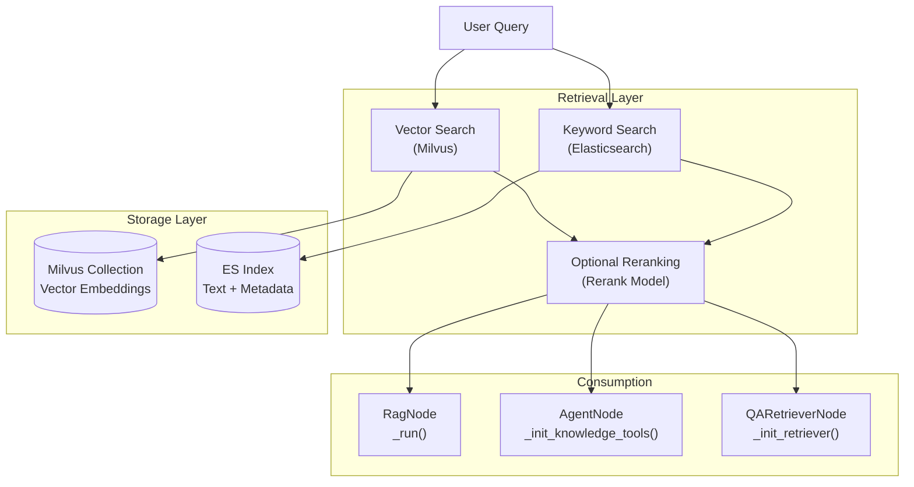
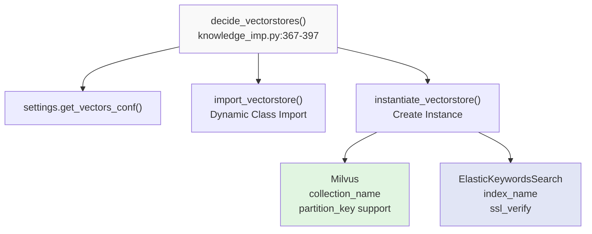
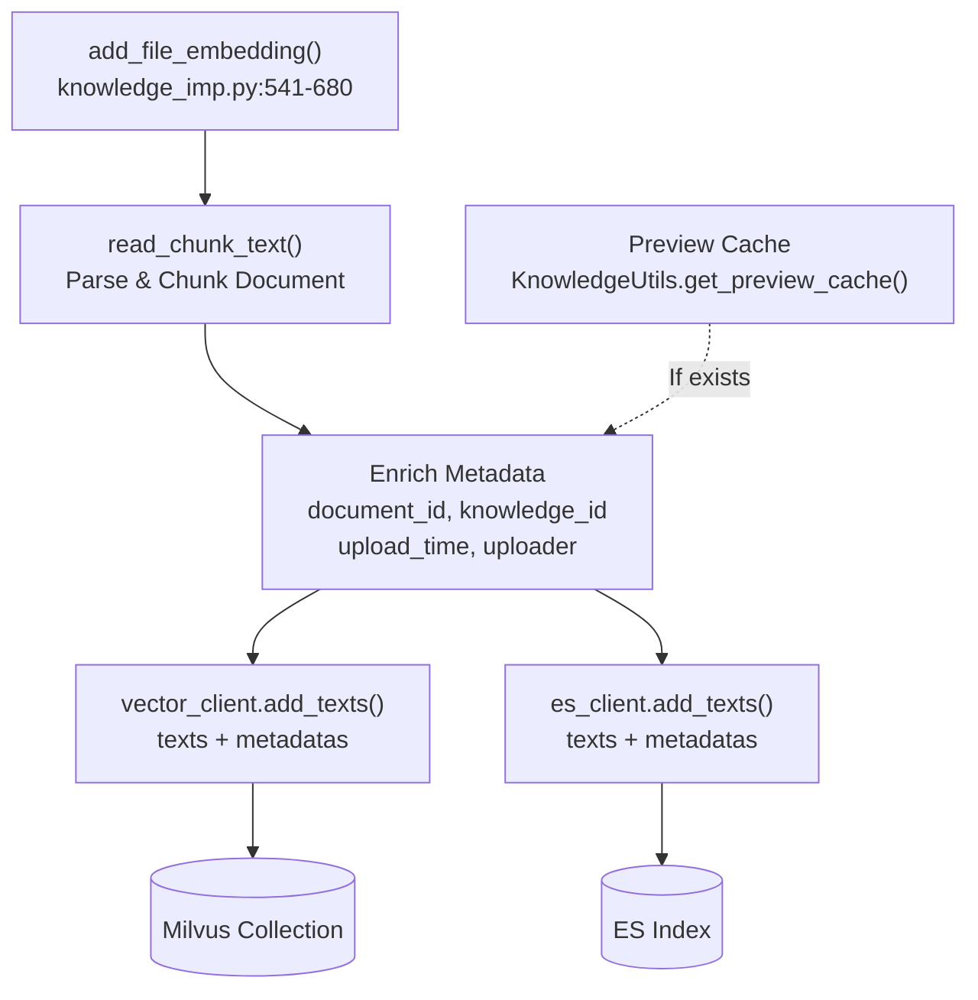
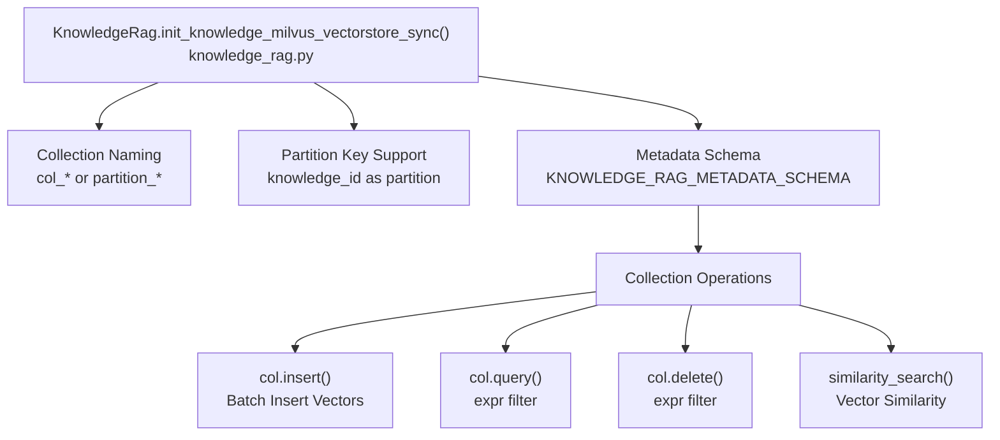
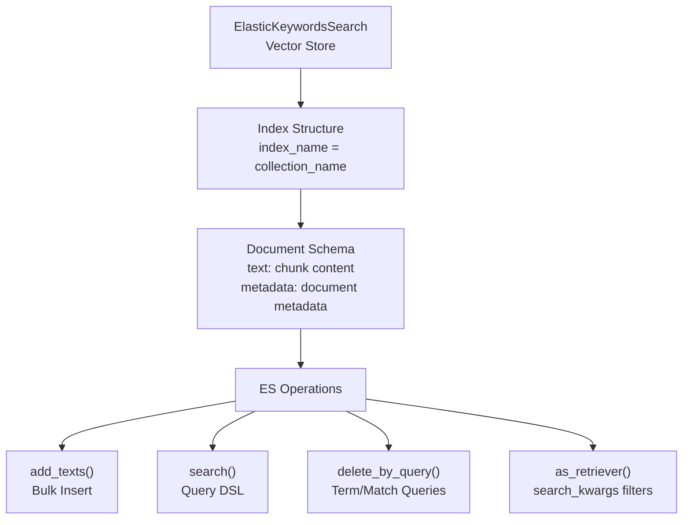
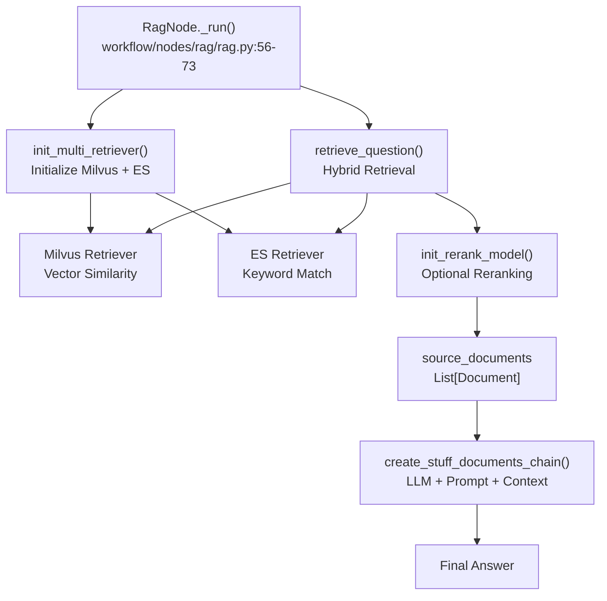
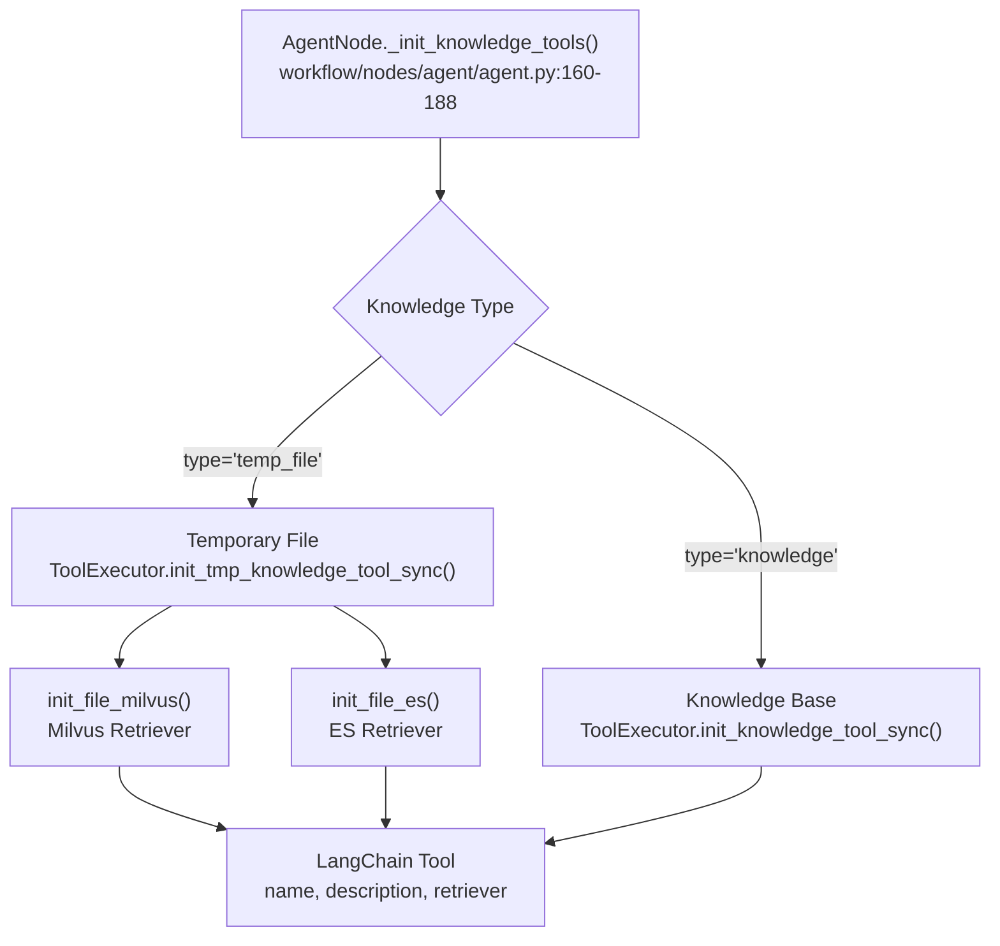
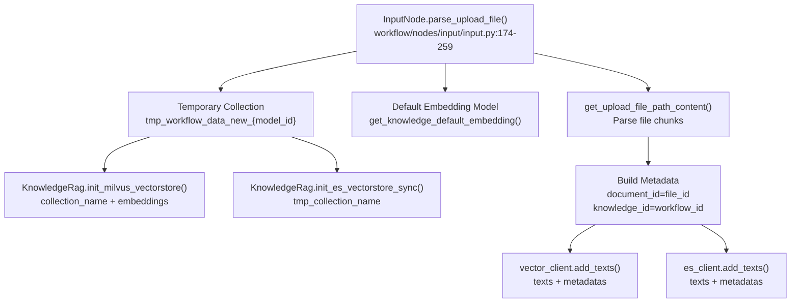
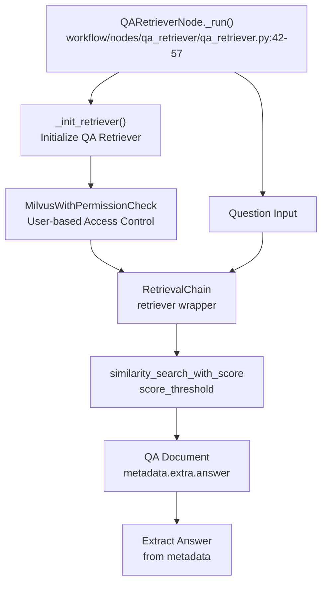
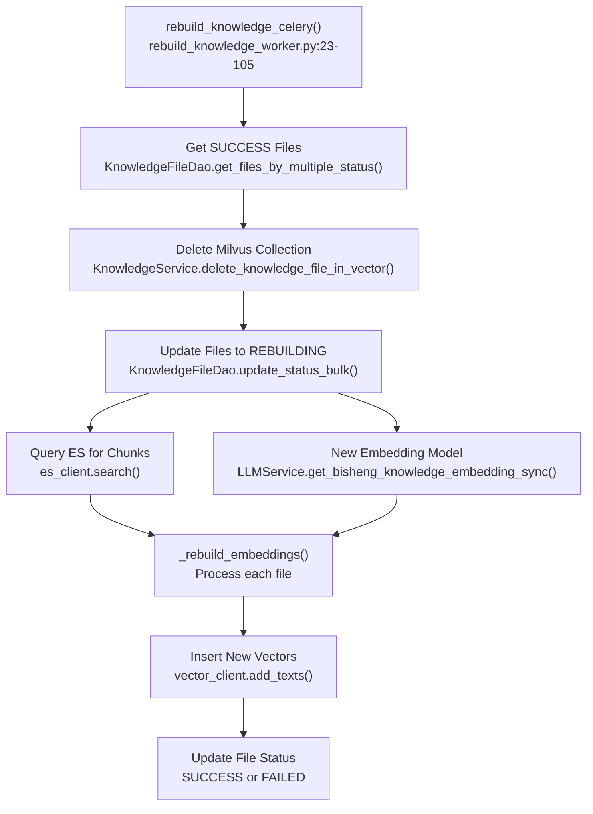

<!-- source: DeepWiki mcp.deepwiki.com · repo dataelement/bisheng · page 6.3 Vector Search and Retrieval · fetched 2026-10-29 -->

# Vector Search and Retrieval

<details>
<summary>Relevant source files</summary>

The following files were used as context for generating this wiki page:

- [.github/workflows/ci.yml](.github/workflows/ci.yml)
- [.github/workflows/release.yml](.github/workflows/release.yml)
- [.pre-commit-config.yaml](.pre-commit-config.yaml)
- [docker/bisheng/config/config.yaml](docker/bisheng/config/config.yaml)
- [src/backend/bisheng/api/services/chat_imp.py](src/backend/bisheng/api/services/chat_imp.py)
- [src/backend/bisheng/api/services/knowledge.py](src/backend/bisheng/api/services/knowledge.py)
- [src/backend/bisheng/api/services/knowledge_imp.py](src/backend/bisheng/api/services/knowledge_imp.py)
- [src/backend/bisheng/api/utils.py](src/backend/bisheng/api/utils.py)
- [src/backend/bisheng/api/v1/endpoints.py](src/backend/bisheng/api/v1/endpoints.py)
- [src/backend/bisheng/database/base.py](src/backend/bisheng/database/base.py)
- [src/backend/bisheng/graph/vertex/base.py](src/backend/bisheng/graph/vertex/base.py)
- [src/backend/bisheng/initdb_config.yaml](src/backend/bisheng/initdb_config.yaml)
- [src/backend/bisheng/interface/chains/base.py](src/backend/bisheng/interface/chains/base.py)
- [src/backend/bisheng/interface/chains/custom.py](src/backend/bisheng/interface/chains/custom.py)
- [src/backend/bisheng/interface/initialize/loading.py](src/backend/bisheng/interface/initialize/loading.py)
- [src/backend/bisheng/interface/initialize/vector_store.py](src/backend/bisheng/interface/initialize/vector_store.py)
- [src/backend/bisheng/main.py](src/backend/bisheng/main.py)
- [src/backend/bisheng/processing/base.py](src/backend/bisheng/processing/base.py)
- [src/backend/bisheng/processing/process.py](src/backend/bisheng/processing/process.py)
- [src/backend/bisheng/services/session/service.py](src/backend/bisheng/services/session/service.py)
- [src/backend/bisheng/template/frontend_node/chains.py](src/backend/bisheng/template/frontend_node/chains.py)
- [src/backend/bisheng/template/frontend_node/embeddings.py](src/backend/bisheng/template/frontend_node/embeddings.py)
- [src/backend/bisheng/template/frontend_node/llms.py](src/backend/bisheng/template/frontend_node/llms.py)
- [src/backend/bisheng/template/frontend_node/vectorstores.py](src/backend/bisheng/template/frontend_node/vectorstores.py)
- [src/backend/bisheng/worker/knowledge/file_worker.py](src/backend/bisheng/worker/knowledge/file_worker.py)
- [src/backend/bisheng/worker/knowledge/qa.py](src/backend/bisheng/worker/knowledge/qa.py)
- [src/backend/bisheng/worker/knowledge/rebuild_knowledge_worker.py](src/backend/bisheng/worker/knowledge/rebuild_knowledge_worker.py)
- [src/backend/test/test_filelib.py](src/backend/test/test_filelib.py)

</details>


## Purpose and Scope

This document describes the vector search and retrieval mechanisms in the Bisheng platform, focusing on the hybrid search architecture that combines Milvus vector similarity search with Elasticsearch keyword search. It covers document indexing, retrieval strategies, reranking, and integration patterns with RAG (Retrieval-Augmented Generation) and agent systems.

For information about document processing and chunking before indexing, see [Document Processing Pipeline](#6.1). For knowledge base management and file upload, see [Knowledge Base Management](#3.1). For asynchronous task processing of indexing operations, see [Asynchronous Task Processing](#6.2).

## Hybrid Search Architecture

The Bisheng platform implements a dual-index architecture where documents are simultaneously indexed in both Milvus (for semantic vector search) and Elasticsearch (for keyword-based full-text search). This enables hybrid retrieval strategies that leverage both semantic similarity and exact keyword matching.

**Hybrid Retrieval Architecture**



Sources: [src/backend/bisheng/workflow/nodes/rag/rag.py:22-197](), [src/backend/bisheng/workflow/nodes/agent/agent.py:160-188](), [src/backend/bisheng/workflow/nodes/qa_retriever/qa_retriever.py:11-72]()

## Vector Store Factory and Configuration

The `decide_vectorstores()` function serves as a factory for creating vector store instances, supporting both Milvus and Elasticsearch backends with configuration from the system settings.

**Vector Store Initialization Flow**



The factory function handles:
- **Milvus**: Collection naming, partition key configuration for multi-tenancy, embedding model compatibility
- **Elasticsearch**: Index naming, SSL verification, metadata schema validation

Sources: [src/backend/bisheng/api/services/knowledge_imp.py:367-397]()

| Parameter | Milvus Configuration | Elasticsearch Configuration |
|-----------|---------------------|----------------------------|
| Primary Identifier | `collection_name` | `index_name` |
| Multi-tenancy | `partition_key` (knowledge_id) | Not applicable |
| Connection | From `settings.get_vectors_conf().milvus` | From `settings.get_vectors_conf().elasticsearch` |
| Metadata | Vector embeddings + metadata | Text + metadata (no vectors) |

## Document Indexing Pipeline

When documents are processed and chunked, they are simultaneously indexed in both Milvus and Elasticsearch. The `add_file_embedding()` function orchestrates this dual-indexing process.

**Dual-Index Document Flow**



Sources: [src/backend/bisheng/api/services/knowledge_imp.py:541-680]()

Key aspects of the indexing process:

1. **Text Extraction**: Documents are parsed and split into chunks using `read_chunk_text()` [src/backend/bisheng/api/services/knowledge_imp.py:773-957]()

2. **Metadata Enrichment**: Each chunk receives metadata including:
   - `document_id`: File identifier
   - `knowledge_id`: Knowledge base identifier
   - `upload_time` and `update_time`: Timestamps
   - `uploader` and `updater`: User information
   - `bbox`: Optional OCR bounding box data for preview

3. **Dual Insertion**: Chunks are inserted into both stores:
   - **Milvus**: Stores text + vector embedding + metadata [src/backend/bisheng/api/services/knowledge_imp.py:650]()
   - **Elasticsearch**: Stores text + metadata (no embedding) [src/backend/bisheng/api/services/knowledge_imp.py:654]()

4. **Cache Integration**: If preview cache exists (user-edited chunks), those are used instead of freshly parsed chunks [src/backend/bisheng/api/services/knowledge_imp.py:600-609]()

## Milvus Vector Storage

Milvus stores high-dimensional vector embeddings generated from document chunks. The system supports both dedicated collections and partitioned collections for multi-tenancy.

**Milvus Collection Management**



Sources: [src/backend/bisheng/api/services/knowledge_imp.py:383-391](), [src/backend/bisheng/worker/knowledge/file_worker.py:161-221]()

### Collection Naming Strategies

The system uses two collection naming strategies:

1. **Dedicated Collections** (prefix `col_`): Each knowledge base gets its own collection
2. **Partitioned Collections** (prefix `partition_`): Multiple knowledge bases share a collection, differentiated by partition keys

This is determined during knowledge base creation [src/backend/bisheng/api/services/knowledge.py:177-179]():

```python
db_knowledge.index_name = generate_knowledge_index_name()
db_knowledge.collection_name = db_knowledge.index_name
```

### Vector Operations

Key Milvus operations used throughout the system:

| Operation | Usage | Example Location |
|-----------|-------|-----------------|
| `add_texts()` | Insert document chunks | [knowledge_imp.py:650]() |
| `query()` | Filtered retrieval by metadata | [file_worker.py:174-176]() |
| `delete()` | Remove documents by ID | [knowledge_imp.py:312]() |
| `similarity_search()` | Vector similarity retrieval | Through retriever interface |

### Partition Key Support

For partitioned collections, the `partition_key` is set to `knowledge_id` during initialization:

```python
if knowledge_id and collection_name.startswith("partition"):
    param["partition_key"] = knowledge_id
```

This enables efficient multi-tenant isolation within a shared collection [src/backend/bisheng/api/services/knowledge_imp.py:383-384]().

## Elasticsearch Full-Text Search

Elasticsearch provides keyword-based search capabilities, complementing Milvus vector search with exact term matching and filtering.

**Elasticsearch Index Structure**



Sources: [src/backend/bisheng/api/services/knowledge_imp.py:315-320](), [src/backend/bisheng/worker/knowledge/file_worker.py:223-244]()

### Index Management

Elasticsearch indices are created with the same name as the knowledge base's `index_name` [src/backend/bisheng/api/services/knowledge.py:189-191]():

```python
es_client = KnowledgeRag.init_knowledge_es_vectorstore_sync(
    knowledge=db_knowledge, 
    metadata_schemas=KNOWLEDGE_RAG_METADATA_SCHEMA
)
es_client._store._create_index_if_not_exists()
```

### Search Capabilities

Elasticsearch provides:
- **Full-text search**: Tokenized search across document content
- **Metadata filtering**: Filter by `document_id`, `knowledge_id`, etc.
- **Scoring**: BM25 relevance scoring for keyword matches

Example deletion by query [src/backend/bisheng/api/services/knowledge_imp.py:315-320]():

```python
res = es_client.client.delete_by_query(
    index=knowledge.index_name,
    query={"terms": {"metadata.document_id": file_ids}},
)
```

## Hybrid Retrieval in RAG Nodes

The `RagNode` class implements hybrid retrieval by combining results from both Milvus vector search and Elasticsearch keyword search, with optional reranking.

**RAG Node Retrieval Flow**



Sources: [src/backend/bisheng/workflow/nodes/rag/rag.py:56-126]()

### Multi-Retriever Initialization

The RAG node extends `RagUtils` base class, which provides retriever initialization methods. The key retrievers are:

1. **Vector Retriever** (`self._milvus`): Initialized from Milvus collection
2. **Keyword Retriever** (`self._es`): Initialized from ES index  
3. **Rerank Model** (optional): Applied to combined results

Retriever configuration is based on:
- Knowledge base IDs or temporary file metadata
- Search parameters (top-k, score threshold)
- Metadata filtering expressions

### Question Retrieval Process

The `retrieve_question()` method (inherited from `RagUtils`) performs:

1. **Parallel Search**: Query both Milvus and ES simultaneously
2. **Result Merging**: Combine documents from both sources
3. **Deduplication**: Remove duplicate chunks if present
4. **Reranking**: Apply rerank model if configured
5. **Top-K Selection**: Return top results based on score

Retrieved documents include:
- `page_content`: The text chunk
- `metadata`: Document metadata (file name, page number, etc.)

### Integration with LLM Chain

Retrieved documents are passed to `create_stuff_documents_chain()` which constructs the final LLM prompt:

```python
qa_chain = create_stuff_documents_chain(llm=self._llm, prompt=self._qa_prompt)
inputs = {
    "context": source_documents,
    "question": question
}
result = qa_chain.invoke(inputs, config=RunnableConfig(callbacks=[llm_callback]))
```

Sources: [src/backend/bisheng/workflow/nodes/rag/rag.py:84-99]()

The prompt template allows referencing `{context}` for retrieved documents and `{question}` for the user query.

## Knowledge Tools in Agent Nodes

Agent nodes can access knowledge bases through specialized knowledge tools that wrap the retrieval functionality.

**Agent Knowledge Tool Initialization**



Sources: [src/backend/bisheng/workflow/nodes/agent/agent.py:160-188]()

### Knowledge Tool Types

Agents can use two types of knowledge tools:

1. **Persistent Knowledge Bases**: Standard knowledge bases from the system
   - Initialized via `ToolExecutor.init_knowledge_tool_sync()` [src/backend/bisheng/workflow/nodes/agent/agent.py:166-169]()
   - Includes pre-configured retrieval parameters

2. **Temporary File Knowledge**: Files uploaded within the workflow session
   - Requires separate Milvus and ES retriever initialization
   - Uses temporary collection with workflow-scoped partition key
   - File metadata provides document IDs for filtering

### Temporary File Retrieval

For temporary files, the agent node initializes retrievers with filtering expressions:

**Milvus Retriever** [src/backend/bisheng/workflow/nodes/agent/agent.py:190-199]():
```python
vector_client = KnowledgeRag.init_milvus_vectorstore(
    collection_name=collection_name, 
    embeddings=embeddings
)
return vector_client.as_retriever(
    search_kwargs={"expr": f'document_id in {file_ids}'}
)
```

**ES Retriever** [src/backend/bisheng/workflow/nodes/agent/agent.py:201-204]():
```python
es_client = KnowledgeRag.init_es_vectorstore_sync(index_name=self.tmp_collection_name)
return es_client.as_retriever(
    search_kwargs={"filter": [{"term": {"metadata.document_id": file_metadata['document_id']}}]}
)
```

This allows agents to access both persistent and session-specific knowledge within the same conversation.

## Temporary File Vector Storage

The `InputNode` handles file uploads within workflows and indexes them in temporary vector stores for downstream retrieval.

**Input Node File Processing**



Sources: [src/backend/bisheng/workflow/nodes/input/input.py:174-259]()

### Temporary Collection Naming

Temporary files use a special collection naming scheme that includes the embedding model ID:

```python
self.tmp_collection_name = 'tmp_workflow_data_new'
milvus_collection_name = self.get_milvus_collection_name(getattr(self._embedding, 'model_id'))
# Results in: tmp_workflow_data_new_{model_id}
```

This ensures that files embedded with different models are stored in separate collections, maintaining vector compatibility [src/backend/bisheng/workflow/nodes/input/input.py:188-189]().

### File Metadata Structure

Each uploaded file chunk receives metadata with workflow-scoped identifiers:

| Metadata Field | Value | Purpose |
|----------------|-------|---------|
| `document_id` | Generated UUID (shared per variable) | Group chunks from same upload variable |
| `document_name` | Original file name | Display and reference |
| `knowledge_id` | `workflow_id` | Partition key for multi-workflow isolation |
| `upload_time` | Current timestamp | Temporal tracking |
| `bbox` | Empty string | No OCR data for temp files |

Sources: [src/backend/bisheng/workflow/nodes/input/input.py:233-240]()

The `document_id` is shared across all files uploaded to the same input variable, allowing retrieval of all related documents with a single filter expression.

## QA Knowledge Retrieval

QA knowledge bases use a specialized retrieval mechanism for question-answer pairs, with dedicated Milvus collections and permission-aware retrievers.

**QA Retrieval Architecture**



Sources: [src/backend/bisheng/workflow/nodes/qa_retriever/qa_retriever.py:11-72]()

### QA Collection Structure

QA knowledge bases store question-answer pairs as special documents where:
- The `text` field contains the question (for embedding/search)
- The `metadata.extra.answer` field contains the answer
- Access is controlled by user permissions via `MilvusWithPermissionCheck`

### QA Retriever Configuration

The QA retriever uses:
- **Collection Name**: Directly specified QA knowledge ID
- **Search Type**: `similarity_score_threshold`
- **Search Parameters**: `{'k': 1, 'score_threshold': user_configured_score}`
- **Permission Check**: Enabled via `_is_check_auth` parameter

Sources: [src/backend/bisheng/workflow/nodes/qa_retriever/qa_retriever.py:24-40]()

When a question is retrieved, the system:
1. Performs vector similarity search on questions
2. Filters by score threshold
3. Extracts answer from top result's metadata
4. Returns answer text or empty string if no match

The result document is also stored for source tracing: `self.graph_state.set_variable(self.id, '$retrieved_result$', result['result'][0])` [src/backend/bisheng/workflow/nodes/qa_retriever/qa_retriever.py:49]()

## Vector Store Rebuilding

When the embedding model changes, the system must rebuild vector stores by re-embedding all chunks while preserving the original text in Elasticsearch.

**Rebuild Process Flow**



Sources: [src/backend/bisheng/worker/knowledge/rebuild_knowledge_worker.py:22-257]()

### Rebuild Strategy

The rebuild process follows these steps:

1. **Preserve Text Data**: ES retains original text and metadata
2. **Delete Vectors Only**: Only Milvus collection is dropped [src/backend/bisheng/worker/knowledge/rebuild_knowledge_worker.py:50]()
3. **Batch Processing**: Files are processed in batches to prevent memory issues
4. **Re-embedding**: Each chunk is re-embedded with the new model
5. **Status Tracking**: Files track rebuild status (REBUILDING, SUCCESS, FAILED)

### Per-File Processing

For each file, the rebuild worker [src/backend/bisheng/worker/knowledge/rebuild_knowledge_worker.py:207-257]():

1. **Queries ES** for all chunks belonging to the file:
   ```python
   search_query = {
       "query": {"match": {"metadata.file_id": file.id}},
       "size": 10000
   }
   response = es_client.client.search(index=index_name, body=search_query)
   ```

2. **Extracts text and metadata** from ES results

3. **Removes pk field** from metadata to avoid conflicts

4. **Calls add_texts()** with new embedding model:
   ```python
   vector_client.add_texts(texts=texts, metadatas=metadatas)
   ```

This preserves all original metadata while updating only the vector embeddings.

## Metadata Schemas and Filtering

Both Milvus and Elasticsearch use structured metadata schemas defined by `KNOWLEDGE_RAG_METADATA_SCHEMA` for consistent filtering and retrieval.

### Standard Metadata Fields

| Field | Type | Purpose | Used In |
|-------|------|---------|---------|
| `document_id` | int | File identifier | Filtering specific files |
| `knowledge_id` | int/str | Knowledge base identifier | Multi-tenancy isolation |
| `document_name` | string | File name | Display and reference |
| `page` | int | Page number | Source tracking |
| `bbox` | JSON string | OCR bounding boxes | Preview highlighting |
| `upload_time` | int | Upload timestamp | Temporal filtering |
| `update_time` | int | Last update timestamp | Change tracking |
| `uploader` | string | Upload user | Audit trail |
| `updater` | string | Update user | Audit trail |
| `user_metadata` | dict | Custom metadata | Extensibility |

### Filter Expression Examples

**Milvus expr syntax** [src/backend/bisheng/worker/knowledge/file_worker.py:174-176]():
```python
expr = f"document_id=={source_file_id} && knowledge_id=={source_knowledge.id}"
source_data = source_milvus.col.query(expr=expr, output_fields=fields)
```

**Elasticsearch filter DSL** [src/backend/bisheng/workflow/nodes/agent/agent.py:203-204]():
```python
search_kwargs = {
    "filter": [{"term": {"metadata.document_id": file_metadata['document_id']}}]
}
```

These consistent metadata schemas enable precise filtering across both vector stores, supporting use cases like:
- Single file retrieval
- Knowledge base isolation
- User-scoped access control
- Temporal queries
- Cross-reference resolution

Sources: [src/backend/bisheng/api/services/knowledge_imp.py:637-645](), [src/backend/bisheng/workflow/nodes/input/input.py:233-240]()

---

