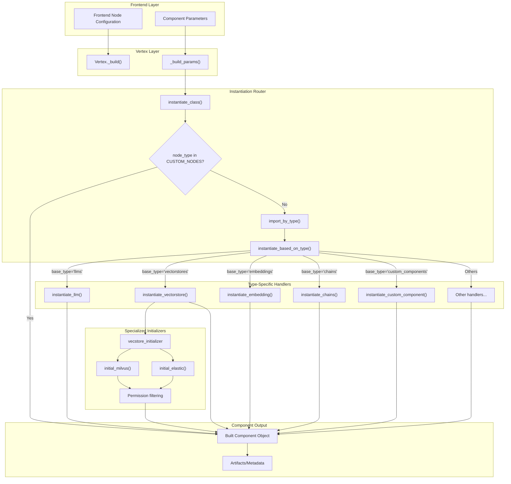
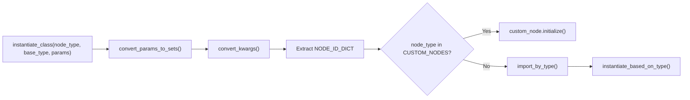
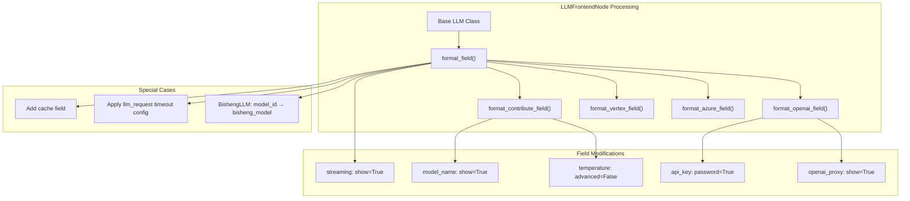
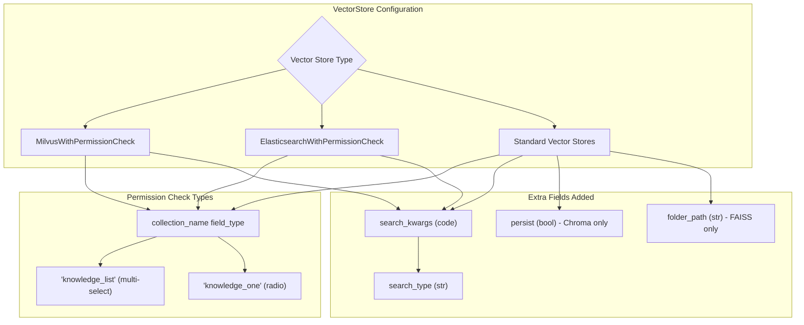
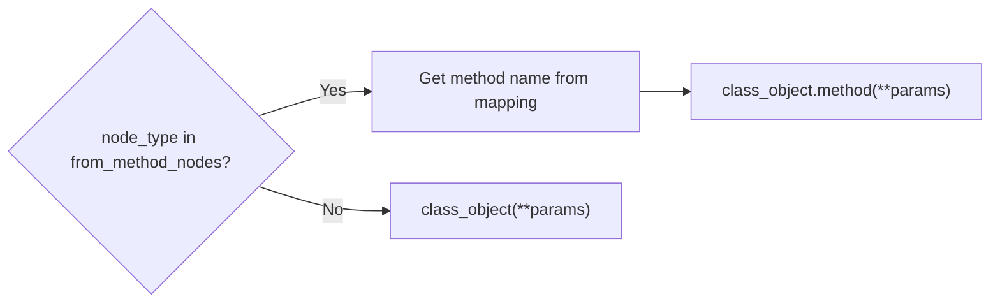
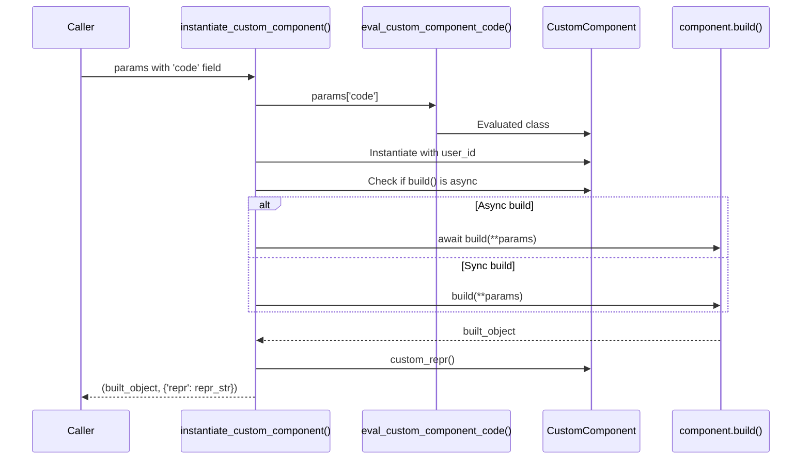
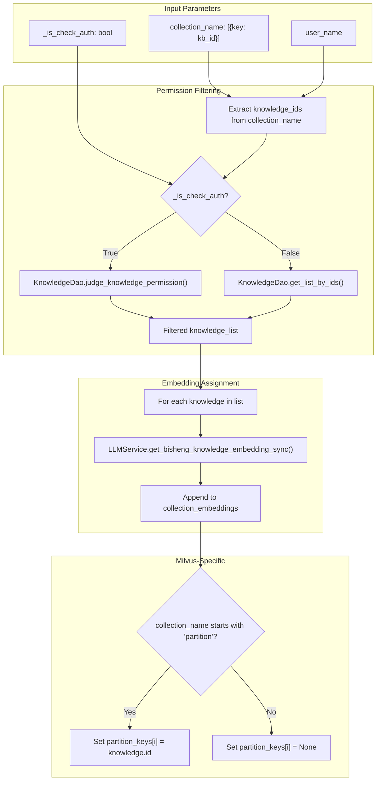
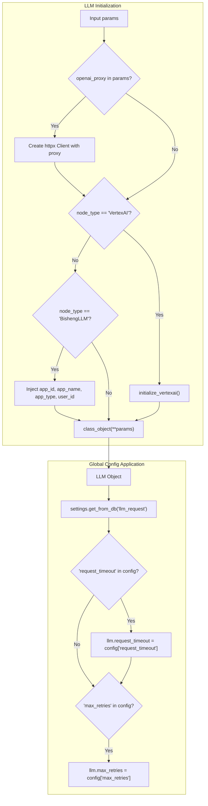
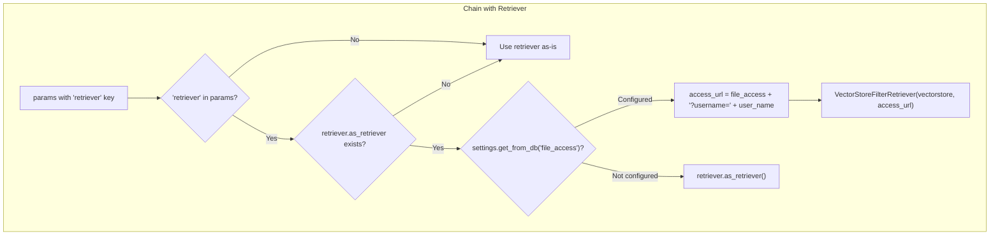
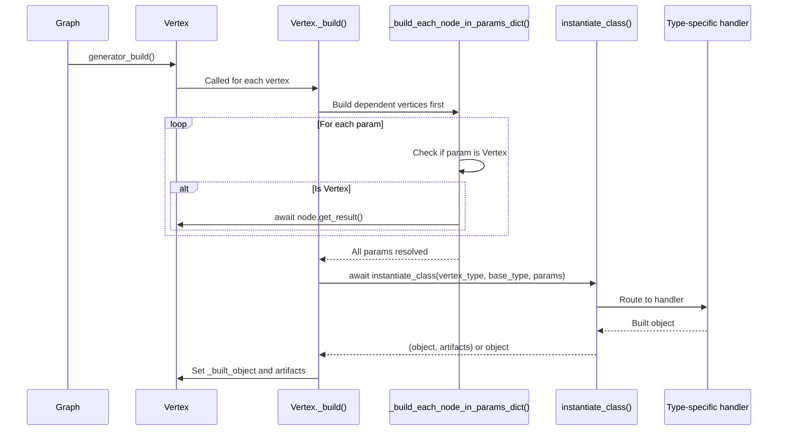

<!-- source: DeepWiki mcp.deepwiki.com · repo dataelement/bisheng · page 6.4 Custom Component System · fetched 2026-10-29 -->

# Custom Component System

<details>
<summary>Relevant source files</summary>

The following files were used as context for generating this wiki page:

- [.github/workflows/ci.yml](.github/workflows/ci.yml)
- [.github/workflows/release.yml](.github/workflows/release.yml)
- [.pre-commit-config.yaml](.pre-commit-config.yaml)
- [docker/bisheng/config/config.yaml](docker/bisheng/config/config.yaml)
- [src/backend/bisheng/api/services/chat_imp.py](src/backend/bisheng/api/services/chat_imp.py)
- [src/backend/bisheng/api/utils.py](src/backend/bisheng/api/utils.py)
- [src/backend/bisheng/api/v1/endpoints.py](src/backend/bisheng/api/v1/endpoints.py)
- [src/backend/bisheng/database/base.py](src/backend/bisheng/database/base.py)
- [src/backend/bisheng/graph/vertex/base.py](src/backend/bisheng/graph/vertex/base.py)
- [src/backend/bisheng/initdb_config.yaml](src/backend/bisheng/initdb_config.yaml)
- [src/backend/bisheng/interface/chains/base.py](src/backend/bisheng/interface/chains/base.py)
- [src/backend/bisheng/interface/chains/custom.py](src/backend/bisheng/interface/chains/custom.py)
- [src/backend/bisheng/interface/initialize/loading.py](src/backend/bisheng/interface/initialize/loading.py)
- [src/backend/bisheng/interface/initialize/vector_store.py](src/backend/bisheng/interface/initialize/vector_store.py)
- [src/backend/bisheng/main.py](src/backend/bisheng/main.py)
- [src/backend/bisheng/processing/base.py](src/backend/bisheng/processing/base.py)
- [src/backend/bisheng/processing/process.py](src/backend/bisheng/processing/process.py)
- [src/backend/bisheng/services/session/service.py](src/backend/bisheng/services/session/service.py)
- [src/backend/bisheng/template/frontend_node/chains.py](src/backend/bisheng/template/frontend_node/chains.py)
- [src/backend/bisheng/template/frontend_node/embeddings.py](src/backend/bisheng/template/frontend_node/embeddings.py)
- [src/backend/bisheng/template/frontend_node/llms.py](src/backend/bisheng/template/frontend_node/llms.py)
- [src/backend/bisheng/template/frontend_node/vectorstores.py](src/backend/bisheng/template/frontend_node/vectorstores.py)
- [src/backend/test/test_filelib.py](src/backend/test/test_filelib.py)

</details>


The Custom Component System provides a unified framework for instantiating, configuring, and extending AI components in Bisheng. It enables dynamic creation of LLMs, vector stores, embeddings, chains, agents, and other LangChain primitives from frontend configuration, while supporting custom implementations and permission-based filtering.

For information about how components are executed within workflows, see [Workflow Engine](#3.5). For details on session-level caching of instantiated components, see [Session Management and Caching](#6.5).

---

## System Architecture

The Custom Component System consists of three primary subsystems: the instantiation router (`instantiate_class`), frontend node configurators, and specialized initializers for each component type.

### Component Instantiation Flow



**Diagram: Component Instantiation Routing Architecture**

Sources: [src/backend/bisheng/interface/initialize/loading.py:58-147](), [src/backend/bisheng/graph/vertex/base.py:254-413]()

---

## Core Instantiation Framework

### Main Entry Point: instantiate_class

The `instantiate_class` function serves as the universal entry point for creating any component in Bisheng. It accepts a `node_type` (e.g., "ChatOpenAI", "Milvus"), a `base_type` (e.g., "llms", "vectorstores"), and parameters dict.



**Diagram: instantiate_class Function Flow**

Key operations:

| Step | Function | Purpose |
|------|----------|---------|
| 1 | `convert_params_to_sets()` | Converts string lists to Python sets for parameters like `allowed_special` |
| 2 | `convert_kwargs()` | Parses JSON strings in kwargs/config parameters |
| 3 | Extract `NODE_ID_DICT` | Maintains mapping of parameter keys to source node IDs |
| 4 | Check `CUSTOM_NODES` | Determines if component is a pre-registered custom node |
| 5 | `import_by_type()` | Dynamically imports the class from LangChain or bisheng_langchain |
| 6 | `instantiate_based_on_type()` | Routes to specialized instantiation handler |

Sources: [src/backend/bisheng/interface/initialize/loading.py:58-86]()

### Type-Based Routing

The `instantiate_based_on_type` function routes to specialized handlers based on `base_type`:

| Base Type | Handler Function | Purpose |
|-----------|------------------|---------|
| `agents` | `instantiate_agent()` | Creates AgentExecutor with tools |
| `prompts` | `instantiate_prompt()` | Builds prompt templates with partial variables |
| `tools` | `instantiate_tool()` | Creates tools with dynamic args_schema |
| `embeddings` | `instantiate_embedding()` | Initializes embedding models |
| `vectorstores` | `instantiate_vectorstore()` | Creates vector stores with permission filtering |
| `chains` | `instantiate_chains()` | Builds chains with retriever integration |
| `llms` | `instantiate_llm()` | Initializes LLMs with timeout/retry config |
| `custom_components` | `instantiate_custom_component()` | Evaluates and builds user-defined components |
| `memory` | `instantiate_memory()` | Creates memory objects with retriever support |

Sources: [src/backend/bisheng/interface/initialize/loading.py:99-147]()

---

## Frontend Node Configuration System

Frontend nodes define how components are configured in the UI. Each component type has a corresponding `FrontendNode` subclass that specifies fields, validation rules, and display properties.

### TemplateField Structure

Components are configured through `TemplateField` objects that define:

```
TemplateField(
    name='temperature',           # Parameter name
    field_type='float',           # Type (str, int, float, dict, code, etc.)
    required=True,                # Whether field is mandatory
    show=True,                    # Whether to display in UI
    advanced=False,               # Whether field is in advanced section
    value=0.7,                    # Default value
    display_name='Temperature',   # UI label
    password=False,               # Whether to mask input
    is_list=False,                # Whether accepts multiple values
    options=['a', 'b']            # Dropdown options (if applicable)
)
```

### LLM Frontend Node

The `LLMFrontendNode` class handles configuration for language models:



**Diagram: LLM Frontend Node Field Processing**

Key features:

- **API Key Handling**: Automatically marks fields containing "api", "key", or "token" as password fields
- **BishengLLM Integration**: Converts `model_id` field type to `"bisheng_model"` for custom model selector [src/backend/bisheng/template/frontend_node/llms.py:223-231]()
- **Timeout Configuration**: Applies global `llm_request.request_timeout` and `max_retries` from `initdb_config.yaml` [src/backend/bisheng/interface/initialize/loading.py:281-290]()
- **Proxy Support**: Enables proxy configuration for OpenAI-compatible endpoints

Sources: [src/backend/bisheng/template/frontend_node/llms.py:10-231]()

### VectorStore Frontend Node

The `VectorStoreFrontendNode` handles configuration for vector databases with special handling for multi-knowledge-base scenarios:



**Diagram: VectorStore Frontend Node Configuration**

**Special Handling for Permission-Checked Vector Stores**:

1. **MilvusWithPermissionCheck**: Changes `collection_name` field type to `"knowledge_list"` (multi-select) with `is_list=True` [src/backend/bisheng/template/frontend_node/vectorstores.py:347-350]()
2. **ElasticsearchWithPermissionCheck**: Uses `"knowledge_list"` for `index_name` field [src/backend/bisheng/template/frontend_node/vectorstores.py:352-362]()
3. Both hide embedding and documents fields from UI (handled during instantiation)

Sources: [src/backend/bisheng/template/frontend_node/vectorstores.py:7-400]()

### Chain Frontend Node

The `ChainFrontendNode` customizes fields for different chain types:

| Chain Type | Special Fields Added |
|------------|---------------------|
| `ConversationalRetrievalChain` | `memory` (BaseChatMemory), `return_source_documents` (bool), `chain_type` (dropdown), `document_prompt` (BasePromptTemplate) |
| `SequentialChain` | `chain_order` (str, array format) |
| `MultiPromptChain`, `MultiRuleChain` | `LLMChains` (list), `destination_chain_name` (dict mapping) |

Sources: [src/backend/bisheng/template/frontend_node/chains.py:9-176]()

---

## Component Initialization Patterns

### Direct Instantiation

Most components use direct class instantiation after parameter preparation:

```
# Example: Standard LLM instantiation
class_object = ChatOpenAI  # Imported via import_by_type
params = {'temperature': 0.7, 'model_name': 'gpt-3.5-turbo', ...}
llm = class_object(**params)
```

Sources: [src/backend/bisheng/interface/initialize/loading.py:253-291]()

### From-Method Initialization

Some components require initialization through class methods rather than constructors:



**Diagram: From-Method Initialization Pattern**

**Examples**:

| Component | Method Name | Source |
|-----------|-------------|--------|
| `APIChain` | `from_llm_and_api_docs` | [src/backend/bisheng/interface/chains/base.py:28]() |
| `ConversationalRetrievalChain` | `from_llm` | [src/backend/bisheng/interface/chains/base.py:29]() |
| `BishengRetrievalQA` | `from_llm` | [src/backend/bisheng/interface/chains/base.py:33]() |
| `CombineDocsChain` | `load_qa_chain` | [src/backend/bisheng/interface/chains/custom.py:105-128]() |

Sources: [src/backend/bisheng/interface/chains/base.py:27-36](), [src/backend/bisheng/interface/initialize/loading.py:380-385]()

### Custom Component Evaluation

User-defined custom components are instantiated through code evaluation:



**Diagram: Custom Component Instantiation Sequence**

Key steps:
1. Extract `code` parameter from params
2. Evaluate code to get `CustomComponent` class
3. Instantiate with `user_id`
4. Detect if `build()` method is async using `inspect.iscoroutinefunction()`
5. Call `build()` appropriately (await if async)
6. Return built object with custom representation

Sources: [src/backend/bisheng/interface/initialize/loading.py:149-168]()

---

## Vector Store Initialization with Permission Checks

Vector stores have complex initialization logic that includes permission filtering and multi-collection support.

### Permission-Based Filtering Flow



**Diagram: Vector Store Permission Filtering Flow**

**MilvusWithPermissionCheck Initialization** [src/backend/bisheng/interface/initialize/loading.py:494-525]():

1. **Input**: `collection_name` parameter contains list of `{key: knowledge_id}` dicts
2. **Permission Check**: If `_is_check_auth=True`, calls `KnowledgeDao.judge_knowledge_permission(user_name, knowledge_ids)` to filter based on user permissions
3. **Embedding Assignment**: For each authorized knowledge base, fetches corresponding embedding model via `LLMService.get_bisheng_knowledge_embedding_sync(0, model_id=knowledge.model)`
4. **Partition Handling**: If collection name starts with "partition", sets `partition_keys[i] = knowledge.id` for partition-based filtering
5. **Fallback**: If no knowledge bases remain after filtering, uses `FakeEmbedding()` to prevent initialization errors

**ElasticsearchWithPermissionCheck**: Similar logic but uses `index_name` parameter instead of `collection_name` and doesn't require partition handling [src/backend/bisheng/interface/initialize/loading.py:526-529]()

Sources: [src/backend/bisheng/interface/initialize/loading.py:485-549]()

### Vector Store Initializer Registry

The `vecstore_initializer` dict maps vector store class names to custom initialization functions:

| Class Name | Initializer Function | Key Features |
|------------|---------------------|--------------|
| `Milvus` | `initial_milvus()` | Auto-loads connection_args from config, fetches embedding from knowledge base |
| `MilvusWithPermissionCheck` | `initial_milvus()` | Same as Milvus + permission filtering |
| `ElasticsearchStore` | `initial_elastic_vector()` | Supports connect_kwargs for credentials |
| `ElasticKeywordsSearch` | `initial_elastic()` | Keyword-based search, no embedding required |
| `ElasticsearchWithPermissionCheck` | `initial_elastic()` | Same as ElasticKeywordsSearch + permission filtering |
| `Pinecone` | `initialize_pinecone()` | Auto-retrieves API key from environment |
| `Chroma` | `initialize_chroma()` | Supports persistence flag |
| `FAISS` | `initialize_faiss()` | Supports local save/load |

Sources: [src/backend/bisheng/interface/initialize/vector_store.py:275-288]()

---

## LLM Configuration and Telemetry

### LLM Instantiation with Global Settings



**Diagram: LLM Configuration Pipeline**

**Configuration Sources**:

1. **Proxy Configuration**: If `openai_proxy` is provided, creates `httpx.Client` and `httpx.AsyncClient` with proxy settings [src/backend/bisheng/interface/initialize/loading.py:258-261]()

2. **Global Timeout/Retry Settings**: Applies settings from `initdb_config.yaml` under `llm_request` section:
   ```yaml
   llm_request:
     request_timeout: 600
     max_retries: 1
   ```
   Applied to LLM instances that have these attributes [src/backend/bisheng/interface/initialize/loading.py:281-290]()

3. **BishengLLM Telemetry**: Injects metadata for telemetry tracking:
   - `app_id`: "flow(will be deprecated)"
   - `app_name`: "flow(will be deprecated)"
   - `app_type`: `ApplicationTypeEnum.SKILL`
   - `user_id`: From params or default 0

Sources: [src/backend/bisheng/interface/initialize/loading.py:253-291](), [src/backend/bisheng/initdb_config.yaml:9-12]()

---

## Retriever and Chain Integration

### Retriever Wrapping with File Access Control

When `file_access` setting is configured, retrievers are wrapped with `VectorStoreFilterRetriever` to enforce document-level permissions:



**Diagram: Retriever Wrapping for Access Control**

This pattern applies to:
- **Chain instantiation**: When chain has a retriever parameter [src/backend/bisheng/interface/initialize/loading.py:332-343]()
- **VectorStore as_retriever**: When converting vector store to retriever [src/backend/bisheng/interface/initialize/loading.py:538-548]()

The `VectorStoreFilterRetriever` makes HTTP requests to the configured `file_access` endpoint to verify user permissions for each retrieved document before returning results.

Sources: [src/backend/bisheng/interface/initialize/loading.py:332-343, 538-548]()

---

## Extension Points

### Adding Custom Nodes

Custom nodes can be registered in `CUSTOM_NODES` dict [src/backend/bisheng/interface/initialize/loading.py:63-68](). They must either:
1. Implement an `initialize()` classmethod
2. Be instantiable via `__init__()`

### Creating New Initializers

To add a new vector store initializer:

1. Define initialization function in [src/backend/bisheng/interface/initialize/vector_store.py]()
2. Add mapping to `vecstore_initializer` dict [src/backend/bisheng/interface/initialize/vector_store.py:275-288]()
3. Handle special cases (connection args, embedding selection, permission checks)

### Extending Frontend Nodes

To customize UI configuration for a component type:

1. Create or extend a `FrontendNode` subclass in [src/backend/bisheng/template/frontend_node/]()
2. Override `format_field()` to customize field properties
3. Override `add_extra_fields()` to inject additional configuration fields

Example field type mappings:

| Field Type | Frontend Rendering |
|------------|-------------------|
| `"bisheng_model"` | Model selector dropdown from LLM service |
| `"bisheng_embedding"` | Embedding model selector dropdown |
| `"knowledge_one"` | Single knowledge base selector (radio) |
| `"knowledge_list"` | Multiple knowledge base selector (checkboxes) |
| `"code"` | Code editor with syntax highlighting |
| `"file"` | File upload widget |

Sources: [src/backend/bisheng/template/frontend_node/base.py](), [src/backend/bisheng/template/frontend_node/llms.py:223-231](), [src/backend/bisheng/template/frontend_node/vectorstores.py:346-362]()

---

## Integration with Vertex Build System

The Custom Component System is invoked during vertex building in the workflow graph:



**Diagram: Component Instantiation within Vertex Build**

Key points:
- Vertices are built in topological order
- Dependent vertices are built recursively before a vertex instantiates its component
- The `NODE_ID_DICT` tracks which vertex IDs provided which parameter values
- Built objects and artifacts are cached on the vertex for reuse

Sources: [src/backend/bisheng/graph/vertex/base.py:254-413](), [src/backend/bisheng/api/utils.py:158-228]()

---

**Summary**: The Custom Component System provides a flexible, extensible framework for instantiating AI components with frontend-configurable parameters, permission-based filtering, and support for both standard LangChain components and custom user-defined implementations. It bridges the gap between UI configuration and runtime execution through a type-based routing system with specialized handlers for each component category.

---

