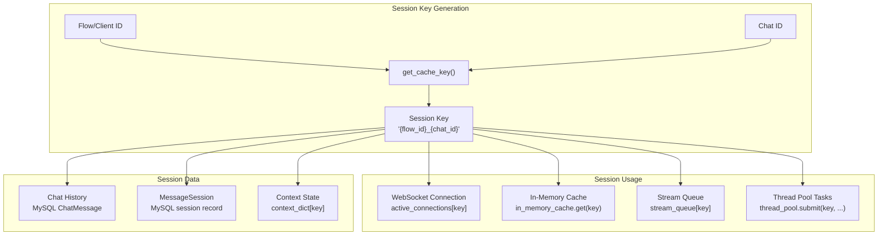
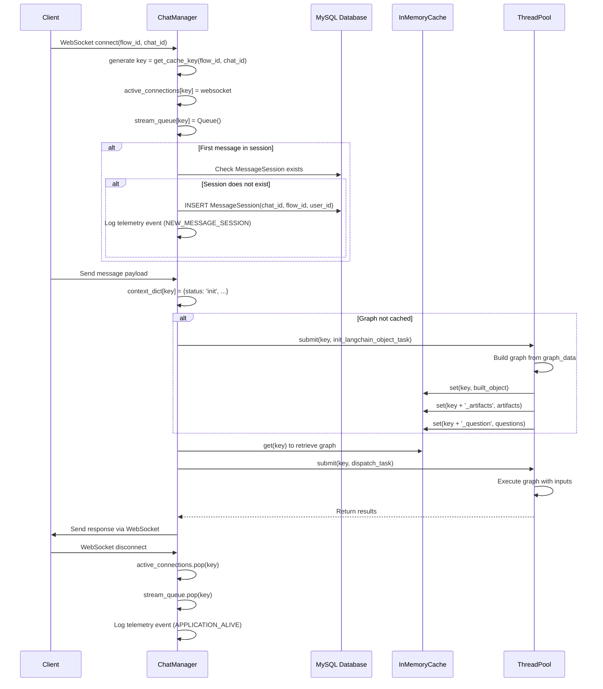
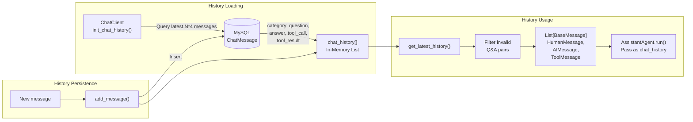
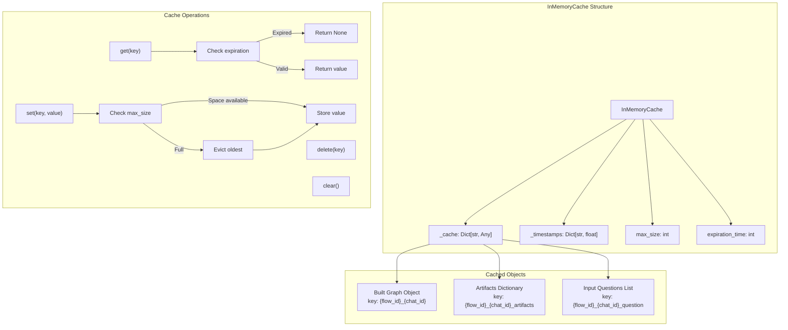
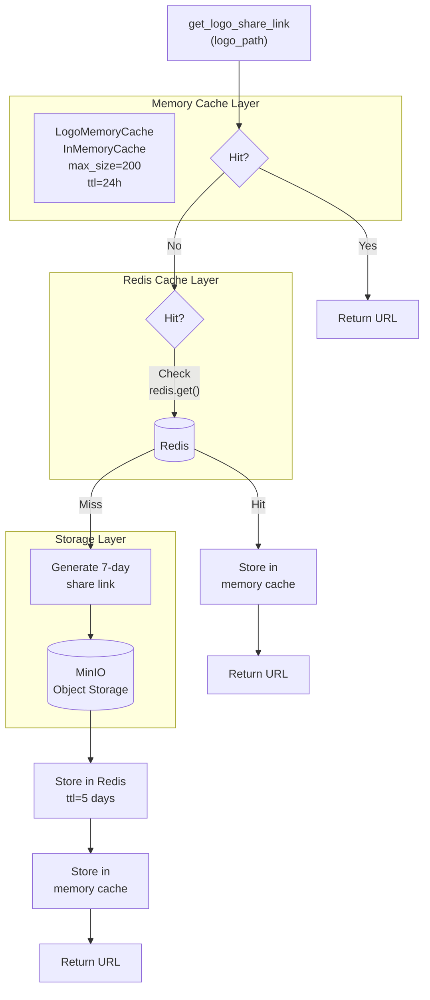
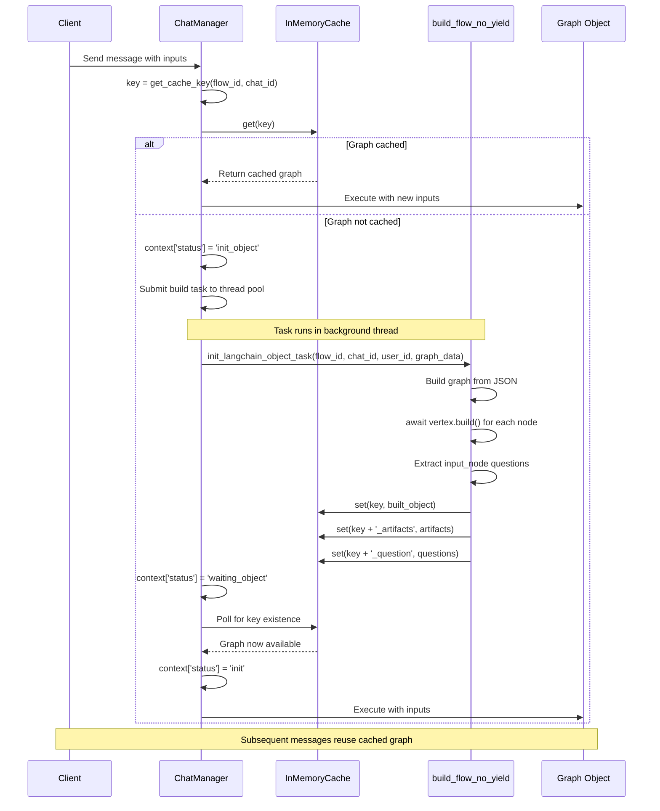
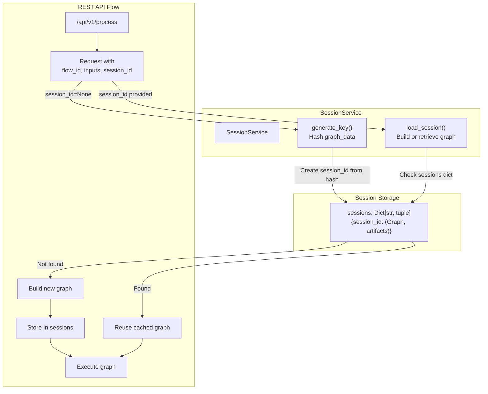
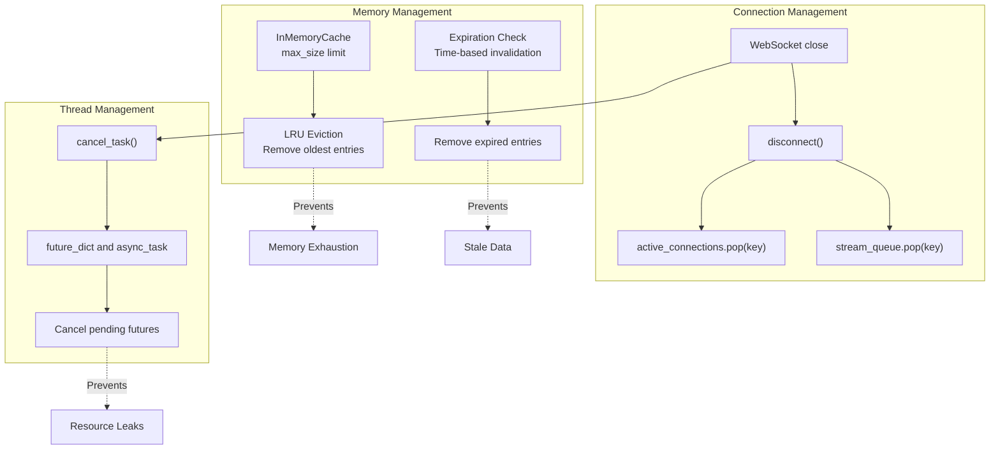
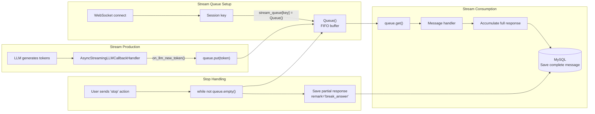

<!-- source: DeepWiki mcp.deepwiki.com · repo dataelement/bisheng · page 6.5 Session Management and Caching · fetched 2026-10-29 -->

# Session Management and Caching

Relevant source files

The following files were used as context for generating this wiki page:

- [docker/bisheng/config/config.yaml](docker/bisheng/config/config.yaml)
- [src/backend/bisheng/api/services/assistant_agent.py](src/backend/bisheng/api/services/assistant_agent.py)
- [src/backend/bisheng/api/services/base.py](src/backend/bisheng/api/services/base.py)
- [src/backend/bisheng/api/utils.py](src/backend/bisheng/api/utils.py)
- [src/backend/bisheng/api/v1/callback.py](src/backend/bisheng/api/v1/callback.py)
- [src/backend/bisheng/api/v1/endpoints.py](src/backend/bisheng/api/v1/endpoints.py)
- [src/backend/bisheng/chat/client.py](src/backend/bisheng/chat/client.py)
- [src/backend/bisheng/chat/handlers.py](src/backend/bisheng/chat/handlers.py)
- [src/backend/bisheng/chat/manager.py](src/backend/bisheng/chat/manager.py)
- [src/backend/bisheng/database/base.py](src/backend/bisheng/database/base.py)
- [src/backend/bisheng/graph/vertex/base.py](src/backend/bisheng/graph/vertex/base.py)
- [src/backend/bisheng/initdb_config.yaml](src/backend/bisheng/initdb_config.yaml)
- [src/backend/bisheng/interface/chains/base.py](src/backend/bisheng/interface/chains/base.py)
- [src/backend/bisheng/interface/chains/custom.py](src/backend/bisheng/interface/chains/custom.py)
- [src/backend/bisheng/interface/initialize/loading.py](src/backend/bisheng/interface/initialize/loading.py)
- [src/backend/bisheng/main.py](src/backend/bisheng/main.py)
- [src/backend/bisheng/template/frontend_node/chains.py](src/backend/bisheng/template/frontend_node/chains.py)
- [src/backend/bisheng/utils/threadpool.py](src/backend/bisheng/utils/threadpool.py)

## Purpose and Scope

This document describes Bisheng's session management and caching mechanisms, which enable efficient stateful conversations and prevent redundant graph rebuilding. Session management tracks user interactions across WebSocket connections and REST API calls, while the caching layer stores expensive-to-build objects like LangChain graphs, LLM instances, and vector stores.

For information about flow/skill execution workflow, see [Flow and Skill Management](#3.7). For chat message persistence, see [Chat and Messaging System](#3.2).

---

## Session Management Architecture

### Session Identification and Key Generation

Sessions in Bisheng are identified by composite keys combining `flow_id` (or `client_id`) and `chat_id`. The system uses a consistent key generation function to maintain identity across different subsystems.

**Session Key Format**: The key follows the pattern `{flow_id}_{chat_id}`, generated by the `get_cache_key()` utility function. This key serves as the primary identifier across all session-related operations.

**Sources**: [src/backend/bisheng/chat/manager.py:115-122](), [src/backend/bisheng/utils/util.py]() (referenced)

### Session Lifecycle Management

The session lifecycle begins when a WebSocket connection is established or a REST API call is made, and continues until the connection is closed or the session expires.

**Connection Establishment**: When a WebSocket connection is established via `ChatManager.connect()`, the manager creates entries in `active_connections` and `stream_queue` dictionaries using the session key.

**Context Tracking**: The `context_dict` maintains per-session state including:
- `status`: Current processing stage ('init', 'init_object', 'waiting_object')
- `has_file`: Whether file processing is involved
- `flow_id` and `chat_id`: Session identifiers

**Sources**: [src/backend/bisheng/chat/manager.py:115-122](), [src/backend/bisheng/chat/manager.py:289-446](), [src/backend/bisheng/chat/manager.py:680-712]()

### Chat History Management

Chat history is managed through two layers: database persistence (MySQL) and runtime memory for the current session.

| Storage Layer | Component | Purpose | Scope |
|---------------|-----------|---------|-------|
| **Database** | `ChatMessage` table | Persistent storage of all messages | All sessions, all time |
| **Database** | `MessageSession` table | Session metadata (flow_id, flow_name, user_id) | Session-level records |
| **Memory** | `ChatClient.chat_history` | Runtime conversation context | Current session only |
| **Memory** | `AssistantAgent` message trimming | Token-limited history for LLM | Current conversation |

**Chat History for Assistants**: The `ChatClient` maintains a runtime `chat_history` list that is loaded from the database on initialization and used to provide conversational context to AI agents.

**Message Categories**: Messages are categorized as `question`, `answer`, `tool_call`, `tool_result`, or `reasoning_answer` to support different conversation patterns and enable proper history reconstruction.

**Token Management**: The `AssistantAgent.trim_messages()` method ensures chat history stays within the configured `max_token` limit by removing oldest messages while maintaining conversation coherence.

**Sources**: [src/backend/bisheng/chat/client.py:211-250](), [src/backend/bisheng/api/services/assistant_agent.py:294-318](), [src/backend/bisheng/chat/manager.py:45-84]()

---

## Caching Architecture

### In-Memory Cache Implementation

The `InMemoryCache` class provides a simple key-value store with LRU eviction and expiration support. It is the primary cache for expensive-to-build graph objects.

**Cache Key Patterns**:
- Base key: `{flow_id}_{chat_id}` - Stores the built graph/chain object
- Artifacts key: `{flow_id}_{chat_id}_artifacts` - Stores template variables and metadata
- Questions key: `{flow_id}_{chat_id}_question` - Stores pre-generated questions for batch processing

**Cache Invalidation**: The cache can be explicitly cleared by calling `set_cache(key, None)`, which triggers a rebuild on the next access. This occurs when file uploads are detected that require document loader re-initialization.

**Sources**: [src/backend/bisheng/core/cache/flow.py]() (referenced), [src/backend/bisheng/chat/manager.py:91-93](), [src/backend/bisheng/chat/manager.py:173-179]()

### Redis-Based Distributed Caching

Redis serves as a distributed cache layer for shared data that needs to be accessible across multiple backend instances or worker processes.

| Cache Type | Key Pattern | TTL | Purpose |
|------------|-------------|-----|---------|
| **Logo URLs** | `logo_cache_new:{logo_path}` | 5 days (432,000s) | MinIO temporary URLs for asset access |
| **Config** | `config:initdb_config` | Manual invalidation | System configuration from database |
| **Session State** | Various | Session lifetime | Linsight workflow state and node heartbeats |

**Two-Tier Logo Caching**: The `BaseService.get_logo_share_link()` implements a two-tier cache strategy:
1. First check `LogoMemoryCache` (in-memory, per-process)
2. Then check Redis (shared across processes)
3. Finally fetch from MinIO and populate both caches

**Config Caching**: System configuration loaded from the database (`initdb_config.yaml` values) is cached in Redis with key `config:initdb_config` and manually invalidated when configuration is updated via the admin API.

**Sources**: [src/backend/bisheng/api/services/base.py:6-59](), [src/backend/bisheng/api/v1/endpoints.py:122-126]()

### Graph Object Caching Strategy

The most expensive operation in Bisheng is building graph objects from flow definitions. The caching strategy minimizes this cost through intelligent reuse.

**Build Process**: The `init_langchain_object_task()` method performs expensive operations:
1. Parse graph JSON structure
2. Topologically sort vertices (nodes)
3. Build each vertex (instantiate LLM, embeddings, vector stores, etc.)
4. Extract artifacts (template variables, input questions)
5. Cache all results

**Cache Invalidation Triggers**:
- File upload: When `InputFileNode` or document loaders receive new files, cache is cleared to ensure fresh parsing
- Explicit cache clearing: REST API parameter `clear_cache=true`
- Session expiration: Cache entries without activity may be evicted by LRU policy

**Sources**: [src/backend/bisheng/chat/manager.py:680-712](), [src/backend/bisheng/api/utils.py:158-227](), [src/backend/bisheng/chat/manager.py:520-565]()

---

## Session Service Integration

The `SessionService` provides a higher-level abstraction for session management, particularly for REST API endpoints that don't use WebSocket connections.

**Session ID Generation**: When no `session_id` is provided in REST API calls, `generate_key()` creates one by hashing the graph structure. This ensures identical flows share the same cache key for better reuse.

**Session Persistence**: Unlike the WebSocket-based `ChatManager` which ties sessions to active connections, `SessionService` maintains sessions in a dictionary that persists across requests within the same backend process.

**Sources**: [src/backend/bisheng/api/v1/endpoints.py:200-204](), [src/backend/bisheng/services/deps.py]() (referenced)

---

## Cache Performance Optimization

### Cache Hit Optimization Strategies

The system employs several strategies to maximize cache hit rates and minimize redundant computation:

| Strategy | Implementation | Benefit |
|----------|----------------|---------|
| **Stable key generation** | Hash-based session IDs for REST API | Identical flows reuse cache |
| **Multi-level caching** | Memory → Redis → Storage | Fast access with fallback |
| **Lazy loading** | Build graphs only when needed | Reduces memory footprint |
| **Selective invalidation** | Only clear cache when structure changes | Preserves valid entries |
| **Artifact caching** | Cache template variables separately | Faster input validation |

**Graph Reuse Conditions**: A cached graph can be reused when:
1. The flow structure (nodes and edges) hasn't changed
2. No file uploads or document loader changes occurred
3. Node parameters haven't been modified via tweaks
4. The session hasn't expired from the cache

**Performance Impact**: Caching reduces typical request processing time from 2-5 seconds (graph building) to 50-200ms (cached execution), representing a ~10-20x speedup for subsequent requests.

**Sources**: [src/backend/bisheng/chat/manager.py:520-565](), [src/backend/bisheng/processing/process.py]() (referenced)

### Memory Management

The caching system implements memory management strategies to prevent unbounded growth:

**Automatic Cleanup**: When a WebSocket connection closes, the `ChatManager` performs comprehensive cleanup:
- Removes connection from `active_connections`
- Clears associated `stream_queue`
- Cancels pending thread pool tasks
- Logs telemetry for session duration

**Manual Cache Management**: Administrators can force cache clearing by setting cache entries to `None`, triggering a rebuild on next access.

**Sources**: [src/backend/bisheng/chat/manager.py:124-164](), [src/backend/bisheng/utils/threadpool.py:90-103]()

---

## Streaming Output Queue Management

For real-time streaming responses, Bisheng maintains per-session queues to buffer LLM token outputs.

**Queue Purpose**: The stream queue serves two purposes:
1. **Stop handling**: When users interrupt streaming output, the queue contents are drained and saved as a partial response
2. **Message tracking**: Accumulates streamed tokens for complete message persistence

**Thread Safety**: Each session has its own `Queue()` instance, providing thread-safe communication between the LLM callback thread and the message handling thread.

**Cleanup**: Stream queues are cleared when sessions end or when new messages begin to prevent cross-contamination.

**Sources**: [src/backend/bisheng/chat/manager.py:99-122](), [src/backend/bisheng/chat/handlers.py:79-134](), [src/backend/bisheng/chat/client.py:264-289]()

---

## Cache Key Utilities and Conventions

The system uses consistent naming conventions for cache keys to ensure proper organization and collision avoidance.

| Key Pattern | Example | Purpose |
|-------------|---------|---------|
| `{flow_id}_{chat_id}` | `abc123_def456` | Primary session identifier |
| `{flow_id}_{chat_id}_artifacts` | `abc123_def456_artifacts` | Template variables and metadata |
| `{flow_id}_{chat_id}_question` | `abc123_def456_question` | Pre-generated questions for batch processing |
| `tmp_{flow_id}_{chat_id}` | `tmp_abc123_def456` | Temporary vector store collections |
| `logo_cache_new:{path}` | `logo_cache_new:icon/xyz.png` | MinIO share links |
| `config:initdb_config` | `config:initdb_config` | System configuration |

**Temporary Collections**: When flows dynamically create vector stores without explicit collection names, the system generates temporary collection names using the pattern `tmp_{flow_id}_{chat_id}` to ensure isolation between sessions.

**Key Generation Function**: The `get_cache_key(client_id, chat_id)` utility ensures consistent key generation across all components.

**Sources**: [src/backend/bisheng/api/utils.py:230-270]() (temporary collection naming), [src/backend/bisheng/chat/manager.py:115-122]()