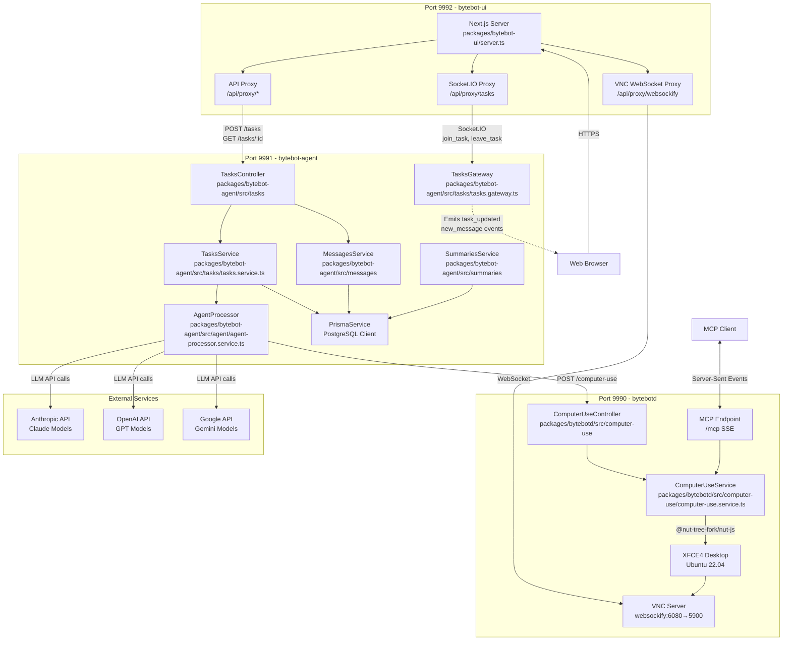
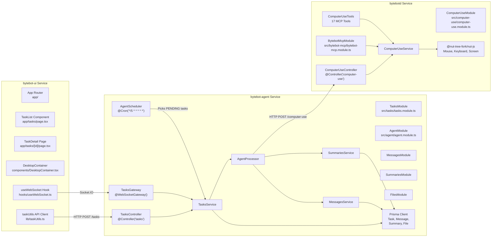
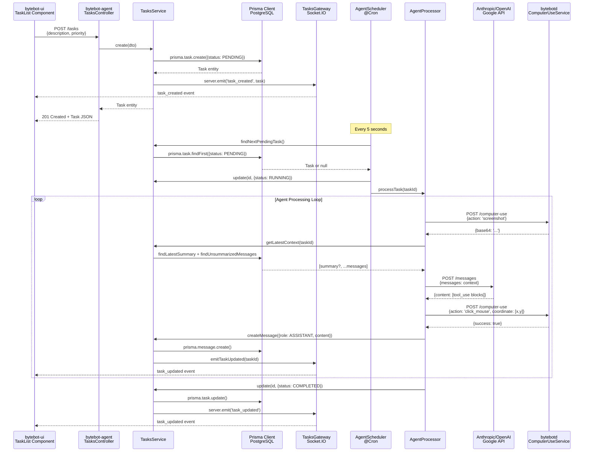
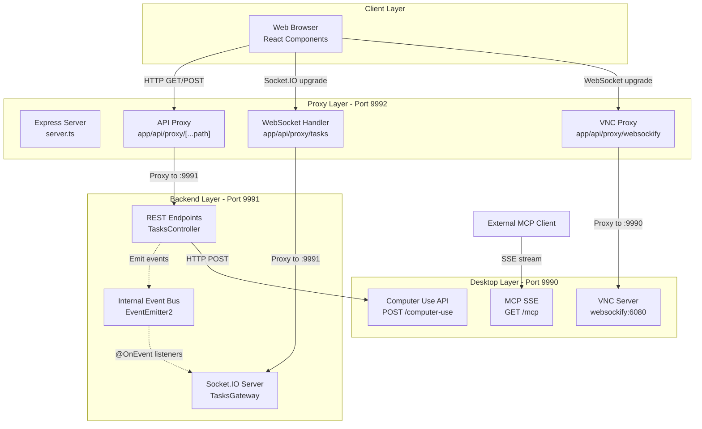

<!-- source: DeepWiki mcp.deepwiki.com · repo bytebot-ai/bytebot · page 1 Overview · fetched 2026-10-29 -->

# Overview

Relevant source files

The following files were used as context for generating this wiki page:

- [README.md](README.md)
- [docs/api-reference/agent/tasks.mdx](docs/api-reference/agent/tasks.mdx)
- [docs/core-concepts/desktop-environment.mdx](docs/core-concepts/desktop-environment.mdx)
- [docs/deployment/railway.mdx](docs/deployment/railway.mdx)
- [docs/guides/task-creation.mdx](docs/guides/task-creation.mdx)
- [docs/introduction.mdx](docs/introduction.mdx)
- [docs/quickstart.mdx](docs/quickstart.mdx)

This document provides a high-level introduction to the Bytebot system, explaining its purpose, architecture, and core components. It serves as the entry point for understanding how Bytebot enables AI-driven desktop automation through a three-tier service architecture.

For deployment instructions, see [Quick Start](#1.1). For detailed architectural patterns, see [System Architecture](#2). For core concepts like Tasks and the observe-act-verify cycle, see [Core Concepts](#1.2).

## Purpose and Capabilities

Bytebot is an open-source AI desktop automation system that executes natural language tasks by controlling a virtual Ubuntu desktop environment. The system combines large language models (LLMs) with desktop automation to perform complex multi-step workflows.

**Core capabilities:**
- Execute tasks described in natural language (e.g., "Download all invoices from email and organize by date")
- Control desktop applications through mouse and keyboard automation
- Process uploaded files (PDFs, spreadsheets, documents) within the LLM context
- Handle authentication flows via password manager integration
- Provide real-time desktop view during task execution
- Support human intervention through takeover mode
- Expose REST and WebSocket APIs for programmatic control

**Target use cases:**
- Business process automation (RPA replacement)
- Document processing and data extraction
- Multi-application workflows across systems without APIs
- Compliance and audit task automation
- Development/QA integration with visual testing

Sources: [README.md:1-311](), [docs/introduction.mdx:1-216]()

## Three-Tier Architecture

**Tier 1: Frontend (bytebot-ui)**
- Next.js 15 application with custom Express server
- Serves React UI components for task management
- Proxies all backend communication (HTTP, WebSocket, VNC)
- Exposes public interface on port 9992

**Tier 2: Orchestration (bytebot-agent)**
- NestJS backend service on port 9991
- Manages task lifecycle through `TasksService`
- Executes agent processing loop via `AgentProcessor`
- Communicates with LLM providers for decision-making
- Persists data to PostgreSQL via Prisma
- Broadcasts real-time updates through `TasksGateway`

**Tier 3: Desktop Environment (bytebotd)**
- NestJS daemon on port 9990 running inside Ubuntu container
- Executes computer actions through `ComputerUseService`
- Provides VNC access via noVNC web client
- Exposes MCP endpoint for tool invocation
- Runs XFCE4 desktop at 1920x1080 resolution

Sources: [README.md:108-116](), [README.md:230-239](), [docs/introduction.mdx:120-147](), Diagram 1 from high-level architecture

## Service Component Mapping

**Frontend Components:**
- `app/tasks/page.tsx`: Task list view with filtering and pagination
- `app/tasks/[id]/page.tsx`: Task detail page with chat and desktop view
- `components/DesktopContainer.tsx`: VNC viewer or scrollable screenshot display
- `lib/taskUtils.ts`: API client for task CRUD operations
- `hooks/useWebSocket.ts`: Socket.IO client for real-time events

**Backend Services:**
- `TasksService`: CRUD operations, status transitions, event emission
- `AgentProcessor`: Core processing loop (observe → plan → act → verify)
- `AgentScheduler`: Cron job running every 5 seconds to pick pending tasks
- `MessagesService`: Message creation, retrieval, grouping, role switching
- `SummariesService`: Hierarchical summarization when token usage exceeds 75%

**Desktop Services:**
- `ComputerUseService`: Dispatches actions to nut-js automation library
- `ComputerUseTools`: MCP tool definitions for 17 desktop operations
- `BytebotMcpModule`: SSE endpoint at `/mcp` for external MCP clients

Sources: [README.md:108-116](), Diagrams 1-4 from high-level architecture

## Data Flow: Task Creation to Execution

**Flow stages:**

1. **Task Creation (UI → Agent):**
   - User submits task via `TaskList` component
   - `taskUtils.createTask()` sends POST to `TasksController`
   - `TasksService.create()` persists to PostgreSQL with `status: PENDING`
   - `TasksGateway` broadcasts `task_created` event via Socket.IO

2. **Task Scheduling (Agent):**
   - `AgentScheduler` cron job runs every 5 seconds
   - Queries `prisma.task.findFirst({where: {status: 'PENDING'}})` 
   - Updates task status to `RUNNING`
   - Invokes `AgentProcessor.processTask()`

3. **Agent Execution Loop (Agent → Desktop → LLM):**
   - `AgentProcessor` captures screenshot via `/computer-use` endpoint
   - Builds context from latest summary + unsummarized messages
   - Sends context to LLM (Anthropic/OpenAI/Google)
   - Receives tool use blocks (e.g., `computer` tool with mouse/keyboard actions)
   - Executes actions via `ComputerUseService`
   - Creates messages and emits `task_updated` events
   - Repeats until task reaches terminal state (`COMPLETED`, `FAILED`, `NEEDS_HELP`)

4. **Real-time Updates (Agent → UI):**
   - `TasksGateway` emits events to rooms (clients joined to specific task IDs)
   - `useWebSocket` hook receives events and updates React state
   - UI re-renders with new messages and status

Sources: [README.md:108-116](), Diagram 2 from high-level architecture, [docs/api-reference/agent/tasks.mdx:1-310]()

## Technology Stack

| Layer | Component | Technology | Purpose |
|-------|-----------|-----------|---------|
| **Frontend** | bytebot-ui | Next.js 15.4.7, React 19 | Server-side rendering, API routes |
| | Styling | Tailwind CSS 4, Radix UI | Component styling, accessible primitives |
| | State | React hooks, Socket.IO client | Client state, real-time updates |
| | VNC | react-vnc | Browser-based desktop access |
| **Backend** | bytebot-agent | NestJS, TypeScript 5.7.3 | Dependency injection, modularity |
| | Database | Prisma ORM, PostgreSQL | Type-safe queries, migrations |
| | LLM Integration | @anthropic-ai/sdk, openai, @google/genai | Multi-provider support |
| | Events | @nestjs/event-emitter, EventEmitter2 | Internal event bus |
| | WebSocket | socket.io | Real-time bidirectional communication |
| | Scheduling | @nestjs/schedule | Cron-based task scheduling |
| **Desktop** | bytebotd | NestJS, TypeScript 5.7.3 | Desktop automation daemon |
| | Automation | @nut-tree-fork/nut-js | Mouse, keyboard, screen control |
| | Input Tracking | uiohook-napi | Global input event capture |
| | Image Processing | sharp | Screenshot encoding/optimization |
| | MCP | @rekog/mcp-nest | Model Context Protocol server |
| | VNC | noVNC, websockify | Web-based remote desktop |
| **Environment** | OS | Ubuntu 22.04 LTS | Base system |
| | Desktop | XFCE4 | Lightweight window manager |
| | Display | X11, Xvfb | Virtual display server |
| | Applications | Firefox ESR, VS Code, 1Password | Pre-installed tools |
| **Shared** | Types | Zod, class-validator | Runtime validation |
| | Package | @bytebot/shared | Cross-package type definitions |

Sources: [README.md:230-239](), Diagram 4 from high-level architecture, [docs/core-concepts/desktop-environment.mdx:36-88]()

## Persistence Layer

The system uses PostgreSQL with Prisma ORM for type-safe database access. Four primary models represent the data structure:

| Model | Purpose | Key Relationships |
|-------|---------|-------------------|
| `Task` | Work unit with description, status, priority | Has many `Message`, `Summary`, `File` |
| `Message` | Conversation entry (user input, LLM response, tool results) | Belongs to `Task` and optionally `Summary` |
| `Summary` | Compressed conversation context for token management | Belongs to `Task`, self-referential for hierarchy |
| `File` | Uploaded file metadata and base64 data | Belongs to `Task` |

**Schema locations:**
- [packages/bytebot-agent/prisma/schema.prisma]()

**Service access patterns:**
- `TasksService` → CRUD operations on `Task` model
- `MessagesService` → Message creation, retrieval, grouping logic
- `SummariesService` → Hierarchical summarization when context exceeds 75% token limit
- `FilesService` → File upload handling, base64 encoding, desktop materialization

**Message content structure:**
Messages use a `Json` type storing arrays of `MessageContentBlock` objects compatible with Anthropic's Claude API format (text, tool_use, tool_result, image, thinking, document blocks).

Sources: [docs/api-reference/agent/tasks.mdx:10-21](), Diagram 5 from high-level architecture

## Communication Architecture

**HTTP Communication:**
- Frontend makes REST requests to `/api/proxy/*`
- Next.js API routes forward to `http://bytebot-agent:9991/*`
- TasksController handles `/tasks` endpoints (GET, POST, PATCH, DELETE)
- AgentProcessor makes POST requests to `http://bytebotd:9990/computer-use`

**WebSocket Communication:**
- Frontend establishes Socket.IO connection to `/api/proxy/tasks`
- UI server proxies WebSocket upgrade to `bytebot-agent:9991`
- TasksGateway handles client events: `join_task`, `leave_task`
- Server emits events: `task_created`, `task_updated`, `task_deleted`, `new_message`
- Room-based subscriptions (clients join `task-{id}` rooms for targeted updates)

**VNC Streaming:**
- Separate WebSocket channel for desktop view
- Proxied from `/api/proxy/websockify` to `bytebotd:9990` websockify server
- Uses noVNC client library for browser rendering
- Bi-directional for mouse/keyboard input and screen updates

**Internal Event Bus:**
- `TasksService` emits domain events: `task.completed`, `task.failed`, `task.takeover`, `task.resume`, `task.cancel`
- `AgentProcessor` listens via `@OnEvent` decorators
- Enables reactive behavior (e.g., abort processing on takeover)

Sources: [README.md:108-116](), Diagram 3 from high-level architecture, [docs/deployment/railway.mdx:18-28]()

## Deployment Options

The system supports three primary deployment methods:

**1. Docker Compose (Local Development)**
- Single command: `docker-compose -f docker/docker-compose.yml up -d`
- Four containers: bytebot-ui, bytebot-agent, bytebotd, postgres
- Environment variables in `docker/.env` for API keys
- Exposed ports: 9992 (UI), 9991 (Agent API), 9990 (Desktop API)
- Volume mounts for PostgreSQL persistence

**2. Railway (Cloud Hosting)**
- One-click deployment via template
- Automatic private networking between services
- Only bytebot-ui exposed with public domain
- Managed PostgreSQL database
- Environment variables configured via Railway dashboard
- Deployment time: ~2 minutes

**3. Kubernetes/Helm**
- Helm chart at `helm/` directory
- Service definitions for ui, agent, desktop
- StatefulSet for desktop with persistent volume
- Ingress for external access
- ConfigMaps for environment variables
- Supports horizontal scaling of agent service

Sources: [README.md:82-106](), [docs/quickstart.mdx:1-363](), [docs/deployment/railway.mdx:1-90]()

## Next Steps

For hands-on deployment, see [Quick Start](#1.1).

For architectural deep-dives, see [System Architecture](#2), [Service Architecture](#2.1), and [Communication Patterns](#2.2).

For understanding the task lifecycle, see [Core Concepts](#1.2) and [Task Management System](#5).

For AI agent internals, see [Agent System](#6) and [Agent Processor](#6.1).

For desktop automation capabilities, see [Desktop Environment](#7) and [Desktop Tools](#7.2).

Sources: TOC structure

---

