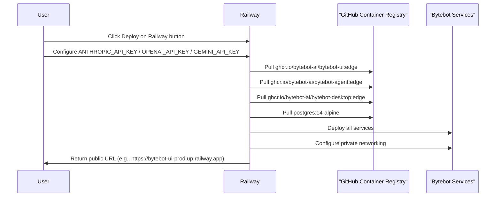
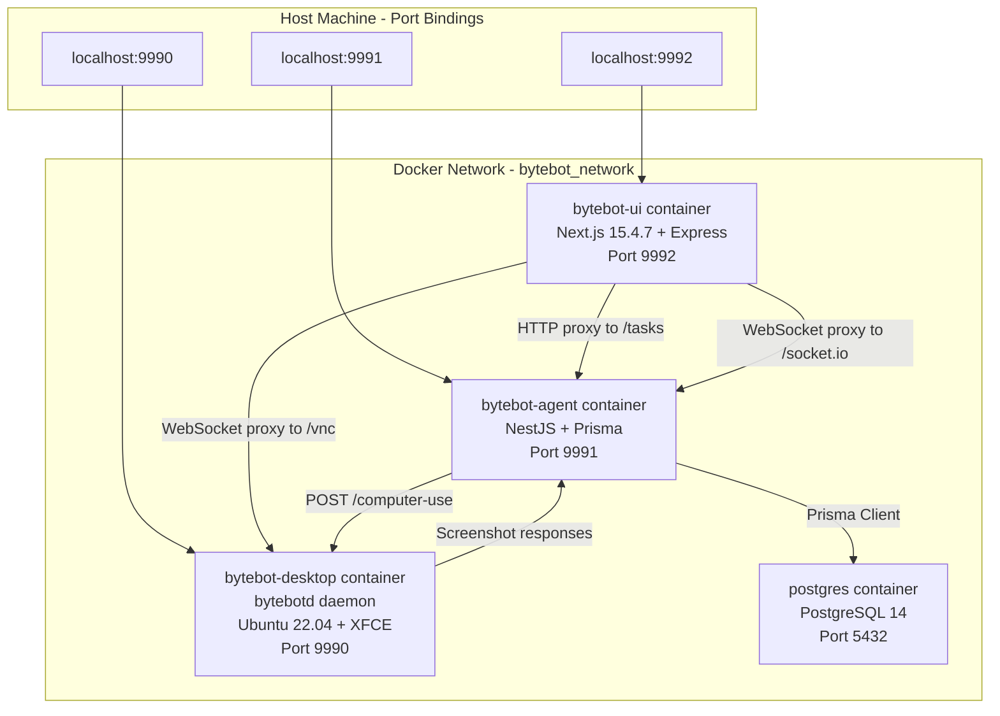
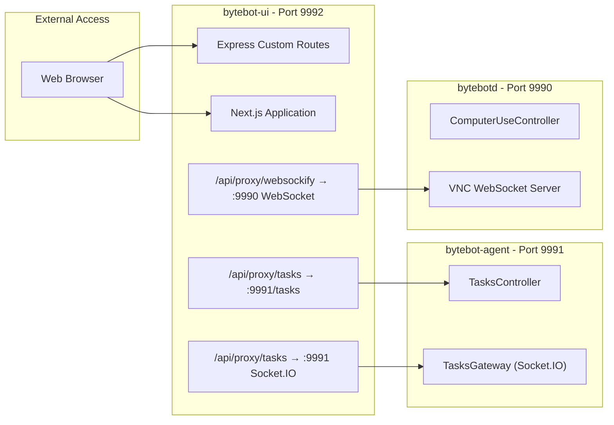
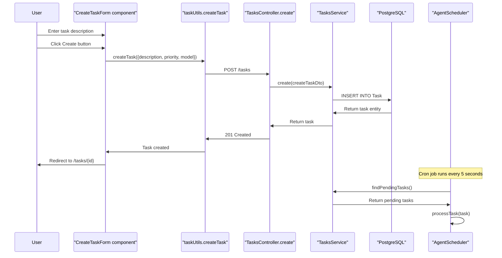
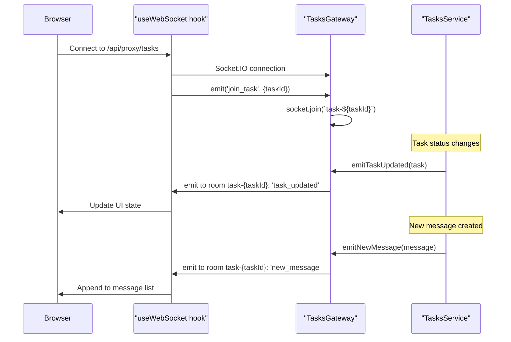

<!-- source: DeepWiki mcp.deepwiki.com · repo bytebot-ai/bytebot · page 1.1 Quick Start · fetched 2026-10-29 -->

# Quick Start

<details>
<summary>Relevant source files</summary>

The following files were used as context for generating this wiki page:

- [README.md](README.md)
- [docs/api-reference/agent/tasks.mdx](docs/api-reference/agent/tasks.mdx)
- [docs/core-concepts/desktop-environment.mdx](docs/core-concepts/desktop-environment.mdx)
- [docs/deployment/railway.mdx](docs/deployment/railway.mdx)
- [docs/guides/task-creation.mdx](docs/guides/task-creation.mdx)
- [docs/introduction.mdx](docs/introduction.mdx)
- [docs/quickstart.mdx](docs/quickstart.mdx)

</details>


This guide provides a streamlined path to deploying Bytebot and executing your first AI-powered desktop automation task. You will launch the complete stack (virtual desktop, AI agent, web interface, and database) and verify functionality within minutes.

For detailed configuration options and advanced deployment scenarios, see [Installation and Setup](#3). For architectural details about how the services communicate, see [System Architecture](#2). For deployment-specific guides, see [Docker Deployment](#3.1) or [Railway Deployment](#3.2).

---

## Prerequisites

Before deploying Bytebot, ensure you have:

| Requirement | Details |
|-------------|---------|
| **Deployment Platform** | Docker ≥ 20.10 with Docker Compose (for self-hosting) OR Railway account (for cloud hosting) |
| **System Resources** | Minimum 4GB RAM available, 10GB disk space |
| **AI Provider API Key** | At least one of: Anthropic API key ([console.anthropic.com](https://console.anthropic.com)), OpenAI API key ([platform.openai.com](https://platform.openai.com/api-keys)), or Google Gemini API key ([makersuite.google.com](https://makersuite.google.com/app/apikey)) |

Sources: [README.md:38-45](), [docs/quickstart.mdx:36-44]()

---

## Deployment Options

Bytebot supports two primary deployment methods optimized for different use cases.

### Railway Deployment (Cloud - Fastest)

Railway provides zero-configuration deployment with automatic service networking.

**Deployment Steps:**



**Services Deployed**

| Service | Image | Port | Public Access |
|---------|-------|------|---------------|
| `bytebot-ui` | `ghcr.io/bytebot-ai/bytebot-ui:edge` | 9992 | Yes (assigned public domain) |
| `bytebot-agent` | `ghcr.io/bytebot-ai/bytebot-agent:edge` | 9991 | No (private network only) |
| `bytebot-desktop` | `ghcr.io/bytebot-ai/bytebot-desktop:edge` | 9990 | No (private network only) |
| `postgres` | `postgres:14-alpine` | 5432 | No (private network only) |

**Configuration:**

1. Navigate to the Railway template deployment page
2. Set environment variable for `bytebot-agent` service:
   - `ANTHROPIC_API_KEY=sk-ant-...` (for Claude models) OR
   - `OPENAI_API_KEY=sk-...` (for GPT models) OR
   - `GEMINI_API_KEY=...` (for Gemini models)
3. Click Deploy
4. Wait approximately 2 minutes for initial build
5. Access the provided URL

Sources: [README.md:85-89](), [docs/quickstart.mdx:11-26](), [docs/deployment/railway.mdx:18-26]()

### Docker Compose Deployment (Self-Hosted)

Docker Compose provides full control over the deployment environment on your own infrastructure.

**Deployment Steps:**

```bash
# Clone repository
git clone https://github.com/bytebot-ai/bytebot.git
cd bytebot

# Configure AI provider (choose one)
echo "ANTHROPIC_API_KEY=sk-ant-your_key_here" > docker/.env
# OR: echo "OPENAI_API_KEY=sk-your_key_here" > docker/.env
# OR: echo "GEMINI_API_KEY=your_key_here" > docker/.env

# Start all services
docker-compose -f docker/docker-compose.yml up -d

# Verify services are running
docker-compose -f docker/docker-compose.yml ps
```

**Service Architecture:**



**Docker Compose Service Definitions:**

The [docker/docker-compose.yml]() file defines four services:
- `bytebot-ui`: Exposes port 9992, depends on `bytebot-agent`
- `bytebot-agent`: Exposes port 9991, depends on `postgres` and `bytebot-desktop`, sets `DATABASE_URL` and `BYTEBOT_CORE_URL`
- `bytebot-desktop`: Exposes port 9990, runs with `--shm-size=2gb` for desktop graphics
- `postgres`: Stores tasks, messages, summaries, and file metadata

Sources: [README.md:92-104](), [docs/quickstart.mdx:50-91](), [docker/docker-compose.yml]()

---

## Service Access Points

After successful deployment, the following endpoints are available:

| Endpoint | URL (Local) | URL (Railway) | Purpose |
|----------|-------------|---------------|---------|
| **Web Interface** | `http://localhost:9992` | `https://<project>.up.railway.app` | Task creation UI, chat interface, desktop viewer |
| **Tasks API** | `http://localhost:9991/tasks` | Internal only | REST API for task CRUD operations |
| **Desktop Control API** | `http://localhost:9990/computer-use` | Internal only | Direct desktop automation endpoint |
| **MCP Endpoint** | `http://localhost:9990/mcp` | Internal only | Model Context Protocol server-sent events |
| **VNC Access** | `http://localhost:9990/vnc` | Internal only | noVNC web client for direct desktop access |

**Port Assignment Rationale:**



The UI service acts as the sole public-facing component, proxying all requests to backend services through Express middleware defined in [apps/bytebot-ui/server.js]().

Sources: [README.md:171-176](), [docs/quickstart.mdx:169-176](), [apps/bytebot-ui/server.js]()

---

## Verification Steps

Verify your deployment is functioning correctly:

**1. Check Service Health:**

```bash
# For Docker Compose deployment
docker-compose -f docker/docker-compose.yml ps

# Expected output shows all services as "Up"
# NAME                STATUS    PORTS
# bytebot-ui          Up        0.0.0.0:9992->9992/tcp
# bytebot-agent       Up        0.0.0.0:9991->9991/tcp
# bytebot-desktop     Up        0.0.0.0:9990->9990/tcp
# postgres            Up        5432/tcp
```

**2. Access Web Interface:**

Navigate to `http://localhost:9992` (or your Railway-provided URL). You should see the task creation interface with an input field and model selector.

**3. Verify Desktop Environment:**

The virtual desktop should be accessible. The `bytebotd` daemon runs on port 9990 and manages:
- X11 display server (`:99`)
- XFCE4 desktop environment
- VNC server (port 6080, proxied via websockify)
- Computer use API endpoint

Sources: [docs/quickstart.mdx:207-223](), [docs/core-concepts/desktop-environment.mdx:72-83]()

---

## Creating Your First Task

Test the complete system by creating a simple automation task.

### Via Web Interface

**Task Creation Flow:**



**Example Tasks:**

| Task Type | Description | Expected Outcome |
|-----------|-------------|------------------|
| **Screenshot** | "Take a screenshot of the desktop" | Agent captures desktop screenshot, saves to filesystem, reports completion |
| **Browser Navigation** | "Open Firefox and go to google.com" | Agent launches Firefox, navigates to URL, confirms page load |
| **File Creation** | "Create a text file called hello.txt with today's date" | Agent creates file in `/home/user/Desktop`, writes date, verifies creation |

Sources: [apps/bytebot-ui/app/(dashboard)/page.tsx](), [apps/bytebot-ui/lib/taskUtils.ts](), [apps/bytebot-agent/src/tasks/tasks.controller.ts]()

### Via REST API

Create tasks programmatically using HTTP requests:

```bash
# Simple task creation
curl -X POST http://localhost:9991/tasks \
  -H "Content-Type: application/json" \
  -d '{
    "description": "Take a screenshot of the desktop",
    "priority": "MEDIUM"
  }'

# Task with file upload
curl -X POST http://localhost:9991/tasks \
  -F "description=Read this PDF and extract all email addresses" \
  -F "priority=HIGH" \
  -F "files=@document.pdf"
```

**Response Structure:**

```json
{
  "id": "cm5a1b2c3d4e5f6g7h8i9j0k",
  "description": "Take a screenshot of the desktop",
  "status": "PENDING",
  "priority": "MEDIUM",
  "control": "AGENT",
  "model": "claude-3-5-sonnet-20241022",
  "createdAt": "2025-01-15T10:30:00.000Z",
  "updatedAt": "2025-01-15T10:30:00.000Z"
}
```

The `status` field transitions from `PENDING` → `RUNNING` → `COMPLETED` as the `AgentScheduler` picks up the task and the `AgentProcessor` executes it.

Sources: [docs/api-reference/agent/tasks.mdx:25-67](), [apps/bytebot-agent/src/tasks/tasks.controller.ts]()

---

## Task Execution Monitoring

Once a task is created, monitor its execution through the web interface or API.

### Web Interface Monitoring

Navigate to `/tasks/{taskId}` to view:
- Real-time message stream (user messages, assistant responses, tool executions)
- Desktop viewer showing live VNC feed or screenshot history
- Task status indicator (green dot = running)
- Control handoff button (switch between agent and user control)

The UI uses WebSocket connections to receive real-time updates:



Sources: [apps/bytebot-ui/hooks/useWebSocket.ts](), [apps/bytebot-agent/src/tasks/tasks.gateway.ts]()

### API Monitoring

Poll the task status endpoint:

```bash
# Get task by ID (includes messages)
curl http://localhost:9991/tasks/{taskId}

# Get currently running task
curl http://localhost:9991/tasks/in-progress
```

Sources: [docs/api-reference/agent/tasks.mdx:116-151]()

---

## Common First-Run Issues

| Symptom | Cause | Resolution |
|---------|-------|------------|
| Container fails to start | Insufficient system resources | Verify 4GB+ RAM available: `docker stats` |
| "Invalid API key" error | Missing or malformed AI provider key | Check [docker/.env]() or Railway environment variables |
| UI shows "Connecting..." indefinitely | Backend services not ready | Wait 30 seconds for services to initialize, check `docker-compose logs` |
| Task stuck in PENDING | AgentScheduler cron not triggering | Verify `bytebot-agent` container is running: `docker ps` |
| Desktop actions fail | bytebotd daemon not responding | Check `bytebot-desktop` logs: `docker logs bytebot-desktop` |

Sources: [docs/quickstart.mdx:274-298]()

---

## Next Steps

After verifying your deployment:

1. **Explore Core Concepts**: Understand how tasks, agents, and the desktop environment interact. See [Core Concepts](#1.2).

2. **Advanced Task Creation**: Learn to write effective task descriptions for complex workflows. See [Task Creation & Management](#5).

3. **Customize Desktop Environment**: Install additional applications or password managers. See [Desktop Environment](#7).

4. **API Integration**: Integrate Bytebot into your applications using the Tasks REST API. See [API Reference](#10).

5. **Production Deployment**: Configure authentication, resource limits, and monitoring. See [Deployment Architecture](#2.3).

Sources: [docs/quickstart.mdx:300-320]()

---

