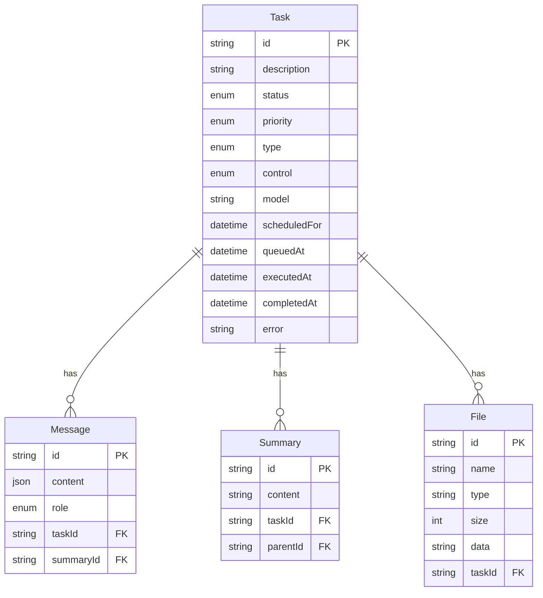
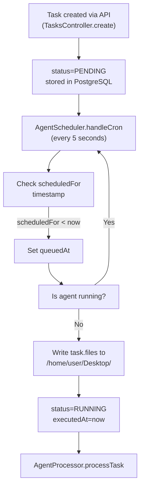
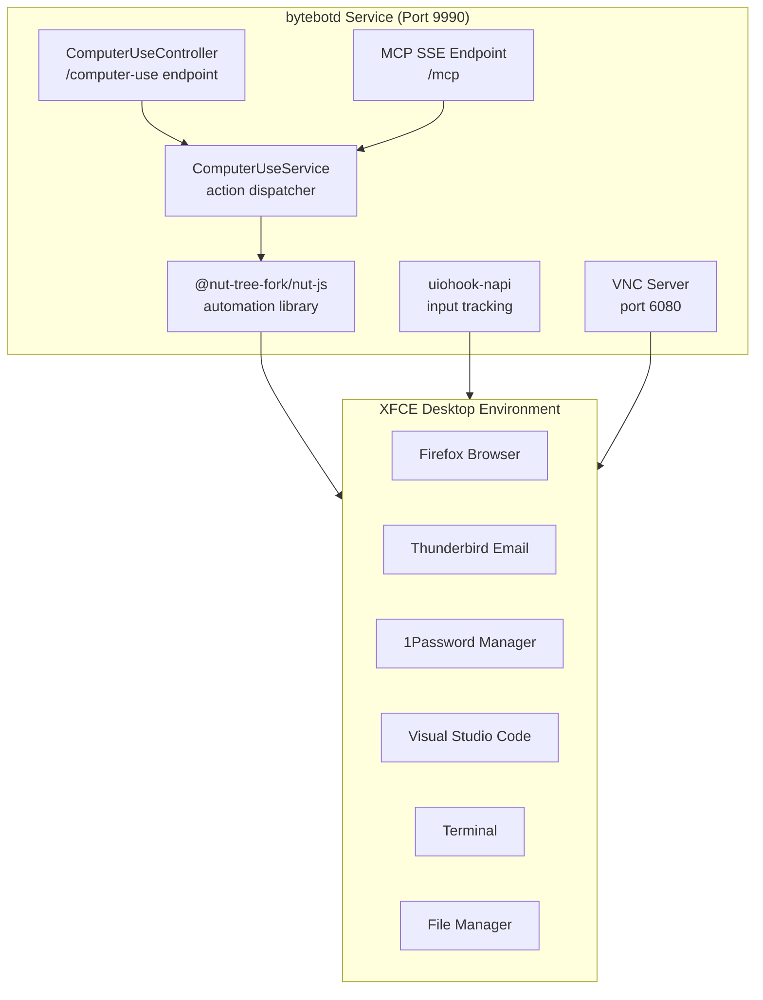
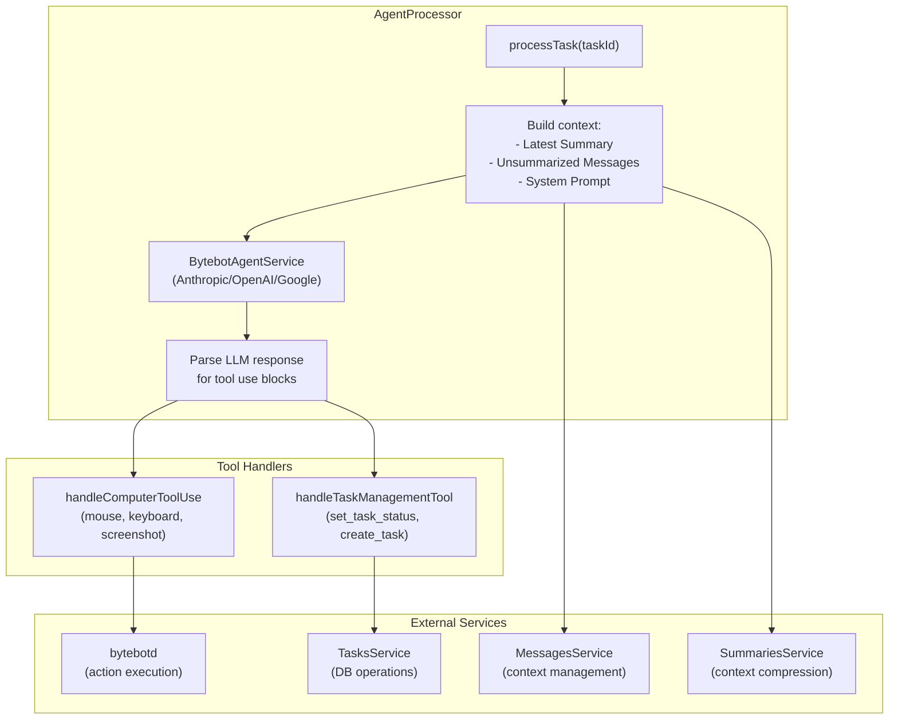
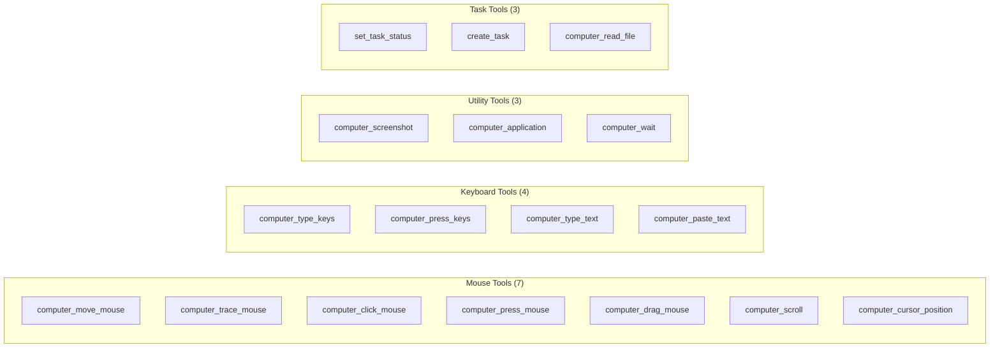
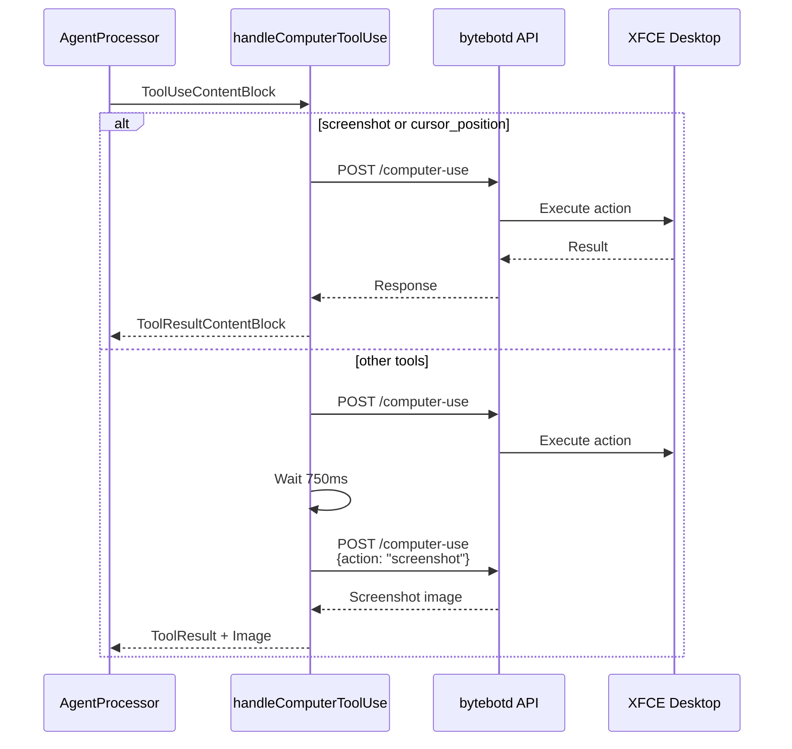
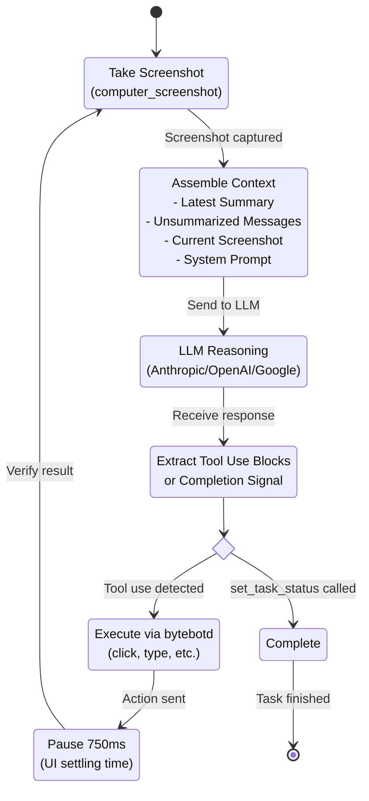
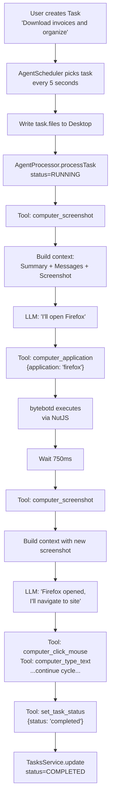

<!-- source: DeepWiki mcp.deepwiki.com · repo bytebot-ai/bytebot · page 1.2 Core Concepts · fetched 2026-10-29 -->

# Core Concepts

<details>
<summary>Relevant source files</summary>

The following files were used as context for generating this wiki page:

- [README.md](README.md)
- [docs/api-reference/agent/tasks.mdx](docs/api-reference/agent/tasks.mdx)
- [docs/core-concepts/desktop-environment.mdx](docs/core-concepts/desktop-environment.mdx)
- [docs/deployment/railway.mdx](docs/deployment/railway.mdx)
- [docs/guides/task-creation.mdx](docs/guides/task-creation.mdx)
- [docs/introduction.mdx](docs/introduction.mdx)
- [docs/quickstart.mdx](docs/quickstart.mdx)
- [packages/bytebot-agent/prisma/migrations/20250722041608_files/migration.sql](packages/bytebot-agent/prisma/migrations/20250722041608_files/migration.sql)
- [packages/bytebot-agent/src/agent/agent.computer-use.ts](packages/bytebot-agent/src/agent/agent.computer-use.ts)
- [packages/bytebot-agent/src/agent/agent.constants.ts](packages/bytebot-agent/src/agent/agent.constants.ts)
- [packages/bytebot-agent/src/agent/agent.scheduler.ts](packages/bytebot-agent/src/agent/agent.scheduler.ts)
- [packages/bytebot-agent/src/agent/agent.tools.ts](packages/bytebot-agent/src/agent/agent.tools.ts)
- [packages/bytebotd/src/computer-use/computer-use.controller.ts](packages/bytebotd/src/computer-use/computer-use.controller.ts)
- [packages/bytebotd/src/main.ts](packages/bytebotd/src/main.ts)

</details>


This page explains the fundamental building blocks of Bytebot and how they work together. It covers Tasks (the unit of work), the Virtual Desktop (the execution environment), the AI Agent (the decision-making system), Tools (available actions), and the observe-act-verify cycle (the execution pattern).

For architectural details about how services communicate, see [Service Architecture](#2.1). For deployment configuration, see [Installation and Setup](#3).

---

## Tasks: The Unit of Work

A **Task** represents a single objective that Bytebot should accomplish. Tasks are the primary interface between users and the system, stored in PostgreSQL, and processed sequentially by the agent.

### Task Data Model



**Sources:** [packages/bytebot-agent/prisma/migrations/20250722041608_files/migration.sql:1-17](), [docs/api-reference/agent/tasks.mdx:12-21]()

### Task States and Lifecycle

Tasks transition through a state machine managed by `TasksService`:

| Status | Description | Next States |
|--------|-------------|-------------|
| `PENDING` | Created, awaiting scheduling | `RUNNING` |
| `RUNNING` | Agent actively processing | `COMPLETED`, `NEEDS_HELP`, `FAILED`, `CANCELLED` |
| `NEEDS_HELP` | Requires user clarification | `RUNNING` (after user input) |
| `COMPLETED` | Successfully finished | (terminal) |
| `FAILED` | Encountered error | (terminal) |
| `CANCELLED` | User cancelled | (terminal) |

**Sources:** [docs/api-reference/agent/tasks.mdx:16-17](), [docs/guides/task-creation.mdx:203-216]()

### Task Scheduling and Execution



**Sources:** [packages/bytebot-agent/src/agent/agent.scheduler.ts:22-62]()

### File Handling

Files uploaded with tasks are:
1. Base64-encoded and stored in the `File` table
2. Written to `/home/user/Desktop/` before task execution via `writeFile` function
3. Accessible to the agent through `computer_read_file` tool

**Sources:** [packages/bytebot-agent/src/agent/agent.scheduler.ts:43-53](), [packages/bytebot-agent/src/agent/agent.computer-use.ts:612-646]()

---

## Virtual Desktop: The Execution Environment

The **bytebotd** service provides a containerized Ubuntu desktop where all task actions are executed. This isolation ensures security and consistency.

### Desktop Architecture



**Sources:** [packages/bytebotd/src/main.ts:1-39](), [packages/bytebotd/src/computer-use/computer-use.controller.ts:1-43](), [docs/core-concepts/desktop-environment.mdx:70-88]()

### Desktop Specifications

| Property | Value |
|----------|-------|
| Operating System | Ubuntu 22.04 LTS |
| Desktop Environment | XFCE4 |
| Display Server | X11 |
| Resolution | 1280x960 (defined in `DEFAULT_DISPLAY_SIZE`) |
| User | `user` (passwordless sudo) |
| Home Directory | `/home/user` |

**Sources:** [packages/bytebot-agent/src/agent/agent.constants.ts:1-4](), [docs/core-concepts/desktop-environment.mdx:39-43](), [docs/core-concepts/desktop-environment.mdx:97-101]()

### Desktop API Endpoint

All desktop actions are executed via `POST /computer-use` on the bytebotd service:

```
POST http://localhost:9990/computer-use
Content-Type: application/json

{
  "action": "screenshot" | "move_mouse" | "click_mouse" | ...,
  ...action-specific parameters
}
```

**Sources:** [packages/bytebotd/src/computer-use/computer-use.controller.ts:19-42]()

---

## AI Agent: The Decision-Making System

The **AgentProcessor** coordinates task execution by maintaining a continuous loop of observation, planning, and action using Large Language Models.

### Agent Components



**Sources:** [packages/bytebot-agent/src/agent/agent.processor.ts]() (inferred from architecture), [packages/bytebot-agent/src/agent/agent.computer-use.ts:28-239]()

### LLM Integration

The agent supports three LLM providers through a common interface:

| Provider | Model (Default) | Environment Variable |
|----------|-----------------|---------------------|
| Anthropic | `claude-3-5-sonnet-20241022` | `ANTHROPIC_API_KEY` |
| OpenAI | `gpt-4o` | `OPENAI_API_KEY` |
| Google | `gemini-1.5-flash` | `GEMINI_API_KEY` |

**Sources:** [docs/quickstart.mdx:327-337](), [README.md:96-99]()

### Agent System Prompt

The agent operates under strict principles defined in `AGENT_SYSTEM_PROMPT`:

1. **Observe First**: Always take screenshot before acting
2. **Navigate Applications**: Use `computer_application` to switch apps
3. **Human-Like Interaction**: Smooth movements, realistic typing
4. **Valid Keys Only**: Use exact nut-tree `Key` enum identifiers
5. **Verify Every Step**: Screenshot after each action
6. **Efficiency & Clarity**: Minimize unnecessary operations
7. **Stay Within Scope**: Only do what user requested
8. **Security**: Flag sensitive data with `isSensitive`
9. **Consistency & Persistence**: Complete bulk operations fully

**Sources:** [packages/bytebot-agent/src/agent/agent.constants.ts:17-175]()

---

## Tools: Available Actions

Tools are functions the agent can invoke to interact with the desktop and manage tasks. They are defined in `agentTools` array and fall into four categories.

### Tool Categories



**Sources:** [packages/bytebot-agent/src/agent/agent.tools.ts:387-405]()

### Tool Execution Flow



**Sources:** [packages/bytebot-agent/src/agent/agent.computer-use.ts:28-239]()

### Tool Definitions Example

Mouse click tool schema:
```typescript
{
  name: 'computer_click_mouse',
  description: 'Performs a mouse click at the specified coordinates or current position',
  input_schema: {
    type: 'object',
    properties: {
      coordinates: { type: 'object', nullable: true },
      button: { type: 'string', enum: ['left', 'right', 'middle'] },
      holdKeys: { type: 'array', nullable: true },
      clickCount: { type: 'integer', default: 1 }
    },
    required: ['button', 'clickCount']
  }
}
```

**Sources:** [packages/bytebot-agent/src/agent/agent.tools.ts:67-90]()

---

## The Observe-Act-Verify Cycle

The agent operates in a continuous loop, always grounding decisions in visual observation of the desktop state.

### Execution Loop



**Sources:** [packages/bytebot-agent/src/agent/agent.computer-use.ts:184-196](), [packages/bytebot-agent/src/agent/agent.constants.ts:94-138]()

### Context Building Strategy

The agent manages LLM token limits through hierarchical summarization:

1. **Initial Context**: Latest summary (if exists) + all unsummarized messages
2. **Token Check**: If usage exceeds 75% of context window
3. **Summarization**: Send conversation to LLM with `SUMMARIZATION_SYSTEM_PROMPT`
4. **Storage**: Create new `Summary` record, link processed messages via `summaryId`
5. **Next Iteration**: Use new summary + only new messages

**Sources:** [packages/bytebot-agent/src/agent/agent.constants.ts:6-15]()

### Verification Pattern

After each action (except `screenshot` and `cursor_position`), the agent:
1. Waits 750ms for UI to settle
2. Takes a screenshot
3. Receives both text confirmation and visual proof
4. Sends screenshot to LLM in next iteration
5. LLM validates expected state before continuing

This creates a fail-safe loop where the agent always knows the actual desktop state.

**Sources:** [packages/bytebot-agent/src/agent/agent.computer-use.ts:184-219](), [packages/bytebot-agent/src/agent/agent.constants.ts:43]()

---

## Integration: How Concepts Work Together



**Sources:** [packages/bytebot-agent/src/agent/agent.scheduler.ts:22-62](), [packages/bytebot-agent/src/agent/agent.computer-use.ts:28-239]()

---

## Summary

The five core concepts form a cohesive system:

1. **Tasks** define what needs to be done
2. **Virtual Desktop** provides isolated execution environment
3. **AI Agent** plans and coordinates actions
4. **Tools** enable interaction with desktop and task management
5. **Observe-Act-Verify** ensures grounded, reliable execution

Together, these create a system where natural language requests are translated into precise desktop actions, always verified through visual observation.

---

