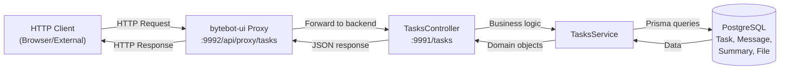
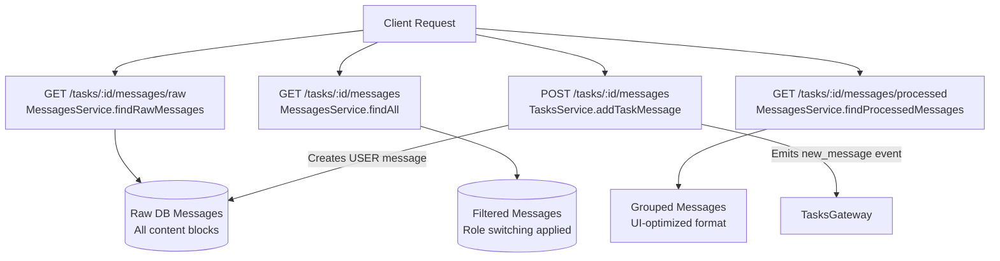
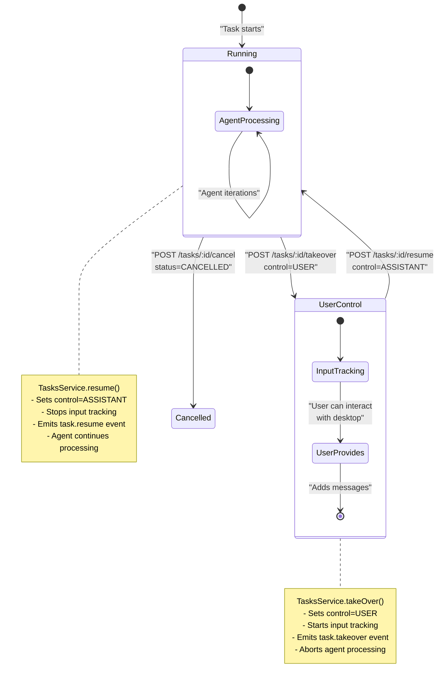
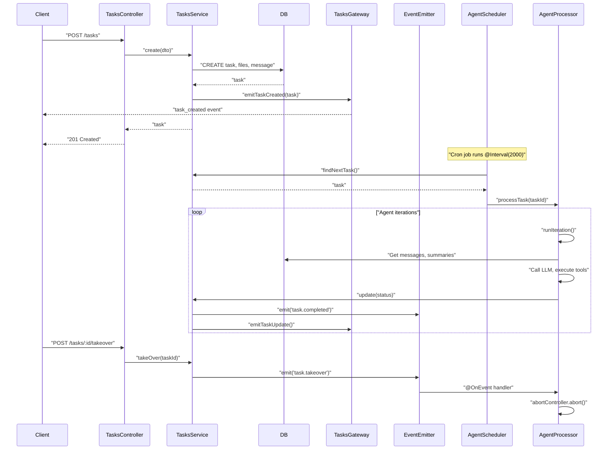

<!-- source: DeepWiki mcp.deepwiki.com · repo bytebot-ai/bytebot · page 10.1 Tasks REST API · fetched 2026-10-29 -->

# Tasks REST API

<details>
<summary>Relevant source files</summary>

The following files were used as context for generating this wiki page:

- [packages/bytebot-agent/src/agent/agent.processor.ts](packages/bytebot-agent/src/agent/agent.processor.ts)
- [packages/bytebot-agent/src/tasks/tasks.controller.ts](packages/bytebot-agent/src/tasks/tasks.controller.ts)
- [packages/bytebot-agent/src/tasks/tasks.service.ts](packages/bytebot-agent/src/tasks/tasks.service.ts)
- [packages/bytebot-ui/src/hooks/useChatSession.ts](packages/bytebot-ui/src/hooks/useChatSession.ts)

</details>


This document provides a complete reference for the HTTP REST API exposed by the **bytebot-agent** service for task management. The Tasks REST API enables creating, querying, updating, and deleting tasks, as well as managing task messages and control flow. For real-time updates about task state changes, see [WebSocket API](#10.3). For information about task lifecycle and states, see [Task Lifecycle](#5.1).

**Sources:** [packages/bytebot-agent/src/tasks/tasks.controller.ts:1-194]()

---

## API Overview

The Tasks REST API is implemented in the `TasksController` class and operates on the `/tasks` base path. All endpoints communicate via JSON and are proxied through the bytebot-ui frontend service running on port 9992, which forwards requests to bytebot-agent on port 9991.



**Sources:** [packages/bytebot-agent/src/tasks/tasks.controller.ts:35-36](), [packages/bytebot-ui/src/utils/taskUtils.ts]()

---

## Endpoint Reference

The following table summarizes all available endpoints:

| Method | Path | Purpose | Auth Required |
|--------|------|---------|---------------|
| `POST` | `/tasks` | Create a new task | No |
| `GET` | `/tasks` | List tasks with pagination and filtering | No |
| `GET` | `/tasks/models` | Retrieve available LLM models | No |
| `GET` | `/tasks/:id` | Get a specific task by ID | No |
| `GET` | `/tasks/:id/messages` | Retrieve task messages (filtered) | No |
| `POST` | `/tasks/:id/messages` | Add a user message to a task | No |
| `GET` | `/tasks/:id/messages/raw` | Retrieve raw unprocessed messages | No |
| `GET` | `/tasks/:id/messages/processed` | Retrieve UI-formatted grouped messages | No |
| `DELETE` | `/tasks/:id` | Delete a task and all related data | No |
| `POST` | `/tasks/:id/takeover` | Transfer control to user | No |
| `POST` | `/tasks/:id/resume` | Transfer control back to agent | No |
| `POST` | `/tasks/:id/cancel` | Cancel a running task | No |

**Sources:** [packages/bytebot-agent/src/tasks/tasks.controller.ts:35-193]()

---

## Core Endpoints

### POST /tasks

Creates a new task and initializes it with a system message. If files are attached, they are stored in the database and the initial message is augmented with file notification text.

**Request Body:** `CreateTaskDto`

```typescript
{
  description: string;           // Required: Task description
  model?: BytebotAgentModel;     // Optional: LLM model to use
  type?: TaskType;               // Optional: IMMEDIATE (default) or SCHEDULED
  priority?: TaskPriority;       // Optional: LOW, MEDIUM (default), HIGH
  scheduledFor?: Date;           // Optional: Schedule time for SCHEDULED tasks
  createdBy?: Role;              // Optional: USER (default) or ASSISTANT
  files?: FileWithBase64[];      // Optional: Files to attach
}
```

**Response:** `Task` object with status `PENDING`

**Status Codes:**
- `201 Created` - Task created successfully
- `400 Bad Request` - Invalid request data

**Implementation Details:**
1. Creates a task record with initial status `PENDING`
2. Saves attached files to database (base64-encoded)
3. Creates initial USER message with description and file notifications
4. Emits `task_created` WebSocket event via `TasksGateway`

**Sources:** [packages/bytebot-agent/src/tasks/tasks.controller.ts:42-46](), [packages/bytebot-agent/src/tasks/tasks.service.ts:40-117](), [packages/bytebot-agent/src/tasks/dto/create-task.dto.ts]()

---

### GET /tasks

Retrieves a paginated list of tasks with optional status filtering.

**Query Parameters:**

| Parameter | Type | Default | Description |
|-----------|------|---------|-------------|
| `page` | number | 1 | Page number (1-indexed) |
| `limit` | number | 10 | Items per page |
| `status` | string | - | Single status filter |
| `statuses` | string | - | Comma-separated status list |

**Response:**

```typescript
{
  tasks: Task[];        // Array of task objects
  total: number;        // Total matching tasks
  totalPages: number;   // Total pages available
}
```

**Status Codes:**
- `200 OK` - Tasks retrieved successfully

**Filtering Logic:**
- If `statuses` is provided, splits by comma and filters tasks
- If only `status` is provided, filters by single status
- If neither is provided, returns all tasks

**Sources:** [packages/bytebot-agent/src/tasks/tasks.controller.ts:48-67](), [packages/bytebot-agent/src/tasks/tasks.service.ts:158-190]()

---

### GET /tasks/models

Retrieves the list of available LLM models. If `BYTEBOT_LLM_PROXY_URL` is configured, fetches models from the proxy service; otherwise, returns hardcoded models based on available API keys.

**Response:** Array of `BytebotAgentModel`

```typescript
[
  {
    provider: string;       // "anthropic" | "openai" | "google" | "proxy"
    name: string;           // Model identifier (e.g., "claude-3-5-sonnet-20241022")
    title: string;          // Display name
    contextWindow: number;  // Context window size in tokens
  }
]
```

**Status Codes:**
- `200 OK` - Models retrieved successfully
- `502 Bad Gateway` - Proxy request failed (when using proxy)
- `500 Internal Server Error` - Other proxy errors

**Sources:** [packages/bytebot-agent/src/tasks/tasks.controller.ts:69-111]()

---

### GET /tasks/:id

Retrieves a specific task by its unique identifier, including associated files.

**Path Parameters:**
- `id` (string) - Task UUID

**Response:** `Task` object with `files` relation included

**Status Codes:**
- `200 OK` - Task found
- `404 Not Found` - Task does not exist

**Sources:** [packages/bytebot-agent/src/tasks/tasks.controller.ts:113-116](), [packages/bytebot-agent/src/tasks/tasks.service.ts:192-215]()

---

## Message Endpoints



**Sources:** [packages/bytebot-agent/src/tasks/tasks.controller.ts:118-168]()

---

### GET /tasks/:id/messages

Retrieves filtered messages for a task with role switching applied (pure tool results become ASSISTANT messages). This is the primary endpoint for displaying task conversation history.

**Path Parameters:**
- `id` (string) - Task UUID

**Query Parameters:**
- `limit` (number) - Optional: Messages per page
- `page` (number) - Optional: Page number

**Response:** Array of `Message` objects

**Sources:** [packages/bytebot-agent/src/tasks/tasks.controller.ts:118-131](), [packages/bytebot-agent/src/messages/messages.service.ts]()

---

### POST /tasks/:id/messages

Adds a user message to a task, typically for providing additional guidance or answering agent questions when task status is `NEEDS_HELP`.

**Path Parameters:**
- `id` (string) - Task UUID

**Request Body:** `AddTaskMessageDto`

```typescript
{
  message: string;  // User message text
}
```

**Response:** Updated `Task` object

**Status Codes:**
- `201 Created` - Message added successfully
- `404 Not Found` - Task does not exist

**Implementation Details:**
1. Creates a USER message with text content
2. Emits `new_message` WebSocket event to notify connected clients
3. If task is RUNNING, agent will process the new message on next iteration

**Sources:** [packages/bytebot-agent/src/tasks/tasks.controller.ts:133-140](), [packages/bytebot-agent/src/tasks/tasks.service.ts:263-280]()

---

### GET /tasks/:id/messages/raw

Retrieves unprocessed messages exactly as stored in the database, without role switching or filtering. Useful for debugging and understanding the raw LLM conversation.

**Path Parameters:**
- `id` (string) - Task UUID

**Query Parameters:**
- `limit` (number) - Optional: Messages per page
- `page` (number) - Optional: Page number

**Response:** Array of `Message` objects with all content blocks

**Sources:** [packages/bytebot-agent/src/tasks/tasks.controller.ts:142-154]()

---

### GET /tasks/:id/messages/processed

Retrieves messages formatted for UI display, with consecutive same-role messages grouped together and user takeover actions extracted. Returns `GroupedMessages[]` format.

**Path Parameters:**
- `id` (string) - Task UUID

**Query Parameters:**
- `limit` (number) - Optional: Messages per page
- `page` (number) - Optional: Page number

**Response:** Array of `GroupedMessages` objects

```typescript
{
  role: Role;                      // USER or ASSISTANT
  messages: Message[];             // Consecutive messages with same role
  userActions?: UserActionBlock[]; // Extracted user input actions (if role=USER)
}
```

**Sources:** [packages/bytebot-agent/src/tasks/tasks.controller.ts:156-168](), [packages/bytebot-agent/src/messages/messages.service.ts]()

---

## Control Flow Endpoints



**Sources:** [packages/bytebot-agent/src/tasks/tasks.service.ts:282-391]()

---

### POST /tasks/:id/takeover

Transfers control from the agent to the user, allowing manual interaction with the virtual desktop. The agent immediately aborts any in-flight LLM requests and stops processing.

**Path Parameters:**
- `id` (string) - Task UUID

**Response:** Updated `Task` object with `control=USER`

**Status Codes:**
- `200 OK` - Takeover successful
- `404 Not Found` - Task does not exist
- `400 Bad Request` - Task not under agent control

**Side Effects:**
1. Updates `task.control` to `USER`
2. Sends POST to `/input-tracking/start` on bytebotd
3. Emits `task.takeover` event via `EventEmitter2`
4. `AgentProcessor` aborts current processing via `AbortController`
5. Emits `task_updated` WebSocket event

**Sources:** [packages/bytebot-agent/src/tasks/tasks.controller.ts:176-180](), [packages/bytebot-agent/src/tasks/tasks.service.ts:320-357](), [packages/bytebot-agent/src/agent/agent.processor.ts:84-95]()

---

### POST /tasks/:id/resume

Transfers control from the user back to the agent, resuming automated processing.

**Path Parameters:**
- `id` (string) - Task UUID

**Response:** Updated `Task` object with `control=ASSISTANT` and `status=RUNNING`

**Status Codes:**
- `200 OK` - Resume successful
- `404 Not Found` - Task does not exist
- `400 Bad Request` - Task not under user control

**Side Effects:**
1. Updates `task.control` to `ASSISTANT`
2. Updates `task.status` to `RUNNING`
3. Sends POST to `/input-tracking/stop` on bytebotd
4. Emits `task.resume` event via `EventEmitter2`
5. `AgentProcessor` creates new `AbortController` and continues iterations
6. Emits `task_updated` WebSocket event

**Sources:** [packages/bytebot-agent/src/tasks/tasks.controller.ts:182-186](), [packages/bytebot-agent/src/tasks/tasks.service.ts:282-318](), [packages/bytebot-agent/src/agent/agent.processor.ts:97-105]()

---

### POST /tasks/:id/cancel

Cancels a running task, marking it as `CANCELLED` and stopping agent processing.

**Path Parameters:**
- `id` (string) - Task UUID

**Response:** Updated `Task` object with `status=CANCELLED`

**Status Codes:**
- `200 OK` - Cancellation successful
- `404 Not Found` - Task does not exist
- `400 Bad Request` - Task already completed, failed, or cancelled

**Side Effects:**
1. Updates `task.status` to `CANCELLED`
2. Emits `task.cancel` event via `EventEmitter2`
3. `AgentProcessor` aborts current processing and resets state
4. Emits `task_updated` WebSocket event

**Sources:** [packages/bytebot-agent/src/tasks/tasks.controller.ts:188-192](), [packages/bytebot-agent/src/tasks/tasks.service.ts:359-391](), [packages/bytebot-agent/src/agent/agent.processor.ts:107-112]()

---

### DELETE /tasks/:id

Permanently deletes a task and all associated data (messages, summaries, files) via cascading database constraints.

**Path Parameters:**
- `id` (string) - Task UUID

**Status Codes:**
- `204 No Content` - Task deleted successfully
- `404 Not Found` - Task does not exist (throws exception before deletion)

**Side Effects:**
1. Deletes task record from database
2. Cascades to delete all messages, summaries, and files
3. Emits `task_deleted` WebSocket event

**Sources:** [packages/bytebot-agent/src/tasks/tasks.controller.ts:170-174](), [packages/bytebot-agent/src/tasks/tasks.service.ts:249-261]()

---

## Data Types and DTOs

### CreateTaskDto

Data transfer object for creating tasks, validated using `class-validator`.

**Properties:**

| Field | Type | Required | Validation | Default |
|-------|------|----------|------------|---------|
| `description` | string | Yes | Non-empty string | - |
| `model` | BytebotAgentModel | No | Valid model object | - |
| `type` | TaskType | No | IMMEDIATE or SCHEDULED | IMMEDIATE |
| `priority` | TaskPriority | No | LOW, MEDIUM, or HIGH | MEDIUM |
| `scheduledFor` | Date | No | Valid date | - |
| `createdBy` | Role | No | USER or ASSISTANT | USER |
| `files` | FileWithBase64[] | No | Array of file objects | [] |

**Sources:** [packages/bytebot-agent/src/tasks/dto/create-task.dto.ts]()

---

### UpdateTaskDto

Partial update object for task modifications. All fields are optional.

**Properties:**
- `status` - TaskStatus enum value
- `priority` - TaskPriority enum value
- `control` - Role enum value (USER or ASSISTANT)
- `executedAt` - Timestamp when execution started
- `completedAt` - Timestamp when task completed
- `error` - Error message if task failed

**Sources:** [packages/bytebot-agent/src/tasks/dto/update-task.dto.ts]()

---

### AddTaskMessageDto

Simple DTO for adding user messages to tasks.

**Properties:**
- `message` (string, required) - User message text

**Sources:** [packages/bytebot-agent/src/tasks/dto/add-task-message.dto.ts]()

---

## Task Object Schema

The `Task` entity returned by API endpoints conforms to the Prisma model:

```typescript
{
  id: string;                    // UUID
  description: string;           // Task description
  status: TaskStatus;            // PENDING, RUNNING, NEEDS_HELP, COMPLETED, FAILED, CANCELLED
  type: TaskType;                // IMMEDIATE or SCHEDULED
  priority: TaskPriority;        // LOW, MEDIUM, HIGH
  control: Role;                 // USER or ASSISTANT
  model: BytebotAgentModel;      // LLM model configuration (stored as JSON)
  createdBy: Role;               // USER or ASSISTANT
  createdAt: Date;               // Creation timestamp
  updatedAt: Date;               // Last update timestamp
  queuedAt?: Date;               // When task was queued
  scheduledFor?: Date;           // Scheduled execution time
  executedAt?: Date;             // When execution started
  completedAt?: Date;            // When task completed
  error?: string;                // Error message if failed
  files?: File[];                // Associated files (when included)
}
```

**Sources:** [packages/bytebot-agent/prisma/schema.prisma]()

---

## Error Handling

All endpoints follow standard HTTP error conventions:

### Common Error Responses

| Status Code | Exception Type | When It Occurs |
|-------------|----------------|----------------|
| 400 | `BadRequestException` | Invalid request data, validation failure, or illegal state transition |
| 404 | `NotFoundException` | Task or resource not found |
| 500 | `InternalServerError` | Unhandled exceptions, database errors |
| 502 | `BadGatewayException` | Proxy service communication failure |

### Error Response Format

```typescript
{
  statusCode: number;
  message: string | string[];
  error?: string;
}
```

**Sources:** [packages/bytebot-agent/src/tasks/tasks.service.ts:203-214](), [packages/bytebot-agent/src/tasks/tasks.controller.ts:80-107]()

---

## Integration with Agent System



**Sources:** [packages/bytebot-agent/src/tasks/tasks.service.ts:40-117](), [packages/bytebot-agent/src/tasks/tasks.service.ts:320-357](), [packages/bytebot-agent/src/agent/agent.processor.ts:114-128](), [packages/bytebot-agent/src/agent/agent.scheduler.ts]()

---

## Proxying Through bytebot-ui

All API requests from the browser are proxied through the bytebot-ui service to avoid CORS issues and centralize backend communication.

**Proxy Configuration:**

- Frontend proxy path: `/api/proxy/tasks/*`
- Backend target: `http://bytebot-agent:9991/tasks/*`
- Implementation: Custom Express middleware in Next.js server

**Example Flow:**

1. Client makes request to `http://localhost:9992/api/proxy/tasks`
2. bytebot-ui proxies to `http://bytebot-agent:9991/tasks`
3. TasksController processes request
4. Response flows back through proxy to client

**Sources:** [packages/bytebot-ui/src/server/index.ts](), [packages/bytebot-ui/src/utils/taskUtils.ts]()

---

