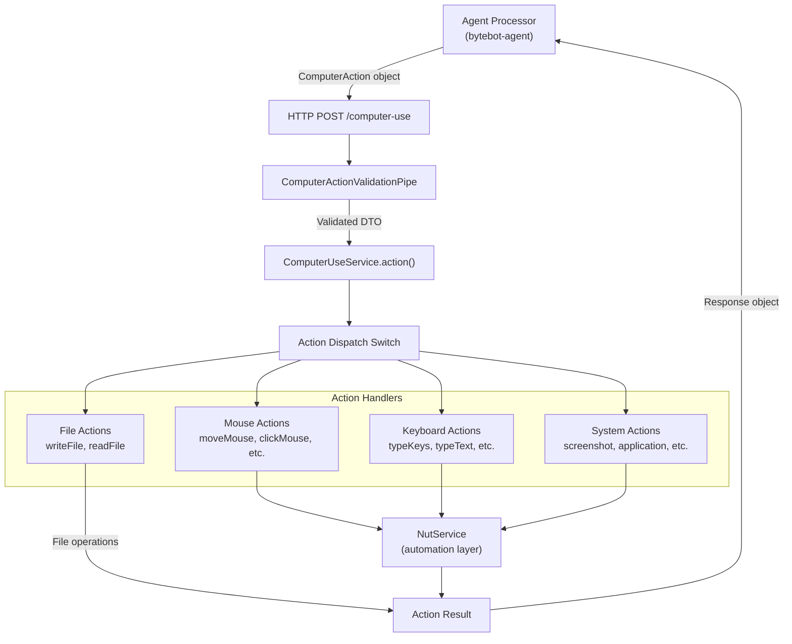
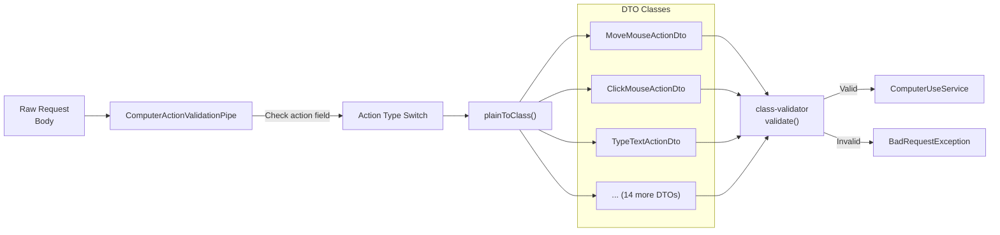
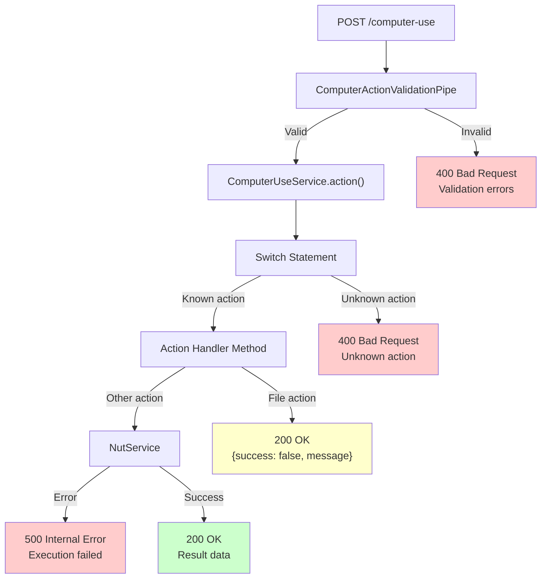
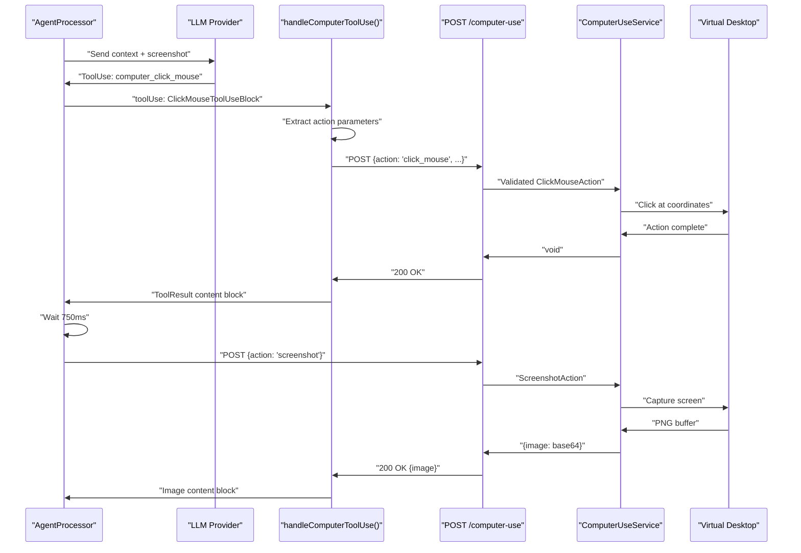
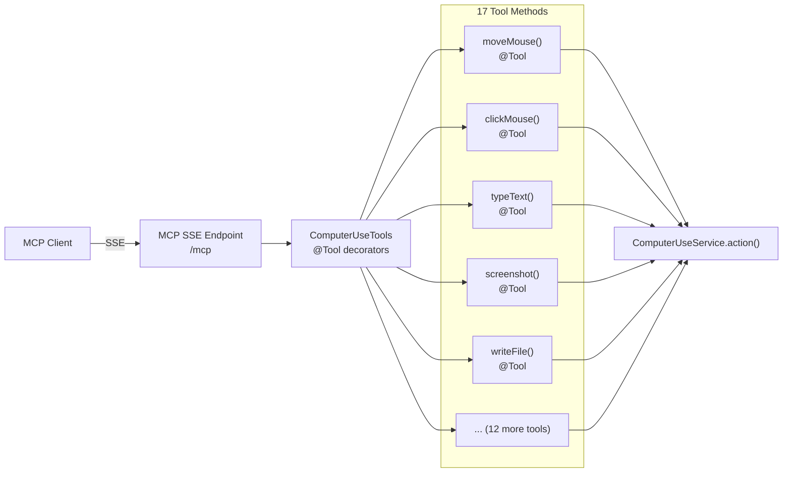

<!-- source: DeepWiki mcp.deepwiki.com · repo bytebot-ai/bytebot · page 10.2 Computer Use API · fetched 2026-10-29 -->

# Computer Use API

<details>
<summary>Relevant source files</summary>

The following files were used as context for generating this wiki page:

- [packages/bytebotd/src/computer-use/computer-use.service.ts](packages/bytebotd/src/computer-use/computer-use.service.ts)
- [packages/bytebotd/src/computer-use/dto/base.dto.ts](packages/bytebotd/src/computer-use/dto/base.dto.ts)
- [packages/bytebotd/src/computer-use/dto/computer-action-validation.pipe.ts](packages/bytebotd/src/computer-use/dto/computer-action-validation.pipe.ts)
- [packages/bytebotd/src/computer-use/dto/computer-action.dto.ts](packages/bytebotd/src/computer-use/dto/computer-action.dto.ts)
- [packages/bytebotd/src/mcp/computer-use.tools.ts](packages/bytebotd/src/mcp/computer-use.tools.ts)
- [packages/shared/src/types/computerAction.types.ts](packages/shared/src/types/computerAction.types.ts)
- [packages/shared/src/types/messageContent.types.ts](packages/shared/src/types/messageContent.types.ts)
- [packages/shared/src/utils/computerAction.utils.ts](packages/shared/src/utils/computerAction.utils.ts)
- [packages/shared/src/utils/messageContent.utils.ts](packages/shared/src/utils/messageContent.utils.ts)

</details>


## Purpose and Scope

This document provides a complete reference for the Computer Use API, the HTTP endpoint exposed by the `bytebotd` service that enables programmatic control of the virtual desktop environment. This API accepts structured action commands and executes them using the underlying automation framework.

For information about how the AI agent integrates with this API, see [Agent Processor](#6.1) and [Computer Use Integration](#6.2). For the MCP-based tools that wrap this API, see [MCP Integration](#7.3). For details on the underlying automation service, see [Computer Use Service](#7.1).

---

## Endpoint Overview

The Computer Use API is exposed as a single HTTP POST endpoint that accepts action objects with varying structures based on the action type.

**Endpoint**: `POST /computer-use`

**Content-Type**: `application/json`

**Service**: `bytebotd` (port 9990)

**Handler**: [packages/bytebotd/src/computer-use/computer-use.service.ts:26-105]()

The endpoint accepts a `ComputerAction` object, validates it using the `ComputerActionValidationPipe`, and dispatches it to the appropriate handler method based on the `action` discriminator field.

### Request Flow Diagram



**Sources**: [packages/bytebotd/src/computer-use/computer-use.service.ts:31-105](), [packages/bytebotd/src/computer-use/dto/computer-action-validation.pipe.ts:29-96]()

---

## Action Type System

All actions inherit from a common type structure with an `action` discriminator field that determines which parameters are required.

### Type Hierarchy

```mermaid
graph TD
    CA["ComputerAction<br/>(discriminated union)"]
    
    subgraph "Mouse Actions (8)"
        MM["MoveMouseAction<br/>action: 'move_mouse'"]
        TM["TraceMouseAction<br/>action: 'trace_mouse'"]
        CM["ClickMouseAction<br/>action: 'click_mouse'"]
        PM["PressMouseAction<br/>action: 'press_mouse'"]
        DM["DragMouseAction<br/>action: 'drag_mouse'"]
        SC["ScrollAction<br/>action: 'scroll'"]
        CP["CursorPositionAction<br/>action: 'cursor_position'"]
    end
    
    subgraph "Keyboard Actions (5)"
        TK["TypeKeysAction<br/>action: 'type_keys'"]
        PK["PressKeysAction<br/>action: 'press_keys'"]
        TT["TypeTextAction<br/>action: 'type_text'"]
        PT["PasteTextAction<br/>action: 'paste_text'"]
    end
    
    subgraph "System Actions (3)"
        SS["ScreenshotAction<br/>action: 'screenshot'"]
        WA["WaitAction<br/>action: 'wait'"]
        AP["ApplicationAction<br/>action: 'application'"]
    end
    
    subgraph "File Actions (2)"
        WF["WriteFileAction<br/>action: 'write_file'"]
        RF["ReadFileAction<br/>action: 'read_file'"]
    end
    
    CA --> MM
    CA --> TM
    CA --> CM
    CA --> PM
    CA --> DM
    CA --> SC
    CA --> CP
    CA --> TK
    CA --> PK
    CA --> TT
    CA --> PT
    CA --> SS
    CA --> WA
    CA --> AP
    CA --> WF
    CA --> RF
```



**Sources**: [packages/shared/src/types/computerAction.types.ts:109-126](), [packages/bytebotd/src/computer-use/dto/computer-action.dto.ts:223-240]()

---

## Mouse Actions

### move_mouse

Moves the mouse cursor to absolute coordinates.

**Request Structure**:
```json
{
  "action": "move_mouse",
  "coordinates": {
    "x": 640,
    "y": 480
  }
}
```

**Parameters**:

| Parameter | Type | Required | Description |
|-----------|------|----------|-------------|
| `action` | `"move_mouse"` | Yes | Action type discriminator |
| `coordinates` | `Coordinates` | Yes | Target position |
| `coordinates.x` | `number` | Yes | X-coordinate (0-1280) |
| `coordinates.y` | `number` | Yes | Y-coordinate (0-960) |

**Response**: `void` (no response body)

**Handler**: [packages/bytebotd/src/computer-use/computer-use.service.ts:107-109]()

---

### trace_mouse

Moves the mouse cursor along a path of coordinates, optionally holding modifier keys.

**Request Structure**:
```json
{
  "action": "trace_mouse",
  "path": [
    { "x": 100, "y": 100 },
    { "x": 200, "y": 150 },
    { "x": 300, "y": 200 }
  ],
  "holdKeys": ["LeftShift"]
}
```

**Parameters**:

| Parameter | Type | Required | Description |
|-----------|------|----------|-------------|
| `action` | `"trace_mouse"` | Yes | Action type discriminator |
| `path` | `Coordinates[]` | Yes | Array of coordinates to trace through |
| `holdKeys` | `string[]` | No | Keys to hold during trace (e.g., modifier keys) |

**Response**: `void`

**Handler**: [packages/bytebotd/src/computer-use/computer-use.service.ts:111-131]()

**Implementation Details**: The handler moves to the first coordinate, holds specified keys, iterates through all path coordinates, then releases keys.

---

### click_mouse

Performs mouse clicks at specified coordinates or current position.

**Request Structure**:
```json
{
  "action": "click_mouse",
  "coordinates": { "x": 500, "y": 300 },
  "button": "left",
  "clickCount": 2,
  "holdKeys": ["LeftControl"]
}
```

**Parameters**:

| Parameter | Type | Required | Description |
|-----------|------|----------|-------------|
| `action` | `"click_mouse"` | Yes | Action type discriminator |
| `coordinates` | `Coordinates` | No | Click position (omit for current position) |
| `button` | `"left" \| "right" \| "middle"` | Yes | Mouse button to click |
| `clickCount` | `number` | Yes | Number of clicks (≥1, use 2 for double-click) |
| `holdKeys` | `string[]` | No | Keys to hold during click (e.g., Ctrl, Shift) |

**Response**: `void`

**Handler**: [packages/bytebotd/src/computer-use/computer-use.service.ts:133-162]()

**Implementation Details**: If `clickCount > 1`, clicks are performed with 150ms delay between each. Coordinates and hold keys are optional.

---

### press_mouse

Presses down or releases a mouse button without clicking.

**Request Structure**:
```json
{
  "action": "press_mouse",
  "coordinates": { "x": 100, "y": 100 },
  "button": "left",
  "press": "down"
}
```

**Parameters**:

| Parameter | Type | Required | Description |
|-----------|------|----------|-------------|
| `action` | `"press_mouse"` | Yes | Action type discriminator |
| `coordinates` | `Coordinates` | No | Position for press/release |
| `button` | `"left" \| "right" \| "middle"` | Yes | Mouse button |
| `press` | `"down" \| "up"` | Yes | Press down or release up |

**Response**: `void`

**Handler**: [packages/bytebotd/src/computer-use/computer-use.service.ts:164-178]()

**Use Case**: Useful for drag operations or holding buttons while performing other actions.

---

### drag_mouse

Drags the mouse along a path while holding a button.

**Request Structure**:
```json
{
  "action": "drag_mouse",
  "path": [
    { "x": 100, "y": 100 },
    { "x": 300, "y": 300 }
  ],
  "button": "left",
  "holdKeys": ["LeftShift"]
}
```

**Parameters**:

| Parameter | Type | Required | Description |
|-----------|------|----------|-------------|
| `action` | `"drag_mouse"` | Yes | Action type discriminator |
| `path` | `Coordinates[]` | Yes | Drag path coordinates |
| `button` | `"left" \| "right" \| "middle"` | Yes | Button to hold during drag |
| `holdKeys` | `string[]` | No | Modifier keys to hold |

**Response**: `void`

**Handler**: [packages/bytebotd/src/computer-use/computer-use.service.ts:180-202]()

**Implementation Details**: Moves to first coordinate, holds modifier keys, presses mouse button, traces path, releases button, releases modifier keys.

---

### scroll

Scrolls the mouse wheel in a specified direction.

**Request Structure**:
```json
{
  "action": "scroll",
  "coordinates": { "x": 640, "y": 480 },
  "direction": "down",
  "scrollCount": 5,
  "holdKeys": ["LeftControl"]
}
```

**Parameters**:

| Parameter | Type | Required | Description |
|-----------|------|----------|-------------|
| `action` | `"scroll"` | Yes | Action type discriminator |
| `coordinates` | `Coordinates` | No | Position to scroll at |
| `direction` | `"up" \| "down" \| "left" \| "right"` | Yes | Scroll direction |
| `scrollCount` | `number` | Yes | Number of scroll wheel notches (≥1) |
| `holdKeys` | `string[]` | No | Modifier keys to hold during scroll |

**Response**: `void`

**Handler**: [packages/bytebotd/src/computer-use/computer-use.service.ts:204-227]()

**Implementation Details**: Each scroll notch includes a 150ms delay between iterations.

---

### cursor_position

Retrieves the current mouse cursor coordinates.

**Request Structure**:
```json
{
  "action": "cursor_position"
}
```

**Parameters**:

| Parameter | Type | Required | Description |
|-----------|------|----------|-------------|
| `action` | `"cursor_position"` | Yes | Action type discriminator |

**Response**:
```json
{
  "x": 640,
  "y": 480
}
```

**Response Type**: `{ x: number; y: number }`

**Handler**: [packages/bytebotd/src/computer-use/computer-use.service.ts:259-262]()

---

## Keyboard Actions

### type_keys

Types a sequence of keys, pressing and releasing each in order. Used for keyboard shortcuts.

**Request Structure**:
```json
{
  "action": "type_keys",
  "keys": ["LeftControl", "C"],
  "delay": 50
}
```

**Parameters**:

| Parameter | Type | Required | Description |
|-----------|------|----------|-------------|
| `action` | `"type_keys"` | Yes | Action type discriminator |
| `keys` | `string[]` | Yes | Array of key names to type in sequence |
| `delay` | `number` | No | Milliseconds delay between key presses |

**Response**: `void`

**Handler**: [packages/bytebotd/src/computer-use/computer-use.service.ts:229-232]()

**Valid Keys**: See the comprehensive list at [packages/bytebotd/src/mcp/computer-use.tools.ts:318-344](). Includes letters (A-Z), numbers, modifiers (LeftControl, LeftShift, etc.), function keys (F1-F24), navigation keys (Home, End, PageUp, etc.), and special keys.

---

### press_keys

Presses down or releases specific keys without typing them. Used for holding modifier keys.

**Request Structure**:
```json
{
  "action": "press_keys",
  "keys": ["LeftShift", "LeftControl"],
  "press": "down"
}
```

**Parameters**:

| Parameter | Type | Required | Description |
|-----------|------|----------|-------------|
| `action` | `"press_keys"` | Yes | Action type discriminator |
| `keys` | `string[]` | Yes | Array of key names to press/release |
| `press` | `"down" \| "up"` | Yes | Press down or release up |

**Response**: `void`

**Handler**: [packages/bytebotd/src/computer-use/computer-use.service.ts:234-237]()

**Use Case**: Holding modifier keys while performing other actions (e.g., Shift-click).

---

### type_text

Types a text string character by character.

**Request Structure**:
```json
{
  "action": "type_text",
  "text": "Hello, World!",
  "delay": 20
}
```

**Parameters**:

| Parameter | Type | Required | Description |
|-----------|------|----------|-------------|
| `action` | `"type_text"` | Yes | Action type discriminator |
| `text` | `string` | Yes | Text to type |
| `delay` | `number` | No | Milliseconds delay between characters |

**Response**: `void`

**Handler**: [packages/bytebotd/src/computer-use/computer-use.service.ts:239-242]()

**Recommended Use**: Best for short strings (<25 characters) or sensitive form fields. For longer text, use `paste_text`.

---

### paste_text

Copies text to clipboard and pastes it using Ctrl+V.

**Request Structure**:
```json
{
  "action": "paste_text",
  "text": "Long text content that would be slow to type character by character..."
}
```

**Parameters**:

| Parameter | Type | Required | Description |
|-----------|------|----------|-------------|
| `action` | `"paste_text"` | Yes | Action type discriminator |
| `text` | `string` | Yes | Text to paste |

**Response**: `void`

**Handler**: [packages/bytebotd/src/computer-use/computer-use.service.ts:244-247]()

**Recommended Use**: Long text strings or special characters not on standard keyboard.

---

## System Actions

### screenshot

Captures a screenshot of the current desktop.

**Request Structure**:
```json
{
  "action": "screenshot"
}
```

**Parameters**:

| Parameter | Type | Required | Description |
|-----------|------|----------|-------------|
| `action` | `"screenshot"` | Yes | Action type discriminator |

**Response**:
```json
{
  "image": "iVBORw0KGgoAAAANSUhEUgAA..."
}
```

**Response Type**: `{ image: string }`

**Handler**: [packages/bytebotd/src/computer-use/computer-use.service.ts:253-257]()

**Implementation Details**: Returns PNG image data as base64-encoded string. The image represents the 1280x960 desktop.

---

### wait

Pauses execution for a specified duration.

**Request Structure**:
```json
{
  "action": "wait",
  "duration": 1000
}
```

**Parameters**:

| Parameter | Type | Required | Description |
|-----------|------|----------|-------------|
| `action` | `"wait"` | Yes | Action type discriminator |
| `duration` | `number` | Yes | Milliseconds to wait |

**Response**: `void`

**Handler**: [packages/bytebotd/src/computer-use/computer-use.service.ts:249-251]()

**Use Case**: Allowing UI elements to load or animations to complete.

---

### application

Opens or switches to a specified application and maximizes it.

**Request Structure**:
```json
{
  "action": "application",
  "application": "firefox"
}
```

**Parameters**:

| Parameter | Type | Required | Description |
|-----------|------|----------|-------------|
| `action` | `"application"` | Yes | Action type discriminator |
| `application` | `Application` | Yes | Application to open/switch to |

**Valid Applications**:
- `"firefox"` - Firefox ESR browser
- `"1password"` - 1Password password manager
- `"thunderbird"` - Thunderbird email client
- `"vscode"` - Visual Studio Code editor
- `"terminal"` - XFCE Terminal
- `"directory"` - Thunar file manager
- `"desktop"` - Show desktop (minimize all windows)

**Response**: `void`

**Handler**: [packages/bytebotd/src/computer-use/computer-use.service.ts:264-362]()

**Implementation Details**: 
1. Checks if application is already open using `wmctrl -lx`
2. If open, activates and maximizes the window
3. If not open, spawns the application process
4. Uses process mapping defined at [packages/bytebotd/src/computer-use/computer-use.service.ts:296-304]()

---

## File Actions

### write_file

Writes a file to the desktop filesystem from base64-encoded data.

**Request Structure**:
```json
{
  "action": "write_file",
  "path": "document.txt",
  "data": "SGVsbG8sIFdvcmxkIQ=="
}
```

**Parameters**:

| Parameter | Type | Required | Description |
|-----------|------|----------|-------------|
| `action` | `"write_file"` | Yes | Action type discriminator |
| `path` | `string` | Yes | File path (relative paths resolved to `/home/user/Desktop/`) |
| `data` | `string` | Yes | Base64-encoded file content |

**Response**:
```json
{
  "success": true,
  "message": "File written successfully to: /home/user/Desktop/document.txt"
}
```

**Response Type**: `{ success: boolean; message: string }`

**Handler**: [packages/bytebotd/src/computer-use/computer-use.service.ts:364-417]()

**Implementation Details**:
1. Decodes base64 data to buffer
2. Resolves relative paths to `/home/user/Desktop/`
3. Creates parent directories using `sudo mkdir -p`
4. Writes to temporary file in `/tmp/`
5. Moves to target location using `sudo cp`
6. Sets ownership to `user:user` and permissions to `644`
7. Cleans up temporary file

**Error Handling**: Returns `success: false` with error message on failure.

---

### read_file

Reads a file from the desktop filesystem and returns it as base64-encoded data.

**Request Structure**:
```json
{
  "action": "read_file",
  "path": "document.pdf"
}
```

**Parameters**:

| Parameter | Type | Required | Description |
|-----------|------|----------|-------------|
| `action` | `"read_file"` | Yes | Action type discriminator |
| `path` | `string` | Yes | File path (relative paths resolved to `/home/user/Desktop/`) |

**Response**:
```json
{
  "success": true,
  "data": "JVBERi0xLjQKJeLjz9...",
  "name": "document.pdf",
  "size": 45678,
  "mediaType": "application/pdf"
}
```

**Response Type**:
```typescript
{
  success: boolean;
  data?: string;        // Base64-encoded file content
  name?: string;        // File name
  size?: number;        // File size in bytes
  mediaType?: string;   // MIME type
  message?: string;     // Error message if success=false
}
```

**Handler**: [packages/bytebotd/src/computer-use/computer-use.service.ts:419-506]()

**Supported Media Types**: The handler includes a comprehensive MIME type mapping at [packages/bytebotd/src/computer-use/computer-use.service.ts:464-482](), supporting:
- Documents: PDF, DOCX, DOC, TXT, HTML, JSON, XML, CSV, RTF, ODT, EPUB
- Images: PNG, JPEG, WEBP, GIF, SVG

**Implementation Details**:
1. Resolves relative paths to `/home/user/Desktop/`
2. Copies file to temporary location using `sudo cp`
3. Reads file as buffer from temporary location
4. Gets file size using `sudo stat`
5. Determines MIME type from file extension
6. Cleans up temporary file
7. Returns base64-encoded data with metadata

**Error Handling**: Returns `success: false` with error message on failure.

---

## Validation System

All requests are validated using NestJS class-validator decorators before execution.

### Validation Pipeline



**Sources**: [packages/bytebotd/src/computer-use/dto/computer-action-validation.pipe.ts:29-96](), [packages/bytebotd/src/computer-use/dto/computer-action.dto.ts:1-240]()

### Common Validation Rules

The validation system enforces the following rules across all action types:

| Rule | Applied To | Example |
|------|-----------|---------|
| `@IsIn([action_name])` | All `action` fields | Ensures exact match |
| `@IsNumber()` | Coordinates, durations | Type checking |
| `@Min(0)` or `@Min(1)` | Counts, delays | Positive values |
| `@IsEnum()` | Button types, directions | Valid enum values |
| `@IsArray()` | Key arrays, paths | Array type checking |
| `@ValidateNested()` | Coordinates objects | Nested validation |
| `@IsOptional()` | Optional parameters | Allows undefined |

**Coordinate Validation**: [packages/bytebotd/src/computer-use/dto/base.dto.ts:3-9]()

**Enum Validation**: [packages/bytebotd/src/computer-use/dto/base.dto.ts:11-37]()

### Validation Error Response

When validation fails, the API returns a `400 Bad Request` with detailed error information:

```json
{
  "statusCode": 400,
  "message": [
    {
      "property": "coordinates",
      "constraints": {
        "isNumber": "coordinates.x must be a number"
      }
    }
  ],
  "error": "Bad Request"
}
```

---

## Error Handling

The Computer Use API implements comprehensive error handling at multiple levels.

### Error Categories

| Error Type | Status Code | Cause | Example |
|------------|-------------|-------|---------|
| Validation Error | 400 | Invalid request structure | Missing required field |
| Unknown Action | 400 | Unrecognized action type | `"action": "invalid_action"` |
| Execution Error | 500 | Action execution failure | NutJS automation failure |
| File Error | 200 (with `success: false`) | File operation failure | Permission denied |

### Error Handling Flow



**Sources**: [packages/bytebotd/src/computer-use/computer-use.service.ts:31-105](), [packages/bytebotd/src/computer-use/dto/computer-action-validation.pipe.ts:29-96]()

### File Operation Error Handling

File operations (`write_file` and `read_file`) use a different error handling strategy - they return a 200 OK response with a `success` field instead of throwing exceptions:

**Write File Error**:
```json
{
  "success": false,
  "message": "Error writing file: Permission denied"
}
```

**Read File Error**:
```json
{
  "success": false,
  "message": "Error reading file: No such file or directory"
}
```

This design allows the agent to gracefully handle file system errors without aborting the entire task execution loop.

**Sources**: [packages/bytebotd/src/computer-use/computer-use.service.ts:410-416](), [packages/bytebotd/src/computer-use/computer-use.service.ts:500-505]()

---

## Integration with Agent System

The Computer Use API is primarily consumed by the AI agent during task execution. The integration flow demonstrates how high-level AI decisions translate into low-level desktop actions.

### Agent-to-API Request Flow



**Sources**: [packages/bytebot-agent/src/agent/agent.computer-use.ts]() (referenced in system architecture)

### Tool Use to Action Conversion

The agent receives LLM tool use blocks and converts them to Computer Use API requests. For example:

**LLM Tool Use Block**:
```json
{
  "type": "tool_use",
  "id": "toolu_123",
  "name": "computer_click_mouse",
  "input": {
    "coordinates": { "x": 500, "y": 300 },
    "button": "left",
    "clickCount": 1
  }
}
```

**Converted to Computer Use API Request**:
```json
{
  "action": "click_mouse",
  "coordinates": { "x": 500, "y": 300 },
  "button": "left",
  "clickCount": 1
}
```

The conversion utilities are provided in [packages/shared/src/utils/computerAction.utils.ts:299-342]().

**Sources**: [packages/shared/src/types/messageContent.types.ts:79-88](), [packages/shared/src/utils/computerAction.utils.ts:125-143]()

---

## MCP Tools Integration

The Computer Use API is also exposed via Model Context Protocol (MCP) tools, allowing external MCP clients to control the desktop.

### MCP Tools Wrapper

The `ComputerUseTools` class wraps each Computer Use API action as an MCP tool with Zod schema validation:



**Sources**: [packages/bytebotd/src/mcp/computer-use.tools.ts:1-698]()

Each MCP tool:
1. Validates parameters using Zod schemas
2. Calls `ComputerUseService.action()` with the appropriate action object
3. Catches errors and returns formatted error messages
4. Returns standardized MCP content blocks

**Example Tool Definition**: [packages/bytebotd/src/mcp/computer-use.tools.ts:11-35]()

For more details on MCP integration, see [MCP Integration](#7.3).

---

## Action Execution Implementation

The `ComputerUseService` dispatches actions to appropriate handlers using a switch statement. Most handlers delegate to the `NutService` automation layer.

### Action Dispatch Map

| Action | Handler Method | Delegates To | Returns |
|--------|---------------|--------------|---------|
| `move_mouse` | `moveMouse()` | `NutService.mouseMoveEvent()` | `void` |
| `trace_mouse` | `traceMouse()` | `NutService.mouseMoveEvent()` + `holdKeys()` | `void` |
| `click_mouse` | `clickMouse()` | `NutService.mouseClickEvent()` | `void` |
| `press_mouse` | `pressMouse()` | `NutService.mouseButtonEvent()` | `void` |
| `drag_mouse` | `dragMouse()` | `NutService.mouseButtonEvent()` + `mouseMoveEvent()` | `void` |
| `scroll` | `scroll()` | `NutService.mouseWheelEvent()` | `void` |
| `type_keys` | `typeKeys()` | `NutService.sendKeys()` | `void` |
| `press_keys` | `pressKeys()` | `NutService.holdKeys()` | `void` |
| `type_text` | `typeText()` | `NutService.typeText()` | `void` |
| `paste_text` | `pasteText()` | `NutService.pasteText()` | `void` |
| `wait` | `delay()` | `setTimeout()` | `void` |
| `screenshot` | `screenshot()` | `NutService.screendump()` | `{ image: string }` |
| `cursor_position` | `cursor_position()` | `NutService.getCursorPosition()` | `{ x, y }` |
| `application` | `application()` | `exec()`, `spawn()`, `wmctrl` | `void` |
| `write_file` | `writeFile()` | `fs.writeFile()`, `exec()` | `{ success, message }` |
| `read_file` | `readFile()` | `fs.readFile()`, `exec()` | `{ success, data, ... }` |

**Sources**: [packages/bytebotd/src/computer-use/computer-use.service.ts:34-104]()

### NutService Integration

The `NutService` wraps the `@nut-tree-fork/nut-js` library, providing:
- Mouse control (`mouseMoveEvent`, `mouseClickEvent`, `mouseButtonEvent`, `mouseWheelEvent`)
- Keyboard control (`sendKeys`, `holdKeys`, `typeText`, `pasteText`)
- Screen capture (`screendump`)
- Cursor queries (`getCursorPosition`)

For details on the NutService implementation, see [Computer Use Service](#7.1).

**Sources**: [packages/bytebotd/src/nut/nut.service.ts]() (referenced in system architecture)

---

## Summary

The Computer Use API provides a unified HTTP interface for controlling the virtual desktop through 17 distinct action types organized into four categories:

- **Mouse Actions** (8): cursor movement, clicking, dragging, scrolling
- **Keyboard Actions** (5): key sequences, text typing, clipboard operations  
- **System Actions** (3): screenshots, waiting, application management
- **File Actions** (2): reading and writing files on the desktop

All requests are validated using class-validator DTOs, dispatched through a type-safe switch statement, and executed via the NutJS automation framework. The API is consumed by both the AI agent during task execution and external MCP clients for programmatic desktop control.

**Sources**: [packages/bytebotd/src/computer-use/computer-use.service.ts:1-508](), [packages/shared/src/types/computerAction.types.ts:1-126](), [packages/bytebotd/src/computer-use/dto/computer-action.dto.ts:1-240]()

---

