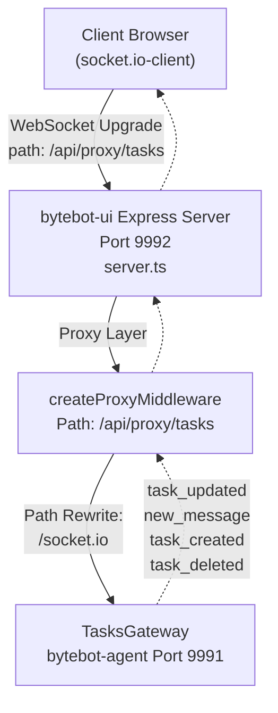
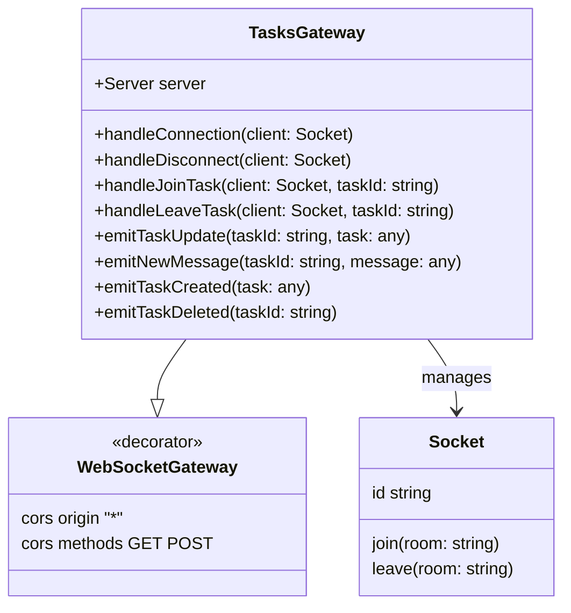
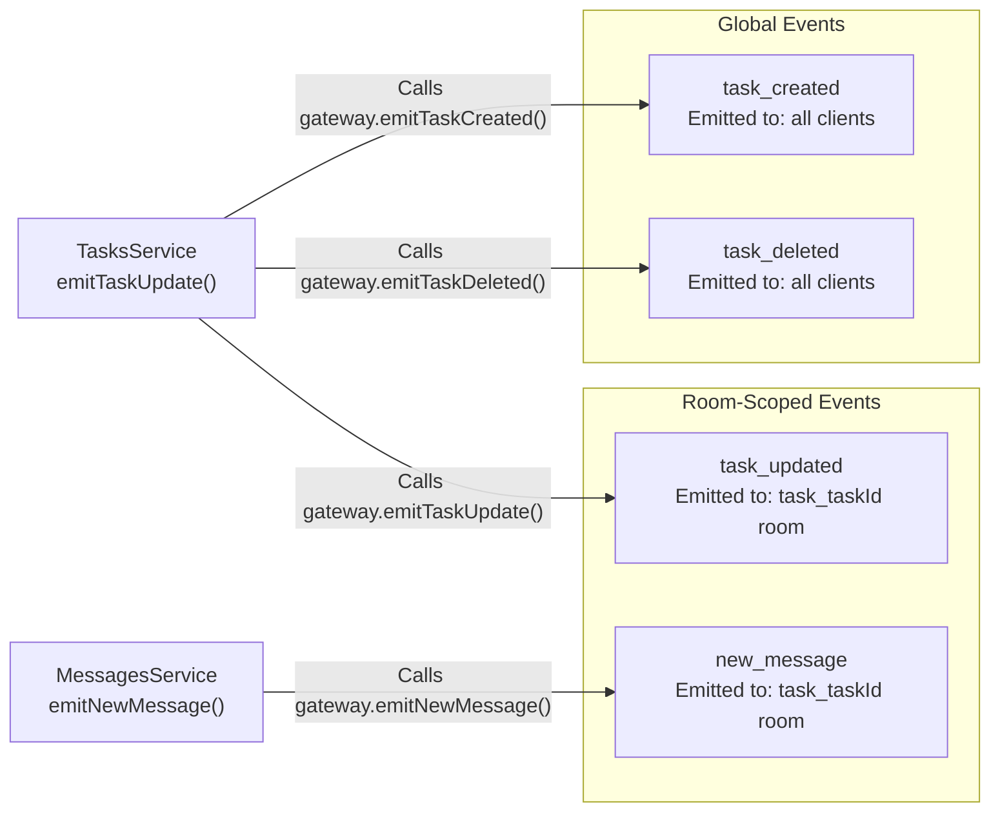
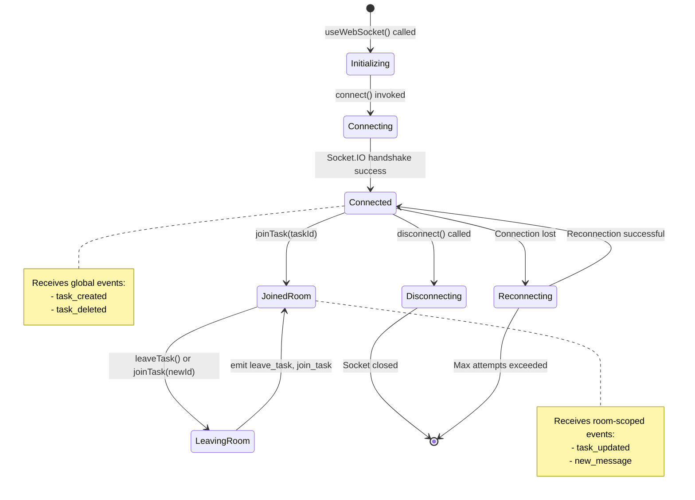

<!-- source: DeepWiki mcp.deepwiki.com · repo bytebot-ai/bytebot · page 10.3 WebSocket API · fetched 2026-10-29 -->

# WebSocket API

<details>
<summary>Relevant source files</summary>

The following files were used as context for generating this wiki page:

- [packages/bytebot-agent/src/main.ts](packages/bytebot-agent/src/main.ts)
- [packages/bytebot-agent/src/tasks/tasks.gateway.ts](packages/bytebot-agent/src/tasks/tasks.gateway.ts)
- [packages/bytebot-ui/next.config.ts](packages/bytebot-ui/next.config.ts)
- [packages/bytebot-ui/server.ts](packages/bytebot-ui/server.ts)
- [packages/bytebot-ui/src/app/api/[[...path]]/route.ts](packages/bytebot-ui/src/app/api/[[...path]]/route.ts)
- [packages/bytebot-ui/src/hooks/useWebSocket.ts](packages/bytebot-ui/src/hooks/useWebSocket.ts)

</details>


This document describes the real-time WebSocket communication layer that enables live task updates and message delivery in Bytebot. The WebSocket API uses Socket.IO for bidirectional communication between the frontend and backend, with room-based subscriptions for task-specific event filtering.

For information about REST API endpoints for task management, see [Tasks REST API](#10.1). For details on the internal event-driven architecture within bytebot-agent, see [Communication Patterns](#2.2).

## Overview

The WebSocket system provides real-time notifications for task state changes, new messages, task creation, and task deletion. Clients connect to the `TasksGateway` in bytebot-agent via a proxy layer in bytebot-ui, subscribe to specific task rooms, and receive targeted updates.

**Key Components:**
- **Server**: `TasksGateway` class in bytebot-agent
- **Client**: `useWebSocket` hook in bytebot-ui
- **Proxy**: Express middleware in bytebot-ui server
- **Transport**: Socket.IO over WebSocket protocol

**Sources:** [packages/bytebot-agent/src/tasks/tasks.gateway.ts:1-58](), [packages/bytebot-ui/src/hooks/useWebSocket.ts:1-114]()

## Connection Architecture

The WebSocket connection flows through a multi-layer proxy architecture to enable unified frontend access.



**Connection Flow:**

1. **Client connects** to `io({ path: "/api/proxy/tasks" })` on port 9992
2. **Express server** receives WebSocket upgrade request at `/api/proxy/tasks`
3. **Proxy middleware** rewrites path to `/socket.io` and forwards to bytebot-agent
4. **TasksGateway** accepts connection on port 9991
5. **Bidirectional communication** established through proxy chain

**Sources:** [packages/bytebot-ui/server.ts:32-37](), [packages/bytebot-ui/server.ts:57-65](), [packages/bytebot-agent/src/tasks/tasks.gateway.ts:12-17]()

## Gateway Configuration

The `TasksGateway` class configures the Socket.IO server with CORS and connection handling.



**Gateway Decorator Configuration:**

| Property | Value | Purpose |
|----------|-------|---------|
| `cors.origin` | `"*"` | Allow all origins |
| `cors.methods` | `["GET", "POST"]` | Permitted HTTP methods |

The gateway implements `OnGatewayConnection` and `OnGatewayDisconnect` lifecycle interfaces to log connection events.

**Sources:** [packages/bytebot-agent/src/tasks/tasks.gateway.ts:12-28]()

## Client-to-Server Events

Clients emit two events to manage room subscriptions.

### join_task

Subscribe to updates for a specific task.

**Event Name:** `"join_task"`

**Payload:** `string` (task ID)

**Handler:** [packages/bytebot-agent/src/tasks/tasks.gateway.ts:30-34]()

```typescript
@SubscribeMessage('join_task')
handleJoinTask(client: Socket, taskId: string) {
  client.join(`task_${taskId}`);
  console.log(`Client ${client.id} joined task ${taskId}`);
}
```

**Room Pattern:** `task_${taskId}`

When a client joins a task room, it will receive all room-scoped events (`task_updated`, `new_message`) for that task.

**Client Usage:**

The `useWebSocket` hook automatically manages room subscriptions. When `joinTask(taskId)` is called, the hook:
1. Leaves the current task room (if any)
2. Emits `join_task` with the new task ID
3. Updates internal state to track the current room

**Sources:** [packages/bytebot-agent/src/tasks/tasks.gateway.ts:30-34](), [packages/bytebot-ui/src/hooks/useWebSocket.ts:68-79]()

### leave_task

Unsubscribe from a task's updates.

**Event Name:** `"leave_task"`

**Payload:** `string` (task ID)

**Handler:** [packages/bytebot-agent/src/tasks/tasks.gateway.ts:36-40]()

```typescript
@SubscribeMessage('leave_task')
handleLeaveTask(client: Socket, taskId: string) {
  client.leave(`task_${taskId}`);
  console.log(`Client ${client.id} left task ${taskId}`);
}
```

Clients should emit this event before disconnecting or switching to a different task to clean up server-side room membership.

**Sources:** [packages/bytebot-agent/src/tasks/tasks.gateway.ts:36-40](), [packages/bytebot-ui/src/hooks/useWebSocket.ts:81-88]()

## Server-to-Client Events

The gateway emits four event types to notify clients of state changes.



**Sources:** [packages/bytebot-agent/src/tasks/tasks.gateway.ts:42-56]()

### task_updated

Notifies clients when a task's state changes.

**Event Name:** `"task_updated"`

**Scope:** Room-scoped (`task_${taskId}`)

**Payload:** Task object

**Emitter Method:** [packages/bytebot-agent/src/tasks/tasks.gateway.ts:42-44]()

```typescript
emitTaskUpdate(taskId: string, task: any) {
  this.server.to(`task_${taskId}`).emit('task_updated', task);
}
```

**Triggered By:**
- Task status changes (PENDING → RUNNING → COMPLETED, etc.)
- Task updates (description, priority, scheduledFor changes)
- Control handoff (AI → USER, USER → AI)
- Execution timestamps (executedAt, completedAt)

Only clients that have joined the specific task room receive this event.

**Client Handler:** [packages/bytebot-ui/src/hooks/useWebSocket.ts:44-47]()

**Sources:** [packages/bytebot-agent/src/tasks/tasks.gateway.ts:42-44]()

### new_message

Notifies clients when a new message is added to a task.

**Event Name:** `"new_message"`

**Scope:** Room-scoped (`task_${taskId}`)

**Payload:** Message object

**Emitter Method:** [packages/bytebot-agent/src/tasks/tasks.gateway.ts:46-48]()

```typescript
emitNewMessage(taskId: string, message: any) {
  this.server.to(`task_${taskId}`).emit('new_message', message);
}
```

**Triggered By:**
- User sends a message
- AI agent generates a response
- Tool execution completes (screenshot, action result)
- User takeover actions

**Client Handler:** [packages/bytebot-ui/src/hooks/useWebSocket.ts:49-52]()

**Sources:** [packages/bytebot-agent/src/tasks/tasks.gateway.ts:46-48]()

### task_created

Notifies all clients when a new task is created.

**Event Name:** `"task_created"`

**Scope:** Global (all connected clients)

**Payload:** Task object

**Emitter Method:** [packages/bytebot-agent/src/tasks/tasks.gateway.ts:50-52]()

```typescript
emitTaskCreated(task: any) {
  this.server.emit('task_created', task);
}
```

**Triggered By:**
- User creates a task via the UI
- AI agent creates a subtask using the `create_task` tool

**Use Case:** Updates task list pages in real-time without manual refresh.

**Client Handler:** [packages/bytebot-ui/src/hooks/useWebSocket.ts:54-57]()

**Sources:** [packages/bytebot-agent/src/tasks/tasks.gateway.ts:50-52]()

### task_deleted

Notifies all clients when a task is deleted.

**Event Name:** `"task_deleted"`

**Scope:** Global (all connected clients)

**Payload:** `string` (task ID)

**Emitter Method:** [packages/bytebot-agent/src/tasks/tasks.gateway.ts:54-56]()

```typescript
emitTaskDeleted(taskId: string) {
  this.server.emit('task_deleted', taskId);
}
```

**Triggered By:**
- User deletes a task via the UI
- Task cleanup operations

**Use Case:** Removes deleted tasks from task list views in real-time.

**Client Handler:** [packages/bytebot-ui/src/hooks/useWebSocket.ts:59-62]()

**Sources:** [packages/bytebot-agent/src/tasks/tasks.gateway.ts:54-56]()

## Event Payload Schemas

### Task Object

```typescript
{
  id: string;
  description: string;
  status: "PENDING" | "RUNNING" | "COMPLETED" | "FAILED" | "NEEDS_HELP" | "CANCELLED";
  priority: "LOW" | "MEDIUM" | "HIGH";
  type: "MAIN" | "SUB";
  control: "AI" | "USER";
  model: string;
  scheduledFor?: Date;
  executedAt?: Date;
  completedAt?: Date;
  error?: string;
  createdAt: Date;
  updatedAt: Date;
}
```

Transmitted in: `task_updated`, `task_created`

### Message Object

```typescript
{
  id: string;
  taskId: string;
  content: MessageContentBlock[];  // Array of text/tool blocks
  role: "USER" | "ASSISTANT";
  createdAt: Date;
  summaryId?: string;
}
```

Transmitted in: `new_message`

For detailed content block types (Text, ToolUse, ToolResult, Image, UserAction), see [Message Content Types](#9.3).

**Sources:** Type definitions in `@bytebot/shared` package

## Client Implementation

The `useWebSocket` hook provides a React interface for WebSocket communication.

### Hook Interface

```typescript
interface UseWebSocketProps {
  onTaskUpdate?: (task: Task) => void;
  onNewMessage?: (message: Message) => void;
  onTaskCreated?: (task: Task) => void;
  onTaskDeleted?: (taskId: string) => void;
}

interface UseWebSocketReturn {
  socket: Socket | null;
  joinTask: (taskId: string) => void;
  leaveTask: () => void;
  disconnect: () => void;
  isConnected: boolean;
}
```

**Sources:** [packages/bytebot-ui/src/hooks/useWebSocket.ts:5-17]()

### Connection Configuration

The hook initializes the Socket.IO client with specific configuration:

```typescript
const socket = io({
  path: "/api/proxy/tasks",        // Proxy endpoint
  transports: ["websocket"],       // WebSocket only (no polling)
  autoConnect: true,               // Connect immediately
  reconnection: true,              // Enable reconnection
  reconnectionAttempts: 5,         // Try 5 times
  reconnectionDelay: 1000,         // 1 second between attempts
});
```

**Configuration Details:**

| Option | Value | Purpose |
|--------|-------|---------|
| `path` | `"/api/proxy/tasks"` | Routes through bytebot-ui proxy |
| `transports` | `["websocket"]` | Skip HTTP long-polling fallback |
| `autoConnect` | `true` | Connect on initialization |
| `reconnection` | `true` | Auto-reconnect on disconnect |
| `reconnectionAttempts` | `5` | Max retry attempts |
| `reconnectionDelay` | `1000` | 1 second between retries |

**Sources:** [packages/bytebot-ui/src/hooks/useWebSocket.ts:21-34]()

### Connection Lifecycle



**Lifecycle Methods:**

**`connect()`** - Establishes WebSocket connection
- Called automatically on hook mount
- Returns existing socket if already connected
- Registers all event handlers

**`joinTask(taskId)`** - Subscribes to task room
- Leaves previous room if any
- Emits `join_task` event
- Updates `currentTaskIdRef`

**`leaveTask()`** - Unsubscribes from current room
- Emits `leave_task` event
- Clears `currentTaskIdRef`

**`disconnect()`** - Closes WebSocket connection
- Calls `socket.disconnect()`
- Clears all refs
- Called on component unmount

**Sources:** [packages/bytebot-ui/src/hooks/useWebSocket.ts:21-104]()

### Event Handler Registration

The hook registers event handlers during connection:

```typescript
socket.on("connect", () => {
  console.log("Connected to WebSocket server");
});

socket.on("disconnect", () => {
  console.log("Disconnected from WebSocket server");
});

socket.on("task_updated", (task: Task) => {
  console.log("Task updated:", task);
  onTaskUpdate?.(task);
});

socket.on("new_message", (message: Message) => {
  console.log("New message:", message);
  onNewMessage?.(message);
});

socket.on("task_created", (task: Task) => {
  console.log("Task created:", task);
  onTaskCreated?.(task);
});

socket.on("task_deleted", (taskId: string) => {
  console.log("Task deleted:", taskId);
  onTaskDeleted?.(taskId);
});
```

All handlers call optional callback props, allowing components to react to events.

**Sources:** [packages/bytebot-ui/src/hooks/useWebSocket.ts:36-62]()

## Proxy Layer Details

The bytebot-ui Express server handles WebSocket upgrade requests using `http-proxy-middleware`.

### HTTP Proxy Setup

```typescript
const tasksProxy = createProxyMiddleware({
  target: BYTEBOT_AGENT_BASE_URL,  // e.g., http://localhost:9991
  ws: true,                         // Enable WebSocket proxying
  pathRewrite: { 
    "^/api/proxy/tasks": "/socket.io"  // Rewrite path
  },
});

expressApp.use("/api/proxy/tasks", tasksProxy);
```

**Sources:** [packages/bytebot-ui/server.ts:33-40]()

### WebSocket Upgrade Handling

```typescript
server.on("upgrade", (request, socket, head) => {
  const { pathname } = new URL(
    request.url!,
    `http://${request.headers.host}`,
  );

  if (pathname.startsWith("/api/proxy/tasks")) {
    return tasksProxy.upgrade(request, socket as any, head);
  }
  
  // ... other upgrade handlers
});
```

The `upgrade` event handler:
1. Parses the request URL path
2. Checks if path starts with `/api/proxy/tasks`
3. Delegates to `tasksProxy.upgrade()` for WebSocket handshake
4. Proxy forwards to `${BYTEBOT_AGENT_BASE_URL}/socket.io`

**Sources:** [packages/bytebot-ui/server.ts:57-65]()

## CORS Configuration

The bytebot-agent backend enables CORS for WebSocket connections.

### Application-Level CORS

[packages/bytebot-agent/src/main.ts:22-25]():

```typescript
app.enableCors({
  origin: '*',
  methods: ['GET', 'POST', 'PUT', 'DELETE', 'OPTIONS', 'PATCH'],
});
```

### Gateway-Level CORS

[packages/bytebot-agent/src/tasks/tasks.gateway.ts:12-17]():

```typescript
@WebSocketGateway({
  cors: {
    origin: '*',
    methods: ['GET', 'POST'],
  },
})
```

Both configurations allow all origins (`*`) to support development environments and flexible deployment. In production, this should be restricted to specific domains.

**Sources:** [packages/bytebot-agent/src/main.ts:22-25](), [packages/bytebot-agent/src/tasks/tasks.gateway.ts:12-17]()

## Usage Example

Typical usage in a React component:

```typescript
const TaskDetailPage = ({ taskId }: { taskId: string }) => {
  const [task, setTask] = useState<Task | null>(null);
  const [messages, setMessages] = useState<Message[]>([]);
  
  const { joinTask, leaveTask, isConnected } = useWebSocket({
    onTaskUpdate: (updatedTask) => {
      if (updatedTask.id === taskId) {
        setTask(updatedTask);
      }
    },
    onNewMessage: (message) => {
      if (message.taskId === taskId) {
        setMessages(prev => [...prev, message]);
      }
    },
  });
  
  useEffect(() => {
    joinTask(taskId);
    return () => leaveTask();
  }, [taskId, joinTask, leaveTask]);
  
  return (
    <div>
      <ConnectionIndicator connected={isConnected} />
      {/* Task details and messages */}
    </div>
  );
};
```

This pattern:
1. Initializes the WebSocket hook with event handlers
2. Joins the task room on mount
3. Updates local state when events arrive
4. Leaves the room on unmount

**Sources:** Implementation pattern follows [packages/bytebot-ui/src/hooks/useWebSocket.ts:1-114]()

## Error Handling

### Connection Errors

The Socket.IO client automatically handles connection failures with exponential backoff:
- Maximum 5 reconnection attempts
- 1 second initial delay
- Automatic exponential backoff

### Event Handler Errors

Event handlers use optional chaining (`?.`) to prevent crashes when callbacks are undefined:

```typescript
onTaskUpdate?.(task);
onNewMessage?.(message);
```

This allows the hook to be used without providing all callbacks.

**Sources:** [packages/bytebot-ui/src/hooks/useWebSocket.ts:44-62]()

## Performance Considerations

### Room-Based Filtering

Room subscriptions ensure clients only receive relevant events:
- Clients in `task_123` room only get updates for task 123
- Global events (task_created, task_deleted) broadcast to all clients
- Prevents unnecessary network traffic and client-side filtering

### Transport Optimization

The client configuration uses WebSocket-only transport:

```typescript
transports: ["websocket"]
```

This skips HTTP long-polling fallback, reducing connection establishment time and eliminating polling overhead.

**Sources:** [packages/bytebot-ui/src/hooks/useWebSocket.ts:29](), [packages/bytebot-agent/src/tasks/tasks.gateway.ts:30-40]()

---

