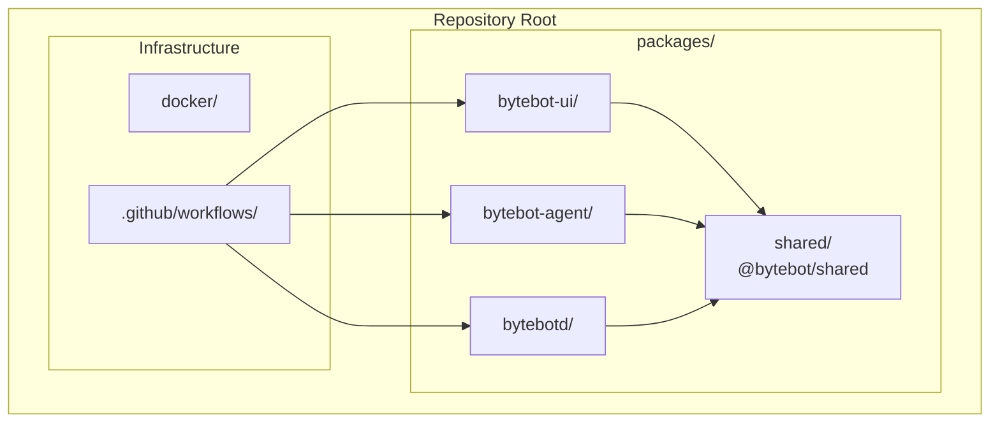
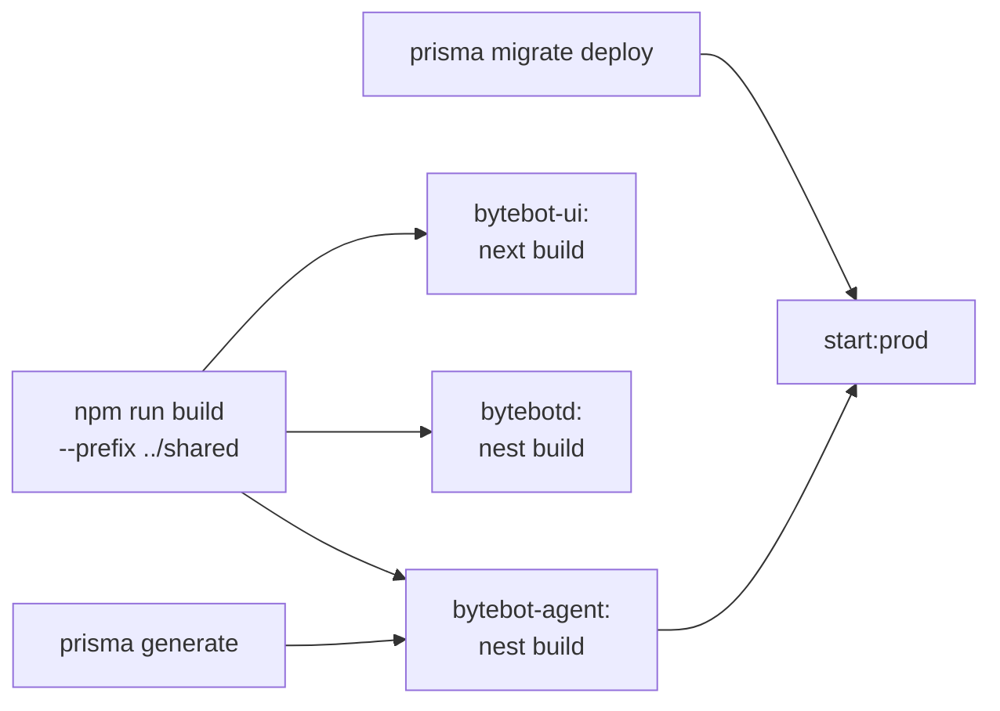
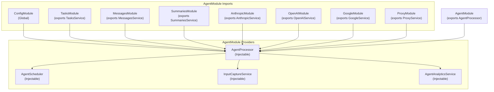
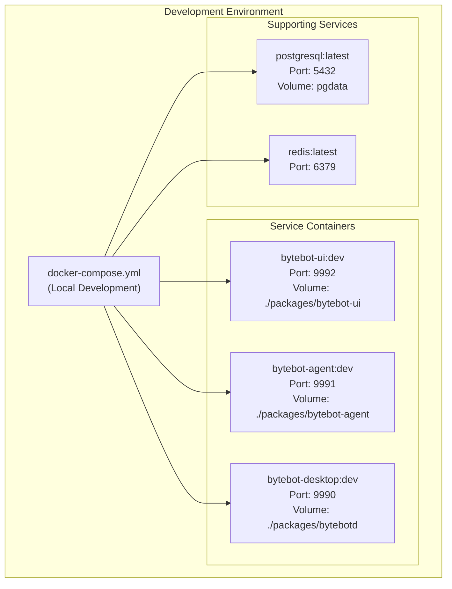
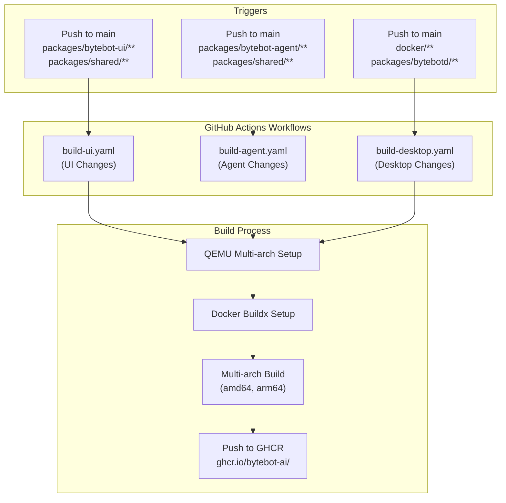
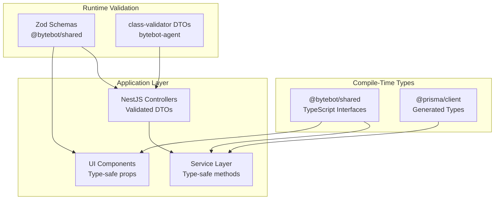
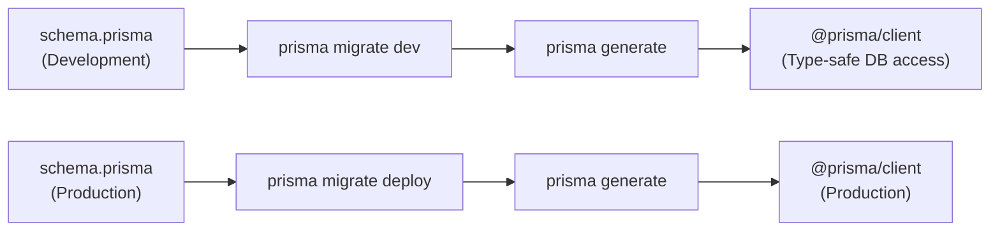
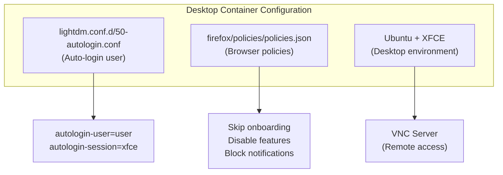

<!-- source: DeepWiki mcp.deepwiki.com · repo bytebot-ai/bytebot · page 11 Development Guide · fetched 2026-10-29 -->

# Development Guide

<details>
<summary>Relevant source files</summary>

The following files were used as context for generating this wiki page:

- [packages/bytebot-agent/package-lock.json](packages/bytebot-agent/package-lock.json)
- [packages/bytebot-agent/package.json](packages/bytebot-agent/package.json)
- [packages/bytebot-agent/src/agent/agent.module.ts](packages/bytebot-agent/src/agent/agent.module.ts)
- [packages/bytebot-agent/src/app.module.ts](packages/bytebot-agent/src/app.module.ts)
- [packages/bytebot-ui/package-lock.json](packages/bytebot-ui/package-lock.json)
- [packages/bytebot-ui/package.json](packages/bytebot-ui/package.json)
- [packages/bytebot-ui/src/app/layout.tsx](packages/bytebot-ui/src/app/layout.tsx)
- [packages/bytebot-ui/src/components/layout/Header.tsx](packages/bytebot-ui/src/components/layout/Header.tsx)

</details>


This document provides developers with comprehensive information for setting up, building, and contributing to the Bytebot system. It covers local development environment setup, build processes, testing procedures, and deployment workflows.

For information about system architecture and component relationships, see [System Architecture](#2). For deployment instructions for end users, see [Installation and Setup](#3).

## Development Environment Requirements

The Bytebot system requires a consistent development environment across all services. The following tools and versions are required:

| Tool | Version | Purpose |
|------|---------|---------|
| Node.js | 20.x | Runtime for all JavaScript/TypeScript services |
| Docker | Latest | Containerization and local development |
| Docker Compose | Latest | Multi-service orchestration |
| PostgreSQL | Latest | Database for development |

All services are configured with TypeScript 5.7+ and use modern ES2022+ features. The system enforces consistent code formatting through Prettier and linting through ESLint across all packages.

**Sources:** [packages/bytebot-agent/package.json:96-98](), [packages/bytebot-agent/package.json:71-72]()

## Repository Structure and Build System

The Bytebot monorepo follows a packages-based architecture with a shared type package and coordinated build processes across all services.

### Package Structure



### Shared Package Architecture

The `@bytebot/shared` package contains type definitions and schemas used across all services:

| Content Type | Purpose | Usage |
|-------------|---------|-------|
| Type Definitions | TypeScript interfaces for Tasks, Messages, ComputerActions | Ensures type consistency across frontend/backend |
| Zod Schemas | Runtime validation schemas | Validates API requests and responses |
| Enums | Shared enumerations (TaskStatus, Priority, Role) | Consistent state values |
| Constants | System-wide constants | Configuration and defaults |

All services declare `@bytebot/shared` as a local dependency using relative paths:

```json
"dependencies": {
  "@bytebot/shared": "../shared"
}
```

**Sources:** [packages/bytebot-agent/package.json:26](), [packages/bytebot-ui/package.json:13]()

### Build Dependencies and Scripts

The build system uses coordinated npm scripts that ensure the shared package is built before individual services:



#### Agent Service Build Scripts

The agent service demonstrates the coordinated build pattern:

| Script | Command | Purpose |
|--------|---------|---------|
| `build` | `npm run build --prefix ../shared && npx prisma generate && nest build` | Full build with shared package and Prisma client |
| `start` | `npm run build --prefix ../shared && nest start` | Basic start with shared package build |
| `start:dev` | `npm run build --prefix ../shared && nest start --watch` | Development mode with hot reload |
| `start:prod` | `npm run build --prefix ../shared && npx prisma migrate deploy && npx prisma generate && node dist/main` | Production start with migrations |

**Sources:** [packages/bytebot-agent/package.json:11-16]()

#### UI Service Build Scripts

The UI service follows the same pattern with Next.js-specific commands:

| Script | Command | Purpose |
|--------|---------|---------|
| `dev` | `npm run build --prefix ../shared && tsx server.ts` | Development server with custom Express backend |
| `build` | `npm run build --prefix ../shared && next build` | Production build |
| `start` | `npm run build --prefix ../shared && tsx server.ts` | Production start |

**Sources:** [packages/bytebot-ui/package.json:6-9]()

## NestJS Module Architecture

The bytebot-agent service follows NestJS best practices for module organization and dependency injection.

### Root Module Structure

```mermaid
graph TB
    AppModule["AppModule<br/>(app.module.ts)"] --> ConfigModule["ConfigModule.forRoot()<br/>isGlobal: true"]
    AppModule --> ScheduleModule["ScheduleModule.forRoot()<br/>Cron scheduling"]
    AppModule --> EventEmitterModule["EventEmitterModule.forRoot()<br/>Internal events"]
    
    AppModule --> AgentModule["AgentModule<br/>Core processing logic"]
    AppModule --> TasksModule["TasksModule<br/>Task CRUD + WebSocket"]
    AppModule --> MessagesModule["MessagesModule<br/>Message storage"]
    AppModule --> SummariesModule["SummariesModule<br/>Context summarization"]
    
    subgraph "AI Provider Modules"
        AppModule --> AnthropicModule["AnthropicModule<br/>@anthropic-ai/sdk"]
        AppModule --> OpenAIModule["OpenAIModule<br/>openai package"] 
        AppModule --> GoogleModule["GoogleModule<br/>@google/genai"]
        AppModule --> ProxyModule["ProxyModule<br/>LiteLLM proxy"]
    end
    
    AppModule --> PrismaModule["PrismaModule<br/>@prisma/client"]
```



**Sources:** [packages/bytebot-agent/src/app.module.ts:1-37]()

### Global Module Configuration

The root module uses NestJS `.forRoot()` pattern for global configuration:

```typescript
@Module({
  imports: [
    ScheduleModule.forRoot(),           // Enables @Cron() decorators
    EventEmitterModule.forRoot(),        // Enables @OnEvent() decorators
    ConfigModule.forRoot({
      isGlobal: true,                    // Makes ConfigService available everywhere
    }),
    // ... feature modules
  ],
})
```

This pattern ensures infrastructure services are available to all modules without repeated imports.

**Sources:** [packages/bytebot-agent/src/app.module.ts:18-23]()

### Feature Module Pattern: AgentModule

The `AgentModule` demonstrates dependency injection and service composition:



**Sources:** [packages/bytebot-agent/src/agent/agent.module.ts:1-34]()

### Dependency Injection Pattern

NestJS modules use constructor injection to access services from imported modules:

```typescript
@Module({
  imports: [
    TasksModule,      // Must export TasksService
    MessagesModule,   // Must export MessagesService
    AnthropicModule,  // Must export AnthropicService
  ],
  providers: [AgentProcessor],
  exports: [AgentProcessor],
})
export class AgentModule {}
```

The `AgentProcessor` can then inject these services:

```typescript
@Injectable()
export class AgentProcessor {
  constructor(
    private tasksService: TasksService,
    private messagesService: MessagesService,
    private anthropicService: AnthropicService,
  ) {}
}
```

**Sources:** [packages/bytebot-agent/src/agent/agent.module.ts:15-33]()

## Containerized Development Workflow  

The system uses Docker for both development and production deployment, with multi-architecture support and automated builds.

### Development Container Architecture



Each service includes Docker configuration optimized for development with volume mounts for hot reloading and debugging support.

**Sources:** [packages/bytebotd/.dockerignore:1-10]()

## CI/CD Pipeline Architecture

The system employs GitHub Actions for automated building and publishing of container images:

### Build Pipeline Structure



Each workflow builds multi-architecture images (amd64, arm64) and publishes them to GitHub Container Registry with the `edge` tag for continuous deployment.

**Sources:** [.github/workflows/build-ui.yaml:1-51](), [.github/workflows/build-agent.yaml:1-50](), [.github/workflows/build-desktop.yaml:1-61]()

## Validation and Type Safety

The system employs dual validation strategies: compile-time type checking with TypeScript and runtime validation using Zod and class-validator.

### Type System Architecture



**Sources:** [packages/bytebot-agent/package.json:38-39](), [packages/bytebot-agent/package.json:45]()

### Zod Schema Validation

Zod provides runtime type validation with TypeScript inference:

| Package | Zod Version | Usage |
|---------|-------------|-------|
| bytebot-agent | 4.0.5 | LLM response validation, API request schemas |
| bytebot-ui | 3.24.2 | Form validation, API response validation |
| @bytebot/shared | - | Shared schemas for common types |

Zod schemas enable both runtime validation and TypeScript type inference:

```typescript
// Schema definition provides both validation and types
const TaskSchema = z.object({
  id: z.string(),
  description: z.string(),
  status: z.enum(['PENDING', 'RUNNING', 'COMPLETED']),
});

// Inferred TypeScript type
type Task = z.infer<typeof TaskSchema>;
```

**Sources:** [packages/bytebot-agent/package.json:45](), [packages/bytebot-ui/package.json:47]()

### Class-Validator DTOs

The bytebot-agent service uses class-validator for NestJS DTO validation:

```typescript
// DTO with validation decorators
class CreateTaskDto {
  @IsString()
  @IsNotEmpty()
  description: string;

  @IsEnum(TaskPriority)
  @IsOptional()
  priority?: TaskPriority;

  @IsArray()
  @ValidateNested({ each: true })
  @Type(() => FileDto)
  files?: FileDto[];
}
```

NestJS automatically validates incoming requests using ValidationPipe:

```typescript
@Post('tasks')
@UsePipes(new ValidationPipe({ transform: true }))
async createTask(@Body() dto: CreateTaskDto) {
  // dto is validated and transformed
}
```

**Sources:** [packages/bytebot-agent/package.json:38-39]()

### Type Guard Pattern

Type guards enable runtime type checking with TypeScript type narrowing:

```typescript
function isToolUseBlock(
  block: MessageContentBlock
): block is ToolUseBlock {
  return block.type === 'tool_use';
}

// Usage with type narrowing
if (isToolUseBlock(block)) {
  // TypeScript knows block is ToolUseBlock
  const toolName = block.name;
  const toolInput = block.input;
}
```

This pattern is used throughout the codebase to safely handle union types and polymorphic data structures.

**Sources:** [packages/bytebot-agent/package.json:38-39]()

## Testing and Development Tools

### Package Scripts and Development Commands

The agent service provides comprehensive npm scripts for various development tasks:

| Script | Purpose | Command |
|--------|---------|---------|
| `start:dev` | Development with hot reload | `npm run build --prefix ../shared && nest start --watch` |
| `start:debug` | Debug mode with inspector | `npm run build --prefix ../shared && nest start --debug --watch` |
| `test` | Unit test execution | `jest` |
| `test:watch` | Continuous testing | `jest --watch` |
| `test:cov` | Coverage reporting | `jest --coverage` |
| `test:e2e` | End-to-end testing | `jest --config ./test/jest-e2e.json` |
| `lint` | Code linting and fixing | `eslint "{src,apps,libs,test}/**/*.ts" --fix` |
| `format` | Code formatting | `prettier --write "src/**/*.ts" "test/**/*.ts"` |

**Sources:** [packages/bytebot-agent/package.json:8-22]()

### Jest Configuration

The agent service uses Jest with TypeScript support:

```json
{
  "jest": {
    "moduleFileExtensions": ["js", "json", "ts"],
    "rootDir": "src",
    "testRegex": ".*\\.spec\\.ts$",
    "transform": {
      "^.+\\.(t|j)s$": "ts-jest"
    },
    "collectCoverageFrom": ["**/*.(t|j)s"],
    "coverageDirectory": "../coverage",
    "testEnvironment": "node"
  }
}
```

Test files follow the `*.spec.ts` naming convention and are located alongside source files.

**Sources:** [packages/bytebot-agent/package.json:75-91]()

### Database Development Workflow

Database operations use Prisma for schema management and client generation:



| Script | Command | Usage |
|--------|---------|-------|
| `prisma:dev` | `npx prisma migrate dev && npx prisma generate` | Development migrations with prompts |
| `prisma:prod` | `npx prisma migrate deploy && npx prisma generate` | Production migrations without prompts |

**Sources:** [packages/bytebot-agent/package.json:9-10]()

## Desktop Environment Development

The desktop service includes specific configuration for the virtual desktop environment used by the AI agents:

### Desktop Environment Configuration



The desktop environment is pre-configured for autonomous operation with automatic login and browser policies that prevent user interaction prompts.

**Sources:** [packages/bytebotd/root/etc/lightdm/lightdm.conf.d/50-autologin.conf:1-4](), [packages/bytebotd/root/etc/firefox/policies/policies.json:1-28]()

## Contributing Guidelines

### Development Workflow

1. **Environment Setup**: Ensure Node.js 20, Docker, and Docker Compose are installed
2. **Repository Clone**: Clone the repository and initialize submodules if any
3. **Dependency Installation**: Run `npm install` in each package directory
4. **Database Setup**: Initialize PostgreSQL and run Prisma migrations
5. **Service Startup**: Use Docker Compose for full system development

### Code Quality Standards

- **TypeScript**: All code must use TypeScript 5.7+ with strict mode enabled
- **Linting**: ESLint configuration is enforced across all packages
- **Formatting**: Prettier configuration ensures consistent code style
- **Testing**: Minimum test coverage requirements for new features
- **Documentation**: Code documentation using JSDoc for public APIs

### Pull Request Process

- Feature branches should be created from `main`
- All CI/CD checks must pass before merging
- Multi-architecture Docker builds are automatically triggered on merge
- Container images are published to GitHub Container Registry with `edge` tags

The modular architecture and comprehensive tooling support rapid development while maintaining production quality standards.

**Sources:** [packages/bytebot-agent/package.json:59-72]()

---

